# Point Processing

## &lt;Histogram&gt;

> **Histogram Equalization**  
> 0~255 사이에서 각각의 밝기(Intensity)가 가지고 있는 Pixel의 개수를 **Histogram**으로 나타낸다.

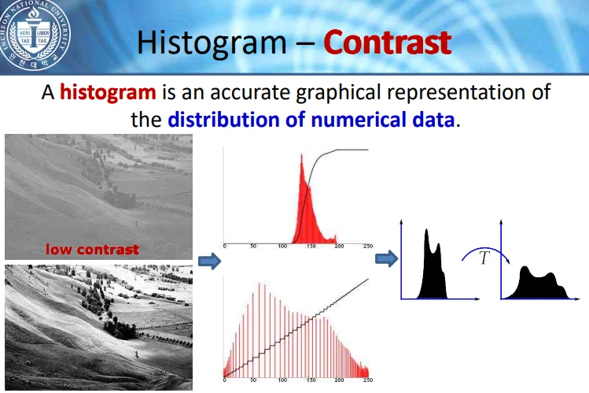

위의 영상은 대조비가 낮다. 이는 밝은 것과 어두운 것의 차이가 크게 없다는 뜻이다. 예를 들자면, 가장 어두운 픽셀이 100 정도의 값을 가지고, 가장 밝은 것이 200 정도의 값을 갖는 것이다.

> 그렇다면 어떻게 해야 할까?

- **개선의 원칙** : 가장 밝은 것과 가장 어두운 것의 차이가 크도록 영상을 변화시킨다.  
    위의 이미지에서 아래 영상은 가장 밝은 것이 255, 어두운 것이 0 정도 될 것이다.

    - 다만, 그럴싸하지 않은 영상이다.

- 위의 영상의 히스토그램을 보면, 밝기가 거의 비슷한 것을 볼 수 있는데, 이걸 0~255로 골고루 맞추기 위해서 **Histogram Equalization**한다.

> Stretch를 통해서 가능하다.

### PDF(Probability Densitiy Function)

> 확률 밀도 함수. 어떤 확률 분포에서 특정 값이 나타날 확률

### CDF(Cumulative Density Function)

> 누적 밀도 함수. 확률 밀도 함수에서 각 값의 합. 위의 이미지에서 확률 밀도 함수에 겹쳐진 검정색 그래프로 나타난다.

$$
CDF =\Sigma PDF
$$

### Example of Histogram

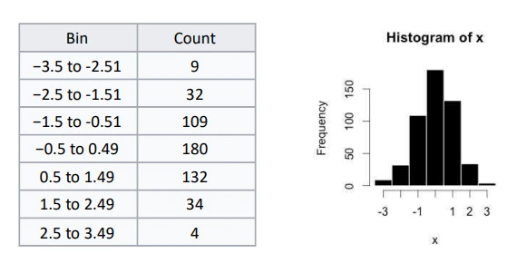

왼쪽 Table을 바탕으로 오른쪽 Histogram을 만들 수 있으며, 반대로 오른쪽 Histogram에서 왼쪽 Table을 만들 수도 있다.

### Symmetric, Unimodal

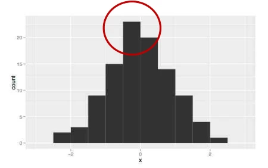

- Symmetric : 대칭적이다.
- Unimodal : modal은 봉우리를 의미하며, Unimodal은 하나의 봉우리를 의미한다.

### Skewed Left and Skewed Right

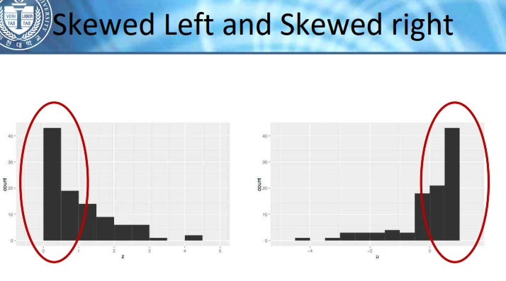

- Skewed : 한 쪽으로 쏠려 있는 특성을 말한다.

### Bimodal and Multimodal

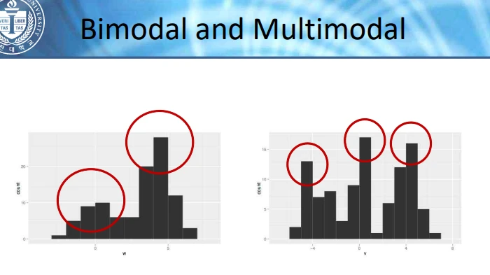

- Bimodal : 두 개의 봉우리
- Multimodal : 아이폰을 예로 들면, 하나의 디바이스로 여러 개의 기능을 할 수 있는 것이다. 그러므로 아이폰은 멀티모달이다. 위의 이미지는 여러 개의 봉우리가 존재하는 것이다.

### Ordinary Histogram and Cumulative Histogram of the same data

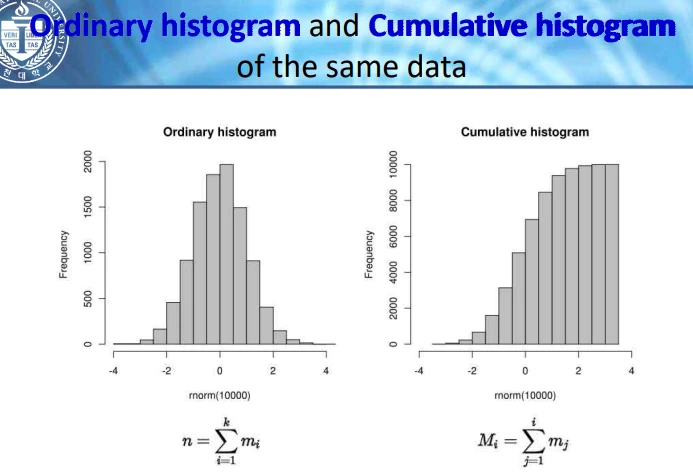

- Ordinary Histogram(PDF) : 어떤 Bin에 대해서, 몇 개가 발생하는 지에 대한 **빈도**를 나타낸다.
- Cumulative Histogram(CDF) : 지금까지 구해진 모든 것을 다 더하는 것이다. 즉, **빈도의 누적합**

---

## &lt;4.1 Image-Processing/Point Operation&gt;

- **영상 처리**(Image Processing)는 항상 세 가지 중 하나이다. (Complex → Simplest)

    - **Transforms**

        - ex. Fourier Transform

    - **Neighborhood Processing**

        - 이웃 픽셀을 이용해 값을 바꾸는 것.

    - **Point Operation**

        - 점처리
        - 면처리

### Chapter. 7의 Example

> Fourier Transform은 가장 복잡하지만, 가장 우수한 영상 처리이다.

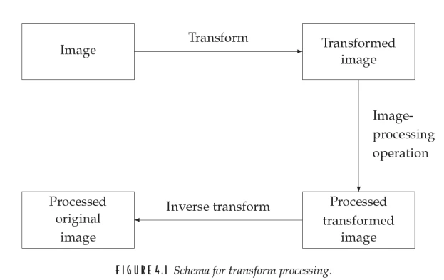

- Image : 공간 도메인의 영상

- Transformed Image : 주파수 도메인의 Signal

    - 왜 이것을 하는가?

        > 필터링 처리를 할 때, 영상처리는 **공간 도메인**이다.   
        >  (공간 도메인이 아닌 것은 시간, 확률 등이 있을 수 있다.)

- 영상은 (0, 0)부터 시작하지 않고, (1, 1)부터 시작한다. 반면 수학은 (0, 0)부터 시작한다.

- 공간 도메인에서 영상을 처리하려면, for loop을 돌려야 한다. 반면 주파수 도메인에서는 시그널 간의 곱하기 한번만 하면 된다.

    - 예를 들어, 100x100 이미지가 있다면, 공간 도메인에서는 operation을 10,000번 해야만 한다. 반면 주파수 도메인에서는 10,000번의 operation을 한 번의 연산으로 끝낼 수 있다.

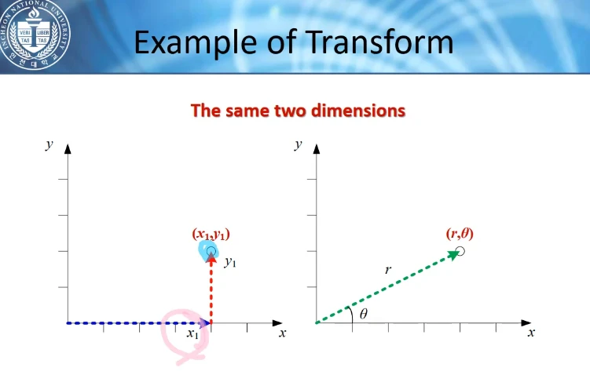

우리는 좌표평면 상에서 한 좌표를 표현하기 위하여 두 개의 정보(x1, y1)가 필요하다. 하지만 이것을 축을 바꾸어서 표현할 수가 있는데, x, y 축을 r과 θ로 변경할 수도 있다는 것이다. 그러면 저장을 할 변수의 값 자체가 줄어들 수 있다. (축에 가깝게 변화시킬 수 있으므로.)

---

## &lt;4.2 Arithmetic Operations&gt;

> 영상처리의 가장 간단한 방법이다. 영상의 픽셀 값을 Arithmetic하게 조절하는 방법들을 말한다.

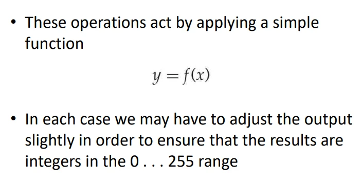

Arithmetic Operations는 수학적이라고는 하지만, 굉장히 직관적인 것을 다룬다.

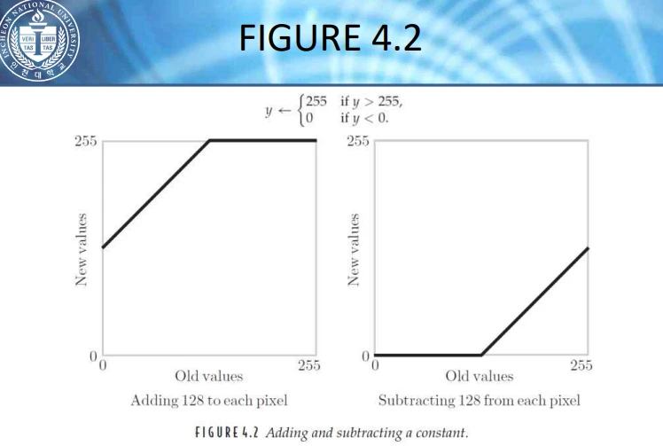

만약 출력 영상의 모든 픽셀이 128을 더했을 경우(좌), 혹은 모든 픽셀에서 128을 뺐을 경우(우).  
이때, **Boundary Condition**을 통해 이미지 픽셀 값의 경계를 조절한다.

**Boundary Condition** (경계조건)

- 255보다 크다면 255로 고정, 0보다 작으면 0으로 고정.
- 값이 범위를 벗어나지 않게 만든다.

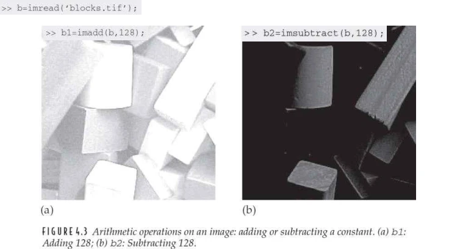

두 연산을 똑같은 이미지에 적용했을 때, 128을 더하는 것은 영상이 매우 밝아지고 128을 빼는 것은 영상이 매우 어두워짐을 알 수 있다.

### Examples of Arithmetic Operations

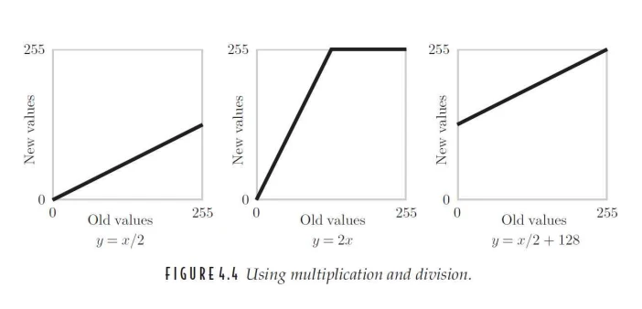

1) 영상 pixel의 intensity를 절반으로 줄인다. (어두워지게 되며, 대조비가 감소하는 것과 동일하다.)

2) 영상 pixel의 intensity를 두 배로 늘린다. (밝아지게 된다.)

3) 영상 pixel의 intensity를 절반으로 줄여 대조비를 감소시킨 후, 영상을 밝게 만든다.

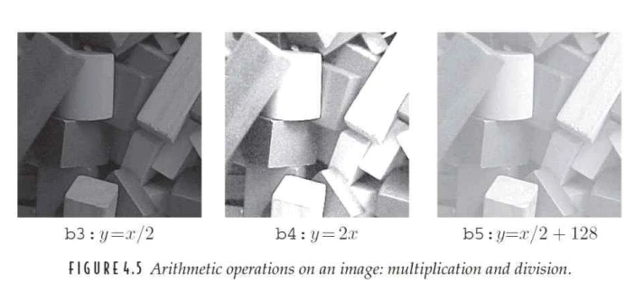

결과적으로 영상이 위와 같이 변화하게 된다.

### Complements(보수)

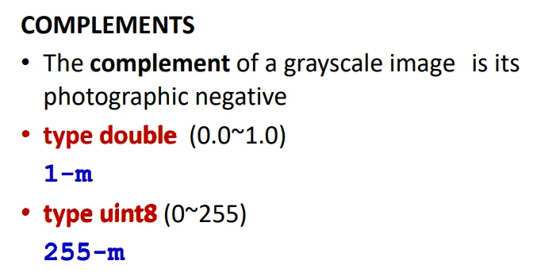

만약 double이라면 0~1 사이이므로, 1-m으로 나타낼 수 있다.

만약 uint8이라면, 0~255이므로, 255-m으로 나타낼 수 있다.

- **이미지 반전 수식**

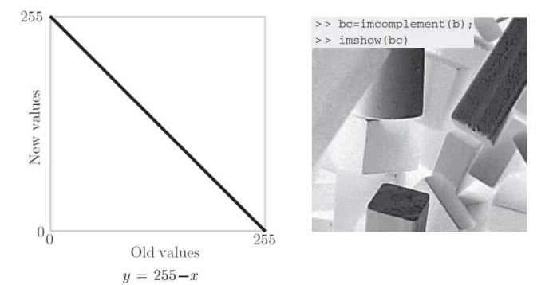

> 영상에 보수를 취한다는 것은, uint8에서는 255-m, double에서는 1-m으로 pixel값을 변환하는 것을 말한다.

---

## &lt;4.3 Histograms&gt;

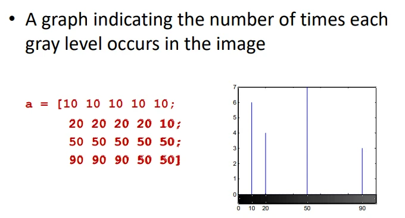

> 각각의 Gray Level이 몇 개가 나오는지 나타낸다. 예를 들어, 10은 6개가 나오므로 오른쪽에서 10은 6개라고 표현되어 있는 것을 알 수 있다.

> 왼쪽 정보를 바탕으로 오른쪽 그림을 만들 수 있다. 하지만, 오른쪽 그림에서 왼쪽은 만들 수 없다. 그것은 원본 영상은 픽셀의 위치에 대한 정보가 있어야만 복원할 수 있기 때문이다.  
> 따라서 왼쪽 정보가 더 많은 정보를 포함하고 있다고 볼 수 있다.

### Histogram Stretching

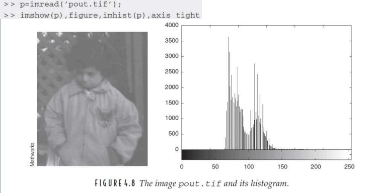

왼쪽 이미지는 원본 영상이지만 영상의 contrast가 높지 않으므로, 영상의 대조를 키우고 싶다.

```matlab
p = imread('pout.tif');
imshow(p), figure, imhist(p), axis tight
% 우선 이미지와 이미지 픽셀의 히스토그램을 출력한다.
```

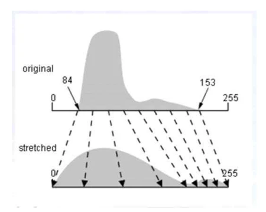

원본 영상의 Histogram이 위의 Histogram일 때, 이 Histogram을 Stretch해서 아래 Histogram처럼 만들고자 한다.

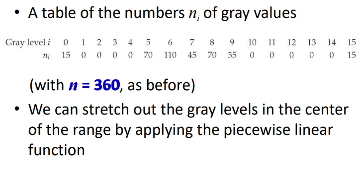

0~15까지의 Gray Level이 있을때, 빈도수를 확인한 이미지이다. 예를 들어 Gray Level 15는 15개의 Pixel이 존재한다. 모든 수를 더해보면, 전체 360개의 Pixel이 존재함을 알 수 있다.

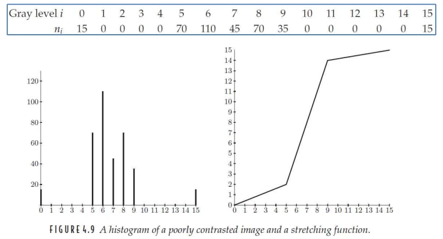

> Histogram Stretch는 사람이 Design하는 것이다. 그래서 어떻게 Design 할 것인지를 결정해야만 한다. 다만, 이것은 그때그때 너무 달라지므로, 자동적으로 Stretch되는 방법을 뒤에서 다룬다.  
> 위 이미지는 (좌) → (우)로 누군가가 Design을 했다고 가정해보자.

- (좌) PDF
- (우) CDF

⇒ 어떻게 만들 수 있을까?

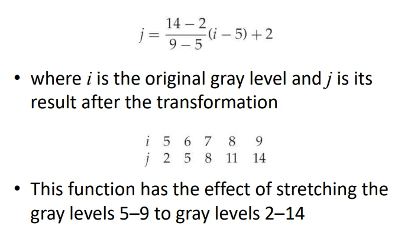

이와 같이, 5→2, 9→14가 된다고 ‘가정’하여 Design했다고 하자. (*임의로 만든 것이며, 어떠한 이유가 있는 것은 아니므로 근거는 없다. 따라서 그때그때 결과가 다를 수 있다.*)

그렇다면, 그 중간에 있는 8은 어디로 가야 하는지를 정해주는 것이 위의 수식이다. 여기서 i에 5를 넣으면, j = 2가 된다. i에 6을 넣으면 5, 7을 넣으면 8, 8을 넣으면 11…

이런 방식으로 Histogram을 **Stretch**한 것이다.

> 다만 이것은 좋은 방식이 아니기 때문에 우리는 **Histogram Equalization**을 해야 한다.

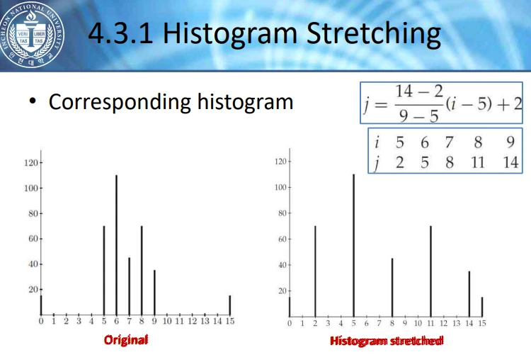

입력값이 왼쪽과 같을 때, 함수가 주어진다. 여기에 입력값을 넣으면 Stretched Histogram을 그릴 수 있는데, Boundary를 적용한다.

>  다만, 0과 15에는 적용하지 않는 것을 보아 모여있는 부분에만 적용하는 것이라고 생각할 수 있는듯 하다.

### imadjust

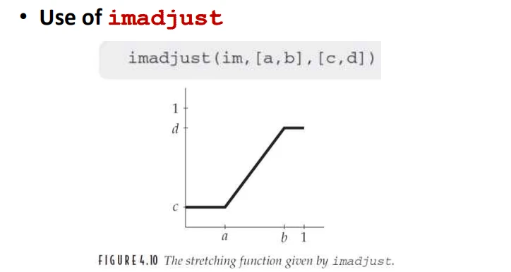

stretch 함수이며, x : [a b]를 y : [c d]로 stretch 하는 함수이다.

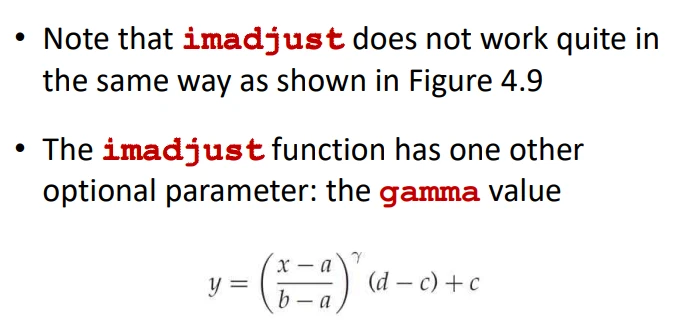

또한 imadjust에는 parameter γ가 사용될 수 있다.

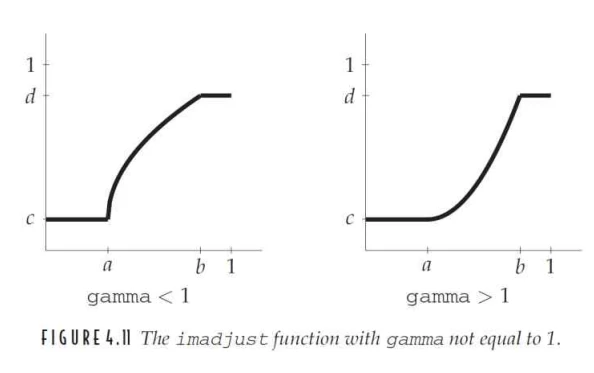

γ값이 1보다 작으면, 위로 볼록을 띄게 된다. 왜냐면 갈수록 값의 상승률이 적어지기 때문이다. γ값이 1보다 크면, 아래로 볼록을 띄게 된다. 왜냐면 갈수록 값이 더 많이 상승하기 때문이다.

### Result of imadjust

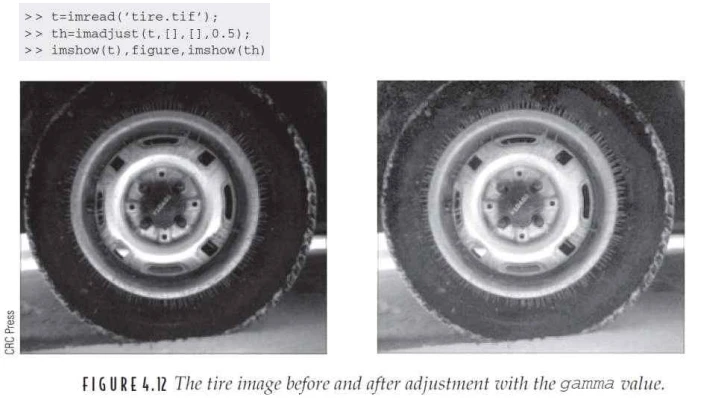

parameter 0.5는 adhoc 같은 값이다. (임시방편) 일반적으로 문제를 해결할 때 adhoc은 임시방편이기 때문에 이 경우에만 맞는 것이다.

- **imhist로 imadjust의 결과 보기.**

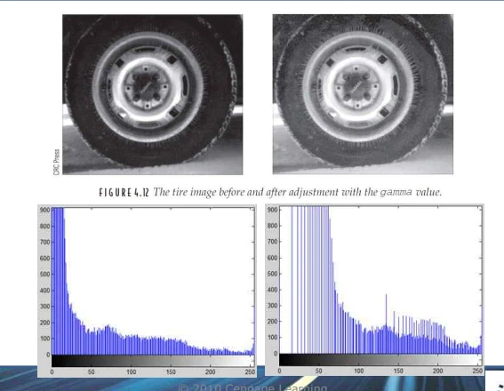

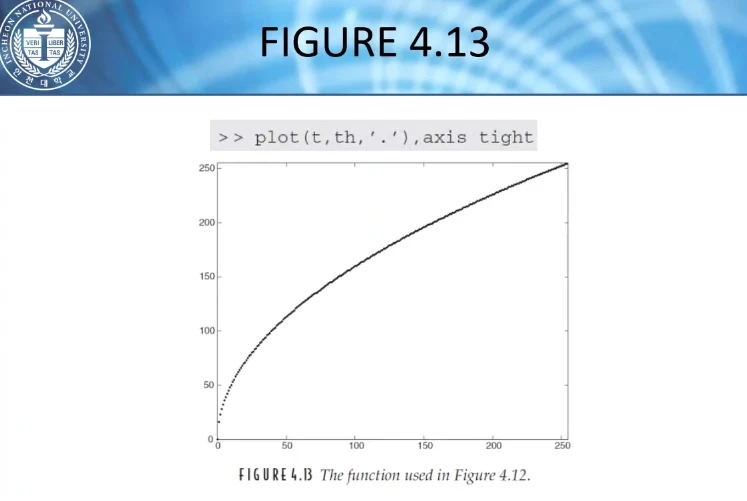

⇒ γ값이 1보다 작으므로 위로 볼록하게 값이 조정된 것을 확인할 수 있다.

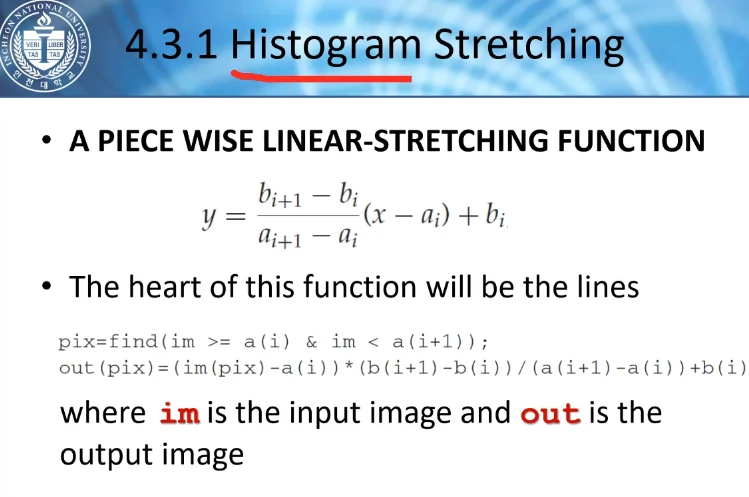

입력 x라는 point에서 결과가 되는 y를 구하는 것이다.

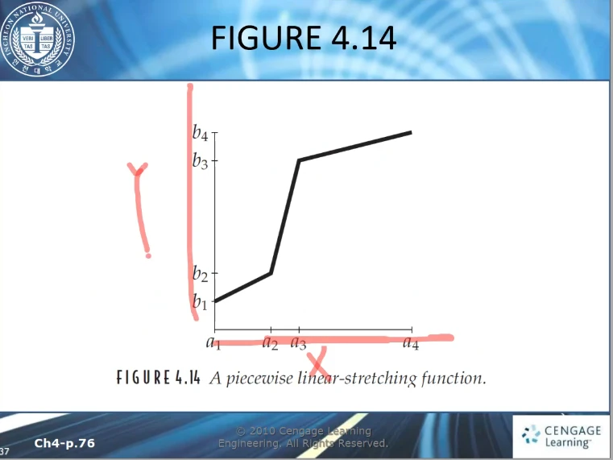

따라서 어떤 입력이 a1, a2, … 일 때, 출력은 b1, b2, … 로 만드는 역할을 하는 함수인 것이다.

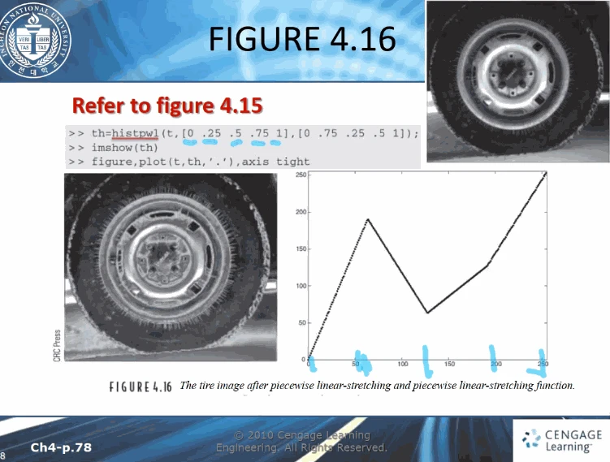

오른쪽의 영상보다 왼쪽의 영상이 더 나은 영상이라고 가정할 때, 0, 0.25, 0.5, 0.75, 1.0의 입력값을 출력값 0, 0.75, 0.25, 0.5, 1.0으로 비율을 변경하여 만들어낸 것이다. (출력을 비율로 조절한 것이다.)

> 하지만 이것은 좋은 아이디어는 아닌데, 타이어 하나를 위한 Algorithm은 중요하지 않기 때문이다. 일반적으로 적용될 수 있는 것이 중요한 것.

### Histogram Equalization

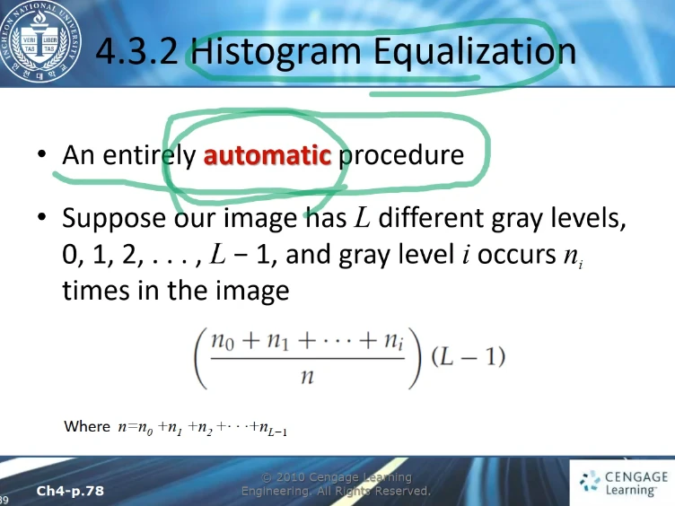

Histogram Equalization은 Automatic Procedure이며, 시스템을 디자인하는 사람의 의견과는 관계없이 결정된다.

L개의 서로 다른 Gray Level이 있다고 해보자. (0, 1, 2, …, L-1) 그리고 gray level i는 n(i)만큼 나타난다고 할 때, 위에 나오는 수식과 같이 표현할 수 있다.

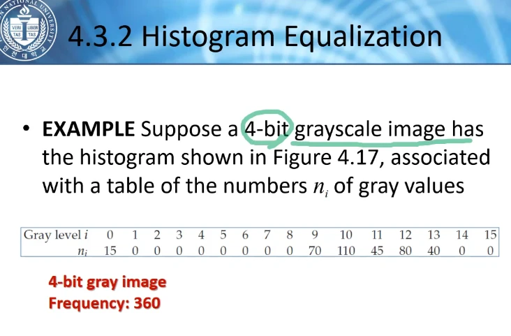

4-bit grayscale image가 있다고 할 때, L = 16이 될 것이다. 그렇다면 gray level은 0~15까지 가능할 것이다. 그리고 개수는 위와 같다고 해보자.

- Original Histogram

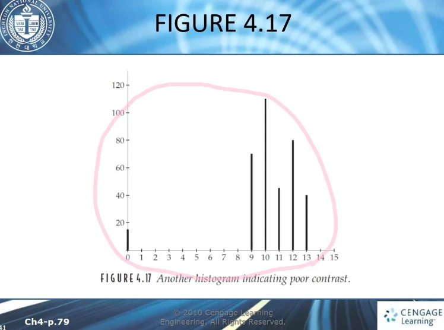

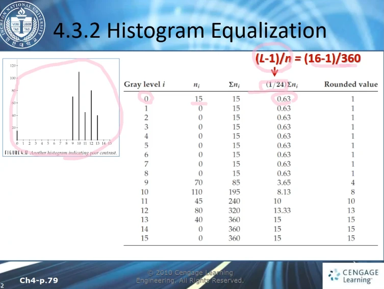

Equalization은 CDF(빈도의 누적합)으로 계산한다. (L-1)/n = (16-1)/360 = 1/24이므로, 이후에 CDF에 대해서 1/24를 곱해주면 된다.

- Gray Level i = 0

    - n(i) = 15
    - Sum = 15
    - 0.63

- Gray Level i = 1

    - n(i) = 0
    - Sum = 15
    - 0.63

… (Gray Level이 8일 때까지는 계속 15가 나오게 된다.)

- Gray Level i = 9

    - n(i) = 70
    - Sum = 85
    - 3.65

- Gray Level i = 10

    - n(i) = 110
    - Sum = 195
    - 8.13

> 이런 과정을 거치며 계속해서 계산해 나가면 Histogram Equalization이 가능하며, 상수를 곱했을 때 (위에서는 1/24) 나온 값에 대해서 Round를 취한 것이 새로운 Rounded Value이다.

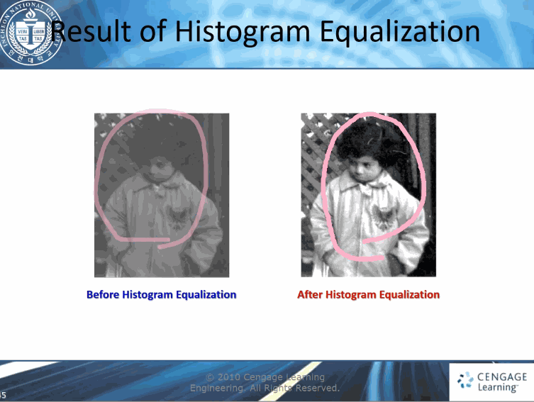

### Histogram Equalization Example

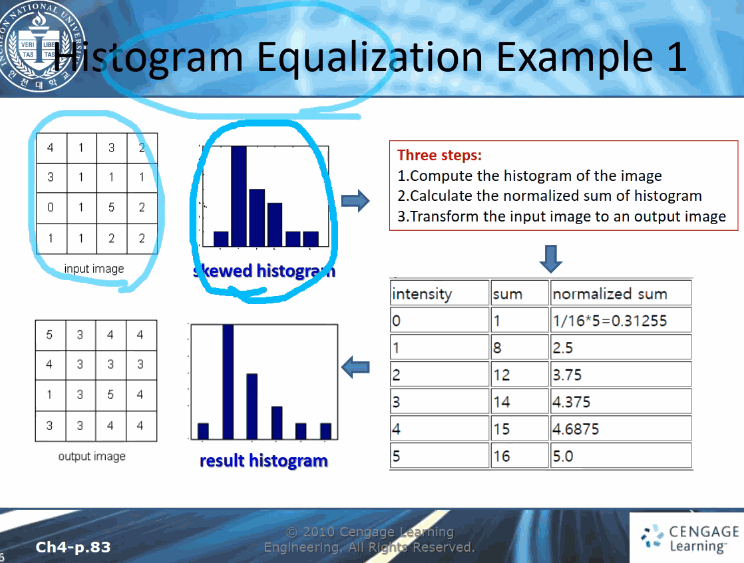

- n = 16, L= 6 (0, 1, 2, …, 5)

    - Intensity가 0인 것은 1개 ⇒ 따라서 Sum도 1
    - Intensity가 1인 것은 7개 ⇒ 따라서 Sum은 8
    - Intensity가 2인 것은 4개 ⇒ 따라서 Sum은 12
    - …
    - Intensity가 5인 것은 1개 ⇒ 따라서 Sum은 16

우리가 구한 상수값은 5/16이므로, 이걸 각각 곱해준 다음, round를 취하면 된다.  
⇒ 위에서는 round를 취하지는 않았음.

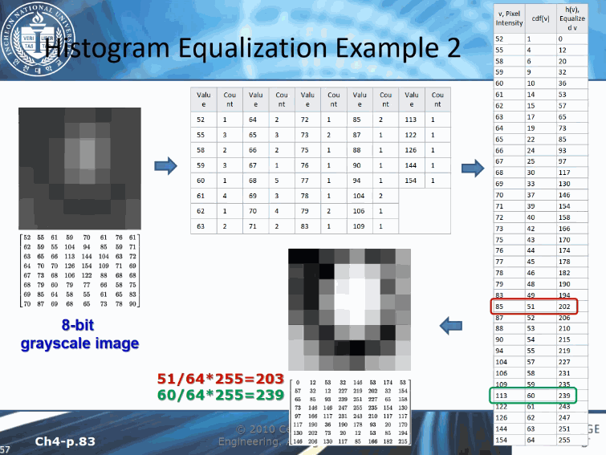

- n = 64이고, 나올 수 있는 값의 개수 L = 256, 0~255 (8-bit이기 때문이다.)
- 따라서 우리가 구한 상수는 255/64이다.

이제 0부터 255까지 하나씩 count를 하고, Sum(CDF)을 구한다. 그리고 그것에 상수 255/64를 곱한 다음, round를 취해주면 된다.

- pixel value 85 : 51 \* 255/64 = 203 (rounded value)
- pixel value 113 : 60 \* 255/64 = 239 (rounded value)
