# Neighborhood Processing

작성일 2023-11-21 · 최종 수정일 2024-11-22
{ .post-date }

## &lt;2D Convolution&gt;

### Convolution

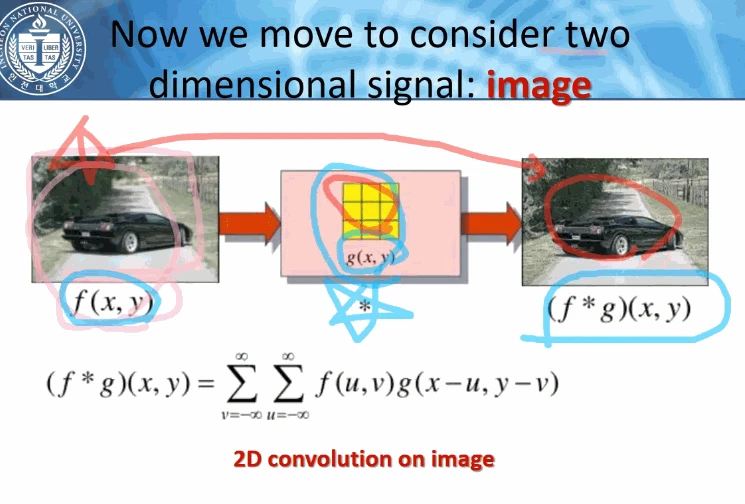

한 영상 f(x, y)가 있을 때, 이 영상을 Kernel에 통과시키면 뚜렷해진 영상을 결과로 얻게 된다.

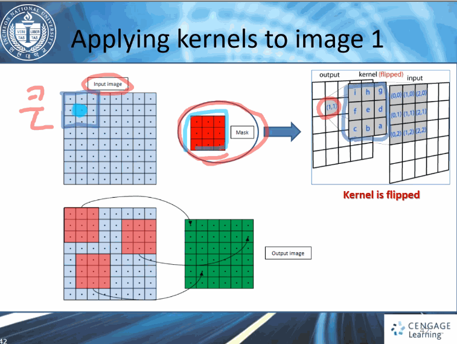

Input Image에서, 파란색 점으로 표시된 부분에 대해서 Mask를 씌운다. 그래서 각각의 값과 Mask의 값을 Element wise로 곱한 다음, 그것을 모두 더한 것이 Output Image의 (1, 1)의 값이 된다.

Kernel의 크기가 3x3이므로, Output Image는 Input Image보다 작아지게 된다. 즉, 가장자리가 한 줄 사라지게 되는 것이다. 그런데 만약 Kernel의 크기가 5x5라면, 가장자리 한 줄이 사라지는게 아니라 두 줄이 사라지게 될 것이다. 

### Convolution Example

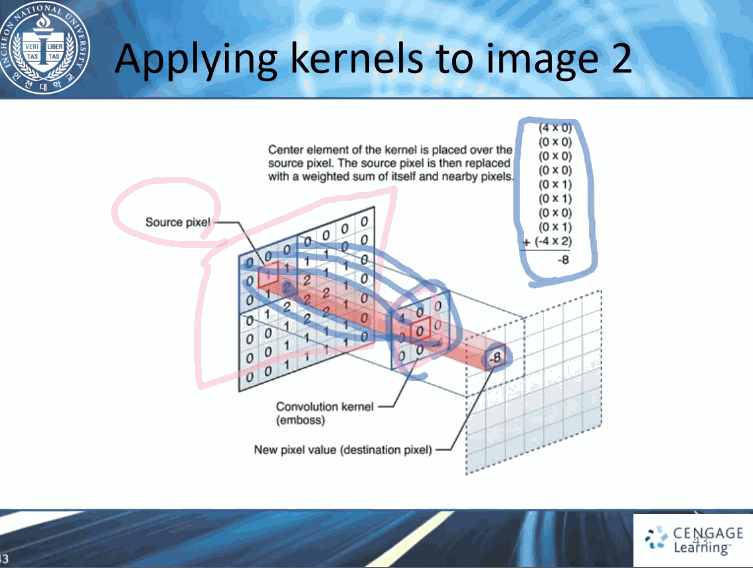

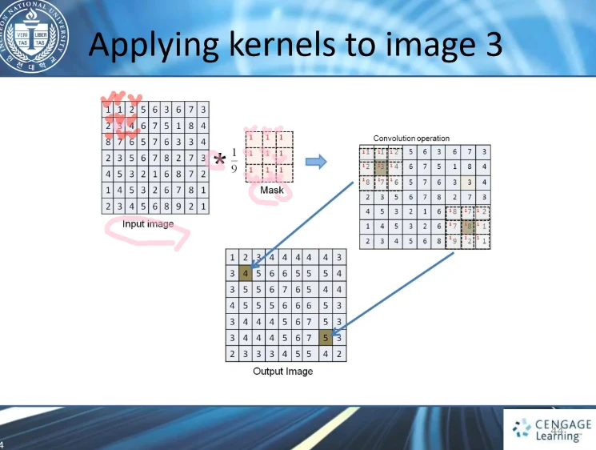

Kernel의 각 Element의 값이 1/9인 Kernel을 Input Image에 씌워 Convolution을 진행한다. 이것은 Element wise로 곱한 것을 모두 더한 다음, 1/9로 나누는 것과 같다.

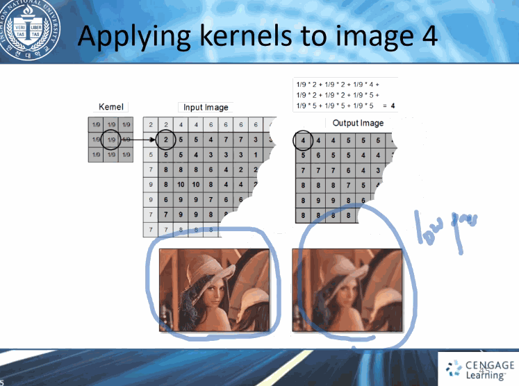

Low Pass Filter를 적용시켜, Image를 Blur하게 만들었다. Low Pass Filter는 영상의 Detail을 담당하는 High Frequency(Edge)를 제거하는 역할이다.

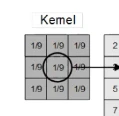

위에 나온 Kernel은 대표적인 평균 필터(Low Pass Filter)이다. 이것을 통과시키면, Output Image의 값은 거의 비슷해져서 마치 평균값만 남기는 것과 똑같은 효과가 된다.

### Types of Filter(LPF, HPF, Identity, Unsharp, Gaussian, …)

- Identity Kernel

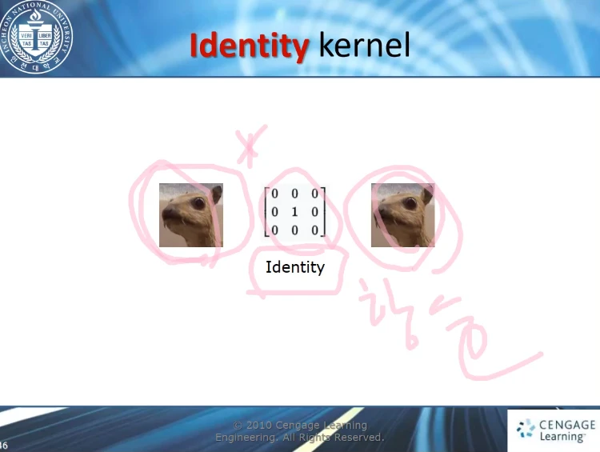

- **Edge Detection Kernel(High Pass Filter)**

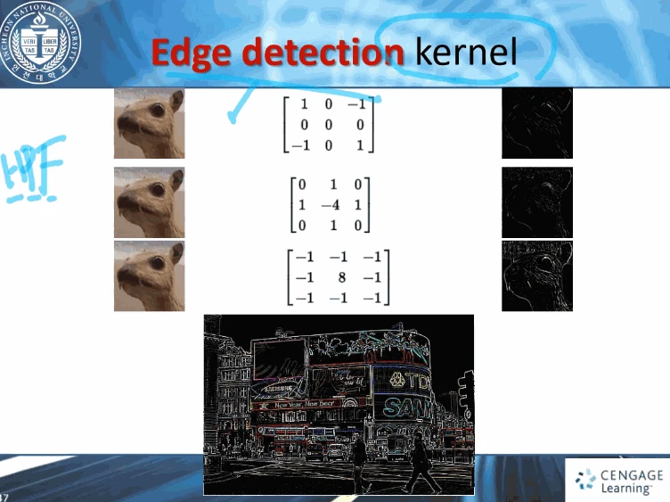

High Pass Filter의 가장 큰 특징은, Kernel 값들을 모두 더하면 0이 된다는 것이다. 이것들을 원본 영상에 Convolution으로 적용하면 Edge 영상이 나오게 된다.

그런데, Edge Detection Kernel은 값의 합이 0이기 때문에 **밝기가 보존되지 않는다.** (매우 어둡게 나오게 된다.) 반면, Identity Kernel은 값의 합이 1이기 때문에 **밝기가 보존**된다.

- **Edge Sharpning Kernel**

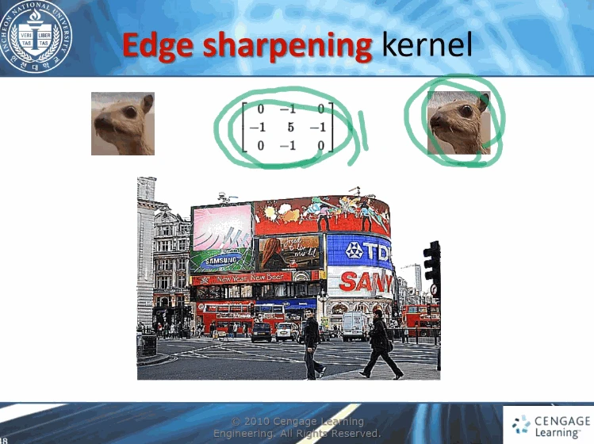

Edge Sharpning Kernel은 다음과 같은 Kernel의 합으로 이루어져 있다.

```text
 0  -1   0         0  0  0
-1   4  -1    +    0  1  0
 0  -1   0         0  0  0
```

⇒ 이것은 Edge Detection Kernel과 Identity Kernel의 합이므로, Edge를 강조하면서 Intensity를 유지하여, 결국 Edge를 뚜렷하게 만드는 역할을 한다.

> 이것을 다른 이름으로 **Unsharp Masking**이라고 한다.

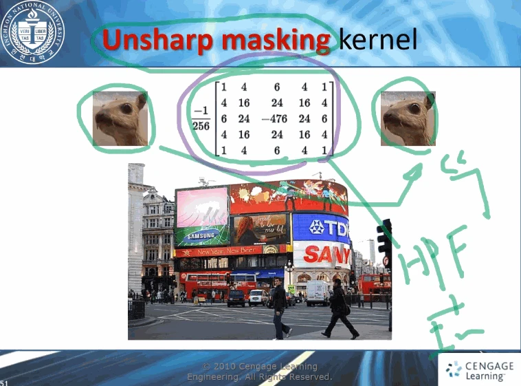

값을 모두 더하면 1이므로 Intensity(밝기)가 보존된다. 그런데, 가운데 값이 가장 크고 이걸 기준으로 Convolution을 적용하고 있으므로, Edge Detection이 이루어진다.

- **Blur Kernel (Normalized Kernel)**

Low Pass Filter의 가장 대표적인 예시이다.

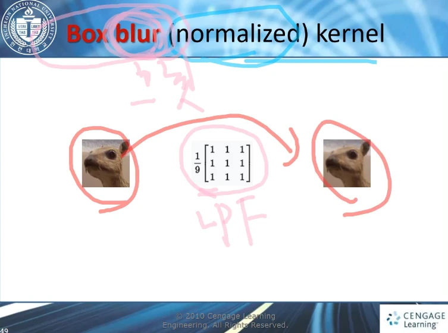

- **Gaussian Blur Kernel**

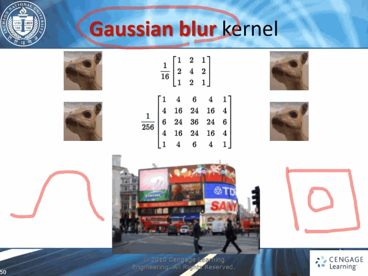

마치 Gaussian Distribution처럼 가운데 값이 가장 크고 멀리 갈수록 값이 작아져서 Gaussian Blur Kernel이다. 값의 총합은 1이므로 Intensity(밝기)는 유지된다. 다만, 영상이 조금 흐려지게 되는데, Identity Matrix가 아닌 이상 **Neighbor들의 값을 고려**하기 때문에 결국 **영상이 평균처럼 되는 것**이다. 그러므로 영상이 조금 흐려지게 되는 것이다.

---

## &lt;Filtering & Mask&gt;

> 이제는 값을 바꾸는데, Kernel Convolutiond을 사용하여 주위 값을 고려하여 바꿔보자. (**Neighborhood Processing**) Kernel은 보통 길이를 홀수로 지정하고, 정사각형으로 만든다.

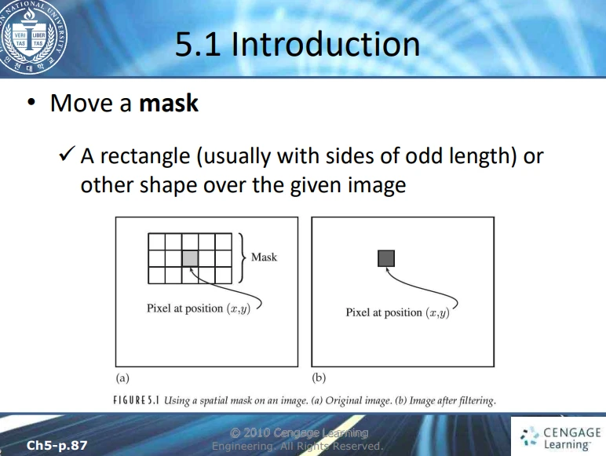

Neighborhood Processing에서, 만약 한 픽셀의 값의 주위 값들이 모두 어두운데, 자기 자신은 밝으면 이상한 값이라고 볼 수 있을 것이다. ⇒ 이러한 것을 아웃라이어라고 한다.

### Mask Example

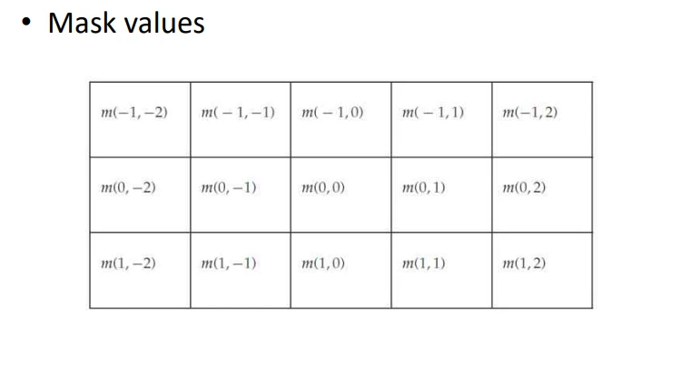

이와 같이 (3, 5) Mask를 사용한다고 가정해보자.

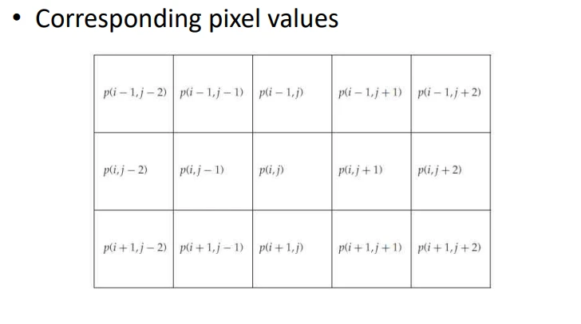

- Mask(3x3)는 자기 자신에 대해 적용하기 때문에, 가운데 픽셀 값을 기준으로 Indexing을 하지만, Pixel Values는 i, j로 표현한다. 그래서 기준이 되는 가운데 Pixel의 Index를 (i, j)라고 할 때, 이것을 기준으로 Convolution의 Indexing을 표현할 수 있다.

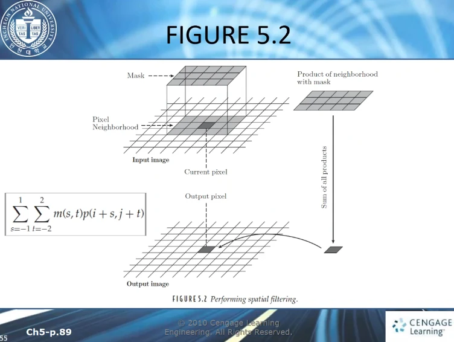

큰 영상의 작은 지점을 처리하기 위하여 Mask를 이용해 Convolution을 진행하여 한 점이 만들어지게 된다. 이것을 수식으로 표현하면 위와 같다.

- 만약 Convolution을 적용하고 나서도 Intensity를 유지하고 싶다면, Mask의 각 Cell의 값이 1/15라면 전체 값은 1이 되기 때문에 Intensity는 유지가 가능할 수 있다.  
    이런 방식으로, Intensity를 유지하려면 Mask의 총합이 1이되면 된다.

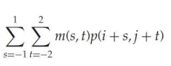

⇒ 수식적 표현. 3행 5열에 대한 수식적인 표현

> 사실 Convolution 공식에서 원본 영상 f(x, y)에 적용되는 Mask는 Convolution의 정의에 따라서는 x, y축에 대해서 뒤집어야 하기 때문에, 부호가 바뀐다.   
>   
> 하지만 위의 수식에서는 그럴 필요가 없는데, 그 이유는 대부분의 Mask는 좌우 대칭으로 만들어지게 되기 때문이다. 그래서 우리가 축을 바꿀 필요가 없다.   
>   
> Mask가 Isotropical(등방성)을 갖기 때문에, 부호에 크게 신경 안써도 된다는 것이다.   
> (따라서 위의 수식에서 i+s, j+t인 것. 수식적으로는 -가 붙어야 함.)

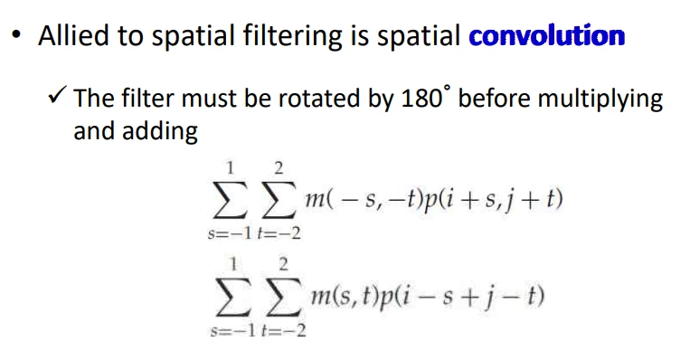

⇒ 이전 내용을 설명하는 부분. Mask를 180도 회전하여 사용해야 하지만, 좌우 대칭으로 만든다면 그러지 않아도 된다는 내용이다.

### Linear Filtering

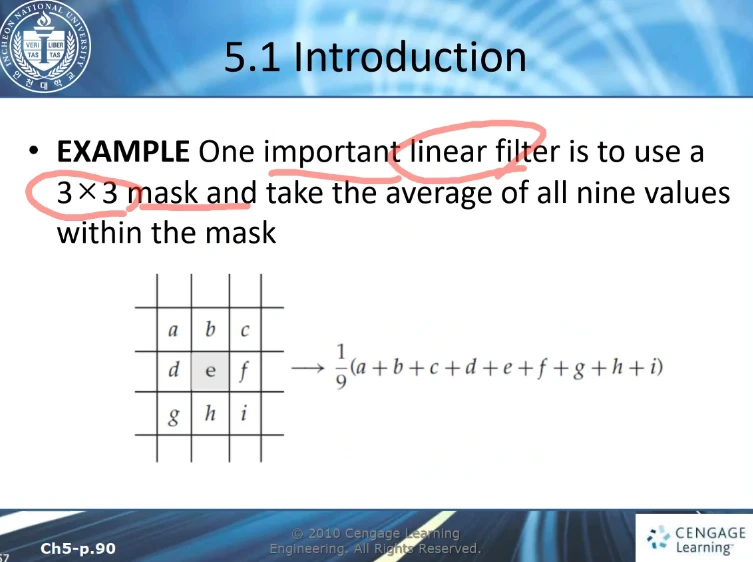

가장 중요한 평균 필터 예시 중 하나인 Linear Filter를 거치는 예제를 생각해 보면, e의 값은 위와 같이 1/9(a + b + c + d + … + h + i)라고 할 수 있다.

### Linear Filter on Magic(마방진)

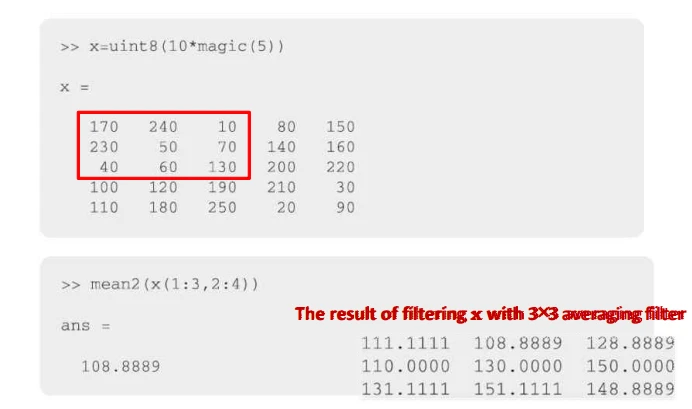

Convolution을 적용하기 위해 Magic(마방진) Matrix를 예시로 만들었다. 위에서는 마방진을 만들고 모든 값에 10을 곱해주어 x를 만들었다.

위의 5x5 matrix에 대해서 3x3 Linear Filter를 적용해 보자. 먼저, 빨간색 영역을 필터링 해보자.   
Matlab에서 지원하는 mean2()는 2차원 평균 Filter인데, 위의 예시에서는 (1:3, 2:4)에 대해서 Linear Filter를 Convolution으로 적용했다는 뜻이다.  
⇒ 어려운 뜻은 아니고, 말 그대로 해당 부분에 Linear Filter를 Convolution 적용하면 된다.

### Notation

- **Averaging Filter(Low Pass Filter)**

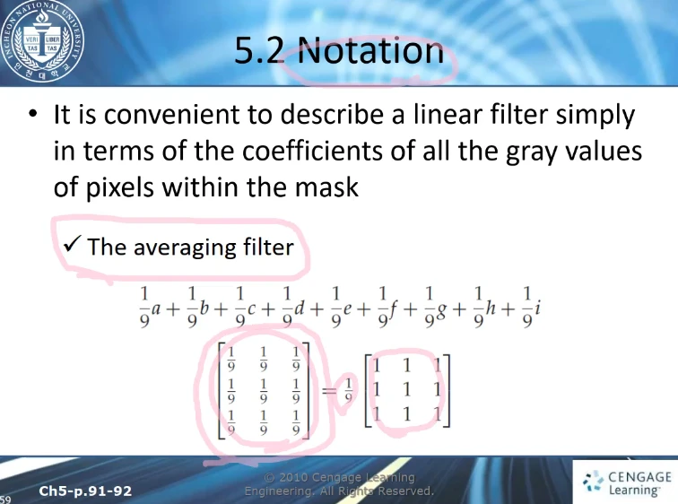

가장 대표적인 Low Pass Filter인 Averaging Filter(Linear Filter)

- **High Pass Filter**

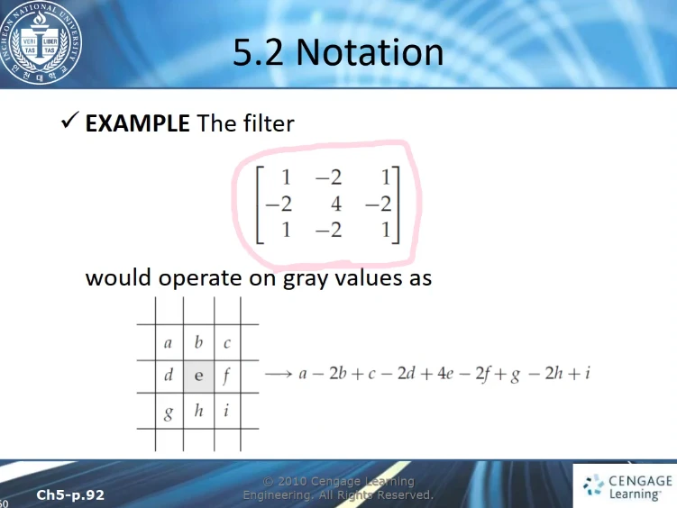

⇒ 이 연산을 통해 나온 결과가 e를 대체하게 된다.

### Edges of the Image

> 만약 우리가 처리하려는 영상의 경계와 겹치게 되면 어떻게 해야 할까?

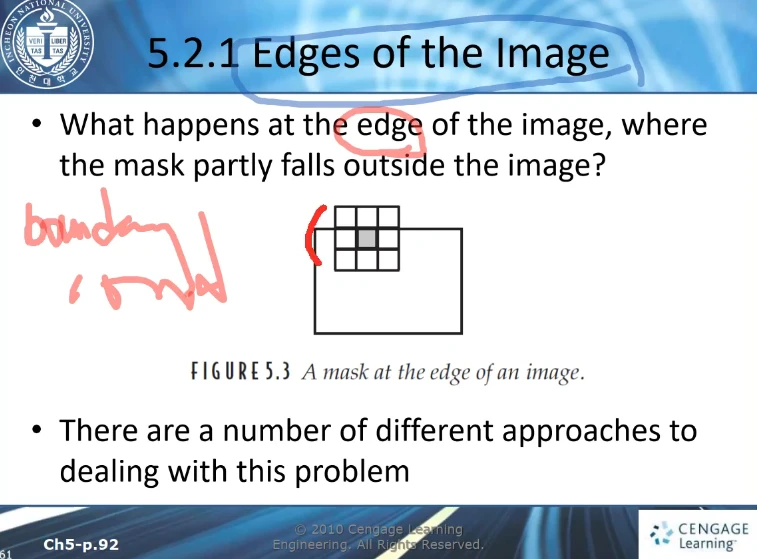

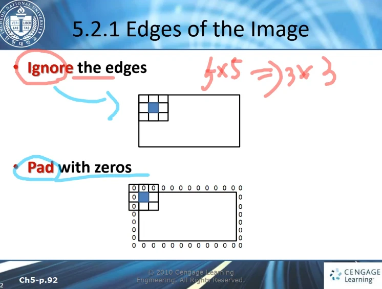

- Ignore : Boundary를 무시한다.
- Padding : Boundary에 0을 취한다.

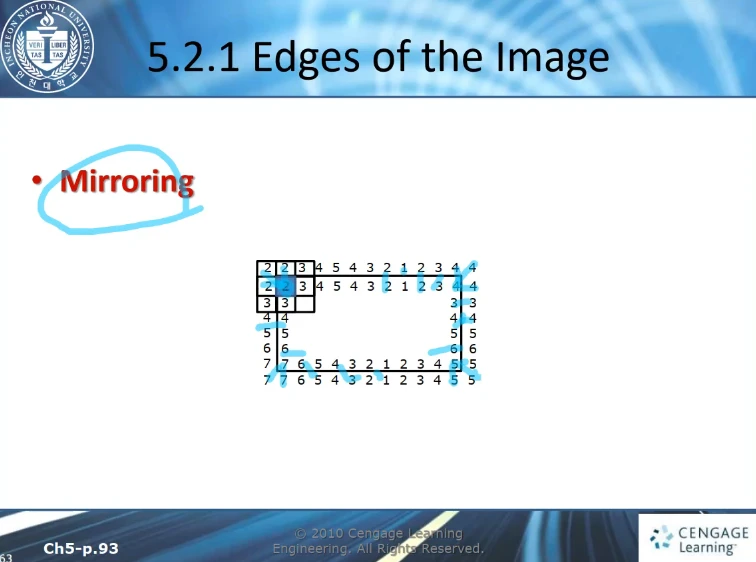

- Mirroring : 값을 Copy하여 생성한다. Corner는 세 번 Copy되고, 나머지는 그대로 Copy한다.

> 모든 예시에서 세 개 필터의 값은 모두 같다. 또한, Boundary값은 그렇게 중요하지는 않다.

### Filtering in MATLAB(filter2)

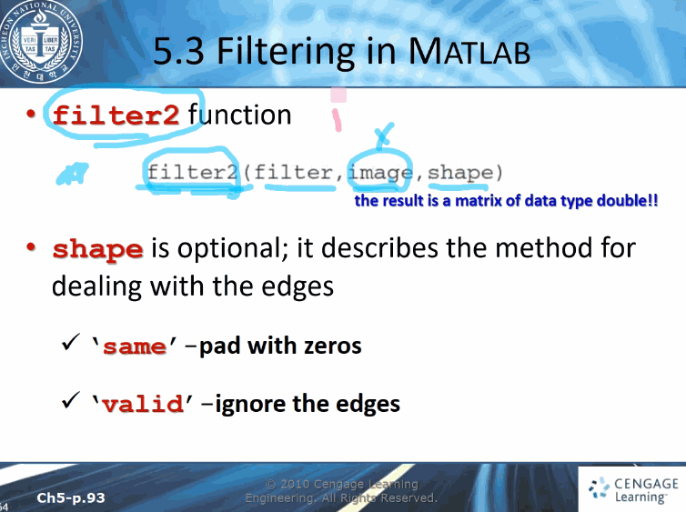

Matlab에서는 filter2를 사용하여 Image를 filtering할 수 있다. 그런데, filter2보다도 사실 imfilter라는 명령어가 더 자주 사용된다. 동작은 똑같으나, image, shape를 넣는 순서가 다르다.

- shape 

    - same으로 설정하면 Zero Padding을 추가해서, Size가 그대로 유지되도록 한다.
    - valid로 하면 ignore한다.

- **Average Filter**

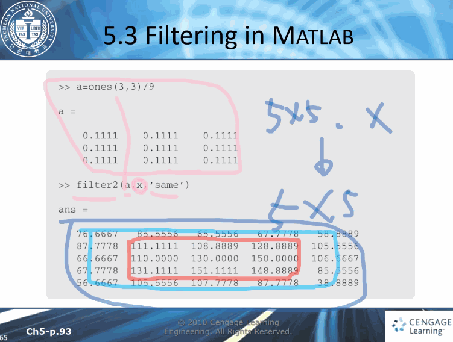

생성한 마방진 x에 filter a를 적용하고, 이것에 shape option을 적용하여 zero padding을 추가한 다음 Filtering을 실시한다.

이렇게 하면, filter와 크기가 똑같은 부분은 valid 옵션을 적용했을 때와 값이 같지만, zero padding을 추가하여 새롭게 만들어진 가장자리 부분은 값이 똑같지는 않다.

> 다만 Boundary Condition이 크게 중요하지는 않다. 실제 영상은 몇 천만 화소가 넘는데, 이것까지 고려하지는 않아도 된다.  
>   
> filter2는 mirroring option은 없다. mirroring도 zero padding, ignore와 똑같이 kernel 크기만큼은 값이 똑같이 나온다.

---

### fspecial

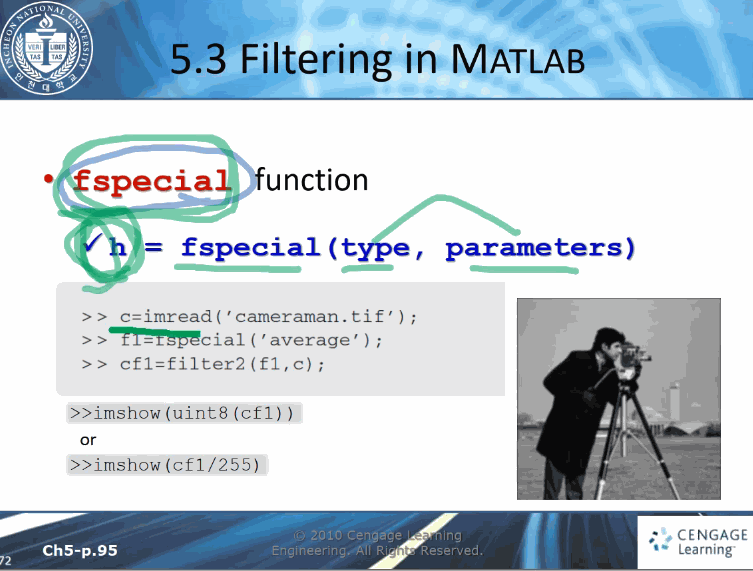

fspecial은 특별한 type의 filter를 적용해주는 Matlab 함수이다.

> filter는 항상 h로 notation을 쓴다고 약속한다.

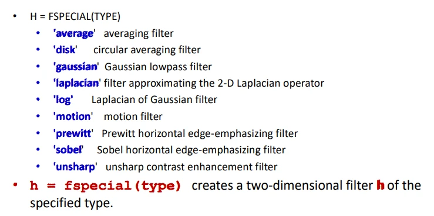

- **fspecial types**

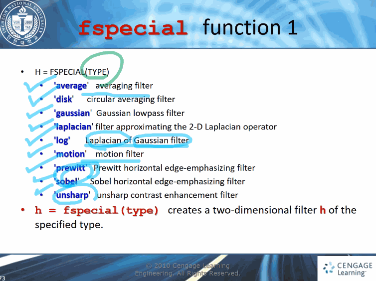

- **Average Filter**

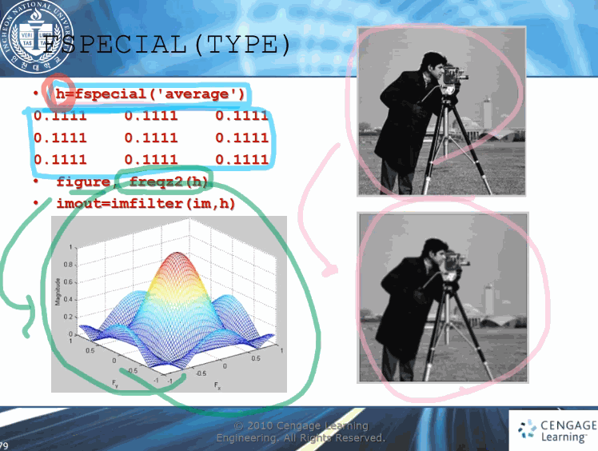

위 삼차원 그래프를 해석해보자. x축, y축에서 0에 가까울수록 저주파이고, 0에서 멀어질수록 고주파가 된다. 그러므로 현재 저주파만 통과되는 것으로 확인할 수 있기 때문에, 이것은 Low Pass Filter라는 것을 알 수 있다. Cameraman 이미지에 Average Filtering을 적용한 것이 오른쪽 하단의 이미지가 된다. 정리하자면, (0, 0)에서는 DC 성분을 완전히 통과시키는 것이며, **주파수가 0이라는 것은 cos(0)가 1이기 때문에 평균값이 들어가 있다는 것으로 해석**된다.

> 다만, 실제 주파수는 위의 이미지와 같이 -1~1 사이에서 주기가 반복되는 것이 아니라 -*π~π에서 반복된다.*

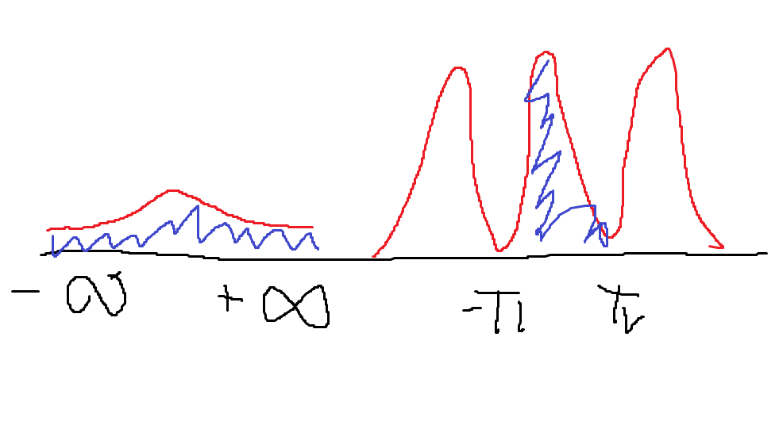

우리는 주파수 도메인에서 어떠한 Signal을 다룰 때, 모든 신호가 주기 신호가 아니기 때문에 해당 신호가 무한대 영역에서 주기를 갖는다고 가정한다고 문제를 해결한다. 이러한 신호를 -*π~π* 사이로 축소시키면 위와 같이 위로 치솟는 모양이 되고, 파란색으로 칠한 면적의 값은 같게 된다.

- **Low Pass Filter(disk)**

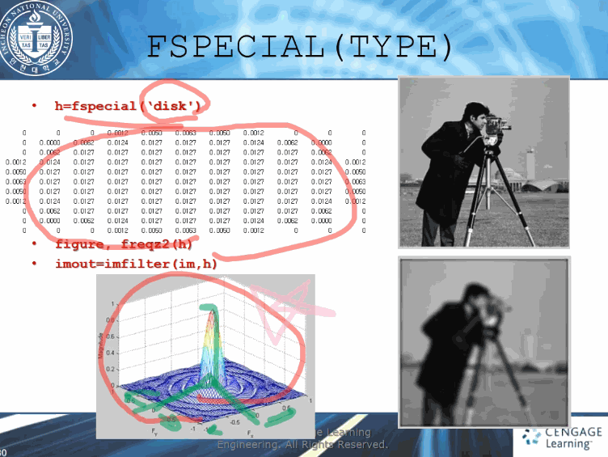

이 예시에서는, 고주파인 Edge값을 많이 잃게 된다. **주파수 도메인**에서는 **(0, 0)이 평균값**인데, 이곳을 1만큼 통과시키는 것을 볼 수 있다. 그런데 고주파로 갈수록 통과시키지 않는 것을 볼 수 있다. 고주파는 Edge이고, 저주파는 평균값이다. 이것은 영상의 전체적인 평균값은 유지해서, 영상의 밝기는 보존하는 것이라고 볼 수 있다. (그리고 Edge도 저주파 Edge만 남았다.)

> freqz2는 영상을 주파수 도메인으로 본다는 뜻이다.

- **Identity Kernel**

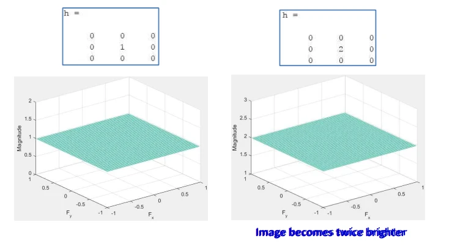

Identity Kernel의 Magnitude가 1 → 2가 되면, 밝기가 2배가 된다.

- **Gaussian and Laplacian**

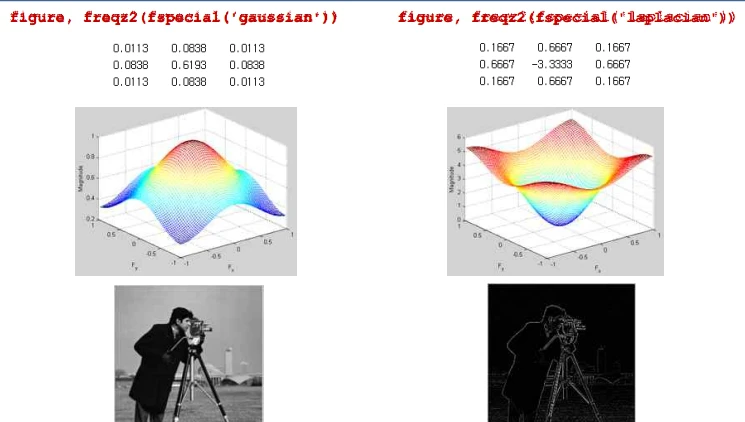

**Gaussian** : Low Pass Filter이지만, 고주파 성분을 어느 정도는 통과시킨다. 또, 주파수가 (0, 0). 즉, 평균에서 Maximum이 1이라는 것은, 밝기는 유지된다는 뜻이다.

**Laplacian** : High Pass Filter이고, 이것은 저주파는 통과시키지 않지만, 고주파는 잘 통과시킨다.

- **주파수** : sin(2\*π\*nx)라고 한다면, n이 주파수이다. 만약 cos(2\*π\*nx)라고 한다면, n이 0이면 직류, 하지만 n이 0이 아니라면 교류이다.

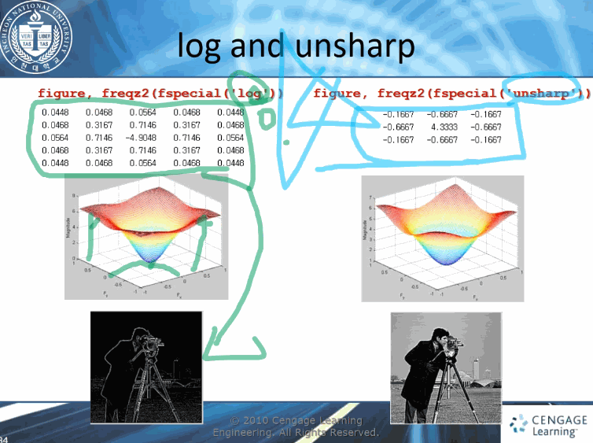

**Log** : Gaussian Filter는 Noise를 제거하는데 강하고, Laplacian Filter는 Edge를 검출하는데 강하다. 따라서 Laplacian Filter를 적용하여 Edge를 검출하기 전에, 먼저 Gaussian Filter를 적용하여 Noise를 제거하고, 그 뒤에 Laplacian Filter를 적용하면 좀 더 정확한 Edge를 검출할 수 있게 된다. 이것이 바로 log Filter이다.

**Unsharp Mask** : (0, 0) 지점에서 Intensity가 1이기 때문에 밝기는 유지가 된다. 하지만 다른 고주파 부분도 통과를 많이 시키기 때문에, 이것은 Identity Matrix에 추가적인 High Pass Filter를 더해서 만들어진 Unsharp Masking이다.

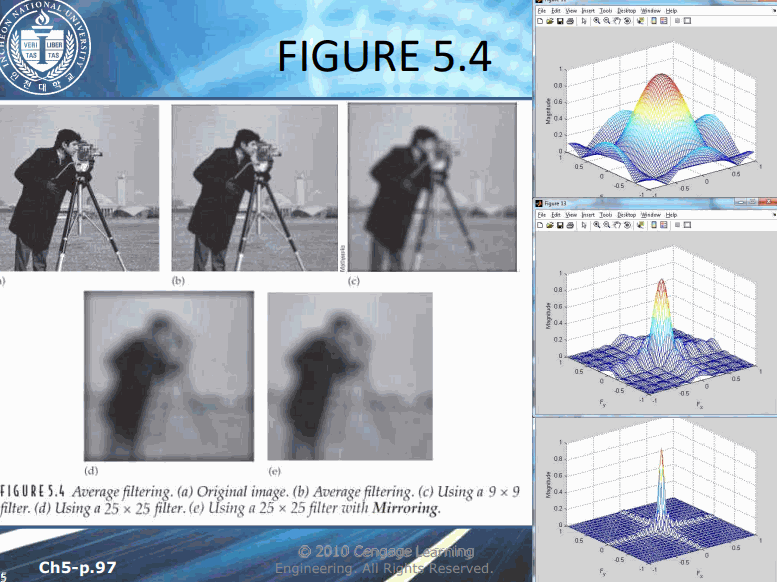

- Original 영상에서 3x3 Low Pass Filter를 거친 것이 (b), 9x9 Low Pass Filter를 거친 것이 (c&#41;, 이렇게 쭉 가면서 점차 filter size가 큰 것을 거치게 된다고 생각할 수 있다.
- 그런데 영상의 밝기는 왜 유지가 될까? 그것은 (0, 0)에서 높이가 1이 되도록 하기 때문이다.
- 오른쪽 맨 위의 경우, 고주파 성분이 조금 남아있고, 아래로 갈수록 사라지는 것을 알 수 있다.

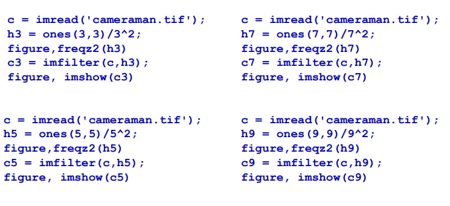

- 점점 coeffcient는 작아지고, 평균 필터는 커지는 Filter.

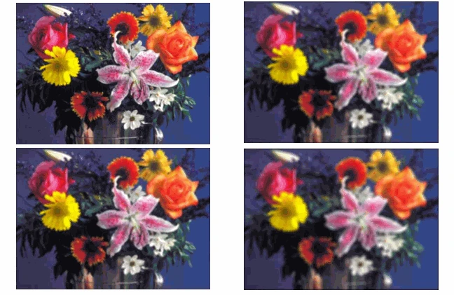

- 평균 필터의 사이즈를 키워가면서 필터링하면, 이와 같이 점차 흐려지는 형태가 된다. (cameraman.tif는 아니지만 위의 코드의 예시라고 볼 수 있음.) 평균 필터의 크기에 따라서 coefficient는 점점 작아진다. (1/9, 1/49, …)

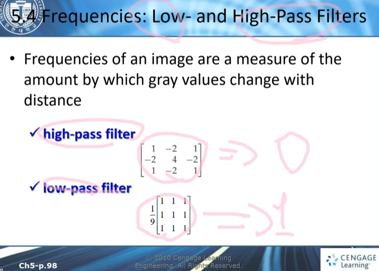

> **High Pass Filter**는 총합이 0이고, **Low Pass Filter**는 총합이 1이다.

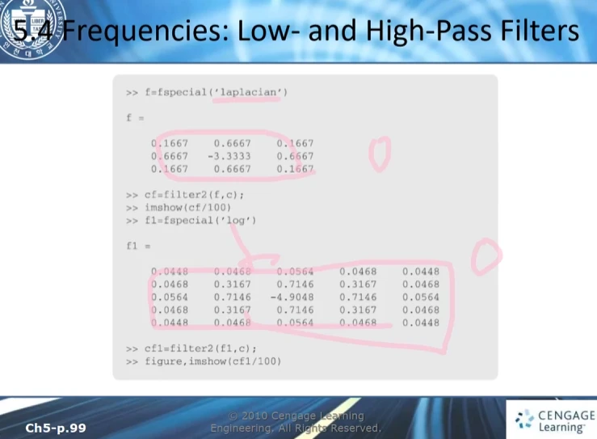

- **Laplacian** : **High Pass Filter**이므로 합이 0이다. 
- **Log(Laplacian of Gaussian)** : **High Pass Filter**이므로 합이 0이다.

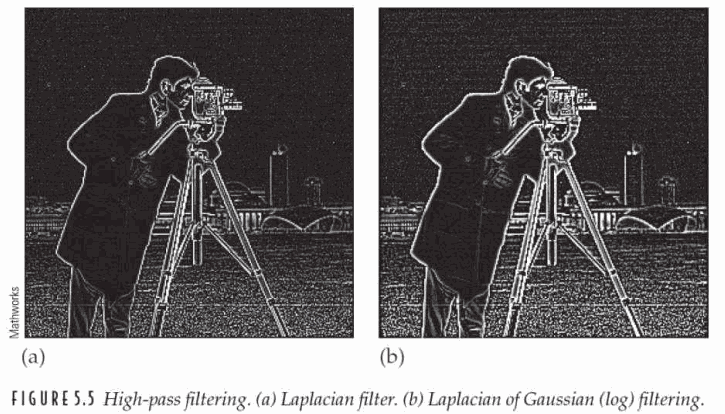

- **High-Pass filter**

**Laplacian** : 노이즈를 억제하지 않고 Edge를 찾는다. 고주파만 뽑아서 Edge만 나타낸다. 

**Laplacian of Gaussian** : 노이즈를 억제하고 Edge를 찾는다.

> 노이즈를 제거하고 Edge를 찾는 것이 영상이 더 뚜렷하다.

### Value Boundary Condition

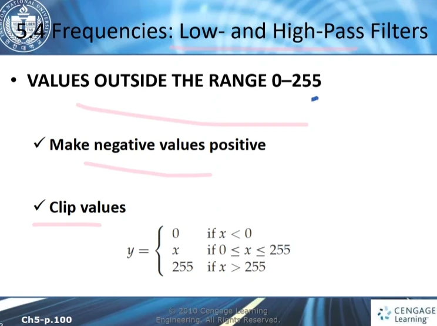

- 이미지 프로세싱을 하다보면, 값이 0~255가 아니게 나오는 경우도 있다.
- 그러면 넘어가는 Value는 Clip 해 버리거나, 간격을 약간 줄이는 방법이 있다.

### Gaussian Filters

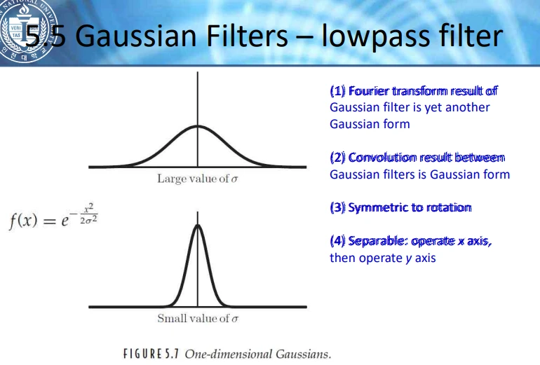

- **Gaussian Filter** : **Sigma**는 **표준편차**, **분산**의 값이다. 분산값이 크다면 더 펼쳐진 모습이다.

> 표준편차가 작다면 고주파를 잘 포함하지 않고, 표준편차가 크다면 고주파를 많이 포함한다.

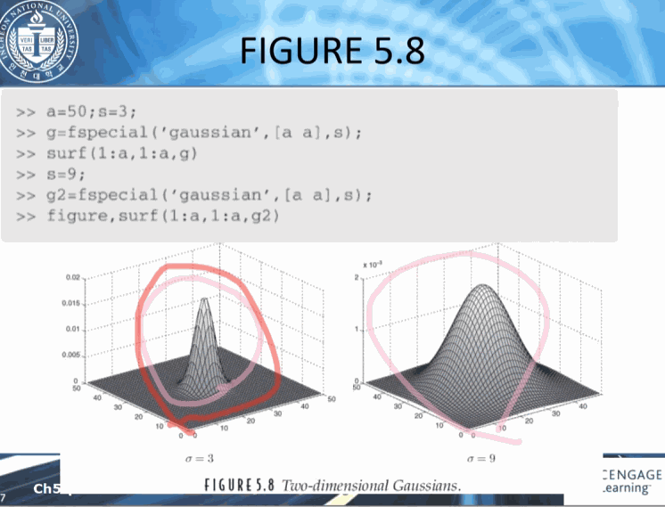

- 표준편차가 작다면 좁은 부분을 통과시키고, 표준편차가 크다면 넓은 부분을 통과시키는 것을 알 수 있다.

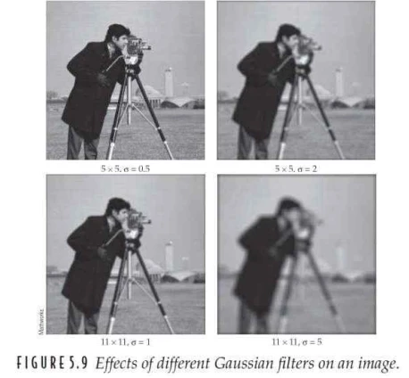

- 표준편차가 커질수록 더 큰 평균 필터를 사용하기 때문에 영상이 흐릿해지는 것을 알 수 있다.

---

### Unsharp Masking

> Image(영상)를 Sharp하게 만드는 방법이다.

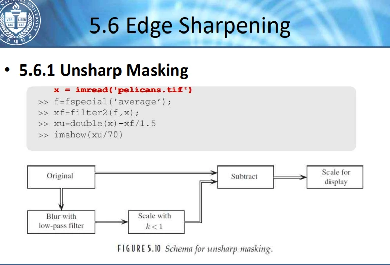

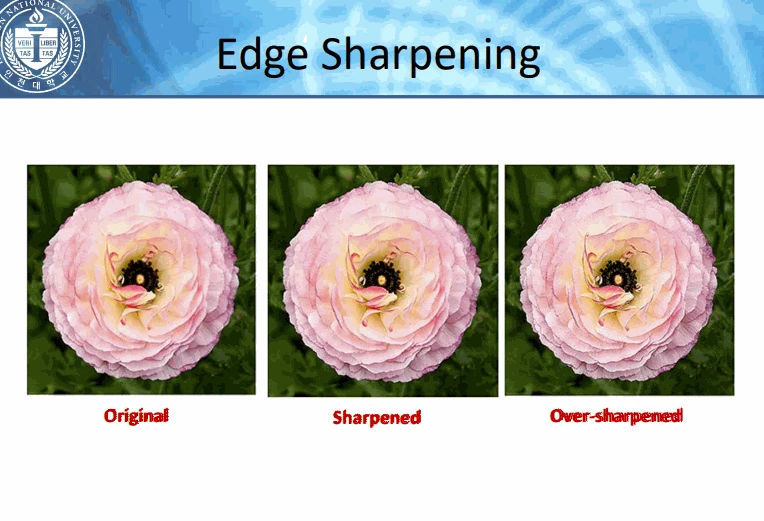

- Original 영상을 과도하게 Sharpning하면 영상이 부자연스러워진다.

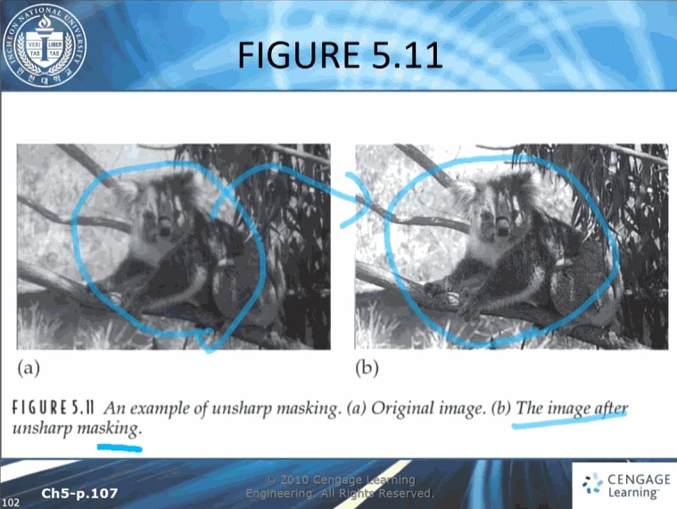

하지만 적절하게 Unsharp Masking을 하면 영상을 보기 좋게 만들 수 있다.  
(좌) **Original** (우) **Unsharp**[뚜렷하게 만든 그림]

- **Low Pass Filtering** (영상을 평균화한다.)

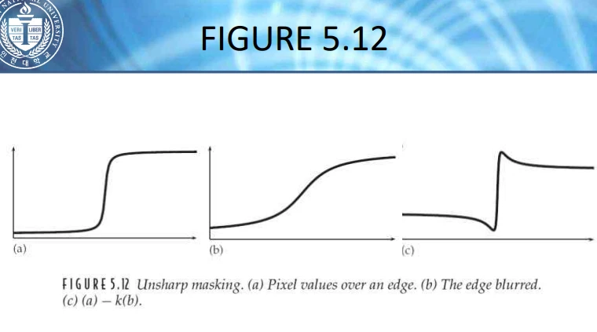

**(a)** Original Image

**(b)** Low Pass Filter (평균처리 한다는 의미. (a)에 처리하면 (b)처럼 Smooth해져서 Blur해 진다.)

**(c&#41;** (a)에서 (b)를 빼면 (c&#41;가 된다.

> Original Data에 평균 처리를 하면, Smooth해 진다. (a)에서 (b)를 빼면 (c&#41;가 되고, (a)에서 (c&#41;를 빼면 (d)가 된다.


이것은 Mach Band와 유사한 점도 있는데, 영상이 밝아지기 직전에 더 어둡게 되고 밝아지고, 어둡기 전에 더 밝아지고 어두워진다. 이것이 Edge가 강조된 것이라고 볼 수 있다.

> 영상을 뚜렷하게 만들려면, Original Image + Image의 고주파 성분


⇒ Original 영상 + Edge 영상 = Edge가 강조된 영상

### ROI : Region Of Intereset

> 영상에서 관심 영역만 뽑아내서 필터링하는 방식


이구아나의 얼굴 부분만 ROI로 설정하여 해당 부분에 영상 처리를 해 보자.


- **Average Filter**, **Unsharp Masking**, **Laplacian of Gaussian**으로 필터링했다.
