# Image Geometry

## &lt;6. Image Geometry&gt;

> Origianl 영상이 너무 작으면 영상을 키우고 싶을 수 있을 것이다. Nearest Neighbor 방식이 가장 간단한 방식이지만, 최근에는 다양한 알고리즘을 활용한 Super-resolution 방법들이 제안되고 있다.

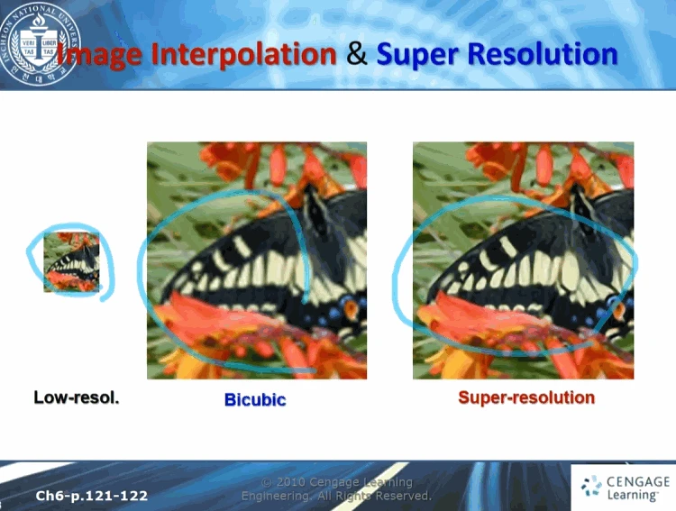

- Super-resolution을 했을 때 영상의 퀄리티가 더 좋다는 것을 확인할 수 있다.

### Interpolation (내삽)

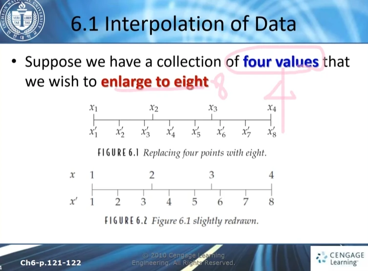

- 만약 원본 영상이 네 개의 픽셀로 이루어진 영상이라고 할 때, 이걸 여덟 개의 픽셀로 늘리고 싶다고 해보자.
- 이 때, x1 = x1’으로 만들고 x4 = x4’으로 만들 수 있다. 하지만 x2’, x4’, x5’, x7’ 등은 만들어 내어야 한다.

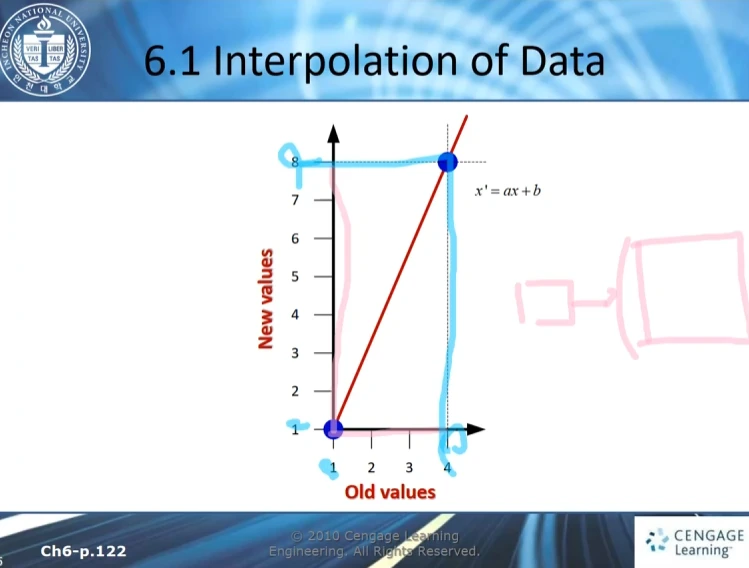

- 즉, 위의 그래프와 같이 새롭게 늘어나는 픽셀에 대해서는 새로운 Value를 만들어 내야 한다.

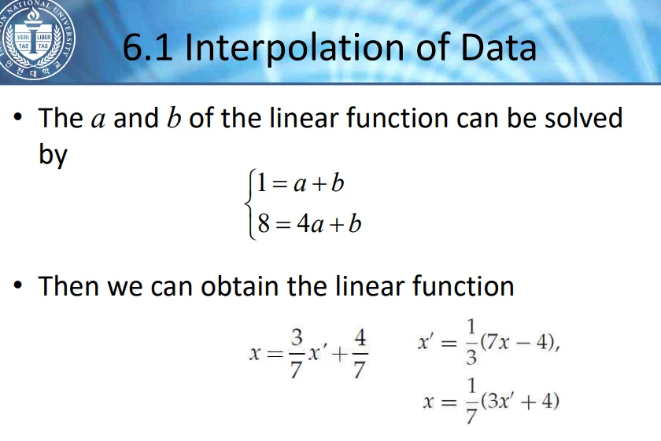

- 우리가 알 수 있는 것은 x가 1일 때 y가 1이었고, x가 4일 때 y가 8이었다는 것이다.  
    ⇒ 이렇게 만들려고 목표하고 있음.
- 이 관계를 이용해서 일차방정식을 풀면 식을 만들어 낼 수 있다.
- 이것이 **Interpolation**의 예시이며, 이와 적절한 Estimation 방식이 필요하다.

### Interpolation of Data

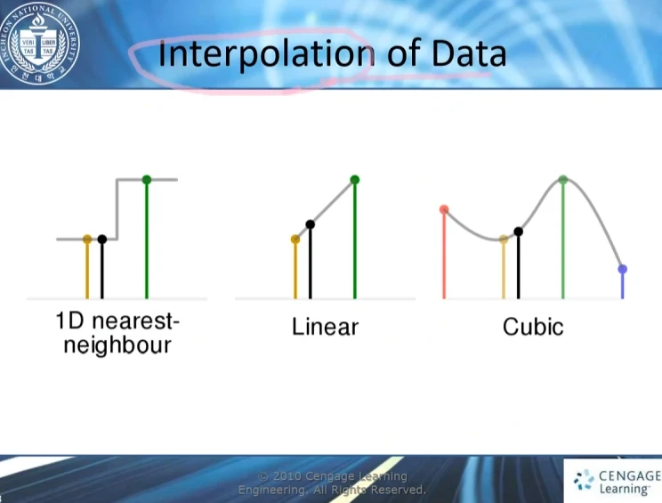

1. **1D mearest-neighbor** 방식 : 가장 가까운 이웃의 값을 취하는 방식이다.
2. **Linear** 방식 : 특정한 점을 이어서 일차함수를 만들고, 그 함수 위의 값으로 설정하는 방식이다. 
3. **Cubic** 방식 :  기존 값들을 Smooth하게 이었을 때의 값을 취하는 방식이다.

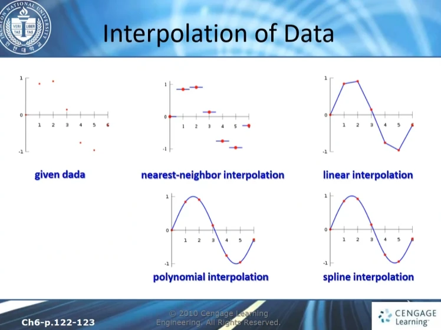

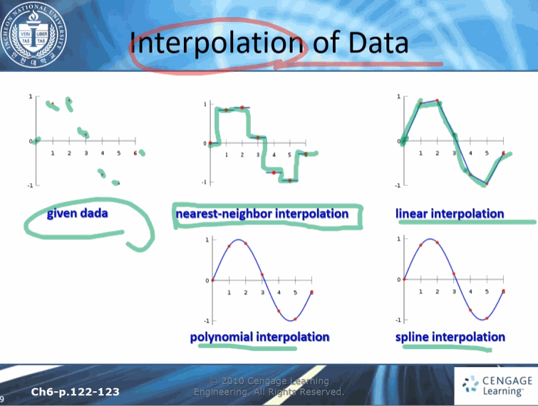

- given data가 존재할 때, 각 방식에 대해서 **보간**(interpolation)을 시도한다.

<!-- -->

1. **nearest-neighbor interpolation** : given data와 가까운 영역은 기존값으로 만드는 방식이다.

    y = ax^0 + b

    따라서 상수를 의미한다.

1. **linear interpolation** : given data를 이어서 값을 만드는 방식이다.
1. **polynomial interpolation** & **spline interpolation** : 두 개의 방식을 크게 구분짓지는 않으며, given data를 Smooth하게 이어서 interpolation하는 방식이다.

### Interpolation of Data in High Dimension

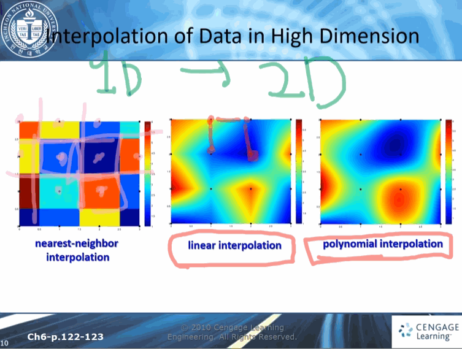

- 이차원에서는 이와 같이 나타나게 될 것이다.

    - **nearest-neighbor interpolation** : 근처의 값으로 interpolation 한다.
    - **linear interpolation** : 두 점을 잇고, linear하게 interpolation한다.
    - **polynomial interpolation** : 점과 점 사이를 Smooth하게 interpolation 한다.

### Extrapolation (외삽)

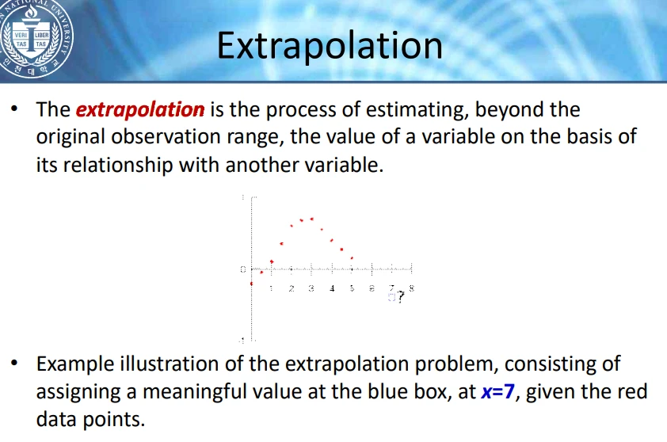

- 데이터의 경향성을 보았을 때 특정한 지점을 지나게 될 것이라고 예측하는 것이다. 즉, given data의 밖에 있는 지점의 값을 찾아내는 방식이다.

---

### Examples on Interpolation Methods

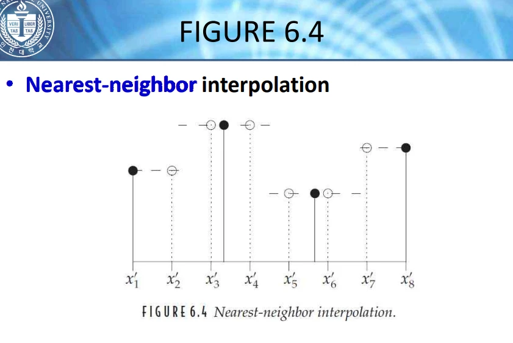

- Given Data가 네 개의 Pixel일 때, 이걸 여덟 개의 Pixel로 늘릴려고 한다.
- Nearest-neighbor 방식을 사용하면, 까만 점이 기존의 값이고 흰 점이 New Value라고 할 때, 가까운 given data의 값을 따라가는 방식으로 만들어지게 된다.

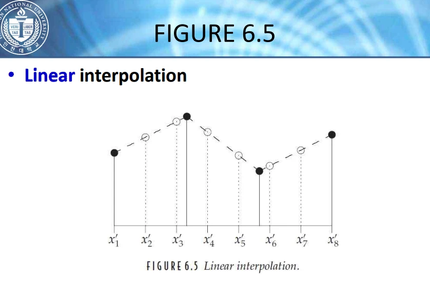

- 마찬가지로 Linear 방식을 사용하면, given data인 까만 점을 이은 Linear한 선 위에서 값을 찾아내는 것을 알 수 있다.
- **More on Linear interpolation**

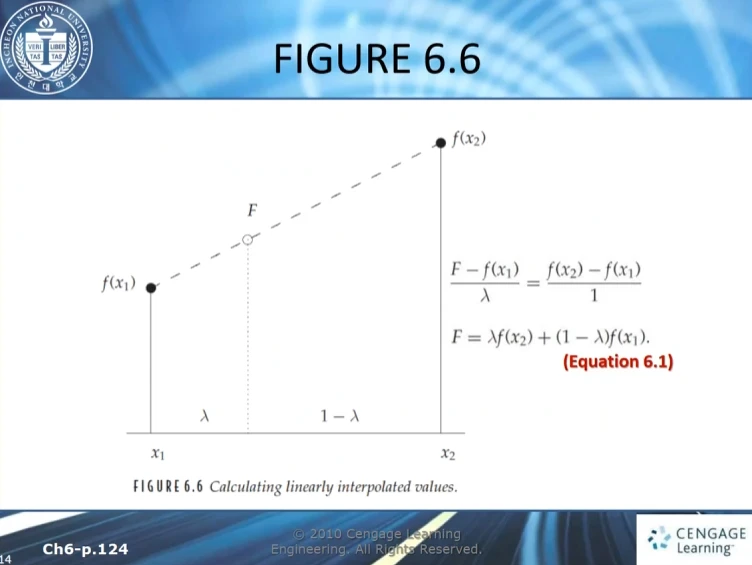

> given data의 값들을 f(x1), f(x2)라고 하고, 이 사이에서 만들어내고 싶은 지점이 있을 때, 이 지점의 값을 F라고 하고, 두 지점 간의 거리를 λ, 1-λ로 표현해보자.   
>   
> 그러면 Equation 6.1과 같은 공식을 만들어 낼 수 있다. (*기울기가 같다는 것을 표현함*)  
> 그리고 이 공식을 약간 변형하면, 아래와 같은 공식을 얻을 수 있다.

$$
F =\lambda f(x_{2}) + (1-\lambda)f(x_{2})
$$

⇒ 어려운 공식은 아니고, 비율을 따져서 중간 값을 결정한다는 의미이다. Linear Layer에서 특정 interpolated value의 값을 구하는 공식이라고 볼 수 있음.

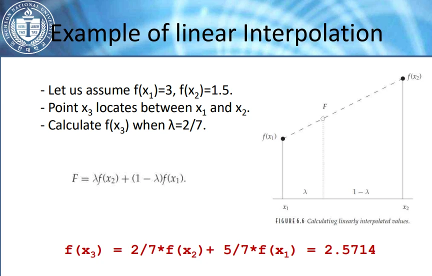

f(x1), f(x2)가 주어지고, 람다의 값이 주어졌다고 할 때, 공식을 사용하면 F의 값을 구해낼 수 있다.

---

## &lt;Image Interpolation&gt;

> 지금까지는 1D Signal에서의 interpolation을 다뤘고, 이제는 이미지에 대해서 적용해본다.

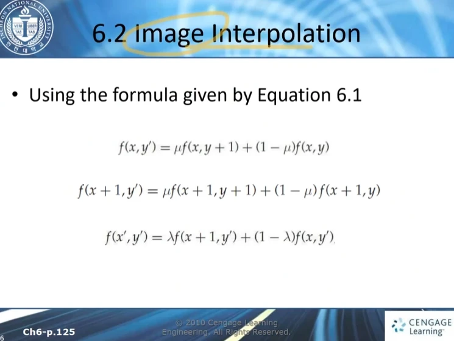

- 영상에서 한 지점의 값은 f(x, y)로 표현되므로, 공식을 약간 수정할 수 있다.
- 또한 두 지점 사이의 거리를 표현하는 것이 바뀌기 때문에 μ를 사용한다.
- x축이 같은 새로운 값에 대해서 적용할 수 있는 공식

$$
f(x, y') = \mu f(x, y+1) +(1-\mu)f(x, y)
$$

- y축이 같은 새로운 값에 대해서 적용할 수 있는 공식

$$
f(x', y') = \lambda f(x+1, y) +(1-\lambda)f(x, y')
$$

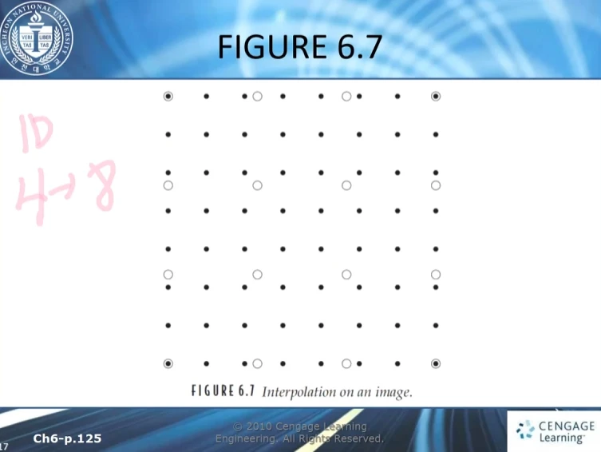

- 하얀색 값들이 존재하는 픽셀(given data)이다. 그리고 까만색 점들이 채워 넣어야 하는 점이다.

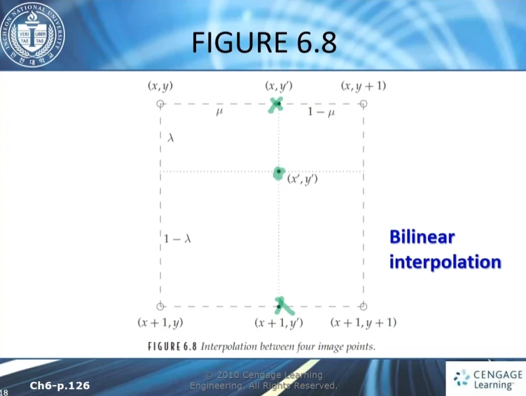

- 우리가 (x’, y’)에서의 값을 구하기 위해서는, (x, y’)의 값과 (x+1, y’)의 값을 먼저 알아내면 좋을 것이다.

> 중요한 것은, x축이 수직축이고, y축이 수평축이라는 것이다. 이차원 평면처럼 x축이 수평축인 것이 아니다.

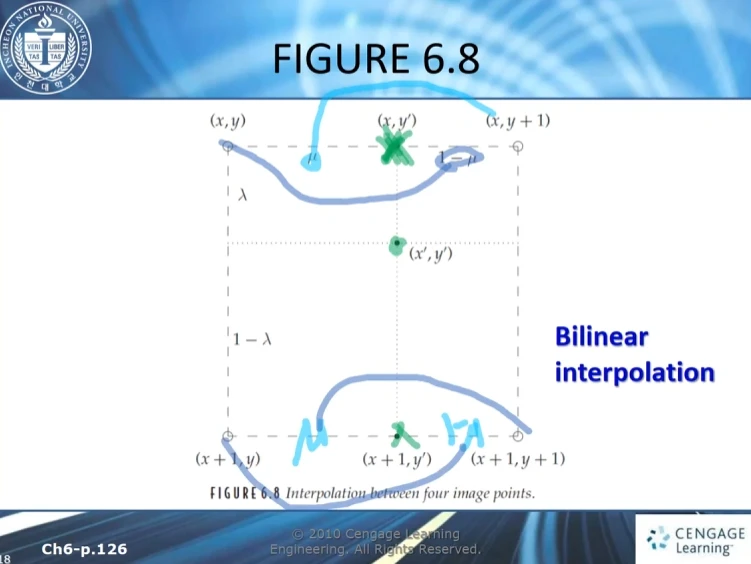

- 이제 흰색 점에 대해서 위와 같이 연산한다. (μ와 1-μ를 곱해서 비율을 계산한다.)
- 그러면 우리는 구해낸 값에 대해서 λ, 1-λ를 곱해서 비율을 계산함으로써 (x’, y’)을 구할 수 있다.

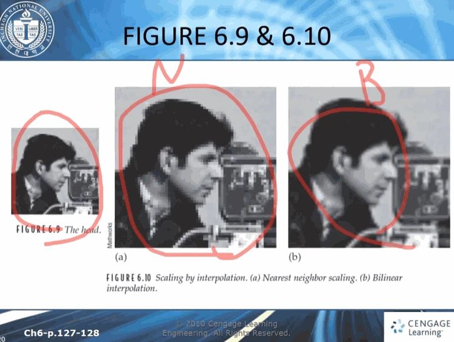

- Nearest (a)로 interpolation한 영상은 뚜렷하지만, 계단 현상이 발생한다.
- Bilinear (b)로 interpolation한 영상은 흐릿하지만, 영상이 Smooth하다.

### General Interplation

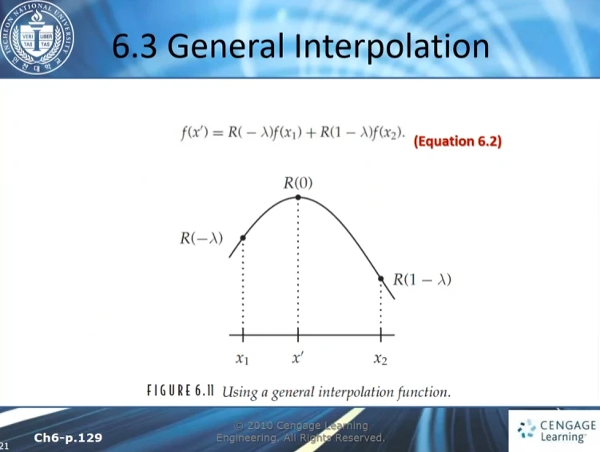

- x’에서의 값이 R(0)라고 하자. index가 0이라는 것은 현재 내 위치에서의 **가중치**라는 의미이다.  
    ⇒ 값을 얼마나 반영할 것인지를 의미하는 것.
- R(-λ), R(1-λ)라는 것은 R(0)를 기준으로 이동한 지점에서의 가중치이다.

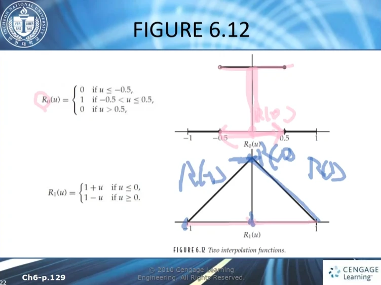

- **Nearest Neighbor** 방식에서는 R(0)가 중앙이라고 할 때, -0.5~+0.5 까지는 가중치가 1이고, 그 외에는 0이라는 것을 알 수 있다.
- **Bilinear** 방식에서는 -1부터 +1까지 가중치가 선형적으로 변화하게 되고, 0에서의 가중치는 1, u값이 변화함에 따라 -1, +1에서 0이 되는 것을 알 수 있다.

### Cubic Interpolation

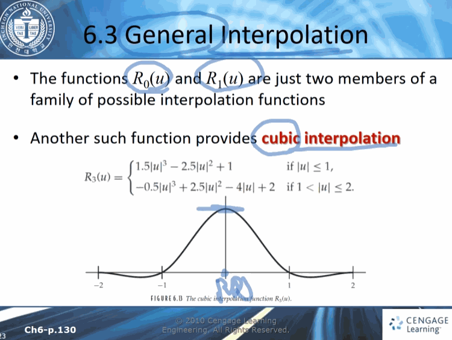

- Cubic Interpolation은 위의 공식과 같이 정의된다.
- 즉, u에 따라서 가중치가 바뀌게 되는 것이다.

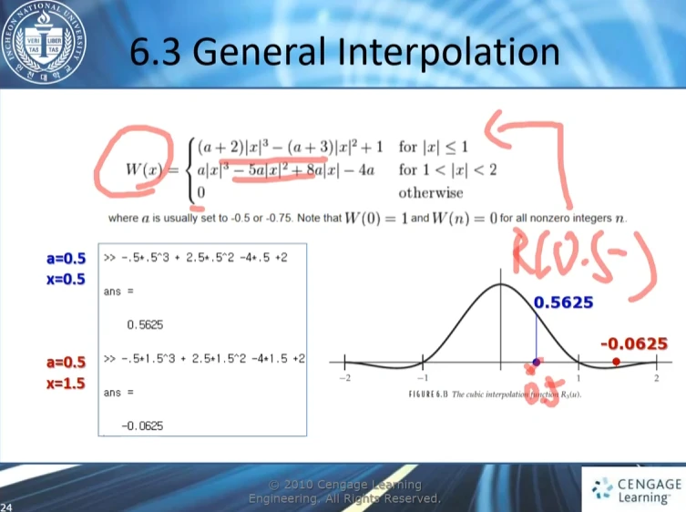

- 만약 x가 0.5라고 할 때, R(0.5)는 어떻게 될까? ⇒ 대입해보면, **0.5625**가 된다.
- 이와 비슷하게 x가 1.5라고 한다면, R(1.5)는 어떻게 될까? ⇒ **-0.0625**가 된다.

> 일반적으로 a값은 -0.5 또는 -0.75로 설정한다. 여기서는 -0.5로 가정한다.

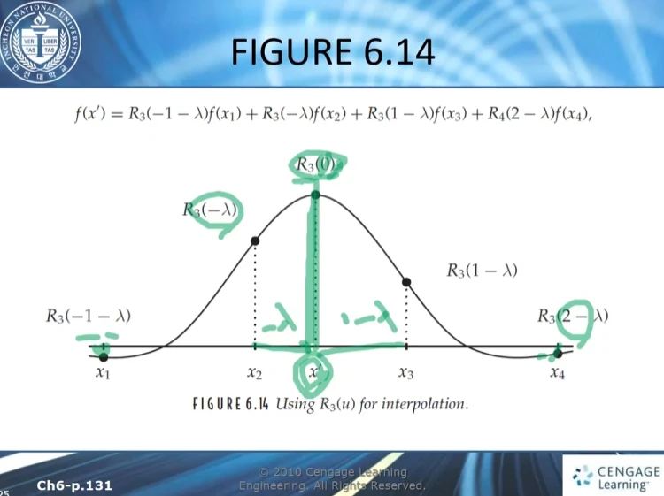

- 결론적으로, x’에서의 y값은 어떻게 계산할까?
- 이것은 λ값이 무엇이냐에 따라서 가중치 값을 결정할 수 있을 것이다.
- 가중치값이 결정이 되면, 존재하는 pixel값들에 대해서 가중치를 곱해 얻어낼 수 있다.

> 현재 이 방식은 1D 데이터에 대한 interpolation이고, 이전에 다뤘던 Bilinear 방식과는 다르게 바로 옆의 데이터에 대한 값만 신경쓰는게 아니라, 주위 값에 대해서 전반적으로 신경쓰는 방식이라고 할 수 있다.

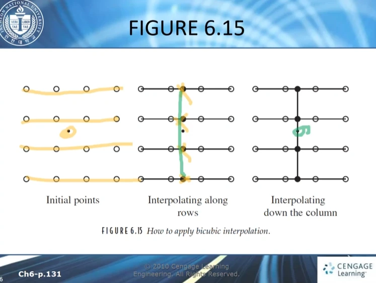

- 이제 이 방식을 이용하면 Bicubic interpolation의 값을 구할 수 있다.
- Initial Points를 검은색 점으로 지정했다고 하자. 이 곳의 값을 구하려면, 먼저 rows의 값을 알아야 한다.
- 따라서 row(y)를 기준으로, 제시된 μ값을 사용해 Bicubic 가중치 값을 구하고, 해당 위치의 pixel 값을 알아낸다.
- 그 다음에는 column(x)을 기준으로 구해진 pixel값을 활용해, 제시된 λ값을 기준으로 Bicubic 가중치 값을 구해 해당 위치의 pixel 값을 알아낸다.

> **Bicubic Interpolation Flow**  
>   
> 1. Row를 기준으로 제시된 μ값을 사용해 Bicubic 가중치 값을 계산한 다음, 이를 바탕으로 해당 위치의 Row 기준 pixel 값들을 알아낸다.  
>   
> 2. Column을 기준으로 제시된 λ값을 사용해 Bicubic 가중치 값을 계산한 다음, 이를 바탕으로 해당 위치의 pixel 값을 알아낸다.

---

### &lt;Enlargement by Spatial Filtering&gt;

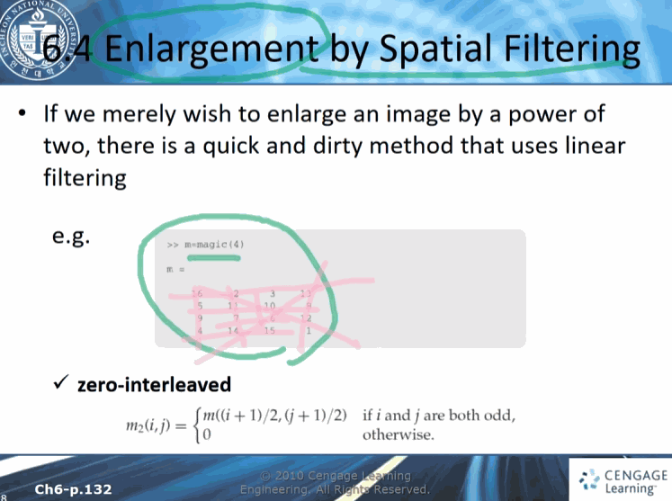

- 마방진 영상을 확대해보고자 한다.

### zero-interleaved

> 확대된 크기만큼 늘어난 pixel에 0을 끼워넣는 방식이다. 위에 제시된 공식을 활용하면, i와 j가 모두 홀수인 경우에만 실제 값을 사용하고 그 외에는 0을 사용한다.

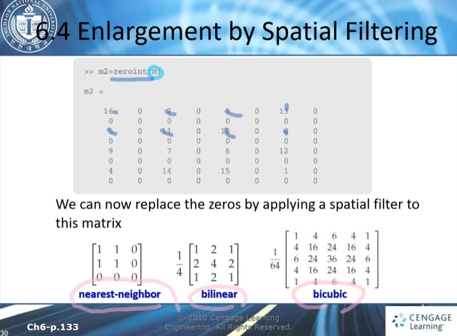

- 마방진 영상에 zero-interleaved를 적용하여 영상을 확대했다. 
- 중간중간 0이 들어간 것을 확인할 수 있는데, 이제 zero 값들을 filtering을 거쳐서 interpolation value로 변경할 것이다.

> ⇒ Zero Padding을 추가하는가?  
> ⇒ Zero Padding을 추가하는 것이 맞다. 그래야 Size가 맞다.

### Nearest-neighbor

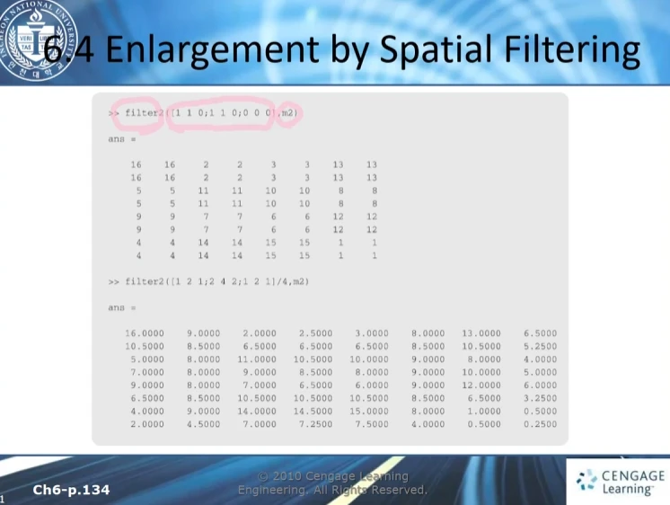

- 위에서 제시된 Nearest-neighbor filter를 컨볼루션 적용하면 위와 같이 interpolation된 결과를 얻을 수 있게 된다.

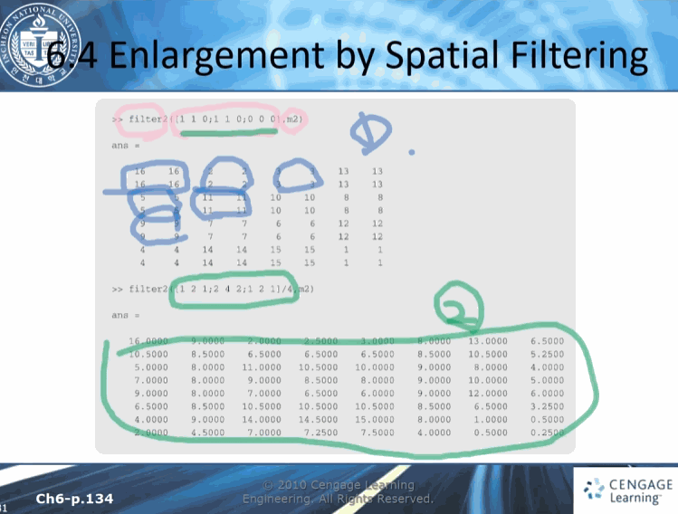

- Bilinear를 적용하면 위와 같다.

---

## &lt;Scaling Smaller&gt;

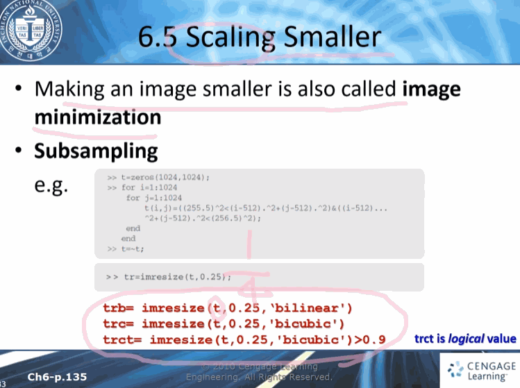

- 영상의 크기를 늘릴 수 있었으니, 이와 유사하게 크기를 줄일 수도 있다.

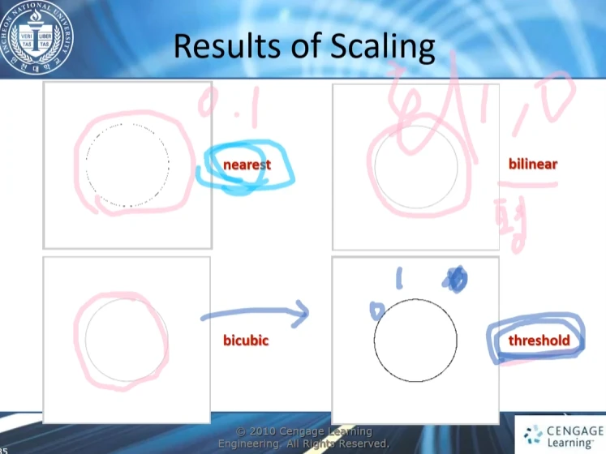

- nearest는 0 또는 1이기 때문에 중간중간 빈 부분이 존재한다.
- bilinear/bicubic은 가중치를 적용해 평균을 적용하기 때문에 실수로 표현되어 회색이 된다.
- threshold는 bicubic에 대해서 값이 특정 지점 이상이면 1로 만들고 아니면 모두 0으로 매핑하기 때문에 검정색으로 나타나지만, 빈 부분도 존재하게 된다.

---

## &lt;Rotation&gt;

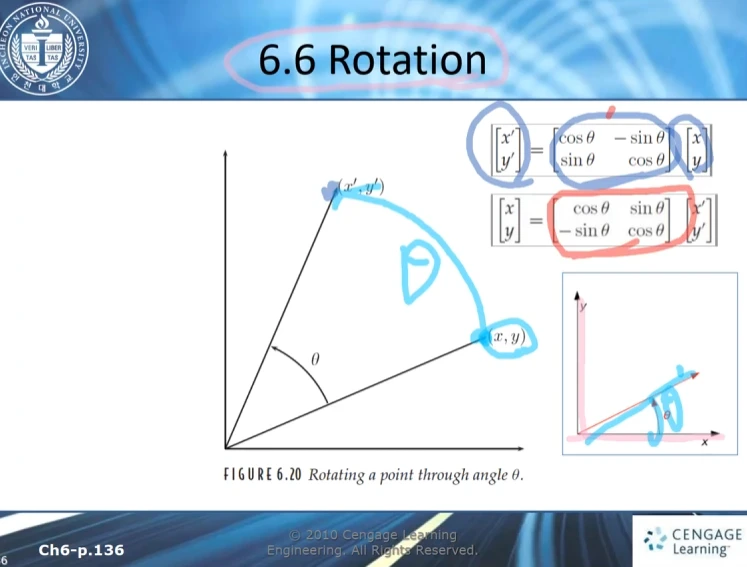

- 영상을 이차원 평면에서 회전시키고자 한다면, 회전 행렬과 행렬곱하면 된다.

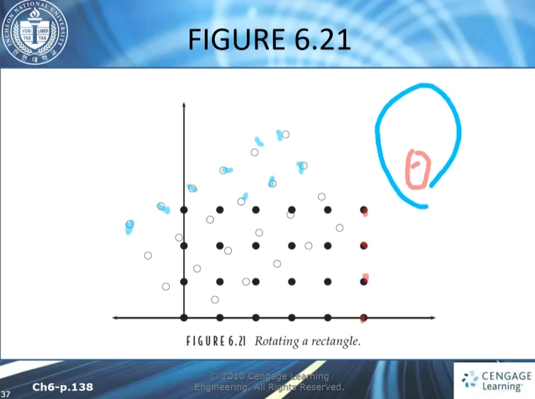

- 검은색 점이 실제 영상이라고 할 때, 회전이 된 픽셀이 흰색 점으로 나타난다.
- 그런데 이렇게 하면 문제가 되는 것이, 우리가 영상을 디스플레이하는 모니터는 반드시 영상을 모니터에 맞게 디스플레이 가능하므로, 흰색 점처럼 디스플레이 할 수는 없다.

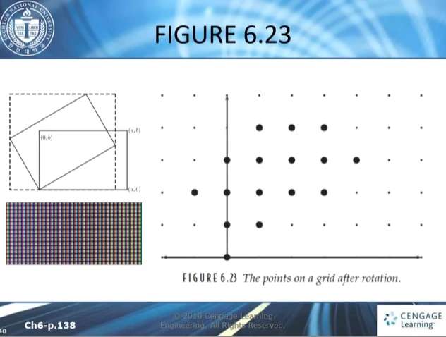

- 이 문제를 해결할 수 있는 방법은, 회전된 픽셀들(검은 점)이 어디서 왔는지를 알아내는 것이다.

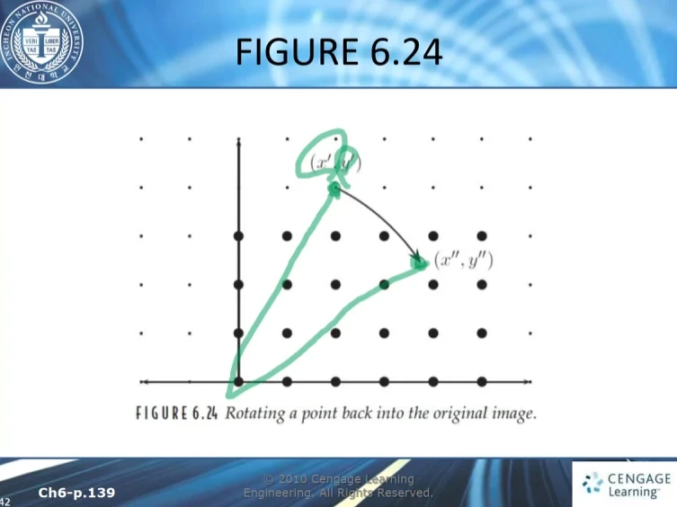

- 만약 회전된 픽셀 (x’, y’)가 (x’’, y’’)에서 왔다면, (x’’, y’’)의 값을 interpolation 공식을 사용해서 구해낼 수 있을 것이다.

- 예컨대 Nearest Neighbor를 사용한다면, 빨간색 점 값이 될 것이다.

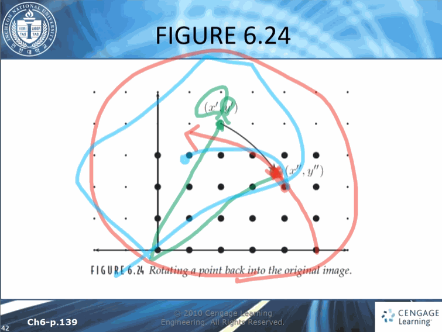

> 정리하자면, Original (검은 점)에서 이동을 시키는게 아니라, 일단 영역을 이동시켜 본 다음, 해당 영역 내에 존재하게 될 Pixel들의 값을 Original 값에서 찾아 지정해 준다는 것이다.
