# Fourier Transform

## &lt;Fourier Transform Introduction&gt;

> 다음 이미지를 보고 무엇을 알 수 있을까? 왼쪽 이미지는 Spatial Domain에서 표현한 이미지이고, 이를 Fourier Transform하여 Frequency Domain에서 나타낸 것이 우측의 이미지이다.  
>   
> 이 이미지를 보면 중앙이 밝게 나타나는 것을 알 수 있는데, 이를 통해 저주파가 높은 영상이라는 것을 알 수 있고, 고주파는 어둡기 때문에 에너지가 상대적으로 적다는 것을 알 수 있다.  
> 그리고 대각선, 수평 성분이 존재함도 알 수 있다.

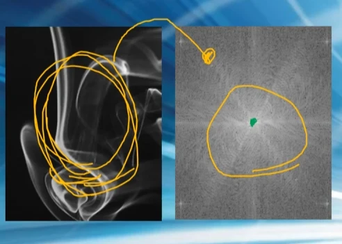

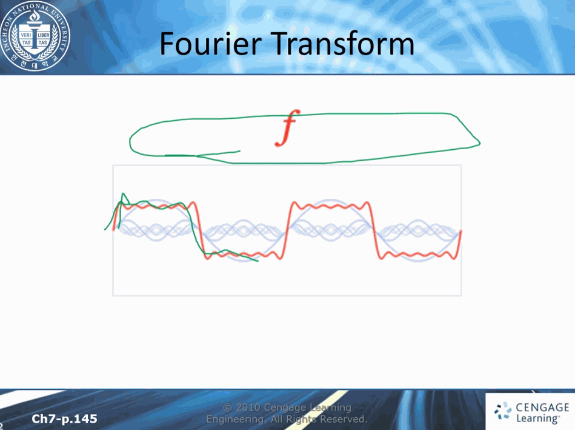

- 어떠한 영상이 위와 같이 존재할 때, 우리는 이것을 Fourier 분석을 통해 여러 개의 신호로 분리하여 급수로 만들 수 있다. (여러 개의 sin, cos으로 이루어 짐)

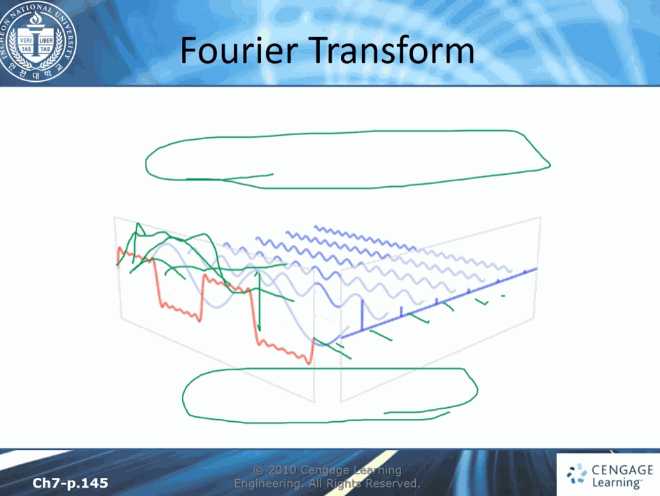

- 이와 같이 수많은 신호로 구성될 수 있으며, 저주파는 상대적으로 진폭이 크고, 고주파는 진폭이 작음을 알 수 있다.
- 세상의 모든 Signal은 sin과 cos의 합으로 이루어질 수 있고, 일반적으로 저주파의 에너지가 고주파의 에너지보다 크다.

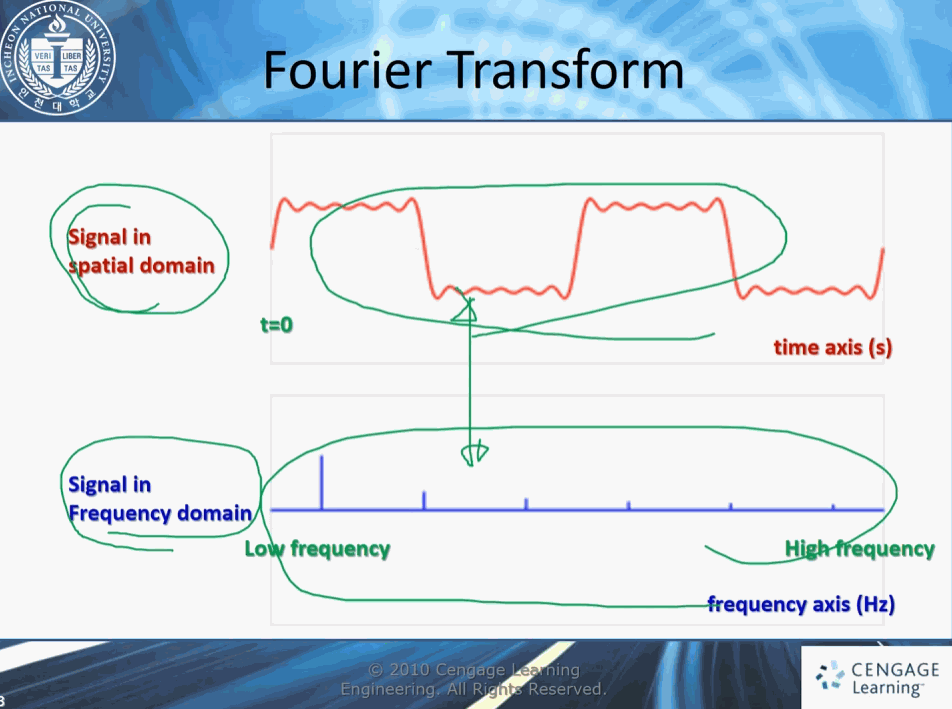

- Spaital Domain에서의 Signal은 위처럼 나타나고, 이를 Frequency Domain으로 변경하면 아래처럼 나타낼 수 있다.
- Spatial Domain에서는 Time이 하나의 축이 되지만, Frequency Domain에서는 Frequency가 하나의 축이 된다.

---

## &lt;Fourier Transform&gt;

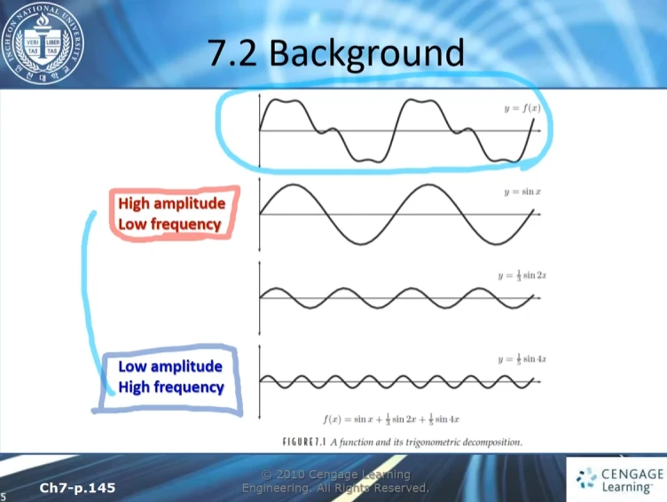

- 일반적으로 어떠한 신호는 High Amplitude Low Frequency Signal과 Low Amplitude High Frequency Signal의 합으로 나타낼 수 있다.
- 어떻게 이와 같이 푸리에 급수를 만들 수 있을까?

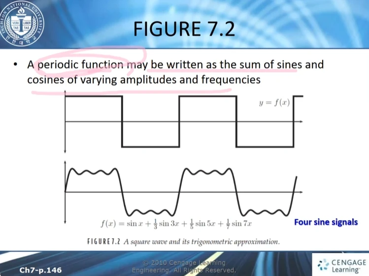

- 푸리에 급수란, 모든 신호를 sin과 cos의 합인 급수로 나타낼 수 있다는 것이다. 심지어는 주기가 없더라도 주기가 무한대인 Signal로 가정하여 급수를 구해낼 수 있다.
- 위와 같이 y=f(x) 구형파가 존재할 때, 이것을 급수로 표현할 수 있을 것이다.
- 또한 두 시그널은 같은 시그널이다.

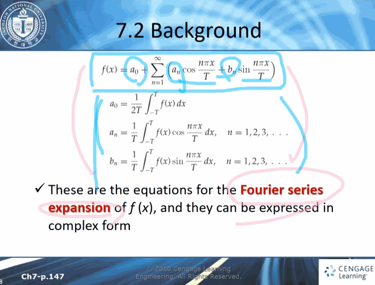

- 푸리에 급수는 위에서 제시된 f(x)처럼 나타낼 수 있다.
- 푸리에 급수는 a0, an, bn으로 구성되며, 이를 구하는 공식은 위와 같다.

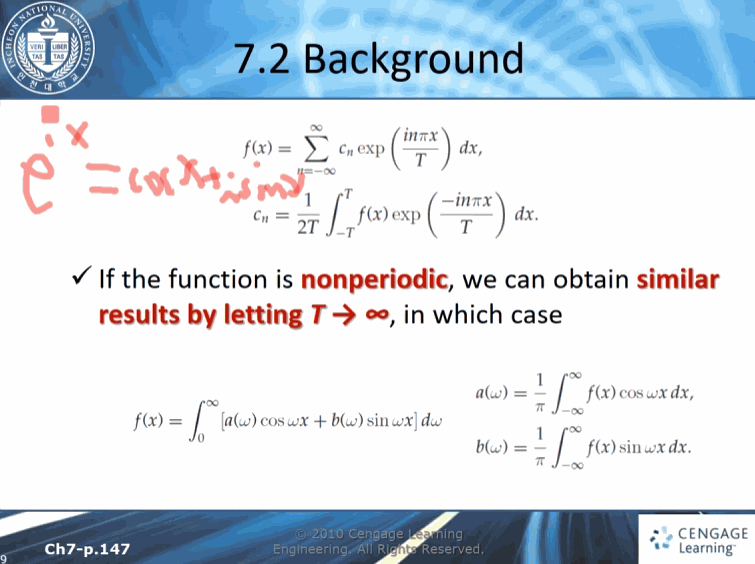

- 또한, sin과 cos으로 나타낼 수 있다는 것은 오일러 공식에 의해서 exponentional로 나타낼 수도 있다는 것이다.

$$
e^{ix} = cosx + isinx
$$

따라서, 푸리에 급수는 exponential을 통해 위와 같이 표현할 수도 있다.

> 만약 시그널이 주기 함수가 아니라면, 주기가 무한대라고 가정하고 비슷한 결과를 나타낼 수도 있다는 것이 위 이미지의 아래 공식이다.

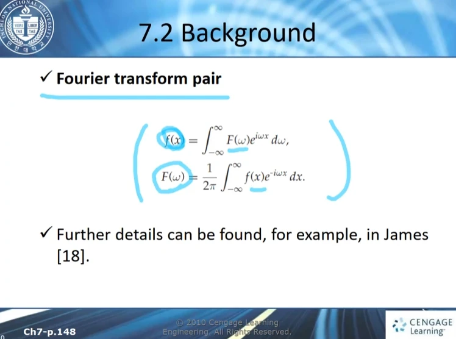

- 푸리에 트랜스폼에 따르면, 어떠한 신호 f(x)는 위와 같이 F(ω)로 나타낼 수 있다.
- ω = 2πf이고, 만약 ω = f라면, F(ω)의 coefficient인 1/2π는 존재하지 않을 것이다.

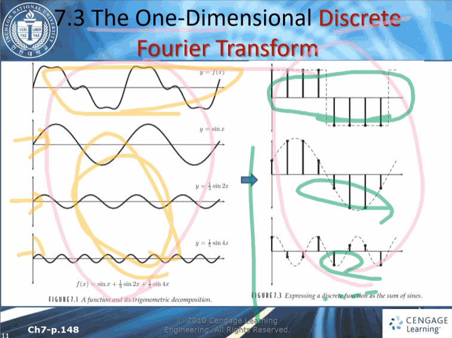

- y = f(x)라는 한 시그널을 얻기 위해서, 그 아래의 노란색 시그널들이 계속 추가되었다.
- 이와 마찬가지로 구형파 하나를 얻기 위해서 녹색 시그널들이 계속해서 추가되어야 한다.
- 이를 **Discrete Fourier Transform**이라고 한다.

### One-dimensional Discrete Fourier Transform

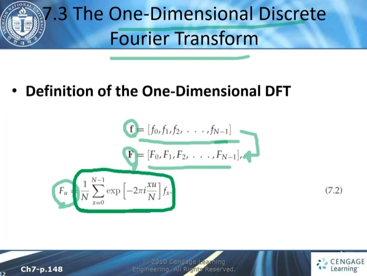

- Fourier Transform의 공식은 교재마다 매우 다양한데, 우리는 위와 같이 정의하자. (Fu)

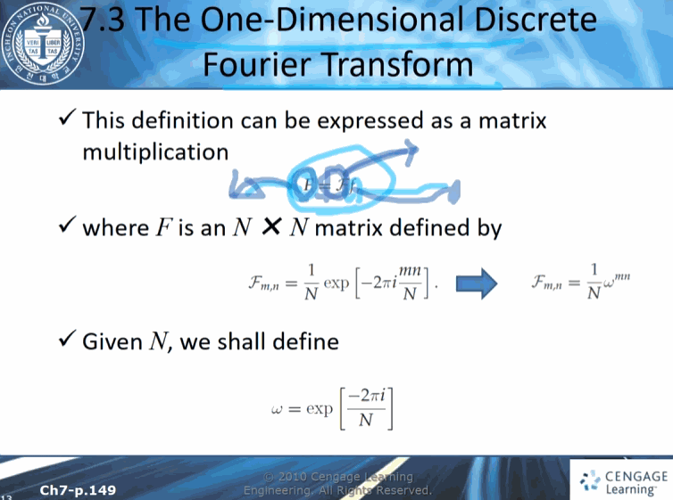

- F = *F*f 라고 할 때, F는 Frequency Domain의 Signal, f는 Spatial Domain의 Signal이다. 이탤릭체 *F*는 Fourier Transform 자체를 뜻한다.
- 만약 F가 N x N Matrix라고 한다면, 이와 같이 정의될 수 있다.

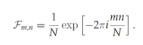

- 이 때, ω는 다음과 같다.

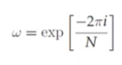

- 따라서, *F*(m,n)은 다음과 같이 정의된다.

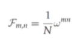

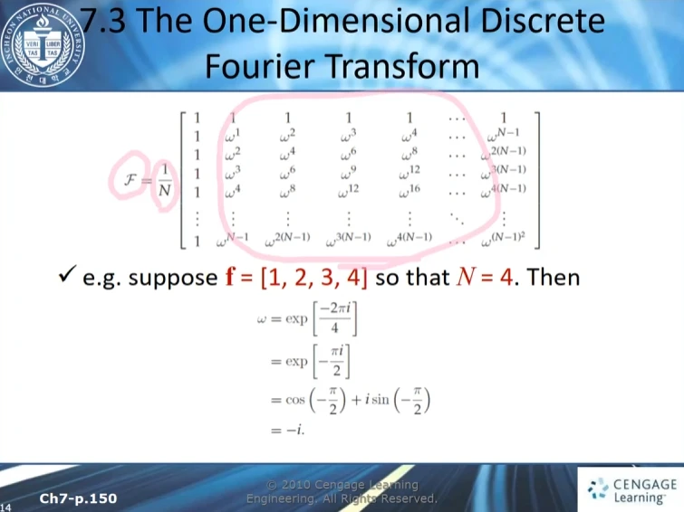

- 만약 f = [1, 2, 3, 4]이다. 그러면 N = 4이다. 이 때 ω를 계산해보자.

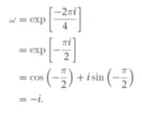

- ω = -i가 된다.

⇒ 이제 이 결과를 Fourier Transform Matrix에 대입하자.

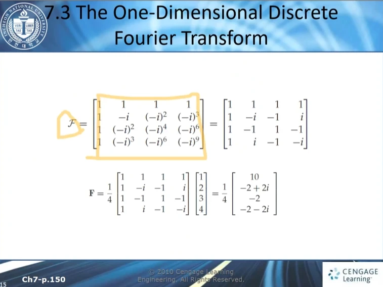

- 이전에 설명한 대로, 구했던 ω를 바탕으로 *F*를 구하고, F = *F*f를 계산하면 된다. 이것이 One-dimensional Discrete Fourier Transform이다.

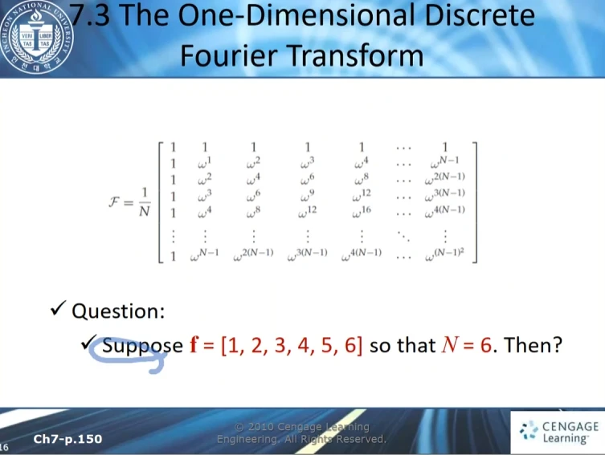

- 만약 f = [1, 2, 3, 4, 5, 6]일 때도 Fourier Transform 결과를 구할 수 있을 것이다.

### Properties of the One-dimensional DFT

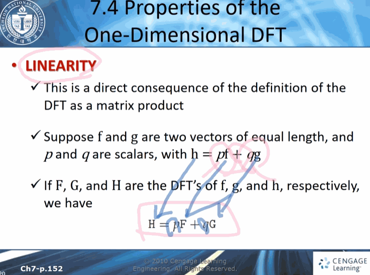

- **Linearty** : 각각의 Fourier Transform을 구하고 Scalar를 곱해서 더하는 것과, 먼저 곱한 것에 대해서 Fourier Transform을 구해서 더한 것은 같다.

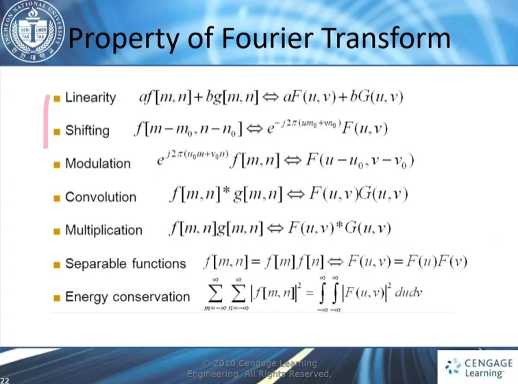

- 다양한 특성이 존재한다.

### Shifting

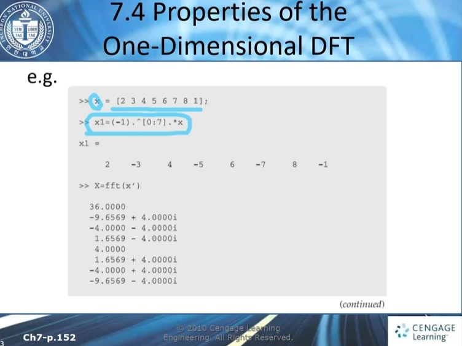

- 만약 원 신호에서 짝수 번째 값들에 마이너스를 곱했다고 해보자.
- 이 변환을 수행하기 전에 얻어낸 fft 신호가 위와 같다고 할 때, 바뀐 신호에 대해서 fft를 적용하면 결과가 어떻게 바뀔까?

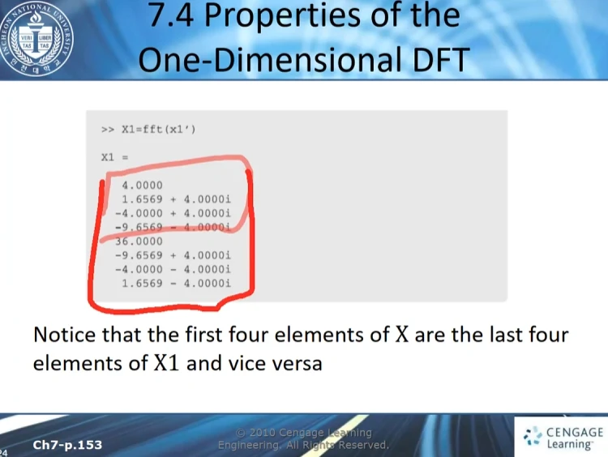

- 이와 같이 신호 절반이 **Shifting** 된다는 것을 알 수 있다.

### Scaling

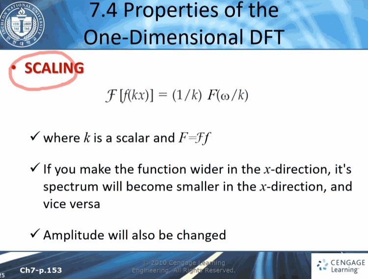

- 이것은 만약 f(kx)에서 k가 2였다고 할 때, Fourier Transform을 적용한 신호는 1/2배가 된다는 것을 의미한다.
- 예를 들어보자. 우리가 만약 x라는 신호의 Fourier Transform 결과를 안다면, 2x에 대해서 Fourier Transform 결과는 어떻게 될까?
- (1/2)F(ω/2)가 돼서, 높이는 절반으로 줄고 주기는 두 배로 늘어나게 된다.

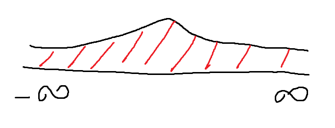

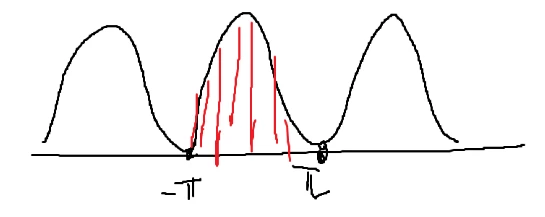

⇒ 무한대의 주기로 표현되는 것을 2pi 내로 줄이면, 면적이 같아진다.

### Separability

> 이차원 데이터가 있을 때, 먼저 한 방향에 대해서 Fourier Transform하고 나서 다른 방향에 대해 Fourier Transform을 적용해도 똑같다는 것이다.

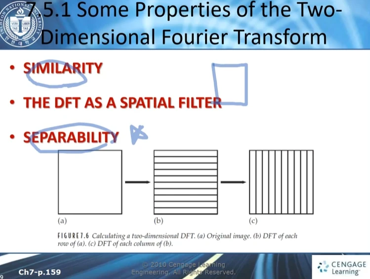

### DC Component

> DC Component는 Fourier Transform 결과(Frequency Domain에서의 Signal)에서 (0, 0)의 값을 의미한다. 주파수 도메인에서의 Signal은 Sin과 Cos으로 구성된 급수로 표현된다. 그런데 Sin(0)과 Cos(0)은 값이 0과 1이기 때문에 값이 변화하지 않는다.

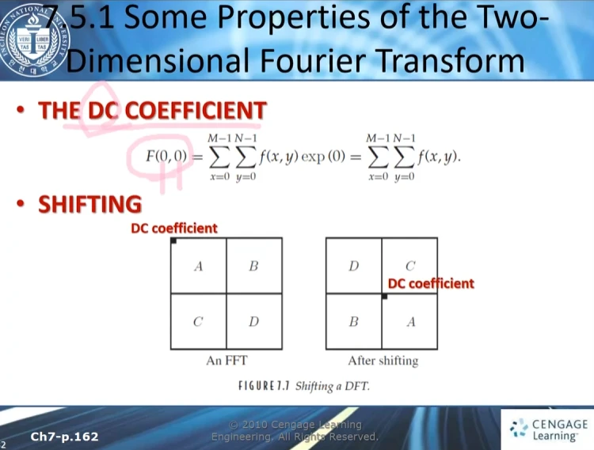

> 즉, F(0, 0)는 모든 x값과 모든 y값을 다 더한 것을 의미한다.

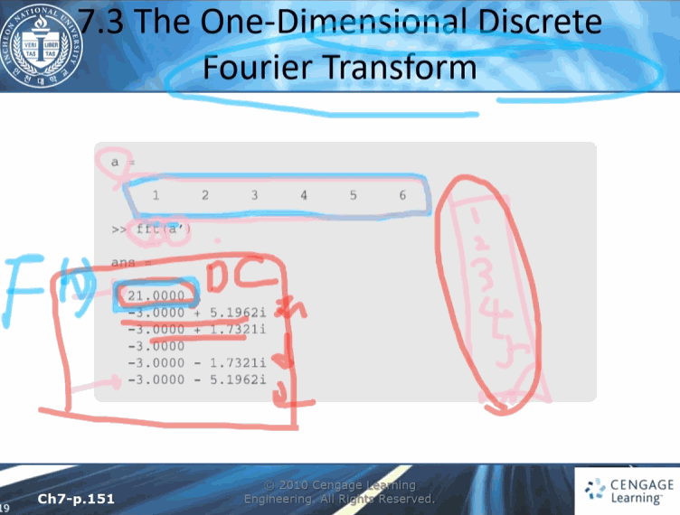

- 이전에 봤던 예제를 살펴보면, F(0)가 21인 것을 확인할 수 있는데, 이것은 전체 시그널의 합이라고 해석하면 된다.

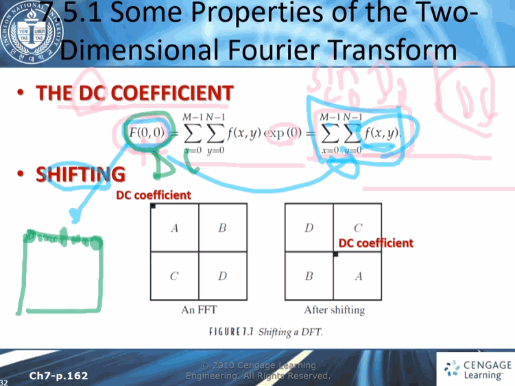

- Fourier Transform을 하면 영상의 (0, 0)이 DC 성분이 되고, 오른쪽으로 갈수록 고주파가 된다. 즉, 가운데가 고주파 성분이 되고, 나중에 가면 다시 저주파 성분이 된다. (끝쪽)
- 왜 그렇게 되냐면, 이렇게 해석해야 된다.

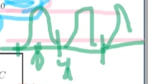

- 신호가 이와 같이 주기적으로 그려진다고 해보자.

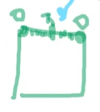

- 이때, (0, 0)이 DC 성분이 되고, 가장 오른쪽은 주기의 마지막 부분이므로, 저주파가 된다.

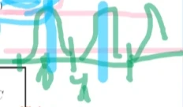

- DC 성분은 파란색 막대로 표현한 부분이다.

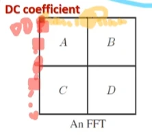

- 또한, 수직으로 봤을 때도 (0, 0)이 최저주파이고, 마찬가지로 중앙이 고주파, 가장 끝쪽은 저주파가 된다.

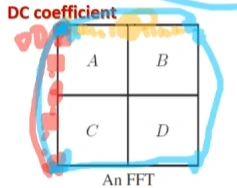

- 그 이유가 무엇이냐면, 실질적으로 주기에 의해 반복이 되고, 결국 값은 복사가 되는 것이기 때문에 사실상 위의 그림에서 파란색 점이 모두 같은 포인트라는 것이다.

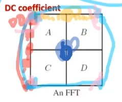

- 따라서, 모서리 부분이 저주파가 되고, 중앙이 고주파가 되는 것이다.

> 그런데, 이게 알아보기가 굉장히 어려우므로, 우리는 Shifting을 해준다.  
> 저주파가 중앙에 오고 고주파가 바깥으로 가는 것이 알아보기 좀 더 편할 것이다.  
> (일반적으로 저주파가 좀 더 중요하고 고주파는 덜 중요해서 중요한 것이 가운데로 오게 만드는 과정이라고 생각하면 된다.)  
> ⇒ 다만 이것은 Display를 할 때만 사용된다.

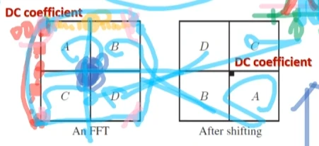

- 이에 따라 Shifting을 해서 좀 더 알아보기 편하게 한다.

---

### FT Examples

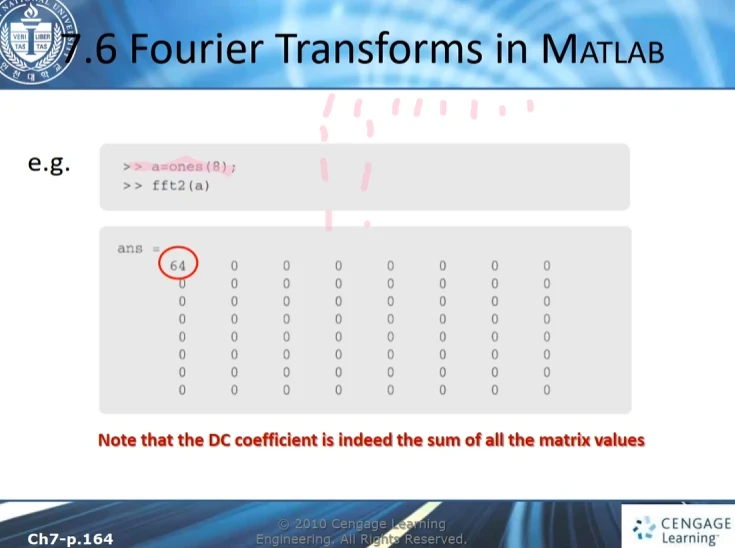

- ones를 Fourier Transform하면, 교류 시그널이 아니기 때문에 DC 성분만 존재한다.

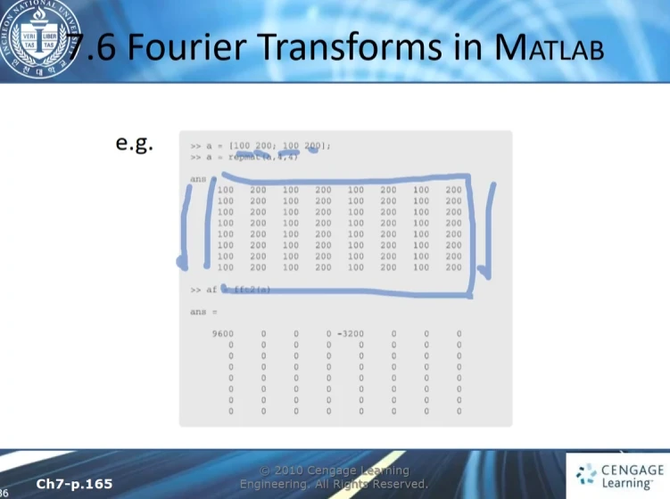

- 이번에는 [100 200; 100 200]이 반복되는 형태라고 생각한다.
- 이것은 실제로 다른 시그널들의 합으로 표현할 수도 있는데,   
    예컨대 [100 100 100 100] + [0 100 0 100]와 같이 할 수도 있고, 아니면  
    [150 150 150 150] + [-50 50 -50 50] 으로 표현할 수도 있을 것이다.
- 이럴 경우, 수직 방향으로는 변화가 없기 때문에 모두 0이 되고, 수평 방향으로는 값의 변화가 존재한다.
- 우선 DC 성분은 9600이다. (100\*32 + 200\*32 = 9600)

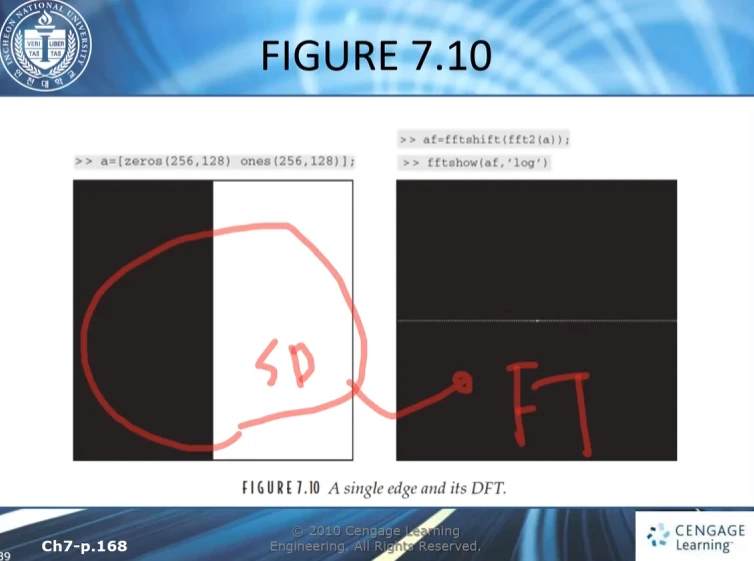

- 원본 영상에 수직 방향으로는 변화가 없고 수평 방향으로만 변화가 있기 때문에 FT를 했을 때도 수평에서만 신호가 나타나는 것을 알 수 있다.

---

## &lt;Filtering in the Frequency Domain&gt;

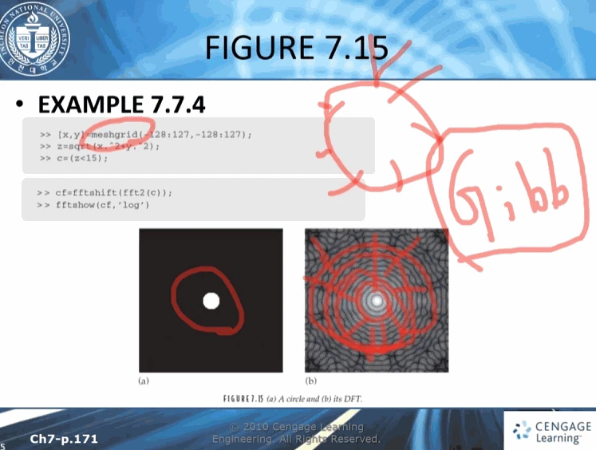

- 이전에 다뤘던 예제들 중에서 위와 같이 값이 0 → 1 → 0으로 급격하게 바뀌는 것은 Signal이 매우 지저분하게 나오게 된다. 

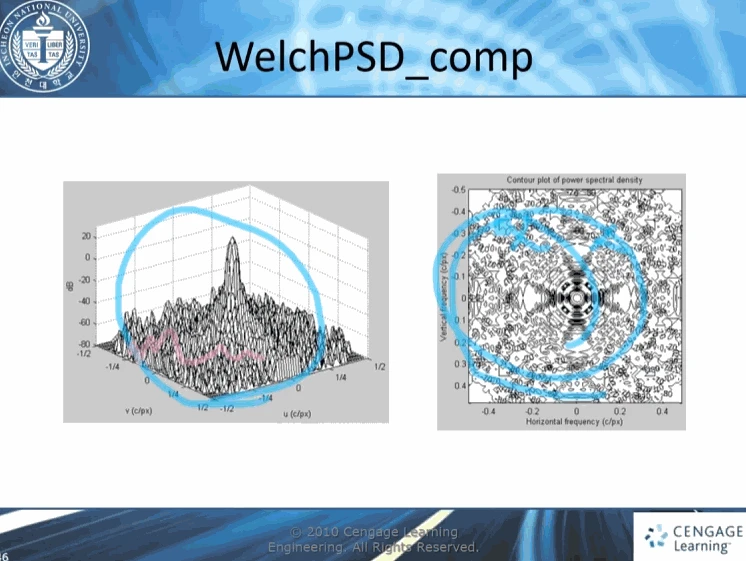

- 왜냐면, 모든 주파수에서 Coefficient가 나타나기 때문이다. 그래서 이걸 스무스하게 처리해주면 신호가 아주 깔끔하게 바뀌는데, 역시 Filtering을 적용하는 것이라고 볼 수 있다.

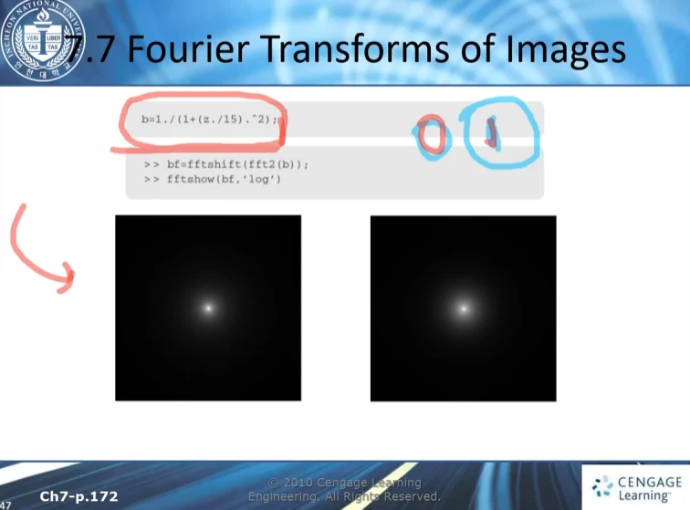

- 이전과 달리 이렇게 스무스하게 밝기가 변하는 이미지는 FT를 했을 때 시그널이 매우 깔끔하게 나오게 된다.

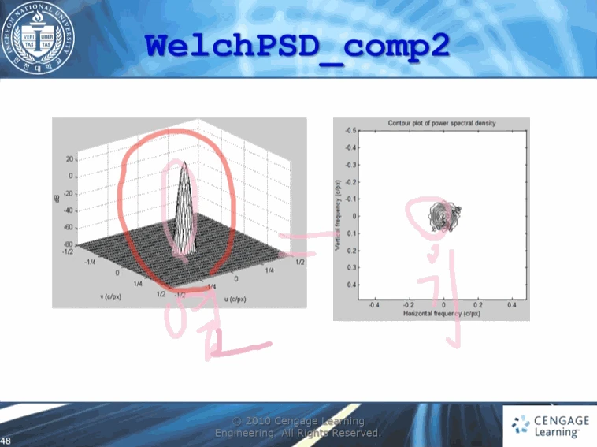

- 왼쪽 그림은 시그널을 옆에서 본 것이고, 오른쪽 그림은 위에서 본 것이다.

### Ideal Filtering on Low-Pass Filtering

> Ideal Filtering은 0에서 1로 값이 뚝 떨어지는 방식을 활용하는 필터링이다. 이를 Low Pass Filtering에 적용해본다.

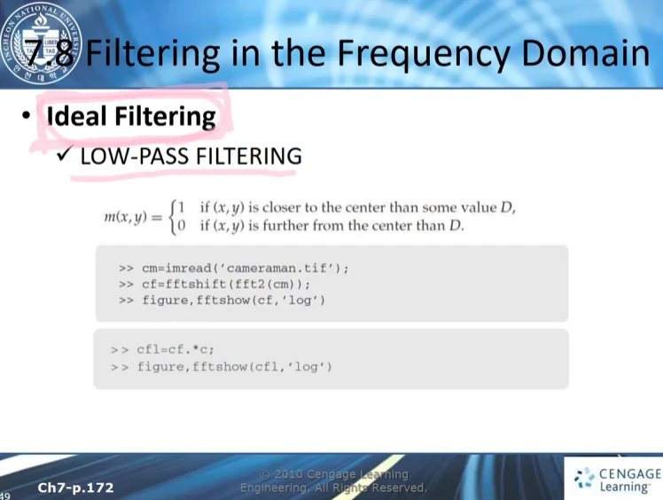

- Low Pass Filter에서 Ideal Filtering을 한다고 하자.
- 이때, D라는 크기의 반경을 설정한다.

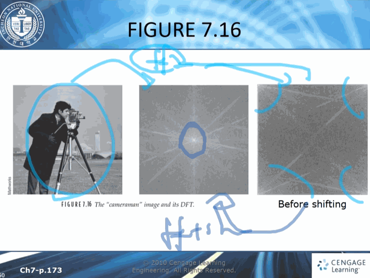

- Cameraman 영상에 ff2를 적용하고 fftshift를 하면 위와 같이 이미지가 나오게 된다. 가운데 부분이 저주파 성분이다.
- 이제 이 신호에서, D로 설정한 반경만큼 Frequency Domain 영상을 도려내보자.

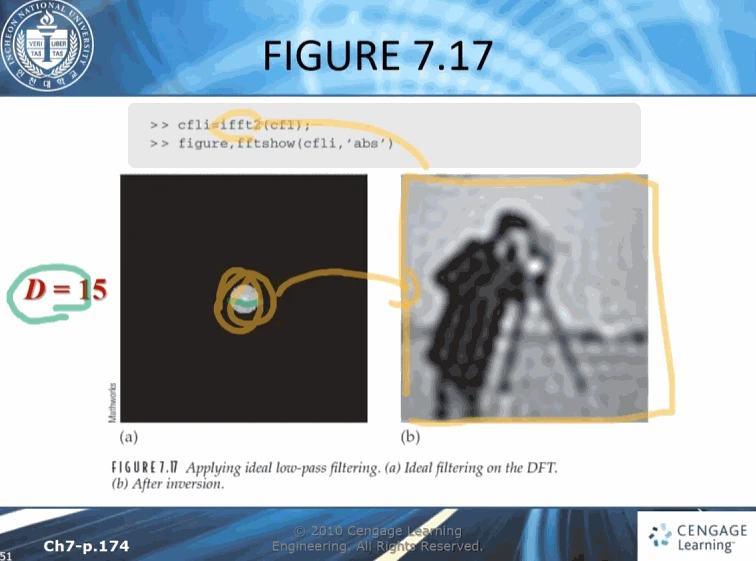

- 도려낸 만큼 Inverse FT를 적용했더니, 이미지가 이와 같이 나왔다.
- 지저분한 물결무늬가 생기는데, 이것이 Gibbs phenomenon이라고 한다.
- 이것이 보기 싫기 때문에, 0에서 1로 곧바로 떨어지는게 아니라 스무스하게 떨어지는 반경을 설정하여 본다.

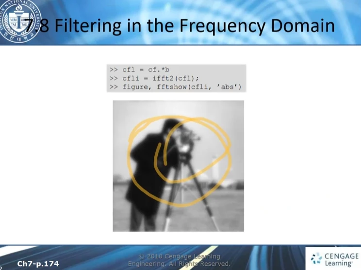

- 그랬더니 물결무늬가 생기지는 않더라. (지저분하진 않더라.)

### Ideal Filtering on High-Pass Filtering

> 이번에는 Ideal Filtering을 High-Pass Filtering에 적용해보자.

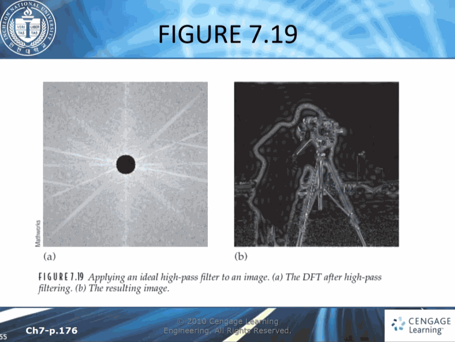

- 역시 마찬가지로 물결무늬가 나타난다.

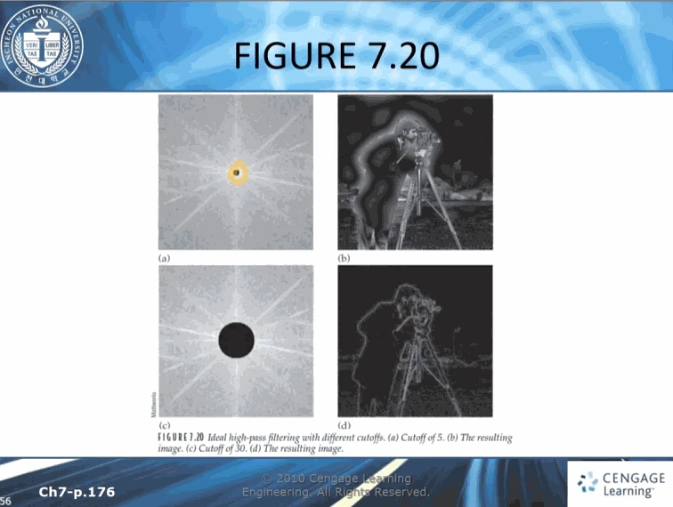

- D가 작다면 저주파 성분을 많이 얻기 때문에 영상이 어느정도 뚜렷해진다.
- 반면 D가 크다면, 저주파 성분을 많이 잃기 때문에 Edge가 나타나게 되고, 물결 무늬가 나타나게 된다.

> 저주파 성분이라는 것은 값의 변화가 크지 않은 것을 말한다. 따라서 경계선이 아닌 부분은 대체로 비슷한 Pixel 값을 가지므로 저주파 성분이다. 그렇기 때문에 저주파 성분을 Display하면 전체 그림이 대략적으로 나타나게 되는 것이다.  
>   
> 반면 고주파 성분은 경계선에서 뚜렷하게 나타난다. (Pixel 값의 변화가 크기 때문에) 따라서 고주파 성분을 Display하면 전체 그림의 Edge가 나타나게 되는 것이다.

### Butterworth Filtering

> Ideal Filtering에서 생기는 Ringing 문제를 해결하기 위해 도입되는 필터이다. 이걸 하기 위해서는 (이전에 했던 것처럼) Sharp하게 Filter를 생성하는게 아니라, 값이 Smooth하게 변하도록 Filter를 생성해야 한다.

- Ideal Filter 버젼의 High Pass Filter와 Low Pass Filter이다.

- 위 방식 대신에 Smooth하게 떨어지고 올라가는 Filter를 생성한다.
- Butterworth Filter를 사용하면 Ringing을 감소시키며 Low/High Pass Filter를 사용할 수 있다.

- Low Pass Filter에서 Butterworth Filter를 사용하면 이전과 달리 Ringing이 줄어든 것을 확인할 수 있다.

- High Pass Filter에서 Butterworth Filter를 사용하면 역시 Ringing이 줄어든 것을 확인할 수 있다.

### Gaussian Filtering

> Butterworth Filter의 일종으로, 가우시안 분포처럼 Filter가 생겼다.

- Low Pass Filter에 Gaussian Filter를 곱하여 Filtering을 적용했을 때의 예시이다.
- D(반경)가 작을 경우, 고주파 성분이 부족하기 때문에 영상이 흐리게 나오는 것을 확인할 수 있으며, D가 클 경우에는 영상이 뚜렷하게 나오는 것을 확인할 수 있다.

- High Pass Filter에 Gaussian Filter를 곱하여 Filtering을 적용했을 때의 예시이다.

---

## &lt;2D-FT Example&gt;

