# Image Restoration

작성일 2023-12-05 · 최종 수정일 2024-11-22
{ .post-date }

## &lt;Types of Noise&gt;

### Gaussian Noise

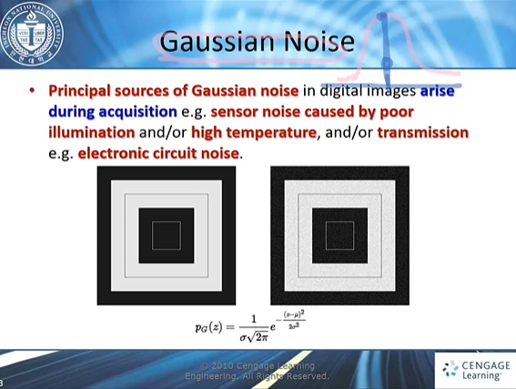

- 영상에 존재하는 노이즈는 랜덤값이며, Gaussian Noise의 경우 어두울수록 노이즈가 많아진다.
- 전자회로 등에서 생기는 노이즈가 Gaussian Noise의 예시이다.
- Gaussian Noise는 0~255 사이의 다양한 값으로 존재할 수 있다.

- 이것은 더해지는 노이즈이다. (Add)

    - Additive Noise

### Salt-and-Pepper Noise

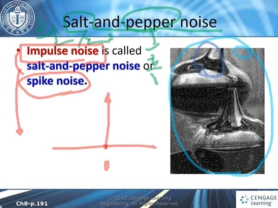

- Impulse하게 생기는 노이즈이며, 0 또는 1로 노이즈가 발생한다.

- 이것은 더해지는 노이즈이다. (Add)

    - Additive Noise

### Noise

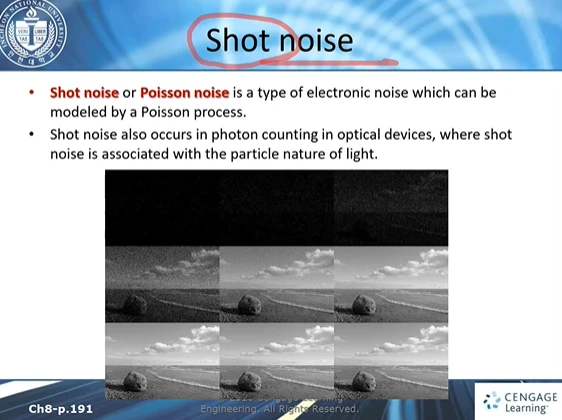

- 푸아송 분포를 따라 생기는 노이즈이다.
- 전자 노이즈이며, 사진을 찍을 때 생기는 노이즈이다.

- Shot Noise는 매우 미미하게 만들어지기 때문에, 영상처리에서 크게 주목하진 않는다.

    - Shot Noise는 곱해지는, Multiplicative Noise이다.

- 그러나 Gaussian Noise와 Salt-and-Pepper Noise의 제거는 많은 사람들이 관심을 가진다.

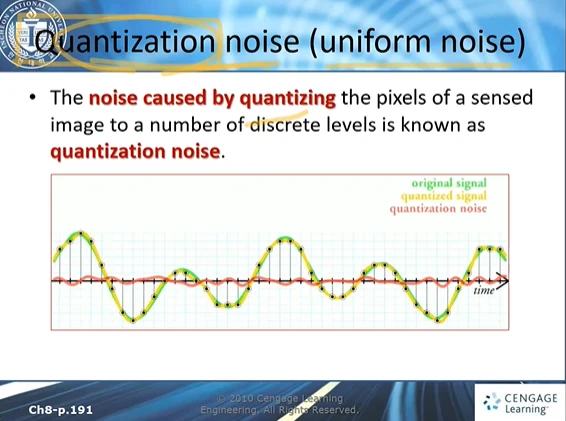

- Quantization을 하는 과정에서 Noise가 발생할 수 있다.
- Original Signal이 녹색 시그널이고, Quantized Signal이 노란색 시그널이다.
- 이때, 녹색에서 노란색을 빼면 Quantization Noise가 된다. 이것은 Original Signal과 Quantized Signal의 값의 차이를 의미한다. ⇒ Error 라고 볼 수도 있다.

### Periodic Noise

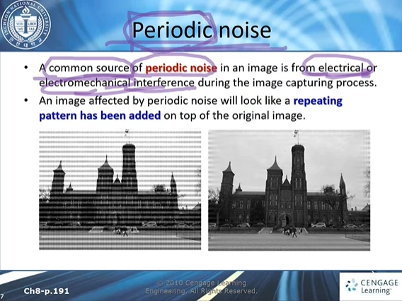

- 위와 같이 반복된 패턴으로 나타나는 노이즈를 Periodic Noise라고 한다.
- 이걸 주파수 도메인에서 확인하면 제거할 수 있게 되는데, 적절한 연산을 처리하고 인버스 TF를 취하면 노이즈가 제거된 영상을 얻을 수 있게 된다.

---

## &lt;Image Restoration&gt;

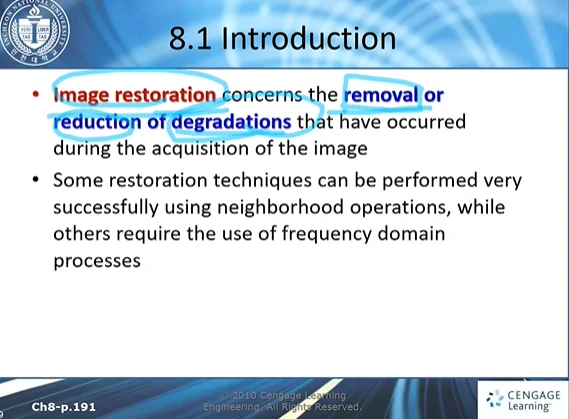

- Image Restoration은 영상에서 노이즈를 제거하거나 화질을 높이는 것을 말한다.
- 이것은 Spatial Domain에서 Neighborhood operation을 하거나, Frequency Domain에서 처리가 가능하다.

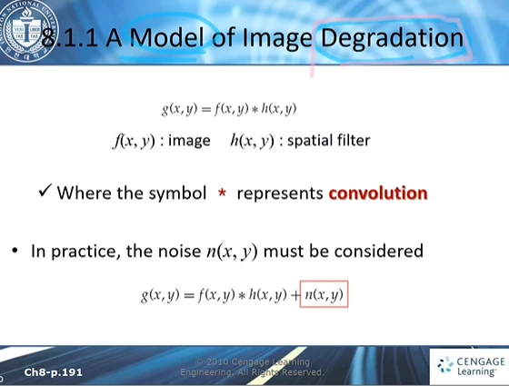

- Original Signal f(x, y)가 존재할 때, 필터링은 주파수 도메인에서는 곱으로 표현되고, 공간 도메인에서는 컨볼루션으로 표현된다.
- 만약 h(x, y)가 Noise라고 한다면, g(x, y)는 노이즈가 낀 영상이 된다.
- Multiplicative Noise는 제거하는 것이 매우 어렵고, Pixel 값이 0인 곳에서는 Noise가 아예 적용되지 않지만 Pixel 값이 클수록 Noise가 커진다.
- Additive Noise는 원본 시그널에 더해진다고 생각할 수 있다.

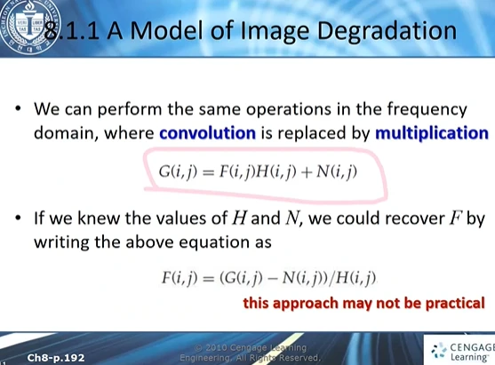

- Multiplicative/Additive Noise를 더한 식에 대해서 FT를 적용하고, 이걸, Frequency Domain에서 정리하면 아래 공식과 같다.
- 다만 이렇게 정리하는 것이 실질적으로는 어려운데, 왜냐면 우리가 H는 알 수 있지만, Additive Noise인 N을 알아내는 것이 매우 어렵기 때문이다.

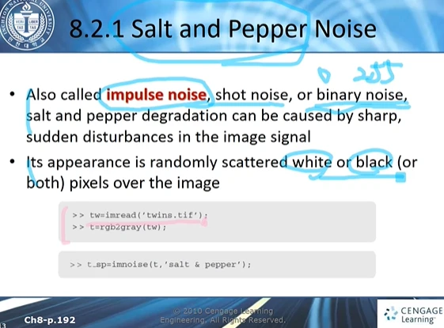

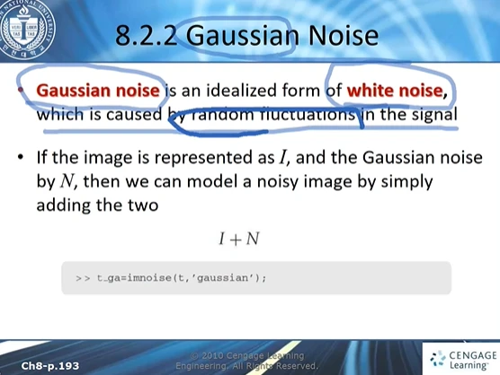

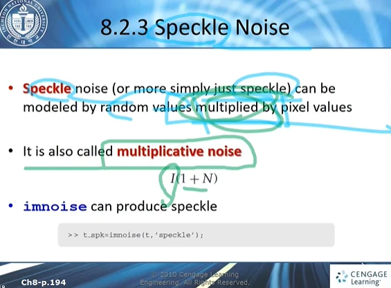

- Multiplicative Noise이므로, 원본 시그널에 곱해진다.

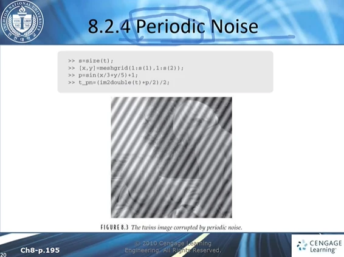

---

## &lt;Denoising&gt;

### Cleaning ‘Salt and Pepper’ Noise

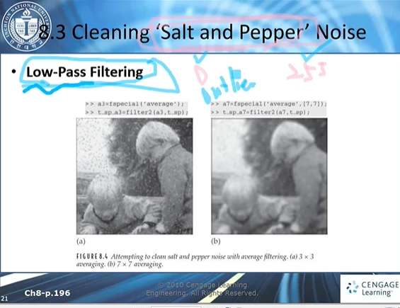

- Salt and Pepper Noise가 나타난다면, Outlier들을 제거하기 위해서 Low-Pass Filter를 통과시키면 된다. (Average Filter)
- 하지만 영상이 흐려지기 때문에 좋은 방법이라고 할 수는 없다.

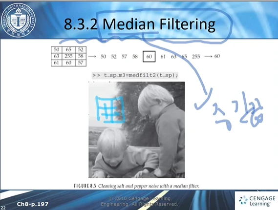

- 대안으로 Median Filter를 사용할 수 있다. Filter의 Convolution을 적용할 때, 가운데 Filter의 값을 제거하고 중간값으로 대체하는 것이다.
- 그러면 Salt and Pepper Noise가 제거되고 영상이 깔끔하게 나오게 된다.

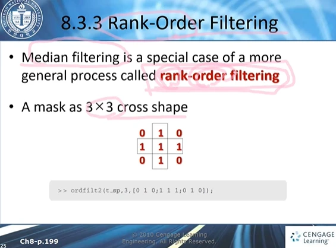

- Rank-Order Filtering은 Median Filter를 개선한 것이다. Median Filter는 값이 모두 1로 구성되어 있었지만, Rank-Order Filter는 위와 같이 생겼다.
- 이는 Median Filter와 비슷한 결과가 나온다.
- Median Filter를 사용하는 것이 가장 좋지만 이걸 사용하지 않는 이유는 Sorting을 해야 하기 때문인데, 따라서 이걸 개선한 것이 Outlier Method라고 할 수 있다.

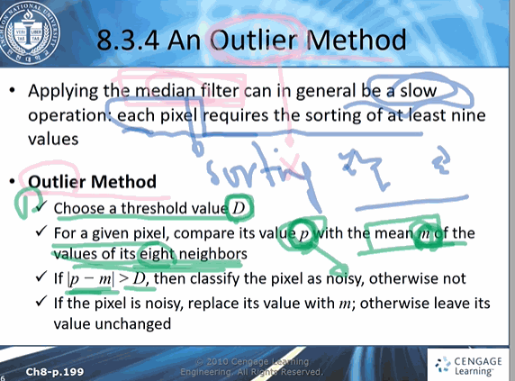

- Threshold Value D를 결정한다.
- 한 Pixel의 값 p와 주위 8개 neighbor의 평균값 m을 비교한다.
- 만약 |p-m| &gt; D라고 한다면, 현재 pixel에 noise가 꼈다고 판단한다.
- 만약 pixel이 noise하다면, p를 m으로 변환한다.

### Cleaning ‘Gaussian’ Noise

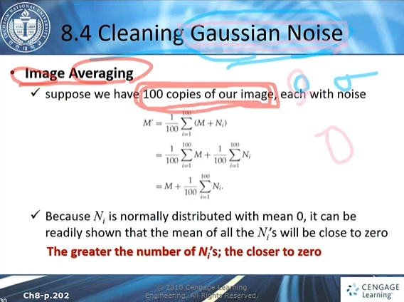

- Gaussian Noise의 평균이 0이라는 것은 Noise를 모두 더하면 Noise가 사라진다는 것이다.
- 여기서 아이디어를 착안하여, Noise를 영상에 100번 더하고 이걸 100으로 나눈다. 
- 그러면 원본 영상은 유지되고, 노이즈는 모두 사라진다고 생각할 수 있다.
- 노이즈를 많이 더할 수록 값이 0으로 수렴하게 된다.
- 또한 Average Filter를 적용하면 가우시안 노이즈를 제거할 수는 있지만, 이것은 영상이 흐려지므로 좋은 방법은 아니다.

### Removal of Periodic Noise

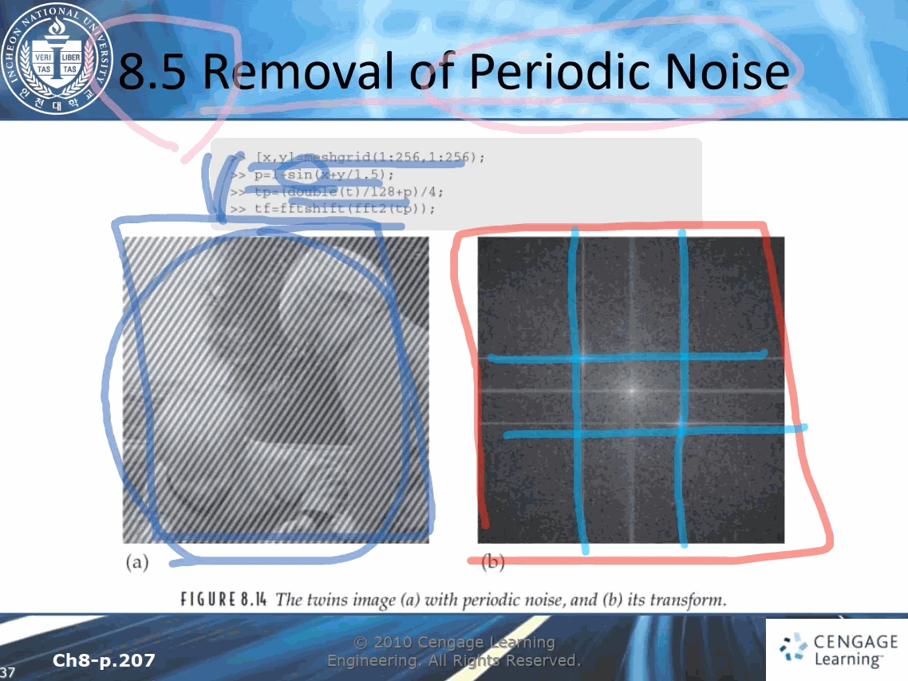

- Periodic Noise를 제거하는 방법은 크게 두 가지가 있다.

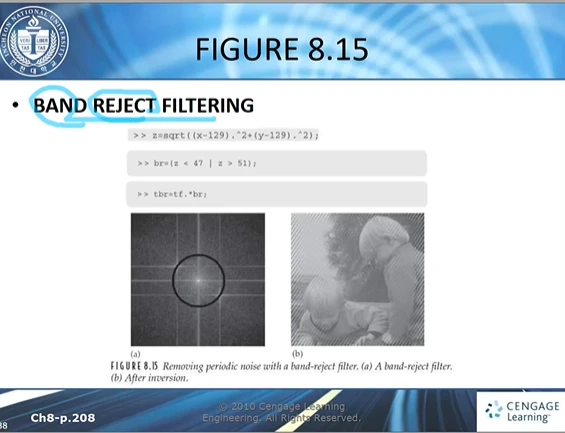

- Band Reject Filtering은, Frequency Dopmain에서 특정한 주파수 영역을 제거하면 공간 도메인에서 노이즈가 일부 사라진다.

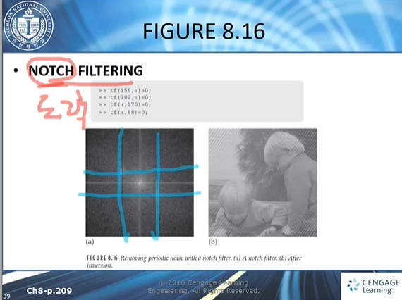

- 주파수 도메인에서 노이즈로 판단되는 부분을 강제로 0으로 만들어 노이즈를 제거하는 방식
