# Image Segmentation

작성일 2023-12-05 · 최종 수정일 2024-11-15
{ .post-date }

## &lt;Image segmentation&gt;

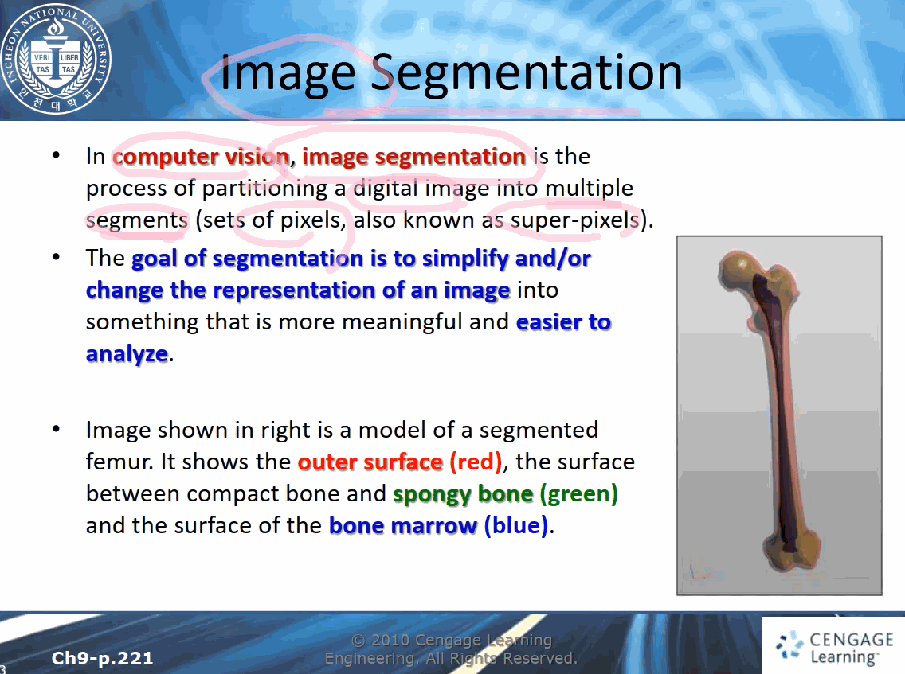

- Image Segmentation의 목적은, 이미지를 특정한 픽셀의 집합으로 나누는 것이다.

### Thresholding

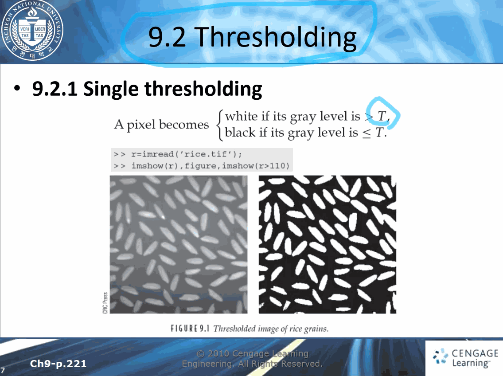

- Pixel 내에서 각 Pixel의 값이 Threshold T보다 크다면 white로 만들고, T보다 작거나 같다면 black으로 만드는 것을 Thresholding이라고 한다.

### Double Thresholding

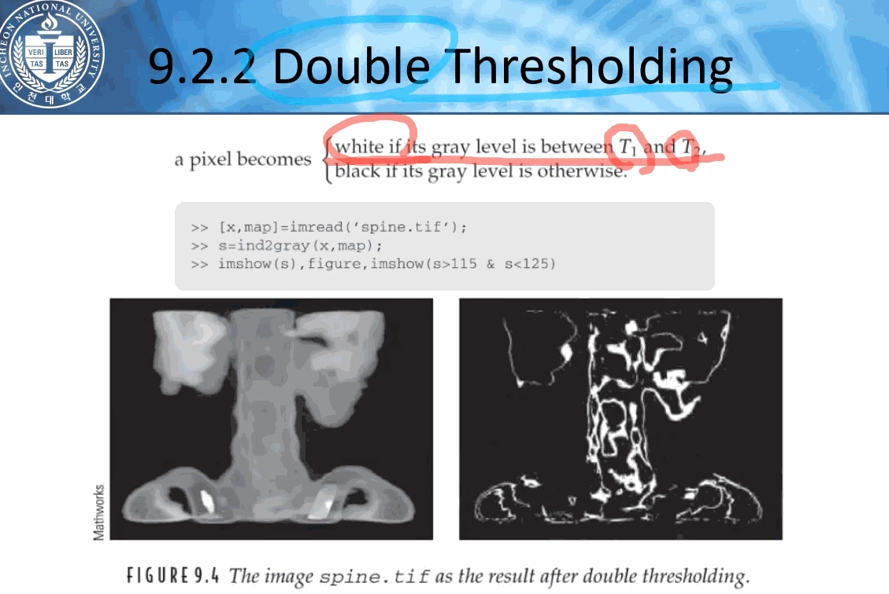

- Thresholding T1, T2 사이에 있다면 White, 그게 아니라면 Black으로 만든다.

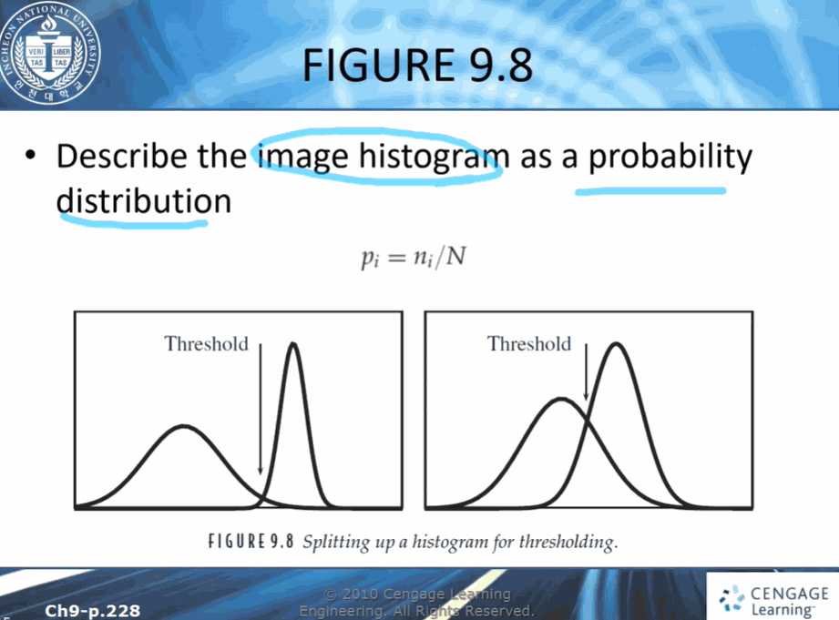

- 한 이미지 내에 두 개의 패턴이 존재한다고 한다면, 두 패턴의 중간쯤으로 Thresholding을 설정하면 패턴을 추출하는데 적절할 것이다.

### Otsu’s Method

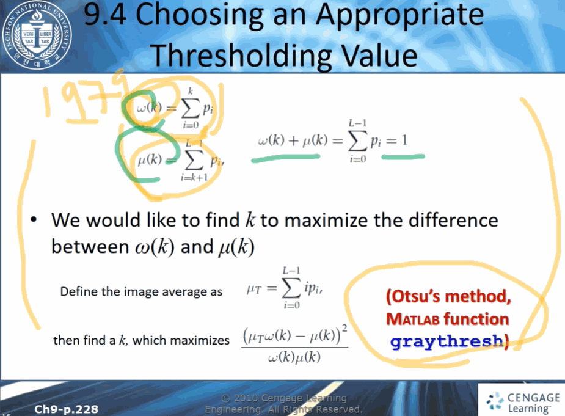

- Otsu’s Method는 이미지를 두 개의 영역(오메가, 뮤)으로 구분하는 방법이다. 

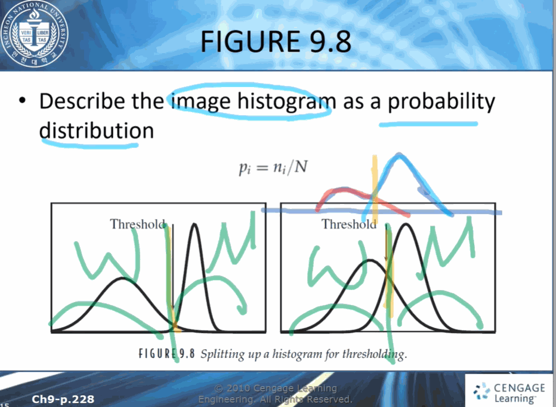

- 공식을 이용하면 Thresholding을 설정할 수 있는데, Thresholding을 결정하는 아이디어는 매우 다양한 알고리즘이 존재한다.

### Adaptive Thresholding

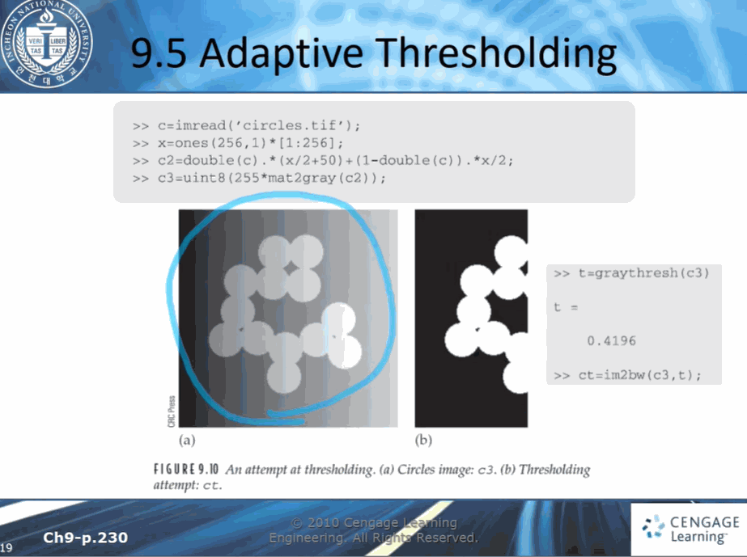

- Threshold가 하나만 있을 때는 Thresholding을 적절하게 하지 못할 수 있다. 위 영상은 Threshold가 두 개 있어야만 왼쪽처럼 올바르게 Thresholding이 가능하다.

---

## &lt;Edge Detection&gt;

> 영상에서 Edge를 Detection하는 방법에 대해 알아보자.

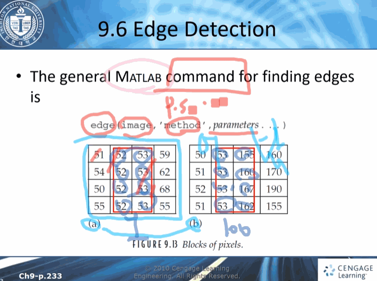

- (a), (b) 두 개의 영상이 있을 때, (a)는 전반적으로 어둡고 비슷한 영상이라 Edge 성분이 많이 존재하지 않으며, 반대로 (b)는 전반적으로 밝고 값의 차이가 커서 Edge 성분이 추출될 수 있다.

### Derivatives and Edges

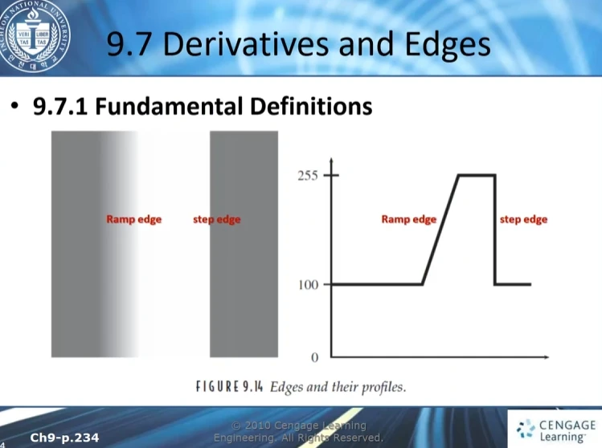

- 위의 영상은 Intensity가 100에서 255가 되었다가 다시 100이 되었다. 
- Step Edge는 Intesity가 급격하게 변화하는 것이며, Ramp Edge는 서서히 변화하는 것이다.

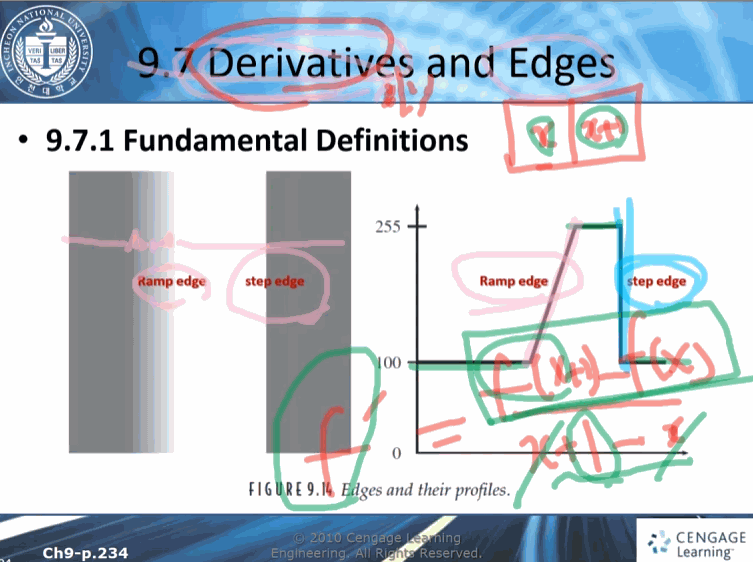

- 그런데 우리는 실제로 값이 변화하는 부분에 대해서 기울기(미분)를 구할 수 있다.

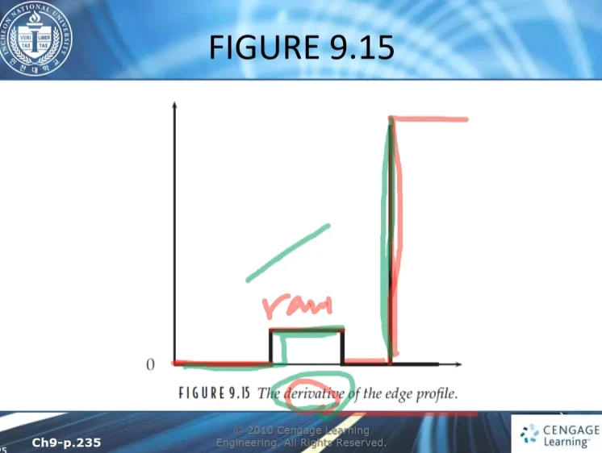

- 실제로 미분을 해보면, Ramp에서는 기울기가 일정하게 상승하는 것을 확인할 수 있으며, 반대로 Step에서는 기울기가 급격하게 변화하는 것을 알 수 있다.

### Prewitt Filter

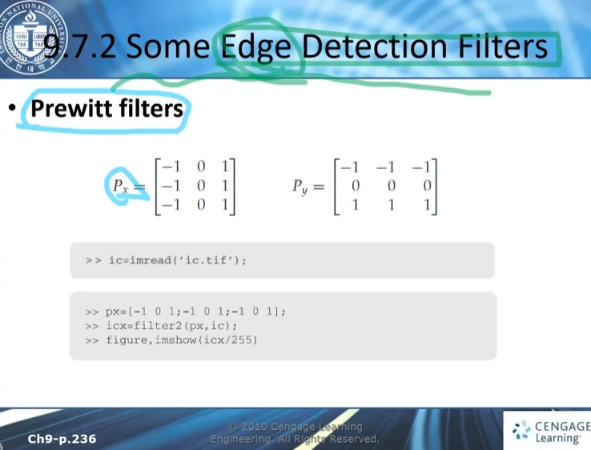

- Prewitt filter는 Edge를 Detection하는 Filter 중 하나로, x성분에 대한 Edge와 y성분에 대한 Edge를 나눠서 추출하는 두 개의 Filter로 구성된다.

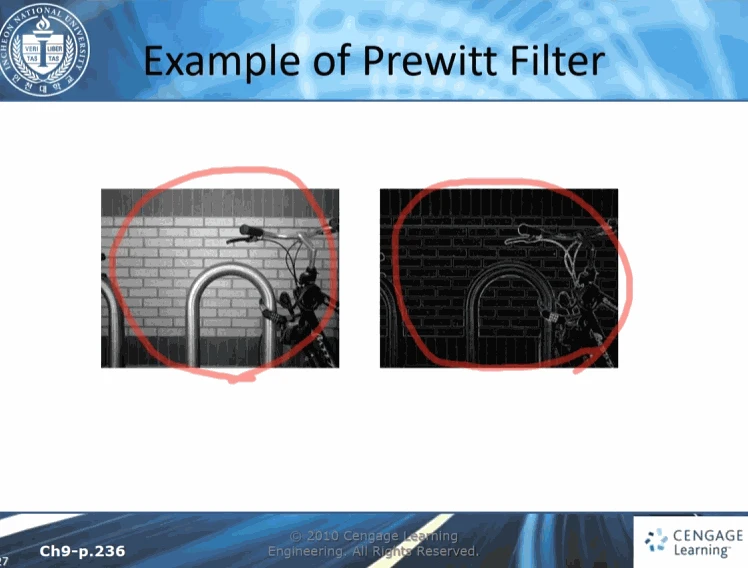

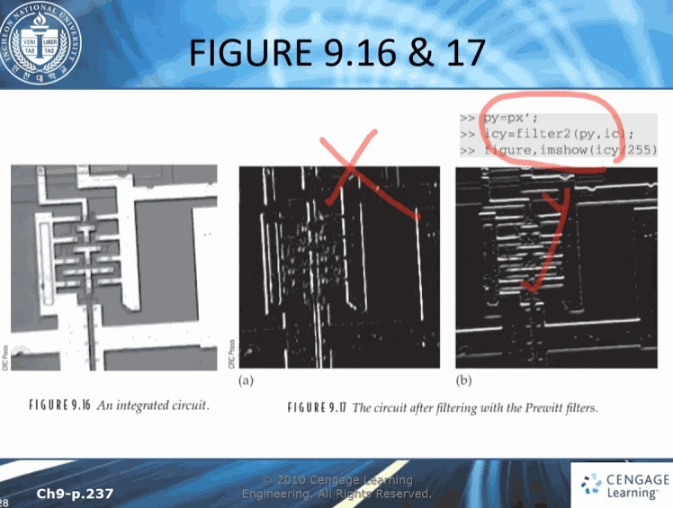

- Prewitt Filter를 사용한 Edge Detection의 결과

> Figure 9.16 & 17에서 구한 x, y 성분의 Edge 이미지에 대해서 각각 제곱하여 더한 것에 루트를 씌운 것을 아래 영상 (a)라고 하자.

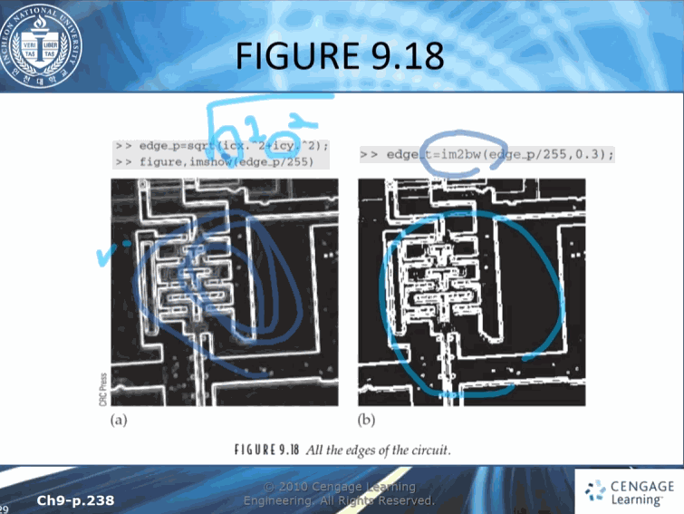

- 이와 같이 구해낸 (a) 영상(8-bit)에 Thresholding을 적용하여 1bit 영상으로 압축할 수도 있다.

### Some Edge Detection Filters

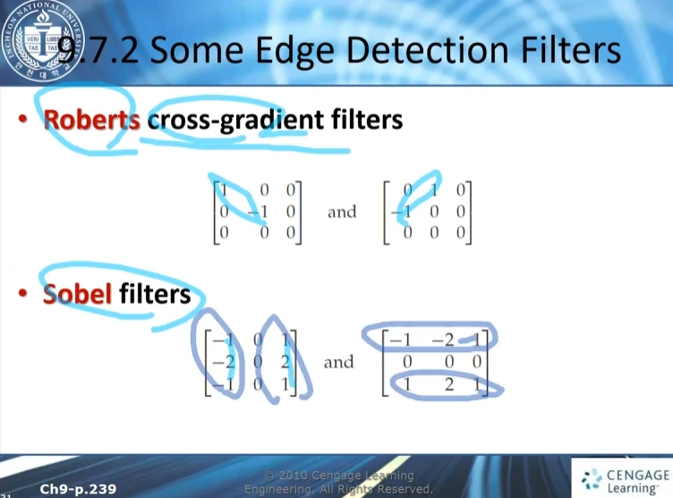

- 이 필터들을 적용하면 Edge를 Detection 할 수 있다.

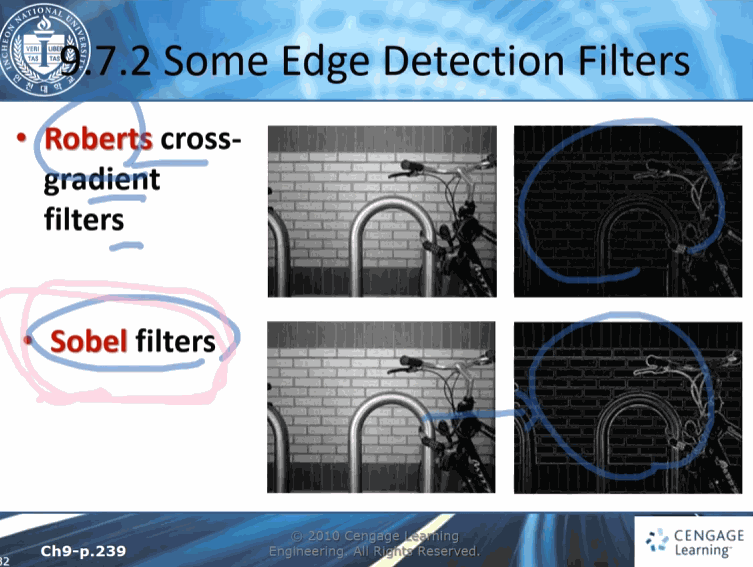

- 일반적으로 Sobel Mask의 결과가 더 뛰어나므로 Sobel을 사용한다.

### Second Derivatives

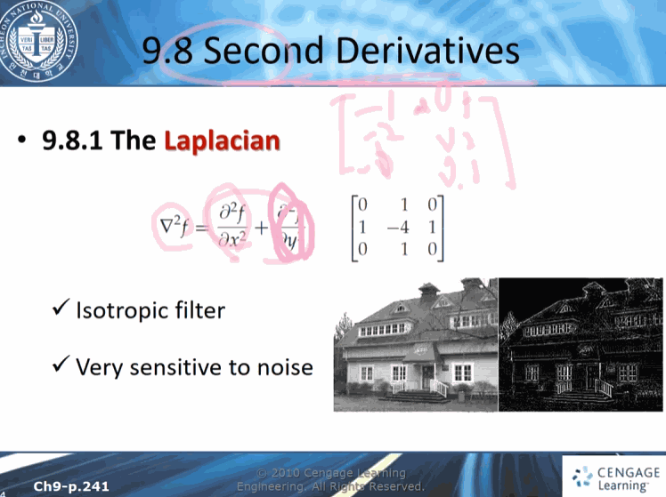

- 이전에 다뤘던 Sobel, Prewitt, Robert는 한 번 미분한 것이었다.
- 이번에는 영상을 x방향으로 두 번 미분하고, 다시 y방향으로 두 번 미분하는 것을 위의 필터를 통해 수행할 수 있다.
- 이것을 **Laplacian**이라고 하며, High Pass Filter이다. (모두 더하면 0이 되기 때문이다.)
- Isotropic filter이다. (중앙을 기준으로 대칭인 것)
- Noise에는 매우 민감하지만, Edge를 잘 검출한다.

> 그냥 High Pass Filter로 사용하기도 하는데,  실제 내재적 의미는 이차 미분을 통한 Edge Detection이다.

### Derivatives Example

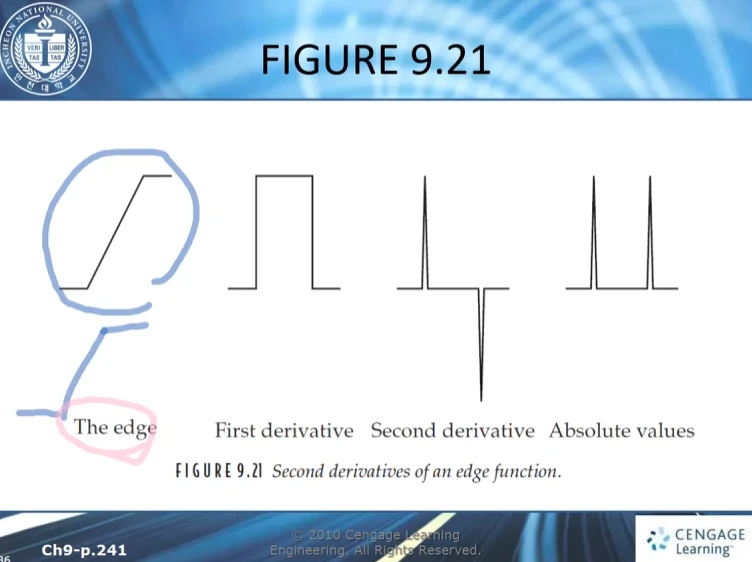

- 어떠한 Edge 신호가 존재한다고 할 때, 이 신호를 미분해보자.
- 현재 Original 신호가 Ramp Edge이기 때문에 일차 미분을 하면 구형파 형태의 신호가 된다.
- 이차 미분을 하면 일차 미분 신호의 기울기를 구해야 하는데, 일차 미분에서 기울기가 변하는 부분은 Step Edge로 나타나기 때문에 Impulse 신호에 가깝게 나타난다.
- 그리고 이것에 절댓값을 취하면 위와 같은 Absolute Values가 된다.
