# Color Processing

## &lt;Color Processing&gt;

### What is Color?

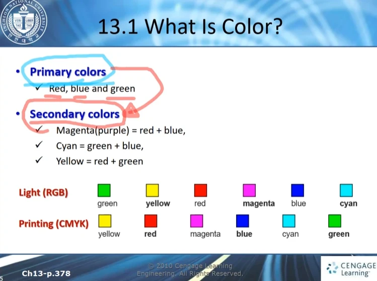

- Primary Color : Red Blue and Green
- Secondary Colors : Magenta Cyan and Yellow
- 빛의 삼원색 (가산혼합) : Red Blue Green
- 색의 삼원색 (감산혼합) : Yellow Magenta Cyan

### 색에 대한 인식도

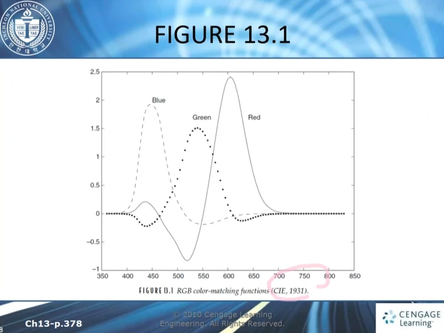

- 일반적으로 사람의 가청주파수는 20Hz ~ 20,000Hz이다.
- 일반적으로 색상은 400Hz ~ 750Hz까지 인식할 수 있다.

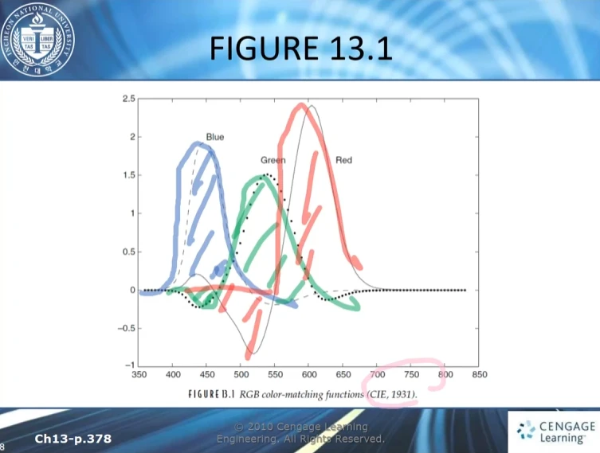

- 색을 인식하는 파장은 다르지만, 색상을 인식하는 비중을 똑같이 만들기 위해서 넓이를 똑같이 만든다. 특정 파장에서 인식도가 -가 되는 경우도 있기 때문에, 적분하면 넓이가 모두 같다.
- 다만, 음수가 있으면 보기가 불편하기 때문에 새롭게 정리한다.

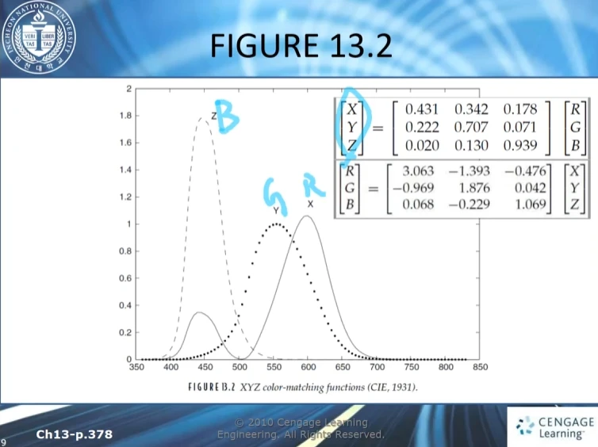

- [X Y Z]에 곱하면 [R G B]가 되고, [R G B]에 곱하면 [X Y Z]가 되는 매트릭스를 찾아내었다.

### HSV

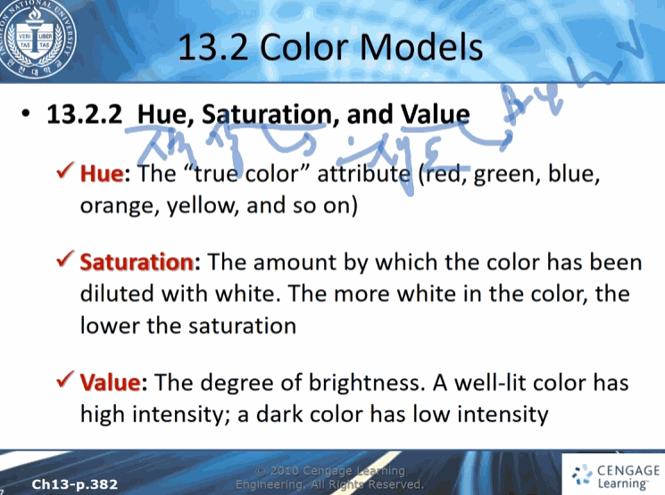

- Hue : 색상
- Saturation : 채도
- Value : 밝기(Brightness)

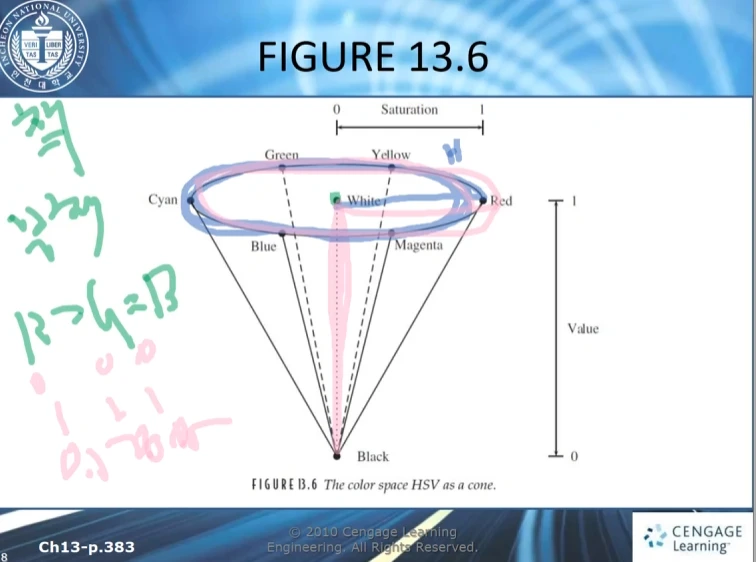

- 색상은 각도로 표현되고, 채도는 직경으로 표현되며, 밝기는 깊이로 표현된다.

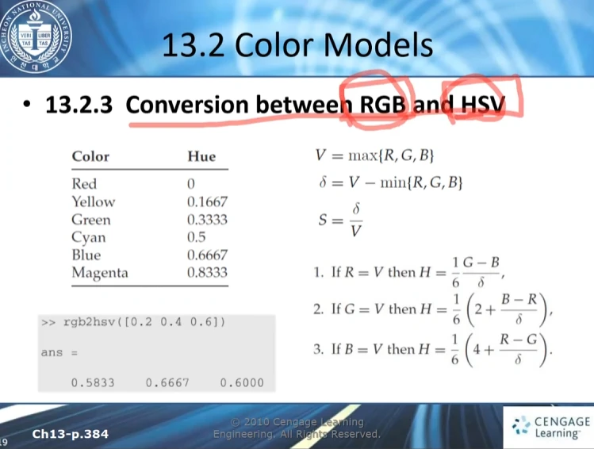

- RGB와 HSV는 서로 변환될 수 있다.
- V(밝기) : max{R, G, B}
- δ : V - min{R, G, B}
- S(채도) : δ / V
- H는 V값에 따라서 다르게 결정된다.

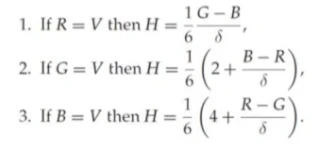

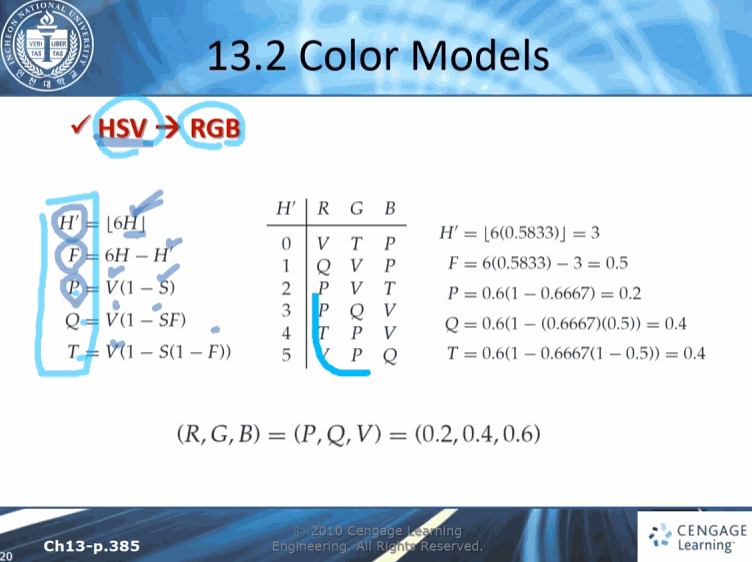

- 공식에 따라서 H, S, V를 R, G, B로 변환할 수 있다.

### YIQ

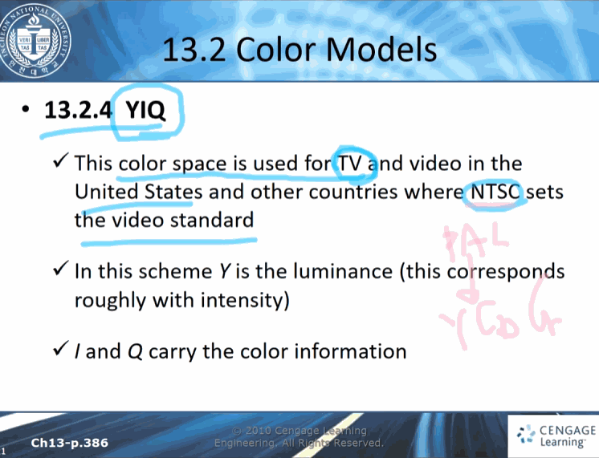

- Y : Luminance (Intensity이며, 흑백 영상이다.)
- I, Q : Chrominance (색상 정보를 담고 있다.)

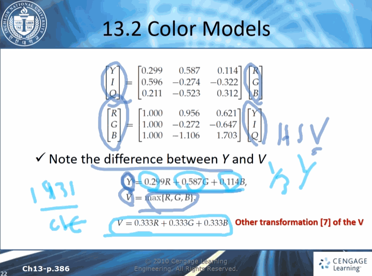

- HSV와 마찬가지로 RGB, YIQ가 변환되는 Marix가 정의되어 있다.

- 혹은 직접 Y를 계산할 수도 있다.

    - 이전에 RGB Color Model에서 Value(Brightness)는 R, G, B의 max로 사용했다. 반면 Y는 변환 공식이 존재해서 직접 계산이 가능하다.
    - V를 max가 아니라 1/3씩 가중치를 가해서 정할 수도 있다.

- 변환에 사용되는 공식은 정의를 어떻게 하냐에 따라 다르게 사용되기도 한다.

### Pseudo Coloring

> 영상에 가상의 컬러를 입히는 방법을 Pseudo Coloring이라고 한다.

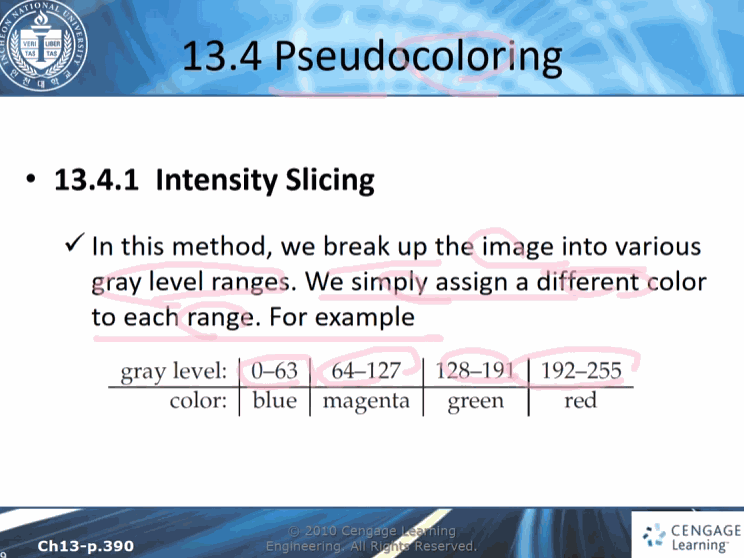

- Intensity Slicing을 통해 Intensity에 따라서 임의의 색상을 입힐 수도 있다.
- 보통 YIQ Color Model에 Processing을 한다면, Y에 대해서만 Processing을 진행한다. 왜냐면 I, Q는 색상 정보이기 때문에 Processing을 진행하면 색상이 달라질 수 있기 때문이다.

### Processing of Color Images

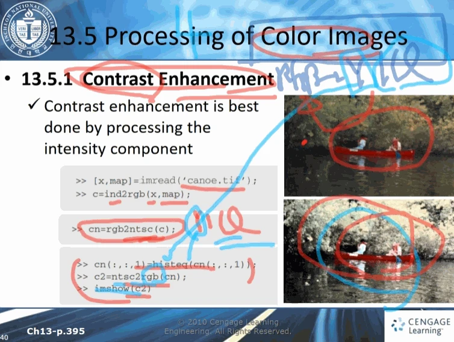

- 예를 들어 위의 영상에서 Histogram Equalization을 한다면 영상의 대조비가 늘어나는 것을 확인할 수 있고, 이때 Y에 대해서만 Processing 하므로, 색상은 변화하지 않는다.

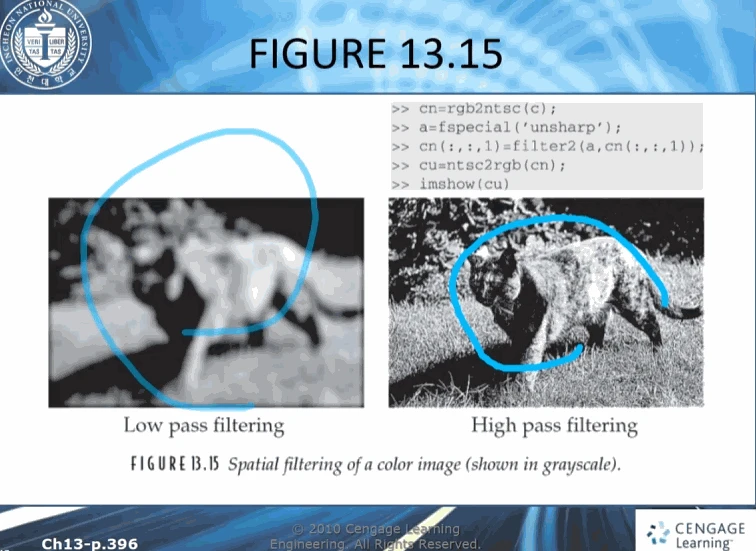

- 다른 예시로, 색상 정보를 가진 IQ는 건드리지 않고 Y에 대해서만 처리를 함으로써 High Pass Filter(정확히는 Unsharp Masking)를 통과시킬 수 있다.

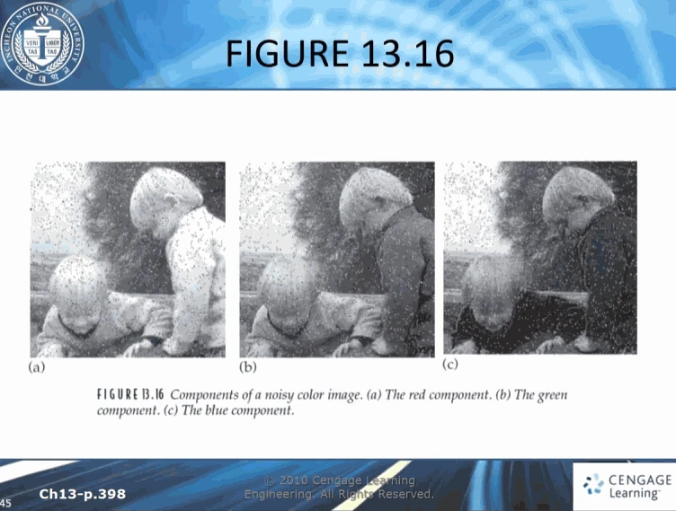

- 마찬가지로 색상 이미지에 대해서 Noise Reduction도 가능하며, 역시 Y에 대해서만 적용한다.

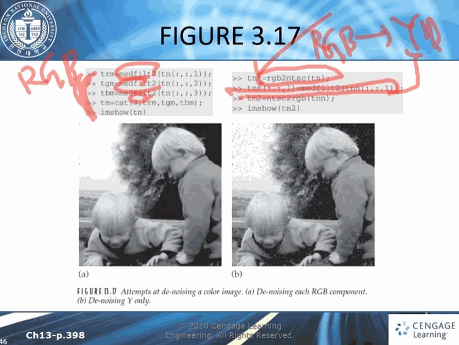

- 하지만 만약, RGB Color Model을 사용한다면 위와 같이 R, G, B 각각에 대해서 적용한다.
- YIQ를 사용할 경우 Y에 대해서만 Reduction을 진행하지만, Noise는 IQ 부분에도 들어있기 때문에 RGB 각각에 대해서 적용한 것인 (a)와는 달리 (b)에는 Salt & Pepper Noise가 남아있는 것을 확인할 수 있다.

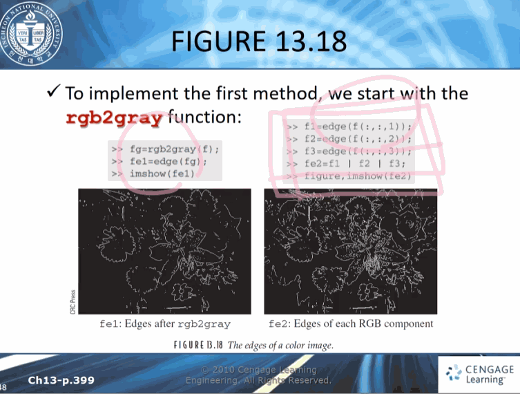

- Edge Detection도 가능하며, RGB 각각에 대해서 Edge Detection을 적용한 다음 OR 연산을 통해 새로운 영상을 얻어낼 수 있다.
