# 13주차: Interpolation, Fourier Transform, 필터

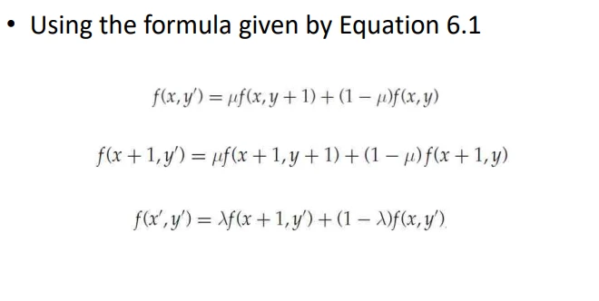

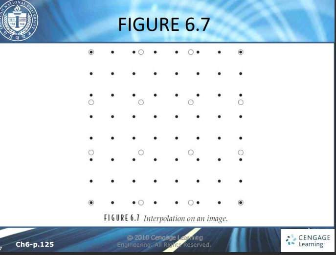

- 8개의 픽셀을 4개의 픽셀로 만드는 것을 가정한다.

image를 scaling하고 interpolatino으로 값을 어떻게 설정할 것인가?

⇒ 거리에 반비례하게 가중치를 주는 방식으로 보인다.

### Bilinear Interpolation

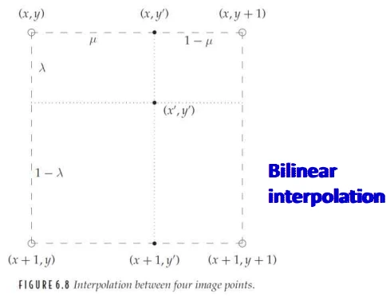

뮤 * x

(1-뮤) * y+1

⇒ x’ 결정

람다 * x+1

(1-람다) * y’

⇒ y’ 결정

> 가중치에 기반한 interpolation 값 설정

- imresize

    - nearest : 기존의 픽셀과의 거리를 측정하여 그냥 가까운 것의 값을 복사해서 넣은 것.
    - bilinear : 위에서 사용한 방법. 거리에 따른 가중치 부여

    ⇒ 뭐가 더 좋은지 판단하기는 힘들다. (a)는 영상이 뚜렷하지만, 계단 현상이 있다. (b)는 평균 필터같은 것을 적용하여, 선명도가 떨어진다.

    - 영상 평가 요소

        - PSNR
        - MSE
        - SSIM
        - FSlM

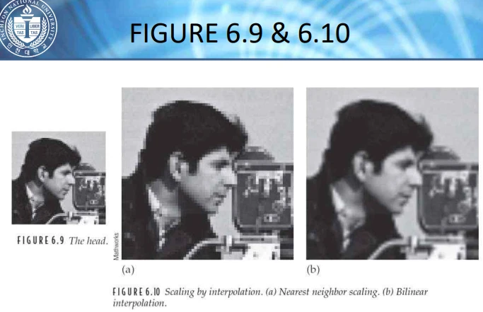

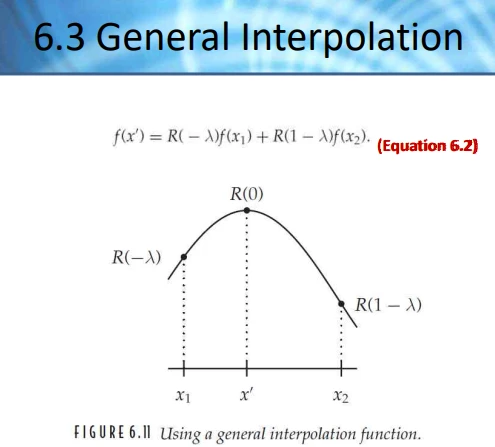

보간을 하고자 하는 위치를 x’으로 둔 것이다.

⇒ 하나의 상상을 한 것.

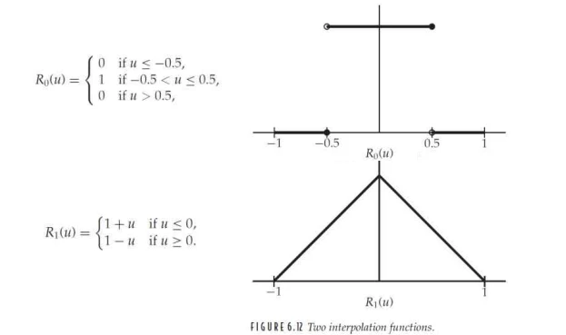

- Nearest Neighbor는 가까운 것을 이용하므로, u라는 것이 가운데에 존재한다면, f(u)는 
- -0.5 &lt; u ≤ 0 .5 에서는 1이 된다.
- Bi-linear?

위에 나오는 개선

### Cubic Interpolation

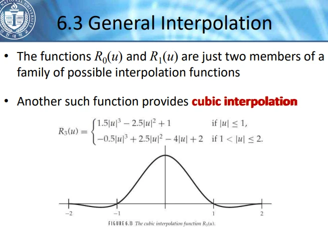

새롭게 만들어지는 점을 기준으로 한다.  if |u| ≤ 1은 위의 부분을 그린 것이고, 

if 1 &lt; |u| ≤ 2는 아랫 부분을 그린 것이다.

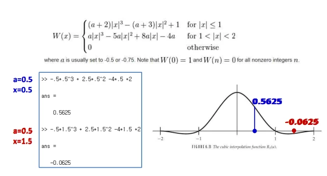

0.5를 넣으면 0.5625이고, 1.5를 넣으면 -0.0625이다.

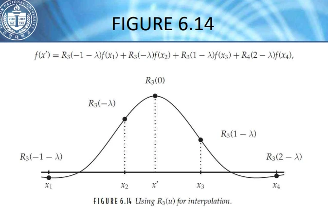

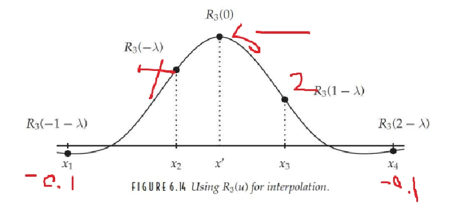

- 1-tap filter
- 2-tap filter
- 4-tap filter : 고려하는 픽셀의 개수가 네 개이다.

⇒ filter size가 늘어난다고 마냥 좋은 것은 아니다.

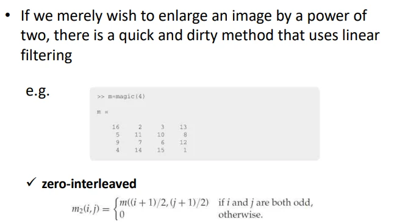

- zero-interleaved : 안에 값을 넣는데, 0을 넣자는 것.

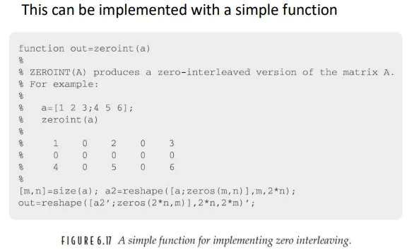

zero-interleaved를 해보니까, 0이 추가되더라.

각각의 행과 열에 0을 추가하자는 것.

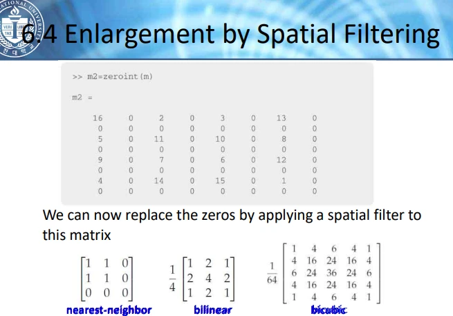

마방진에 zeroi-interleaved한 것에 filter를 적용한다. 이것은 각각의 위치에 가중치*실제값이다.

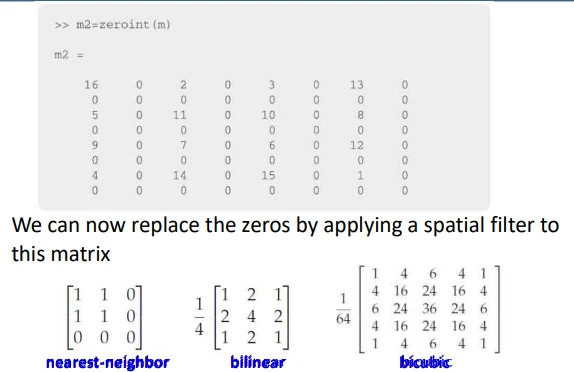

이때, 적용하는 filter 세 개가 있다.

- nearest-neighbor
- bilinear
- bicubic

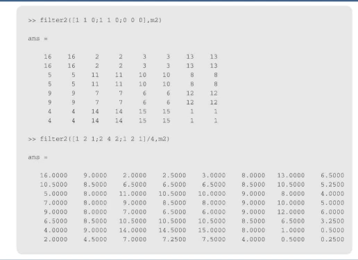

마방진에 zero-interleave 한 것에 nearest-neighbor, bilinear를 적용한 결과이다. 

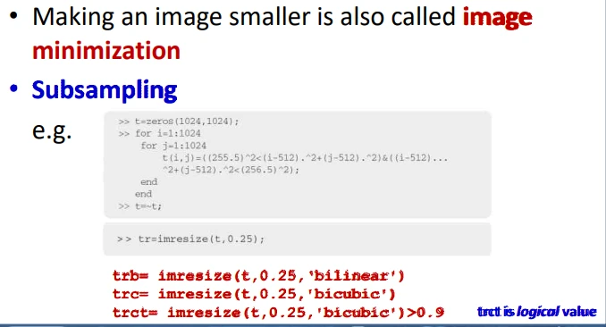

- imresize가 0.25이므로, 영상을 작게 하자는 것.

- 그런데 여기서 imresize(t, 0.25, ‘bicubic’) &gt; 0.9이기 때문에, logical image를 만든다는 것이다.

    이 기준을 0.9로 판단하는 것.

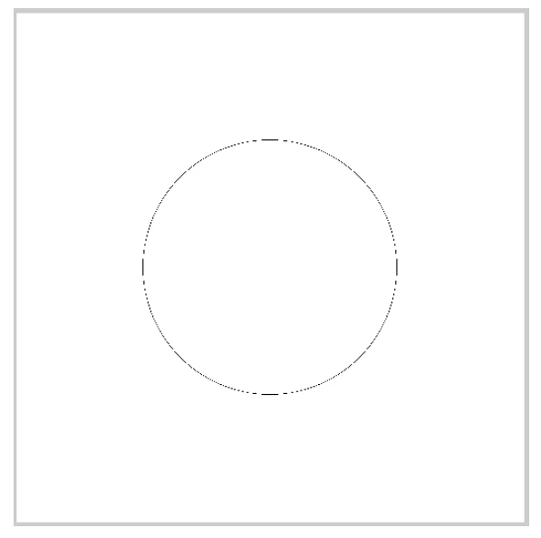

nearest_neighbor는 끊기는 점이 존재함.

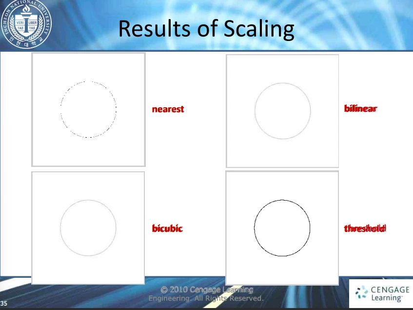

bilinear와 bicubic은 끊기는 것은 없지만, 검은색이 확실히 안나온다.

threshold는 0.9보다 크면 1, 아니면 0이라서 binary화 한다는 것이다.

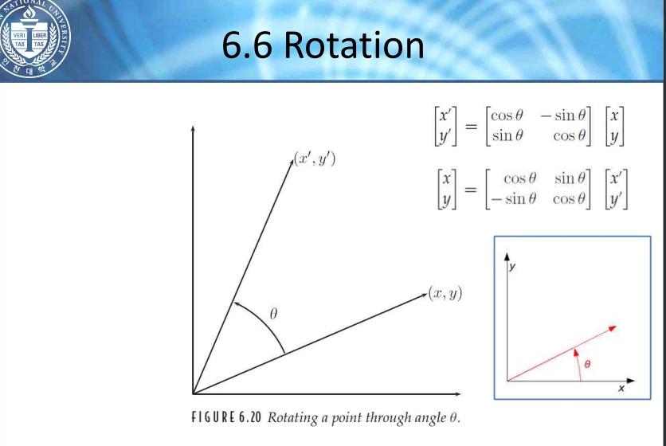

회전 행렬의 수식

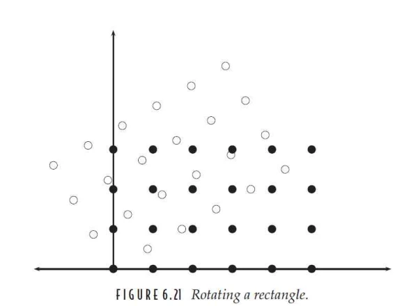

결국 회전시킨 것을 display해야되는데, 하얀점은 임의의 점에 존재한다.

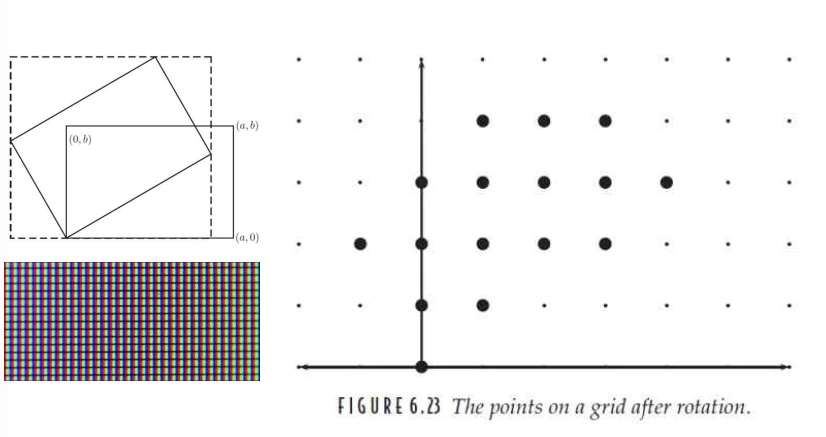

회전된 픽셀은 어디에서 왔을까? 원래 좌표를 찾아서, 거기서 구하면 되는 것으로 보인다.

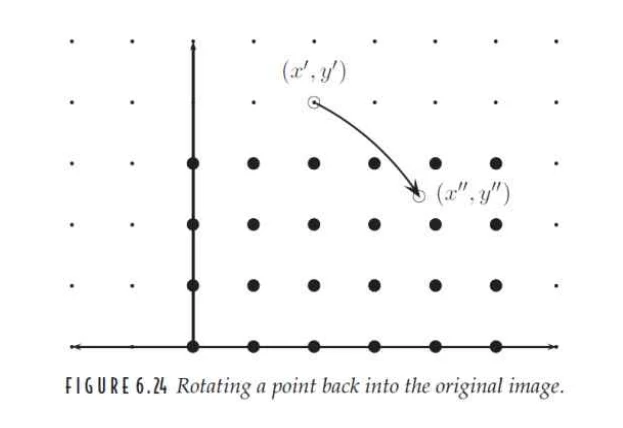

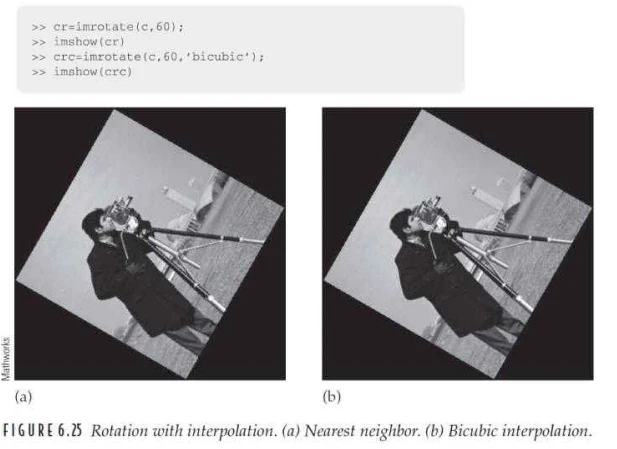

- ENS

    - N : normality

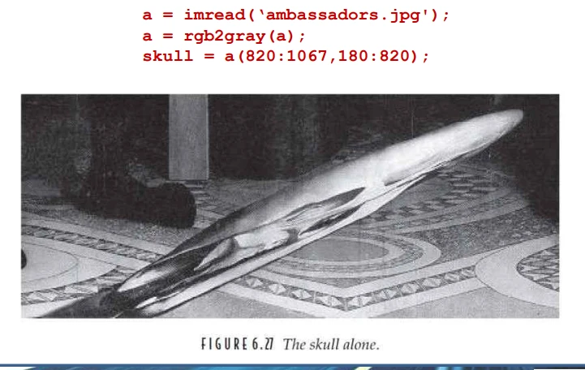

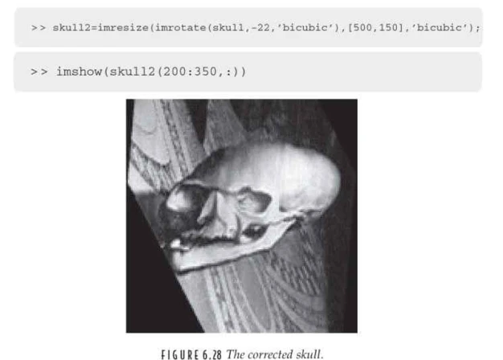

원래 그림을 이와 같이 만들어 낸다.

---

## &lt;Fourier Transform&gt;

- 공간 도메인
- 주파수 도메인

### Fourier Transform

- 저주파
- 고주파

sin2pinx ⇒ x이 주파수이다. freq가 10인 신호를 만들려면 n에 10을 넣는 것으로 보인다.

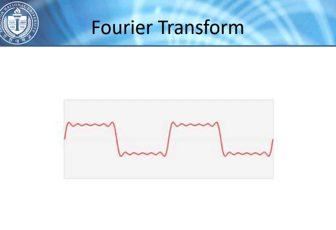

한 신호는 sin/cos 함수의 결합으로 만들어져 있다. 저주파는 사이즈가 크고, 고주파는 사이즈가 작다. 

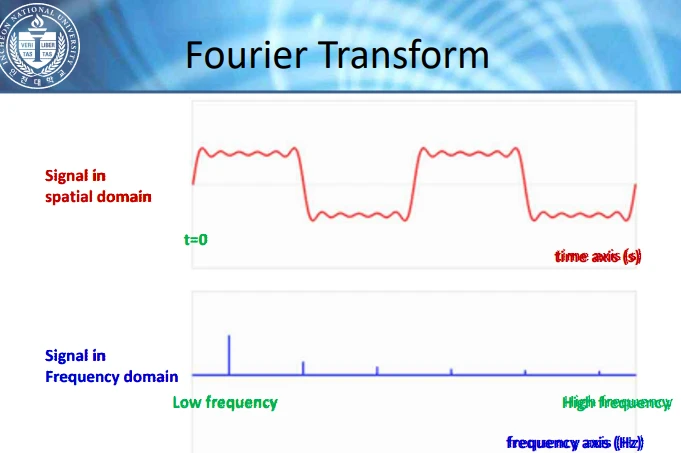

위를 알면 밑을 그릴 수 있다. (빨간색 : 공간 도메인)

밑을 알면 위를 그릴 수 있다. (파란색 : 주파수 도메인)

⇒ 무엇을 그려도두 개는 서로 똑같다.

저주파가 변화량이 적고 크기가 작다. 영상에서 대부분은 저주파일 것이다.

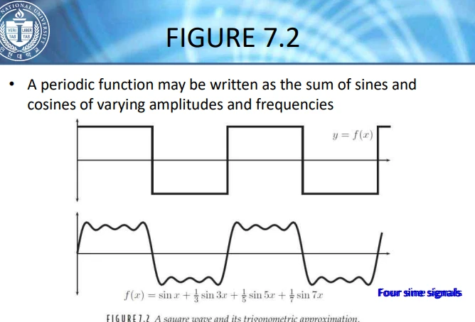

- 구형파 : 위에서 나온 구를 쓴다.

    ⇒ 이걸 만들기 위해서는 sin파가 sin이 필요하다. 많이 곱할 수록 더 좋은 시그널이 된다.

    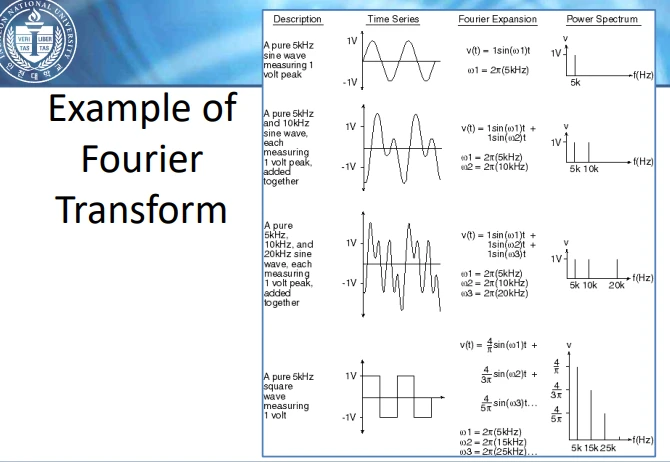

    sin파를 주파수로 변환. 마지막 것은 무한대로 있어야 하는 것으로 보인다.

    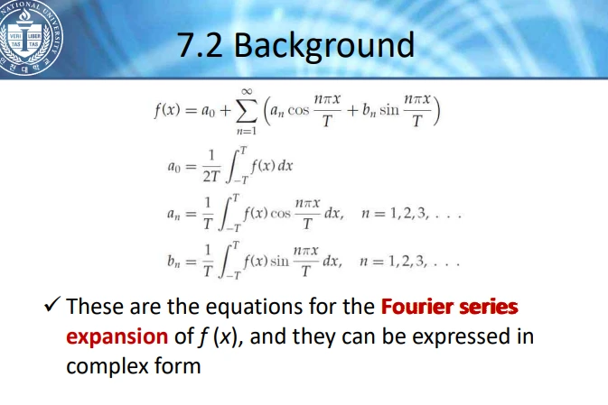

    cosmx*(cosnx)dx

    m=n이면 숫자가 나오고, m≠n이면 0이 나온다.

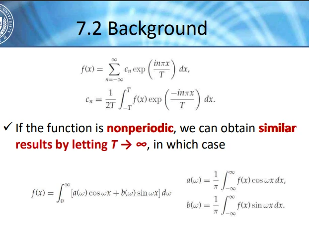

- 주기가 무한대라고 가정을 하고 문제를 해결한다.

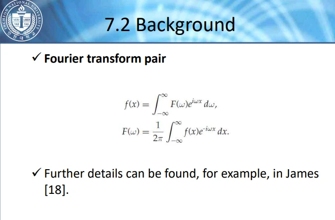

어떤 시그널은 주파수 도메인의 시그널 * e^(iwx) 혹은 아래 식이고, 타임 도메인에서는 똑같은 식에 2pi를 나누고, 지수에 -를 곱한 것이다. (사실 의미는 똑같다.)

주파수에서는 결국, 주파수로 표현해야 한다. (Hz : 1초에 몇 번의 사이클이 이루어지는가)

- Fourier Transform을 한다는 것은, 주파수별로 Coefficient를 찾겠다는 뜻이다.

    - 주어진 시그널에서, 특정주파수의 Coefficient(계수)가 얼마인지 찾겠다는 뜻이다.

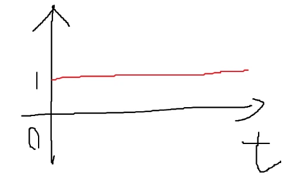

이와 같이 모든 값이 1이라고 한다면, (cos 1은 0이므로) 주파수 도메인에서의 값은 0밖에 나오지 않는다.

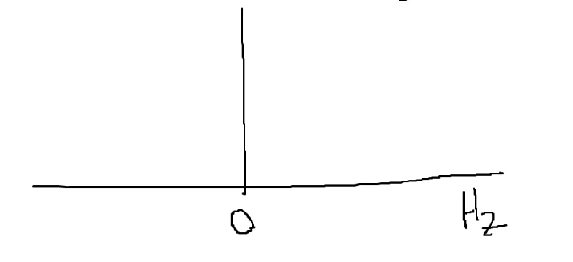

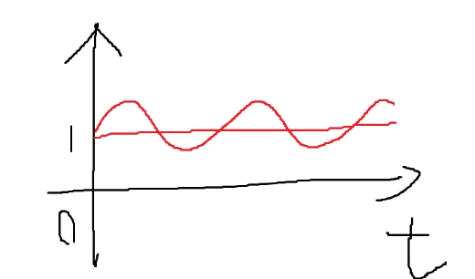

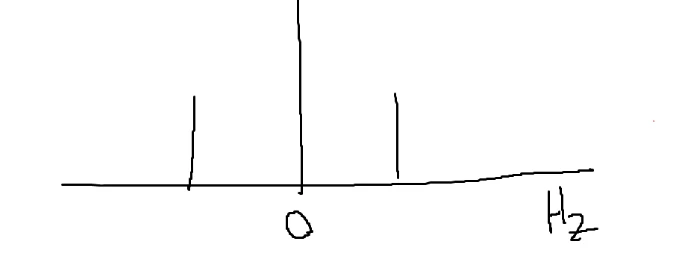

만약 어떤 신호가 시간 도메인에 더 추가되면, 이와 같이 주파수 표현이 더 늘어나게 될 것.

주파수를 표현하는 방법은 두 가지가 있는데, 각속도로 표현하는 방법과 주파수 도메인에서의 공식에서 2pi를 나누는 것은, 오메가를 썼기 때문이다. 만약 오메가를 f(x)로 바꾸면 2pi로 나누는 것은 필요하지 않다. (2pif = w, f = 1/t)

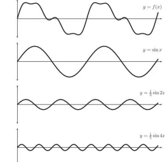

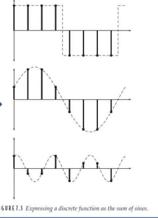

세 개의 신호가 합쳐지면 이와 같이 바뀌며, 샘플링 하면 오른쪽과 같이 된다.

### The one-dimensional discrete fourier transform

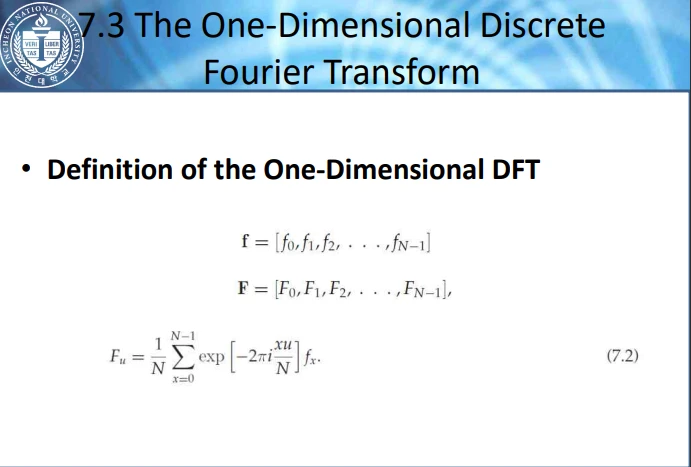

f를 Fourier Transform하면 F가 된다. (이때 f는 영상을 의미한다.)

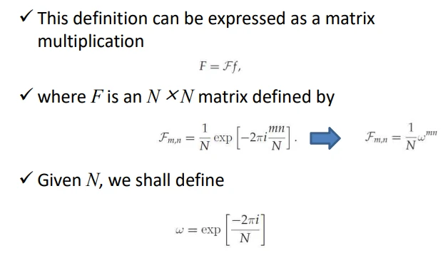

F = Ff (대문자 F는 주파수 도메인에서의 시그널 그 coefficient를 표현함. 저주파가 가운데에 있고, 고주파가 될 수록 왼쪽/오른쪽으로 간다는 것이다. 소문자 f는 이미지이다.)

> Fourier Transform의 목적은, 특정한 주파수에서의 Coefficient를 구하는 것이다.

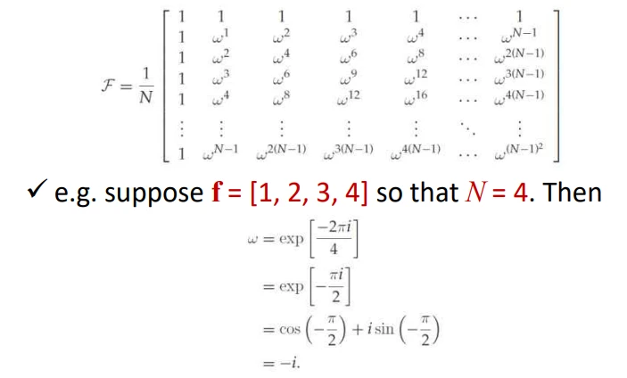

N은 숫자의 개수. w = exp(-2pi/N)이므로, N에 4를 대입한다. 오일러 공식을 이용하면 분해가 가능하므로, 정답은 -i가 된다.

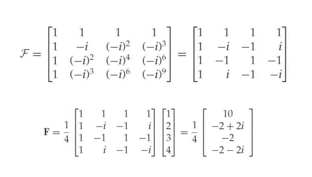

답은 이와 같이 표현될 것이다. (w = -i) 이것에 대해서 FT를 적용해 보자. 계수는 1/N이고, 원 신호에서 구한 w와 행렬곱을 하면 된다.

- 주파수가 0이라는 것의 의미는 평균값이라는 의미인데, 그것이 정답의 첫 번째 신호로 표현된다.따라서, 시그널들의 평균이 2.5라는 것. (10/4)

- 그렇다면 다른 신호들의 의미는 무엇일까? 원을 한 바퀴 돌면 주파수(각이 변한 정도)는 2pi이다. 따라서 구해진 네 개의 신호는 위에서부터 순서대로 (0, 2pi, 4pi, …) (pi/2, 5pi/2, 9pi/2, …) (pi, 3pi, 5pi, …) … 를 의미하는 것이다. 만약 표현되는 시그널이 8개가 되면, 2pi 내에서 표현되는 신호를 (8/2)개로 쪼개서 표현하는 것이다. 가령 16개의 시그널로 표현한다면 (16/2)으로 나눠서 표현하는 것.

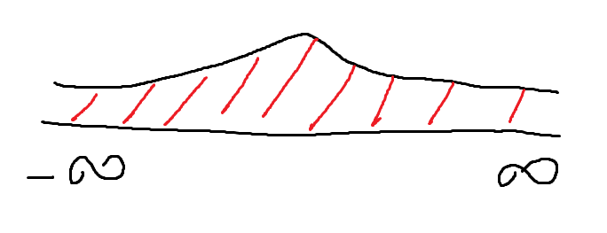

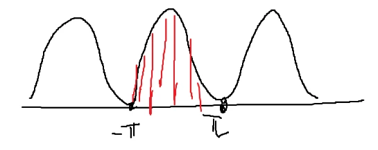

⇒ 무한대의 주기로 표현되는 것을 2pi 내로 줄이면, 면적이 같아진다.

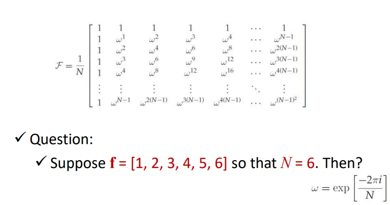

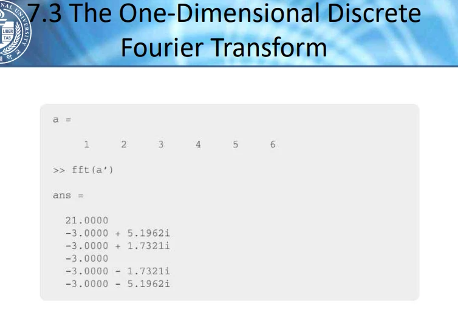

2pi만큼 한 바퀴 도는 것을 N/2으로 쪼개어 표현해야 한다. 여기서 21은 pi/3의 주파수를 갖는 것의 coefficient이고, 그 아래는 2pi/3의 주파수를 갖는 것의 coefficient… 이런 식으로 표현된다.

### Fourier Transform의 특성

- LINEARITY

    - h = pf + qg

        ⇒ 더해서 FT를 해도 똑같고, FT하고 더해도 똑같다.

    - SHIFTING

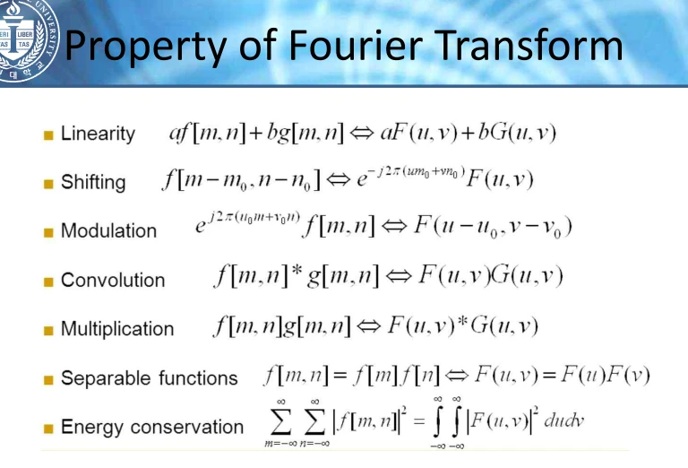

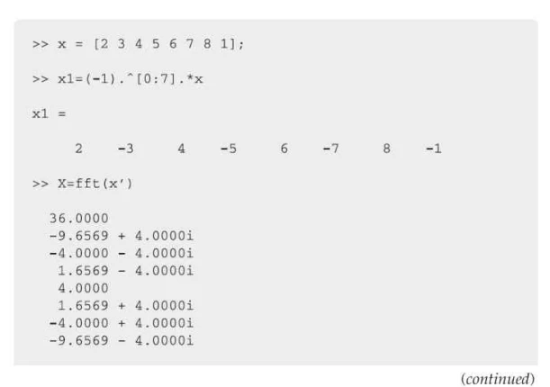

x라는 기본 신호에, 짝수번째 숫자에만 -1을 곱해 x1을 만들었다. 결과는 어떻게 될까?  
⇒ **Shifting이 된다. 위의 네 개를 아래로 내리고, 아래 네 개를 위로 올리면 되는 것으로 보인다.**

- sinx와 sin2x의 FT에서의 차이

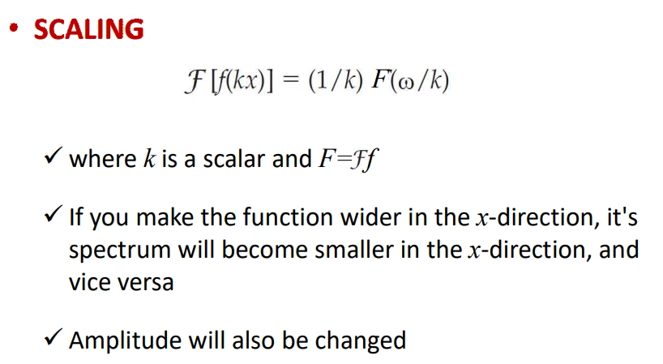

만약 sinx를 Fourier Transform한 것이 F(w)라고 한다면, sin2x를 Fourier Transform 한 것은   
(1/2)F(w/2)가 된다. 이것은 높이가 절반이 되고, 주기는 두 배가 된다는 것이다.

### Some properties of the Two-dimensional Fourier Transform

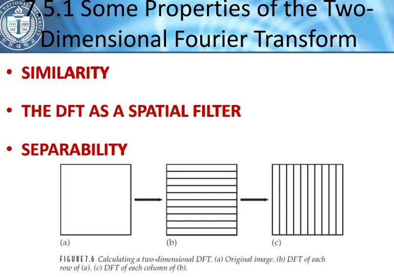

- seperability에 의해서, x/y를 별도로 FT해도 된다.

F(0, 0)의 뜻은 영상 전체의 총합이다.

처음 (0, 0)과 2pi 지점은 저주파이고, 가운데 pi는 고주파이다. 일반적으로 저주파는 중요하지만, 고주파는 크게 중요하지 않다. 그러므로 사실은, 저주파가 가운데에 오고 고주파가 가장자리로 가는 것이 좋다.

그래서 FFT SHIFT라는 것이 만들어져서, 저주파가 중앙으로 오도록 변환한다.

ones(8)에 의해, 시간 도메인에서 모든 값이 1이라고 한다. 이것은 신호에 변화가 없으므로, 오로지 (0, 0)의 DC 성분만 64가 나온다. (모두 더한 것)

가로 방향으로는 변화가 있으나, 세로로는 변화가 없다. 이것은 사실 다른 매트릭스의 합으로 표현을 할 수도 있는데, 예컨대 100 100 100 100 + 0 100 0 100 … 이런 식으로 표현될 수도 있다는 것. 세로 방향으로는 변화가 없으므로 모두 0이 되고, 150들을 다 더한 것이 9600이 될 것이다.

fftshift는 값에 변화가 생기지는 않지만, 저주파가 가운데로 모이도록 변환한다.

수직 성분은 변화가 없고, 수평 성분만 변화한다. FFT SHIFT 했기 때문에, DC 성분이 가운데에 표현.

구형파(좌)를 만들기 위해서는, sin이나 cos이 매우 많이 필요하다. 따라서 거의 모든 주파수에 대해서 coefficient가 존재한다.

Original Data가 0부터 64까지 신호가 1이기 때문에 우측 그림도 이렇게 표현되는 것으로 보인다.

그런데 만약, 구형파가 아니라 약간 스무스한 그림이 된다면, 오른쪽처럼 뾰족한 그림이 아니라 스무스한 가우스처럼 표현될 것이다.

좌측 그림을 FT한게 가운데 그림, 이걸 FFT SHIFT한 것이 오른쪽 그림이다. FT를 하면, 값이 0→1, 1→0, 이것이 수평/수직 모두에 대해서 존재한다. 대각선으로는 변화가 없기 때문에 위와 같이 표현될 것이다.

### Ideal Filter

⇒ 0에서 1로 뚝 떨어지는 것. 이렇게 하면 지저분해 진다. 왜냐면 모든 주파수에서 Coefficient가 모두 나타나기 때문이다. 그래서 이걸 스무스하게 처리해 주면 아주 깔끔해진다.

카메라맨 영상을 Fourier Transform하면 왼쪽 그림과 같이 되는데, 저 정도의 저주파 신호만으로도 오른쪽 그림과 같이 표현된다. 영상의 평균값은 DC에서 나타난다.

가운데를 뚫었더니 오른쪽과 같이 Edge만 나오게 된다.

---

## &lt;Butterworkth Filtering&gt;

이런 날카로운 구형파를 버터우스 필터를 적용하면 스무스해진다.

스무스하게 바꾸면, 표현하기 위해 사용되는 Sin. cos의 값을 적게 사용할 수 있게 된다.

- 가우시안 필터링

