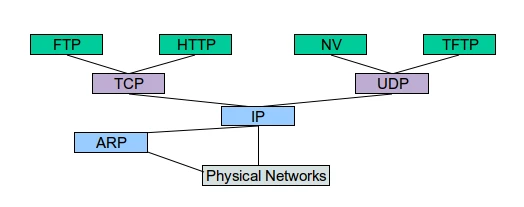
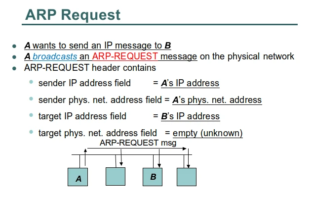
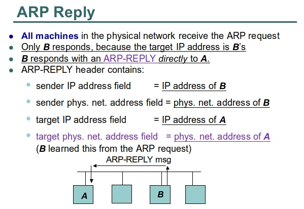
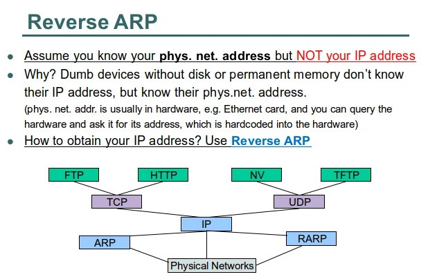
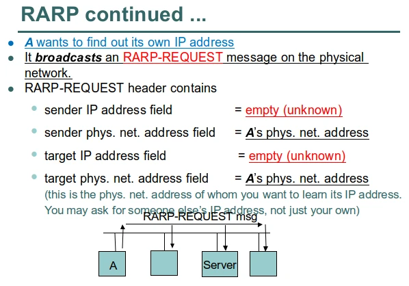
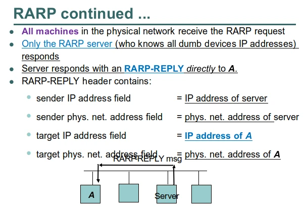

# 1주차 - Basic Network Components

## &lt;Internetworking&gt;

### Packet Switching

> Packet Switching은 네트워크 라우터에 전달되는 모든 packet을 resource를 공유하며 동시에 처리하는 방식이다. 모든 packet은 **store and forward** 를 통해 packet을 반드시 router에 저장됐다가 routing과 forwarding을 통해 전송한다.  
>   
> packet의 크기가 L-bit이고, 모든 Link의 rate가 R (bps)라면, 이 packet을 전송하는 데는 L/R seconds가 소모된다. (one-hop)

- 만약 packet이 link의 transmission rate를 초과하여 도착한다면 어떻게 될까?

    - packet이 router에 존재하는 queue에 저장되어 대기하다가 전송된다.
    - 만약 queue가 꽉 찬 상태에서 packet이 추가적으로 도달하면, packet이 drop된다.

### Four sources of packet delay

> packet delay에는 네 종류가 존재한다.

d(nodal) = d(proc) + d(queue) + d(trans) + d(prop)

- **d(proc)** : **nodal processing**

    - check bit errors
    - determine output link
    - typically &lt; msec

- **d(queue)** : **queueing delay**

    - time waiting at output link for transmission
    - depends on congestion level of router

- **d(trans)** : **transmission delay**

    - L : packet length (bits)
    - R : link bandwidth (bps)
    - d(trans) = L/R

- **d(prop)** : **propagation delay**

    - d : length of physical link
    - s : propagation speed in medium
    - d(prop) : d/s

### Throughput

> Throughput이란, sender와 receiver간에서 bit를 전송하는 속도를 말한다.

- instantaneous : rate at given point in time

    - 순간적인 속도를 말함

- average : rate over longer period of time

    - 긴 시간 동안의 전송 속도를 말함

> 네트워크에서 Throughput은 가장 느린 link의 rate이다.

### Two key network-core functions

- **routing** : 전달된 packet에 대해 routing algorithm을 적용하고, 이 과정에서 router에 존재하는 local forwarding table을 통해 전달할 link를 선택하는 과정
- **forwarding** : 선택된 link로 packet을 전송하는 과정

### Circuit Switching

> source와 dest가 하나의 회선을 할당받아 데이터를 주고 받는 방식이며, 이 과정에서 연결된 회선의 모든 resource를 독점적으로 사용하여 통신하는 방식이다. 전화와 같은 실시간 통신에 사용되므로 **속도**와 **성능**이 **일정**하다.

### Layering(OSI model)

> Network는 Layering을 통한 Modularization을 통해서 유지/보수를 용이하게 한다. 특정 Layer의 내용은 수정해도, 이미 Modularization이 되어 있기 때문에 다른 시스템의 동작은 크게 수정할 필요가 없다는 이점이 생긴다.

- **Five-layer Internet protocol stack**

    - **application** : supporting network applications

        - FTP, SMTP, HTTP

    - **transport** : process-process data transfer

        - TCP, UDP

    - **network** : routing of datagrams from source to destination

        - IP, routing protocols

    - **link** : data transfer between neighboring network elements

        - Ethernet, 802.11(WiFi), PPP

    - **physical** : bits on the wire

- **Seven-layer ISO/OSI reference model**

    - **presentation** : allow applications to interpret meaning of data

        - encryption, compression, machine-specific conventions

    - **session** : synchronization, recovery of data exchange

### ARP(Address Resolution Protocol, 주소 결정 프로토콜)

> 네트워크 상에서 IP 주소를 물리적 네트워크 주소로 대응시키기 위해 사용되는 프로토콜이다. 이때 물리적 네트워크 주소는 이더넷 또는 네트워크 카드 주소를 의미한다.

- A가 B에게 IP message를 보내려고 한다.
- A는 **ARP-REQUEST** message를 **physical network**에 **broadcast** 한다.

- **ARP-REQUEST Header**는 다음과 같은 정보를 가진다.

    - sender IP address field = A의 IP address
    - sender physical network address field = A의 Physical Network Address
    - target IP address field = B의 IP address
    - target physical network field = empty (unknown)

- 같은 Physical Network에 속해 있는 모든 machine들은 ARP Request를 전달받는다.
- 이때, 전달받은 ARP request의 target IP가 B의 IP였기 때문에, B만 응답한다.
- B는 **ARP_REPLY**를 A에게 직접 전송한다.

- **ARP_REPLY Header**는 다음과 같은 정보를 가진다.

    - sender IP address field = B의 IP address
    - sender physical network address field = B의 Physical Network Address
    - target IP address field = A의 IP address

    - target physical network field = A의 physical network address

        - B는 ARP-REQUEST를 통해서 A의 phys. net. address를 알고 있음.

### Reverse ARP

> physical network address는 알지만 IP address는 모를 경우 **Reverse ARP**를 사용할 수 있다.   
>   
> 왜 이런 경우가 발생하는가? 저장 능력이 떨어지는 네트워크 디바이스들은 자신의 phys. net. address는 알지만 IP address는 알지 못할 수도 있다.  
>   
> 이 경우, 자신의 IP address를 얻는 방법이 바로 **Reverse ARP**이다.

- A는 자신의 IP address를 찾고자 한다.
- A는 physical network 상에 RARP_REQUEST를 broadcast 한다.

- **RARP-REQUEST Header**는 다음과 같은 정보를 가진다.

    - sender IP address field = empty (unknown)
    - sender phys. net. address field = A의 phys. net. address
    - target IP address field = empty (unknown)

    - target phys. net. address field = A의 phys. net. address

        ⇒ 자신의 IP address를 얻고 싶으므로, target 또한 자신이다.

- physical network에 있는 모든 machine들은 RARP request를 받는다.
- 오직 RARP server만 모든 디바이스들의 IP address를 알고 있다.
- 서버는 RARP_REPLY를 A에게 직접 전송한다.

- **RARP-REPLY Header**는 다음과 같은 정보를 가진다.

    - sender IP address field = IP address of server
    - sender phys. net. address field = phys. net. address of server
    - target IP address field = **IP address of A**
    - target phys. net. address field = phys. net address of A

### DHCP(Dynamic Host Configuration Protocol)

> DHCP는 한 디바이스가 특정한 local network에 참가했을 때, 동적으로 IP 주소를 생성하는 것을 목표로 한다.

- Broadcast vs Unicast

[유니캐스트(UniCast), 브로드캐스트(BroadCast), 멀티캐스트(MultiCast)](https://rakuraku.tistory.com/110)

- **Unicast**

    - MAC Address 기반으로 상대측 IP 주소를 목적지로 하는 1대1 통신 방식이다. (현재 네트워크에서 가장 많이 사용되는 방식)
    - 하나의 송신자가 다른 하나의 수신자로 데이터를 전송하는 방식

    - 유니캐스트 통신 방식은 Destination을 제외한 다른 네트워크 상의 PC들의 CPU 성능을 저하시키지 않는데, 그 이유는 자신의 MAC Address가 아니라고 판단되면 랜카드에서 해당 Frame을 버리기 때문이다.

    - 하지만 그룹 통신을 위해 다중 수신자들에게 동일한 데이터를 전송하고자 할 경우, 유니캐스트 전송방식을 사용한다면 전송하고자 하는 데이터 패킷을 다수의 수신자에게 여러 번 전송해야 하고, 동일한 패킷의 중복 전송으로 인해 네트워크 효율이 저하된다.

- **Broadcast**

    - 자신의 Host가 속해 있는 네트워크 전체를 대상으로 패킷을 전송하는 일대다 통신방식이다.
    - 브로드캐스트는 Local LAN 상에 붙어있는 모든 네트워크 장비들에게 보내는 통신이며, 여기서 Local이란, 라우터에 의해 구분된 공간. 즉, 브로드캐스트 도메인 공간을 말한다.
    - 브로드캐스트 주소는 미리 정해져 있으며, 이 주소가 오면 랜카드는 비록 자신의 MAC Address와 같지는 않지만 해당 브로드캐스트 패킷을 CPU에게 전달하게 된다.
    - 브로드캐스트는 반드시 필요한 통신 방식이지만, 데이터를 수신할 필요가 없는 호스트들에게도 데이터가 전송되기 때문에 불필요한 인터럽트가 발생되며, 브로드캐스트는 자신이 속한 네트워크에만 한정되고, 라우터를 경유하지 못한다는 단점이 있다.

- **DHCPDISCOVER** (looks for server)

    - Host broadcasts a **DHCPDISCOVER**
    - Relay unicasts the **DHCPDISCOVER** to server

- **DHCPOFFER** (server offers IP address, 서버가 IP address를 권한다.)

    - Server unicasts DHCPOFFER to relay’s IP address
    - Relay broadcasts DHCPOFFER to host

- **DHCPREQUEST** (hosts requests offered IP address)

    - HOST broadcasts **DHCPREQUEST**
    - Relay unicasts **DHCPREQUEST** to server

- **DHCPACK** (server acks, i.e. grants, IP address)

    - Server unicasts **DHCPACK** to relay’s IP address
    - Relay broadcasts **DHCPACK** to host
