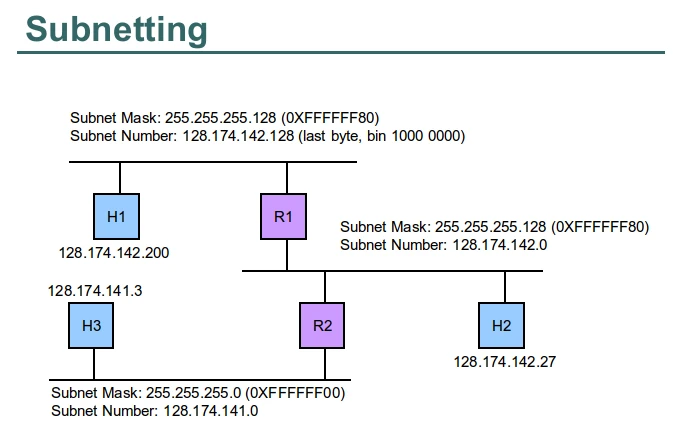
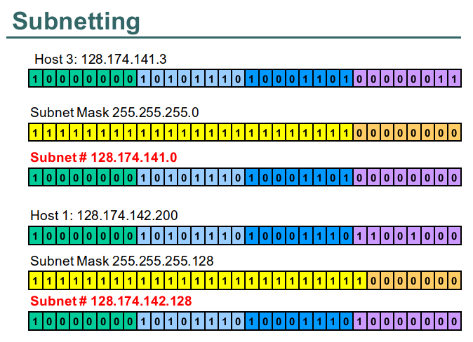
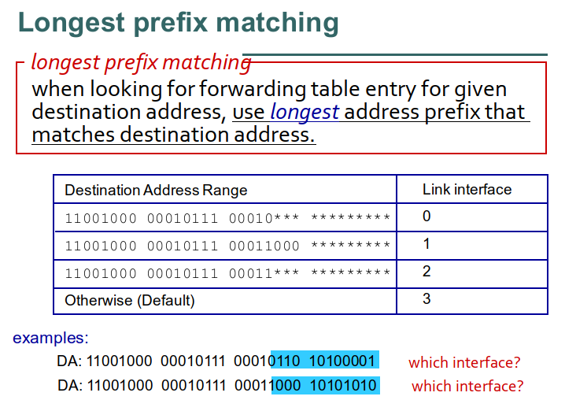
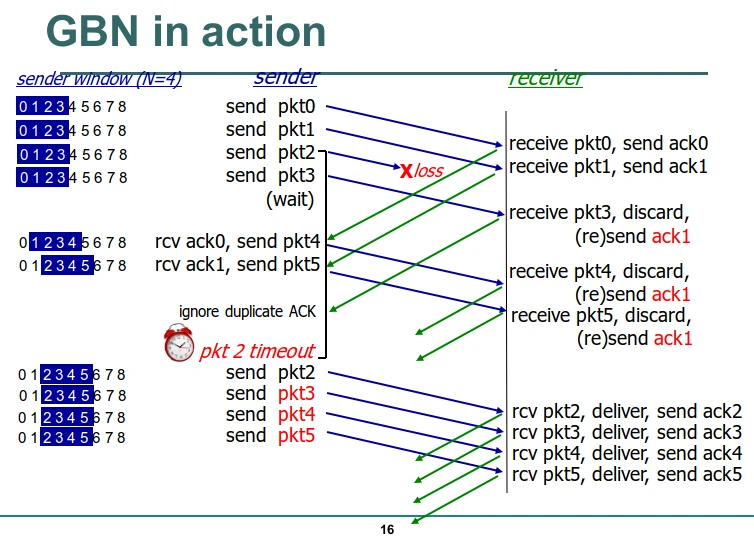
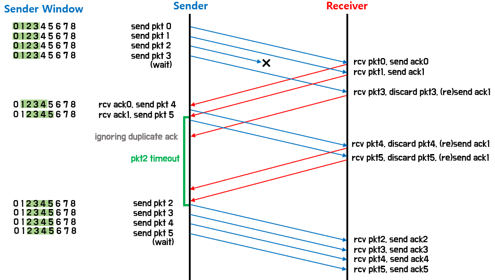
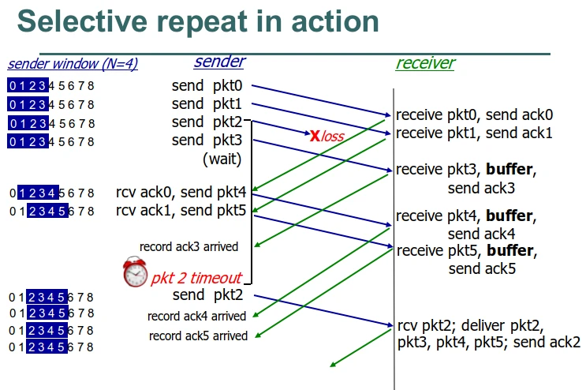
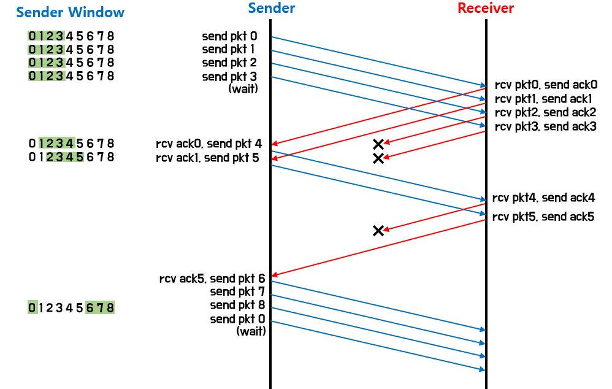

# 2주차 - Subnetting, GBN & Selective Repeat

작성일 2023-09-26 · 최종 수정일 2025-04-11
{ .post-date }

## &lt;Subnetting&gt;

> IPv4 주소는 4개의 바이너리 8자리 수로 이루어져 총 32비트로 구성되어 있다. IPv4 주소를 제대로 이해하기 위해서는 서브넷의 개념을 알아야 한다.

- IP 주소는 **네트워크** 부분과 **호스트** 부분으로 나누어진다. 하나의 **로컬 네트워크**란, 하나의 라우터를 거쳐가는 여러 개의 호스트들이 연결된 **브로드캐스트 영역**이다.

    - 즉, 디바이스의 브로드캐스팅을 받을 수 있는 네트워크로 연결된 것을 로컬 네트워크라고 한다.
    - 만약 어떤 네트워크에서 한 노드가 브로드캐스트를 했을 때 그 네트워크의 모든 노드가 신호를 받았다면 그 네트워크는 하나의 네트워크라고 볼 수 있다.
    - 그러므로 IP 주소의 네트워크 부분은 같아야 하고, 호스트 부분은 달라야 한다는 것이다.

### Subnetting

> 같은 로컬 네트워크에 위치한 디바이스끼리 효율적으로 네트워크 통신과 브로드캐스팅을 하기 위해서 장치들을 일정한 규칙에 따라 하나의 그룹으로 묶는 것. 기본적으로 서브넷 내의 호스트는 같은 서브넷의 호스트끼리만 통신이 가능하다.  
>   
> 그렇다면, 건물 밖의 대상(=같은 서브넷에 속하지 않는 호스트)을 찾아가고자 한다면 어떻게 해야 하는가?

목적지가 같은 서브넷이 아니라면, 반드시 **게이트웨이**(Gateway)를 거쳐서 밖으로 나가야 한다. 항상 좀 더 큰 네트워크로 나가고자 한다면 반드시 게이트웨이를 거쳐야만 한다.  

### Subnet mask

> 서브넷을 구분하는 방법으로서, 서브넷 마스크의 범위 밖에 있는 것들은 동일한 로컬 네트워크에 속해 있는 것이 아니다.

ex)

IP 주소에서 **192.168.0.1/24** 혹은 **192.168.0.1**  **서브넷 마스크** : **255.255.255.0**과 같은 것을 본 적이 있을 것이다. 여기서 **/24**는 **255.255.255.0**과 같은 것을 나타내는데, **255.255.255.0**을 2진수로 나타내면 **1111 1111.1111 1111.1111 1111.0000 0000**이다. 여기서 앞에서부터 연속된 1의 개수만 나타낸 것이 **/24**이다. 슬래시로 표시되는 단위를 **CIDR 표기법**이라고도 한다.

- **계산 방법**

192.168.0.1/24

여기서 1로 채우는 필드가 네트워크 ID이고, 0으로 채우는 필드가 호스트 ID임.

1100 0000. 1010 1000. 0000 0000. 0000 0001 - IP 주소

1111 1111. 1111 1111. 1111 1111. 0000 0000 - 서브넷 마스크

1100 0000. 1010 1000. 0000 0000. 0000 0000 - 서브넷 네트워크

- 서브넷 ⇒ 192.168.0
- 서브넷 내 기기 ⇒ 192.168.0.1
- 네트워크 주소 : 192.168.0.0
- 호스트 주소 : 000.000.000.1

같은 local network에 위치한 모든 호스트들은 같은 **서브넷 넘버**를 가진다.

> 하나의 IP는 네트워크 + 호스트로 구성되어 있으며, 하나의 네트워크. 즉, 하나의 브로드캐스트 도메인에 있는 IP끼리 통신하기 위해선 네트워크 영역이 같아야 하며, 호스트 IP는 달라야 한다.  
>   
> 만약 네트워크 영역이 다르다면, Router나 Gateway와 같은 통신 장비를 통해 통신할 수 있다. 다만 라우터와 네트워크 장비 없이 통신할 수 있는 영역을 우리는 브로드 캐스트 도메인이라고 하고, 하나의 네트워크 영역에는 당연히 네트워크 영역은 같고, 호스트 IP는 달라야 한다.

<!-- -->

> 서브네팅이란, 네트워크 관리자가 네트워크 성능을 향상시키기 위해, 자원을 효율적으로 분배하는 것이다. 여기서 자원을 효율적으로 분배한다는 것은 **네트워크 영역**과 **호스트 영역**을 **분할**하는 것이라고 생각할 수 있다.  
>   
> **서브넷 마스크**는 반드시 1이 연속적이어야 하며, 1인 부분은 **네트워크의 주소**를, 0인 부분은 **호스트의 주소**를 의미한다. 필요한 네트워크 주소만 호스트 IP로 할당 할 수 있게 만들어, 네트워크 낭비를 방지한다.

⇒ H1, H2는 같은 서브넷 마스크를 적용했을 때 서브넷 넘버가 다르므로 다른 네트워크라고 판단할 수 있다.

- 서브넷 마스크를 적용하는 과정(서브네팅)

### Longest Prefix Matching

> Forwarding Table에서 도착지의 주소를 바탕으로 전송할 entry를 찾을 때, Longest Prefix Matching 사용해서 앞단부터 비교하면서 매칭되는 link로 이동하도록 만든다.

---

## &lt;TCP&gt;

> Transport Layer의 서비스(프로토콜)는 서로 다른 호스트에서 동작하는 애플리케이션 프로세스 간의 logical communication을 지원한다.  
>   
> Transport Protocol은 end system에서 동작한다.

- **sender side** : App을 **segments**로 분해하여 network layer로 전송한다.
- **receiver side** : 전달받은 segments를 message로 조합하여 application layer로 전송한다.
- **TCP**(Transmission Control Protocol)
- **UDP**(User Datagram Protocol)

- **Transport vs Network Layer**

    - network layer : logical communication between hosts
    - transport layer : logical communication between processes

### TCP vs UDP

- **TCP**

    - reliable, in-order delivery

        - congestion control
        - flow control
        - connection setup

- **UDP**

    - unreliable, un-ordered delivery

        - best effort
        - not guarantees delay
        - not guarantees bandwidth

    - UDP segments may be

        - lost
        - delivered out-of-order to app

    - connectionless

        - no handshaking between UDP sender and receiver

    - used on streaming multimedia apps

### Go-Back-N

> 송신자가 확인 응답을 기다리지 않고 최대 허용된 수 안에서 여러 패킷을 전송하는 방식이다.

N은 Window Size이며, 윈도우는 순서번호 공간에서 오른쪽으로 이동(슬라이드)한다. 그래서 GBN 프로토콜은 슬라이딩 윈도우 프로토콜이라고도 부른다.

처음에 window size만큼 지정된 패킷을 전송한다. 이때 timeout 타이머를 켠다. 이후에 순서대로 ACK를 전달받을 경우, window를 순서번호에서 한 칸씩 우측으로 슬라이드 하고, timer를 재시작한다. (체크하는 packet 기준점 변경)

그런데 만약 도중에 packet loss가 발생했다면, receiver는 그 이후에 도착한 packet을 모두 discard 한다. sender는 packet loss가 발생한 것을 모르기 때문에 receiver가 ACK를 전달해 주어야만 한다. 이후, discard된 packet으로부터 전달받는 ACK는 duplicate ACK이기 때문에 sender는 window를 슬라이드 하지 않고 대기한다.

쭉 대기하다가, loss된 packet의 timeout 시간이 지나면, packet 2부터 window size만큼 다시 packet을 전달한다.

> **확인 응답이 안된 packet의 수를 N으로 제한하는 이유**  
>   
> TCP는 송신자가 수신자의 버퍼를 오버플로우 시키는 것을 방지하기 위해 흐름 제어(flow control)를 한다. 송신되는 세그먼트의 양을 제한하여 congestion control을 할 수 있다. 수신 측은 사용 가능한 버퍼 공간이 얼마나 되는지를 송신자에게 알려주고, 송신자는 그에 맞게 윈도우의 범위(N)를 조절한다.

### Selective Repeat

> GBN은 패킷 하나의 오류 때문에 많은 패킷을 불필요하게 재전송한다. 그래서 Selective Repeat은 오류가 발생한 패킷만을 송신자가 다시 전송하게 한다. 윈도우 크기 N은 확인 응답이 안된 패킷의 수를 제한하는데 사용하지만, GBN과는 달리 송신자는 윈도우에서 몇 패킷에 대한 ACK를 수신할 수 있다.  
>   
> SR 프로토콜은 수신측과 송신자 모두 윈도우를 가지고 있지만, 두 윈도우가 항상 같지는 않다. 수신측이 패킷을 받았더라도, 송신측이 윈도우의 맨 앞에 있는 패킷에 대한 응답(ACK)을 받지 못하면 송신측의 윈도우는 절대 이동하지 않는다.

SR은 초기에 정해진 윈도우 사이즈만큼 packet을 전송하고, timeout 타이머를 동작시킨다. (*이때 timeout 타이머는 pkt0의 도착 시간을 체크한다.*) 

이후 receiver 측에 packet이 도착하면 이를 확인하는 ACK를 sender에게 전송한다. sender가 ACK를 확인하면 윈도우를 우측으로 한 칸 슬라이딩하고, 새로운 packet을 전송한 다음, 타이머를 재시작한다. (*위의 예제에서는 두 개의 ACK가 도착했으므로, 두 칸 움직여서 5까지 전송이 됐을 것*)

그러던 도중 **packet loss**가 발생한다면 receiver는 도착한 packet을 버리지 않고 **buffering**한다. 또한 해당 packet에 대한 ACK를 sender에게 전송하고, sender는 ACK가 도착했음을 기록한다. (다만 슬라이딩 윈도우를 옮기지는 않는다.) 

그렇게 **packets**(pkt3, 4, 5)을 보관하고 있다가 timeout이 일어나면, 해당 **packet**(pkt2)을 다시 전송한다. sender는 ACK5까지 도착한 것을 알고 있으므로, 슬라이딩 윈도우를 한 번에 6까지로 이동시킨다.
