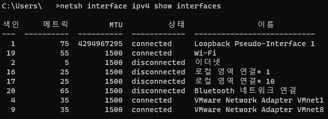
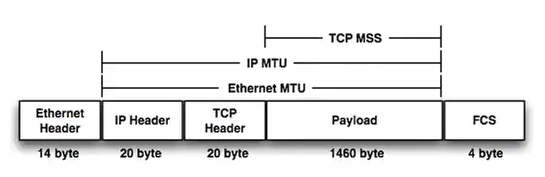
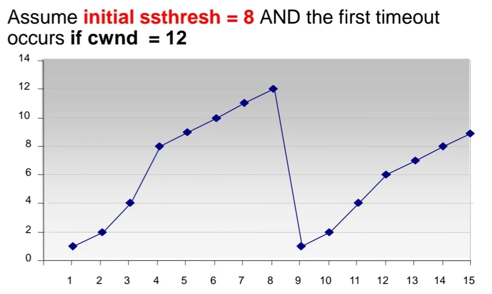
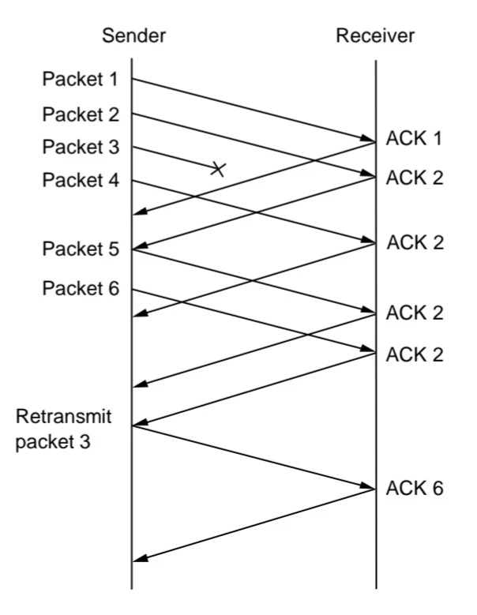
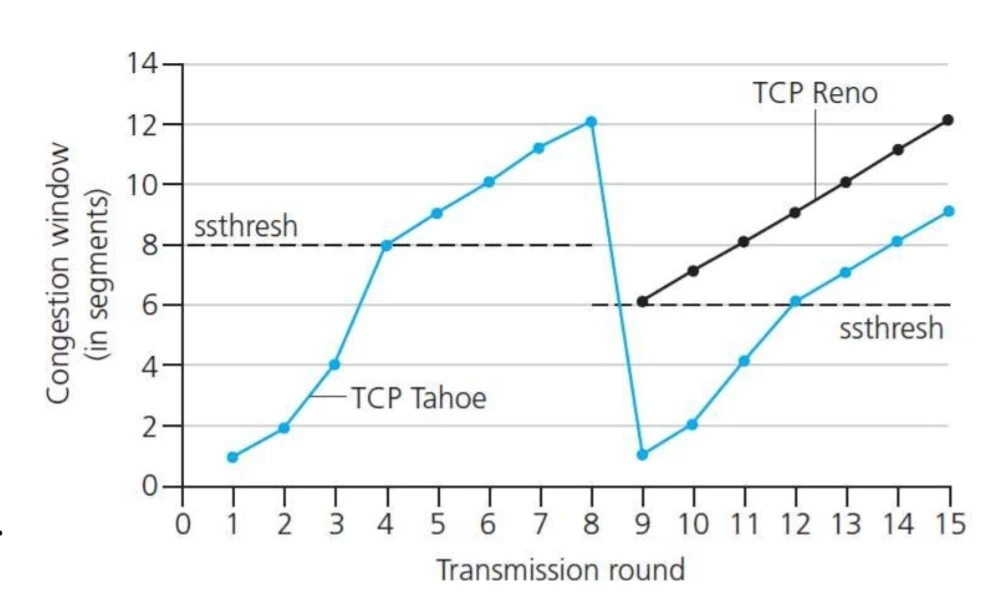

# 3주차 - Congestion Control

## Congestion Control

---

### Principles of congestion control

- **congestion** : 네트워크가 packet을 처리하는 속도보다 더 많은 packet이 전달되어 packet이 drop되는 상황 ⇒ queue가 꽉 찬 상황에서 새로운 packet이 도달하면 packet이 drop된다.

- **manifestations**: ⇒ congestion의 원인

    - Lost packets (Buffer overflow at routers)
    - Long delays (Queueing in router buffers)

#### Why is congestion a problem?

- Sources are unaware of current state of resource
- Sources are unaware of each other

    > Source(Host)들은 자신이 보낼 데이터의 현재 상태나 Network의 상태를 고려하지 않고 packet을 전송하기만 하면 되기 때문에 congestion이 발생한다.

- **congestion에 대처하는 방법**

    - **Congestion Avoidance**
    - **Congestion Control**

---

#### Queueing Disciplines On Network Service

- **Queueing Discipline**

    > Packet을 Queueing으로 처리하는 정책

    - **First-In-First-Out** (FIFO)

        - does not discriminate between traffic sources   
            (traffic sources를 구분하지 않고 하나의 Queue로 처리한다.)

    - **Fair Queueing** (FQ)

        - Round Robin을 사용해서 각각의 Flow Queue를 공평하게 처리하는 방법
        - Ensures no flow captures more than its share of capacity  
            ⇒ 모든 flow가 똑같은 Quantum(Capacity)만을 사용해야 한다.

    - **Weighted Fair**

        - Queueing을 사용할 때 긴급하게 보낼 packet이 발생할 경우, weight에 따라서 처리 시간을 부여하는 방식을 활용할 수 있다.

---

#### Fairing Queue

- **Fairing Queue Algorithm on Fake Server**

    - Bit-by-bit round-robin server 

        가상의 한 클락이 진행될 때마다 현재 연결되어 있는 모든 flow에서 한 비트가 전송되는 가상의 서버가 있다고 해보자. (denote : 나타내다)

        - P(f,i) : denote the length of packet i of Flow f
        - S(f,i) : denote the fake time when start to transmit packet i
        - F(f, i) : denote the fake time when finish transmitting packet i

        $$
        F_{f, i} = S_{f, i} + P_{f, i}
        $$

        ⇒ 즉, Flow f의 전송이 끝나는 가상의 시각 **F**는 시작 시각과 Flow f가 갖는 packet i의 길이를 더한 것이다. **S** + **P**

    - Fake Server는 packet f, i를 언제 전송하게 되는가?

        - packet i가 도착했을 때, 서버가 이전에 받았던 packet i-1에 대한 처리가 끝나지 않았다면, packet i-1의 처리가 끝난 직후에 packet f, i가 처리된다. **F(f, i-1)**
        - 만약 현재 flow에서 처리되는 packet이 없다면 packet i가 도착하자마자 전송한다. 이때의 시각을 A(f, i) [**Arriving Time**]라고 한다.

> 따라서, 아래와 같은 결과를 얻을 수 있다. packet f, i 전송의 종료 시각은 전송 시작 시각(MAX) + packet의 길이이다.

$$
F_{f, i} = MAX(F_{f, i-1}, A_{f, i}) + P_{f, i}
$$

⇒ 이를 통해서 packet i의 처리 시각을 계산할 수 있다. 이전에 나왔던 S(f, i)를 MAX값이 대체하는 것.

> **Fairing Queue 정리**  
> Fairing Queue는 다수의 Flow가 존재할 때,각 Flow에 일정한 Capacity(Time Quantum 혹은 일정량의 packet)를 할당하며 Round-Robin을 통해 packet을 transmit하는 방식이다.

- **“Real” FQ Server (실제 Fairing Queue Server의 동작)**

    - When a packet P(f, i) is received

        - compute the value F(f, i)

            ⇒ 각 Flow에 대해서 F value를 계산

        - Insert packet into a priority queue, ordered by F value

            ⇒ F value에 따라 정렬되는 Priority Queue에 packet을 넣는다.

    - When the output channel becomes idle (**현재** **Service 되고 있는 것이 없을 때**)

        - Retrieve the packet from the priority queue with least F value

            ⇒ F value가 작은 순으로 priority queue를 검색한다.

        - Transmit the packet

- **FQ Algorithm Limitations**

    - bit-by-bit server에서 사용되는 FQ 알고리즘은 완벽하지 않은데, 그 이유는 **현재 packet에 대한 preemption을 허용할 수 없기 때문**이다.

---

### TCP Congestion Control

> Congestion이 발생한 상황에서 congestion을 해소하기 위해 일부 사항을 변경하는 방식

- Keywords
- **CongestionWindow**
- **Slow Start Threshold** (ssthresh)

- **Throughput**

    - W : window size
    - D : round-trip delay

    - TCP throughput : W / D

        ⇒ 한 번에 보내는 데이터의 사이즈인 window size를 한 번 통신할 때 걸리는 delay로 나눈 값

---

#### **AIMD**(Additive Increase Multiplicative Decrease)

> Approach : Sender에서 Loss가 발생할 때까지 transmission rate(cwnd)를 additive하게 증가시키는 것

- **additive increase** : increase cwnd (congestion window) by 1 MSS(Maximum Segment Size) every RTT(Round Trip Time) until loss detected

    ⇒ 한 번의 RTT가 지날 때마다 cwnd를 1 MSS씩 증가시킨다.

- **multiplicative decrease** : cut cwnd in half after loss

    ⇒ congestion이 발생하면 cwnd를 절반으로 감소시킨다.

AIMD는 하나의 packet을 처리할 때마다 window size를 1 MSS씩 증가시키고, congestion을 만나게 되면 window size를 절반으로 감소시키는 방식이다.

**MTU & MSS**

- MTU(Maximum Transmission Unit) : 네트워크 인터페이스에서 패킷 또는 프레임 기반의 네트워크에서 전송될 수 있는 최대 크기의 패킷 또는 프레임을 말한다.

    Ethernet 환경에서는 헤더와 트레일러를 제외한 값이며, Ethernet에서 MTU값은 1500byte

⇒ cmd에서 확인 가능

- MSS(Maximum Segment Size) : TCP 상에서 전송할 수 있는 사용자 데이터를 분할하지 않고 한번에 보내는 최대 크기. 즉, TCP의 데이터 길이(Payload)만을 의미한다. MSS 값은 기본적으로 MTU 값에 의해 결정되며, MTU의 헤더 부분을 뺀 부분이 MSS가 된다.

> Window Size가 커지면 Performance 자체는 좋아질 수 있다. (이상적으로) 하지만 단순히 Window Size를 키우지 않는 것은 Network의 처리 속도가 너무 큰 Window Size를 따라가지 못하기 때문이다.

- Source(Host)에서 Network에서 congestion이 발생했는지를 어떻게 판단할 수 있을까?

    > **Timeout의 발생 여부를 판단**하면 된다. Host는 TCP 요청을 보낼 때마다 자신의 요청이 제대로 처리되었는지를 판단하기 위하여 Timer를 설정하는데, Timer가 expired 되었다는 것은 packet loss가 발생했다는 것이다.  
    >   
    > packet은 전송 에러가 거의 발생하지 않으므로, packet loss가 발생했다는 것은 congestion의 발생을 의미한다고 볼 수 있다.

---

#### TCP Slow Start

> Host간의 통신이 시작되었을 때(when connection begins), 초기 cwnd = 1 (Maximum Segment Size)이며, 매 RTT마다 cwnd를 두 배로 증가시키는 방식. Ack를 전달 받을 때마다 cwnd를 증가시킨다.

- **Summary**

초기 transmission rate는 느리지만, exponential하게 증가되므로 이후에 빠른 속도로 통신할 수 있다.

- **Slow-Start Threshold** (ssthresh)

Slow Start Threshold는 사전에 설정된 값으로, cwnd를 exponential하게 상승시키다가 cwnd가 특정 지점에 도달하게 된다면 cwnd의 증가치를 1로 감소시킨다. (ex. increasement = 1) 

만약 cwnd를 상승시키던 도중 congestion이 발생하면 아래 두 개의 변화를 적용한다.

1. **ssthresh := cwnd/2** (Slow Start Threshold를 현재 cwnd의 절반으로 감소시킨다.)
2. **cwnd := 1** (congestion window size를 1로 설정한다.)

- cwnd = 1부터 시작하여 매 RTT마다  exponential하게 cwnd를 증가시킨다. (2배)
- 그러다가 ssthresh = 8에 도달하게 되면 additive increase 로 변경한다. (+1)
- 증가하던 도중 congestion을 만나게 되면 ssthresh := cwnd/2로 변경, cwnd := 1로 설정한다.

> ex) 만약 ssthresh가 8이 아니라 6이었다면?  
> ⇒ 그렇다면 exponential increase는 6에서 멈추고 additive increase로 변경된다.

---

### Fast Retransmit

> Problem : 만약 한 packet의 loss가 발생하면, 그 packet에 대해서 timeout이 발생할 때까지 다른 packet이 오더라도 Acknowledgement는 이전까지 전달받은 Ack만 반환받게 된다.  
> 이 때문에 낭비되는 Idle periods가 발생하므로, 일정 횟수 이상 Ack의 duplication이 발생할 경우 Fast Retransmission을 수행하는 것이 **Fast Retransmit**의 개념이다.

⇒ Packet 3에서 Loss 발생, Timeout까지 계속해서 ACK2만 전달되다가 Cumulative Ack에 의해서 최종적으로 받은 Packet 6에 대한 ACK가 도달하게 된다.

> ACK란?  
> packet이 올바르게 전달됐다고 안내해주는 확인용 packet. packet3가 lost일 때 packet3가 전달되지 않은 상태에서 아무리 다른 packet이 전달되더라도 TCP에서는 계속해서 ACK2를 보내게 된다. 이것은 굉장한 낭비가 될 수 있으므로 Fast Retransmit에서는 ACK가 3회 이상 duplicate 되면 Fast Retransmit을 수행한다.

#### Slow Start or Not?

- Fast Retransmission이후에 Slow Start를 할 것인가 아니면 Fast Recovery를 할 것인가?

    ⇒ 이것은 TCP의 version에 따라 달라진다.

---

### Fast Recovery

> Fast Recovery that avoids **slow start** after a fast retransmit

세 번의 ACK가 duplicate 되고 나면, Lost packet을 retransmit한다.

세 번의 duplicated ACK가 감지되면 아래의 변화를 적용한다.

- ssthresh := cwnd/2
- cwnd := ssthresh

⇒ 즉, threshold를 절반으로 줄이고, cwnd를 ssthresh로 초기화한다.  
(**Q. 이 경우 threshold를 감소시키는 이유는 무엇인가?**)

(**A. threshold를 1&#47;2로 감소시키고 그 지점부터 cwnd를 시작하므로, additive increase로 시작하기 때문에 이렇게 동작하는 것 같다. slow start를 적용하면 다시 threshold까지 상승할 때까지 몇 번의 RTT를 거쳐야만 한다.**)

---

### Flavors of TCP Congestion Control

- TCP Tahoe : congestion 이후에 slow start를 실시한다.

    - Slow Start
    - Fast Retransmit

- TCP Reno : congestion 이후에 cwnd를 절반으로 감소시킨다.

    - Fast Retransmit

    - Fast Recovery

        ⇒ **Performance 측면에서는 Reno가 더 좋을 수 있음.**

