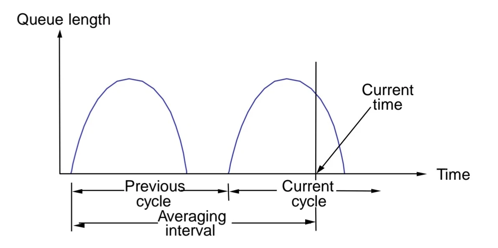
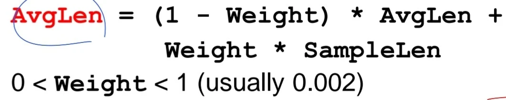
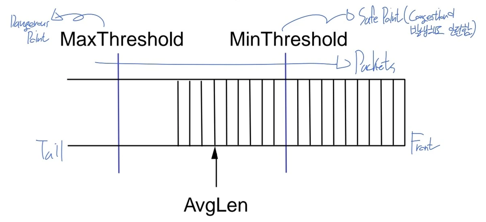
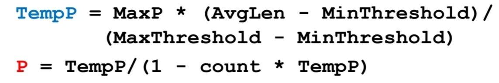
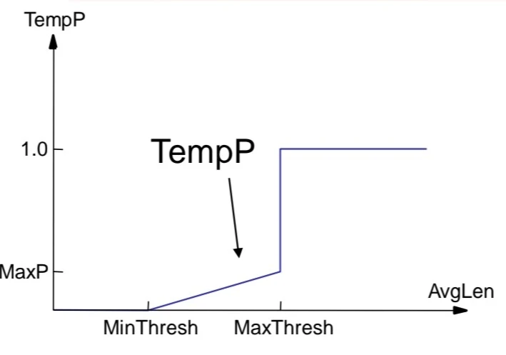

# 4주차 - Congestion Avoidance

작성일 2023-09-26 · 최종 수정일 2023-09-27
{ .post-date }

## Congestion Avoidance

> Congestion이 발생하기 전에 예방하는 방법

- Typical Internet Queueing

Network Data(Packet, Segment)를 처리할 때는 packet을 Queue에 보관하며, FIFO 구조를 가진다.  
만약 Queue가 Full일 경우에는, Arriving Packet은 Drop된다.

---

### DECbit - Not used in TCP

> congestion이 발생할 경우, router가 각 packet header에 congestion indication (CI) bit를 packet에 실어 전송하는 방식으로서, congestion에 대한 책임을 router와 end node에도 분배하는 방식이다.  
>   
> 현재 packet 구조에서는 DECbit가 구현되어 있지 않기 때문에 사용되지 않는다.

- 각 Router는 큐의 상태를 모니터링하고, congestion이 발생할 것 같을 때 end node에게 알린다.
- 이때 Router에 전송되는 packet에 binary congestion bit인 **DECbit**를 추가한다.
- Destination Host는 congestion bit를 ACK에 복사하고, 이를 다시 Source로 전달한다.
- 이를 통해 Source는 sending rate(transmission rate)를 조절하여 congestion을 예방한다.

- congestion bit는 packet header에 추가되며, Router는 한 packet의 average queue length가 1 이상일 경우에 congestion bit를 set한다.

    - Average Queue Length는 지난 (busy + idle) cycle와 현재 busy cycle을 포함한 시간 간격 동안 측정된다.
    - Queue Length : 큐에서 대기하고 있는 packet의 수

    ⇒ 네트워크 디바이스가 얼마나 혼잡한지를 나타내는 지표이다. 만약 Average Queue Length가 특정 threshold를 넘어서면, 이것은 congestion이 발생할 수 있다는 가능성을 시사하게 된다.

- 만약 지난 window size의 50%보다 적게 bit가 set 되었다면, cwnd를 1 packet 증가
- 만약 지난 window size의 50% 이상으로 bit가 set 되었다면, cwnd를 0.875 배로 감소

⇒ packet 여러 개가 전송되므로, 그 flow에 대해서 DECbit를 검사해야 한다.

---

### RED(Random Early Detection)

> Congestion을 Avoid하면서 높은 throughput을 유지하고 delay를 낮출수 있도록 고안된 방식  
> burst에 대처할 수 있는 방안으로, 안정적인 queueing을 지속하는 것보다는 burst를 처리할 수 있도록 초점을 맞추었다.

#### Lock-out Problem

- Lock-out Problem : **Drop-tail routers treat bursty traffic poorly**

- Alternative Solutions

    - **Random Drop** : Queue가 꽉찼을 때 새로운 packet이 전달되면, random한 packet을 drop시키도록 하는 방식

#### Early Random Drop

- Drop packets before queue becomes full (early drop)

    ⇒ Queue가 꽉차기를 기다리는 것이 아니라 queue length가 drop level을 넘어설때, drop probability p를 가진 arriving packet을 먼저 drop함으로써 Congestion을 방지한다.

- Average Queue Length

- SampleLen은 packet의 길이이다.
- AvgLen은 초기에 MaxThreshold와 MinThreshold의 평균이며, 이를 통해서 AvgLen을 구해내는 것이다.

- Two queue length thresholds

    - MinThreshold
    - MaxThreshold

- Case 1 (Normal Case)

    - AvgLen ≤ MinThreshold ⇒ enqueue the packet

- Case 2

    - MinThreshold &lt; AvgLen &lt; MaxThreshold ⇒ calculate probability **P**
    - ex) p = 0.5이면, 둘 중 하나의 packet은 drop될 수 있다는 뜻

- Case 3 (Dangerous Case)

    - MaxThreshold ≤ AvgLen ⇒ drop arriving packet

> 새롭게 구해낸 AvgLen에 대해서 Case 1, 2, 3을 적용하는 것.

#### RED Details

- Computing Probability P

- count : number of **consecutive** packets NOT dropped while within MinThresh and MaxThresh

#### Example

- AvgLen은 불변이라고 가정해보자.

    - MaxP = 0.02, count = 0
    - AvgLen = (MaxThreshold + MinThreshold)/2
    - TempP = 0.01

- After 50 packets arrive without dropping

    - P = 0.01/(1 - 50\*0.01) = 0.02

- After 99 packets arrive without dropping

    - P = 0.01/(1 - 99\*0.01) = 1
    - Packet will be dropped!
