# 4주차 - Border Gateway Protocol

작성일 2023-09-27 · 최종 수정일 2023-09-28
{ .post-date }

## Border Gateway Protocol

> Routing Protocol이 동작하기 위해서는 모든 router들이 네트워크에 존재하는 다른 모든 router들을 알고 있어야만 한다. 하지만, 해외와 같이 굉장히 멀리 있는 router들의 존재까지 알 필요는 없을 것이다. BGP는 이러한 router들의 집합인 domain 간의 통신 프로토콜을 정의하는 방식으로, 현대 인터넷의 문제 중 가장 복잡한 문제 중 하나이다. (BGP-4)

---

### Routing Domains

> 그렇기 때문에 우리는 인터넷을 Domain으로 나눠서 지역적으로 분할할 필요가 있다.  
> 이를 **Routing Domain** 이라고 한다.

#### Autonomous Systems (Routing Systems)

> AS는 독립적인 네트워크를 의미하며, 각 기관이나 단체(ISP 등)가 독립적으로 운영하는 네트워크들이 라우터에 의해 연결된 복잡한 네트워크이다.  
> ⇒ 인터넷은 수많은 AS들이 복잡하게 연결된 네트워크이다.

- 특성

    - AS 내의 라우터들은 서로 동일한 라우팅 프로토콜을 사용한다.
    - AS 내의 네트워크와 라우터들은 한 조직에 의해 관리된다.
    - 각 AS는 고유한 16 bit ID를 가지고 있다.

- Routing 문제의 분류

    - **Interdomain** : Domain(Autonomous System) 간의 Routing  
        ⇒ BGP는 Interdomain 문제를 다룬다.
    - **Intradomain** : Domain(Autonomous System) 내에서의 Routing  
        ⇒ Domain 별로 Intradomain routing protocol은 다를 수 있다.

- **backbone** : 다양한 네트워크를 상호 연결하는 컴퓨터 네트워크의 일부로서, 각기 다른 LAN이나 부분망 간에 정보를 교환하기 위한 경로를 제공한다. 수많은 지역의 대형 회사는 지역 전체를 한데 묶는 백본망을 가질 수 있으며, 이 부서들을 아우르는 네트워크 연결(ex. 이더넷, 무선)을 네트워크 백본이라고 부른다.

#### Standard Interdomain Routing Protocol

- Interdomain Routing Protocol은 **Optimality** 보다는 **Reachability**에 집중한다.  
    즉, 최적의 경로를 찾아서 routing을 하는 것보다는 일단 갈 수 있는 길을 찾는 것 자체에 집중

- Loop Freedom  
    AS 간에 존재하는 Loop는 Interdomain Routing 과정에 악영향을 줄 수 있다.

    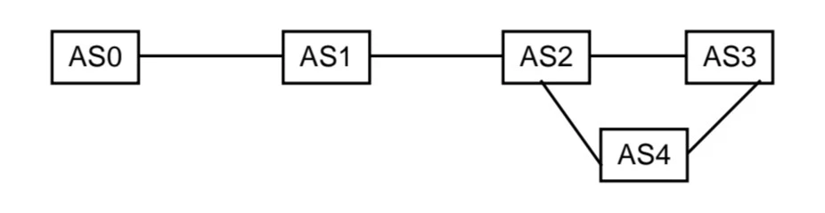

    위와 같은 Interdomain 상황에, AS2, AS3, AS4 모두 Loop를 거쳐 AS0에 도달할 수 있다. BGP는 optimality가 아닌 reachability에 집중하므로, AS2→AS1→AS0를 선택하지 않고 AS2→AS3→ … 를 선택하여 congestion의 발생을 야기할 수 있다.

- Intradomain Policies

    각각의 AS는 주로 ISP에 의해 관리되기 때문에 Intradomain Policies를 자율적으로 결정하게 된다. 따라서 BGP는 optimal path를 찾는데 집중하지 않고 적어도 갈 수 있는 path를 찾아낸다.

- Common Intradomain Routing Protocols

    - **Routing Information Protocol** (RIP)

        - Distance Vector Algorithm(분산형 알고리즘)
        - 각 노드(라우터)는 자신에게 연결된 이웃의 링크 비용만 알고 있기 때문에 벨만-포드 알고리즘을 이용해 최적의 경로를 계산할 수 있다.

        - **Distance Vector**

            - Distance vector는 loop path를 generate 할 수 있다는 단점이 존재함.

    - **Open Shortest Path First** (OSPF)

        - Link State Algorithm(중앙집중형 알고리즘)
        - 모든 노드(라우터)는 모든 링크의 비용을 알고 있기 때문에 다익스트라 알고리즘을 이용해 최적의 경로를 계산할 수 있다. 한 노드에서 다른 모든 노드까지의 최적 경로를 계산하여 routing table에 저장해 놓는다.  
            ⇒ 각 Router마다 존재하는 Table 별로 Routing Table 존재

        - Link State

            - Overhead가 크다.

---

### BGP-4

> Current Standard Interdomain Routing Protocol

- BGP-4에서, 가능하면 Loop를 회피하는 방식으로 path를 선택한다.

#### Conflicting Policies

> 각 router 별로 path에 대한 preference가 다를 수 있어 발생하는 문제

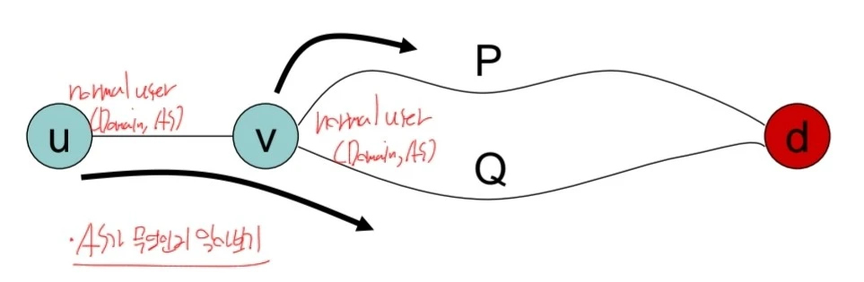

위와 같은 상황에서 router u, v의 preference는 아래와 같다.

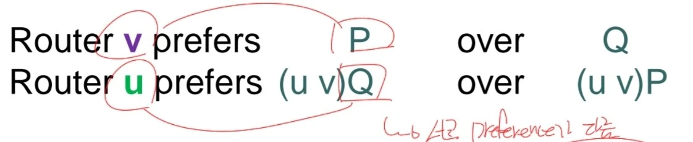

- Router V : P를 선호함
- Router U : (u v)Q를 선호함 ⇒ (u → v → Q) 라는 의미.

> 이 상황에서 **Conflicting Policies**에 의해 **divergence**가 발생할 수 있다.

---

### Stable Path Problems(SPP)

- Destination이 항상 0번 노드라고 가정
- 각각의 Node(AS or router)는 0번 노드로 가는 경로를 찾고자 한다.
- 각각의 Node는 여러 개의 path를 가지며, 위에 있을수록 preference가 높다.  
    따라서 가능하다면 Preferred Path를 사용하지만, Current Path는 빨간색 Path이다.

#### Stable Path Problem Example

> 주어진 그래프에서 Stable한 Path를 찾을수 있는지 없는지 다루는 문제

**example**

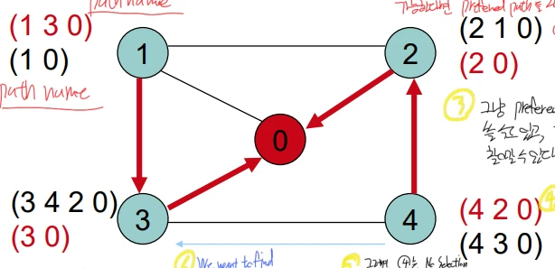

위와 같은 상태의 그래프가 존재한다고 해보자. 이 상황에서 노드 4가 (4 2 0)을 선택하고 있으므로, 노드 3은 Preferred Path인 (3 4 2 0)으로 Path를 Update 할 수 있다. 

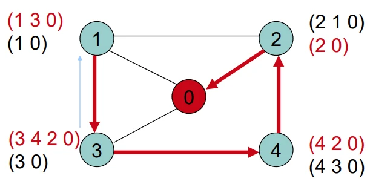

다음과 같이 경로를 업데이트 하면, 노드 1은 현재 선택하고 있던 Preferred Path (1 3 0)을 계속 이용할 수 없다. ⇒ 왜냐면, 노드 3이 Path를 (3 0)이 아닌 (3 4 2 0)으로 변경했기 때문이다.  
그러므로 노드 1은 Path를 (1 0)으로 변경해야 한다.

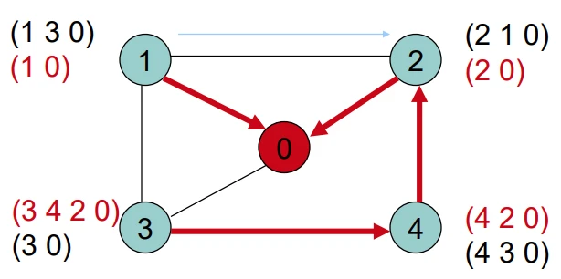

이렇게 되면 노드 2는 Preferred Path인 (2 1 0)을 이용할 수 있게 된다. ⇒ 노드 1이 (1 0)이기 때문  

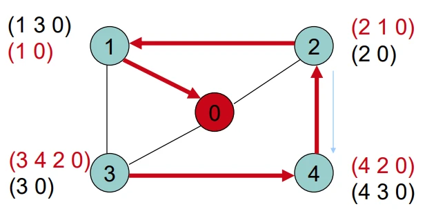

그런데 이와 같이 변경하면 문제가 발생하게 된다. 노드 4의 경로인 (4 2 0)의 이용이 불가능한 것이다. ⇒ 왜냐면, 노드 2의 경로가 (2 0) 이어야만 노드 4의 (4 2 0)이 계속해서 이용될 수 있는데, 노드 2의 경로가 (2 1 0)이 되었기 때문이다.

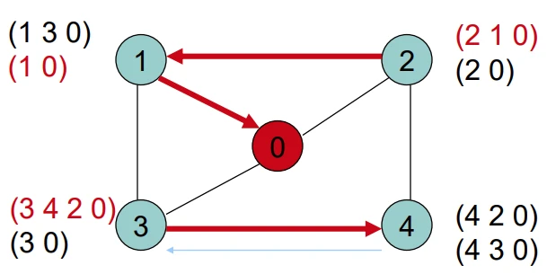

그러므로 이와 같이 노드 4는 선택 가능한 경로를 모두 잃게 되는 문제가 발생한다. BGP에서는 적어도 경로를 찾아내는 것을 목표로 하기 때문에, 노드 4가 현재 상황을 Report해서 경로를 찾아내고자 한다.

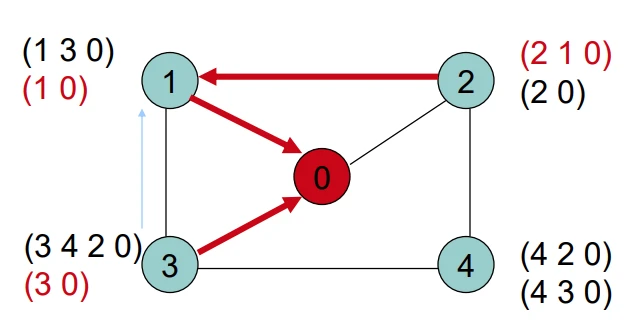

다시 노드 3의 경로를 (3 4 2 0)에서 (3 0)으로 변경한다.

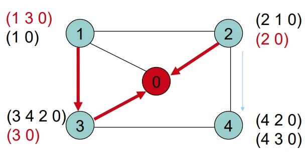

노드 3의 경로가 (3 0)이 되었으므로, 노드 1은 Preferred Path (1 3 0)을 선택할 수 있게 된다. 그러므로 노드 1의 경로를 변경한다. 또한 노드 1의 경로가 (1 3 0)으로 바뀜에 따라 노드 2는 (2 1 0)을 사용할 수 없게 되므로, 경로를 (2 0)으로 변경한다.

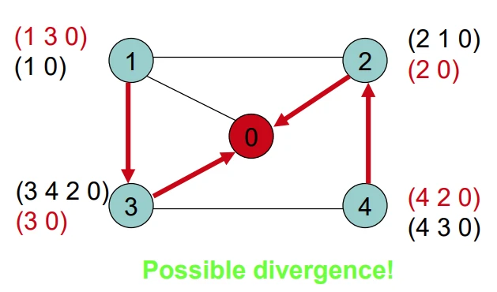

그러면 노드 4는 다시 노드 2의 경로 (2 0)을 활용할 수 있게 되므로, 결론적으로 (4 2 0)의 경로를 사용할 수 있게 된다.

> SPP 문제에서 Stable Status란, 아래 조건을 만족하는 상황이다.  
>   
> 1. 각 노드는 도착지로 가는 Reachable Path를 반드시 가져야 한다.  
> 2. 각 노드는 Preferred Path를 사용해야 한다.  
>   
> 위의 상황은 적어도 Reachable한 Path를 모든 노드가 갖기는 하지만, 모두가 Preferred Path를 이용하고 있지는 않으므로, **Stable Status가 아니다.**  
> ⇒ 이를 **divergence**라고 한다.
