# 5주차 - Dispute Digraph

작성일 2023-10-28
{ .post-date }

## &lt;Dispute Digraph&gt;

> SPP(Stable Path Problem)이 주어졌을 때, 해당 SPP가 Solvable 한지 아닌지를 판단할 수 있는 방법이다. 주어진 SPP를 바탕으로 Dispute Digraph를 그리고, Cycle이 존재하는지 아닌지를 판단하면 된다.

### Conflict Arcs

> Dispute Digraph를 구성하는 그래프 중 하나로서, 서로 충돌하는 경로가 존재할 경우 그려지게 된다.

- Conflict Arc는 실선으로 표현한다.

### Transmission Arcs

> Dispute Digraph를 구성하는 그래프 중 하나로서, 서로 충돌없이 경로가 생성 가능할 경우 그려지게 된다.

- Transmission Arc는 점선으로 표시한다.

> Conflict Arc와 Transmission Arc를 그리고, Cycle이 존재하지 않는다면 해가 존재할 가능성이 있는 것이고, Cycle이 존재한다면 해가 없다고 확신할 수 있다.

### Examples

- Ex. 1

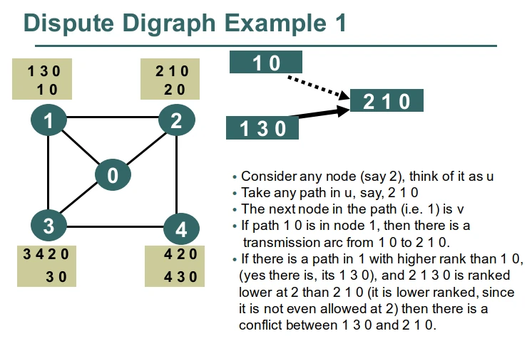

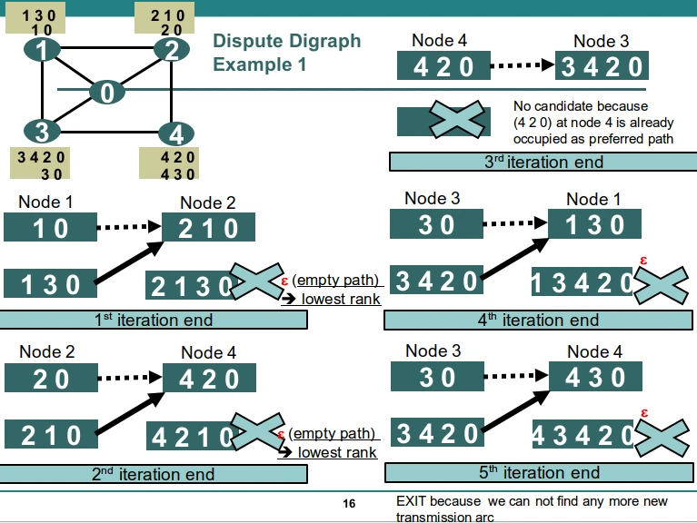

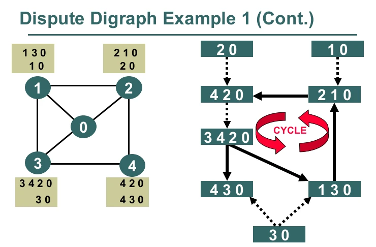

- Ex. 2

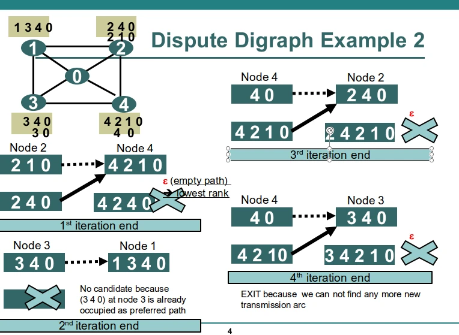

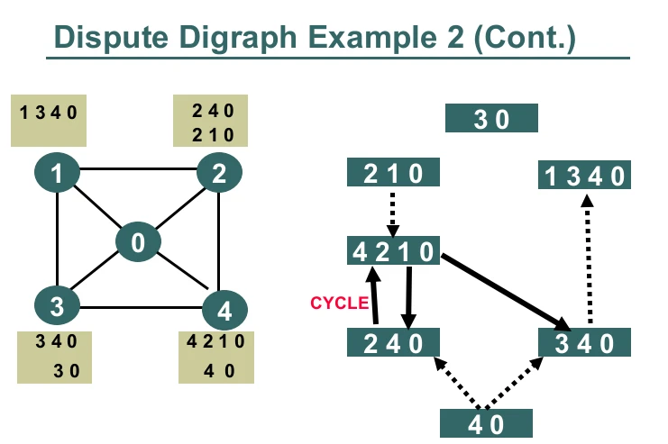

- Ex. 3

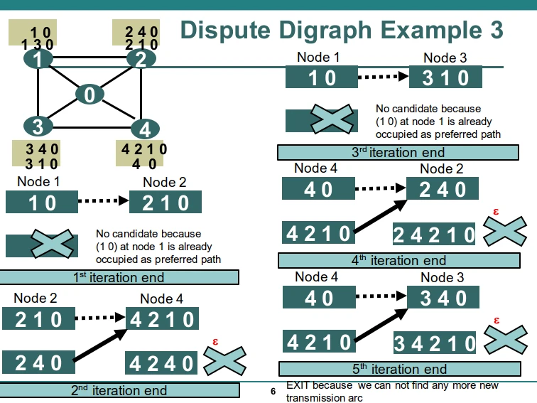

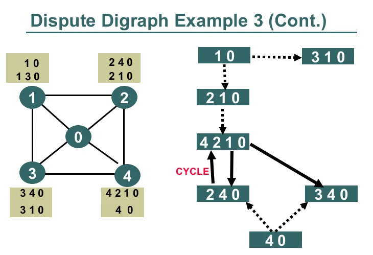

### Dynamic Execution

> SPP 문제를 history를 업데이트 하는 방식으로 풀어나가는 방식이다.

- 새로운 path가 이전의 path보다 higher ranked라면, 새로운 path를 새로운 history로 추가한다.
- 새로운 path가 이전 path보다 lower ranked라면, 오래된 경로를 - sign을 붙여서 추가한다.

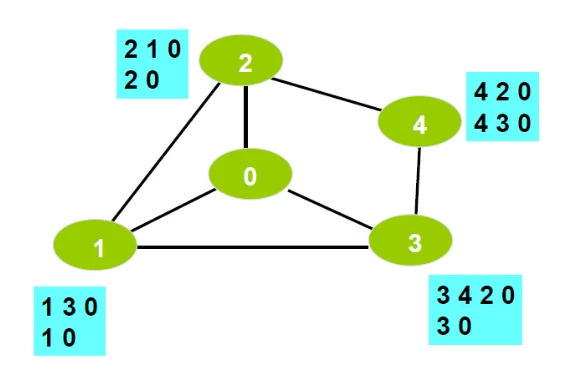

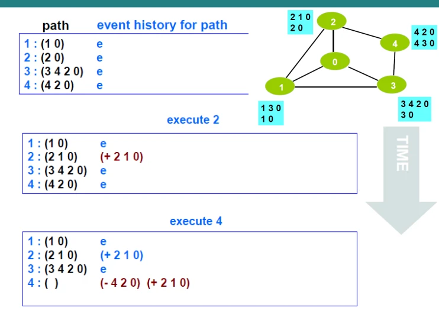

- 초기 상태는 각 노드에 대해서 history가 없음. (empty)

    - 문제에서는 시작점이 주어질 수 있음.   
        **2번** 노드의 (2 1 0)이 선택. 따라서 (+ 2 1 0)을 **2번** 노드에 넣어준다.

- path로 **2번** 노드에서 (2 1 0)이 선택되면, **4번** 노드의 (4 2 0)은 사용이 불가능하므로 **4번** 노드에 (- 4 2 0) 추가, 그리고 이전의 history인 (+ 2 1 0)을 넣어준다.

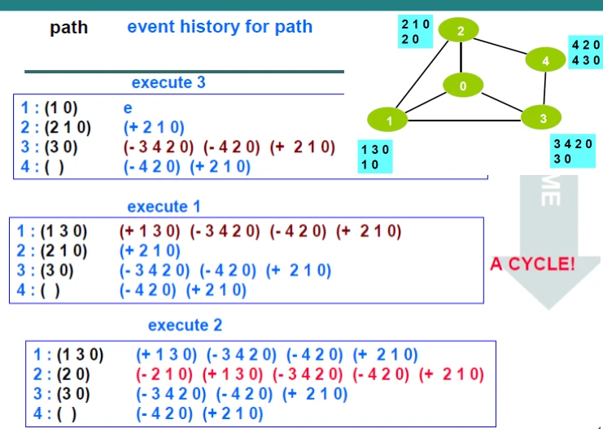

- (- 4 2 0)이 되었으므로, **3번** 노드에서 (3 4 2 0)은 사용 불가. 따라서 **3번** 노드에 (- 3 4 2 0)을 추가하고, 이전의 history들을 모두 넣어준다.
- 이제 새로운 경로 (1 3 0)을 **1번** 노드에 추가할 수 있으므로, (+ 1 3 0)을 추가하고, 이전 history를 모두 추가한다.
- **1번** 노드에서 (+ 1 3 0)을 할 경우, (2 1 0)을 선택할 수 없으므로, (- 2 1 0)을 **2번** 노드에 추가하고, 이전 history를 모두 추가한다.

> 여기까지 진행하면 Cycle이 존재함을 확인할 수 있다.

### Path Selection Policy

> Autonomous System과 BGP Speaker들이 있을 때, local preference와 AS hops, MED value에 따라 path를 select하는 policy를 다룬다.

- Step

    > If we have multiple BGP speakers per AS then, path selection is as follows:

    - From the paths that satisfy the import policies

        - Choose those with the greatest local_pref
        - local_preference가 가장 높은 것을 선택해야 한다.

    - Then, out of the remaining paths from above, choose the ones with least # of AS hops to the destination

        - destination 까지의 hop이 가장 적은 것을 선택해야 한다.

    - Then, for each neighboring AS B, of the paths chosen above, if multiple paths from B, choose the one with lowest MED value.

        - 일반적으로 Lowest가 Preferrable이지만, 조건에 따라 Highest가 Preferrable이기도 함.

    ⇒ 여기까지 Interdomain

    - Choose the path whose internal cost to reach the border router is least.

        - border router까지 도달하는 internal cost가 가장 작은 path를 선택

    ⇒ 여기까지 Intradomain

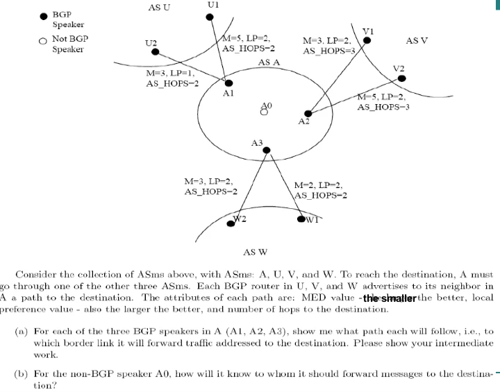

- 이 예제에서는 LP가 클수록 좋다고 판단함. 그러므로 LP가 유일하게 1인 A1-U2를 배제한다.
- AS V의 path들은 AS_HOPS가 다른 AS보다 크기 때문에 V는 배제한다.
- 이러면 세 개의 path가 남는다. (A1, U1), (A3, W2), (A3, W1)

- (A3, W2)는 (A3, W1)보다 MED value가 높기 때문에 배제한다.

    - AS 내에서 MED가 가장 작은 것을 고려한다.

- 이러면 두 개의 path가 남는다. (A1, U1), (A3, W1)

- 이제 A1, A2, A3는 border router까지 도달하는 internal cost를 고려하여 경로를 선택한다.

    - A1은 U1을 선택한다. (A1 → A1의 cost는 0이지만, A1 → A3의 cost는 0이 아니다.)
    - A3도 유사하게 W1을 선택한다.
    - A2는 A1, A3 중에서 A2까지의 local cost가 더 작은 것을 선택한다.
