# 6주차 - P2P & Chord System

작성일 2023-10-28
{ .post-date }

## &lt;P2P Solution Types&gt;

> P2P란, Peer To Peer System을 말하며, 서버/클라이언트의 네트워크 아키텍처가 아니라 사용자들끼리 데이터를 공유할 수 있는 네트워크 아키텍처를 말한다.  
>   
> 이때 Peer란, 동일한 권한을 가진 Host를 말한다.

- **Motivation**

    - How to find data in a distributed file sharing system?

    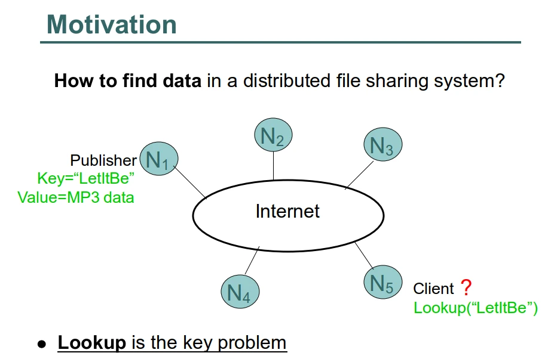

P2P에서 가장 중요한 문제는 분산된 파일 공유 시스템에서 어떻게 원하는 데이터를 찾아낼 것인가? 이다. 만약 “Let It Be” 음악 파일을 원하는 Client가 있다고 하면, 해당 Client는 해당 파일을 가지고 있는 Publisher를 **Look Up**(탐색) 한다.

### Centralized P2P

> Centralized P2P는 하나의 강력한 Device(Server의 역할)를 사용하여 P2P 통신을 실시한다.

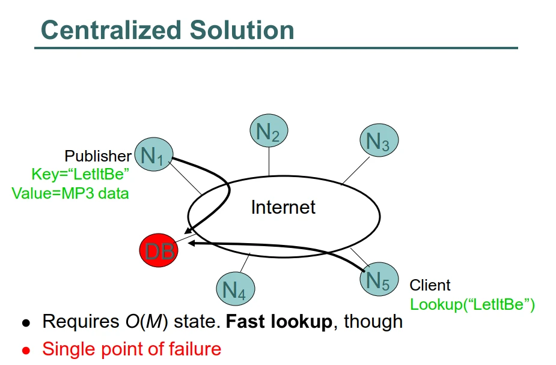

- Centralized Solution는 데이터를 가지고 있는 강력한 Server가 존재해서, Client가 **Look Up**을 하면 아주 빠르게 원하는 데이터를 찾아낼 수 있다. (**Fast Look Up, O(M)**)

- Single point of failure

    - 하지만 하나의 서버만 고장나도 모든 기능이 마비된다는 치명적인 단점이 존재한다.

### Distributed Solution(No Server)

> Centralized Server가 지닌 Single point of failure의 문제를 해결하기 위해 서버를 없앤 형태

- **Flooding**

    - Distributed Solution은 중앙 서버가 없기 때문에 Publisher를 찾기 위해서는 Flooding을 통해서 모든 peer를 Look Up 해야 한다.
    - 그러므로 최악의 경우에는 **O(N)**  **Messages**를 Look Up 해야 한다.

---

## &lt;Chord System&gt;

> Chord는 2\^m 개의 노드를 허용하는 P2P 시스템이다. Chord에서 노드8이 Key 54라는 파일을 찾아내고 싶다면, 핑거 테이블을 만들고, Visiting Node를 구성하면 된다. 이를 통해 특정한 파일을 어떠한 노드가 갖고있는 지를 알아낼 수 있다.  
>   
> Chord System은 항상 Clock Wise Circular Searching을 허용한다.

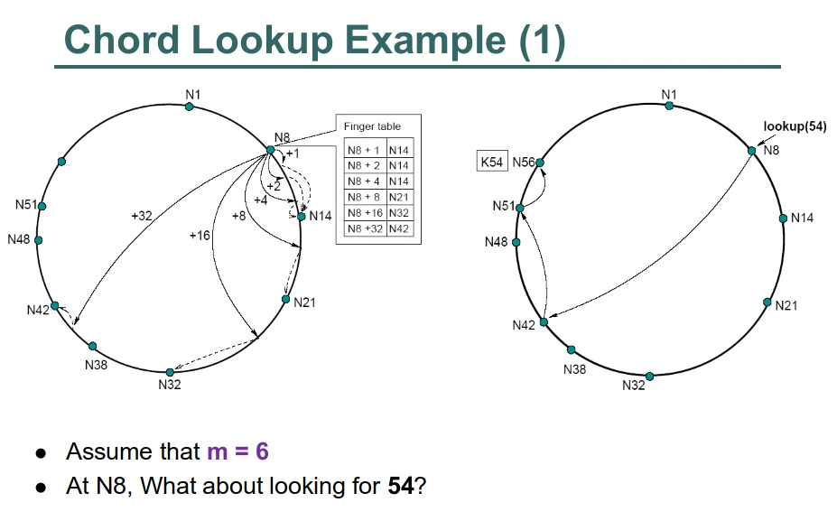

- 먼저, Client를 기준으로 Finger Table을 작성해야 한다.
- Finger Table은 Key Range, Match Node Column으로 구성된다.
- **Example Solution**

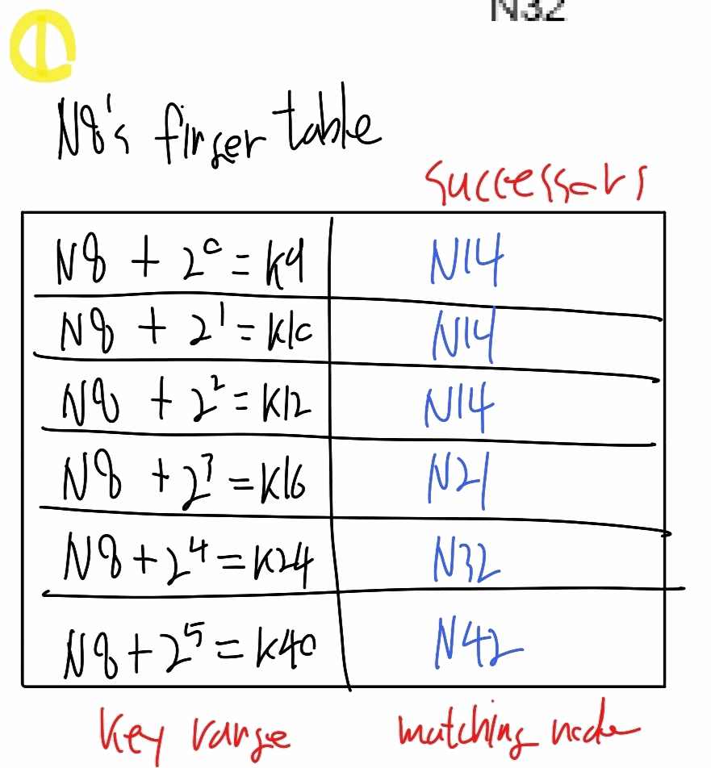

N8부터 탐색을 시작하며, m = 6이기 때문에 finger table을 2\^5가 증가되는 key range까지로 구성한다. 각각의 row의 key range를 구하고, 가장 가까운 successor를 찾는다. (*key range와 clock wise circular search 방향으로 가장 가까운 node. 만약 한 바퀴를 돈다면, 기본값으로 적는다.*)

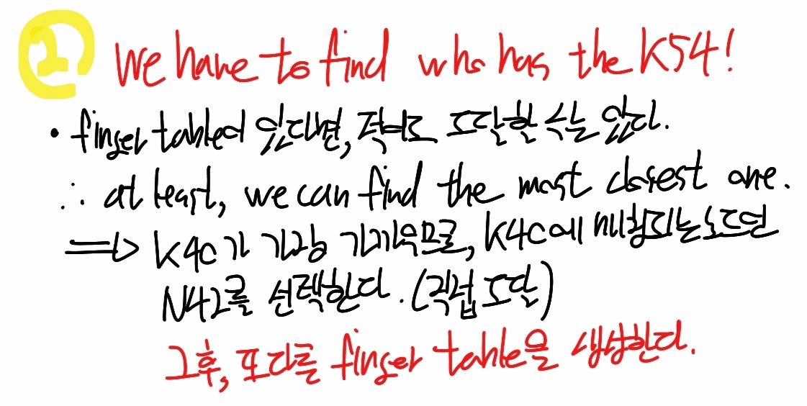

우리가 해야 하는 것은 K54가 어디에 있는지 찾는 것이다. 그러므로 계속해서 finger table을 만들어 나가야만 한다.

우리가 찾는 것은 k54이고, 현재 기준으로 k40이 가장 가깝기 때문에, k40에 매칭되는 successor 노드인 N42로 이동한다.

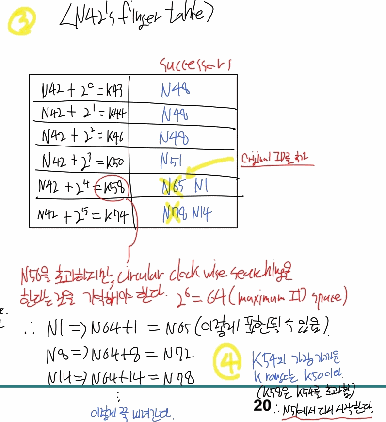

N42에 대한 finger table을 완성한다. 그리다 보면 successor node의 크기가, 한 바퀴를 지나서 Chord System의 허용 host 수보다 커지는 경우가 있는데, 이 경우에는 그냥 기본값으로 표현한다.  
(*따라서 위의 예제에서는 N65를 N1, N78을 N14라고 표현한다.*)

우리가 찾고자 하는 것은 K54인데, 가장 가까운 노드를 찾아가면 된다. 그런데 K50은 N51에 매칭되고, K58은 N1에 매칭된다. 둘 다 K54를 포함하지는 못하지만, K54를 초과하지 않는 N51로 이동하면 된다.

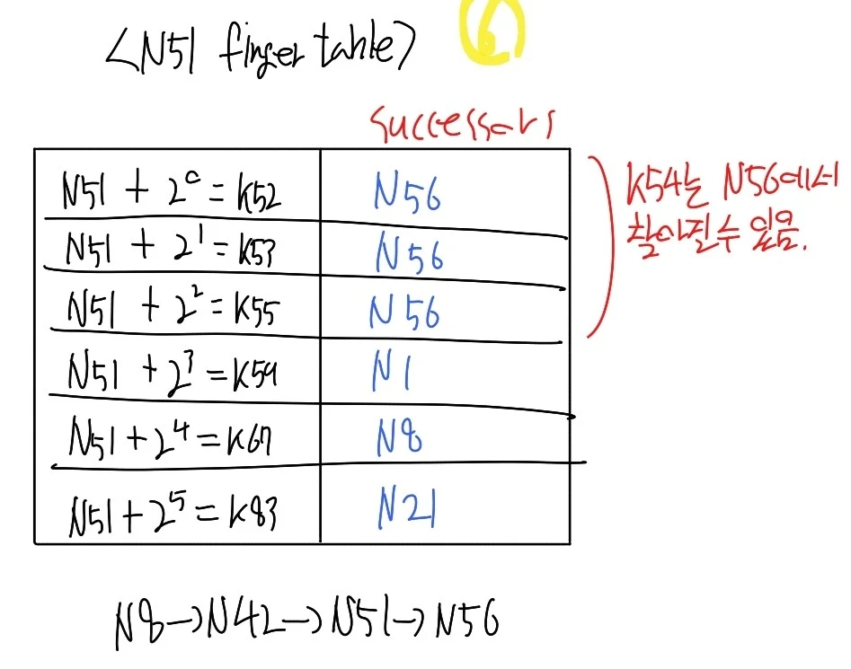

이제 N51에 대한 finger table을 그린다. 우리가 찾는 것은 k54이고, k54를 갖는 매칭 노드는 N56이라는 것을 알아내었으므로, 최종적으로 N56을 선택한다.

### Chord System Example

- **Ex. 1**

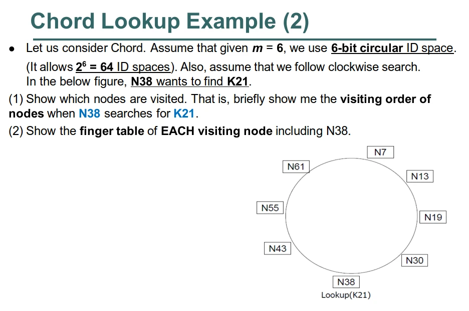

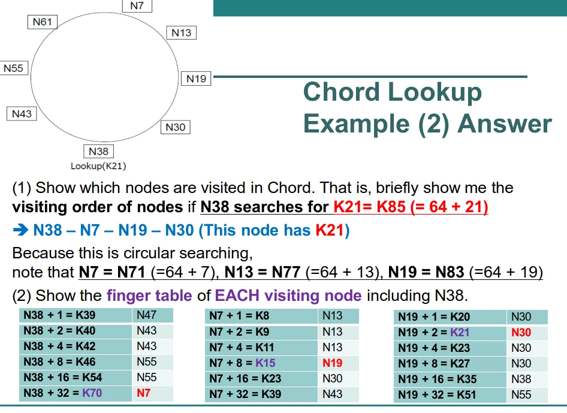

- **Ex. 2**

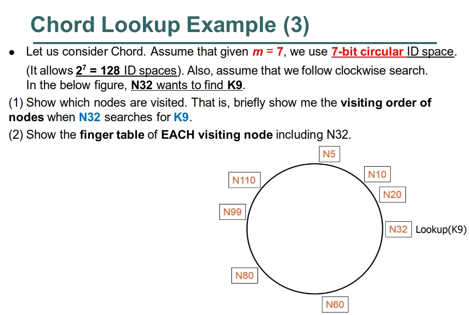

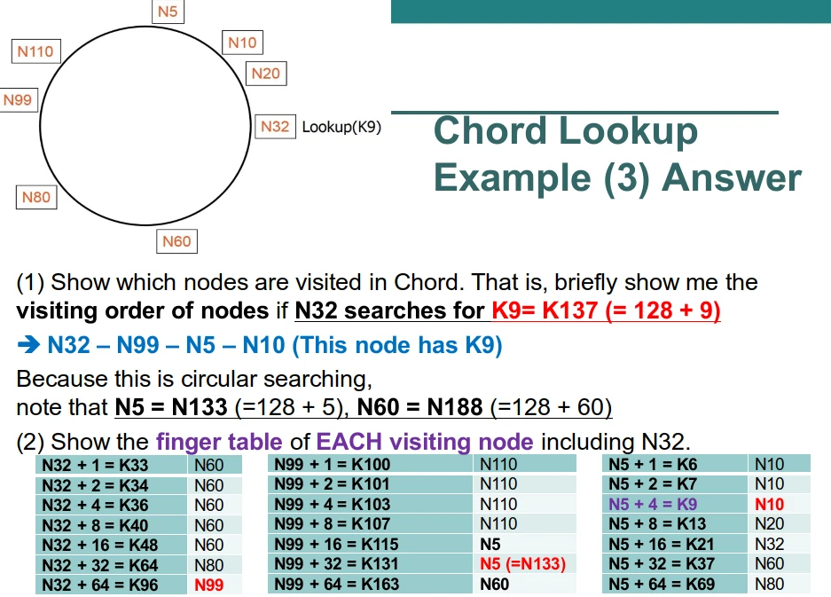

### Joining the ring (Three Steps)

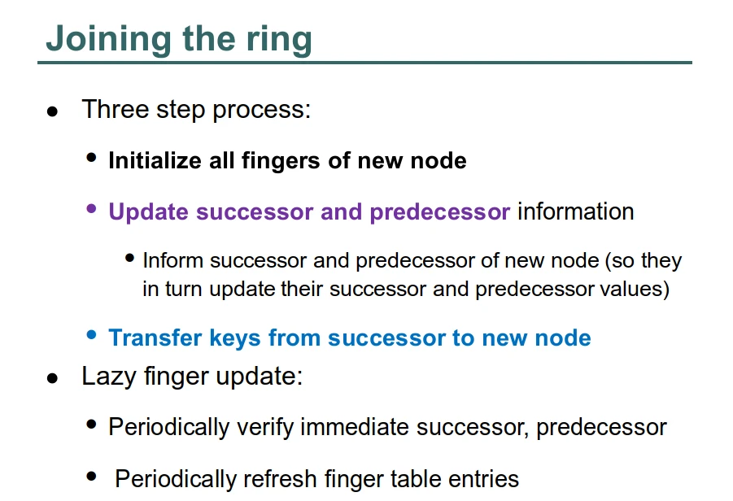

- 새롭게 Chord System에 들어올 노드의 finger table을 초기화한다.

- 새로운 노드를 기준으로, 새로운 노드의 **Successor**와 **Predecessor**의 **finger table**을 업데이트.

    - 실질적으로는 N20에서만 successor가 바뀌게 되고, N40은 바뀌는 것이 없는 것으로 보인다.

- Successor가 가진 key를 새로운 노드로 이동시킨다.

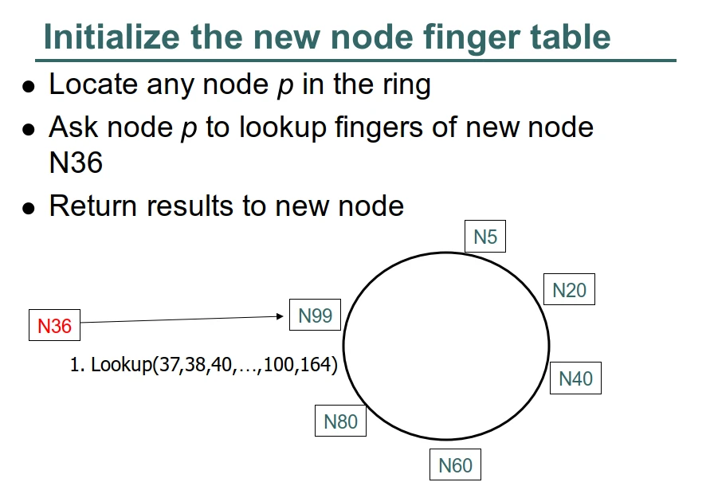

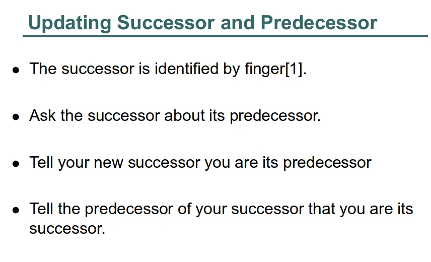

- successor는 n.finger[i] = successor(n + 2\^(i-1))이다. 따라서, N36.finger[1]은 N40이다.

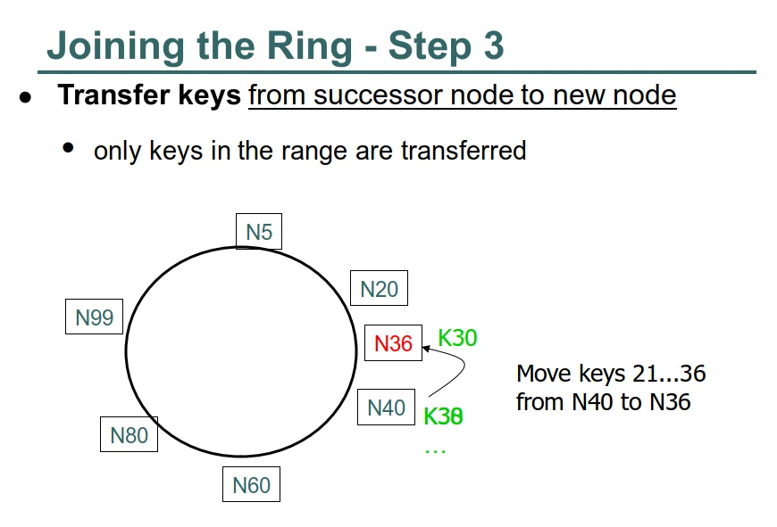
