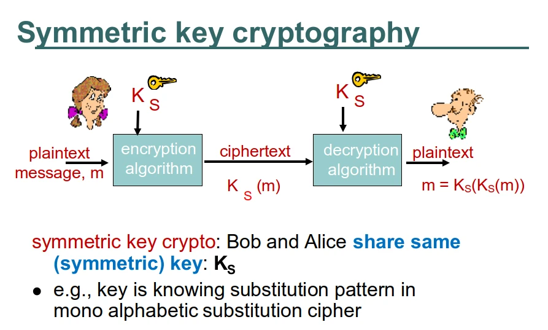
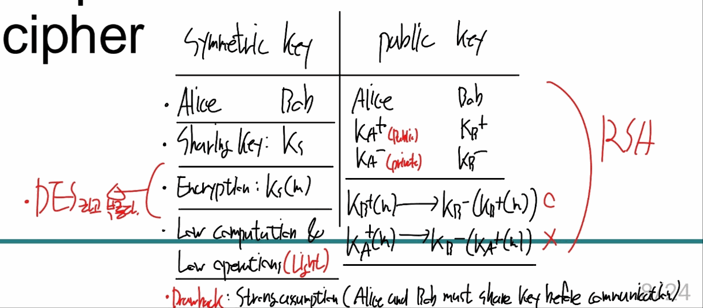
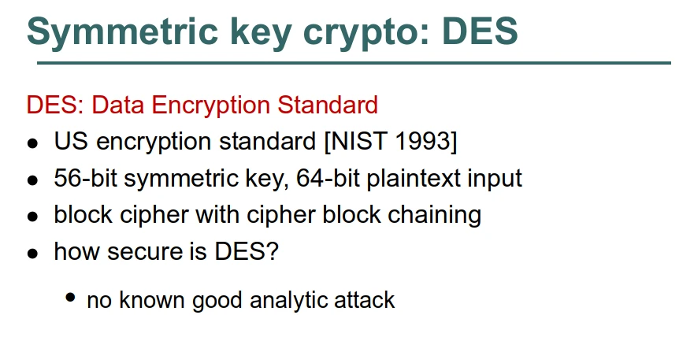
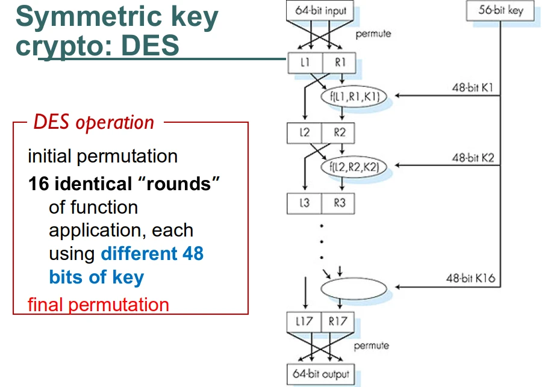
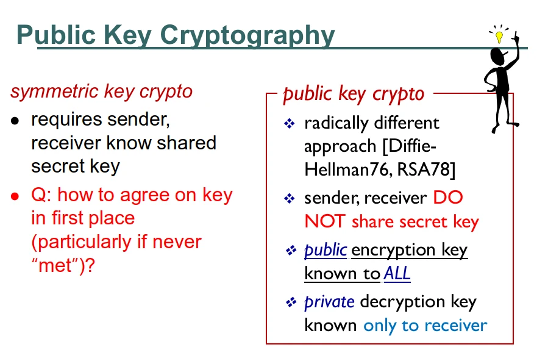
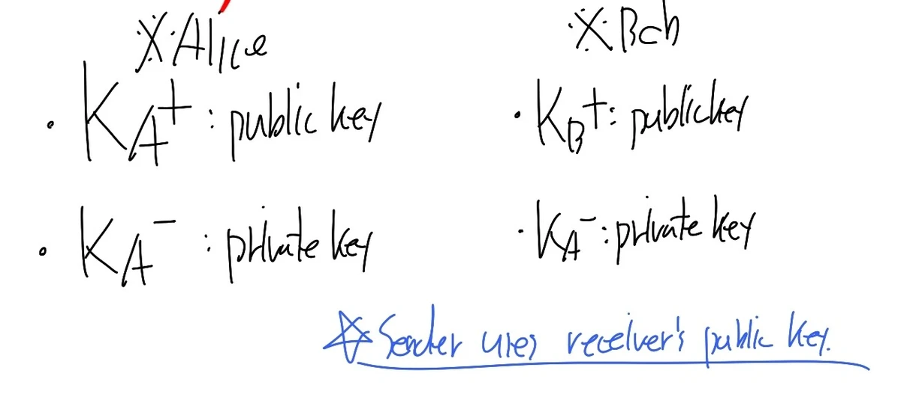
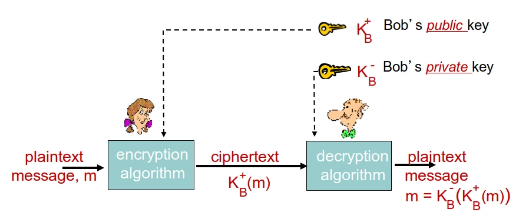
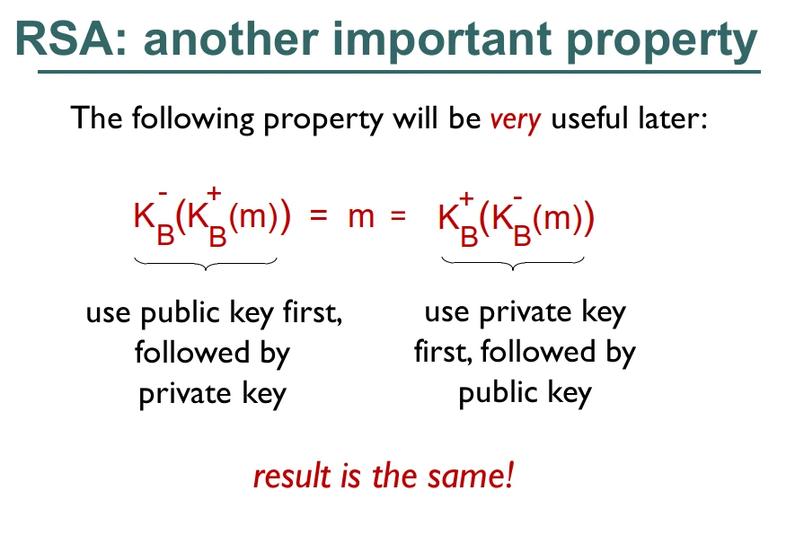
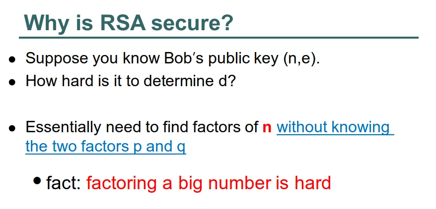

# 7주차 - Symmetric Key(DES) & RSA

작성일 2023-10-28
{ .post-date }

## &lt;Symmetric Key System&gt;

> Symmetric Key는 sender와 receiver가 대칭적인, 동일한 키를 사용하는 암호화를 말한다.

- 밥과 앨리스는 동일한 대칭키(Symmetric Key) **Ks**를 사용하며, 이를 통해 **encryption**과 **decryption**을 모두 진행한다.

- **symmetric key**는 연산량이 적고, **public key**와 비교했을 때 상대적으로 Light하다는 장점이 있다.
- 하지만 상대방에 대한 **Strong Assumption**이 필요해서, 반드시 상대방에게 키를 공유해야만 한다는 단점이 있다.
- **DES**라고 불리는 symmetric key 방식은, message **m**을 Sharing Key **Ks**를 이용해서 <strong>Ks(m)</strong>으로 암호화 한다.
- 복호화를 통해 message를 얻는 과정은 <strong>m = ks(ks(m))</strong>으로 정의된다.

### DES(Data Encryption Standard)

- **DES**는 **Symmetric Key**에서 Data를 **Encryption**하는 Standard이다.
- **56-bit**  **symmetric key**를 갖고, **64-bit**의 **plaintext input**을 처리한다.

- DES는 56-bit의 key를 가지고, 64-bit의 plaintext input을 처리한다.

- 총 16단계의 동일한 round function을 적용하는 과정(round)을 거쳐서 암호화된다.

- 각 단계에서 48-bit의 서로 다른 Key를 사용하여 암호화된다.
- 이때, L1은 R2가 되고, R1은 L2가 되는 방식으로 진행된다.

---

## &lt;Public Key System&gt;

> Symmetric Key는 간단하게 암호화와 복호화를 할 수 있다는 점에서 이점을 갖지만, 상대방에 대한 Strong Assumption이 필요하다는 데서 큰 단점을 가진다. 이에 따라 sender와 receiver가 동일한 키를 사용하지 않는 public key 방식이 대두되었다.

- sender는 receiver의 public key를 사용한다.
- receiver는 sender가 자신의 public key를 이용해 암호화하여 보낸 파일을 자신의 private key를 이용해 복호화하여 확인한다.

- **public key를 이용한 암호화와 복호화 과정**

### RSA

> RSA는 Public Key와 Private Key의 Pair를 만들어내는 알고리즘이다.

- RSA를 통해 만들어진 Key Pair를 이용하면, 어떤 것으로 암호화를 하고 복호화를 하던지 간에 메시지를 동일하게 얻어낼 수 있다.

- 왜 RSA가 안전한가?

    - 주어진 정보가 없이 매우 큰 수를 예측하는 것이 현실적으로 불가능하기 때문이다.
