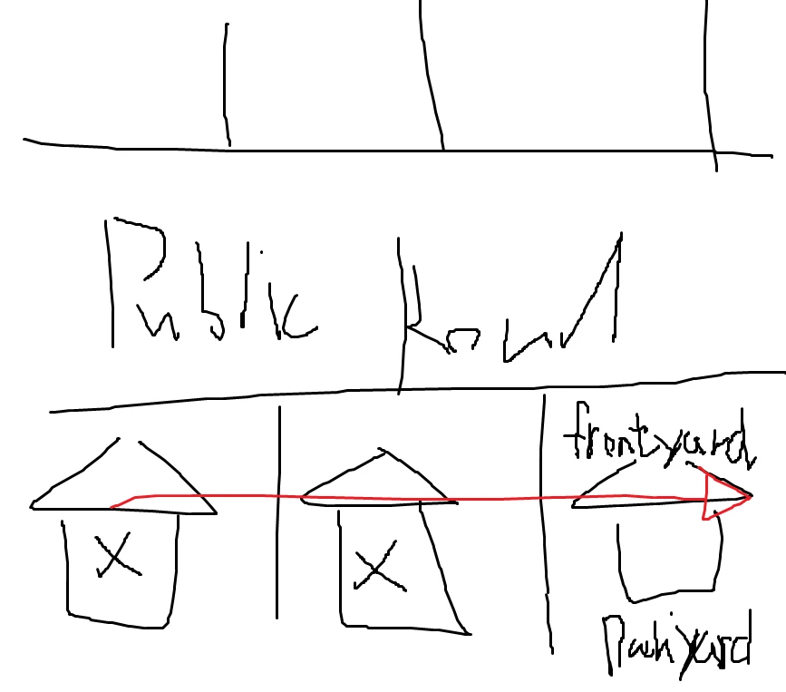
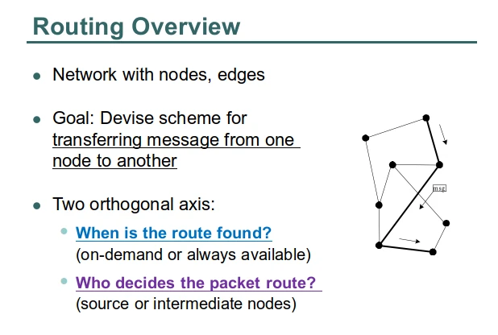
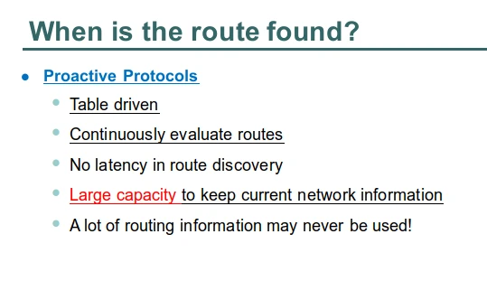
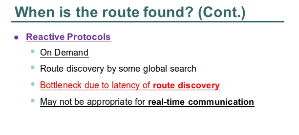
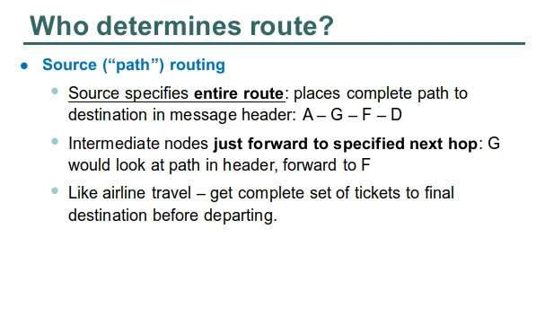
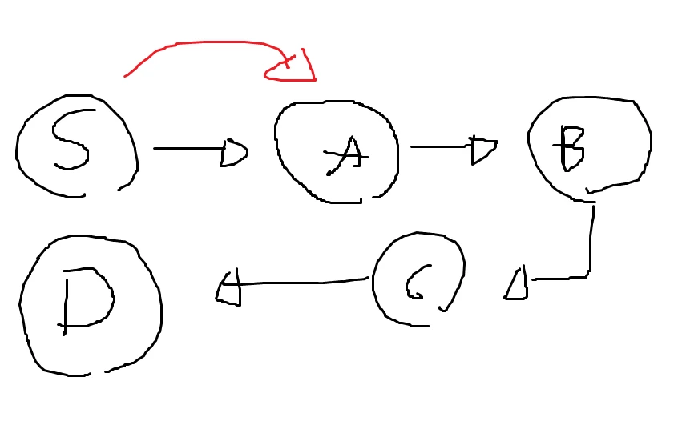
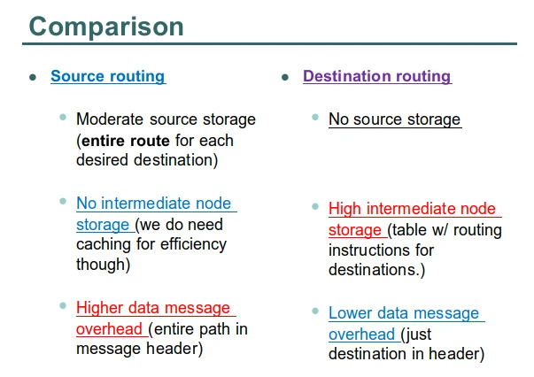
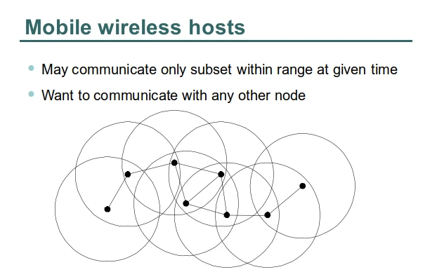
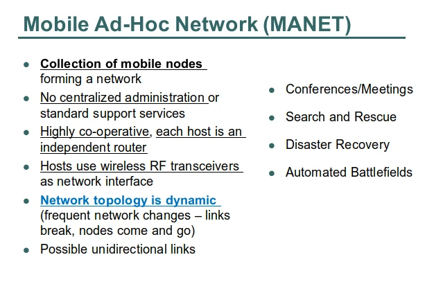
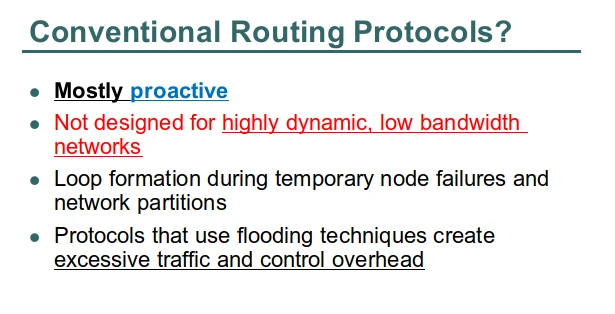

# 12주차: Shared Tree, Ad-Hoc 라우팅

## &lt;Lecture Note 24&gt;

- PIM : Multicasting Routing인데, 큰 지역을 포함하는 방법. RPM은 큰 지역에는 적합하지 않았기 때문임.

### Shared Tree(RPT)

- Mandatory
- 이것이 Delay가 될 수도 있기 때문에, Source를 기준으로 추가적인 Path가 필요한 것.
- Root는 랑데뷰 포인트. 다만 항상 RP가 Root이지만은 않을 것.

### Shortest-Path Tree(SPT)

- Optional
- Receiver는 Group Member
- Source를 Root로 설정하는 Path를 추가하는 방식. 모든 Receiver(Group member)가 Source가 될 수도 있음.
- 1) Receiver들이 RP에게 Join, RPT를 구성한다.
- 2) Source가 RP에게 정보 전달.
- 3) 만약 빈번하게 하면, 그냥 Tree 자체에 Source를 조인시켜 버림
- 4) 그런데 만약 R1이 Multicasting에 의해서 두 번 전달 받게 된다면, 두 개의 Path 중 더 긴 것을 잘라낸다. (Selective Pruning)

---

## &lt;Lecture Note 25&gt;

UAV를 이용해 물건을 배달할 때, 어떤 문제가 있을 수 있나?

만약 화살표 방향으로 물건을 배달하고자 하는데, 경로 상에 있는 다른 집이 회사의 고객의 집이 아니라면, UAV Penetration을 허용할 것인가? (해당 경로가 Minimum Path인 경우.)

만약 경로 상에 있는 집의 주인이 이동을 허락하지 않을 경우, 일정 고도 이상으로 올라가서 이동했다가 고객의 집에 도착하면 고도를 낮추는 방식을 사용해야만 할 것이다.

⇒ 어떤 방식이 가장 효율적일까?

1) Smart City(Newyork)

2) Extensive Ocean Area

⇒ 서로 적용되는 사항이 다를 수 있음.

---

## &lt;Routing in Ad-Hoc Networks&gt;

목적지까지 데이터를 전달하고자 할 때, 거쳐서 전달할 수 있는 중간 노드가 **Ad-Hoc**이다. 

Ad-hoc을 사용한 Routing Protocol을 디자인할 때, 고려할 것들.

- 1) **When is the route found?**
- 2) **Who decides the packet route?**

⇒ 유명한 두 가지 Solution이 있다.

1) **Proactive Protocols** (전통적인 Wire Network)

- 모든 Path를 알고 유지하고 있으므로, 그냥 데이터를 보내면 된다.
- 하지만 많은 Memory가 필요하고, 유지하는데 많은 Resource가 든다.

2) **Reactive Protocols (On-demand)**

- 모든 Path를 모르기 때문에, 그때 그때 Path를 찾아서 보내는 방식이다.
- Real-time Communication에는 적합하지 않다.

> 여기까지는 첫 번째 문제를 해결한다. 1) **When is the route found?**

<!-- -->

> 이제 두 번째 문제를 해결하자. 2) **Who decides the packet route?**

### Source Routing (Path)

- Source가 모든 것을 알고 있으므로, Data와 Path를 함께 전달하는 방식
- 따라서 Source를 제외하면, 다른 Router 들은 Forward만 해서 부담이 매우 적다.
- 하지만, Source의 부담이 너무 커지며, Message의 Size가 너무 커지게 된다.

⇒ Trade-off가 존재함.

### Destination Routing (Hop-by-Hop)

- 목적지만 정해놓고, 하나씩 찾아가는 방식.
- Message Size가 작아지고, 정보 유지에 필요한 Resource도 적어진다.
- 하지만, 경로를 그때 그때 찾아서 가야한다.

### Example of an Ad-hoc Network(MANET)

⇒ Mobile Ad-hoc Network는 보통 Wire-less

- Proactive : (Conventional Network) 모든 Message가 Destination까지 도착하는 경로를 contain 해야만 한다.
- 반면, MANET은 Reactive이다.

