# Multicasting

## &lt;Multicasting&gt;

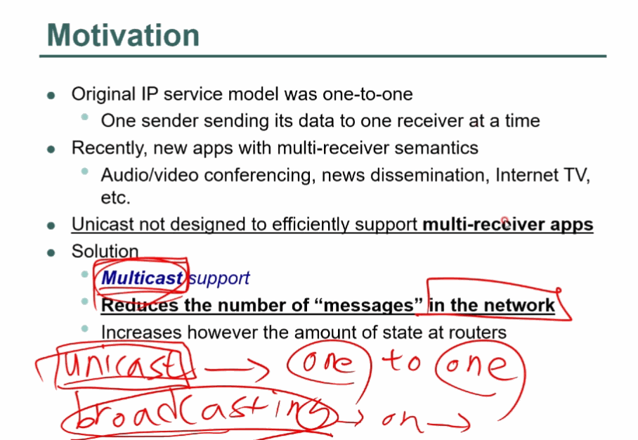

- **Communication** 방식에는 다양한 방식이 있다.

    - **Unicast** : One to One 통신 (Direct Communication)
    - **Broadcasting** : One to Many 통신 (Sender가 보낸 메시지를 &lt;모두가&gt; 볼 수 있음.)
    - **Multicasting** : Multicasting은 특정한 Group Member만 볼 수 있는, 그 Group Member들 간의 통신이다. ⇒ 우리 수업의 공지는 수업을 듣는 사람들만 볼 수 있음.

- Broadcasting은 매우 편리하지만, Message 수가 너무 많다는 단점이 존재한다. Multicasting은 그러한 문제를 해결하고자 한 방법이며, 여기에서 중요한 것은, Network에 전달되는 메시지의 수를 줄이는 것이다.

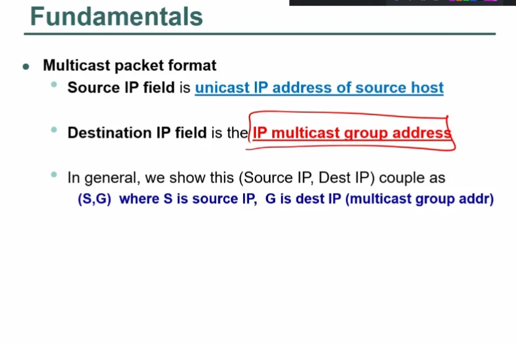

- Multicast Packet format

    - Source IP field : unicast IP address of source host

    - Destination IP field : IP multicast group address

        ⇒ 특정 그룹에 대한 주소가 존재하며, 그 안에 그룹 멤버가 존재한다.

- (S, G)

    - S : Source IP Address
    - G : Destination IP Address

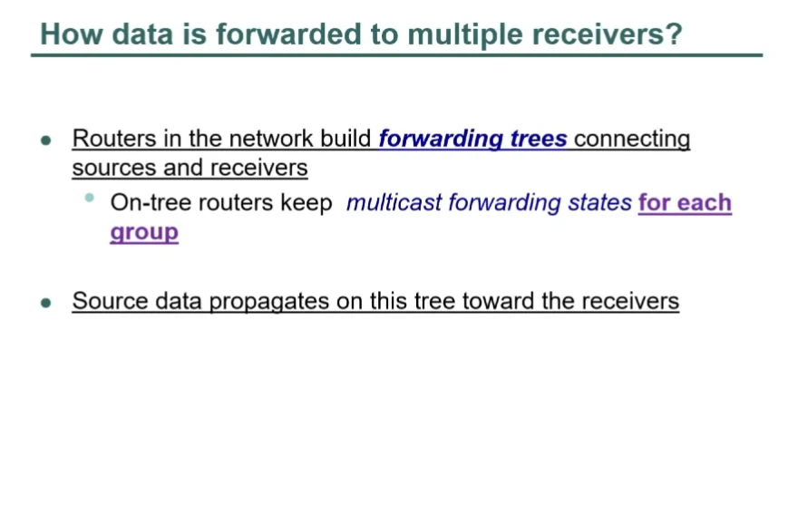

- 그룹 내에 많은 멤버가 있을때, 어떻게 해야 이들에게 메시지를 보낼 수 있을까?

    - **Forwarding Tree**를 이용하며, 기본적으로 모든 Router가 해당 Tree에 연결이 되어 있는 것을 가정한다.

### Sample Forwarding Tree

> Forwarding Tree는 **Shared Tree**와 **Source-based Tree**가 존재할 수 있다.

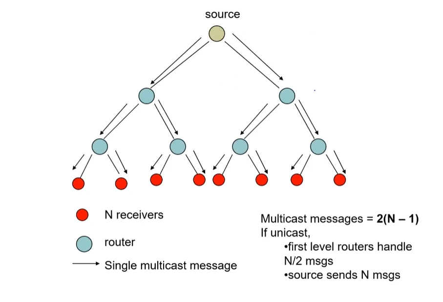

- 각각의 Member가 Source가 될 수 있으며, 각각의 Member는 자신이 좋아하는(자신에게 최적화 된) Shortest Path Tree를 생성할 수 있다. ⇒ **의무적인 사항이 아님**.
- 단, 모든 Member는 Shared Tree에 Join해야 한다. 그래야 Multicasting Message를 받을 수 있기 때문이다. ⇒ **의무적인 사항**임. 단, Shared Tree는 항상 Optimal하지 않을 수 있음.

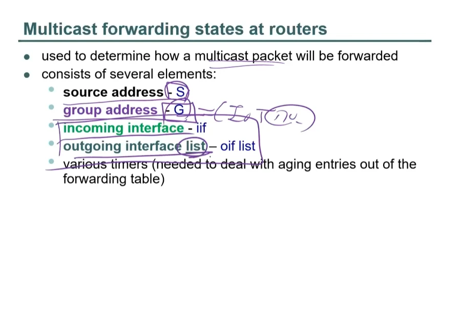

- incoming interface : iif는 Source Node로부터 전달된 데이터를 받는 interface이다.
- outgoing interface : oif는 전달된 데이터를 내보내는 interface이다.

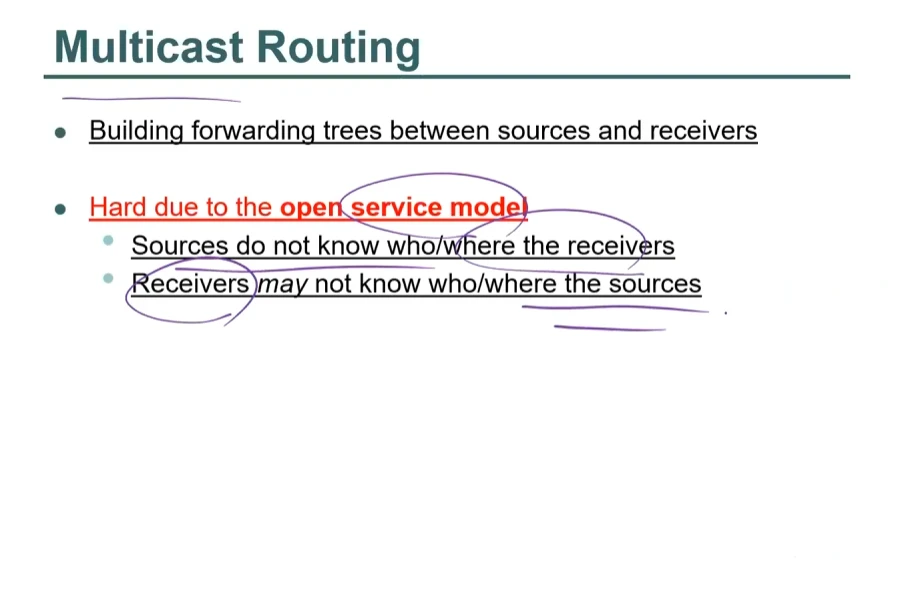

- Multicast Routing은 open service model이다.

    - Source는 Receiver가 어디 있는지 모를 수도 있다.
    - Receiver는 Source가 어딨는지 모를 수도 있다.

### Routing Approaches

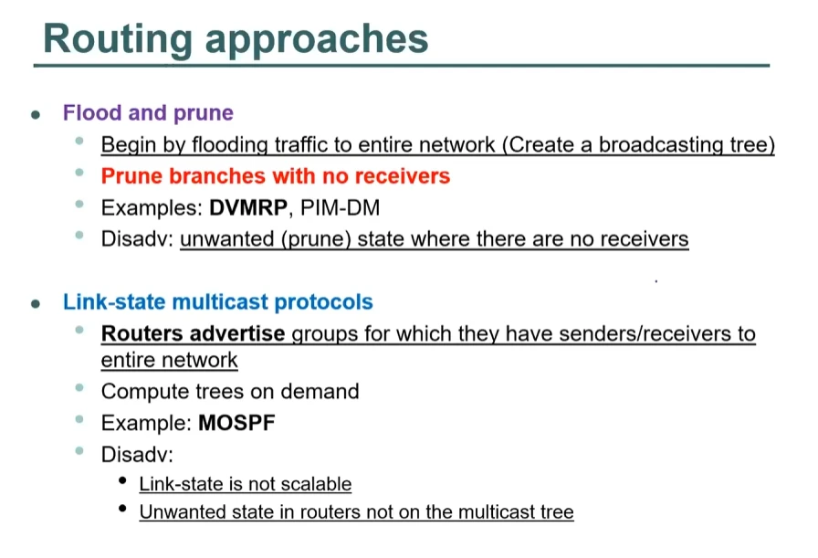

- **Flood and prune (DVMRP)**

    *Flood는 Broadcasting과 같은 의미이다.*

    일단 처음에 필요한 정보를 뿌리고, 필요 없는 Edge 등을 잘라내는 방식이다. 만약 Receiver가 없는 Edge가 존재한다면, 그 Edge를 유지할 필요가 없다.  
    ⇒ 즉, Group Member가 없다면 잘라낸다.

- **Link-state multicast protocols (MOSPF)**

    Router들이 Sender/Receiver의 정보가 있을 때, Router들끼리 서로 정보를 주고 받으면서 데이터를 전달하는 방법이다.  
    ⇒ 확장성이 떨어진다.

### Types of Forwarding Trees

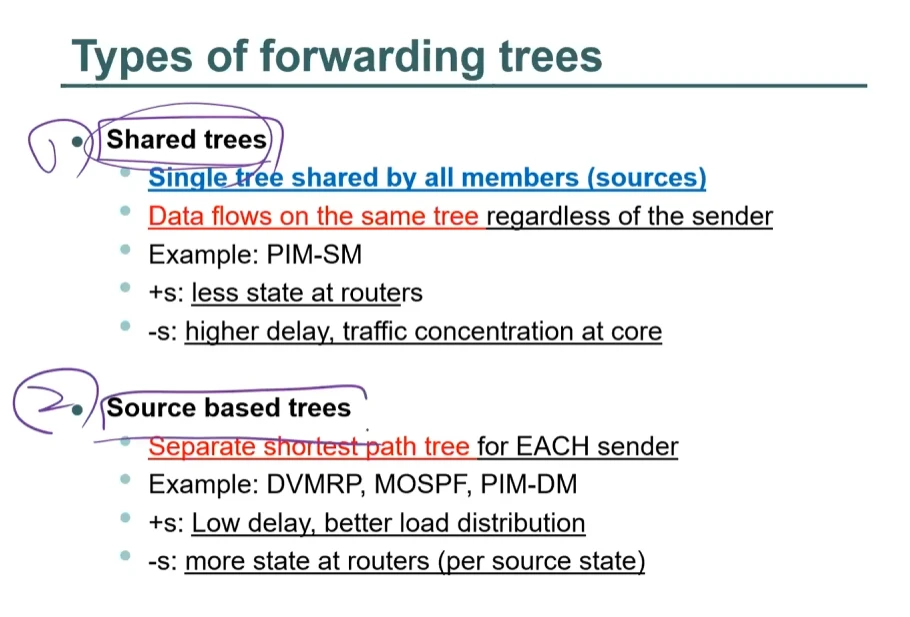

- **Shared trees** : 이것에 포함되어 있어야만 메시지를 전달받을 수 있기 때문에 Group Member에게 Shared Tree는 필수적이다. (*PIM-SM : Sparse Mode*)
- **Source-based trees** : 각각의 Sender가 자기 자신 만의 Shortest Path를 생성하는 방법이다. 이것은 Optional해서 필요할 경우에만 생성한다. (*DVMRP, MOSPF, PIM-DM : Dense Mode*)

### Bridges and Extended LANs

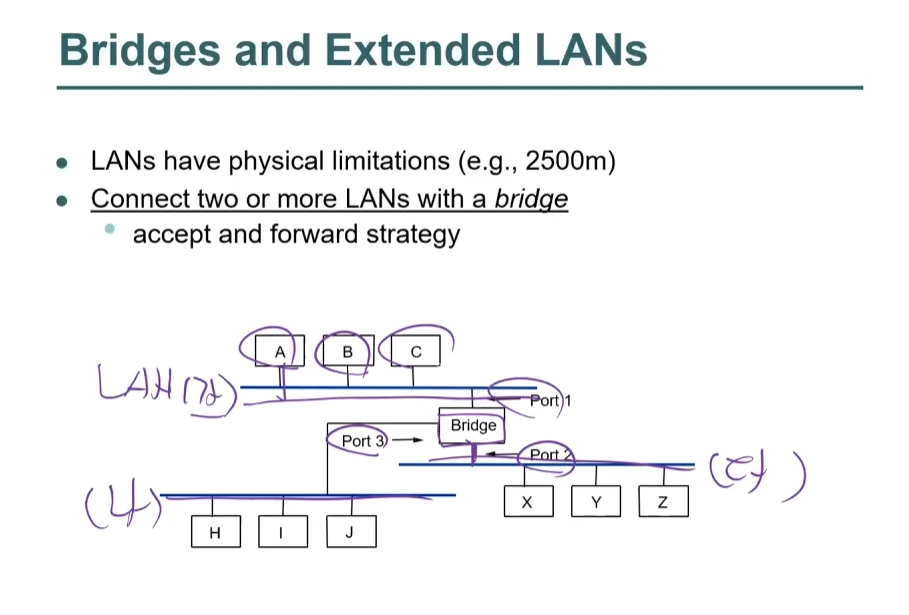

- Bridge는 각각의 LAN들을 연결하는 지점이며, 만약 A, B, C가 연결된 LAN에서 A가 Broadcasting을 하면, A, B, C가 메시지를 전달받게 될 것이다.

- 만약 A가 X에게 메시지를 전달하고자 한다면, Broadcasting을 통해 Bridge로 전달하게 된다.

    - 이때, Bridge는 다른 노드들이 A에게 메시지를 보내고 싶을 경우에 대비하여 **Learning**(Update)를 하게 된다.
    - 만약 A → X 였다고 하는데, 이전에 Learning을 했었다면 Broadcasting을 하지 않고 곧바로 Port 2로만 메시지를 보내게 될 것이다.

### Learning Bridges

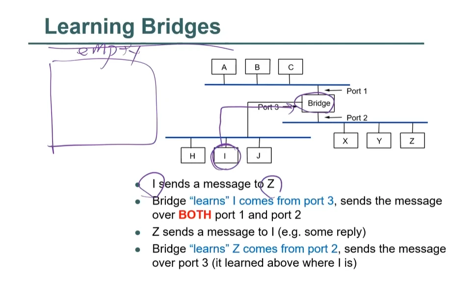

- Node I가 Z에게 메시지를 보내려고 하는데, 현재 Bridge의 Learning Information이 없어서 우선 Port 1/Port 2 모두에 Broadcasting을 보낸다.

    - 결국에는 Z가 전달받게 될 것이다.

- 이 과정에서, “Node I가 Port 3번에 있다.” 라는 사실을 Bridge가 배우게 된다. 

- 그래서 만약 이후에 Node C가 Node I에게 메시지를 전달하고자 하는 경우가 생긴다면, 배웠던 정보를 바탕으로 Port 3에만 메시지를 전송한다. (**Broadcasting보다는 효율적이라고 볼 수 있음.**)

    - 그리고, C가 Port 1에 있음을 학습한다.

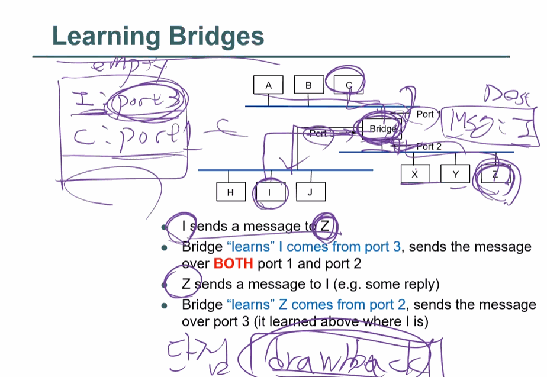

- **Learning Bridge의 단점**

    - 만약 메시지를 보내지 않는 Node가 있다면, Bridge는 그 Node의 존재를 알아차리지 못한다.

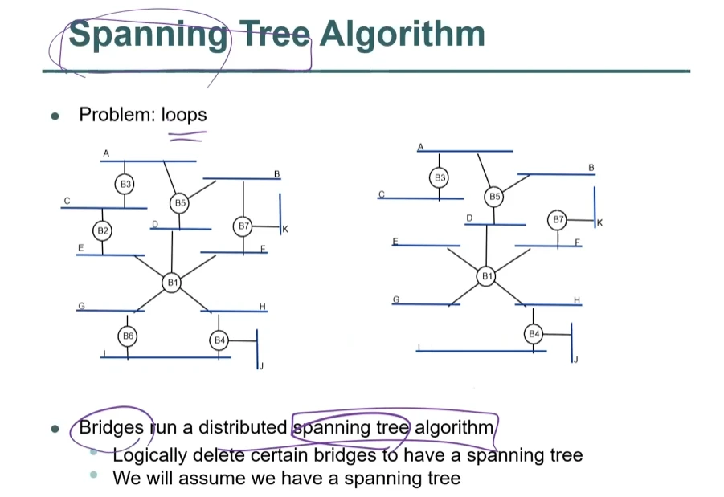

- **Spanning Tree** : 하나의 Node는 반드시 하나의 Edge와는 연결되어 있는 것.

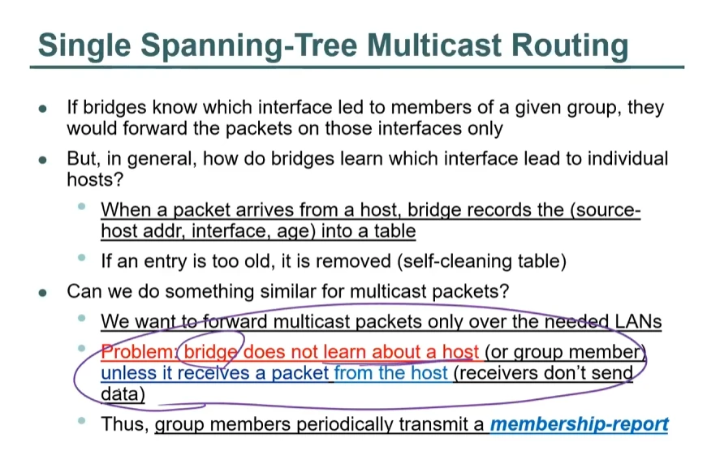

- 이전에 Bridge Learning의 단점은, Bridge가 알아차리지 못하는 Host가 존재할 수 있다는 것이다.
- 이를 방지하기 위하여 일정 주기마다 Membership-report를 하여 Host가 여전히 Group Member임을 Bridge에게 알려준다.

---

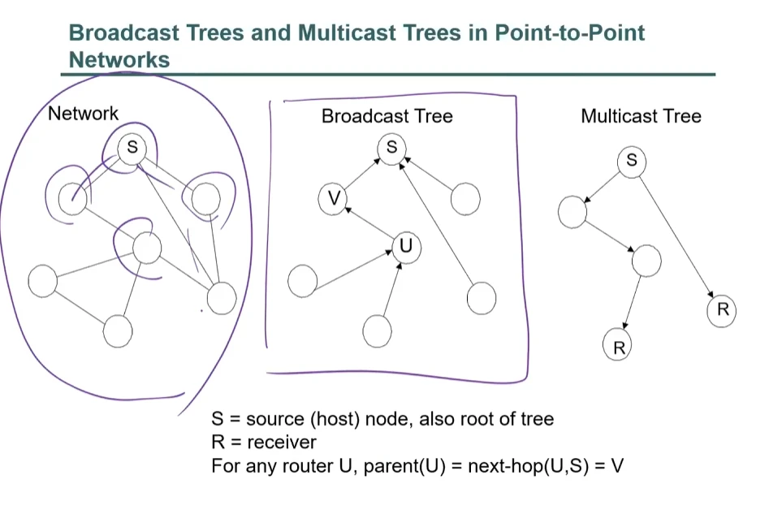

- 현재 Group Member가 아니어도 시스템에 있는 모든 노드들이 적어도 하나의 연결성을 갖도록 하는 것이 Broadcasting Tree이다. ⇒ Spanning Tree  
    (Group Member의 Change가 Dynamic하게 일어날 수 있음.)
- 이와 다르게 같은 그룹 Member만 전달받을 수 있도록 생성되는 Tree를 **Multicast Tree**라고 한다.

> DVMRP가 Final Version이다.  
>   
> RPF → RPB → TRPB → RPM(*Distance Vector 정보를 쓰면 DVMRP*)

### RPF

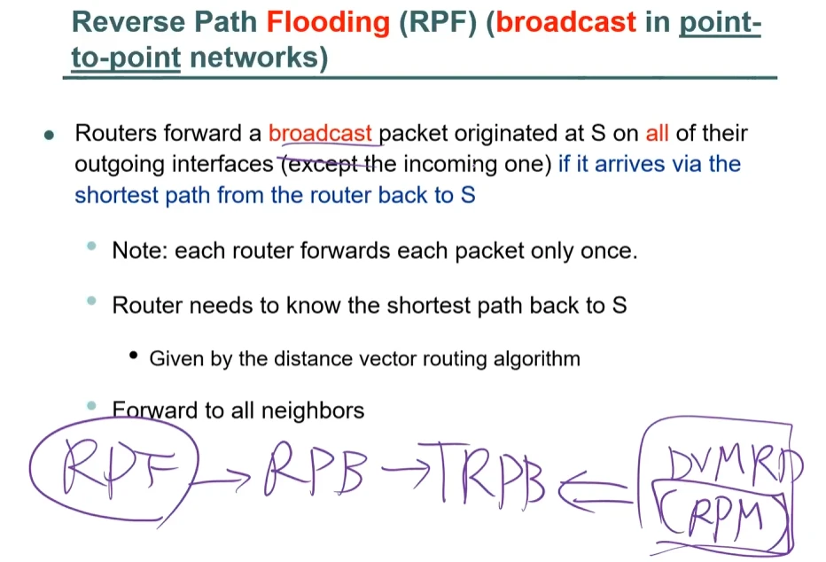

- **RPF** : 각각의 Router들이 Multicasting Packet을 iif로 받아서, 모든 oif 당 한 번씩만 내보내는 방법이다. iif로 다시 데이터를 내보내지는 않는다. 

    - 각각의 라우터는 자신과 연결된 oif에 packet을 한 번씩만 보낸다.

        ⇒ 이를 통해 Multicasting Packet을 Receiver들이 받을 수 있다.

> **문제점** : Shared Link가 있으면, 모든 Router들이 oif로 Multicasting Packet을 내보내기 때문에 Duplicated Packet이 존재할 수 있다.

### RPB

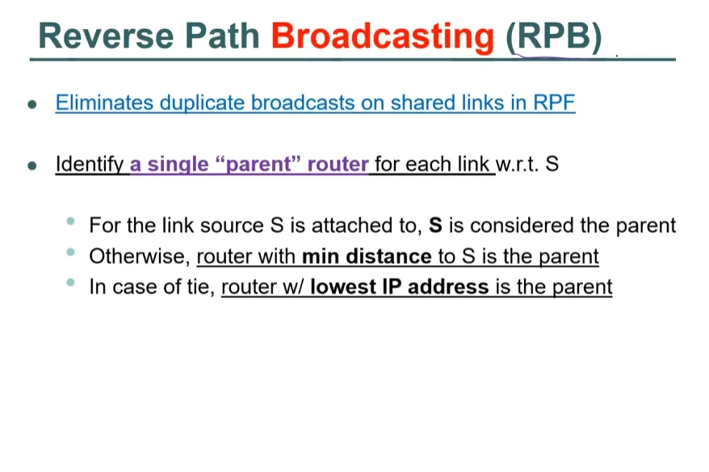

- RPB는 Duplicated Packet 문제를 해결하여, 하나의 Shared Link 당 하나의 Single Parent를 설정하고, 여기서만 Data를 전달받는다.
- 이때 Parent를 결정하는 방법은 다양하게 있다.

### RPF vs RPB

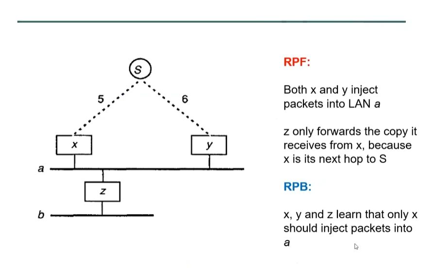

- Shared Link (a), (b)가 존재한다.
- 5, 6은 거리 정보이다.

- **RPF**

    Source가 Data를 x, y 모두에게 보내며, x, y는 oif로 데이터를 보내기 때문에 (a)는 동일한 packet을 중복되어 받게 된다.

- **RPB**

    Source가 Data를 x, y 모두에게 보내는데, Shared Link에 Single Parent가 존재하기 때문에 데이터를 하나만 받게 된다. ⇒ 여기서는 거리가 짧은 것을 Shared Link (a)의 Parent로 설정 가능.

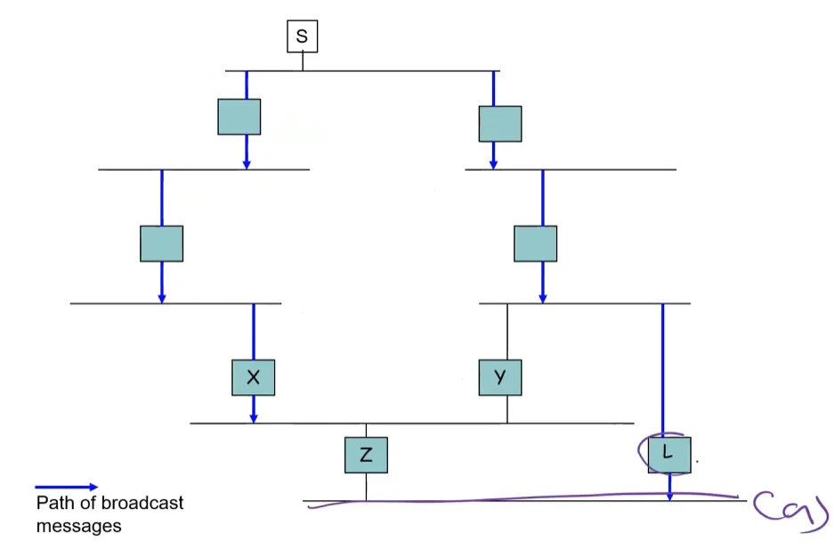

- Shared Link (a)에서는 Z를 Parent로 설정하면 4-Hop을 거쳐야 하지만, L을 Parent로 설정하면 3-Hop만으로 Packet을 받을 수 있다. 따라서 Parent를 L로 설정한다.

### TRPB (Truncating The Tree)

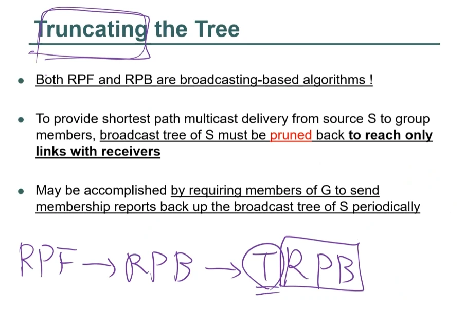

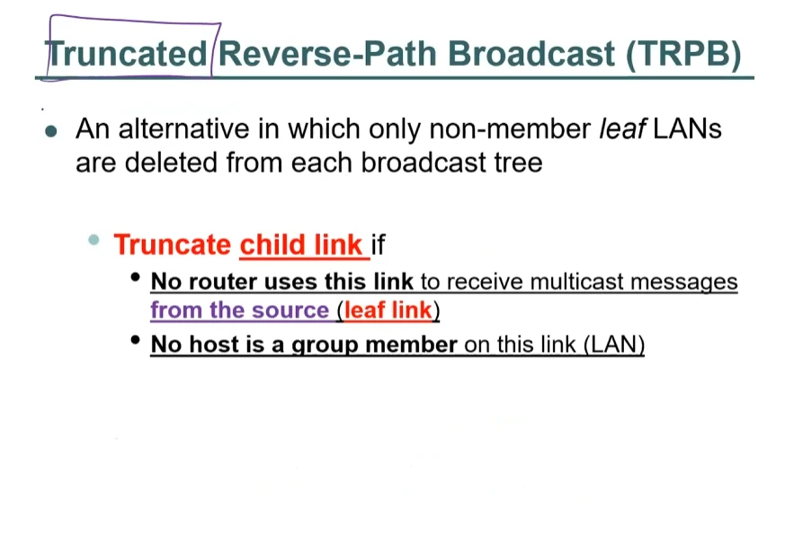

- TRPB는 다음 조건을 만족하면 Child Link를 제거한다.

    - Child Link가 Leaf Link를 갖지 않는다. (즉, oif를 갖지 않는다.)
    - 해당 LAN에 Group Member가 존재하지 않는다.

### TRPB Example

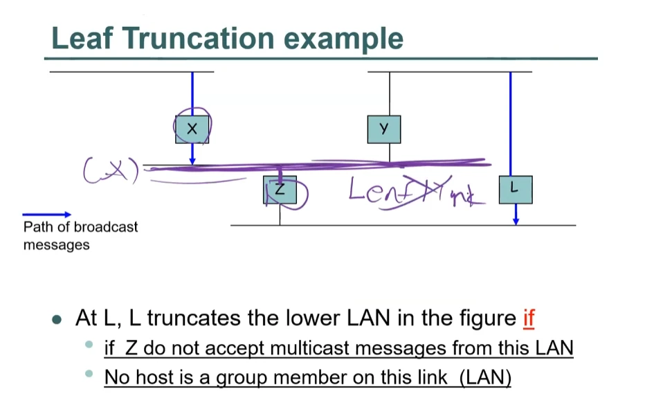

- 중간에 있는 Link는 조건을 만족하지 못하므로 제거하지 못한다.
- 하지만 마지막에 있는 것은 leaf node가 없고, Group Member가 없으므로 truncate 할 수 있다.

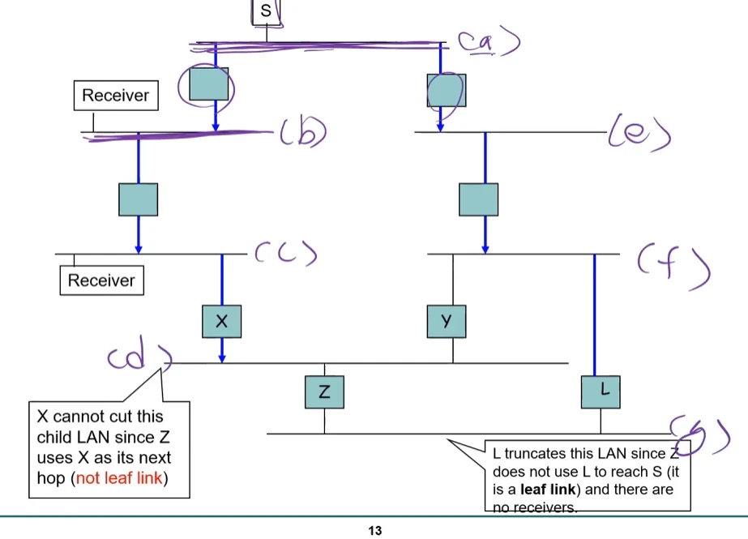

- (a) : 제거할 수 없음. ⇒ oif 존재
- (b) : 제거할 수 없음. ⇒ oif 존재, Receiver 존재
- (c&#41; : 제거할 수 없음. ⇒ oif 존재, Receiver 존재
- (d) : 제거할 수 없음. ⇒ oif 존재
- (e) : 제거할 수 없음. ⇒ oif 존재
- (f) : 제거할 수 없음. ⇒ oif 존재
- (g) : 제거 가능. ⇒ oif가 없고, Receiver가 존재하지 않음. (Group Member) 

> RPB였다면, (g)로 Packet을 전송했을 것이다. 하지만 TRPB에서는 (g)로 Packet을 전송하지 않는다.

### RPM

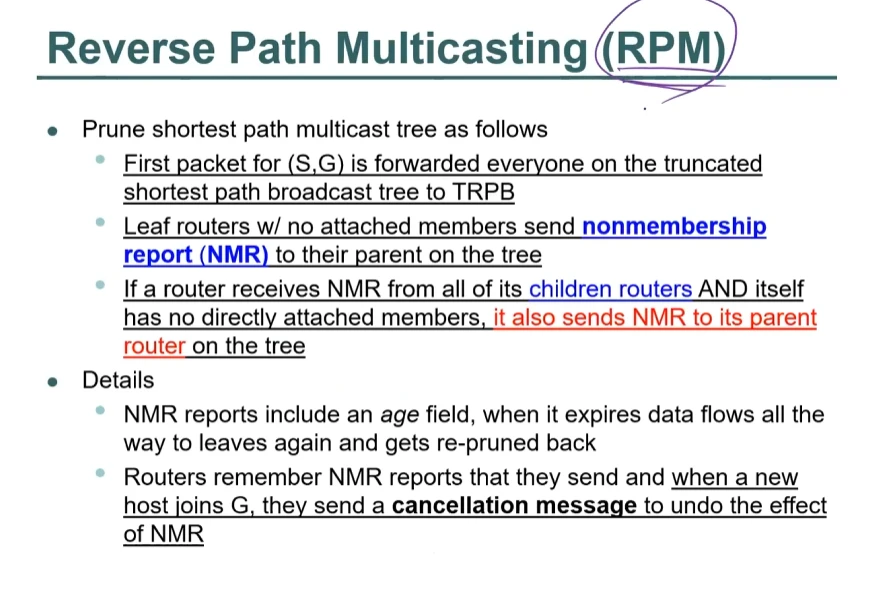

- RPM은 다음 조건을 만족할 때 **NMR Reporting**을 한다.

    - Group Member가 없을 때, 부모 노드에게 보내지 않아도 된다고 보고한다.
    - 하지만 새로운 Group Member가 Shared Link에 Join하면, NMR Reporting을 취소하도록 다시 보고한다.

### NMR Reporting Example

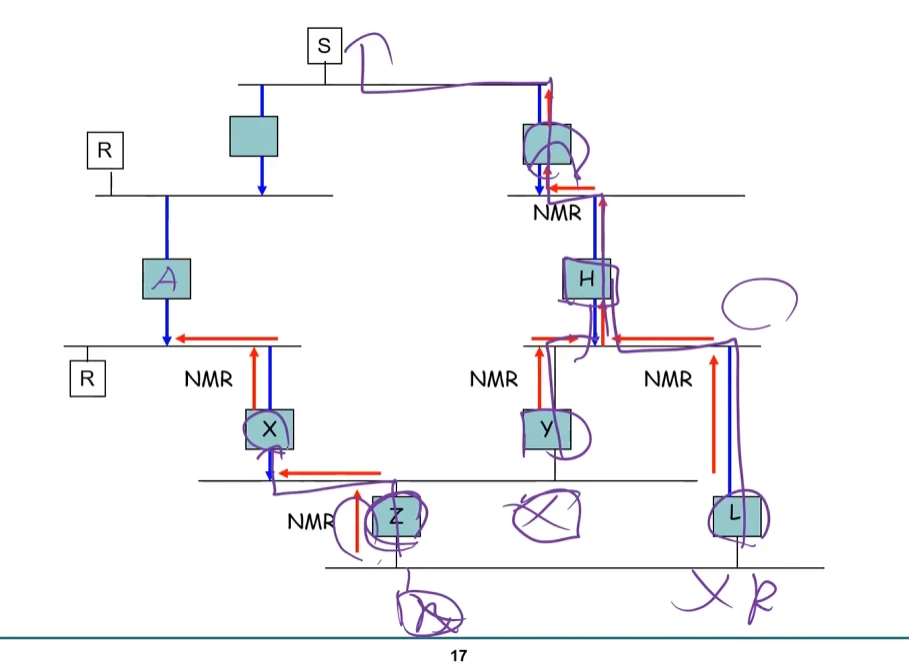

- Z 아래에는 Group Member가 없으므로 NMR Reporting을 해서 위로 올려보내고, 이를 부모 노드인 X 로 전달한다.
- L 아래에도 Group Member가 없으므로 NMR Reporting을 해서 위로 올려보낸다.
- 마찬가지로 X, Y도 NMR Reporting을 올려보낸다.
- 그러다가 노드 A의 LAN에는 Receiver가 존재하여 NMR이 멈춘다.
- 반면 L에서부터 시작된 NMR은 쭉 올라가서 부모 노드에게 모두 전달한다.
- NMR Reporting이 끝난 이후, Source가 Multicasting을 할 일이 생기면 Source는 오른쪽으로는 아예 보내지도 않는다. (NMR을 받았기 때문)
- 반면 왼쪽으로는 노드 A에 연결된 LAN 까지는 보내고, X부터는 보내지 않는다.

> 굉장히 많은 Packet을 절약할 수 있었음.

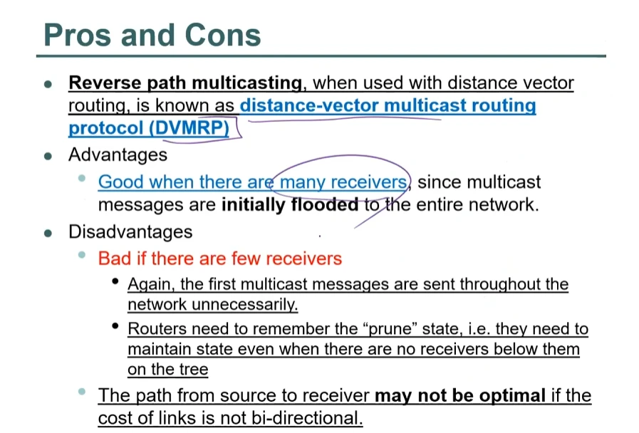

- DVMRP는 Receiver의 수가 적으면 좋다.
- 하지만 Receiver의 수가 적으면 안좋다.

### Link-State Multicast Routing

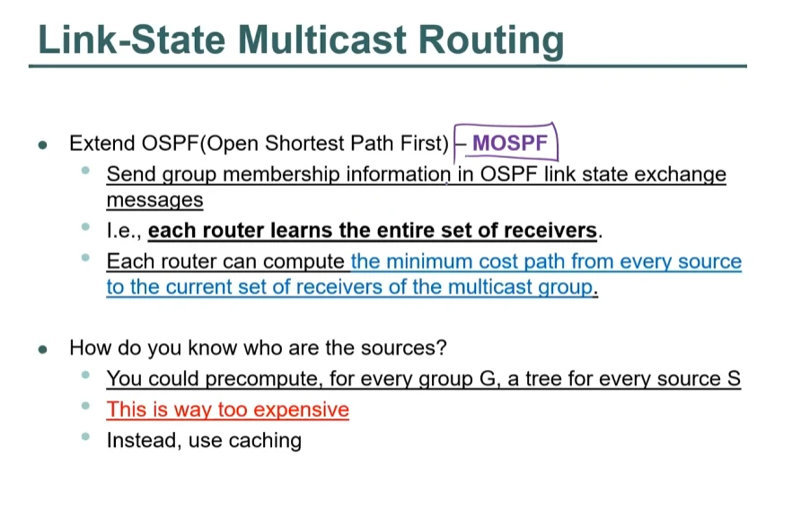

- Link-state 방식(MOSPF)은 Routing 정보를 계속해서 Neighbor들에게 Broadcasting 한다. 

    - 그래서 Broadcasting이 많다는 단점이 있다.

---

## &lt;Interdomain-Multicasting&gt;

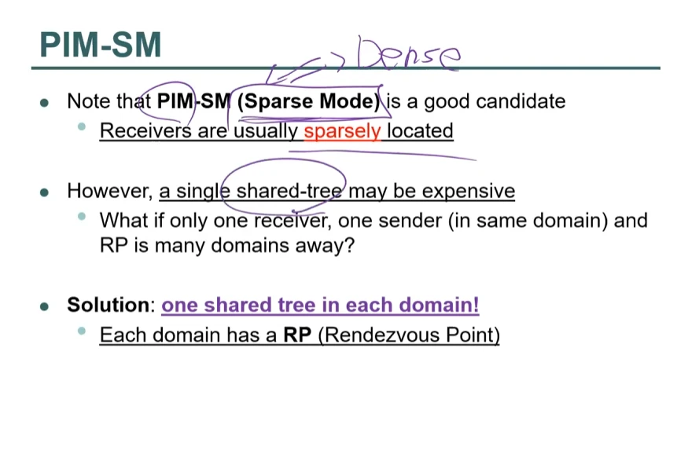

- Shared Tree는 모든 Group Member가 연결되는 것이 필수이다.
- 반면 Source-based Tree는 Optional이지만, Optimal Path를 제공할 수 있다.

- 그런데 현재 여러 개의 Domain을 고려하므로, 하나의 Shared Tree만 사용하면 비효율적일 수도 있다. 따라서 각 도메인 당 하나의 Shared Tree를 구성한다.

    이때 **RP**(*Rendezvous Point*)는 각 Shared Tree의 Root Node를 의미한다.

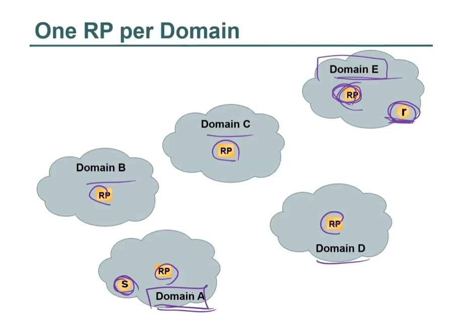

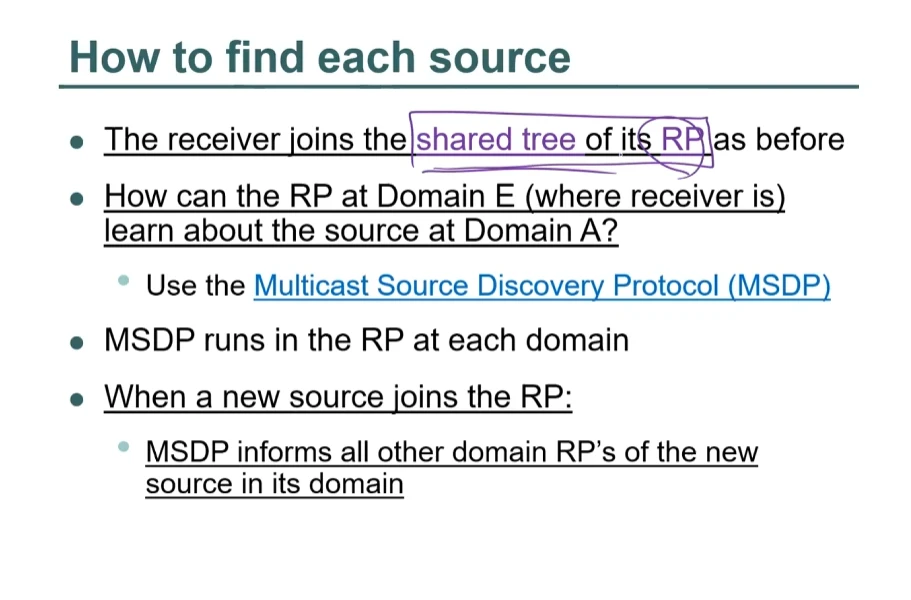

- Receiver는 어떠한 Shared Tree의 RP에 Join할 수 있다.
- 이 상황에서, Domain E의 RP가, Domain A의 Source를 어떻게 알 수 있는가?
- MSDP는 다른 Domain의 RP에게 Source의 존재를 알리는 프로토콜이다.

### Joining the SPT of the Source

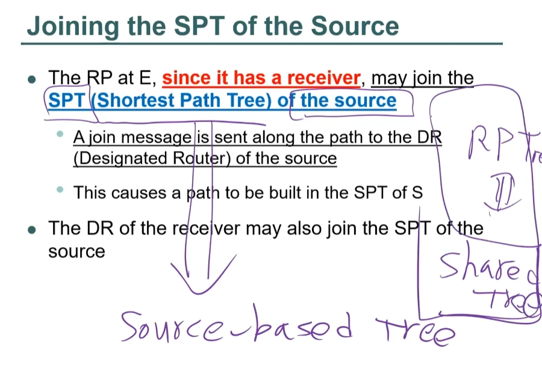

- RPT = Shared Tree이며, 어떠한 Group에서 RPT는 Mandatory하다.
- 반면 SPT = Source-based Tree이며, 이는 Group 내에서 Optional하다.

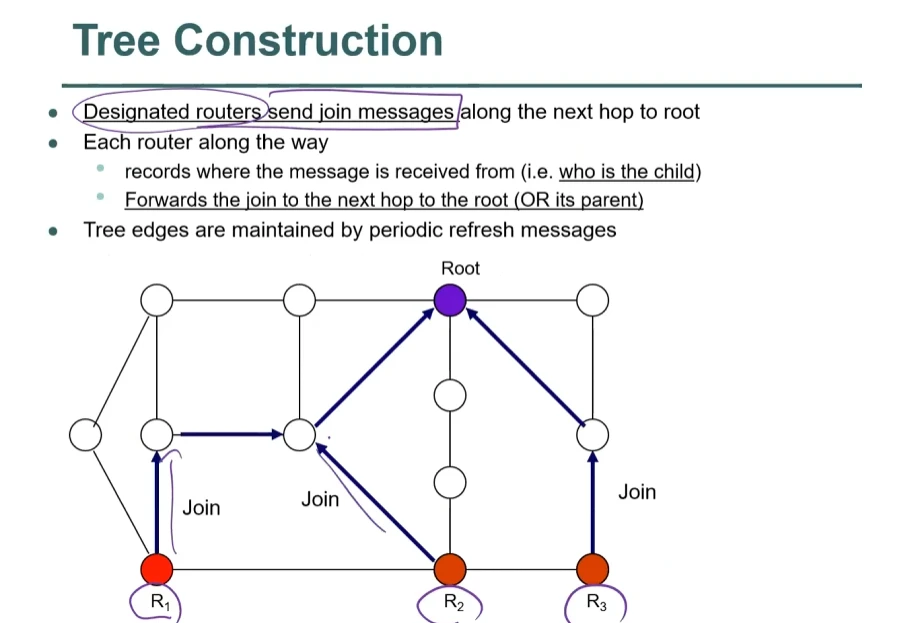

- 새로운 Router들이 Shared Tree에 Join하기 위해서 Root(RP)에게 Join Message를 보내고 RPT에 참여하게 된다.

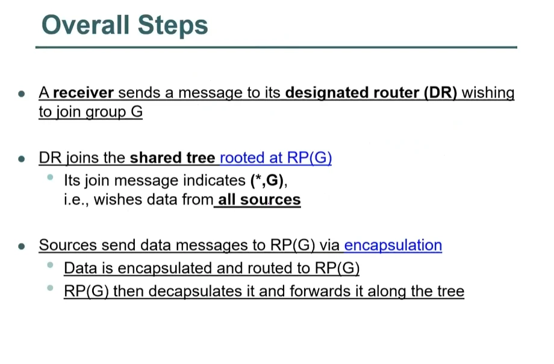

1. Receiver가 Designated Router에게 Join Message를 전송한다.
2. Receiver가 Shared Tree(RPT)에 Join한다.
3. Source는 data를 encapsulate하여 RP에 전달한다.
4. RP는 data를 decapsulate하여 전체 Tree에 데이터를 전달한다.

<!-- -->

- 각각의 Source는 자신의 SPT가 존재한다. 그 SPT에서는 자신이 Root이다.
