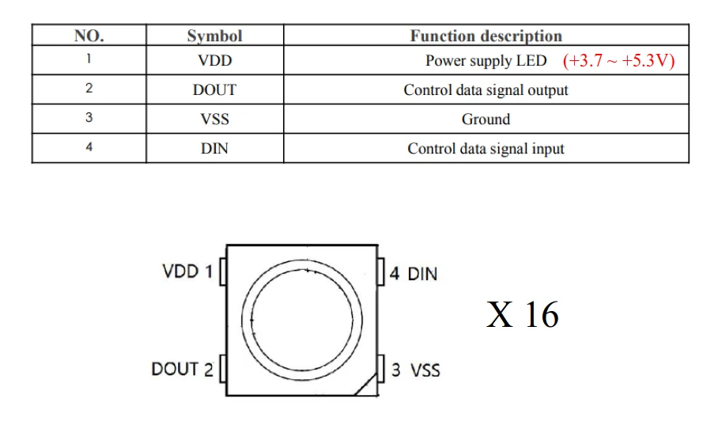
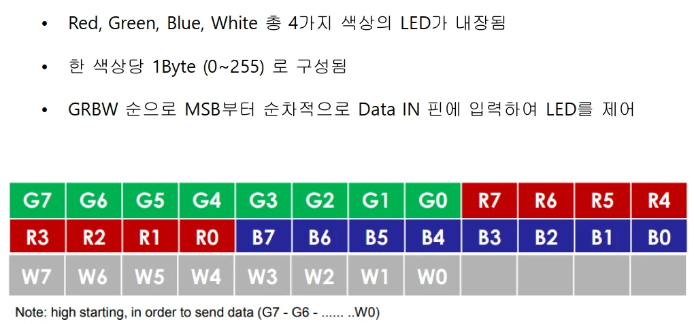
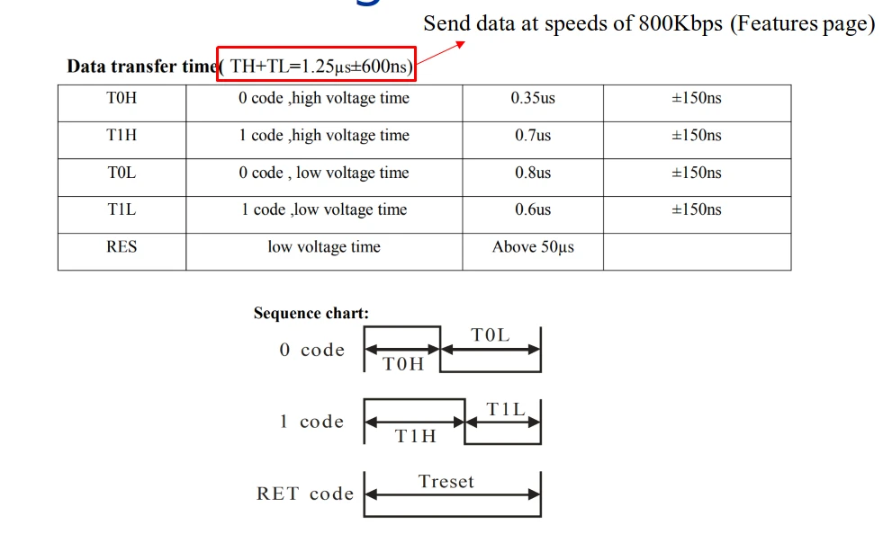
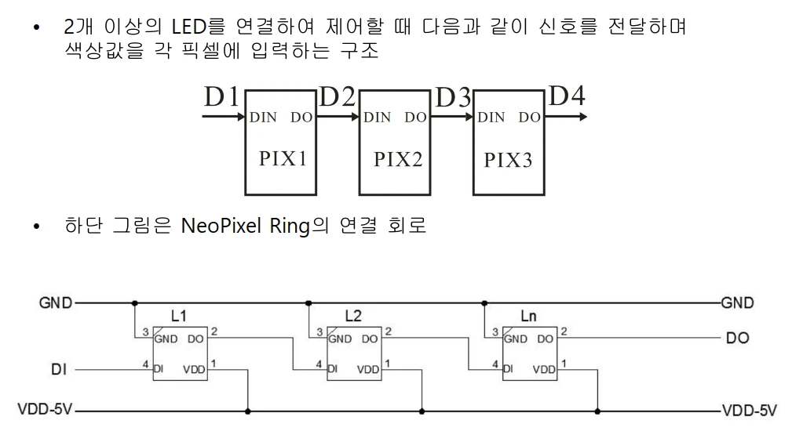
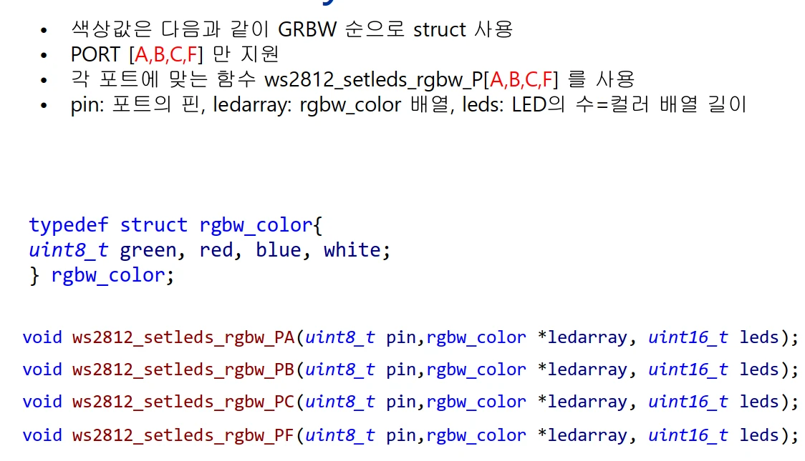

# 10주차: Neopixel LED 제어

- 네오픽셀 : 각각의 LED에 RGB가 들어있고(White는 별도로 명암만 조절하는 용도로 존재한다.), 어떤 값을 주냐에 따라서 다른 색을 낼 수 있다. 모든 색을 다 구현이 가능하다! LED가 16개가 있는데, 여기서는 편의상 링으로 된 타입을 사용한다.

    최근에는 디지털 디바이스들이 감성을 따진다. 공기청정기만 보더라도, 불 켜져있는 LED만 봐도 색깔이 Linear하게 변하고 그런 것들을 볼 수 있다. 아무튼 그런 것들을 가능하게 하는 디스플레이 H/W이다.

    16개의 LED 모듈이 연결된 LED링  
    LED 모듈: WS2812B RGBW  
    VDD(V+), Data In, GND(0) 세 핀으로 LED 제어

LED는 몇 개가 연결되던, 단 세 개의 핀으로만 제어된다. 실제로 데이터는 선 하나로만 준다. 이 신호는 CPU가 전달해준다.

---

제어를 하려면 무엇을 알아야 하는가? WS2812라는 칩의 특성과 동작 플로우, 매커니즘을 알아야 한다. 각각의 LED를 내가 선택해서 값을 줘야하는 구조이다. 이를 Address처럼 생각해서 값을 준다고 생각하면 된다. Addressable Pixel.

Each pixel of the three primary color can achieve 256 brightness display, completed 1677216 color full color display, and scan frequency is fo 2KHz.

LED를 제어하려면 상당히 복잡한 과정이 필요한데, 우리는 연구실에서 제작한 라이브러리를 통해 간단하게 제어하도록 한다.

포트가 cascading되어 있다. (연결되어 있어서, 선 하나만으로도 데이터를 전달할 수 있도록 한다.) 선이 하나로 간다는 것은, 어떤 추가적인 clock signal도 없고 사전에 맞춰놓는 것도 없으며 일방적으로 줘야하는 것이기 때문에 정확히 해당하는 타이밍에 데이터가 전달되도록 만들어주어야 하기 때문에 데이터를 적어도 800Kbps 이상의 속도로 전달해준다.

LED는 불을 켜기 위해 저항을 연결해주어야 했는데, 얘는 추가적인 components의 연결이 필요하지 않다.

---



VDD 1 : 전원  
DOUT 2 : 다음 것을 연결 (DOUT ↔ DIN)  
VSS 3 : Ground  
DIN 4 : Control data signal input

⇒ 빛이 생각보다 밝다. 그 말은 즉슨 power를 많이 소모한다.



> 색깔을 조절하는 방법  
>
> MSB G7 … G0 R7 … R0 B7 … B0 W7 … W0 LSB  
> 데이터는 MSB부터 채워준다.

선 하나로 데이터를 전달할 때 가장 중요한 것은 타이밍이다. 타이밍을 정확히 맞춰야 한다. encoding을 할 때, 한 개의 값을 만들기 위해서 High Time, Low Time이 필요하다.

0을 표현해야 할 때, 1을 표현해야 할 때, RES(reset)을 해야할 때. 세 개의 경우가 있는데 code 0이라는 것을 나타내기위해서는 T0H와 T0L을 자료에 표시된 대로 유지해야 한다.



T0H는 최소 0.35us 이상, +- 150ns(허용 범위) 유지한다.  
T1H는 최소 0.7us 이상, +- 150ns(허용 범위) 유지한다.  
T0L는 최소 0.8us 이상, +- 150ns(허용 범위) 유지한다.  
T1L는 0.6us 이상, +- 150ns(허용 범위) 유지한다.  
RES는 50us 이상 유지한다.

이전에는 high, low를 주면 곧바로 값이 적용됐지만, 이 component는 pulse의 width로 값을 구분해서 전달해줄 수 있다.



Device 1 ( → DIN DOUT →) Device 2( → DIN DOUT → ) … Device n   
( → DIN → 마지막은 연결이 필요하지 않다. )

Cascade하게 값은 어떻게 넘겨주는가?  
제일 먼저 전달되는 값은 첫 번째 LED의 값이다. 그 다음 어떤 커맨드를 주는게 아니라, 데이터를 곧바로 32 bit, 32 bit, 32 bit, … 이런 식으로 옆으로 bypass(넘겨주기) 해준다. 각각의 LED는 clear되어 있는 상태에서 처음에 들어오는 32 bit의 데이터를 취해서 색깔을 반영한다. 그 다음 들어오는 data는 모두 bypass한다. 결국에는 Serial 연결이기 때문에 한꺼번에 동시에 Data를 전달받을 수는 없다. 그러므로 첫 번째 DIN과 가까운 LED가 먼저 동작하며 가장 마지막에 연결된 LED가 가장 늦게 동작하지만, 실제로 사람의 눈으로는 이 Delay를 감지하기 힘드므로 크게 문제가 되지 않는다.

한 번 색깔을 쭉 줬는데, 색깔을 바꾸고 싶다면 먼저 reset(clear)를 시켜줘야 한다. clear를 한다는 것은 색이 없어지는게 아니라, 새로운 색(data)를 받아들일 준비가 되어있다는 뜻이다. reset code는 low로 80us이상 유지하면 된다. 

> 앞으로는 Neopixel을 사용하는 프로젝트를 만들면 사전 설정을 다 해주어야 한다. Solution에서 Project에 .c .h file을 add해준 뒤, properties - toolchain - symbol - debug+  
> F_OSC=16000000UL 을 추가해준다. 추가로, #define interrupt_is_disabled를 추가해주어야 하는데 이것도 symbol에서 debug에 추가해주면 좋다.

---

- mc_ws2812.h를 살펴보자.



미리 만들어 놓은 macro와 prototype이 선언되어 있다. (포트들은 여기 선언된 것들만 만들어 놨기 때문에 이 포트들만 지원한다.)

setled, sendarray_mask가 하나의 세트로 되어있다. setled라는 것을 보면, 

```c
void inline ws2812_setleds_rgbw_PA(uint8_t pin, rgbw_color *ledarray, uint16_t leds)
{
	ws2812_sendarray_mask_PA((uint8_t*)ledarray,leds<<2,0x01<<pin);
	_delay_us(ws2812_resettime);
}

void inline ws2812_setleds_rgbw_PB(uint8_t pin, rgbw_color *ledarray, uint16_t leds)
{
	ws2812_sendarray_mask_PB((uint8_t*)ledarray,leds<<2,0x01<<pin);
	_delay_us(ws2812_resettime);
}
```

rgbw_color type으로 먼저 값을 설정한 뒤, 해당 함수를 불러와서 실행한다.  
함수에서 leds는 led의 수이다. 각각의 LED의 값을 구조체의 배열로 만들어서 설정해준다.

---

ws2812_setleds_rgbw_PX 함수의 역할은, 전달받은 주소의 값을 led 숫자만큼 옮겨준다. 즉, 내가 원하는 led의 값은 구조체의 인덱스 값이라는 것이다. 어떻게 연결되어 있는지 다시 리뷰를 해보자. cascade하게 연결이 되어있다. 일반적으로 우리가 지금까지 사용하던 led들은 개별적으로 포트에 연결되어 있었지만, Neopixel LED는 CPU가 LED의 첫 번째에만 연결되어 있다. 즉, cascade하게 연결되어 있으므로, 값을 모두 전달해줘야 bypass되어서 뒤로 전달될 수 있다. 하지만 뒤에 있는 LED까지 값을 전달해주려면 값을 모두 채워서 보내야 한다. (앞에는 끄고 뒤에는 켤려면 앞에는 꺼지는 값을 주고 뒤에만 켜지는 값을 준다. all 0로 하면 꺼진다.) 매번 할 때마다 전체에 대해서 값을 다시 주어야 한다.

색깔은 결국 비율이므로, Brightness는 색의 비율로써 조절한다.

---

Q.1 : 한 개의 LED를 반복 점멸시키기

```c
/*
 * Neopixel.c
 *
 * Created: 2022-11-07 오전 9:41:01
 * Author : JDK
 */ 

#include <avr/io.h>
#define F_CPU 16000000UL
#define FOSC 160000000UL
#include <util/delay.h>

// undefine if you want to accept interrupts in LED control functions
// #define interrupt_is_disabled
#define LED_COUNT 16

#include "mc_ws2812.h"

void led_on(rgbw_color color) {
	ws2812_setleds_rgbw_PB(6, &color, 1);
	// prototype이 포인터로 선언되어 있기 때문에 &를 넣어준다.
}

void led_all_off() {
	rgbw_color tempColors[LED_COUNT];
	// 하나의 LED가 하나의 구조체를 값으로 갖는다.
	// 따라서, 모든 LED가 꺼지도록 모든 값이 0인 구조체로 설정한다.
	// 켤 때는 하나만 켰지만, 끌 때는 다 꺼지도록 설정해줌...
	for (unsigned char i = 0; i < LED_COUNT; i++) {
		tempColors[i] = (rgbw_color) { 0, 0, 0, 0 };
	}
	
	// tempColor는 배열로 선언되었으므로, 이름을 넣어주면 된다.
	ws2812_setleds_rgbw_PB(6, tempColors, LED_COUNT);
	// port번호, rgbw_color 구조체 배열의 주소, 몇 개의 LED에 전달할 것인지.
}

void led_alternating(rgbw_color _colors[]) {
	
	for (unsigned char i = 0; i < 3; i++) {
		led_on(_colors[i]);
		_delay_ms(330);
		
		led_all_off();
		_delay_ms(330);
	}
}

int main(void) 
{
	DDRB |= 0x01 << 6;

	//rgbw_color redColor = (rgbw_color) { 0, 128, 0, 0 };
	//rgbw_color greenColor = (rgbw_color) { 128, 0, 0, 0 };
	//rgbw_color blueColor = (rgbw_color) { 0, 0, 128, 0 };
		
	rgbw_color colors[3];
	// GRBW
	colors[0] = (rgbw_color) { 0, 128, 0, 0 };  // red
	colors[1] = (rgbw_color) { 128, 0, 0, 0 }; // green
	colors[2] = (rgbw_color) { 0, 0, 128, 0 }; // blue
	// brightness는 조절하지 않음...
			
    while (1) 
	{
		led_alternating(colors);
	}
}
```

---

Q.2 : 한 개의 LED를 R, G, B 순으로 반복 출력해보기

```c
#include <avr/io.h>
#define F_CPU 16000000UL
#define FOSC  16000000UL
#include <util/delay.h>
#define LED_COUNT 16
#include "mc_ws2812.h"

void led_on(rgbw_color color){
	ws2812_setleds_rgbw_PB(6,&color,1);
}

int main(void)
{
    DDRB |= 0x01 << 6;
    rgbw_color redColor;
    rgbw_color greenColor;
    rgbw_color blueColor;
    // Color order : G,R,B,W
    redColor = (rgbw_color) { 0, 128, 0, 0 };
    greenColor = (rgbw_color) { 128, 0, 0, 0 };
    blueColor = (rgbw_color) { 0, 0, 128, 0 };

	while (1)
	{
    led_on(redColor);
    _delay_ms(330);
    led_on(greenColor);
    _delay_ms(330);
    led_on(blueColor);
    _delay_ms(330);
	}
}
```

---

Q.3 : 한 개의 LED를 원하는 위치에 출력해보기

```c
#include <avr/io.h>
#define F_CPU 16000000UL
#define FOSC  16000000UL
#include <util/delay.h>
#define LED_COUNT 16
#include "mc_ws2812.h"

void led_on(rgbw_color color, int index){
	rgbw_color cArr[LED_COUNT];

	for(int i=0; i<LED_COUNT; i++){
		if(i == index) cArr[i] = color;
		else cArr[i] = (rgbw_color){0,0,0,0};
	}

		ws2812_setleds_rgbw_PB(6, cArr, LED_COUNT);
}

void led_all_off() {
	rgbw_color tempColors[LED_COUNT];
	for (unsigned char i = 0; i < LED_COUNT; i++) {
		tempColors[i] = (rgbw_color) { 0, 0, 0, 0 };
	}

	ws2812_setleds_rgbw_PB(6, tempColors, LED_COUNT);
}

int main(void)
{
    DDRB |= 0x01 << 6;
    rgbw_color redColor;
    rgbw_color greenColor;
    rgbw_color blueColor;

    // Color order : G,R,B,W
    redColor = (rgbw_color) { 0, 128, 0, 0 };
    greenColor = (rgbw_color) { 128, 0, 0, 0 };
    blueColor = (rgbw_color) { 0, 0, 128, 0 };

	while (1)
	{
	  led_on(redColor, 0);
		_delay_ms(330);
		led_on(greenColor, 6);
		_delay_ms(330);
		led_on(blueColor, 12);
		_delay_ms(330);
	}
}
```

---

Q.4 :  LED 링 Shift 해보기

```c
#include <avr/io.h>
#define F_CPU 16000000UL
#define FOSC  16000000UL
#include <util/delay.h>

#include "mc_ws2812.h"
#define LED_COUNT 16
rgbw_color redColor;
rgbw_color greenColor;
rgbw_color blueColor;

void led_ring_shift(rgbw_color color){
	rgbw_color cArr[LED_COUNT];

	for(unsigned char j = 0; j< LED_COUNT; j++){
		for(unsigned char i = 0; i< LED_COUNT; i++){
				if(i==j){
					cArr[i] = color;
				}
				else{
					cArr[i] = (rgbw_color){0,0,0,0};
				}
			}

			ws2812_setleds_rgbw_PB(6, cArr, LED_COUNT);
			_delay_ms(100);
	}
}

int main(void)
{
	DDRB |= 0x01 << 6;
	
	// Color order : G,R,B,W
	redColor = (rgbw_color) { 0, 128, 0, 0 };
	greenColor = (rgbw_color) { 128, 0, 0, 0 };
	blueColor = (rgbw_color) { 0, 0, 128, 0 };

	while (1)
	{
		led_ring_shift(redColor);
	}
}
```

---

Q.5 : LED 링 밝기 변화

```c
#include <avr/io.h>
#define F_CPU 16000000UL
#define FOSC  16000000UL
#include <util/delay.h>

#include "mc_ws2812.h"
#define LED_COUNT 16
rgbw_color redColor;
rgbw_color greenColor;
rgbw_color blueColor;

void led_ring_brightness(){
	rgbw_color cArr[LED_COUNT];
	int dir=0;

	for(int i=0; dir? i>=0 : i<25; dir? i-- : i++){
		for(int j = 0; j< LED_COUNT; j++){
			cArr[j] = (rgbw_color){i*10,0,0,0};
		}

		ws2812_setleds_rgbw_PB(6, cArr, LED_COUNT);
		_delay_ms(40);
		if(i==24){
			dir=1;
		}
	}
}

int main(void)
{
	DDRB |= 0x01 << 6;
	
	// Color order : G,R,B,W
	redColor = (rgbw_color) { 0, 255, 0, 0 };
	greenColor = (rgbw_color) { 255, 0, 0, 0 };
	blueColor = (rgbw_color) { 0, 0, 255, 0 };

	while (1)
	{
		led_ring_brightness();
	}
}
```
