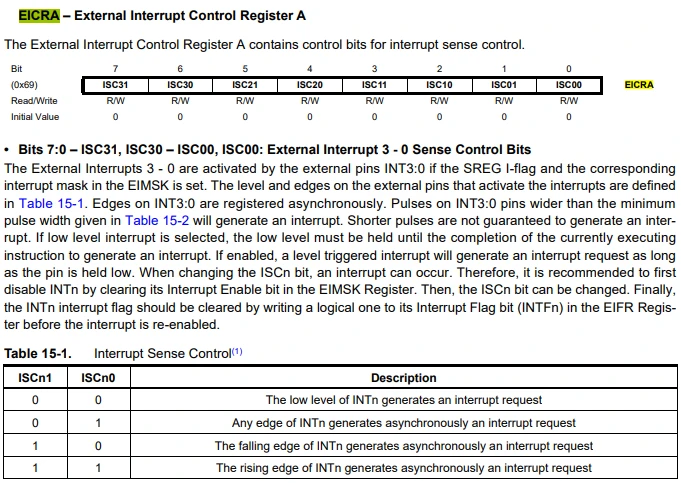
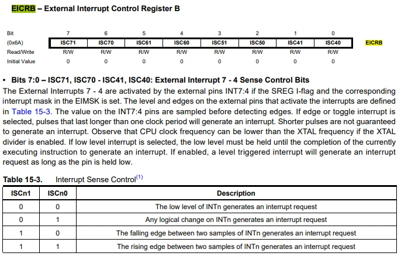
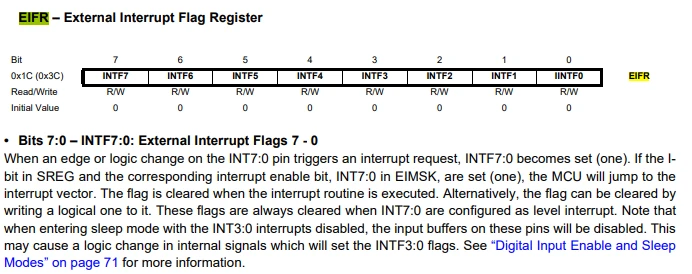
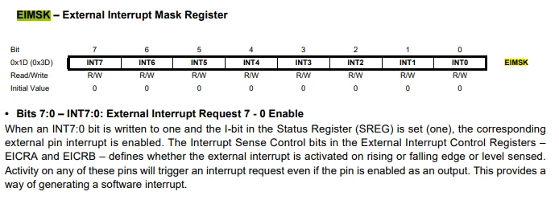
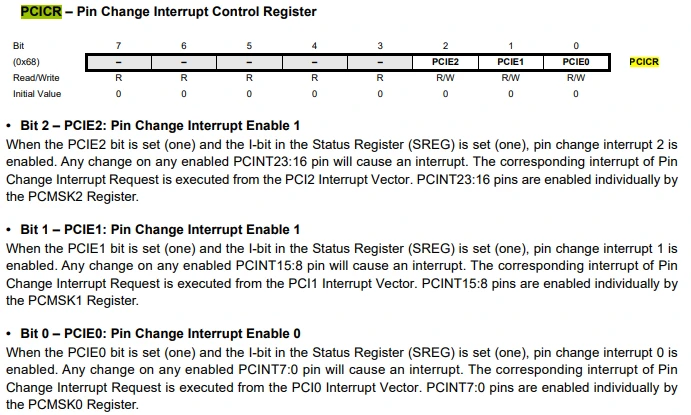
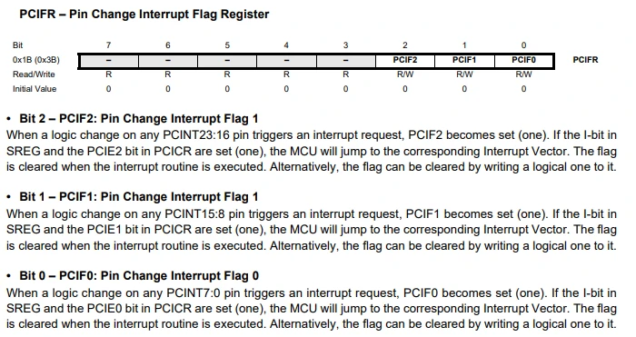
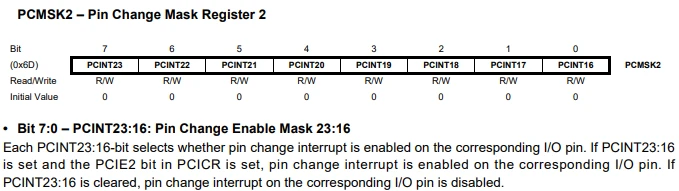
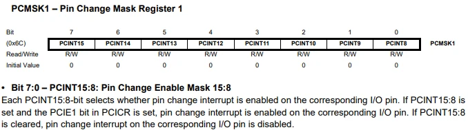
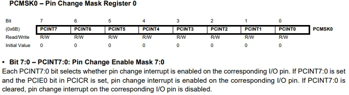

# Interrupt

작성일 2022-12-07 · 최종 수정일 2023-12-08
{ .post-date }

- `DDRn`

DDR은 port의 direction을 결정하는 역할을 하는 Register이다. DDR은 모든 포트에 대해 존재하므로, 사용할 포트의 알파벳 기호를 확인하여 direction을 설정하면 된다.

> `0` : 0은 port의 direction을 input으로 설정한다.  
>
> `1` : 1은 port의 direction을 output으로 설정한다.

- `PORTn`

`PORT`는 각 `port`를 `output`으로 사용할 때, 값을 설정할 수 있는 register이다. PORT또한 DDR과 마찬가지로 모든 포트에 대해 존재하므로, 사용할 포트의 알파벳 기호를 확인하여 value를 설정하면 된다.

> 만약 PORT를 이용해 LED의 전원을 켜고 싶다면, 해당 PORT에 `Logical 0`를 주어야 한다. LED는 Diode이기 때문에, 양단에 0.7V 이상의 전압차가 존재해야 동작하기 때문이다.  
>
> LED는 다리가 긴 쪽 (+, Anode) 을 VCC 쪽에 저항과 연결하고, 다리가 짧은 쪽 (-, Cathode) 을 output으로 설정된 PORT와 연결해주면 된다.

- `PINn`

`PIN`은 각 `port`를 `input`으로 사용할 때, 값을 입력받을 수 있는 register이다. PIN또한 DDR, PORT와 마찬가지로 모든 포트에 대해 존재하므로, 사용할 포트의 알파벳 기호를 확인하며 value를 입력받으면 된다.

```c
unsigned char value = PINK & 0x04; // PK2의 값을 입력받는다.
```

---

- `Switch`

> 우리가 사용하는 Switch는 `Standby High`, `Active Low`이다.

스위치는 하단에 내부가 어떻게 연결되어 있는지 표시되며, 이에 맞게 연결해야 한다. 또한, 항상 양쪽 단자가 보드에서 건너뛰는 부분에 연결되도록 해야한다. 스위치는 한쪽은 `GND`로 연결되도록, 다른 한 쪽은 `VCC`로 연결되도록 만들면 된다. 이 때, VCC와 스위치 사이는 저항으로 연결(1K ohm)해주도록 한다.

스위치가 잘못 연결되는 것을 막으려면, 항상 스위치를 `대각선`으로 연결하면 된다.

- `PINn`과 `Switch`를 연결하기

`Interrupt`를 사용하기 위해서는 PINn과 Switch를 연결하여 `Logical Status Change`를 확인해야 한다. 이를 위해서 Switch와 VCC가 연결되는 부분에 Wire를 연결하여 PINn port와 연결해주면 인터럽트에 활용할 수 있게 된다. `(Active Low, Standby High)`

---

- Interrupt

Interrupt의 종류는 2가지가 있다. 첫 번째는 `External Interrupt`이고, 두 번째는 `Pin Change Interrupt`이다. 

ㅁ External INT

외부 인터럽트는 0번부터 7번까지 총 8개가 존재하며, 연결된 포트는 다음과 같다.

INT0 : PD0 (21)

INT1 : PD1 (20)

INT2 : PD2 (19)

INT3 : PD3 (18)

INT4 : PE4 (2)

INT5 : PE5 (3)

INT6 : PE6

INT7 : PE7

외부 인터럽트에서 사용하는 Register는 `EICRA`, `EICRB`, `EIFR`, `EIMSK`가 있다.

ㅁ `EICRA`



`EICRA`는 외부 인터럽트 0번~3번의 trigger 방식(`Sense Control`)을 결정할 수 있는 register이다.

0 0 : `low level` (0인 경우, 스위치로 따진다면 눌렀을 때) 에서 인터럽트가 계속 발생된다.

0 1 : 모든 edge에서 인터럽트가 발생한다. (누를 때, 뗄 때 모두 발생한다.)

1 0 : `falling edge`에서 발생한다. (스위치에서는 누를 때 High→Low이므로, 누를 때 인터럽트 발생)

1 1 : `rising edge`에서 발생한다. (스위치에서는 뗄 때 Low→High이므로, 뗄 때 인터럽트 발생)

ㅁ `EICRB`



EICRB는 EICRA와 비슷한 기능을 한다. 외부 인터럽트 4~7번을 담당하며, `Interrupt Sense Control`은 EICRA와 `동일`하다.

ㅁ`EIFR`



EIFR은 외부 인터럽트 0~7번 중 어떤 인터럽트가 실행됐는지 체크하기 위해 필요한 레지스터이다. 해당 레지스터의 각 비트는 해당하는 인터럽트가 실행될 때 자동으로 set되었다가, MCU가 interrupt vector로 점프해서 ISR이 실행될 때 다시 clear된다. 

> Flag를 활용하면 인터럽트의 동시 수행을 체크하여 특정한 기능을 수행할 수 있을 것으로 보이나, 외부 인터럽트에서는 Flag를 따로 활용하지 않았다. (UART는 활용)

중요한 것은, 각 ISR 내에서 실행할 인터럽트에 해당하는 `EIFR`을 `set to clear` 해주어야 한다는 것이다. (Flag Register는 bit를 set해주면 CPU가 clear해준다.) 왜 그러냐면, 프로그래머가 직접 Flag Register를 set해주면 CPU가 무조건 다시 clear해주지만, 인터럽트가 수행되다보면 꼬여서 CPU가 인터럽트의 수행을 제대로 catch하지 못할 수도 있다. 이 경우를 방지하기 위해 ISR 내에서 되도록이면 Flag의 bit를 set해주는 루틴을 추가한다.

ㅁ `EIMSK`



외부 인터럽트를 사용하려면, 반드시 `SREG register`의 `I-bit` 가 `enable` 되어있어야 한다.   
`( sei(), cli() )` 이와 동시에, 외부 인터럽트를 사용하려면 해당하는 번호의 `EIMSK bit`를 `set`  
해주어야 한다.

---

ㅁ `PCINT`

PCINT는 외부 인터럽트와는 다른 추가적인 인터럽트이다. `PCINT`는 `0:23`, 총 24개가 있다.  
0:7, 8:15, 16:23 과 같이 8개 씩 한 개의 PCINT로 묶인다. (bulk로 8개씩 묶임)

PCINT0 (0:7)

PCINT1 (8:15)

PCINT2 (16:23)

ㅁ `PCICR`



PCINT는 이전에 외부 인터럽트가 EICR에서 `sense control`을 설정해 준 것과 달리, sense control을 `사용자`가 설정할 수 없다. `(고정됨)` default는 `any edge trigger` 방식으로, `모든 edge`에서 인터럽트를 발생시킨다. 따라서 PCICR은 Interrupt enable을 하려면, 사용할 `PCINTn`의 `bit`를 `set`해주는 방식이다. 인터럽트를 사용하기 위해서는 반드시 PCICR에서 해당하는 PCINT의 bit를 set해주어야 한다.

ㅁ `PCIFR`



PCIFR은 외부 인터럽트의 EIFR과 같은 기능을 한다. Interrupt request 요청되면 해당하는 번호의 PCIFn 이 set되었다가, MCU가 Interrupt Vector로 점프해서 ISR이 실행되면 자동으로 clear된다. 하지만 외부 인터럽트와 마찬가지로 CPU가 Flag clear를 놓칠 수도 있기 때문에 ISR 내에서 Flag set to clear 루틴을 추가해주도록 한다.

ㅁ PCMSKn







PCMSK는 외부 인터럽트의 EIMSK와 마찬가지로 사용할 인터럽트에 해당하는 bit를 set해주어야 한다. 그런데, PCINT는 8개씩 하나의 bulk로 묶여있으므로, PCIMSK는 활용할 pin에 대하여 각각 set해주어야 한다.

```c
ISR(PCINT2_vect) {

...

in = PINK & 0x04
if (!(in & 0x04)) {
...
}

}
```

이와 같은 방식으로 해당하는 pin의 interrupt를 check하여 사용한다.

- 외부 인터럽트 : EICRA, EICRB, EIFR, EIMSK
- PCINT : PCICR(0~2번 비트), PCIFR(0~2번 비트), PCIMSK0:2

---

- `LED` 사용시 설정할 것

<!-- -->

1. DDR (output, 1)
2. PORTn (PORT값 설정, LED는 Low를 줘야 불이 켜짐)

<!-- -->

- `Switch` 사용시 주의할 것

반드시 대각선으로 연결한다.

- `인터럽트` 사용시 설정할 것

ISR에서 초반에 `채터링 방지`를 위해 \_delay\_ms 넣어주기

main에서 `sei();` 해주기.

1. External Interrupt

EICRA (0:3)

EICRB (4:7)

EIFR (0:7, ISR에서 한 번 set해서 clear해주기)

EIMSK (0:7)

1. Pin Change Interrupt

PCICR (0:2번 비트, 사용할 것만 enable)

PCIFR (0:2번 비트, External Interrupt와 마찬가지로 set to clear)

PCMSK0:2 (각 bulk에서 사용할 bit 확인)

PCINT는 any logical change occurs interrupt의 sense control만 사용가능.  
구분하려면 어떤 핀에서 값이 바뀌는지 ISR(PCINTn_vect)에서 S/W적으로 체크해주어야 한다.

```c
ISR(PCINT2_vect) {
//...

if (PINK & 0x01) { // PCINT 16
	
}
```
