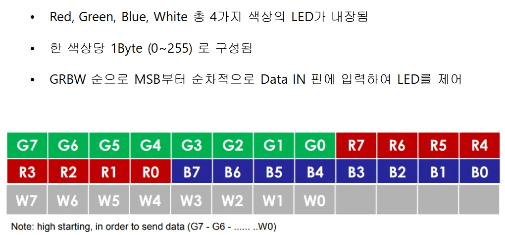
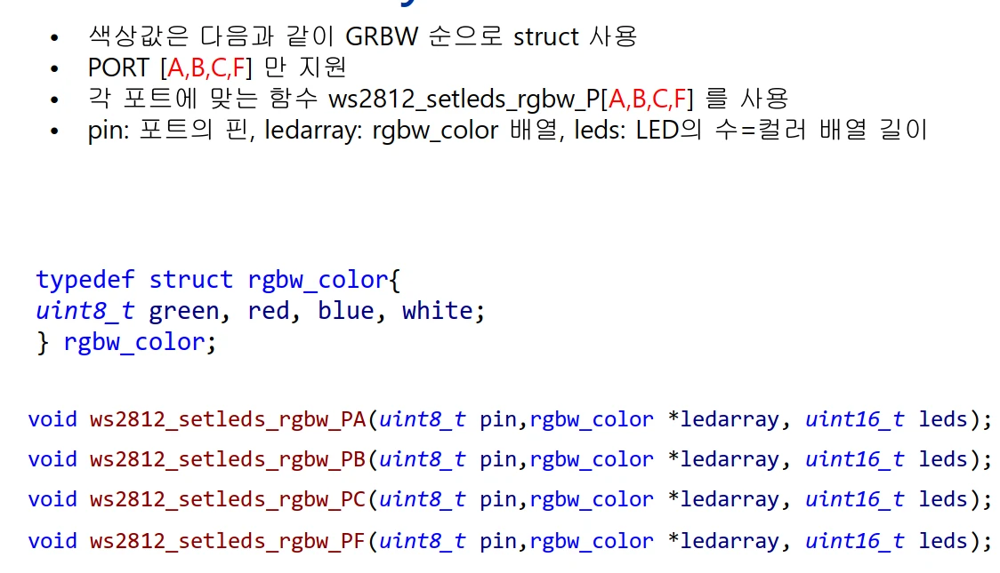

# Neopixel

작성일 2022-12-07 · 최종 수정일 2023-09-22
{ .post-date }



> 색깔을 조절하는 방법  
>
> MSB G7 … G0 R7 … R0 B7 … B0 W7 … W0 LSB  
> 데이터는 MSB부터 채워준다.

> 앞으로는 Neopixel을 사용하는 프로젝트를 만들면 사전 설정을 다 해주어야 한다. Solution에서 Project에 .c .h file을 add해준 뒤, properties - toolchain - symbol - debug+  
> F_CPU=16000000UL 을 추가해준다. 추가로, #define interrupt_is_disabled를 추가해주어야 하는데 이것도 symbol에서 debug에 추가해주면 좋다.

---

- mc_ws2812.h를 살펴보자.



미리 만들어 놓은 macro와 prototype이 선언되어 있다. (포트들은 여기 선언된 것들만 만들어 놨기 때문에 이 포트들만 지원한다.) ⇒ PA, PB, PC, PF

```c
void inline ws2812_setleds_rgbw_PA(uint8_t pin, rgbw_color *ledarray, uint16_t leds)
{
	ws2812_sendarray_mask_PA((uint8_t*)ledarray,leds<<2,0x01<<pin);
	_delay_us(ws2812_resettime);
}

void inline ws2812_setleds_rgbw_PB(uint8_t pin, rgbw_color *ledarray, uint16_t leds)
{
	ws2812_sendarray_mask_PB((uint8_t*)ledarray,leds<<2,0x01<<pin);
	_delay_us(ws2812_resettime);
}
```

rgbw_color type으로 먼저 값을 설정한 뒤, 해당 함수를 불러와서 실행한다.  
함수에서 leds는 led의 수이다. 각각의 LED의 값을 구조체의 배열로 만들어서 설정해준다.

---

ws2812_setleds_rgbw_PB(uint8_t pin, rgbw_color \*ledarray, uint16_t leds)  
⇒ PB에서 pin에다가 데이터 전달. ledarray 배열의 주소를 전달해줌. leds는 켤 led 개수

ws2812_setleds_rgbw_PX 함수의 역할은, 전달받은 주소의 값을 led 숫자만큼 옮겨준다. 즉, 내가 원하는 led의 값은 구조체의 인덱스 값이라는 것이다. 어떻게 연결되어 있는지 다시 리뷰를 해보자. cascade하게 연결이 되어있다. 일반적으로 우리가 지금까지 사용하던 led들은 개별적으로 포트에 연결되어 있었지만, Neopixel LED는 CPU가 LED의 첫 번째에만 연결되어 있다. 즉, cascade하게 연결되어 있으므로, 값을 모두 전달해줘야 bypass되어서 뒤로 전달될 수 있다. 하지만 뒤에 있는 LED까지 값을 전달해주려면 값을 모두 채워서 보내야 한다. (앞에는 끄고 뒤에는 켤려면 앞에는 꺼지는 값을 주고 뒤에만 켜지는 값을 준다. all 0로 하면 꺼진다.) 매번 할 때마다 전체에 대해서 값을 다시 주어야 한다.

색깔은 결국 비율이므로, Brightness는 색의 비율로써 조절한다.

---

Q.1 : 한 개의 LED를 반복 점멸시키기

```c
/*
 * Neopixel.c
 *
 * Created: 2022-11-07 오전 9:41:01
 * Author : JDK
 */ 

#include <avr/io.h>
#define F_CPU 16000000UL
#define FOSC 160000000UL
#include <util/delay.h>

// undefine if you want to accept interrupts in LED control functions
// #define interrupt_is_disabled
#define LED_COUNT 16

#include "mc_ws2812.h"

void led_on(rgbw_color color) {
	ws2812_setleds_rgbw_PB(6, &color, 1);
	// prototype이 포인터로 선언되어 있기 때문에 &를 넣어준다.
}

void led_all_off() {
	rgbw_color tempColors[LED_COUNT];
	// 하나의 LED가 하나의 구조체를 값으로 갖는다.
	// 따라서, 모든 LED가 꺼지도록 모든 값이 0인 구조체로 설정한다.
	// 켤 때는 하나만 켰지만, 끌 때는 다 꺼지도록 설정해줌...
	for (unsigned char i = 0; i < LED_COUNT; i++) {
		tempColors[i] = (rgbw_color) { 0, 0, 0, 0 };
	}
	
	// tempColor는 배열로 선언되었으므로, 이름을 넣어주면 된다.
	ws2812_setleds_rgbw_PB(6, tempColors, LED_COUNT);
	// port번호, rgbw_color 구조체 배열의 주소, 몇 개의 LED에 전달할 것인지.
}

void led_alternating(rgbw_color _colors[]) {
	
	for (unsigned char i = 0; i < 3; i++) {
		led_on(_colors[i]);
		_delay_ms(330);
		
		led_all_off();
		_delay_ms(330);
	}
}

int main(void) 
{
	DDRB |= 0x01 << 6;

	//rgbw_color redColor = (rgbw_color) { 0, 128, 0, 0 };
	//rgbw_color greenColor = (rgbw_color) { 128, 0, 0, 0 };
	//rgbw_color blueColor = (rgbw_color) { 0, 0, 128, 0 };
		
	rgbw_color colors[3];
	// GRBW
	colors[0] = (rgbw_color) { 0, 128, 0, 0 };  // red
	colors[1] = (rgbw_color) { 128, 0, 0, 0 }; // green
	colors[2] = (rgbw_color) { 0, 0, 128, 0 }; // blue
	// brightness는 조절하지 않음...
			
    while (1) 
	{
		led_alternating(colors);
	}
}
```

---

Q.2 : 한 개의 LED를 R, G, B 순으로 반복 출력해보기

```c
#include <avr/io.h>
#define F_CPU 16000000UL
#define FOSC  16000000UL
#include <util/delay.h>
#define LED_COUNT 16
#include "mc_ws2812.h"

void led_on(rgbw_color color){
	ws2812_setleds_rgbw_PB(6,&color,1);
}

int main(void)
{
    DDRB |= 0x01 << 6;
    rgbw_color redColor;
    rgbw_color greenColor;
    rgbw_color blueColor;
    // Color order : G,R,B,W
    redColor = (rgbw_color) { 0, 128, 0, 0 };
    greenColor = (rgbw_color) { 128, 0, 0, 0 };
    blueColor = (rgbw_color) { 0, 0, 128, 0 };

	while (1)
	{
    led_on(redColor);
    _delay_ms(330);
    led_on(greenColor);
    _delay_ms(330);
    led_on(blueColor);
    _delay_ms(330);
	}
}
```

---

Q.3 : 한 개의 LED를 원하는 위치에 출력해보기

```c
#include <avr/io.h>
#define F_CPU 16000000UL
#define FOSC  16000000UL
#include <util/delay.h>
#define LED_COUNT 16
#include "mc_ws2812.h"

void led_on(rgbw_color color, int index){
	rgbw_color cArr[LED_COUNT];

	for(int i=0; i<LED_COUNT; i++){
		if(i == index) cArr[i] = color;
		else cArr[i] = (rgbw_color){0,0,0,0};
	}

		ws2812_setleds_rgbw_PB(6, cArr, LED_COUNT);
}

void led_all_off() {
	rgbw_color tempColors[LED_COUNT];
	for (unsigned char i = 0; i < LED_COUNT; i++) {
		tempColors[i] = (rgbw_color) { 0, 0, 0, 0 };
	}

	ws2812_setleds_rgbw_PB(6, tempColors, LED_COUNT);
}

int main(void)
{
    DDRB |= 0x01 << 6;
    rgbw_color redColor;
    rgbw_color greenColor;
    rgbw_color blueColor;

    // Color order : G,R,B,W
    redColor = (rgbw_color) { 0, 128, 0, 0 };
    greenColor = (rgbw_color) { 128, 0, 0, 0 };
    blueColor = (rgbw_color) { 0, 0, 128, 0 };

	while (1)
	{
	  led_on(redColor, 0);
		_delay_ms(330);
		led_on(greenColor, 6);
		_delay_ms(330);
		led_on(blueColor, 12);
		_delay_ms(330);
	}
}
```

---

Q.4 :  LED 링 Shift 해보기

```c
#include <avr/io.h>
#define F_CPU 16000000UL
#define FOSC  16000000UL
#include <util/delay.h>

#include "mc_ws2812.h"
#define LED_COUNT 16
rgbw_color redColor;
rgbw_color greenColor;
rgbw_color blueColor;

void led_ring_shift(rgbw_color color){
	rgbw_color cArr[LED_COUNT];

	for(unsigned char j = 0; j< LED_COUNT; j++){
		for(unsigned char i = 0; i< LED_COUNT; i++){
				if(i==j){
					cArr[i] = color;
				}
				else{
					cArr[i] = (rgbw_color){0,0,0,0};
				}
			}

			ws2812_setleds_rgbw_PB(6, cArr, LED_COUNT);
			_delay_ms(100);
	}
}

int main(void)
{
	DDRB |= 0x01 << 6;
	
	// Color order : G,R,B,W
	redColor = (rgbw_color) { 0, 128, 0, 0 };
	greenColor = (rgbw_color) { 128, 0, 0, 0 };
	blueColor = (rgbw_color) { 0, 0, 128, 0 };

	while (1)
	{
		led_ring_shift(redColor);
	}
}
```

---

Q.5 : LED 링 밝기 변화

```c
#include <avr/io.h>
#define F_CPU 16000000UL
#define FOSC  16000000UL
#include <util/delay.h>

#include "mc_ws2812.h"
#define LED_COUNT 16
rgbw_color redColor;
rgbw_color greenColor;
rgbw_color blueColor;

void led_ring_brightness(){
	rgbw_color cArr[LED_COUNT];
	int dir=0;

	for(int i=0; dir? i>=0 : i<25; dir? i-- : i++){
		for(int j = 0; j< LED_COUNT; j++){
			cArr[j] = (rgbw_color){i*10,0,0,0};
		}

		ws2812_setleds_rgbw_PB(6, cArr, LED_COUNT);
		_delay_ms(40);
		if(i==24){
			dir=1;
		}
	}
}

int main(void)
{
	DDRB |= 0x01 << 6;
	
	// Color order : G,R,B,W
	redColor = (rgbw_color) { 0, 255, 0, 0 };
	greenColor = (rgbw_color) { 255, 0, 0, 0 };
	blueColor = (rgbw_color) { 0, 0, 255, 0 };

	while (1)
	{
		led_ring_brightness();
	}
}
```
