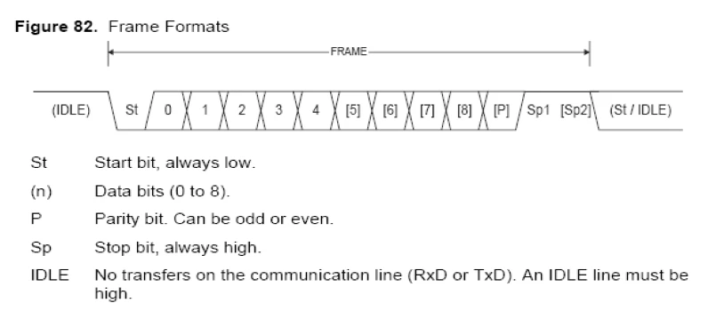
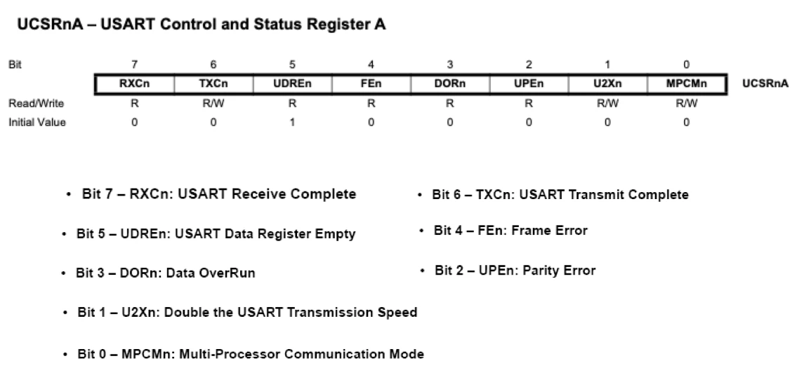
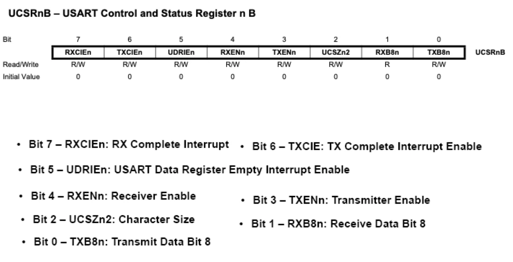
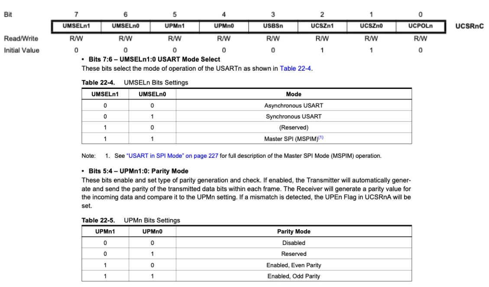
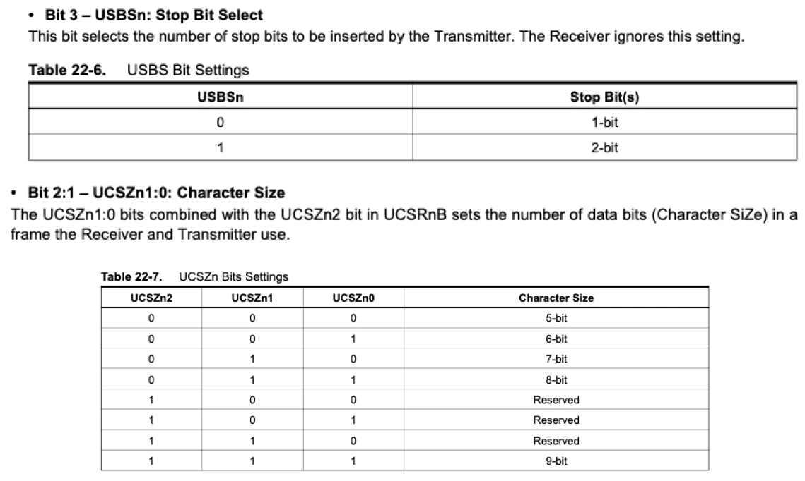
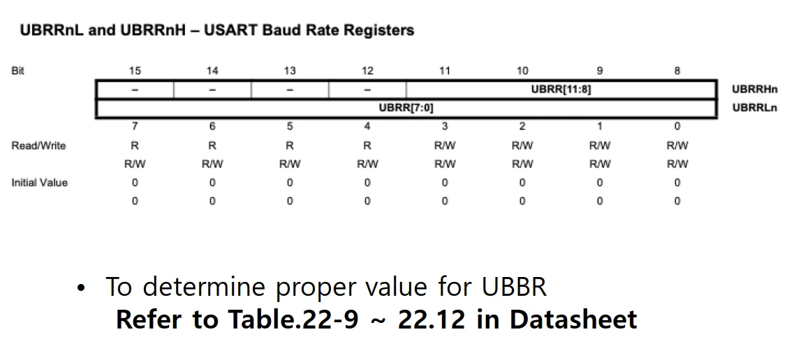
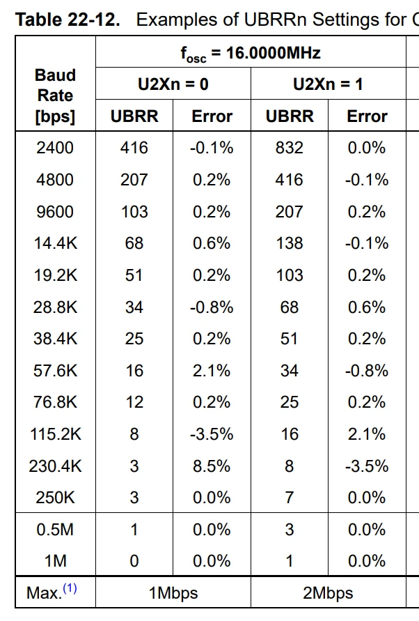

# UART

## UART 통신

- Tx, Rx가 약속해야 하는 것들

<!-- -->

1. 통신 속도
2. 스톱비트
3. 패리티
4. 데이터길이



- `데이터 길이` : 5, 6, 7, 8, 9 bits
- `패리티 비트` : Error Detection (ASCII가 7bit인데, 여기다가 1비트를 써서 Parity를 표현한다.)  
    → None(아예 없음), Even Parity(둘다 even[1]), Odd Parity(둘다 odd)  
    보낸 쪽에서의 1의 개수와 받은 쪽의 1의 개수를 비교하여 even인지 odd인지 확인한다.
- `스톱 비트` : normal이 standby high이므로, low로 계속 유지한다. 

UART 통신 설정에 사용되는 Register들

- USARTn I/O Data Register - `UDRn`
- USART Control and Status Register A - `UCSRnA`
- USART Control and Status Register B - `UCSRnB`
- USART Control and Status Register C - `UCSRnC`
- USART Baud Rate Register - `UBRRnL`, `UBRRnH`

한 프레임에서 전달받는 데이터는 `UDRn` 이라는 Register에 들어간다. UDR에 `쓰고`  `받을` 수 있다. `UDR`은 하나는 `Read`로 되어있고, 하나는 `Write`가 있는데 코드 상에서 값을 쓰면 보내는 거고, 값을  읽으면 받는 것이다.   
(Full-duplex, 논리상 동시에 주고 받을 수 있다. 하지만, CPU가 한 개이기 때문에 한 번에 한 개의 동작만 구현할 수 있다.)



⇒ UART는 4개 있으므로, n은 0:3이다. 예제에서는 UART 1번 사용. 따라서 `UCSR1A`…

- `UCSRnA`

Bit 7 - `RXCn` : USART Receive Complete  
이 이벤트가 떴을 때만 UDR을 읽어서 데이터를 가져올 수 있다.

Bit 6 - `TXCn` : USART Transmit Complete  
보낼 때 사용하는 비트이며, 사용하지 않아도 된다.

Bit 5 - `UDREn` : USART Data Register Empty  
UDR이 현재 비어있는지 체크한다. (데이터를 보내기 전에는 항상 empty인지 체크한다.)

⇒ RXCn을 이용해서 main에서 데이터가 들어오는 걸 체크 가능. 그런데, 받는 것은 interrupt로 처리하고, 보내는 것만 manual하게 하므로, 실제로 쓸 일은 많지 않은 것 같음.

⇒ UDREn을 이용해서 데이터를 쓸 수 있는지 체크.

Bit 4 - FEn : Frame Error  
Frame에 오류가 난 경우

Bit 3 - DORn : Data OverRun  
stop bit가 나와야 되는데 나오지 않은 경우

Bit 2 - UPEn : Parity Error  
Parity에 오류가 발생한 경우

~~Bit 1 - U2Xn : Double the USART Transmission Speed (Over Clock)~~  
~~Internal Clock 등을 사용할 때, Clock 속도가 느릴 때 사용하지만, 주로 쓰지 않는다.~~

~~Bit 0 - MPCMn : Multi-Processor Communication Mode~~  
~~사용하지 않는다.~~



- `UCSRnB` // 몇 번 UART를 사용하냐에 따라 n이 달라진다. AVR은 네 개의 UART 포트가 존재함.

Bit 4 - `RXENn` : Receiver Enable  
Rx를 Enable한다.

Bit 3 - `TXENn` : Transmitter Enable  
TX를 Enable한다.

Bit 7 - `RXCIEn` : RX Complete Interrupt Enable  
얘를 Enable 해두면, 얘에 상응하는 ISR이 존재하므로 데이터가 오면 인터럽트를 수행,  
그 루틴에 가서 데이터를 처리하면 된다.

Bit 6 - `TXCIE` : TX Complete Interrupt Enable  
보내는 것은 Interrupt 처리를 하지 않으므로 거의 사용하지 않는다.

Bit 5 - `UDRIEn` : USART Data Register Empty Interrupt Enable  
데이터를 갖고 있다면 얘를 빨리 보내줘야 하는데, 인터럽트를 쓰면 오히려 불편할 수 있다. flag를 확인하면서 쭉쭉 보내주면 된다. 보낼 때는 인터럽트를 사용하지 않는 것이 일반적이다.

Bit 2 - `UCSZn2` : Character Size   
`5bit ~ 9bit` 까지 설정 가능.

⇒ 여기서 데이터의 사이즈는 byte가 아니라 bit 수.

Bit 1 - `RXB8n` : Receive Data Bit 8

Bit 0 - `TXB8n` : Transmit Data Bit 8  
9번 째 비트를 보내거나 받을 때 그 값을 쓰고 받는 부분.





- `UCSRnC`
- Bit 7, Bit 6 : UMSELn1:0

0 0 : Asynchronous를 사용할 것이므로, 고정. `(건드리지 않으면 됨)`

- Bit 5, Bit 4 : `UPMn1:0` ⇒ Parity Bit 관장.

0 0 : Disabled

0 1 : Reserved (사용안함)

1 0 : Enabled, Even Parity

1 1 : Enabled, Odd Parity

- Bit 3 : `USBSn` ⇒ Stop Bit

0 : 1-bit

1 : 2-bit

- Bit 2, Bit 1 : `UCSZn1:0` ⇒ UCSRnB에 있는 UCSZn2와 같이, 보내고 받는 데이터 비트 길이
- Bit 0, Polarity  : 앞쪽 엣지로 할 것인지 뒤쪽 엣지로 할 것인지를 정하며, 큰 차이는 없다.



- `UBRRHn`, `UBRRLn`

일반적으로 많이 사용되는 통신 속도를 설정하는 방법은 이미 테이블로 계산되어 있다. 일반적으로 우리는 Clock 속도로 16MHz를 사용한다. 테이블을 보면 Error도 나오는데, 되도록 Error가 적게 발생하는 것이 좋다. Baud Rate를 설정할 때 한 바이트로 설정할 수 없는 경우도 있기 때문에 UBRR Register는 두 바이트를 사용한다.

```c
UBRR1H = (unsigned char) (BAUD_9600 >> 8);
UBRR1L = (unsigned char) BAUD_9600;
// 상위 비트는 Bit Shift로 옮겨서 넣어줌. 총 12비트로 표현하기 때문에,
// 상위 네 비트는 >> 8로 하위로 옮겨줘서 UBRRnH에 넣어주어야 함.
```

- 원하는 Baud Rate에 맞추기 위한 UBRR 값. #define



---

- UART 통신 팁

<!-- -->

1. 인터럽트에서 처리하고, main에서 flag를 확인해 보낸다.

만약 UCSRnB에 있는 RXCIEn을 Enable하지 않는다면, 데이터를 수신 받을 때는 UCSRnB에서 RXCn을 통해 데이터가 다 들어온 것을 확인하고, UDRn에서 값을 읽어오면 된다.

데이터를 보내고 싶다면 우선 현재 UCSRnA에 있는 UDREn을 확인해서 UDR이 비어있는지 확인하고, 비어있다면 UDR에 값을 써주면 된다.

이 모든 과정에서 flag를 이용해서 확인 → main의 while loop에서 flag 처리 후 동작의 구조이다.

---

1. RXCIEn을 해서, 데이터 수신을 인터럽트 처리한다.

이렇게 되면 데이터를 수신받는 과정은 인터럽트 처리가 된다. 이를 통해 할 수 있는 것은 Command나 Protocol을 사용할 수 있다는 것이다.

1) Command

전역으로 unsigned char 배열을 만들어서 그 곳에 값을 하나씩 저장하고, RETI를 통해 Line Feed와 Carriage Return이 넘어왔을 때, 현재 스트링을 판단한다. 이를 통해 원하는 동작을 구현해낼 수 있다.

2) Protocol

프로토콜은 사전에 정의된 규약이다. #define으로 macro 처리해두면 편하다. 만약 UART1번을 사용한다고 한다면, ISR(USART1_RX_vect) 등으로 ISR을 만들고, 전역 state 변수를 만들어서 들어오는 protocol에 따라 적절하게 state를 옮겨주고, 최종적으로 ISR내에서 함수를 실행시키거나, flag를 만들어서 main의 infinity loop에서 condition을 파악해 동작을 실행하면 된다.

---

- 데이터를 보내거나 받을 때는 반드시 한 바이트씩 주고받게 된다. 만약 수신받을 때는 한 바이트씩 배열에 저장하면서 값을 받아줘야함. 송신할때는 UDRn에 한 바이트씩 쓰면서 데이터를 보내줘야함.
- 수신받을 데이터를 보관하는 전역 unsigned char 배열을 선언하고, 초기에 바로 모든 값이 0으로 채워지므로, 처음 사용하기 전까지는 추가적인 initialization을 하지 않아도 된다. 이후에 값을 복사해줄 때는 필요할 경우 끝에 ‘\\0’을 추가해준다.
