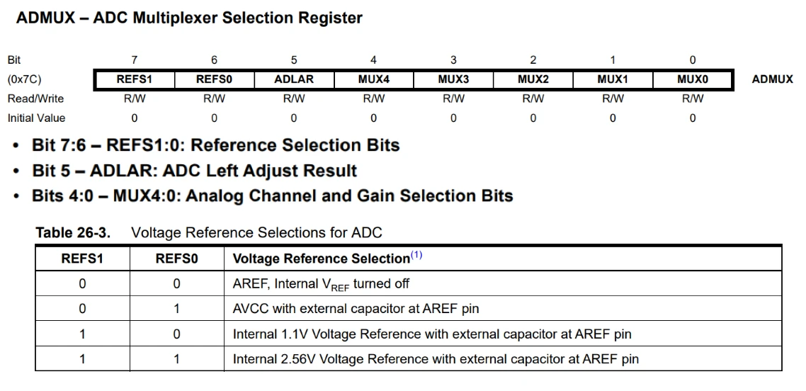
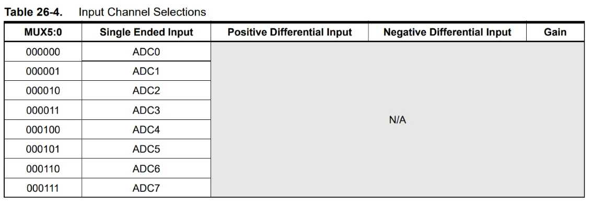
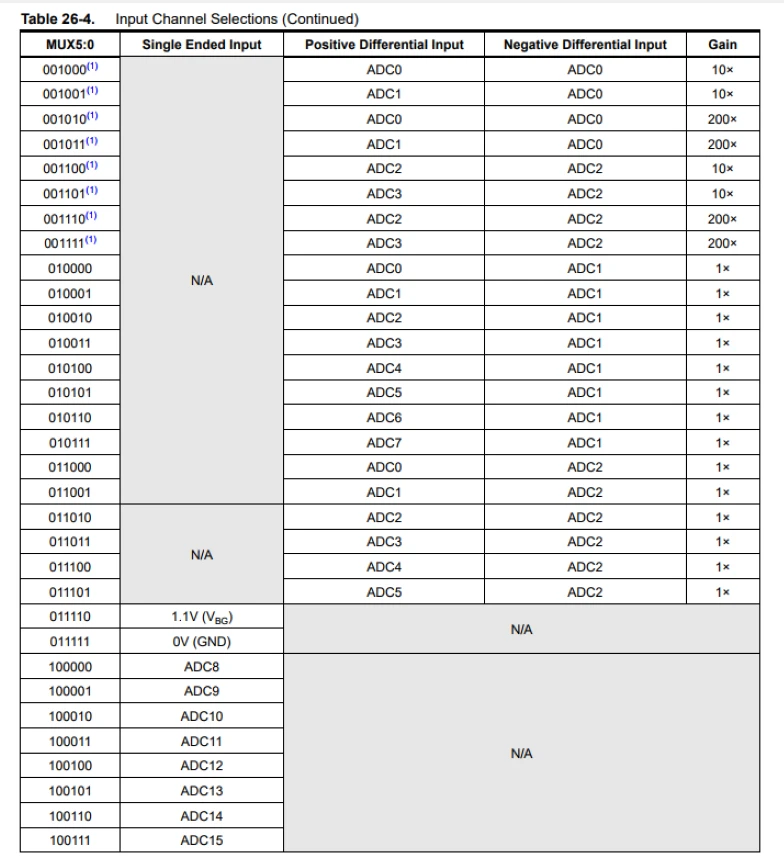
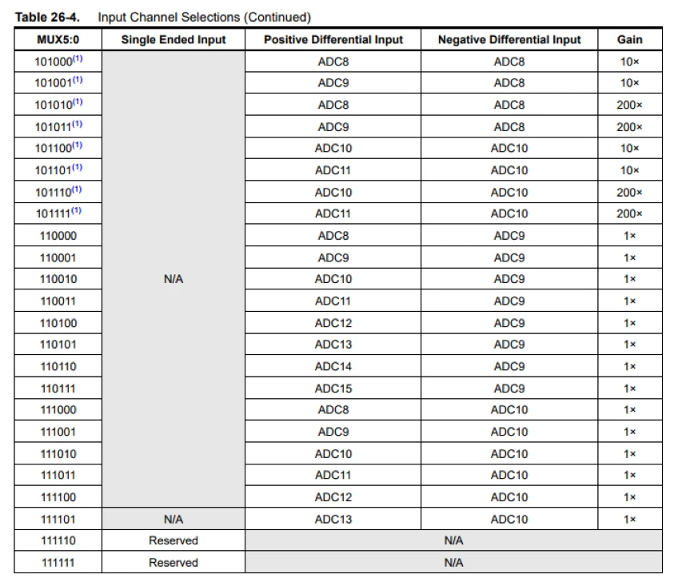
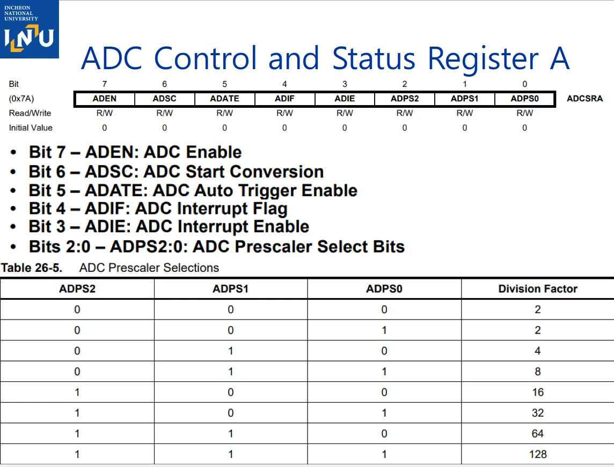
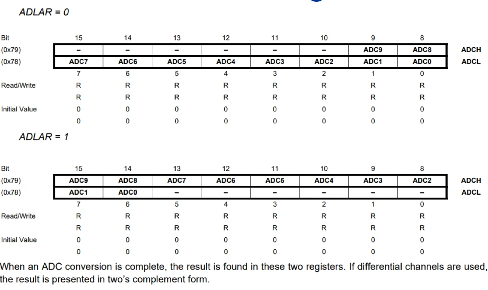

# ADC

- ADC는 총 16개의 핀이 있으며, ADMUX에서 16개 중 어떤 핀 사용할 지 결정할 수 있음.
- 10-bit resolution이기 때문에, 0~1023까지 총 1024개의 단계로 표현 가능함.
- `ADMUX`



- 기준점은 `ADMUX` register의 `REFS1`, `REFS0` 를 선택해서 고른다. 얘를 보통 0, 1로 주는데, 이것이 기본 5V를 의미한다. 
- `ADLAR` : 만약 ADC0:7가 아닌, ADC8:15 까지 선택하려면, 해당 비트를 set해주고, MUX에 값을 채워준다.









- `ADCSRA` (Analog to Digital Converter Status Register A) 
- Bit - 7, `ADEN`  : ADC를 사용할 수 있도록 Enable 한다.
- Bit - 6, `ADSC` : 이걸 set하면, AD conversion이 시작된다.
- Bit - 5, ADATA : 거의 사용하지 않는 것으로 보인다.
- Bit - 4, `ADIF` : ADC Interrupt Flag. ⇒ ADC 변환이 끝나면 flag가 올라감. 이걸로 끝난 것 체크.  
    따로 ADIE를 enable하지 않아도 Flag는 올라가는 것으로 보임. 아마 ADIE를 하면 새롭게 ISR을 만들어서 원하는 처리를 추가해주는 것일 듯 함.

```c
while(!(ADCSRA & (1 << ADIF));
// 만약 Flag가 올라가지 않는다면. 즉, 데이터 전송이 끝났다고 알려주지 않으면
// 넘어가지 못하도록 막아줌.
```

- Bit - 3, ADIE : ADC 변환이 끝나면 ISR 수행하도록 Enable해줌. 따로 쓰지는 않는 것으로 보인다.
- Bit - 2:0, `ADPS2:0` : ADC의 `Prescaler`를 결정하는 비트.   
    ⇒ 예제에서는 111로 설정.  
    prescaler 값에 따라서 ADC의 최대값이 달라짐.

> ADC 변환을 하고 나서는, \_delay\_us(300) 정도를 넣어준다. 오류 방지용 딜레이.



- `ADCH`, `ADCL` : ADLAR이 0이냐 1이냐 (즉, ADC0:7을 쓰냐 ADC8:15를 쓰냐에 따라서)에 따라 ADSC(AD start Conversion) 이후 변환된 값을 받는 방식이 달라짐. 예제에서는 ADLAR는 0이었으므로, 아래의 형태를 따를 것이다.

```c
// ADLAR = 0
unsigned int result = ADCL + (ADCH << 8); // ADCH를 High Bit로 옮겨서 더해줌.

// ADLAR = 1
unsigned int result = (ADCL >> 6) + (ADCH << 2); // 이와 같이 하면 될 것으로 보인다.
```

> unsigned int 만들어서 ADCL과 ADCH의 값을 얻어낼 때, 반드시 ADCL을 먼저 쓰고 그 뒤에 ADCH를 써야 올바른 값을 얻을 수 있음.
