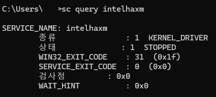
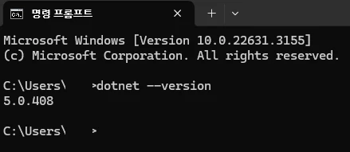
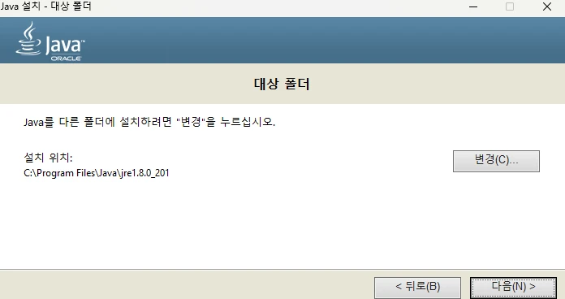
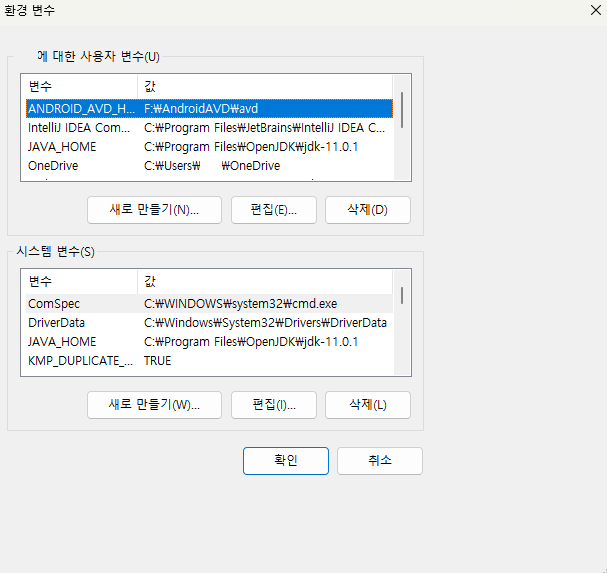
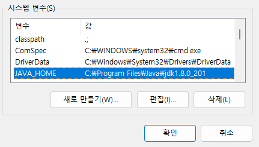
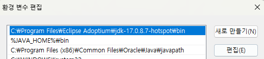
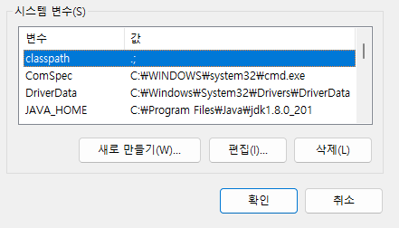
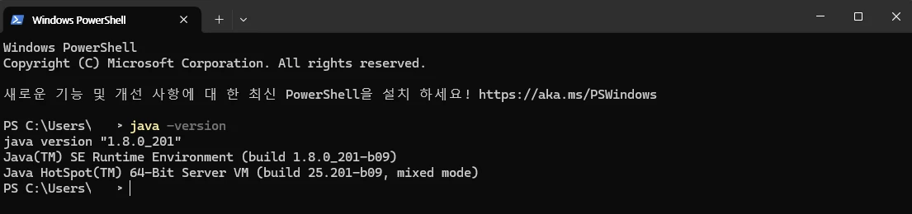
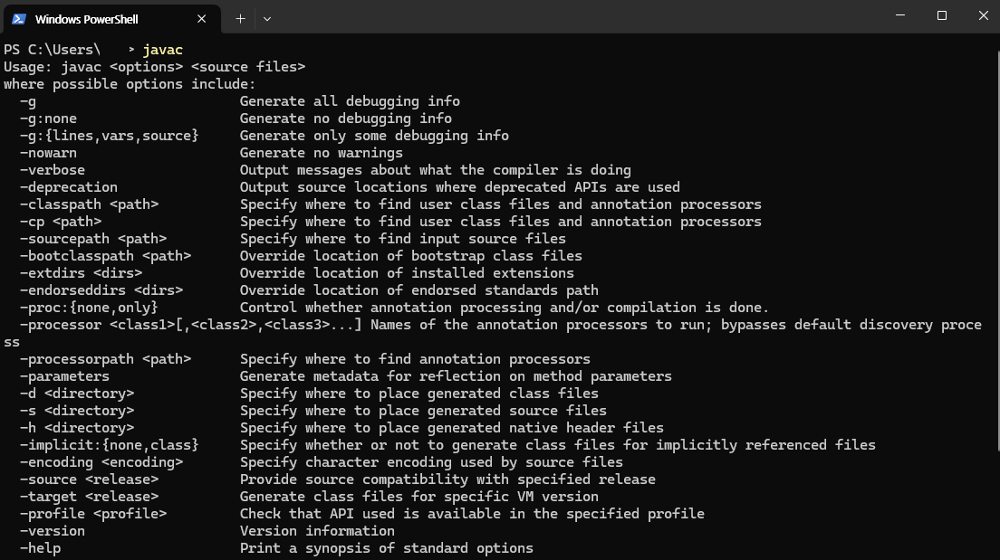

# 2주차: 개발 환경과 에뮬레이터 설치

## &lt;수업(2024-03-11 월)&gt;

- 모바일 SW (Tizen App) 개발을 위한 Tool 설치 (*Visual Studio 등*)

### 개발 툴

IDE는 Tizen Studio와 Visual Studio를 선택하여 사용할 수 있음. 그러나 이번에는 Visual Studio에 Extension을 심어서 편하게 사용하도록 한다. (*버젼은 Visual Studio 2019*)

- Visual Studio 2019 설치

    - .NET 데스크톱 개발
    - C++을 사용한 데스크톱 개발
    - .NET cross-platform development (out of support) 체크

    > 용량은 약 10\~15GB 가량 필요함.

### .NET SDK Version 체크

Visual Studio 도움말(H)에서 Microsoft Visual Studio 정보(A)에 들어가보면, 버전이 나온다.

> 16.11 버젼은 5.0.4xx SDK를 설치해야 한다.  
> ex) SDK 5.0.408, .exe를 받아서 설치할 것(Installers)

### Java SDK

8.0의 update 201 또는 241을 사용, 자료 설명은 201에 맞춰져 있음.

- Java SE 8 (8u202 and earlier) 선택한 후, 아래로 조금 스크롤해서 Java SE Development Kit 8u202 확인 후, OS에 맞는 버전을 선택

### Java 환경변수 설정

시스템 변수 → 새로 만들기

- JAVA_HOME
- classpath

두 가지를 입력한다.

### Tizen SDK 설치

Visual Studio 위에 Tizen SDK를 설치한다.

- tizen 검색 → Visual Studio Tools for Tizen과 Samsung TV .NET App Templates 설치
- Package Manager

- Install Tizen SDK

    - 먼저 SDK를 설치할 빈폴더를 적당한 이름(공백없는 영문자/숫자만으로 작성)
    - Install new Tizen SDK &gt; | Agress &gt; 위의 Path 선택 후 Next 진행

### Tizen Emulator 설치

- 가장 General한 에뮬레이터를 설치한다.

- Package Manager에서 Main/Extensions 둘 다에서 설치를 진행한다.

    - Main SDK에서 2개

        - Tizen SDK Tools
        - 8.0 Tizen

    - Extensions SDK에서 1개

        - Extras

    - 총 3개를 설치한다.

### Trouble Shooting

1. Emulator가 제대로 동작하지 않는 경우

    - 1번 단계

        도구-Tizen Emulator를 선택하면 에뮬레이터 도구가 실행됨. Create 버튼을 선택해서 새로운 에뮬레이터 이미지를 생성한다.

        T-8.0-x86_64를 사용, 처음엔 반드시 복사본을 사용한다.

    - 2번 단계

        안되면 download new image 클릭

    - 3번 단계

        H/W Support ⇒ GPU를 반드시 꺼야한다. (지원하지 않음.)

        ⇒ CPU VT가 disable 되어 있을 수 있기 때문에, Firmware Setting에서 확인해보면 된다.

        

        > 설치 안되어 있으므로, intelhaxm을 설치해야 함

        ⇒ 설치하고 나면 Hyper-V 기능을 꺼야한다고 나오는데, 다음과 같이 cmd에서 끄면 된다. (관리자)

        ```powershell
        bcdedit /set hypervisorlaunchtype off
        ```

        이렇게 해도 안되면 시스템 부팅 시에 Hyper-V 기능을 꺼야할 수 있음.

2. Emulator의 동작 오류

    가끔씩 잘 되다가 안되는 경우가 있다. S/W적인 문제일 수도 있지만, 새로운 복사본을 사용해야 할 수도 있다. 만약 원본을 사용하고 있었다면, Emulator만 재설치를 진행하자.

### Create Project

설치가 완료되면 제공된 빈 프로젝트를 사용한다.

> 뭔가 안될 때는 Emulator 복사 다시 만들어보자.

---

## &lt;2024-03-16 (토)&gt;

### Visual Studio 2019

- Visual Studio 2019 16.11.34 설치

### .NET SDK

[Download .NET 5.0 (Linux, macOS, and Windows)](https://dotnet.microsoft.com/en-us/download/dotnet/5.0)

- 5.0.408 설치
- x64



### JDK



- 설치 위치: `C:\Program Files\Java\jre1.8.0_201`



⇒ Flutter 때문에 JAVA_HOME이 이미 설정되어 있음.

- JAVA_HOME



- Path



- classpath



- java -version



⇒ 버젼이 OpenJDK 17.0.8로 나오는 이슈가 있어서 프로그램 추가/제거에서 삭제해 주었음.

- javac


