# 4주차: XAML 기본 구조와 StackLayout 실습

작성일 2024-03-25 · 최종 수정일 2024-04-01
{ .post-date }

## &lt;수업(2024-03-25 월)&gt;

### 에뮬레이터 오류

작업을 하다가 뭔가 안되거나 동작이 안되면 에뮬레이터를 새롭게 만들어서 하면 된다. 가장 좋은 응급처방이다.

### MainPage.xaml 파일

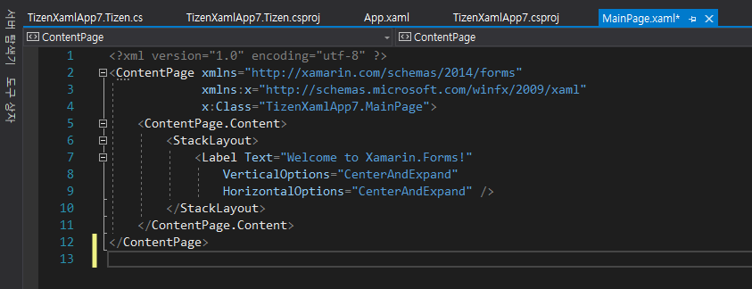

MainPage.xaml 파일이다. 꺽쇄로 구성되어 있는 언어를 마크업 언어라고 한다. 이는 절차지향 프로그래밍 언어와는 다르다.

- **Block**: 보통 &lt;&gt;로 시작되는 것은 Block으로 취급되며, &lt;/&gt;와 매칭되어 하나의 구역을 만든다. Block 이후의 코드는 Indentation으로 구분하여 Block 내부의 요소로 설정할 수 있다.
- **Element**(*임의로 붙인 이름*): Block과는 다르게 하나의 꺽쇄만으로 요소가 구성되는 것.
- **&lt;ContentPage.Content&gt;**: xaml 파일의 시작점. 마치 C언어의 main함수와도 같다. xaml에서는 만약 요소를 명시하지 않을 경우 default 값으로 설정되는 것들이 대부분이다.

- **&lt;StackLayout&gt;**: Layout의 종류는 여러가지가 있지만, 대표적으로는 StackLayout이 사용된다.

    - 이 Layout은 한 화면에서 여러 개의 요소들을 Stacking하는 방식이다.
    - 다른 종류로는 AbsoluteLayout, GridLayout 등이 있다.
    - Layout은 또 다른 Layout 안에 넣어 element를 추가하여 구성할 수 있다. (*Cascading*)

> 솔루션 구조를 보면, Tizen 프로젝트와 Xamarin 프로젝트가 있다. Xamarin 프로젝트는 UI를 다루며, Tizen 프로젝트는 Code를 다룬다.

### 실습 1)

> 화면 중앙에 나온 글자를 키우고, 내용을 바꾸고, 색깔을 바꿔보자.  
> Tip: Xamarin으로 만들 수 있는 모든 코드는 C#에서 구현이 가능하지만, C#을 Xamarin에서 모두 구현할 수는 없다.

- **코드**

```xml
<?xml version="1.0" encoding="utf-8" ?>
<ContentPage xmlns="http://xamarin.com/schemas/2014/forms"
             xmlns:x="http://schemas.microsoft.com/winfx/2009/xaml"
             x:Class="TizenXamlApp7.MainPage">
    <ContentPage.Content>
        <StackLayout>
            <Label Text="Hello, World!"
                VerticalOptions="CenterAndExpand" 
                HorizontalOptions="CenterAndExpand"
                FontSize="300"
                TextColor="Red" />
                <!--  Red 대신에 #ff0000를 사용해도 된다. -->
        </StackLayout>
    </ContentPage.Content>
</ContentPage>
```

- **결과**

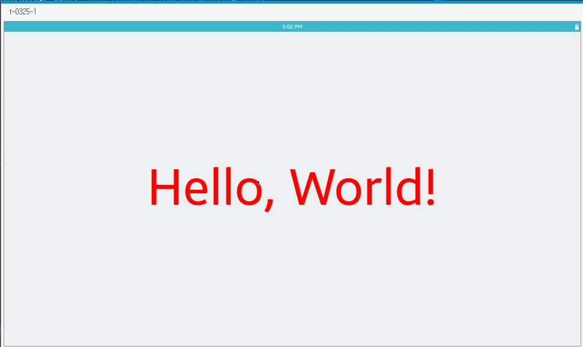

### 실습 2)

> Label 추가 및 정렬 바꿔보기

```xml
<?xml version="1.0" encoding="utf-8" ?>
<ContentPage xmlns="http://xamarin.com/schemas/2014/forms"
             xmlns:x="http://schemas.microsoft.com/winfx/2009/xaml"
             x:Class="TizenXamlApp7.MainPage">
    <ContentPage.Content>
        <StackLayout>
            <Label Text="Hello, World!"
                VerticalOptions="Start" 
                HorizontalOptions="Start"
                FontSize="300"
                TextColor="Red" />
            <Label Text="Hello, World!"
                VerticalOptions="CenterAndExpand" 
                HorizontalOptions="CenterAndExpand"
                FontSize="300"
                TextColor="Blue" />
            <Label Text="Hello, World!"
                VerticalOptions="End" 
                HorizontalOptions="End"
                FontSize="300"
                TextColor="Green" />
                <!--  Red 대신에 #ff0000를 사용해도 된다. -->
        </StackLayout>
    </ContentPage.Content>
</ContentPage>
```

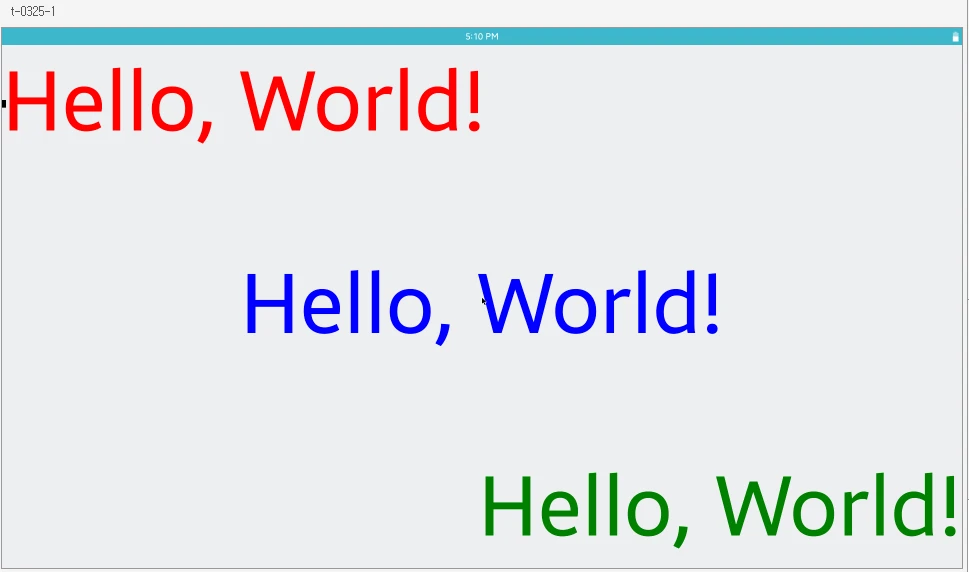

> Label을 세 개만들고 모든 옵션을 CenterAndExpand로 지정한다면, 아래와 같이 나온다. 이는 Expand 옵션에 의해, 지정된 사이즈 내에서 균형있게 공간을 배치되는 것이다.

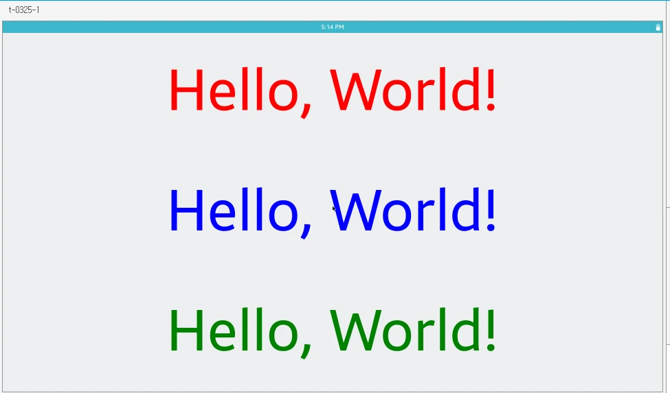

⇒ *또한 Stack 구조이기 때문에, 주어진 Layout에서 위에 적을 수록, 실제 UI의 윗쪽부터 쌓여나간다.*

> 이번에는 세 개의 Label에 대해서 Vertical Option을 모두 Center로 지정해보자. 어떻게 될까?

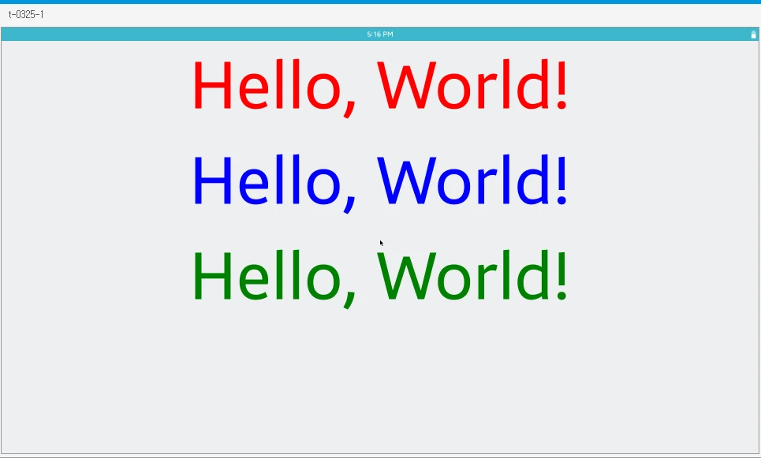

⇒ *예상과는 다른 결과가 나오는 것을 알 수 있다.*

> 그렇다면 왜 이렇게 되는 것일까? FontSize를 20으로 바꿔서 확인해보자.

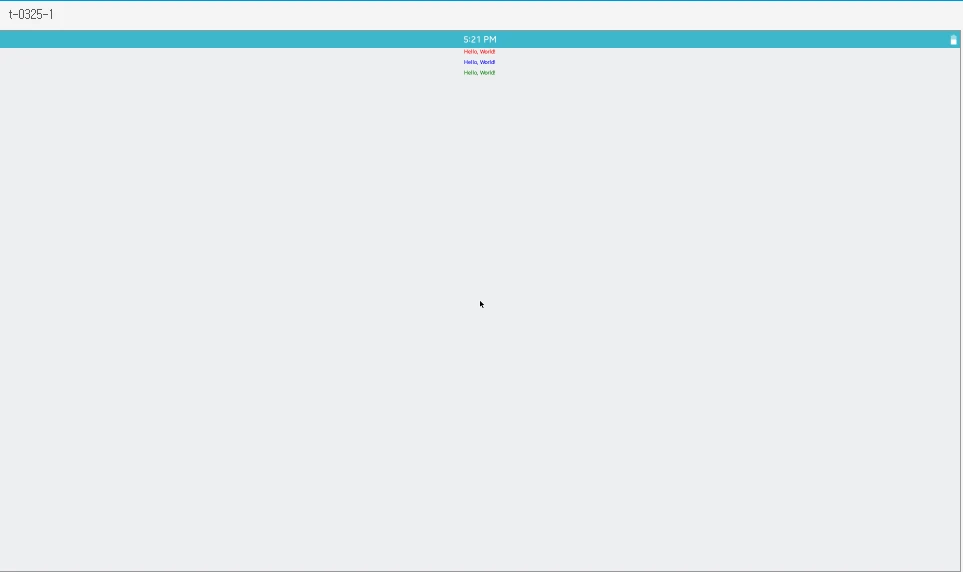

⇒ *확인해 본 결과, Center Option이 무너지고 모두 위에서부터 쌓이고 있는 것을 확인할 수 있다.*

### 실습 3)

> 세 개의 Label에 대해서 StartAndExpand, CenterAndExpand,EndAndExpand를 붙여 확인해보자.

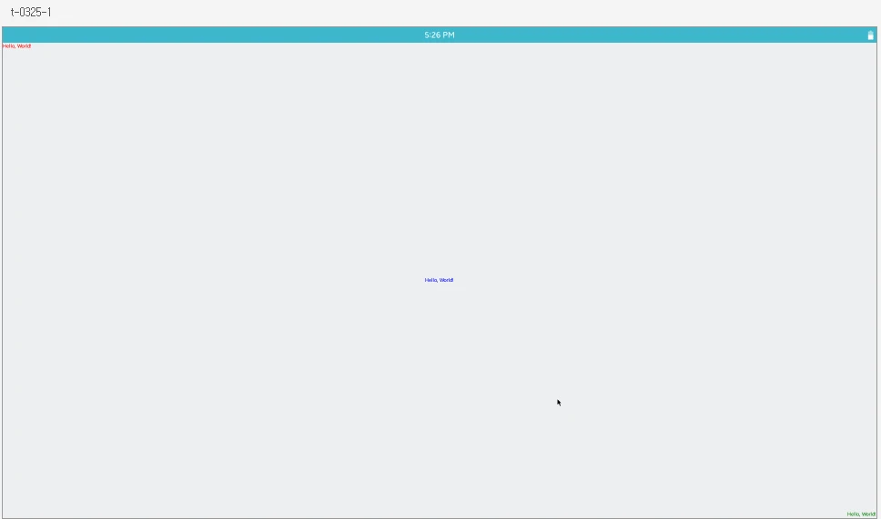

⇒ 적절하게 띄우라고 설정해주니, 이와 같이 출력되었다.

### 실습 4)

> BackgroundColor 추가 및 VerticalOptions를 제거해보자.

- **코드**

```xml
<?xml version="1.0" encoding="utf-8" ?>
<ContentPage xmlns="http://xamarin.com/schemas/2014/forms"
             xmlns:x="http://schemas.microsoft.com/winfx/2009/xaml"
             x:Class="TizenXamlApp7.MainPage">
    <ContentPage.Content>
        <StackLayout>
            <Label Text="Hello, World!"
                HorizontalOptions="Start" 
                FontSize="200"
                   BackgroundColor="White"
                TextColor="Red" />
            <Label Text="Hello, World!"
                HorizontalOptions="Center" 
                FontSize="200"
                BackgroundColor="White"
                TextColor="Blue" />
            <Label Text="Hello, World!"
                HorizontalOptions="End" 
                FontSize="200"
                BackgroundColor="White"
                TextColor="Green" />
                <!--  Red 대신에 #ff0000를 사용해도 된다. -->
        </StackLayout>
    </ContentPage.Content>
</ContentPage>
```

- **결과**

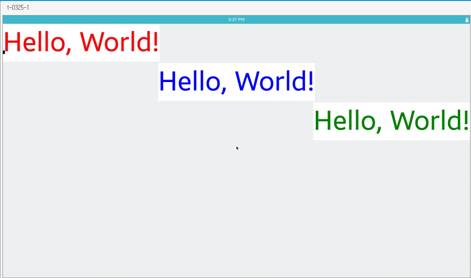

### 최종 코드

```xml
<!-- 2024-03-25 (월) StackLayout 활용 -->
<ContentPage xmlns="http://xamarin.com/schemas/2014/forms"
             xmlns:x="http://schemas.microsoft.com/winfx/2009/xaml"
             x:Class="TizenXamlApp7.MainPage">
    <ContentPage.Content>
        <StackLayout>
            <Label Text="Hello, World!"
                HorizontalOptions="Start" 
                FontSize="200"
                   BackgroundColor="White"
                TextColor="Red" />
            <Label Text="Hello, World!"
                HorizontalOptions="Center" 
                FontSize="200"
                BackgroundColor="White"
                TextColor="Blue" />
            <Label Text="Hello, World!"
                HorizontalOptions="End" 
                FontSize="200"
                BackgroundColor="White"
                TextColor="Green" />
            <!--  Red 대신에 #ff0000를 사용해도 된다. -->
        </StackLayout>
    </ContentPage.Content>
</ContentPage>
```

---

## &lt;수업(2024-03-26 화)&gt;

> Absolute Layout과 C#을 활용한다. Xamarin과 동일한 작업을 C#으로도 할 수 있다.

### 실습 1)

- **코드**

```xml
<?xml version="1.0" encoding="utf-8" ?>

<ContentPage xmlns="http://xamarin.com/schemas/2014/forms"
             xmlns:x="http://schemas.microsoft.com/winfx/2009/xaml"
             x:Class="TizenXamlApp7.MainPage">
    <ContentPage.Content>
        <AbsoluteLayout>
            <Label Text="Hello, World!"
                AbsoluteLayout.LayoutBounds="0, 0, 600, 200"
                FontSize="200"
                BackgroundColor="White"
                TextColor="Red" />
            <Label Text="Hello, World!"
                AbsoluteLayout.LayoutBounds="700, 450, 600, 200"
                FontSize="200"
                BackgroundColor="White"
                TextColor="Blue" />
            <Label Text="Hello, World!"
                AbsoluteLayout.LayoutBounds="1320, 880, 600, 200"
                FontSize="200"
                BackgroundColor="White"
                TextColor="Green" />
        </AbsoluteLayout>
    </ContentPage.Content>
</ContentPage>
```

> LayoutBounds를 (a, b, c, d)라고 할 때, a, b는 좌상단의 좌표이고, c, d는 가로, 세로 길이를 의미

- **결과**

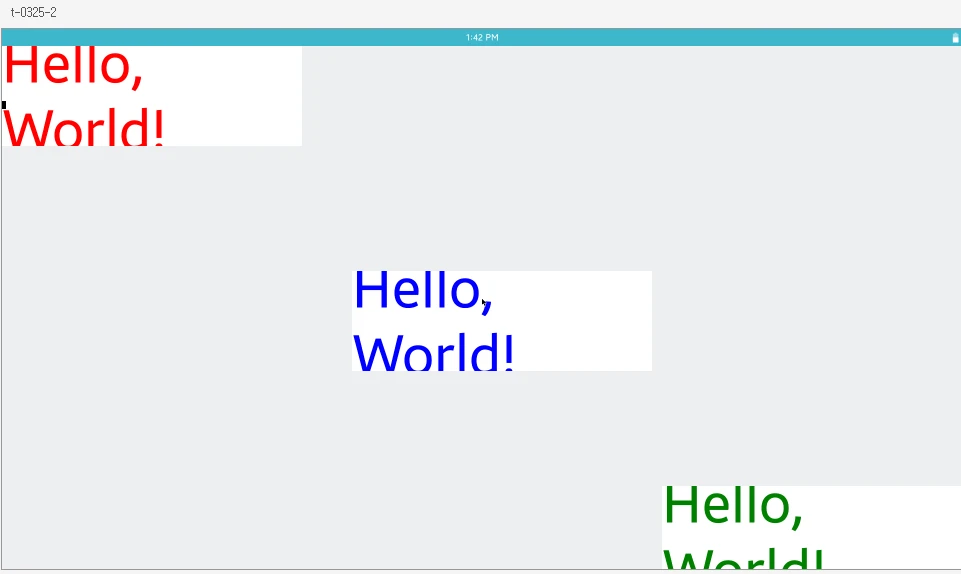

⇒ 글자가 너무 큰 것으로 보인다.

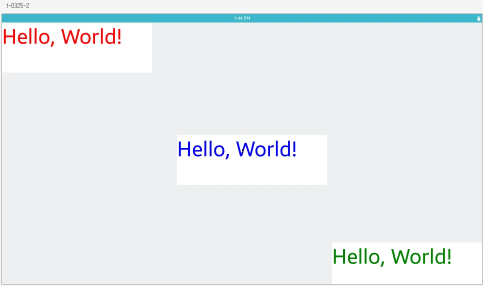

⇒ 글자는 작아지지만, 예제와는 약간 다른 부분이 있는 것으로 보인다.

### Xamarin과 C#의 매칭

- **MainPage.xml.cs**

```csharp
using System;
using System.Collections.Generic;
using System.Linq;
using System.Text;
using System.Threading.Tasks;

using Xamarin.Forms;
using Xamarin.Forms.Xaml;

namespace TizenXamlApp7
{
    [XamlCompilation(XamlCompilationOptions.Compile)]
    public partial class MainPage : ContentPage
    {
        public MainPage()
        {
            InitializeComponent();
        }
    }
}
```

> MainPage는 xml의 ContentPage.Content에 대응된다. 다만, 변수를 선언하는 선언형 방식으로 코딩을 해줘야 한다는 점에서 차이가 있다.

- **MainPage.xml**

```xml
<?xml version="1.0" encoding="utf-8" ?>

<ContentPage xmlns="http://xamarin.com/schemas/2014/forms"
             xmlns:x="http://schemas.microsoft.com/winfx/2009/xaml"
             x:Class="TizenXamlApp7.MainPage">
    <ContentPage.Content>
    </ContentPage.Content>
</ContentPage>
```

- **MainPage.xml.cs (코드 변경)**

```csharp
using System;
using System.Collections.Generic;
using System.Linq;
using System.Text;
using System.Threading.Tasks;

using Xamarin.Forms;
using Xamarin.Forms.Xaml;

namespace TizenXamlApp7
{
    [XamlCompilation(XamlCompilationOptions.Compile)]
    public partial class MainPage : ContentPage
    {
        public MainPage()
        {
            InitializeComponent();

            // 명시적 타입 지정 대신 var를 사용해도 된다.
            StackLayout layout = new StackLayout();
            Label label1 = new Label
            {
                Text = "Hello, World!",
                TextColor = Color.Red,
                FontSize = 200,
                HorizontalOptions = LayoutOptions.StartAndExpand,
                VerticalOptions = LayoutOptions.StartAndExpand
            };

            layout.Children.Add(label1);
            Content = layout;
        }
    }
}
```

### 실습 2)

> StackLayout을 C#으로 구성해보기

- **코드**

```csharp
using System;
using System.Collections.Generic;
using System.Linq;
using System.Text;
using System.Threading.Tasks;

using Xamarin.Forms;
using Xamarin.Forms.Xaml;

namespace TizenXamlApp7
{
    [XamlCompilation(XamlCompilationOptions.Compile)]
    public partial class MainPage : ContentPage
    {
        public MainPage()
        {
            InitializeComponent();

            // 명시적 타입 지정 대신 var를 사용해도 된다.
            StackLayout layout = new StackLayout();
            Label label1 = new Label
            {
                Text = "Hello, World!",
                TextColor = Color.Red,
                FontSize = 200,
                HorizontalOptions = LayoutOptions.StartAndExpand,
                VerticalOptions = LayoutOptions.StartAndExpand
            };
            Label label2 = new Label
            {
                Text = "Hello, World!",
                TextColor = Color.Green,
                FontSize = 200,
                HorizontalOptions = LayoutOptions.CenterAndExpand,
                VerticalOptions = LayoutOptions.CenterAndExpand
            };
            Label label3 = new Label
            {
                Text = "Hello, World!",
                TextColor = Color.Blue,
                FontSize = 200,
                HorizontalOptions = LayoutOptions.EndAndExpand,
                VerticalOptions = LayoutOptions.EndAndExpand
            };

            layout.Children.Add(label1);
            layout.Children.Add(label2);
            layout.Children.Add(label3);

            Content = layout;
        }
    }
}
```

- **결과**

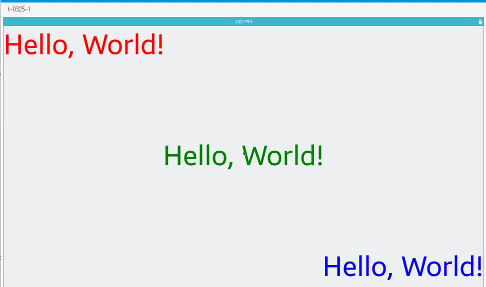

### 실습 3)

> AbsoluteLayout을 C#으로 구성해보기

- **코드**

```csharp
using System;
using System.Collections.Generic;
using System.Linq;
using System.Text;
using System.Threading.Tasks;

using Xamarin.Forms;
using Xamarin.Forms.Xaml;

namespace TizenXamlApp7
{
    [XamlCompilation(XamlCompilationOptions.Compile)]
    public partial class MainPage : ContentPage
    {
        public MainPage()
        {
            InitializeComponent();

            // 명시적 타입 지정 대신 var를 사용해도 된다.
            AbsoluteLayout layout = new AbsoluteLayout();
            Label label1 = new Label
            {
                Text = "Hello, World!",
                TextColor = Color.Red,
                FontSize = 200,
            };
            AbsoluteLayout.SetLayoutBounds(label1, new Rectangle(0, 0, 600, 200));

            Label label2 = new Label
            {
                Text = "Hello, World!",
                TextColor = Color.Green,
                FontSize = 200,
                HorizontalOptions = LayoutOptions.CenterAndExpand,
                VerticalOptions = LayoutOptions.CenterAndExpand
            };
            AbsoluteLayout.SetLayoutBounds(label1, new Rectangle(700, 450, 600, 200));

            Label label3 = new Label
            {
                Text = "Hello, World!",
                TextColor = Color.Blue,
                FontSize = 200,
                HorizontalOptions = LayoutOptions.EndAndExpand,
                VerticalOptions = LayoutOptions.EndAndExpand
            };
            AbsoluteLayout.SetLayoutBounds(label1, new Rectangle(1320, 880, 600, 200));

            layout.Children.Add(label1);
            layout.Children.Add(label2);
            layout.Children.Add(label3);

            Content = layout;
        }
    }
}
```

⇒ AbsoluteLayout.SetLayoutBounds를 사용해서 위치를 지정해 주어야 함.

### 실습 4)

> StackLayout을 이용하여 새로운 레이아웃을 xml만 이용하여 구현해보기

- (1)

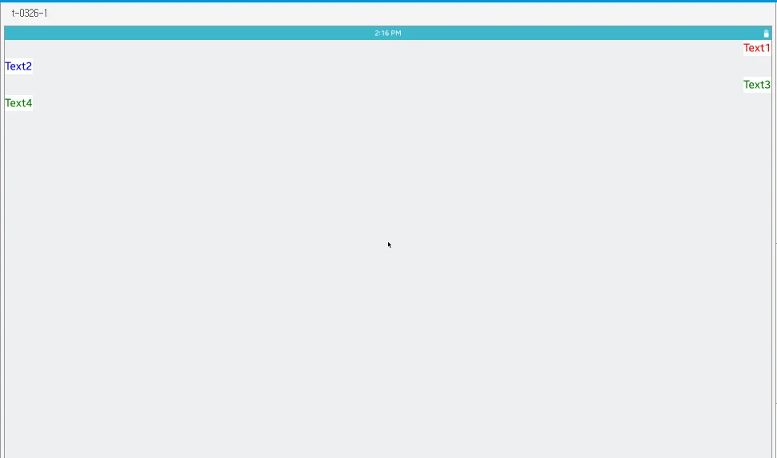

```xml
<?xml version="1.0" encoding="utf-8" ?>

<ContentPage xmlns="http://xamarin.com/schemas/2014/forms"
             xmlns:x="http://schemas.microsoft.com/winfx/2009/xaml"
             x:Class="TizenXamlApp7.MainPage">
    <ContentPage.Content>
        <StackLayout>
            <Label Text="Text1"
                HorizontalOptions="End"
                FontSize="50"
                BackgroundColor="White"
                TextColor="Red" />
            <Label Text="Text2"
                HorizontalOptions="Start"
                FontSize="50"
                BackgroundColor="White"
                TextColor="Blue" />
            <Label Text="Text3"
                HorizontalOptions="End"
                FontSize="50"
                BackgroundColor="White"
                TextColor="Green" />
            <Label Text="Text4"
                HorizontalOptions="Start"
                FontSize="50"
                BackgroundColor="White"
                TextColor="Green" />
        </StackLayout>
    </ContentPage.Content>
</ContentPage>
```

- (2)

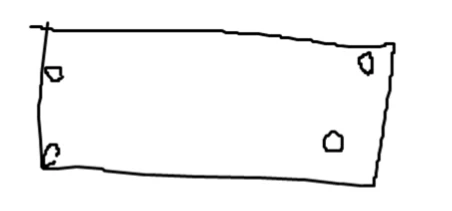

- (3)

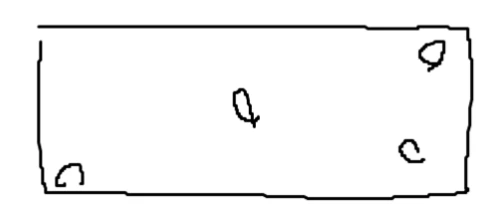

⇒ Vertical 사용 가능
