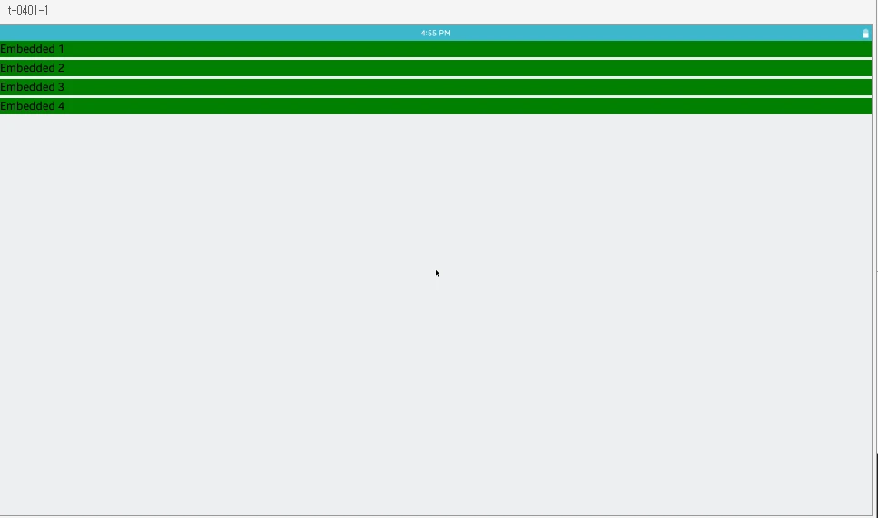
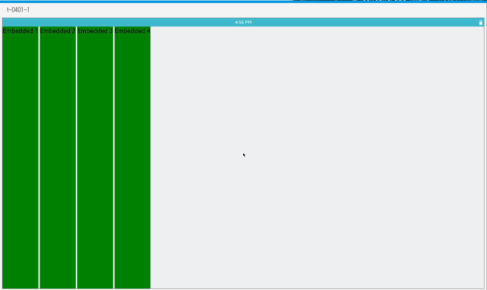
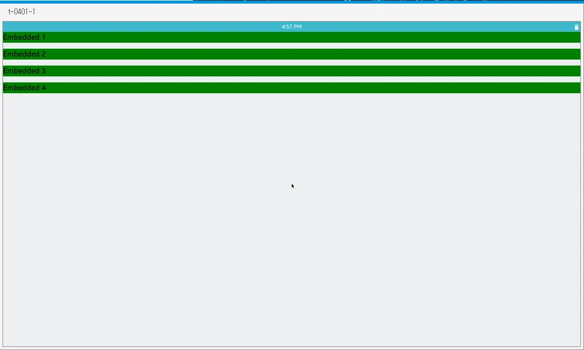
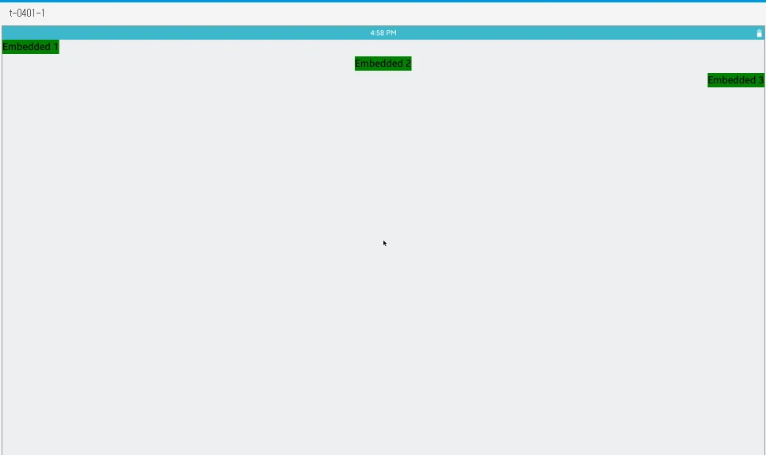
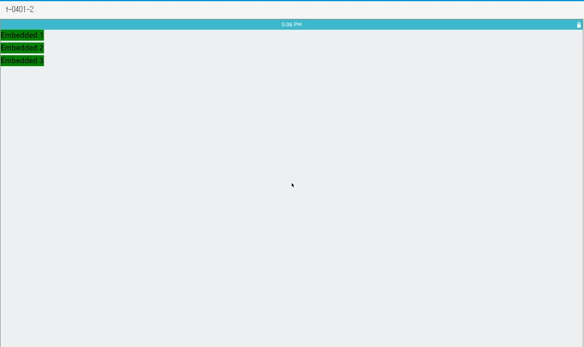
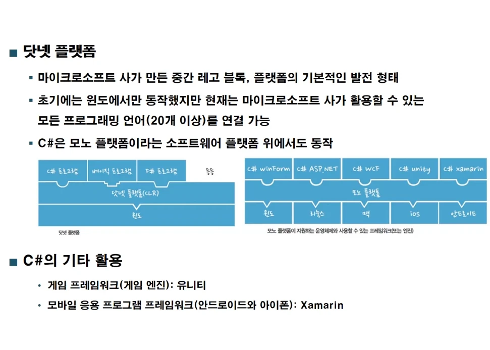
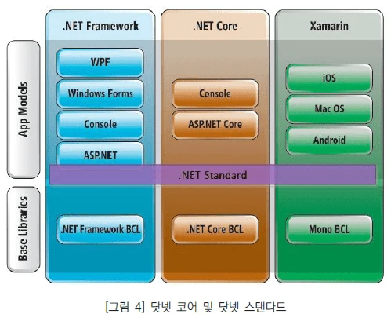
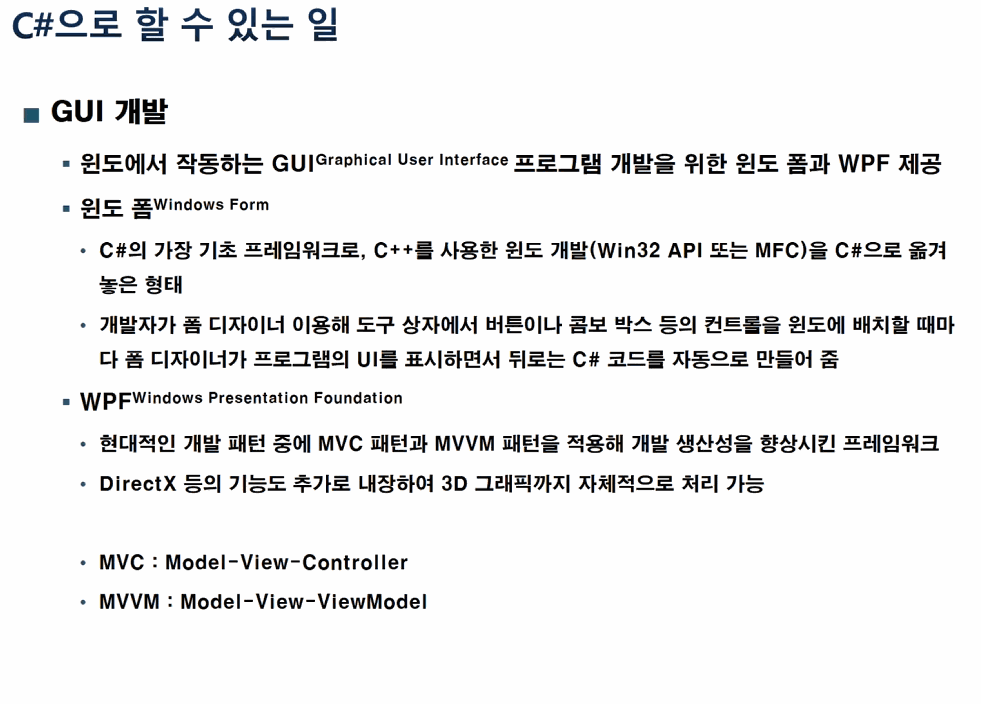
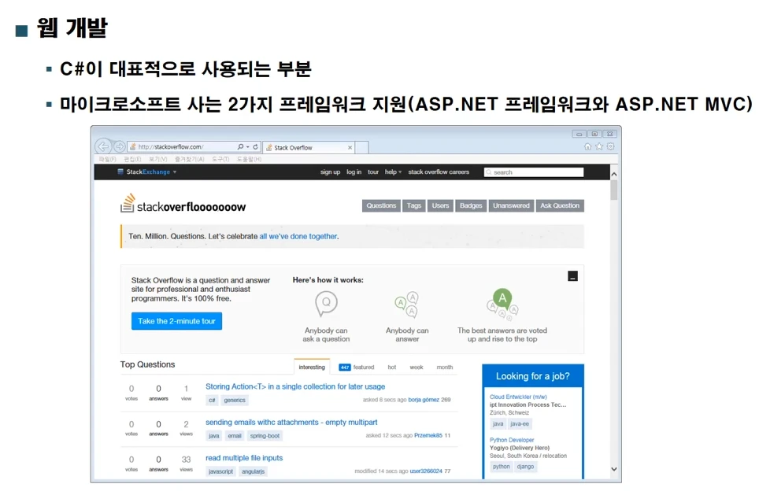
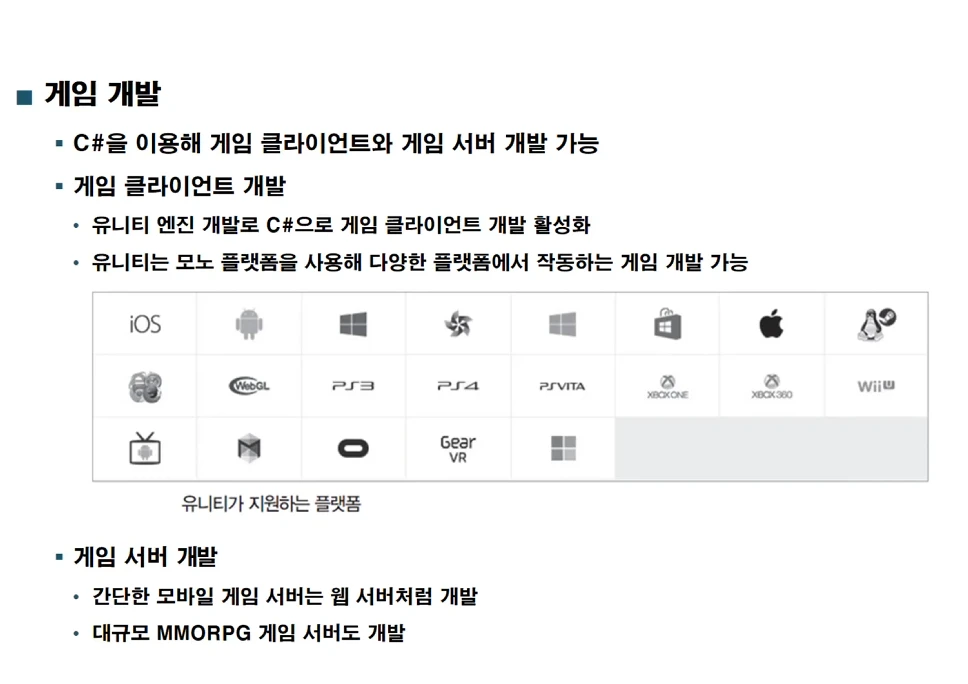

# 5주차: StackLayout 주요 속성, .NET 플랫폼

작성일 2024-04-01 · 최종 수정일 2024-04-05
{ .post-date }

## &lt;수업(2024-04-01 월)&gt;

### StackLayout의 기본 사용과 주요 속성

- **Orientation**: 방향

    - 방향에 맞춰 element를 나열하면 stacking 되는 구조
    - Vertical/Horizontal

> StackLayout의 Orientation option에 Vertical 옵션을 준 채로 Label을 만들면, 가로로 꽉찬다. 세로 길이는 자동으로 지정되는데, 이는 내부에 작성된 글자의 default 크기 때문일 것으로 보인다.

⇒ Vertical은 Default Option이다.

> 만약 StackLayout의 Orientation option에 Horizontal 옵션을 준다면, Label이 StackLayout에 쌓이는 방향이 수평으로 바뀌고, 세로가 꽉찬다. 가로 길이는 글씨 크기에 의해 자동으로 지정된다. 또한 자동적으로 설정된 default margin 때문에 Label 사이에 간격이 존재하게 된다. ⇒ 여기서는 Spacing 이라고 표현 한다.  default 값은 6 pixel이다.

> Q. 만약 Spacing을 500정도 줘서 화면을 벗어나면 어떻게 되는가?  
> Q. 만약 Spacing이 -라면 어떻게 되는가?  
> ⇒ (+) 라면 떨어트리고, (-) 라면 Overlap 시킨다.

Orientation(*Vertical, Horizontal*)과 VerticalOptions/HorizontalOptions를 동시에 준다면 이전처럼 채워지는 형태가 아닌, 부분적인 크기로 나오게 된다.

### 실습 1)

```xml
<?xml version="1.0" encoding="utf-8" ?>

<ContentPage xmlns="http://xamarin.com/schemas/2014/forms"
             xmlns:x="http://schemas.microsoft.com/winfx/2009/xaml"
             x:Class="TizenXamlApp7.MainPage">
    <ContentPage.Content>
        <StackLayout Orientation="Vertical">
            <Label Text="Embedded 1" BackgroundColor="Green"></Label>
            <Label Text="Embedded 2" BackgroundColor="Green"></Label>
            <Label Text="Embedded 3" BackgroundColor="Green"></Label>
            <Label Text="Embedded 4" BackgroundColor="Green"></Label>
        </StackLayout>
    </ContentPage.Content>
</ContentPage>
```



### 실습 2)

```xml
<?xml version="1.0" encoding="utf-8" ?>

<ContentPage xmlns="http://xamarin.com/schemas/2014/forms"
             xmlns:x="http://schemas.microsoft.com/winfx/2009/xaml"
             x:Class="TizenXamlApp7.MainPage">
    <ContentPage.Content>
        <StackLayout Orientation="Horizontal">
            <Label Text="Embedded 1" BackgroundColor="Green"></Label>
            <Label Text="Embedded 2" BackgroundColor="Green"></Label>
            <Label Text="Embedded 3" BackgroundColor="Green"></Label>
            <Label Text="Embedded 4" BackgroundColor="Green"></Label>
        </StackLayout>
    </ContentPage.Content>
</ContentPage>
```



### 실습 3)

```xml
<?xml version="1.0" encoding="utf-8" ?>

<ContentPage xmlns="http://xamarin.com/schemas/2014/forms"
             xmlns:x="http://schemas.microsoft.com/winfx/2009/xaml"
             x:Class="TizenXamlApp7.MainPage">
    <ContentPage.Content>
        <StackLayout Orientation="Vertical" Spacing="20">
            <Label Text="Embedded 1" BackgroundColor="Green"></Label>
            <Label Text="Embedded 2" BackgroundColor="Green"></Label>
            <Label Text="Embedded 3" BackgroundColor="Green"></Label>
            <Label Text="Embedded 4" BackgroundColor="Green"></Label>
        </StackLayout>
    </ContentPage.Content>
</ContentPage>
```



### 실습 4)

```xml
<?xml version="1.0" encoding="utf-8" ?>

<ContentPage xmlns="http://xamarin.com/schemas/2014/forms"
             xmlns:x="http://schemas.microsoft.com/winfx/2009/xaml"
             x:Class="TizenXamlApp7.MainPage">
    <ContentPage.Content>
        <StackLayout Orientation="Vertical">
            <Label Text="Embedded 1" BackgroundColor="Green" HorizontalOptions="Start"></Label>
            <Label Text="Embedded 2" BackgroundColor="Green" HorizontalOptions="Center"></Label>
            <Label Text="Embedded 3" BackgroundColor="Green" HorizontalOptions="End"></Label>
        </StackLayout>
    </ContentPage.Content>
</ContentPage>
```



### 테스트

> 옵션을 바꿔가면서 아래 세 개의 화면을 만드는 실습이다.



---

## &lt;강의(C#)&gt;

### .NET Platform



- **.NET Framework**

.NET Framework는 C#과 함께 2002년 공개된 프레임워크이다. 초기에는 윈도우 위에서만 동작했으며, CLR이라는 .NET 플랫폼을 운영체제와 언어 사이에 포함하여 프로그래머가 다양한 언어를 다룰 수 있도록 지원하였다. .NET Framework에서 프로그래밍 언어(대표적으로 C#)는 빌드 후에 IL(Intermediate Language, 중간 언어)로 변환되어 CLR(.NET 플랫폼)에 의해 실행되는 구조를 가졌다. 이는 자바의 바이트코드(Bytecode) ↔ JRE(Java Runtime Environment)와 유사하다.

⇒ .NET Framework는 C#, F#, Visual Basic을 지원함.

> 통상적으로 윈도우용 애플리케이션은 .NET Framework 기반으로 개발하는 것이 생산성이 높고 성능도 좋다. 또한 3rd Party 라이브러리도 풍부하다. 하지만 대부분이 상용이고 윈도우 전용이기 때문에 애플리케이션 생태계가 웹과 모바일 중심으로 변화하면서 한계를 보였다.  
>   
> 게다가 기업들이 비용 절감을 위해 리눅스를 비롯한 오픈소스 소프트웨어 도입에 적극적으로 나서게 되며 라이선스 비용이 많이 드는 윈도우 기반 서버가 아니더라도 수준 높은 웹 애플리케이션 서비스가 가능하게 되면서 이러한 한계는 더욱 두드러지게 되었다.

- **.NET Core**(크로스 플랫폼, 오픈소스)

MS도 이러한 .NET Framework의 한계를 인식하고 대안을 마련하기 시작했다. 2014년 .NET Core라는 이름으로 크로스 플랫폼을 지원하는 오픈소스 프레임워크를 출시했다. 또한 MS는 .NET Foundation을 설립하여 오픈소스 진영으로 입지를 넓혀갔고, 삼성전자도 .NET Foundation의 기술운영위원회에 참여하며 .NET App을 지원하는 Tizen OS를 주도적으로 개발해 나가고 있다.

> MS는 .NET Core 출시와 함께 .NET 표준 API 스펙인 .NET Standard도 발표했다. 개발자가 .NET Standard API만을 사용하여 라이브러리를 빌드해 배포하면, .NET Standard 버전을 지원하는 .NET 환경에서는 어디서든 참조 및 실행이 가능하다. 그러므로 다양한 플랫폼에서 공통적으로 사용하기 위한 라이브러리는 .NET Standard를 타겟으로 개발할 것을 권장하고 있다.



- **.NET**

MS는 그동안 개별적으로 지원하던 .NET Framework와 .NET Core를 .NET이라는 단일 서비스로 통일했다.

### C#으로 할 수 있는 일



- GUI 프로그램 개발을 위한 **Windows Forms**와 **WPF**

    - Windows Form

        - C#의 가장 기초적인 프레임워크이며, C++을 사용한 윈도우 개발(Win32 API 또는 MFC)을 C#으로 옮긴 형태이다.

    - WPF

        - 현대적인 개발 패턴 중에 MVC 패턴과 MVVM 패턴을 적용해 개발 생산성을 향상시킨 프레임워크이다.
        - DirectX 등의 기능도 추가로 내장하여 3D 그래픽까지 자체적으로 처리 가능

- **MVC**: Model-View-Controller
- **MVVM**: Model-View-ViewModel



- **웹 개발**

    - ASP.NET Framework와 ASP.NET MVC



- **게임 개발**

    - C#을 이용해 **게임 클라이언트**와 **게임 서버 개발**이 가능하다.

    - 게임 클라이언트 개발

        - 유니티 엔진 개발로 C#으로 게임 클라이언트 개발 활성화가 가능하다.
        - 유니티는 모노 플랫폼을 사용해 다양한 플랫폼에서 작동하는 게임 개발이 가능하다.

    - 게임 서버 개발

        - 간단한 모바일 게임 서버는 웹 서버처럼 개발
        - 대규모 MMORPG 게임 서버도 개발 가능하다.

---

### Programming

- **Example 1)**

```csharp
using System;
using System.Collections.Generic;
using System.Linq;
using System.Text;
using System.Threading.Tasks;

namespace CS_Lecture
{
    class HelloWorld
    {
        // 프로그램 실행이 시작되는 곳
        static void Main(string[] args)
        {
            // command line을 통해 전달받은 argument의 길이
            if (args.Length == 0)
            {
                Console.WriteLine("사용법: HelloWorld.exe <이름>");
                return;
            }

            Console.WriteLine("Hello, {0}!", args[0]);
        }
    }
}
```

⇒ 실제로 프로그램을 만들고 나면, Debug Mode와 Release Mode를 잘 구분해야 한다.
