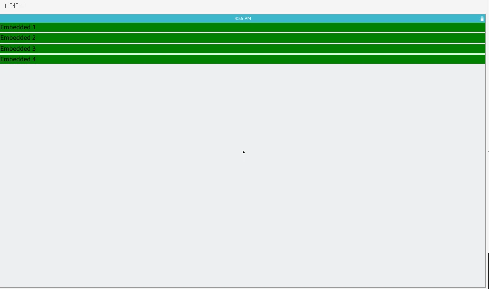
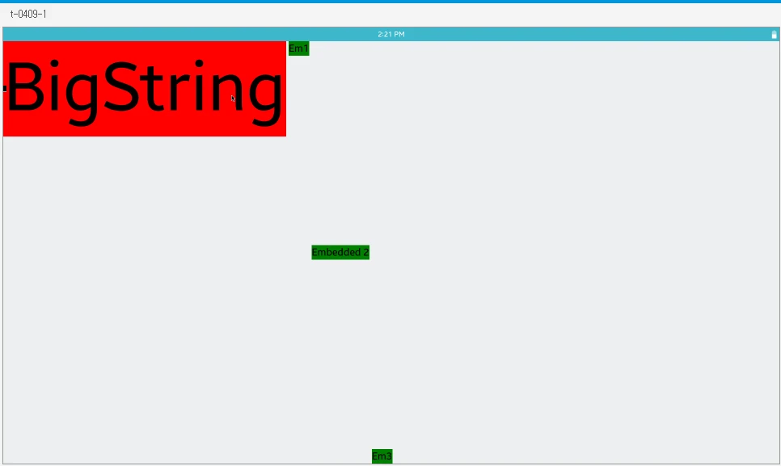
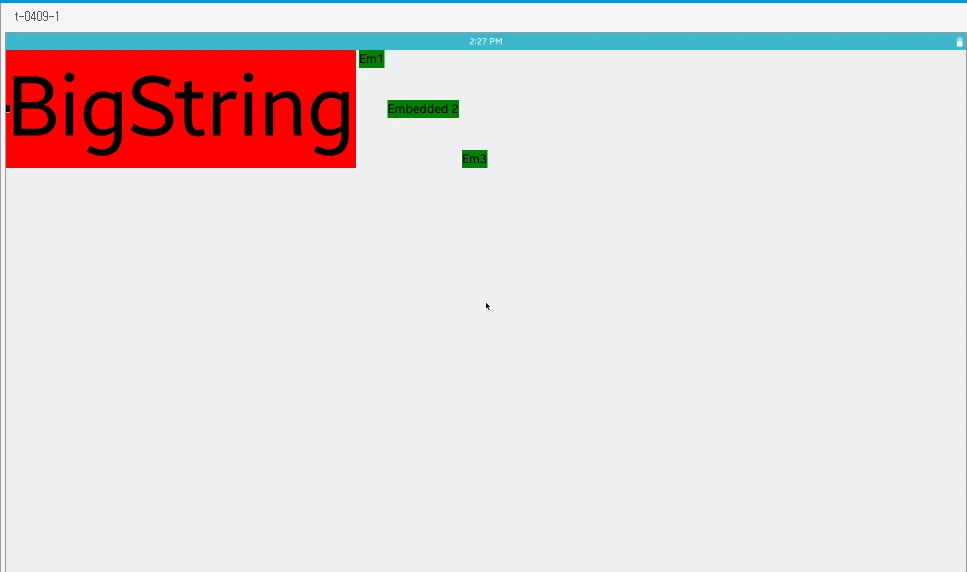
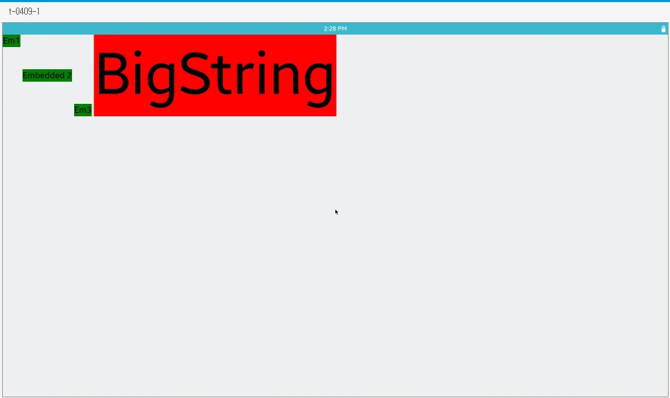

# 6주차: Layout Options, C# 클래스와 namespace

작성일 2024-04-09 · 최종 수정일 2024-04-12
{ .post-date }

## &lt;수업(2024-04-09, 화)&gt;

```xml
<StackLayout Orientation="Vertical" HorizontalOptions="Start">
	<Label Text="Embedded 1" BackgroundColor="Green" HorizontalOptions="Start">
	<Label Text="Embedded 2" BackgroundColor="Green" HorizontalOptions="Center">
	<Label Text="Embedded 3" BackgroundColor="Green" HorizontalOptions="End">
</StackLayout>
```

⇒ 이렇게 하면 HorizontalOptions가 적용되지 않는 것처럼 보인다. 이것은 왜일까?

> 적용 안되는 것처럼 보이지만, 어쩌면 적용이 안되도록 사용한 것일 수도 있다.  
> 위의 코드에서 첫 번째 것의 사이즈를 300으로 키우면, 예상된 결과가 나온다.

```xml
<StackLayout Orientation="Vertical" HorizontalOptions="Start">
	<Label Text="Embedded 1" BackgroundColor="Green" HorizontalOptions="Start">
	<Label Text="Embedded 2" BackgroundColor="Green" HorizontalOptions="Center">
	<Label Text="Embedded 3" BackgroundColor="Green" HorizontalOptions="End">
</StackLayout>
```

> Layout의 Options는 Layout에 들어가는 Element들에 대한 Alignment 옵션이고, Label(Element)의 Options는 Label이 움직일 수 있는 공간에 대한 Alignment 옵션이다.  
>   
> 정리하자면, StackLayout은 “StartAndExpand” 등의 옵션을 사용하지 않을 경우, 내부에 들어가는 요소에 맞춰서 크기가 설정된다.

### 실습 1)

> StackLayout의 Orientation을 Horizontal로 바꿔보자.

```xml
<StackLayout Orientation="Horizontal" VerticalOptions="Start">
	<Label Text="Embedded 1" BackgroundColor="Green" VerticalOptions="Start"/>
	<Label Text="Embedded 2" BackgroundColor="Green" VerticalOptions="Center"/>
	<Label Text="Embedded 3" BackgroundColor="Green" VerticalOptions="End"/>
</StackLayout>
```

⇒

```xml
<StackLayout Orientation="Horizontal" VerticalOptions="Start">
	<Label Text="Em1" BackgroundColor="Green" VerticalOptions="Start"/>
	<Label Text="Embedded 2" BackgroundColor="Green" VerticalOptions="Center"/>
	<Label Text="Em3" BackgroundColor="Green" VerticalOptions="End"/>
</StackLayout>
```

⇒

```xml
<StackLayout Orientation="Horizontal" VerticalOptions="Start">
	<Label Text="BigString" BackgroundColor="Red" FontSize="300" VerticalOptions="Start"/>
	<Label Text="Em1" BackgroundColor="Green" VerticalOptions="Start"/>
	<Label Text="Embedded 2" BackgroundColor="Green" VerticalOptions="Center"/>
	<Label Text="Em3" BackgroundColor="Green" VerticalOptions="End"/>
</StackLayout>
```

⇒ StackLayout의 Orientation은 Stacking 하는 방향을 정하는 것이다. Layout의 VerticalOptions=”Start”라는 것은, 내부에 있는 View 요소의 시작점(Vertical)을 Start로 한다는 것이다.

### 4주차 실습 1)

```xml
<?xml version="1.0" encoding="utf-8" ?>

<ContentPage xmlns="http://xamarin.com/schemas/2014/forms"
             xmlns:x="http://schemas.microsoft.com/winfx/2009/xaml"
             x:Class="TizenXamlApp7.MainPage">
    <ContentPage.Content>
        <StackLayout Orientation="Vertical">
            <Label Text="Embedded 1" BackgroundColor="Green"></Label>
            <Label Text="Embedded 2" BackgroundColor="Green"></Label>
            <Label Text="Embedded 3" BackgroundColor="Green"></Label>
            <Label Text="Embedded 4" BackgroundColor="Green"></Label>
        </StackLayout>
    </ContentPage.Content>
</ContentPage>
```



> 이전에는 Layout에 VerticalOptions, HorizontalOptions 등을 적용하지 않아서 전체가 칠해졌음. 즉, 이러한 Option을 적용하면 Label의 전체 영역을 다루는게 아니라, 내부 글자에만 집중하게 됨.  
>   
> ⇒ Layout에서 지정 안하면 Expand가 됨.

### 실습 2)

```xml
<StackLayout Orientation="Horizontal">
	<Label Text="BigString" BackgroundColor="Red" FontSize="300"/>
	<Label Text="Em1" BackgroundColor="Green" VerticalOptions="Start"/>
	<Label Text="Embedded 2" BackgroundColor="Green" VerticalOptions="Center"/>
	<Label Text="Em3" BackgroundColor="Green" VerticalOptions="End"/>
</StackLayout>
```

⇒ 이렇게 하면 BigString의 View 영역이 Expand로 확장된다. 이에 따라 StackLayout의 View 영역도 변하므로, Label2, 3, 4의 View 영역이 확장되어 Start, Center, End의 Align 위치가 변하게 된다.

- Q. 그렇다면, StackLayout의 VerticalOptions를 Start로 지정하고, Label에서 Expand로 지정하면 모두 확장되는가?
- Q. 위의 코드에서 BigString의 VerticalOptions를 Center로 하면, Expand는 되지만 글자는 중간에 나오게 되는가?

```xml
<StackLayout Orientation="Horizontal">
	<Label Text="BigString" BackgroundColor="Red" FontSize="300" VerticalOptions="Start"/>
	<Label Text="Em1" BackgroundColor="Green" VerticalOptions="Start"/>
	<Label Text="Embedded 2" BackgroundColor="Green" VerticalOptions="Center"/>
	<Label Text="Em3" BackgroundColor="Green" VerticalOptions="End"/>
</StackLayout>
```

> Layout의 VerticalOptions는 Label의 영역을 StackLayout에서 Expand할 것인가, 일부만 사용할 것인가? 를 의미하고, Label의 VerticalOptions는 그 중에서 얼마나 사용할 것인가? 이다.  
>   
> 따라서 Layout의 VerticalOptions를 통해 지정할 영역을 선택하고, View 요소인 Label의 Text가 어디에만 표시될 지를 Label의 VerticalOptions로 지정하는 것이다.  
>   
> 즉, 기본은 Expand이다. 따라서 지정하지 않으면 전체를 차지하게 된다.

### 테스트

> 앞의 코드에서는 BigString Label이 첫 번째 였는데, 이것을 제일 마지막인 4번째 Label로 바꾼다면, 어떻게 되겠는가? 그 결과를 보고 해석하라.

### Layout의 VerticalOptions를 적용하지 않은 경우

- **수행 전 이미지**



- **수행 전 코드**

```xml
<?xml version="1.0" encoding="utf-8" ?>

<ContentPage xmlns="http://xamarin.com/schemas/2014/forms"
             xmlns:x="http://schemas.microsoft.com/winfx/2009/xaml"
             x:Class="TizenXamlApp7.MainPage">
    <ContentPage.Content>
        <StackLayout Orientation="Horizontal">
            <Label Text="BigString" BackgroundColor="Red" FontSize="300" VerticalOptions="Start"/>
            <Label Text="Em1" BackgroundColor="Green" VerticalOptions="Start"/>
            <Label Text="Embedded 2" BackgroundColor="Green" VerticalOptions="Center"/>
            <Label Text="Em3" BackgroundColor="Green" VerticalOptions="End"/>
        </StackLayout>
    </ContentPage.Content>
</ContentPage>
```

- **수행 후 이미지**
- **수행 후 코드**

```xml
<?xml version="1.0" encoding="utf-8" ?>

<ContentPage xmlns="http://xamarin.com/schemas/2014/forms"
             xmlns:x="http://schemas.microsoft.com/winfx/2009/xaml"
             x:Class="TizenXamlApp7.MainPage">
    <ContentPage.Content>
        <StackLayout Orientation="Horizontal">
            <Label Text="Em1" BackgroundColor="Green" VerticalOptions="Start"/>
            <Label Text="Embedded 2" BackgroundColor="Green" VerticalOptions="Center"/>
            <Label Text="Em3" BackgroundColor="Green" VerticalOptions="End"/>
            <Label Text="BigString" BackgroundColor="Red" FontSize="300" VerticalOptions="Start"/>
        </StackLayout>
    </ContentPage.Content>
</ContentPage>
```

### Layout의 VerticalOption을 적용한 경우

- **수행 전 이미지-2**



- **수행 전 코드-2**

```xml
<?xml version="1.0" encoding="utf-8" ?>

<ContentPage xmlns="http://xamarin.com/schemas/2014/forms"
             xmlns:x="http://schemas.microsoft.com/winfx/2009/xaml"
             x:Class="TizenXamlApp7.MainPage">
    <ContentPage.Content>
        <StackLayout Orientation="Horizontal" VerticalOptions="Start">
            <Label Text="BigString" BackgroundColor="Red" FontSize="300" VerticalOptions="Start"/>
            <Label Text="Em1" BackgroundColor="Green" VerticalOptions="Start"/>
            <Label Text="Embedded 2" BackgroundColor="Green" VerticalOptions="Center"/>
            <Label Text="Em3" BackgroundColor="Green" VerticalOptions="End"/>
        </StackLayout>
    </ContentPage.Content>
</ContentPage>
```

- **수행 후 이미지-2**



- **수행 후 코드-2**

```xml
<?xml version="1.0" encoding="utf-8" ?>

<ContentPage xmlns="http://xamarin.com/schemas/2014/forms"
             xmlns:x="http://schemas.microsoft.com/winfx/2009/xaml"
             x:Class="TizenXamlApp7.MainPage">
    <ContentPage.Content>
        <StackLayout Orientation="Horizontal" VerticalOptions="Start">
            <Label Text="Em1" BackgroundColor="Green" VerticalOptions="Start"/>
            <Label Text="Embedded 2" BackgroundColor="Green" VerticalOptions="Center"/>
            <Label Text="Em3" BackgroundColor="Green" VerticalOptions="End"/>
            <Label Text="BigString" BackgroundColor="Red" FontSize="300" VerticalOptions="Start"/>
        </StackLayout>
    </ContentPage.Content>
</ContentPage>
```

---

## &lt;강의(C#)&gt;

### using static Console

만약 Console이라는 Library를 명시적으로 사용하지 않고 그 안에 속한 함수들을 사용하도록 하려면, 아래와 같이 Console을 using으로 선언해주면 된다. 이때, using static을 사용해야 한다.  
⇒ 이것은 include와는 다르다.

```csharp
using System;
using static System.Console;
namespace CS_Lecture
{
    class HelloWorld
    {
        // 프로그램 실행이 시작되는 곳
        static void Main(string[] args)
        {
            // command line을 통해 전달받은 argument의 길이
            if (args.Length == 0)
            {
                WriteLine("사용법: HelloWorld.exe <이름>");
                return;
            }

            WriteLine("Hello, {0}!", args[0]);
        }
    }
}
```

- **using**

using은 C#의 키워드

- **System**

기본 클래스의 네임 스페이스

- **namespace**

성격, 하는 일이 비슷한 형식을 하나의 이름으로 그룹화 한 것

.NET 프레임워크 라이브러리

⇒ System.IO

⇒ System.Printing

> namespace를 만들 수 있음.

```csharp
namespace namespace_name
{
	// Class
	// Structure
	// Interface
	// etc...
}
```

- **using static**

데이터 형식의 정적 멤버 사용

- **Console 클래스의 대표적인 정적 멤버**

Write(), WriteLine(), Read(), ReadLine()

### Class

- **클래스**

    - C# 프로그램을 구성하는 기본 단위
    - 데이터와 데이터 처리 기능(메서드)
    - class class_name { }

- **C#의 { 와 }**

    - 코드 블록

### namespace 예제

```csharp
using System;

namespace Method
{
    class Calculator
    {
        public static int Plus(int a, int b)
        {
            return a + b;
        }

        public static int Minus(int a, int b)
        {
            return a - b;
        }
    }

    class MainApp
    {
        static void Main(string[] args)
        {
            int result = Calculator.Plus(1, 2);
            Console.WriteLine(result);

            result = Calculator.Plus(5, 2);
            Console.Write(result);
        }
    }
}
```
