# 7주차: Nested Layout, Fill과 Expand 옵션

작성일 2024-04-16 · 최종 수정일 2024-04-21
{ .post-date }

## &lt;수업(2024-04-16, 화)&gt;

### Nested Layout

옵션의 변경이 변화를 가하지 않는다면, 다른 것을 없앨 때도, 혹은 위치나 순서 등을 바꿨을 때도 동일한지 체크해 보아야 한다.

```xml
<?xml version="1.0" encoding="utf-8" ?>

<ContentPage xmlns="http://xamarin.com/schemas/2014/forms"
             xmlns:x="http://schemas.microsoft.com/winfx/2009/xaml"
             x:Class="TizenXamlApp7.MainPage">
    <ContentPage.Content>
        <StackLayout>
            <Label Text="Start" FontSize="200" BackgroundColor="Green"></Label>

            <StackLayout Orientation="Vertical">
                <Label Text="Embedded 1" BackgroundColor="Green" HorizontalOptions="Start"/>
                <Label Text="Embedded 2" BackgroundColor="Green" HorizontalOptions="Center"/>
                <Label Text="Embedded 3" BackgroundColor="Green" HorizontalOptions="End"/>
            </StackLayout>
        </StackLayout>
    </ContentPage.Content>
</ContentPage>
```

⇒ Label에서 HorizontalOptions를 빼면 넓어지긴 하지만, 중앙 정렬이 안되므로 어떠한 것을 해야만 한다.

옵션을 주지 않을 때 채워지는 이유는, default option이 Fill이기 때문이다. 그러므로 HorizontalOptions=”Fill”과 HorizontalOptions=”Center”를 주면 되겠지만, 이것은 불가능하다. 그러므로 별도의 옵션이 존재하는 것이라고 볼 수 있다.

> Layout의 option은 차지하는 영역을 조절한다. 기본을 Fill이기 때문에 아무것도 지정하지 않으면 모든 영역을 차지하게 될 것이다.  
>   
> 그리고 Label에 대해서 지정되는 Option은 그 내부 영역에서 얼마나 차지할지를 의미한다.

```xml
<?xml version="1.0" encoding="utf-8" ?>

<ContentPage xmlns="http://xamarin.com/schemas/2014/forms"
             xmlns:x="http://schemas.microsoft.com/winfx/2009/xaml"
             x:Class="TizenXamlApp7.MainPage">
    <ContentPage.Content>
        <StackLayout>
            <Label Text="Start" FontSize="200" BackgroundColor="Green" HorizontalOptions="Fill" HorizontalTextAlignment="Center"></Label>

            <StackLayout Orientation="Vertical">
                <Label Text="Embedded 1" BackgroundColor="Green" HorizontalOptions="Start"/>
                <Label Text="Embedded 2" BackgroundColor="Green" HorizontalOptions="Center"/>
                <Label Text="Embedded 3" BackgroundColor="Green" HorizontalOptions="End"/>
            </StackLayout>
        </StackLayout>
    </ContentPage.Content>
</ContentPage>
```

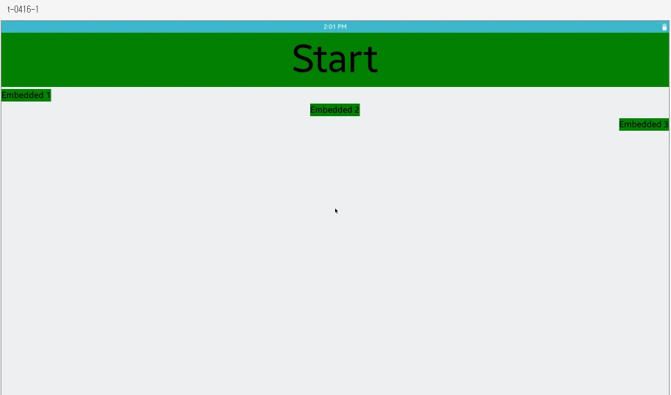

⇒ *결과*

---

## &lt;강의(C#)&gt;

### 예제 (1)

```xml
<?xml version="1.0" encoding="utf-8" ?>

<ContentPage xmlns="http://xamarin.com/schemas/2014/forms"
             xmlns:x="http://schemas.microsoft.com/winfx/2009/xaml"
             x:Class="TizenXamlApp7.MainPage">
    <ContentPage.Content>
        <StackLayout>
            <!-- StackLayout의 Orientation을 지정하지 않으면 default이므로, 수직적으로 쌓인다. -->
            <Label Text="Start" FontSize="200" HorizontalOptions="CenterAndExpand" BackgroundColor="Aqua"></Label>

            <!-- 여기서는 StackLayout의 Orientation을 Horizontal로 지정한다.
            따라서 이 Layout 내부에 속하는 것은 수평적으로 쌓이게 된다. -->
            <StackLayout Orientation="Horizontal">
                <Label Text="BigString" BackgroundColor="Red" FontSize="500"></Label>
                
                <!-- 다음 Label은 모두 VerticalOptions를 지정한다. (Start/Center/End) -->
                <Label Text="Em1" BackgroundColor="Green" VerticalOptions="Start"></Label>
                <Label Text="Embedded 2" BackgroundColor="Green" VerticalOptions="Center"></Label>
                <Label Text="Em3" BackgroundColor="Green" VerticalOptions="End"></Label>
                
            </StackLayout>
        </StackLayout>
    </ContentPage.Content>
</ContentPage>
```

본 코드의 결과는 어떻게 나오게 될까?

- 가장 상위의 StackLayout은 Orientation을 지정하지 않았으므로, default인 vertical이 된다.  
    따라서 해당 Layout 바로 아래에 있는 요소는 수직적으로 쌓이게 된다.

- StackLayout

    - (1) Label
    - (2) StackLayout

이 상태이므로, Label과 StackLayout은 서로 수직적으로 쌓여있다. 

- (1) Label

해당 Label에는 CenterandExpand라는 Option을 주었다. 이 경우, Text가 중앙에 오게 되며, 해당 Text의 크기 만큼 Aqua Background가 생기게 된다.

- (2) StackLayout

    - Label (3)
    - Label (4)
    - Label (5)
    - Label (6)

Orientation을 Horizontal로 설정하였으므로, Label이 수평적으로 쌓이게 된다. 이때 StackLayout의 세로 길이는 세로 크기가 가장 큰 내부 View 요소에 맞춰지게 된다.

(*이와 비슷하게 Orientation이 Vertical일 경우에는 StackLayout의 가로 길이는 가로 크기가 가장 큰 내부 View 요소에 맞춰지게 된다.*)

- (3) Label

별도의 추가적인 설정이 없으므로, FontSize 500으로 해당 StackLayout의 좌상단에 붙어서 표시된다. 이때, 해당 Label은 Orientation이 Horizontal인 StackLayout에 속하며, 내부 View 요소 중에서 세로 길이가 가장 크기 때문에 해당 요소가 세로 길이의 기준으로 설정된다.

- (4) Label

VerticalOptions가 Start이므로, 수직 옵션이 Start로 맞춰진다. 즉, (3) Label의 바로 옆에 만들어지고 수직 위치는 Start이다. (*이때, Text에 맞춰서 설정되고 BackgroundColor가 전체를 덮진 못한다.*)

- (5) Label

VerticalOptions가 Center이므로, 수직 옵션이 Center로 맞춰진다. 즉, (4) Label의 바로 옆에 만들어지고 수직 위치는 Center이다. 

> 만약 BackgroundColor가 해당 Label이 차지할 수 있는 전체 영역을 차지하도록 하고 싶다면, 다른 옵션을 선택해야만 한다. 현재는 VerticalOptions를 통해 Text가 중앙에 오도록 만들었지만, Text도 중앙에 오면서 전체 영역을 모두 색칠하고자 한다면 VerticalTextAlignment 옵션을 Center로 두고, VerticalOptions를 Fill로 둬야 한다.

> Label에서 VerticalOptions와 HorizontalOptions를 지정하지 않으면 두 옵션 모두 Start이다.

- (6) Label

VerticalOptions가 End이므로, 수직 옵션이 End로 맞춰진다. 즉, (4) Label의 바로 옆에 만들어지고 수직 위치는 End이다. 

> 이때 (4), (5), (6)의 세로 최대 크기는 옆에 있는 (3)의 크기를 넘지 못한다.

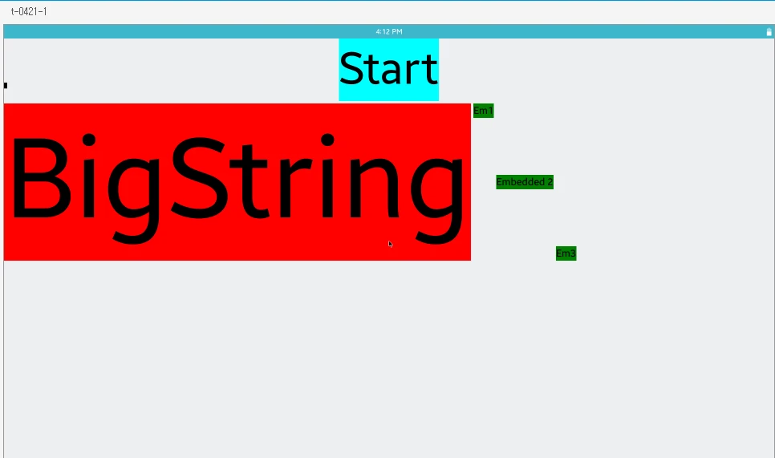

⇒ *이 경우, Start가 마치 BigString의 끝 부분에 정렬된 것처럼 보일 수도 있는데, 그렇지 않다.*

> 계속 활용하다보면, Tile Style로 만들어 나갈 수도 있다.

### 예제 (2) - Fill

> Fill 옵션은 Default이며, 내가 할당받을 수 있는 최대 영역을 모두 색칠하게 된다.

```xml
<?xml version="1.0" encoding="utf-8" ?>

<ContentPage xmlns="http://xamarin.com/schemas/2014/forms"
             xmlns:x="http://schemas.microsoft.com/winfx/2009/xaml"
             x:Class="TizenXamlApp7.MainPage">
    <ContentPage.Content>
        <StackLayout Orientation="Horizontal">
            <!-- -->
            <Label Text="BigString" BackgroundColor="Red" FontSize="500"></Label>
            <Label Text="Em1" BackgroundColor="Green" VerticalOptions="Start"></Label>
            <Label Text="Embedded 2" BackgroundColor="Green" VerticalOptions="Center"></Label>
            <Label Text="Em3" BackgroundColor="Green" VerticalOptions="End"></Label>
            <Label Text="Fill!!" BackgroundColor="Green" VerticalOptions="Fill"></Label>
        </StackLayout>
    </ContentPage.Content>
</ContentPage>
```

- (1) StackLayout

    - (2) Label
    - (3) Label
    - (4) Label
    - (5) Label
    - (6) Label

- (1) StackLayout

Orientation이 Horizontal로 설정되었으므로, 모든 View 요소들이 수평적으로 쌓이게 된다.

- (2) Label

Bigstring은 별도의 VerticalOptions나 HorizontalOptions가 없으므로 Fill 상태이다. VerticalTextAlignment와 HorizontalTextAlignment는 모두 Start이다. 정리하자면, StackLayout의 Orientation이 Horizontal이기 때문에 아무것도 건드리지 않을 경우 Label은 자신이 차지할 수 있는 최대의 Height를 갖게 되고, Width는 내부 Text의 길이에 맞춰진다.

> Label에 아무런 옵션도 주지 않을 경우 기본 옵션은 Fill이다.   
>   
> 만약 Label이 포함된 StackLayout의 Orientation이 Horizontal이라면 Label의 Height는 최대가 되고, Width는 내부 Text의 크기에 맞춰진다.  
>   
> 만약 Orientation이 Vertical이라면 Label의 Width는 최대가 되고, Height는 내부 Text의 크기에 맞춰진다.

- (3), (4), (5) Label

각 Label은 모두 StackLayout의 Orientation이 Horizontal인 View 요소이며,  VerticalOptions가 Start, Center, End이기 때문에 시작, 중앙, 끝 부분에 위치한다. VerticalOptions 또는 Horizontal Options를 지정할 경우 Fill Option은 사라지기 때문에 정렬된 부분에서만 BackgroundColor가 존재한다.

- (6) Label

VerticalOptions가 Fill이기 때문에 BackgroundColor가 전체 영역을 채운다.

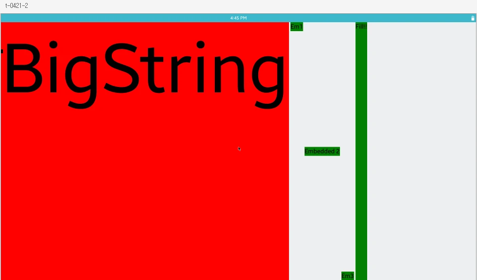

### 예제 (3) - Fill

> 이번에는 StackLayout의 Orientation을 Vertical로 설정해보자.

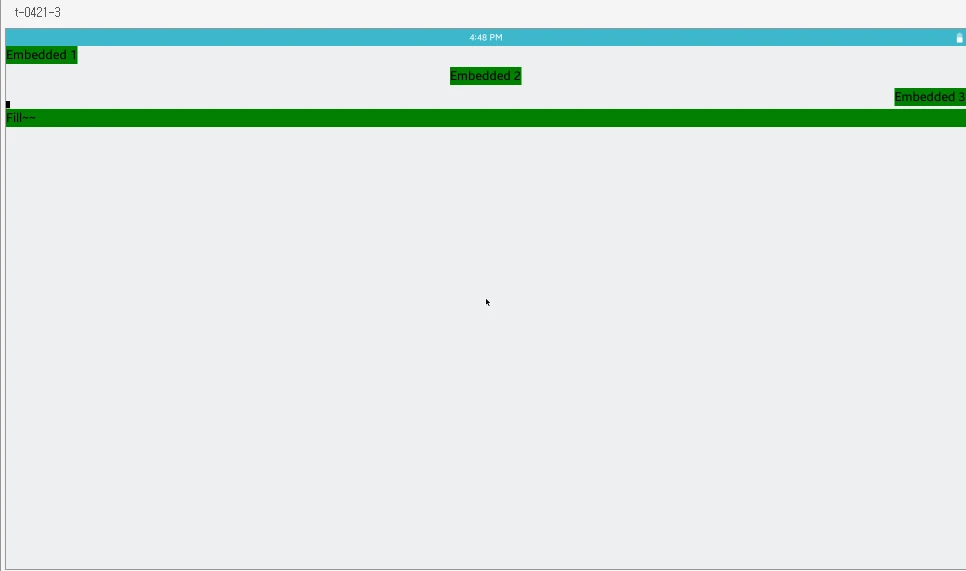

### 예제 (4) - Expand

VerticalOptions, HorizontalOptions에 Expand를 붙일 수 있다.

```xml
<?xml version="1.0" encoding="utf-8" ?>

<ContentPage xmlns="http://xamarin.com/schemas/2014/forms"
             xmlns:x="http://schemas.microsoft.com/winfx/2009/xaml"
             x:Class="TizenXamlApp7.MainPage">
    <ContentPage.Content>
        <StackLayout Orientation="Vertical">
            <!-- -->
            <Label Text="Embedded 1" BackgroundColor="Green" HorizontalOptions="Center"></Label>
            <Label Text="Embedded 2" BackgroundColor="Green" HorizontalOptions="Center"></Label>
        </StackLayout>
    </ContentPage.Content>
</ContentPage>
```

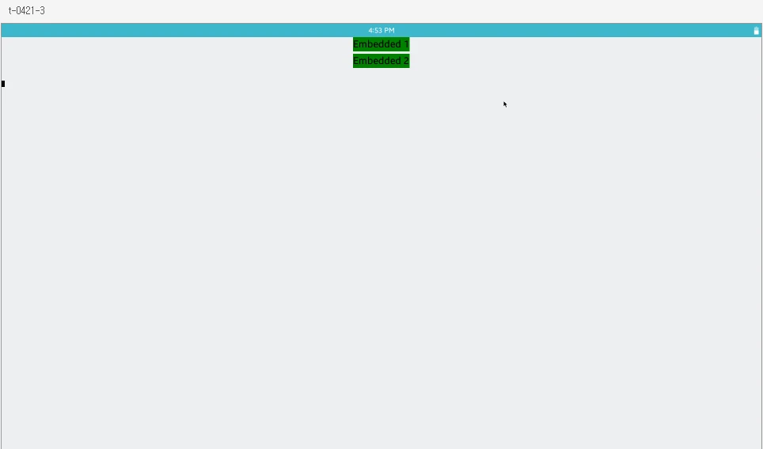

이 상황에서 코드를 일부 추가해보자.

```xml
<?xml version="1.0" encoding="utf-8" ?>

<ContentPage xmlns="http://xamarin.com/schemas/2014/forms"
             xmlns:x="http://schemas.microsoft.com/winfx/2009/xaml"
             x:Class="TizenXamlApp7.MainPage">
    <ContentPage.Content>
        <StackLayout Orientation="Vertical">
            <!-- -->
            <Label Text="Embedded 1" BackgroundColor="Green" HorizontalOptions="Center" VerticalOptions="Center"></Label>
            <Label Text="Embedded 2" BackgroundColor="Green" HorizontalOptions="Center" VerticalOptions="Center"></Label>
        </StackLayout>
    </ContentPage.Content>
</ContentPage>
```

⇒ VerticalOptions를 추가해 보았다.

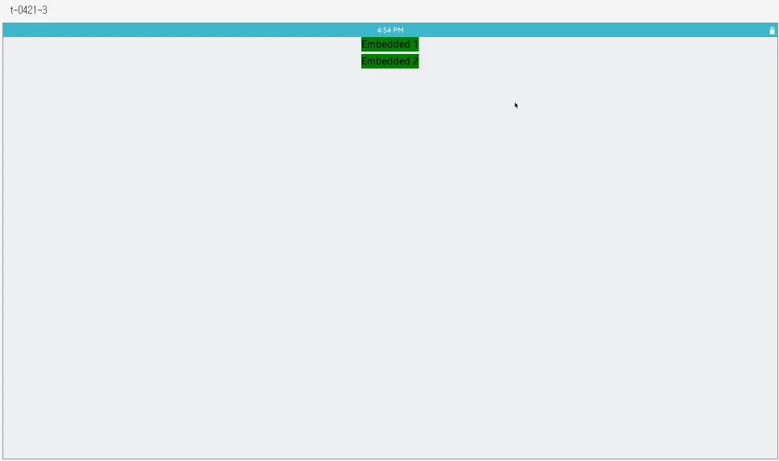

⇒ 그러나 변화가 없는 것을 알 수 있다. 그 이유는, 단순히 Start, Center, End를 적용하기만 하면 현재 View 요소가 차지하고 있는 영역 안에서 정렬된다. 그런데 이 경우 StackLayout의 Orientation이 Vertical이므로, 각 View 요소는 자신의 Height를 넘어서는 영역을 가질 수는 없게 된다.

그런데 여기서 Expand 옵션을 적용한다면, 자신의 Height를 넘어서서 다른 View 요소와 적절하게 공간을 나눠 가질 수 있게 된다.

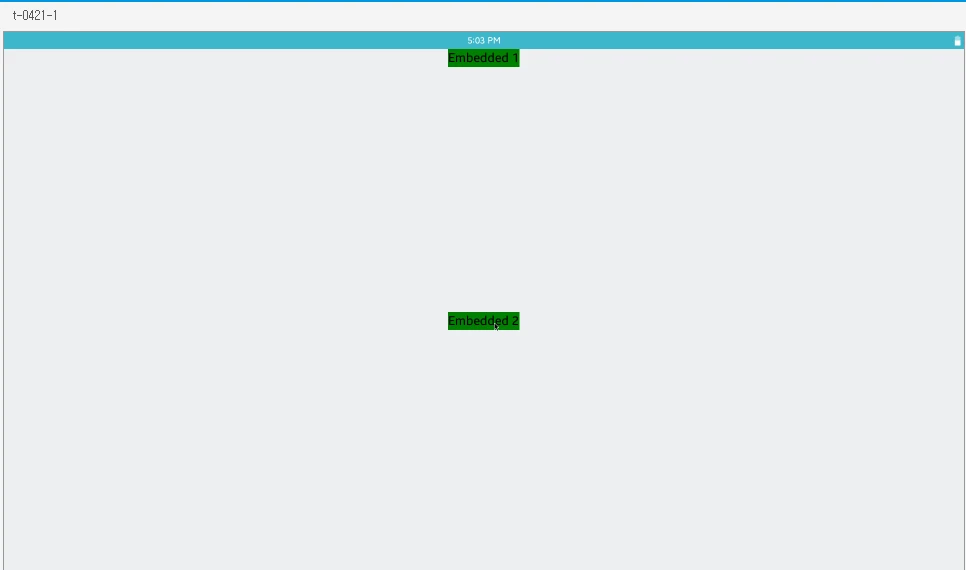

⇒ 이번에는 두 개의 Label에 모두 CenterAndExpand 옵션을 주면, 다음과 같이 나온다.

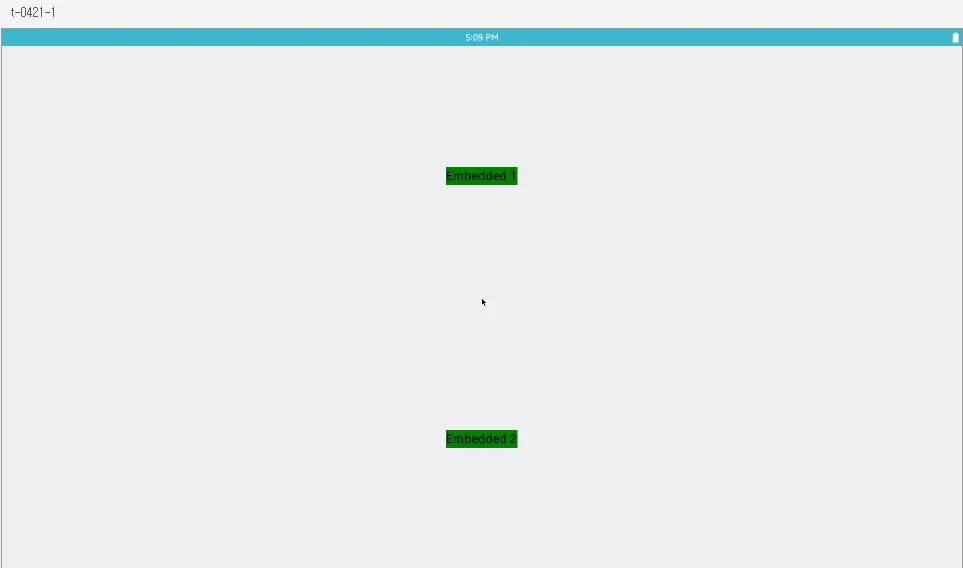

⇒ 이번에는 세 개의 Label을 만들고 가운데 Label에만 CenterAndExpand 옵션을 줘보자.

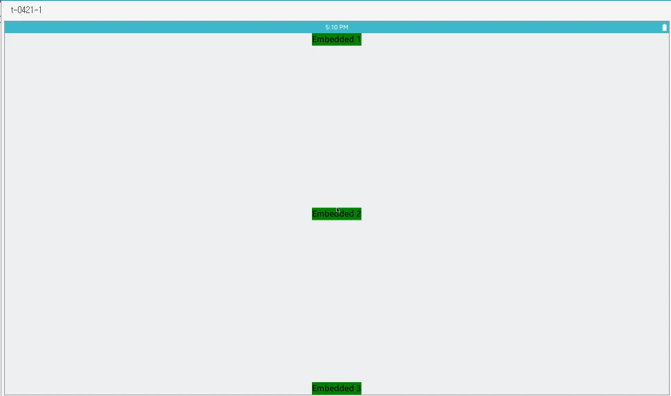

이와 같은 결과가 나온다. 나는 세 개가 모두 붙어있을 것이라고 예상했는데, 확대될 수 있는 여지가 있다면, 무조건 확대하는 것으로 보인다.

- 그렇다면 여기서 가운데 옵션은 StartAndExpand, EndAndExpand로 바꾸면 어떨까?

    - StartAndExpand

        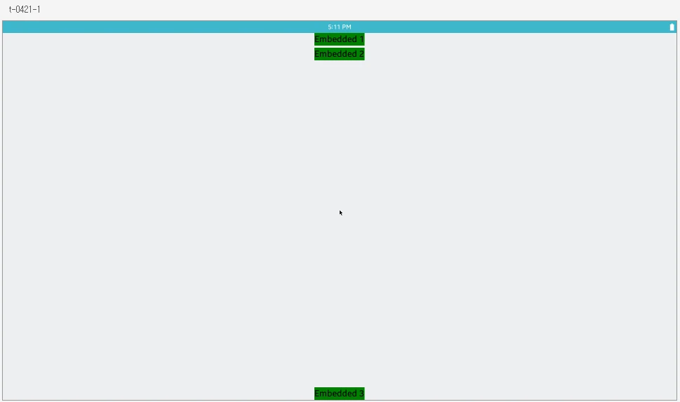

    - EndAndExpand

        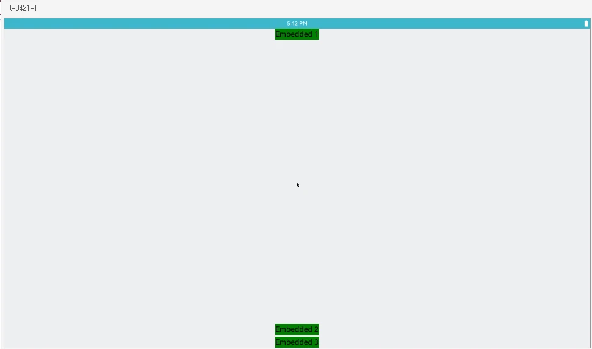

> 이를 통해 잠정적으로 결론을 내려보고자 한다. \~AndExpand 옵션이 붙는다면, 우선 가장 먼저 해당 방향으로 확장할 수 있는 만큼 길이를 확장하게 된다. 그 상태에서 만약 AndExpand 옵션을 공유하는 것이 있다면 공간을 나눈다.

### 예제 (4) - FillAndExpand

> VerticalOptions, HorizontalOptions를 지정하지 않을 경우 Fill이 Default이다.  
> Fill은 칸을 정해주고, AndExpand는 남은 공간을 어떻게 할지를 결정한다.

```xml
<?xml version="1.0" encoding="utf-8" ?>

<ContentPage xmlns="http://xamarin.com/schemas/2014/forms"
             xmlns:x="http://schemas.microsoft.com/winfx/2009/xaml"
             x:Class="TizenXamlApp7.MainPage">
    <ContentPage.Content>
        <StackLayout Orientation="Vertical">
            <!-- -->
            <Label Text="Embedded 1" BackgroundColor="Green" HorizontalOptions="Fill" VerticalOptions="FillAndExpand"></Label>
            <Label Text="Embedded 2" BackgroundColor="Green" HorizontalOptions="Fill" VerticalOptions="FillAndExpand"></Label>
        </StackLayout>
    </ContentPage.Content> 
</ContentPage>
```

⇒ StackLayout의 Orientation이 Vertical 일 때, Label의 HorizontalOptions는 Fill이고, VerticalOptions는 FillAndExpand이다. 따라서 두 Label이 화면을 절반씩 채우며, Text는 각 Label의 Start 위치에 자리잡고 있을 것이다. (Guess)

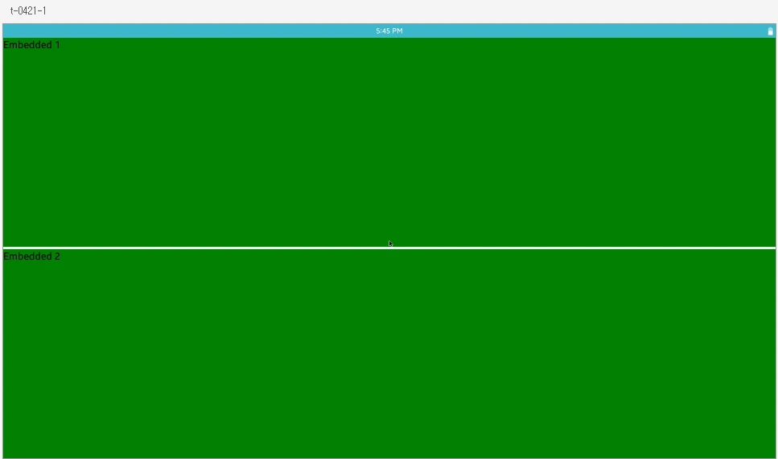

⇒ 올바른 결과가 나온 것을 알 수 있다.

참고로, VerticalOptions=”FillAndExpand”로 하지 않고 Fill만 줄 경우, Vertical 방향으로는 확장되지 않아 Horizontal 방향으로 쭉 긴 두 개의 Label이 나온다.

> Q. 그렇다면 Fill과 AndExpand 옵션을 혼합하여 사용할 수는 없는 것인가?  
> ⇒ ~~TextAlignment에 AndExpand 옵션이 없으므로 사실상 불가능하다고 봐야 함. 그렇다면 다른 방법으로 구현은 불가능한가?~~  
> ⇒ 아니다. FillAndExpand Option이 있다.  
>   
> Q. AndExpand가 중간에 다른 것으로 가로막혀 있다면 어떻게 될까?  
> ⇒ 막혀있는 부분을 뚫지 못하고 그 사이 공간을 차지하게 될 것으로 보인다.

### 예제 (5) - Label의 위치 확인

```xml
<Label Text="Em1" BackgroundColor="Green" HorizontalOptions="Center" VerticalOptions="Start\">
<Label Text="Em2" BackgroundColor="Green" HorizontalOptions="Center" VerticalOptions="Center\">

<Label Text="Em1" BackgroundColor="Green" HorizontalOptions="Center" VerticalOptions="Fill\">
<Label Text="Em2" BackgroundColor="Green" HorizontalOptions="Center" VerticalOptions="Center\">

<Label Text="Em1" BackgroundColor="Green" HorizontalOptions="Center" VerticalOptions="FillAndExpand\">
<Label Text="Em2" BackgroundColor="Green" HorizontalOptions="Center" VerticalOptions="Center\">

<Label Text="Em1" BackgroundColor="Green" HorizontalOptions="Center" VerticalOptions="FillAndExpand\">
<Label Text="Em2" BackgroundColor="Green" HorizontalOptions="Center" VerticalOptions="FillAndExpand\">

<Label Text="Em1" BackgroundColor="Green" HorizontalOptions="Fill" VerticalOptions="FillAndExpand\">
<Label Text="Em2" BackgroundColor="Green" HorizontalOptions="Fill" VerticalOptions="FillAndExpand\">
```

### Label 옵션

- TextColor
- LineBreakMode
- FormattedText: 텍스트 정렬
- Scrollview, Gridview
