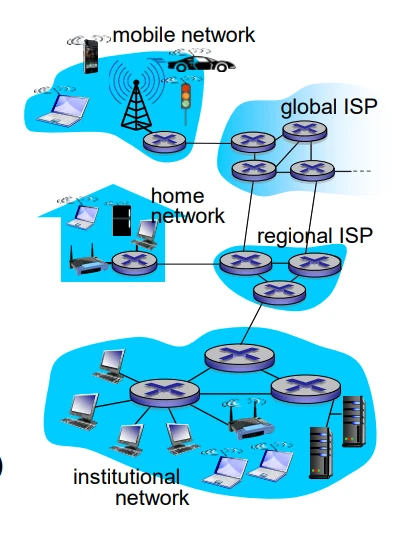
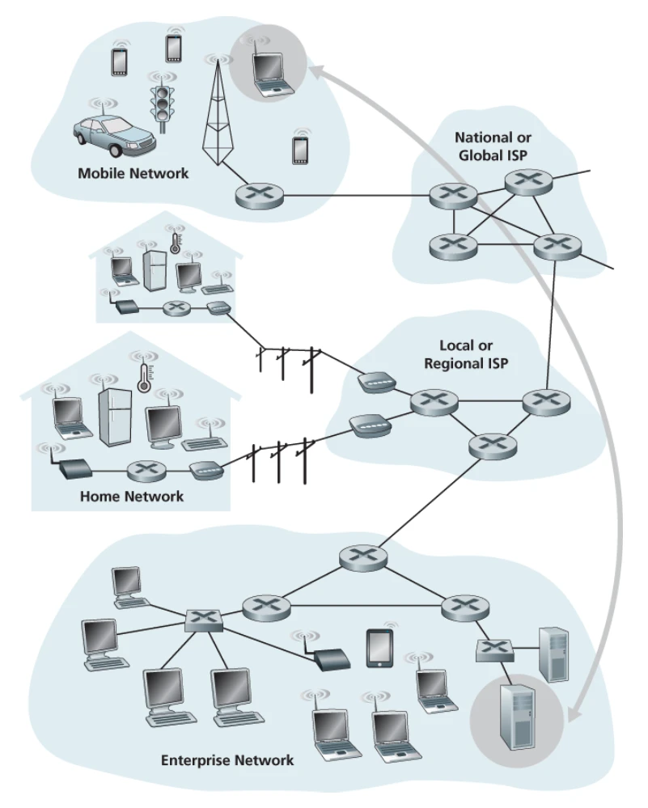
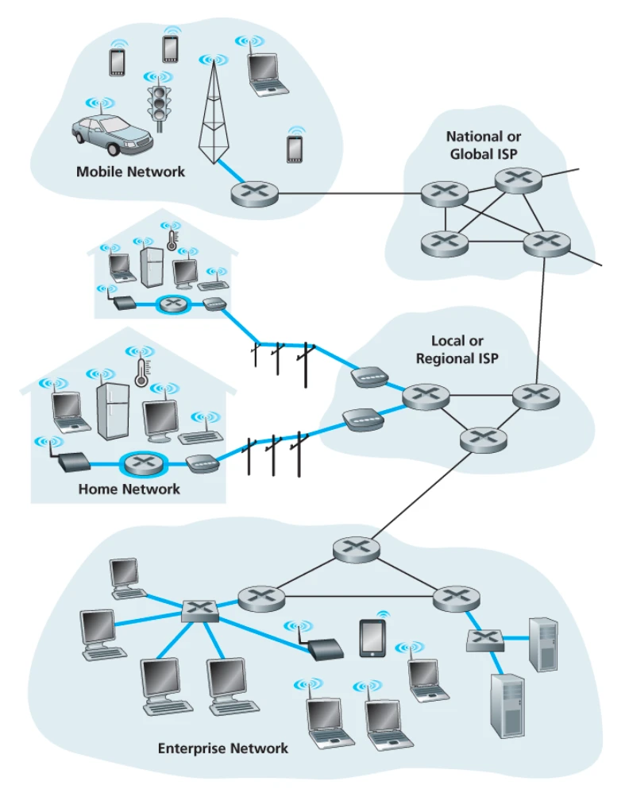
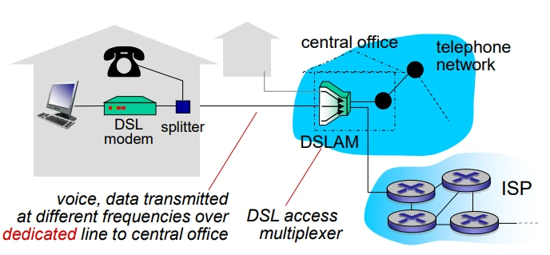
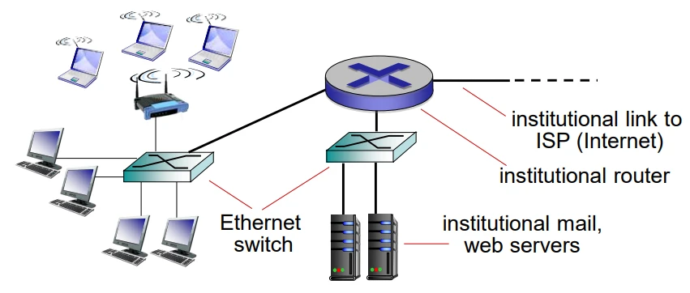
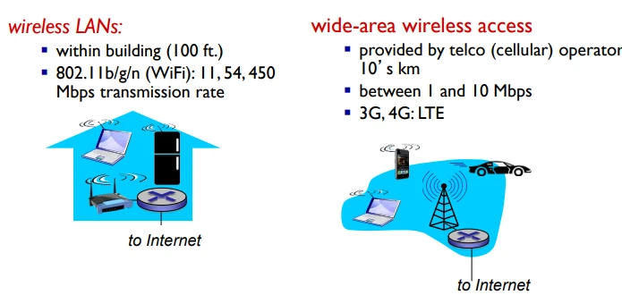
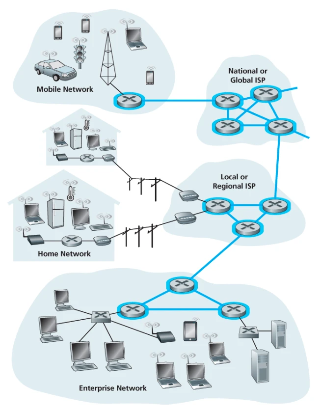
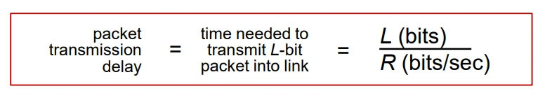

# Network의 기본 구성요소

> **네트워크**란?  
> 통신할 수 있는 두 개 이상의 기기들이 interconnect 되어서 서로 데이터를 주고 받는 것. 네트워크 프로그래밍은 서로 다른 기기에서 Protocol을 맞춰서 tight하게 작성해야 한다.  
>   
> 네트워크 프로그래밍은 Application Software를 다룸에도 불구하고, 기본적으로 TCP/IP를 다루며, 이것은 System Software에서 처리된다.

## &lt;Overview&gt;

- **1.1 What is Internet?** : 인터넷은 **Network of Networks**라는 뜻으로, 네트워크 간의 네트워크 라는 의미를 가진다. ⇒ 인터넷, 네트워크를 다 뜯어보면 Protocol로 이루어져 있다.

    - Internetwork : 독립적인 여러 개의 네트워크를 연결한 것. (전세계의 모든 네트워크를 연결)
    - Intranetwork : 조직, 기관 내에서의 단말기들끼리 서로 연결된 것. (지역적 네트워크) 

- **1.2 Network Edge** 
- **1.3 Network Core**
- **1.4 Peformance** : 사용자가 느끼는 네트워크 통신 속도. Packet Loss, Packet Delay 등의 정량적 평가를 의미한다. (즉, Metric들에 대한 평가) ⇒ **Throughput** 산출 가능
- **1.5 Protocol Layers, Service Models**
- **1.6 Network under attack: security**
- **1.7 History**

---

## &lt;Host & Router&gt;

### Internet

인터넷의 구성요소를 나타낸 그림

**Internet**은 **Network of Networks**이다.  
  
전세계적으로 수십억 개의 컴퓨팅 장치를 연결하는 컴퓨터 네트워크이다.

### Host(End System)

> **일반적인 사용자가 인터넷을 사용하는 시스템**을 **Host**(**End system**)라고 한다.  
> **Host**는 **Application**들이 실행되어 **네트워크를 사용하는 시스템**이다.  
> (Peer, Server, Client라고 불리기도 한다.)  
>   
> 예를 들어 **Labtop**은 인터넷을 사용할 수 있는 시스템이기 때문에 **Host**이자 **End system**이다. 또한 호스트가 인터넷에 연결 가능한 방법은 매우 다양하다. (유선 연결, 무선 연결 등)  
>   
> **Host는**  **Communication Link**와 **Packet Switch**의 네트워크로 연결된다.

- **Server** : **Host**(**End system**) 중의 하나이며, 특정 **Host**가 **Server**(Host)에 접속하려면, 서버와 직접 연결되어 있지 않기 때문에 돌아서 가야만 한다. 

    - 이런 경우, 내가 속한 네트워크와 연결된 다른 네트워크와 통신하면서 도착할 수 있는 경로를 찾게 되는데, 이때 거치게 되는 것이 **Router**이다.

> **Band Width**(Transmission Rate, 링크 대역폭 또는 전송률)  
>   
> 전송률의 단위는 **bps**(bits per second, 초당 비트 수)이다.
>
> **Communication Link**의 **Band Width**는 마치 파이프와 같다.  
> 데이터를 전송하는 Link의 직경이 크면, 데이터의 전송 속도는 커진다. (**Data Rate**  **상승**)반대로 직경이 작으면, 데이터의 전송 속도는 감소한다. (**Data Rate**  **감소**)  
>   
> 동축케이블, 구리선, 광케이블, 라디오 스펙트럼을 포함한 다양한 물리 매체로 구성된다.

### Packet

> **송신 종단 시스템**에서, **수신 종단 시스템**으로 보내지는 데이터.

- 송신 종단 시스템이 보내고자 하는 데이터를 Segment로 나누고, 각 Segment에 헤더(Header)를 부착하여 수신 종단 시스템으로 전송한다.
- 패킷은 목적지에서 원래의 데이터로 다시 조립된다.

### Router

> **Router**(라우터)란, **Host가 아니면서** Host의 실행이 가능하도록, **pakcet을 목적지까지 전달**해 주는 존재를 말한다. 

- **Network Level** : Router

- **Local Level** : Switch(Hub)

- 똑같이 Switching을 하더라도 **Network Level**에서 사용되면 **Router**이고 **Local Level**에서 사용되면 **Switch**라고 한다. 
- **Router**는 Network 상에서 **Packet**을 **전송할 경로**를 **찾아내는 역할**이고, **Swtich**는 **다른 역할**을 한다.
    

> 인터넷은 **Router** + **DNS**라고 봐도 무방하다.

### **Protocol(프로토콜)**

> TCP, IP, HTTP, Skype, 802.11 등, 모든 것이 네트워크에서 사용되는 약속인 **프로토콜**이다.  
> **프로토콜**이란, 인터넷에서 **정보의 송수신을 제어하는 규약**을 말한다.

- **프로토콜이 필요한 이유**

    네트워크 통신은 혼자서 하는 것이 아니라, 반드시 상대방이 있어야 한다. 따라서 프로토콜을 사용하여 서로 통신 규칙을 정해야만 한다.

    **프로토콜**은 각각의 **Field**마다 **정해진 형식**으로 **정의**가 필요하다. (메세지의 순서, 행동 등)  
메세지를 받기만 하면 의미가 없고, 이에 대한 유의미한 Action이 필요하다.

### Hop

> **홉**(hop)은 컴퓨터 네트워크에서 출발지와 목적지 사이에 위치한 경로의 한 부분이다. 데이터 패킷은 브리지, 라우터, 게이트웨이를 거치면서 출발지에서 목적지로 경유한다. 패킷이 다음 네트워크 장비로 이동할 때마다 홉이 하나 발생한다. **홉 카운트**(hop count)는 데이터가 출발지와 목적지 사이에서 통과해야 하는 중간 장치들의 개수를 가리킨다.

### **Internet As Service**

- Application Programming Interface(Socket)를 제공하는 Infrastructure이다.

---

## &lt;Network Edge&gt;

네트워크의 구성 요소 간의 상호작용을 표현한 그림

### **Network Edge**(네트워크 엣지)

> 네트워크 가장 끝 쪽에 존재하며, Application을 실행하는 **Host**들이 존재하는 부분.

- **Host**(Edge Device)와 **Router**(Access Router)로 구성되며, Network Edge에 존재하는 Host는 **Client** 또는 **Server**이다.

- Host는 다음과 같은 방식을 통해 통신한다.

    - **TCP**(Transmission Control Protocol) : Packet의 전달을 보장하는 방식
    - **UDP**(User Datagram Protocol) : Packet의 전달을 보장하지 않는 방식

### **Access Network**(액세스 네트워크)

> 한 End System과 먼 거리에 위치한 다른 End System까지를 잇는 경로 중에서 첫 번째 Router.  
> 즉, **Edge Router**에 **연결**하는 **Network**를 말한다.

Access Network의 예시(굵은 선)

- 네트워크에 접근하기 위한 네트워크로서, End System들이 인터넷을 사용할 수 있도록 길을 열어주는 네트워크이다. (그 연결 자체를 Access Network라고 부름.)
- 스마트폰에서 와이파이에 접속하거나 PC에 랜선을 꼽는 것 모두 **Access Router**를 통해서 **Access Network**에 접속하는 것이다.
- 위의 이미지에서 굵은 선으로 표현한 것이 더 큰 Network로 연결해 주는 Access Network.

- 액세스 네트워크의 종류 다음과 같은 것들이 있다.

    - 가정 접속 : **DSL**, **Cable Network**,  
    - 기업(그리고 가정) 접속 : **Ethernet, Wireless Access Network**
    - 광역 무선 접속 : **3G**, **LTE 4G**, **5G**

### Access Network의 대표적인 예시

- **DSL**(Digital Subscriber Line), 가정 접속의 대표적인 예시

    

    - 과거에는 전화선을 사용해서 인터넷 연결을 시도했다. 그래서 인터넷 사용 중에 전화선을 사용하면 인터넷이 끊기곤 하였다. 이 문제를 해결하기 위하여 DSL이 적용되었다.
    - DSL은 Spliter라는 것을 사용하여 **Band Width를 나누고**, voice와 data가 동시에 전송되도록 만들어 병렬 처리가 되도록 했다.

- **Ethernet**(Enterprise Access Networks)

    

    - Institutional Network에서 여러 개의 디바이스의 요청을 처리하기 위해서 처리해주는 Hub가 존재하는 Access Network

- **Wireless Access Networks**

    

    - Broadcast Media(무선) ⇒ 장, 단점이 존재한다.

    - Wireless LAN (Wifi) 

        - MIMO(Multiple Input Multiple Output)

            - 안테나의 세기와 방향을 조절하여 데이터를 전송할 수 있는 방식

        - Wifi는 인터넷과 연결되어 있어야 함.
        - **DHCP**  : 무선 AP(Access Point, 공유기)에는 모두 있는 기능으로, 인터넷에 새롭게 연결될 때마다 Device에 IP를 할당하는 기능.

> **Edge Device**(Host, End system)가 어떻게 가까운 Edge Router에 연결될 수 있는 것일까?  
> ⇒ 즉, Network Edge에 속하는 Host가 어떻게 Edge Router에 연결될 수 있는 것일까?

Access Network의 예시(굵은 선)

1. **Residential ISP**(Home Network)

2. **Institutional ISP**(기관 내의 망)

    - 기관 안에서의 망은 Private IP를 사용, 따라서 외부로 드러나지 않아 외부에서 접속이 불가능하다는 특징이 있다.

    - 인터넷을 하려면 연결된 Host는 Unique한 IP Address를 가져야만 한다. (**DHCP**)

        - 그렇다면, Private IP는 왜 같을 수 있을까?

        ⇒ Home Network, Institutional ISP에서 사용하는 IP는 절대 드러나지 않는다.  
내가 서버에 요청을 하게 되면, **NAT**(Network Address Transition) 기술을 사용해서 Private IP도 구분이 가능해져서 응답을 받을 수 있다

3. **Mobile Network**(Mobile ISP) : 4G, LTE, 5G 등의 무선 통신 기술을 활용해 **Edge Router**에 연결.

> 이와 같이 다양한 디바이스가 Network Core에 연결될 수 있도록 유/무선 기술을 지원하는 Access Network가 존재하기 때문에, End System들이 Edge Router로 연결될 수 있고, 결과적으로 다른 End System과 통신이 원활히 가능해진다.

---

## &lt;**Network Core**(네트워크 코어)&gt;

> **Network Edge**와 **Network Edge**는 서로 직접 연결할 수 없기 때문에 중간에 연결해 주는 부분이 반드시 필요하다. **Network Core**는 이러한 Network Edge를 이어주는 Router로만 구성된 Network를 말한다.

Network Core의 예시(굵은 선)

### Network Core

> **Network Core**의 **역할**은 오직 **Destination**까지 **Packet을 전달**해 주는 역할이다.  
> Network Core에는 오직 **Router**들만 존재하며, 따라서 오직 Router들만 존재하는 Network를 Network Core라고 할 수 있다.

- **Network Core**에서 Packet을 전달하는 통신 방식은 다음과 같다.

    - **Circuit Switching**

    - **Packet Switching** ⇒ Packet을 교환하는 방식

        - **Forwarding** : 라우터의 input으로 들어오는 packet을 올바른 output으로 보내는 기능으로서, Router에 존재하는 **Forwarding Table**을 참조하여 결정한다.
        - **Routing** : Packet이 어디로 갈지 판단하는 과정이며, Forwarding Table을 만드는 과정이라고 볼 수 있다. **Routing 알고리즘**으로 판단한다.

### Packet Transmission Delay

- Host는 데이터를 packet이라는 작은 데이터 단위로 나누어 이를 전송한다.

    - packet은 L bits로 구성된다. (bits)

    - packet을 Access Network로 전송하는 속도(transmission rate)를 R이라 하자. (bits/sec)

        ⇒ 이때 Host와 Switch(혹은 Router)를 연결하고 있는 Link에서의 전송 속도를 transmission rate라고 하고, 다른 말로는 capacity, link band width라고도 한다.

⇒ L bits의 Packet을 전송하는데 필요한 지연 시간(delay)은 L을 R로 나눈 값이다.
