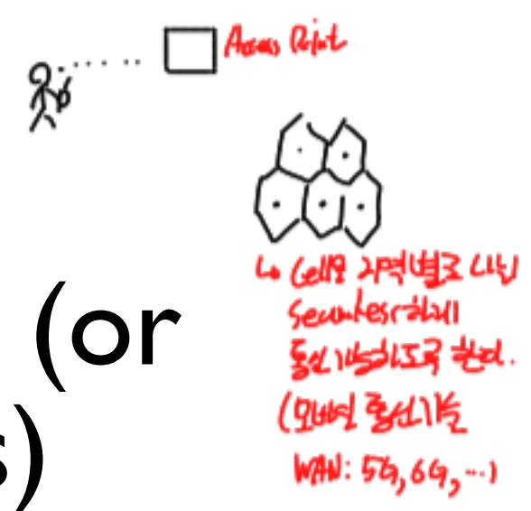
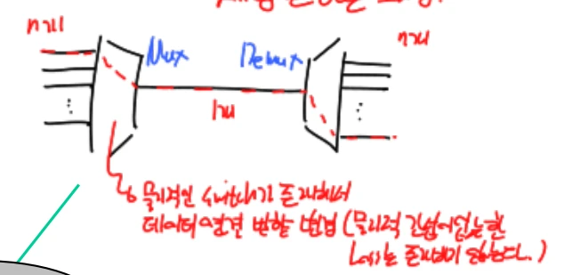
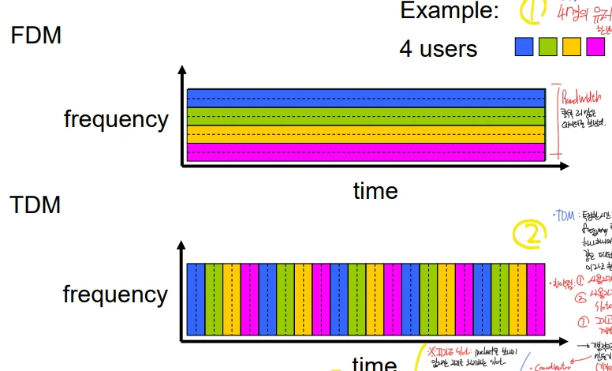
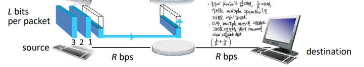
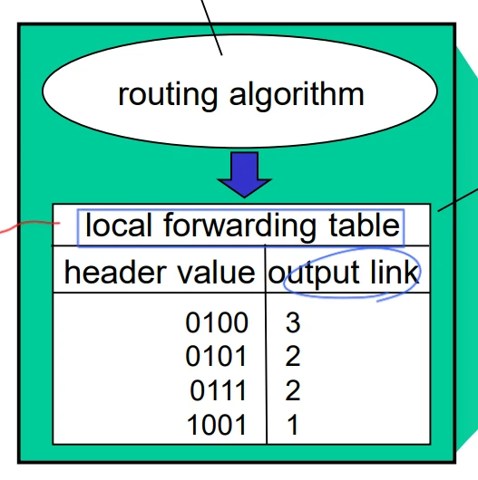
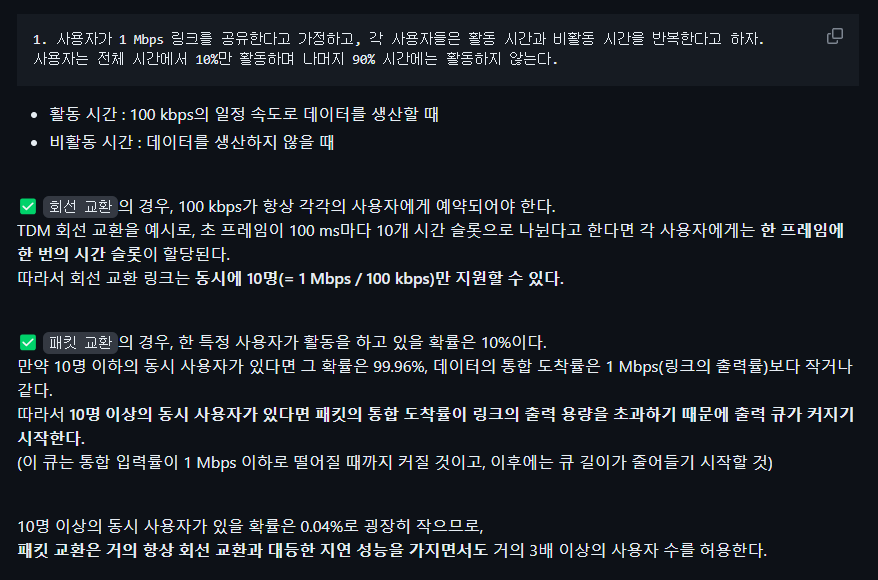

# Media Example & Network Core

## &lt;Media Example&gt;

> 네트워크 통신을 지원하는 매체는 유선 연결과 무선 연결이 존재한다.

### **Guidied Media(유선  매체)**

- Copper : 구리선

- Fiber : 광섬유 

    - 빛을 통해 데이터를 전송하는 유선 매체이다. 
    - 전자기적 노이즈에 취약하다는 단점이 있다.

- Coax : 콕스 케이블

    -  전송 속도가 높은 유선 매체이며, Shield가 존재해서 내구성을 강화한 형태이다. 
    - Shield로 인해 접히지 않는다는 특성이 있어서 최근에는 잘 사용되지 않는다.

- Twisted Pair(TP) 

    - **내구성 증대**를 위해 내부의 전송선을 꼬아놓은 유선 매체이다. 
    - 유선 연결은 noise를 잘 타기 때문에 **twist**를 함으로써 **impedence가 높아지게 되므로**, **compensation**(보완, 보정)이 가능하다.

### **Un-guided Media(무선 매체)**

> 무선 통신은 일반적으로 **전파거리**로 구분한다.  
>   
> 무선 데이터의 경우, 데이터가 튕겨서 들어오는 경우가 존재하기 때문에 **Duplicated** 문제를 처리해야만 한다.

- Terrestrial Microwave 

    - 지역/국가를 넘어 초장거리 통신이 가능한 매체

- LAN(e.g., WiFi) 

    - Local한 Area를 커버하는 Network 통신 기술

- Wide-Area(e.g., cellular) 

    - LAN보다 넓은 범위의 Area를 커버하는 통신 기술. 
    - Cellular는 지역별로 Cell을 나눠 Seamless하게 통신 가능하도록 만든 기술이다. WAN에는 5G, 6G 등의 기술이 포함된다.

    

- Satelite

- WPAN(Wireless Personal Area Network) 

    - 한 사람에 대해서 커버할 수 있는 무선 네트워크 기술을 일컫는 용어

        - Bluetooth 

            - 2000년대 초반에 나온 기술로, 한 사람을 커버할 수 있는 범위에서 무선 통신하는 방식.
            - 최근에는 BLE(Bluetooth Low Energy)로 사용되고 있다.

        - Zigby : Low Consumption/Many Peer 기능을 지원하는 근거리 무선 통신

---

## &lt;Network Core (Cont.)&gt;

- **Network Edge에는 무엇이 존재하는가?**

    - Internet에 연결될 수 있는 모든 장비들이 존재
    - Network를 사용하는 이유는 Edge끼리 통신하기 위해서이다.

> 그런데, 아무리 Network Edge가 갖추어져 있어도 Network Core가 없다면 다른 Network Edge와 통신할 수 없다.

***Q. 만약 Internet에 Network core가 없다면 어떻게 되는가?***

> “**왜 Network Core가 없으면 멀리까지 통신하는 것이 불가능한가?”**  
>   
> Network Core가 없다면 Network Edge에 존재하는 Host는 자신이 보낼 Host와 모두 유선 연결이 되어 있어야 하며, 각각이 어디에 존재하는지 모두 알 수 있어야 한다.   
>   
> 모든 Host가 모든 Host와 물리적으로 연결되고 모든 Host에 대한 정보를 갖는 것은 **현실적으로 불가능**하므로, 중간 중간에 위치하는 Network Core를 통해서 Destination까지 최적의 경로를 찾아가도록 하는 것이다.

⇒ 각각의 **Host**는 **Network Edge**에 존재하는 **Access Network**(Access Router)를 거쳐서 **Network Core**에 **Packet**을 **전송**하게 된다. 그러면 **Network Core**에 존재하는 **Router**들은 그때그때 네트워크의 상황을 분석하면서 **Routing 알고리즘**을 통해 **전송 경로**를 정하게 된다.

### **Circuit Switching**

> 디바이스를 연결한 네트워크에 물리적인 Switch가 존재해서, 데이터 통신을 원하는 경우 Mux를 조작해 데이터를 연결하는 방향을 변경하고 정해진 방향으로만 데이터를 주고 받는 통신 방식.  
> Circuit Switching을 하기 위해서 사전 준비 단계인 **Call Setup**이 필요하다.

- **Call Setup** : Circuit Switching을 하기 위해 필요한 과정으로, 실제 데이터(Packet)가 가지는 않고데이터를 전송하기 위해 필요한 세팅을 하는 과정이다. 

    - 이를 통해 데이터를 보내기 전에 Destination이 실제로 존재하는지 검사하고, 이후 확정되면 통신을 시작한다.

    - Circuit Switching을 사용할 경우, 물리적 간섭이 없는 한, **Loss**와 **Delay**는 존재하지 않는다. 그러므로 성능을 어느정도 보장할 수 있다.

        - 즉, **모든 Packet이 똑같은 Delay를 통해 전달**된다.

    - Circuit Switching을 사용할 경우, Resource Sharing이 매우 어렵다.

        - 이러한 한계를 극복하고자 **Multiplexing**을 도입

            - **FDM**(Frequency Division Multiplexing)
            - **TDM**(Time Division Multiplexing)

### FDM(Frequency Division Multiplexing) & TDM(Time Division Multiplexing)

> FDM과 TDM은 Circuit Switching에서 Resource Sharing을 구현하기 위해 도입한 두 가지 방법이며, 각각 주파수와 시간을 나눠 통신을 하게 된다.  
> 아래의 예제는 네 명의 유저가 동시에 데이터를 전송하려는 상황을 가정한 예제이다.

- **FDM**

    > 여러 유저가 동시에 데이터를 전송할 때, 주파수를 나눠서 동시에 여러 데이터를 전송하는 방식이다.

    - 한 번에 데이터를 보낼 수 있는 양이 감소하기 때문에 전송 속도가 줄어든다.

    - 주파수를 나누기 위해서 모든 Host에 **추가적인 H/W 장치**가 필요하다.

        > 실질적으로 인터넷에서는 사용이 불가능하며, 거의 무선통신에서 사용된다.

- **TDM**

    > 여러 유저가 동시에 데이터를 전송할 때, 시간대를 나눠 한 유저가 자신에게 할당된 시간에 모든 frequency를 사용하도록 하는 방식이다.

    - 하나하나의 조각을 **Slot**이라고 하고, 같은 패턴이 반복되는 곳을 **Frame**이라고 한다.
    - 사용자가 적을 때는 효과가 좋지만, 사용자가 많아지면 한 유저에게 돌아가는 Slot이 적어지기 때문에 효과가 떨어진다.

    - 인터넷은 사용자가 가변적인 환경이다. (Nomadic)

        - 사용자가 가변이기 때문에 유저가 너무 많아지면, 한 유저가 데이터를 너무 오랫동안 보내지 못하는 Starvation이 발생할 수도 있음.

    - 기본적으로 TDM은 Frame을 만들기 위한 추가적인 Device(H/W)가 필요하다.
        (각각의 유저에게 Slot을 할당하는 역할)

    - 그리고, 통신에 참여하는 각각의 유저가 자신의 Slot을 보내는 타이밍이 모든 유저와 synchronize가 되어야 하는데, 그게 매우 어렵다.
    - TDM은 Bluetooth에 주로 사용되는데, Bluetooth는 Master/Slave 구조이기 때문에 통신에 참여하는 유저들을 관리하기가 쉬워 Slot 재할당과 Synchronization이 간편하다.
        ⇒ 그러나 인터넷에는 적용하기 어렵다.

    - Idle Slot

        - packet을 보내지 않지만 자리를 차지하게 되는 Slot.

> 이러한 이유 때문에 FDM, TDM은 Circuit Switching에서 Resource Sharing을 위해 사용할 수 없다. 그러므로 Packet Switching을 사용한다.

### **Packet Switching**

> Host가 Application-Layer의 메세지들을 packet으로 나누어 전송하는 방식이다.

- 우리가 사용하는 Internet은 **Packet Switching**을 사용하며, **Packet**이 **생성**되면 **Packet**을 **가까운 Router로 계속해서 전송**한다.

    - Network를 구성하는 Core는 속도가 다 다르다. 그래서 Link들의 속도가 다 다르고, 그래서 Service Rate가 다르다. (Link가 Packet을 처리하는 속도)

    - 만약 Service Rate보다 새로운 Packet이 들어오는 속도가 더 빠르다면, **Queueing**을 사용하여 Packet을 임시적으로 보관해 처리를 지연한다.

        > 이때, Queue Size보다 많은 Packet이 들어오면 Packet을 Drop한다.

- **Packet Switching**은 **Call Setup이 없다**는 장점이 있다. 

    - 각 Packet에는 **TTL**(Time to Live)라는 것을 정해서, 일정 시간 이상까지 Destination에 도달하지 못하면 Drop 시킬 수 있다.

        > ex. Web Browser에 URL을 검색하면 Host에서 데이터를 받기 위해 특정 서버(Destination)까지 Core를 통해서 Packet을 전달하고 Response를 받게 되는데, 이때 Local하게 Timer를 정해서 지정한 시간까지 Response가 도달하지 서버 탐색을 중지시키는 방식이다.

- 내보낼 수 있는 **Rate**가 정해져있다.

    - 그래서 한 Router에 Multiple한 Edge가 Packet을 보낸다면, 이것등를 Queue에 보관하고 일정한 속도로 처리한다.
    - Packet Switching은 **Store-and-Forward** 방식을 이용하나, 그렇다고 해서 항상 저장하는 것은 아니다. Queue는 Finite Resource이기 때문에, Queue가 Full이라면 Client의 Request가 Drop 될 수도 있다.
        ⇒ 이 때문에 **Loss**와 **Delay**가 발생 가능.

    > 그렇다면 Queueing Delay를 어떻게 줄일까?  
    > ⇒ **Service Rate**를 늘리면 된다. (Delay와 Loss의 감소)

    [Why does routers with infinite buffer, while preventing the dropping packets at the network layer, would not solve the problem of congest...](https://www.quora.com/Why-does-routers-with-infinite-buffer-while-preventing-the-dropping-packets-at-the-network-layer-would-not-solve-the-problem-of-congestion-on-the-network-And-yet-would-contribute-to-worsen-congestion)

### Packet Switching Example

> 두 개의 Link가 존재하는 예제가 있다고 가정하자.

- **Source → Router Link**

    - **Transmission Rate**가 **R**이다. 

- **Router → Destination Link**의 **Transmission Rate**가 **R**로 **동일**하다.
- 이 경우, **End-to-End Delay**는 **2L/R**이다. (L/R + L/R 단, Zero Propagation Delay일 경우)
- 만약 중간에 **Router**가 없다면 각 **Link**의 **전송 속도**는 **L/R**이지만, 실제로 **Packet Switching**에서는 여러 개의 Link를 거치는 동안 Packet을 전송하는 한 가지 작업만 수행하는 것이 아니라  **Multiple Operation**을 진행하기 때문에, 실제 처리 시간이 늘어난다.
- **Packet Switching**은 **Multiple Access**를 지원해서, **Packet**을 전송할때 **Resource**를 **나눠서**  **사용**해야 한다.

### Two key network-core functions

- **Routing** : Router가 전달받는 Packet마다 Routing Algorithm을 적용하여 어느 Router로 전달해 주어야 할 지를 판단한다. 

    - **Routing Table :** 사전에 저장된 **Routing Table**이 존재해서, Packet이 가진 **Header**를 통해 **어느 곳**으로  가는 **Packet**인지 **판단**하고, 이를 **Routing Table**에서 **비교**하여 이동시킬 **Link**를 **선택**한다.

    

- **Forwarding** : Routing 알고리즘을 거쳐 이동할 경로가 선택된 Packet을 적절한 Router로 이동시키는 과정을 Forwarding이라고 한다.
- **Circuit Switching과 Packet Switching에 관한 예제**

[https://gaia.cs.umass.edu/kurose_ross/interactive/](https://gaia.cs.umass.edu/kurose_ross/interactive/)

[https://github.com/IT-Book-Organization/Computer-Networking_A-Top-Down-Approach/tree/main/Chapter_1/1.3 네트워크 코어](https://github.com/IT-Book-Organization/Computer-Networking_A-Top-Down-Approach/tree/main/Chapter_1/1.3%20%EB%84%A4%ED%8A%B8%EC%9B%8C%ED%81%AC%20%EC%BD%94%EC%96%B4)

### Packet Switching vs Circuit Switching

- Packet Switching은 한 번에 많은 요청이 가해지는 곳에 유리하다. (Burst Data)

    - Packet이 단시간에 너무 많이 도달하여 Bursty한 Router가 생기면, Router에 부담이 매우 커지게 된다. 이와 같이 Router에 부담이 발생하는 현상을 **Congestion**이라고 한다. 

        ⇒ Packet Delay는 증가하고, Loss가 발생하는 현상.

        > 만약 Loss(Drop of packet)가 발생하면, 요청을 보낸 Client는 이를 Timer로 체크하고 있다가 일정 시간이 지나도 Response가 오지 않으면 다시 요청을 보낸다.

    - **Congestion**으로 발생하는 문제를 해결하고자, **TCP**를 도입한다.

        - **TCP**를 통해 **Congestion Control**이 가능해진다.

- **Circuit Switching**은 한 번 Call Setup을 하면 Resource를 공유하지 않고 모든 데이터를 보내게 되므로, **Throughput**이 매우 좋다.

### ISP(Internet Service Provider)

- End System들은 **access ISPs**(residentail, company, university ISPs)를 통해서 Internet에 연결됨.

    - 이때 Access ISPs 들은 서로 **interconnected** 되어있어야만 한다.
    - 그런데 Access ISPs 들을 서로 연결할 때, 직접 연결한다면 복잡도는 O(N^2)이다.

- **Global ISP**

    - 근처에 있는 수많은 Access ISPs 들에 연결되는 Router들을 포함하는 Network이다.
    - 전세계 네트워크는 여러 개의 Global ISP가 존재하고, 이러한 Global ISP들이 연결되는 형태로 구성된다.

- **Regional ISP**

    - Global ISP 내부에 존재하는 지역적인 수준의 ISP이다.

- **IXP**(Internet Exchange Point)

    - 다중의 ISP들이 서로 피어링할 수 있는 만남의 장소
    - 일반적으로 교환기를 갖춘 독자적인 빌딩에 존재한다.
