# Delay, Loss, Throughput & Protocol Layers & Security

작성일 2023-10-13 · 최종 수정일 2023-12-12
{ .post-date }

## &lt;Loss and Delay&gt;

> Loss와 Delay는 Packet Switching에서 발생한다.

- Router에 전달된 Packet이 현재  Router의 Service Rate에 따라 처리될 때, 곧바로 다른 Link를 통해 다른 Router로 전송될 수 있다면 Packet은 Queue에 저장되지 않는다.

- 하지만 Link의 전송 속도(Transmission Rate)보다 Request Rate가 빠르다면, Queueing 한다.

    ⇒ Queue는 Finite Size이므로 Request Rate가 높아질 수록 Queue에 점점 더 많은 Request가 쌓이게 되고, 이 때문에 **Queueing Delay**가 발생한다.

- 만약 Queue가 꽉찼는데도 계속해서 Request가 들어온다면, 그 Packet은 Queue에 들어오지 못하고  **Drop**되는데, 이를 **Congestion**이라고 한다.

    > 그렇다면, Host는 Loss가 발생한 것을 어떻게 알 수 있을까? 우편을 예로 들어보자.  
    >   
    > 일반우편 : 배송은 해주나, 배송을 완전히 보장하지는 않는다.  
    > 등기우편 : 받는 사람이 직접 받을 때까지 배송하고, 받았는지 피드백도 돌려준다.  
    >   
    > 이처럼 일반우편과 같이 배송하는 것을 Network에서는 “Best Effort”라고 한다. Loss가 발생하는 환경은 안그래도 Congestion이 많이 발생하므로, Redundancy를 감소시키고자 피드백을 주지 않는다.  
    > ⇒ 그렇다면 어떻게 알 수 있는가?  
    >   
    > Transport Layer가 Loss 여부를 체크해준다.

### Four sources of packet delay

> Packet Switching 과정에서 발생하는 Delay의 종류는 총 네 개이며, 네 개의 Delay를 합쳐서 **Total Nodal Delay**라고 한다.

$$
d_{nodal} = d_{proc} + d_{queue} + d_{trans} + d_{prop}
$$

- d_proc

    - Routing Algorithm을 돌려서 보낼 Router를 선택하는 과정에서 발생하는 Delay이다.

- d_queue

    - Packet이 Queue에서 대기하는 시간

- d_trans

    - **Packet**을 **Link**로 전송하는데 걸리는 시간

        - Packet의 모든 비트를 Link로 밀어내는 데 필요한 시간이라고 볼 수 있다.
        - 그러므로 두 Router 사이의 물리적 거리와는 관계가 없다.

    - d_trans = L/R (bits/bps)
    - Link의 Capacity(Band Width)에 의존한다.

- d_prop

    - 전파 딜레이이며, 무선으로 예를들면 멀리 있을 수록 늦게 전달받는 것을 예로 들 수 있다.

    - propagation speed는 거리에 영향을 받는다. (실제 물리적인 거리를 고려)

        - Packet의 길이나 Transmission Rate와는 관계가 없다.

    - d_prop = d/S

        - d : length of physical link
        - S : propagation speed (m/sec)

    - d_prop은 빛의 속도와 거의 같거나 약간 작다.

> 그런데 사실상 Network에서는 Queueing Delay를 제외하고는 무시할 수 있다. 다른 요소들은 무시할만한 수준이기 때문이다.  
>   
> 만약 Queueing Delay가 없다면, Transmission Delay가 Major Factor이다.

[Transmission versus Propagation Delay](https://www2.tkn.tu-berlin.de/teaching/rn/animations/propagation/)

[[RE] propagation delay 와 transmission delay 의 차이는? | NETMANIAS](https://www.netmanias.com/ko/post/qna/3754)

### Caravan Analogy

[컴퓨터 네트워크 기본 2](https://velog.io/@arthur/컴퓨터-네트워크-기본-2)

> 차량 1대 : 1 bit  
> 차량 10대(Caravan) : Packet (10비트)  
> 차량 10대는 모두 동일한 속도로 움직인다 : 100km/h  
> Processing Delay와 Queueing Delay는 없다고 가정.  
> Toll booth에서는 12초라는 처리 시간이 걸린다 (bit transmission time)  
>   
> **Q. Caravan이 두 번째 Toll booth에 도달하려면 얼마의 시간이 걸릴까?  
> \* Caravan은 Packet이고, 차량 한 대는 한 bit이다. Toll Booth는 Router의 역할을 하며, 차량 한 대가 Toll Booth에 먼저 도착했다고 보내는 것이 아니라 Packet의 모든 Bit가 도착해야만 전송을 시작할 수 있다.**

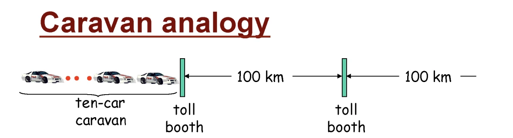

- 10대의 차가 모두 첫 번째 톨 부스를 통과하는데 걸리는 시간은 120초이다.
- 따라서 Caravan의 마지막 차량이 첫 번째 톨 부스를 통과하는데 2분이 걸린다.
- 마지막 Caravan이 첫 번째 톨 부스를 통과하고 나면, 100km를 이동해야 한다.
- 모든 차량은 100km/h의 속도로 이동하므로, 60분이 걸린다.
- **A. 따라서 62분이 걸린다.**

- **Caravan Analogy (more)**

    > Suppose cars now “propagate” at 1000km/h  
    > ⇒ 차량의 이동 속도가 1000km/h이다.  
    >   
    > Suppose toll booth now takes one min to service a car  
    > ⇒ 톨 부스가 차량 한 대를 처리하는데 1분이 걸린다.  
    >   
    > **Q. 첫 번째 톨 부스에서 모든 차량을 처리하기 전에, 차량이 두 번째 톨 부스에 도달하는가?**

    - **A. 1분 뒤에 첫 번째 차량이 처리되고, 그 이후에 6분이면 두 번째 톨 부스에 도착한다. 따라서 차량이 두 번째 톨 부스에 7분만에 도착한다. 10대의 차량이 첫 번째 톨 부스에서 모두 처리되려면 총 10분이 걸리므로, 차량이 두 번째 톨 부스에 도착하는 시간이 더 빠르다.**

### Queueing Delay (Revisited)

> Queueing Delay는 Traffic Intensity로 표현될 수도 있다.  
> 일반적으로 패킷의 도착에는 고정된 패턴이 없고, 임의의 시간만큼 떨어져서 도착하게 된다.  
> 아래 그래프는 트래픽 강도에 대한 평균 Queueing Delay의 질적 의존도를 나타낸다.

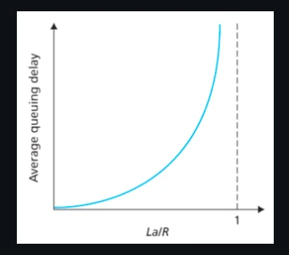

- R: Link Bandwidth (bps)
- L: Packet Length (bits)

- a: Average Packet Arrival Rate

    - 초당 얼마나 많은 Packet이 도착하는 지

$$
trafficIntensity = \frac{La}{R}
$$

L/R은 Transmission Delay이다. L과 R이 일정한 경우, Traffic Intensity가 증가한다는 것은 Queueing Delay가 발생한다는 것이다. (왜냐면, 처리 능력은 증가하지 않는데 도착하는 Packet의 수가 증가한다는 의미이기 때문이다.) Traffic Intensity가 1에 접근할수록 Average Queueing Delay가 급격하게 증가한다.

- La/R ~ 0 : Packet이 드물게 도착하는 상태. Avg Queueing Delay는 0에 가까워진다.
- La/R → 1 : Packet 도착이 전송 용량을 초과하여 Queue가 생성됨.
- La/R &gt; 1 : 초당 처리할 수 있는 수준보다 더 많은 Packet이 도달하여 Congestion이 발생한 상태.

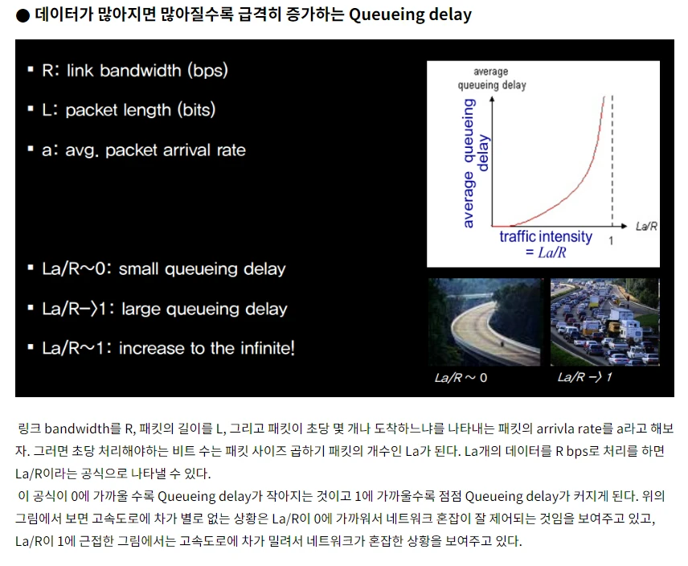

### tracert

> 나의 Host에서 특정 Host까지 도달하는 path를 찾아내는 프로그램

- 내 Host가 위치한 지역적 Network의 Access Router를 거쳐서 바깥으로 나가게 되며, 경로를 찾아내준다.
- tracert는 세 개의 packet을 보내며, 각 router에 갔다가 돌아오는 시간을 보여준다.
- 요청 시간이 만료된 것은 drop된 것이다.
- tracert는 강제적으로 Network Layer에 요청해서 Feedback을 보내도록 하는 것이다.

---

## &lt;Throughput&gt;

> 네트워크 통신의 성능을 평가하는 지표로서, 얼마만큼의 packet을 전송했고, 해당하는 시간 동안 얼마를 보냈는가 등을 평가한다.

- **instantaneous**(순간 속도) : rate at give point in time

- **average**(평균 속도) : rate over longer period of time

    ⇒ 순간 속도, 평균 속도가 있으나 우리는 보통 평균 속도를 고려한다. 가속도에 의해서 계산하면 값이 많이 튀기 때문이다.

### Network에서의 Throughput

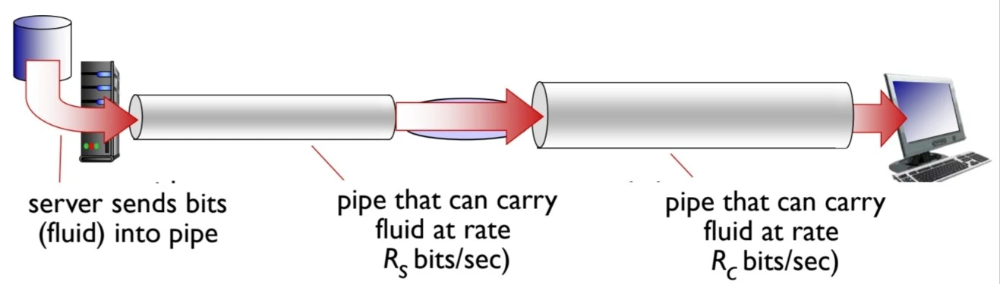

서버(S) → 클라이언트(C)로 Packet을 전달하는 예제. 두 파이프가 Rs, Rc의 rate로 데이터를 전송한다.

- 모든 **Communication Link**는 **Rate**가 다를 수 있다.

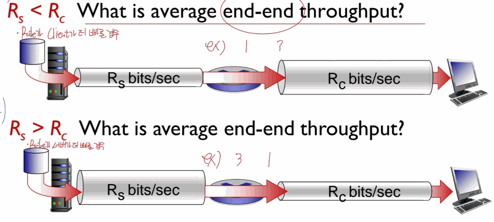

- 만약 Client 측의 Rate가 더 빠르다면?

- **End-to-End Throughput Example**

    > 1) Rs(1), Rc(3)  
    > 2) Rs(3), Rc(1)  
    >   
    > 위와 같은 Rate로 서비스되고 있을 때, 두 경우에서 End-to-End Throughput이 같을까?

    > Throughput이 같을 수 없다. 그 이유는 Bottleneck 현상때문이다.  
    > 아무리 뒷쪽의 Rate가 빠르다고 하더라도, 앞쪽의 영향을 받게 된다.  
    > 따라서 (1) Throughput = Rs (Rc &gt; Rs)이고, (2) 에서도 Throughput = Rc (Rs &gt; Rc)이다.  
    >   
    > Throughput을 계산하는 방법은 아주 많은 Hop을 지나더라도, 똑같이 가장 느린 Link의 Rate라고 할 수 있다.

### Throughput Examples in Real Network

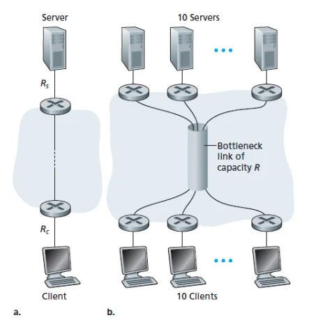

- 그림 a.는 컴퓨터 네트워크로 연결된 두 개의 Host를 나타낸다.

    - 서버가 네트워크에 연결되어 있는 접속 링크의 속도 (Rs)
    - 클라이언트가 네트워크에 연결되어 있는 접속 링크 속도 (Rc)
    - Network Core에 있는 모든 Link가 Rs, Rc보다 매우 높은 전송률을 가지고 있다고 생각하자. (실제로도 그렇다.)

    > 이때의 Throughput은 다음과 같다.

    $$
    min\{Rc, Rs\}
    $$

- 그림 b.는 Network Core에 연결된 10개의 서버와 10개의 클라이언트를 나타내며, 10개의 동시적인 다운로드가 일어나고 있다.

    - 10개의 다운로드가 통과하는 코어에는 하나의 링크 R이 존재한다.
    - R : 링크 R의 Rate
    - Rs : 모든 서버 접속 링크가 가지고 있는 속도
    - Rc : 모든 클라이언트 접속 링크가 가지고 있는 속도
    - 코어에서의 모든 링크의 전송률은 Rs, Rc, R보다 크다고 가정한다.
        (단, 속도 R인 하나의 공통 링크는 예외로 한다.)

    > 만약 R의 속도가 충분히 크다면, 각 다운로드에 대한 처리율은 다음과 같다.

    $$
    min\{Rs, Rc\}
    $$

    > 하지만 공통 링크 R의 속도가 Rs, Rc와 같은 수준이라면?  
    > e.g., Rs = 2 (Mbps), Rc = 1 Mbps, R = 5 Mbps  
    > ⇒ 공유 링크는 각 다운로드에 500 kbps의 처리율을 제공하기에, 각 다운로드에 대한 종단 간 처리율은 500 kbps로 줄어든다.  
    >   
    > 즉, 코어에서의 **공유 링크**가 각 다운로드에 대한 **병목**이 된다.

    $$
    min\{Rs, Rc, R/10\}
    $$

---

## &lt;Protocol Layers&gt;

> Network는 Layered Architecture를 사용한다.  
> Layer(Layered Architecture) ↔ Monolithic

### Why Layering?

- **왜 Layer<strong>(계층적 구조)</strong>를 사용하는가?**

    - Network에 관여하는 모든 요소들은 그 종류가 너무나도 다양하기 때문에 특정한 서비스를 담당하는 module 별로 구분해야만 한다. 
    - 이렇게 하면 복잡한 일련의 과정을 단순한 것들의 연속으로 체계화 할 수 있으며, 이렇게 할 경우 한 module이 과도하게 많은 부담을 지지 않도록 만들 수 있다.
    - 결과적으로 사용이 쉬워지고, 유지보수가 간단해지며, 새로운 기능을 업데이트하기에 좋다.

### Internet Protocol Stack

> Internet을 사용하기 위해서는 여러 개의 **Protocol**을 사용해야 하며, 이 **Protocol**들은 **계층적 구조**를 지녀, Protocl Stack으로 표현할 수 있다.

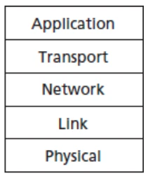

인터넷 프로토콜 스택은 5개의 계층으로 구성된다.

- Application
- Transport
- Network
- Link
- Physical

### Application Layer

> 네트워크 애플리케이션과 애플리케이션 계층 프로토콜이 들어있는 Layer이다.

- 인터넷의 애플리케이션 계층이 포함하는 대표적 프로토콜은 다음과 같다.

    - **HTTP** : 웹 문서 요청과 전송 제공
    - **SMTP** : 전자메일 전송 제공
    - **FTP** : 두 End System 간의 파일 전송 제공

- **DNS**(Domain Name Server)는 Application Layer에 존재한다.

- **Application Layer Protocol**은 여러 End System에 분산되어 있어서, 한 **End System**에 있는 **Application**이 다른 **End System**에 있는 **Application**과 **Packet**을 **교환**하는 데 이 프로토콜을 사용한다.

    > 모든 통신의 양 끝단은 HTTP와 같은 Protocol이지, Application Program이 아니다.

### Transport Layer

> 클라이언트와 서버 간에 Application Layer의 메시지를 전송하는 서비스를 제공하는 Layer이다.  
> 보통 TCP Protocol을 사용하며, 포트를 열어서 응용 프로그램들이 데이터를 전송하도록 한다.  
> (*Application Layer에 다양한 기능을 제공하는 프로토콜*)

- Transport Layer Packet을 **Segment**라고 한다.

- Transport Protocol의 두 가지 종류는 다음과 같으며, 이를 통해 Application Layer의 Message를 전달한다.

    - **TCP**

        - 애플리케이션에게 **연결 지항형 서비스**(Connection Oriented)를 제공한다.

            - Transport Layer가 Packet들의 전송이 유효한지 확인하고, 전송에 실패한 Packet들을 다시 전송하다는 것을 뜻한다.

        - 목적지로의 애플리케이션 계층 메시지 **전달 보장**과 **흐름 제어**(Flow Control)를 포함한다.
        - 긴 메시지를 짧은 메시지로 나누고(Segment), 혼잡 제어(Congestion Control) 기능을 제공한다. (*네트워크가 혼잡하면, 출발지의 전송률을 줄인다.*)

    - **UDP**

        - 애플리케이션에게 **비연결형 서비스**를 제공한다.
        - 신뢰성, 흐름제어, 혼잡 제어를 제공하지 않는다. 
        - Host에게 Feedback을 제공하지 않는 **Best Effort** 방식이다.

### Network Layer(=IP 계층)

> 한 호스트에서 다른 호스트로 **Datagram**(IP의 전송 단위)을 **라우팅**하는 책임을 지는 Layer이다.  
> 즉, 이 계층에서 가장 중요한 기능은 **Routing**이다. (이 계층의 대표적인 장비가 Router)

- 출발지와 목적지 간의 일련의 **Packet Switching**(인터넷에서는 Router)를 통해 **Datagram**을 **Route**하는 역할을 맡는다.

    - 출발지 **Host**에서 **인터넷 트랜스포트 계층 프로토콜**(TCP/UDP)은 **트랜스포트 계층 세그먼트**와 **목적지의 주소**를 **네트워크 계층**으로 **전달**한다.
    - **네트워크 계층**은 **Destination Host**의 **트랜스포트 계층**으로 **세그먼트**를 **운반**하는 서비스를 제공한다.

- 인터넷 네트워크 계층은 **라우팅 프로토콜**을 포함한다.

    > Routing Protocol은 출발지와 목적지 사이에서 데이터그램이 이동하는 경로를 결정하는 프로토콜이다.

    - 인터넷은 Network of Networks이며, 한 네트워크 내부에서 네트워크 운용자는 원하는 어떠한 Routing Protocol이라도 수행할 수 있다.
        ⇒ 즉, ISP에 따라 Routing Protocol은 상이할 수 있다는 뜻.

- **IP 프로토콜**

    > 네트워크 계층은 **IP 데이터그램**의 필드를 정의하며, End System과 Router가 이 field에 어떻게 동작하는지를 정의하는 프로토콜인 IP 프로토콜을 갖는다.  
    > (네트워크의 주소를 정의한다.)

    - 오직 하나의 IP 프로토콜만이 존재한다.
    - 네트워크 계층을 가진 모든 인터넷 요소는 IP 프로토콜을 수행해야만 한다.

### Link Layer

> 전체 프레임을 한 네트워크 요소에서 이웃 네트워크 요소로 이동시키는 Layer이다.  
> Link Layer는 나한테 직접 붙어있는 One Hop이며, **MAC Address**를 가진다.  
> (MAC Address는 네트워크 카드가 만들어질 때부터 부여된 Hard Coded Address이다.)

- **Link Layer**에서 전송되는 단위 **packet**을 **Frame**이라고 한다.

> 경로 상의 한 노드(Host or Packet Switch)에서 다른 노드로 Packet을 이동하기 위해, Network Layer는 Link Layer의 서비스에 의존해야 한다.

- 각 노드에서 Network Layer은 Datagram을 Link Layer로 보내고, Link Layer는 그 Datagram을 경로 상의 다음 노드에 전달한다.
- 다음 노드에서 Link Layer는 그 Datagram을 상위 Network Layer로 보낸다.

> Network Layer에서 Routing Algorithm을 돌리며 보낼 Router를 선택하면, 전달할 Packet을 Link Layer에 의존하여 보낸다.  
>   
> Link Layer는 packet을 Frame으로 전달받고, 이를 전달할 Router의 Network Layer로 전송하는 역할을 한다.

### Physical Layer

> 프레임 내부의 각 비트를 한 노드에서 다음 노드로 이동시키는 Layer이다.  
> 단지 데이터를 전송하기만 할 뿐, 어떠한 에러 체크나 데이터 체크를 하지 않는다.

---

## &lt;ISO/OSI Reference Model&gt;

> 과거에는 각 H/W 회사들이 자신들의 규격과 Protocol을 사용하여 호환성에 문제가 발생했고, 이에 따라 통신 프로토콜의 국제 표준을 정하게 되었다.  
> ⇒ Reference Model(OSI 7 Layer)

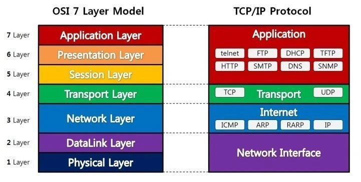

- 다른 것들은 Protocol Stack과 동일하나, 두 개가 추가되었다.

### Presentation

> Encryption(암호화), Compression(압축)을 담당하는 Module S/W.

- Presentation Layer는 코드 간의 번역을 담당하여, 데이터의 형식상 차이를 다루는 부담을 Application Layer로부터 덜어준다.

    - 다양한 **인코딩**/**암호화**를 여기서 담당한다.
    - 사용자의 명령어를 완성 및 결과로 표현. **포장**/**압축**/**암호화**한다.

### Session

> Sychronization을 맞추는 Layer이다.  
> (특정 Host와 계속해서 연결을 유지할 수 있는 역할을 한다.)

> **인터넷에는 왜 Presentation Layer와 Session Layer가 없을까?**  
>   
> 인터넷에서 사용하는 통신 프로토콜인 HTTP는 Stateless한 방식이므로, Session이 필요하지 않아 Presentation과 Session을 추가하지 않았다.  
> ⇒ 이후에는 보안 등의 문제가 대두되며 두 개의 Layer가 필요해지게 되었는데, 모든 Internet Application에서 이것을 사용하는 것은 아니므로, 필요하면 Application Layer에서 사용하게 된다.  
>   
> **TSL**, **SSL**, **HTTPS** 등이 대표적인 예시이다.

[OSI 7 계층이란?, OSI 7 계층을 나눈 이유](https://shlee0882.tistory.com/110)

[네트워크 | OSI 7 계층 그림과 함께 이해하기](https://velog.io/@jeongs/네트워크-OSI-7-계층-그림과-함께-이해하기)

### Encapsulation

> Source의 Application Layer의 Message를 Destination까지 보내는 과정에서, 각 Layer에서 Packet을 Header로 감싸 필요한 동작을 확인하고 이를 통해 Payload를 보호하는 것을 말한다.

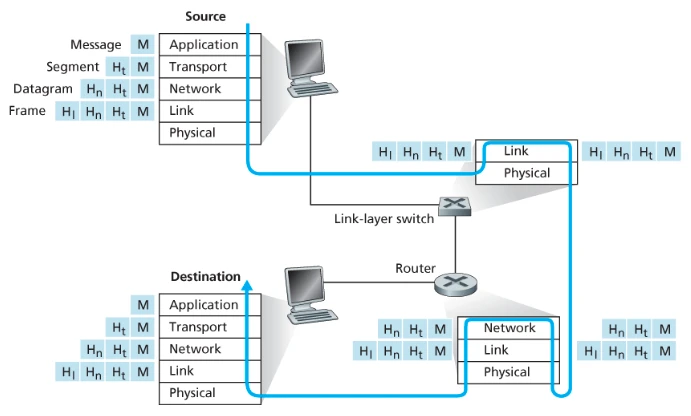

- 각각의 Layer 들은 서로 transparent해서, 어떤 일을 하고 있는지 보여지지 않는다.

    - 즉, Encapsulation을 통해 데이터를 계층 별로 보호한다.

- **Source**

    - Application

        - Application Layer의 Message로 전달하고자 하는 Message를 **Transport Layer**로 내려보낸다.

    - Transport

        - 데이터를 **Payload**에 실는다.
        - transport **header**를 붙인다.
        - 이를 **Segment**라고 하며, 이것을 **네트워크 레이어**로 보낸다.

    - Network

        - network layer에서는 내용 전체가 data로 보이기 때문에, 어디까지가 payload이고 어디까지가 header인지 알지 못한다.
        - 여기에 network layer의 **header**를 추가로 붙인다.
        - 이를 **Datagram**이라고 하며, 이것을 **링크 레이어**로 보낸다.

    - Link

        - 내려온 내용 전체가 data(network layer와 마찬가지이다.)
        - link layer **header**를 추가로 붙인다.
        - 이를 **Frame**이라고 하며, 이것을 **Physical Layer**로 내려 보낸다.

    - Physical

        - 실제 물리적으로 bit를 전송한다.

- **Switch**

    > Switch는 IP address를 보고 판단하는게 아니라, MAC address를 보고 전달하기 때문에 2계층으로 이루어져 있다.

    - Physical
    - Link

- **Router**

    > Network Router는 데이터를 확인할 필요가 없고 옮기기만 하면 되기 때문에 3계층으로 이루어져 있다.

    - Physical

    - Link

        - Link Layer Header를 Extract한다.

    - Network

        - Header를 벗겨서 Routing 진행.

    - 다시 Network, Link Header를 감싸주면서 내려온다.

- **Destination**

    - Physical
    - Link
    - Network
    - Transport

    - Application

        ⇒ 각 단계에서 자기 자신의 Header만 Extract하고 내용을 확인한다.

> 각 Packet의 Header에는, 그 계층에서 어떤 일을 할 것인지에 대한 데이터가 들어간다.  
> ⇒ Encapsulation : 본문인 Payload는 보호되고, Header로 역할과 목적을 판단한다.  
>   
> 네트워크 통신에서 이뤄지는 각 Layer의 일들은 Application Level에서는 알 수가 없다.  
> Internet Protocol Stack은 각각 Modularization 되어 Layered 되었기 때문에, 각 Layer는 자신의 일만 담당하면 된다.

---

## &lt;Network Security&gt;

> Encryption과 Decryption을 통해 Attack을 방어할 수 있다.

- 초기에 인터넷은 내부적으로만 사용되는 용도로 개발되었기 때문에, 보안을 고려하고 만들어지지 않았다.

    - 하지만 시간이 갈수록 많은 컴퓨터가 연결되면서 보안을 신경써야만 했다.
    - Protocol Designer들은 보안을 고려하지 않고 설계하며, 문제가 발생하고 나면 해결한다.
    - Security는 모든 Layer에서 고려되어야 한다.

### Malware

> 인터넷을 통해 Host에게 전달되는 데이터들 중, 해로운 것을 포함한 것을 Malware라고 한다.

- virus

    - 컴퓨터 내에서 스스로 복제하면서 컴퓨터에 악영향을 끼치는 File
    - 하나의 프로그램이 CPU에서 실행되는 것에 불과하다.

- worm

    - 컴퓨터 내에서 스스로 복제된다는 점에서 virus와 비슷하다.
    - worm은 독자적으로 실행되며, 종종 파일 전송이나 유저의 입력 등을 착취한다.

- spyware malware

    - 유저의 사적인 정보들을 모으는 프로그램
    - 이것을 모아 악의적인 유저에게 전송한다.

- malware에 감염된 Host는 botnet에 등록되어, network에 속한 다른 Host를 공격할 수도 있다.

### Dos(Denial of Service)

> 서버는 한 번에 처리될 수 있는 Capacity가 정해져 있는데, 그걸 넘어서는 양이 가해지면 서버가 위험해 질 수 있다. DoS는 그러한 점을 노려, Server 내에서 Thread를 계속 생성해 Memory Overflow를 발생시킴으로써 서버를 공격하는 방식이다.

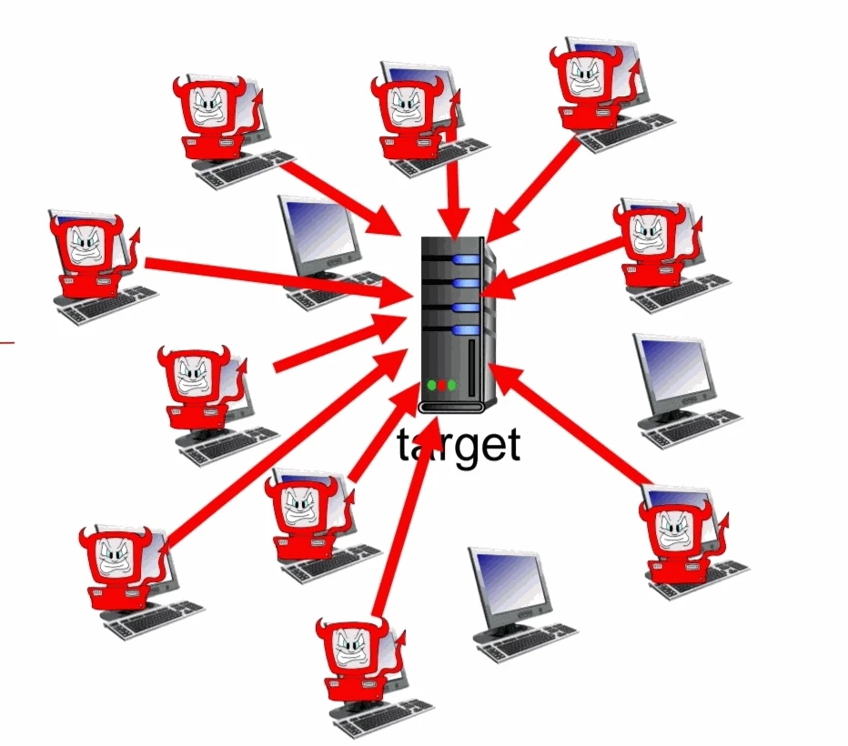

- Select Target
- Break into hosts around the network (see botnet) 
    ⇒ 해당 Target이 연결된 network에서 botnet을 형성해 나간다.

- Send packets to target from compromised hosts
    ⇒ botnet에서 target으로 악의적인 packet을 전송.

### Sniffing

> Broadcast Media(Shared ethernet, wireless 등)에서 유저가 전송하는 데이터를 탈취하는 것.  
> Network와 연결된 Host에서 특정한 프로그램(**Packet Sniffer**)을 설치하면, Network에서 전송되는 모든 Packet을 확인할 수 있다.

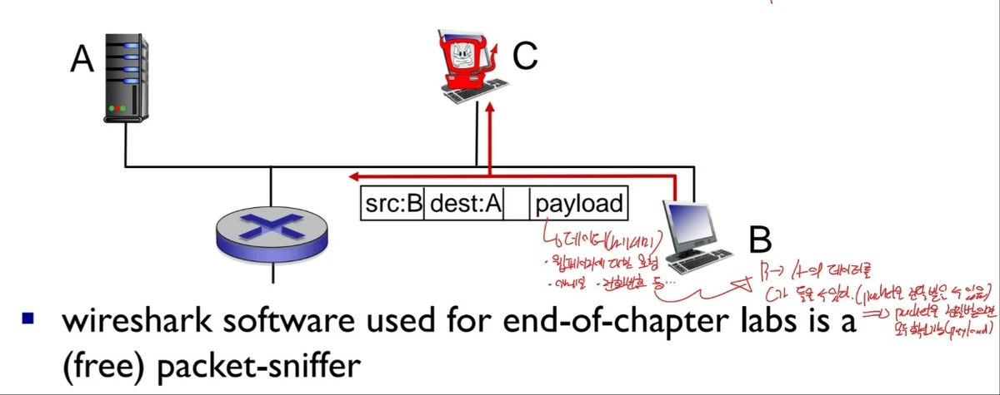

### IP Spoofing

> 내 요청이 다른 사람의 요청인 것처럼 IP Address를 위장하는 방법이다.

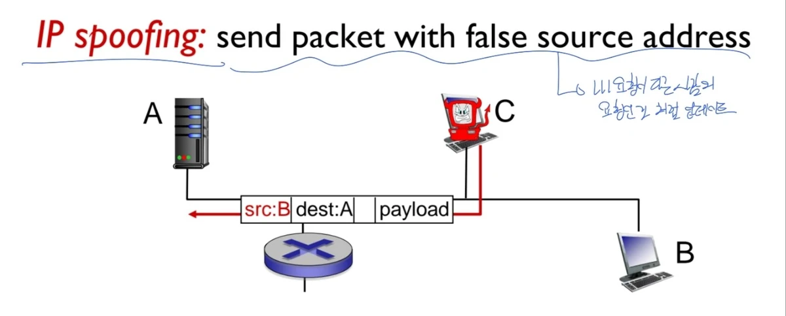
