# Application Layer & Processes Communicating

작성일 2023-10-10 · 최종 수정일 2023-12-07
{ .post-date }

## &lt;Chapter 2: outline&gt;

- **2.1 principles of network applications**

- **2.2 Web and HTTP**

    - Internet에서 가장 많이 사용하는 Application은 Web Browser이다.
    - 또한 인터넷에서 가장 많이 사용하는 프로토콜은 HTTP이다.

- **2.3 electronic mail**

    - SMTP, POP3, IMAP

- **2.4 DNS(Domain Name Service)**

    - **DNS**(Domain Name Service)는 고정 IP를 갖고 있는 여러 사이트를 이름으로 찾아갈 수 있는 기능을 제공한다.

- **2.5 P2P applications** 

- **2.6 video streaming and content distribution networks**

- **2.7 socket programming with UDP and TCP**  

---

## &lt;Application Layer&gt;

> Network Application을 어떻게 구현할 것인가?  
> ⇒ 몇 가지 사전 지식이 필요하다.

- **Transport Layer**로부터 어떤 서비스를 받을 것인가?

    - network application을 개발할 때 가장 먼저 선정해야 함.

- **Client-Server Architecture** or **P2P**
- **Content Distribution Networks** (멀티미디어 서비스)

> application은 사실 protocol이라고 해도 무방하다. 무수히 많은 application protocol들이 존재한다.

### Some network apps

> 최근 대다수의 application들은 network로 연결된다. network application이란, 인터넷으로부터 서비스를 받거나, 인터넷을 이용해서 수행되는 application들을 말한다. 

- Network Application의 종류

    - email
    - web
    - text messaging
    - remote login
    - P2P
    - multi-user network games
    - streaming stored video (Youtube, Hulu, Netflix)
    - voice over IP (e.g, Skype)
    - real-time video conferencing
    - etc…

### Creating a network app

> network application을 만드는 것은 end to end system 간에서 메시지를 전달하기 위한 것이다. 그래서 network application은 end system에서만 실행된다. 

- Network Core에는 router만 존재하기 때문에 Application의 수행을 고려할 필요가 없으며, 따라서 router는 Application Layer와 Transport Layer가 없다.

    - physical layer
    - data link layer
    - network layer

⇒ 따라서 Network Application을 만들 때는 Network Core를 고려하지 않고 End-to-End만 고려하면 된다.

### Client-Server Architecture

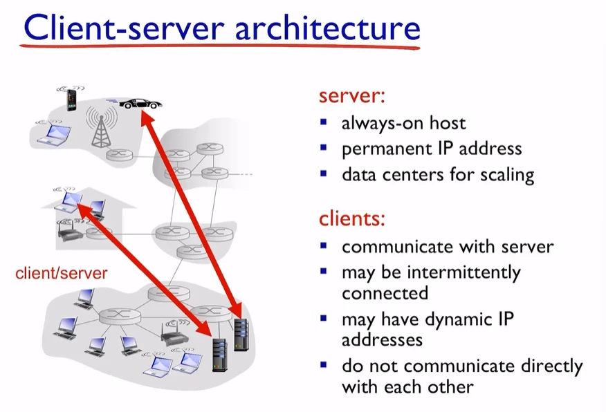

- **Client-Server** : 대다수의 application들이 선택하고 있는 아키텍처

    - **Server** :  **client**의 **요청**을 **처리**하는 특별한 End System
    - **Client** : Server에 접속해 **요청**을 **보내서**  **서비스를 받는** Application이 돌아가는 **End System**

    > Server는 특별한 경우를 제외하고는, 불특정다수에게 서비스를 제공하기 위해서 항상 켜져있어야 한다. 그리고 서버에는 항상 **서버 데몬**이 실행되고 있어야 한다.

    - 클라이언트가 서버에 접속하기 위해서는 IP Address를 알아야 한다.

        > 우리는 Domain으로 요청하지만, 실제로는 DNS를 통해서 IP로 바꾸고 요청을 들어가게 된다. 즉, **인터넷에서는 IP Address로만 통신할 수 있다.**  
        >   
        >   
        >   
        > **IP Address**는 Device마다 고유해야 하며, 인터넷에 연결된 모든 디바이스는 IP Address를 가져야만 통신할 수 있다.

    - **Dynamic IP Address** : 일반적으로 Host들은 그때그때 IP Address가 바뀌며, 이런 IP들을 Dynamic IP Address라고 한다.

        - Dynamic IP Address는 **DHCP**를 통해서 유동적으로 정해지는 Private IP이다.

          
⇒ 그런데 IP Address가 계속 바뀌면, 어떻게 이 IP Address로 접속할 수 있는 것인가?

        > Server는 항상 **Permanent IP Address**를 가진다. 이래야만 언제 어디서나 클라이언트가 서버에 접속할 수 있다. 만약 서버의 주소가 바뀌면 클라이언트는 접속할 수 없으므로 서버는 고정 IP를 가진 채로 항상 켜져있어야만 한다.  
        >   
        > 만약 Server에 접속자가 많으면, 서버를 분산적으로 같은 기능을 수행할 수 있게도 해야 한다. 이를 **Scaling**이라고 한다.

    > 서버의 가장 중요한 역할은, **Client의 요청을 기다리고 처리하는 것**이다. 언제 어디서 올지 모르는 Client의 요청을 처리하기 위해서 항상 대기해야 하며, Client가 접근할 수 있는 **Permanent IP Address**를 가져야 한다.

    ⇒ Client는 Server에 request를 보내 통신 가능 여부를 확인하는데, 통신이 가능하면 그때부터 Client와 Server가 서로의 존재를 확인하고 통신을 시작하게 된다.

### **Peer-to-Peer** (P2P)

> 그런데, 항상 서버와 데이터를 주고받거나 서버에만 요청할 수 있는 것이 불편하다는 입장이 대두되었다. 그래서 나온 것이 P2P이다. 이것은 그냥 디바이스끼리 대등하게 통신할 수 있도록 하는 것이다.

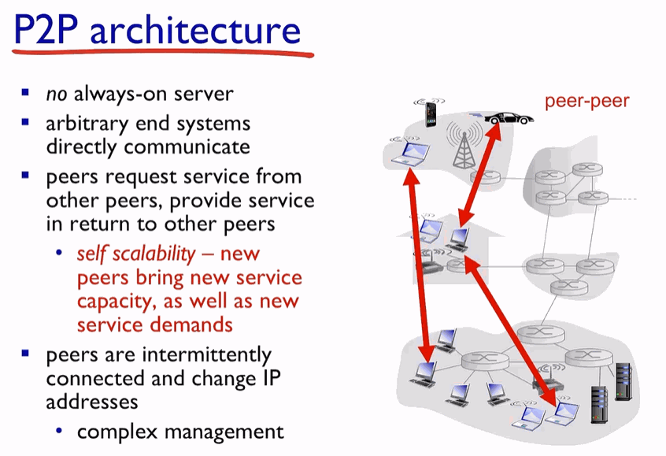

- P2P는 Client가 필요에 따라 그때그때 Server가 되는 Architecture이다.

    - 그런데, Client는 유동 IP를 사용하므로 안정적인 사용은 어려울 수도 있다.

- P2P는 Hybrid 방식으로도 사용될 수 있다.

    - ex. Kakaotalk
    - 사용자가 카카오톡에 로그인 → 서버로부터 계정 정보를 받아옴 → 채팅방 오픈 →
        서버에서 친구의 IP를 받아 연결 생성 → 친구에게 채팅을 보냄 → 
        대화 내용이 서버로 전달 → 대화 내용이 친구에게 전달됨
        ⇒ 이 방식은 Client-Server Architecture와 P2P Architecture를 결합하여 사용한 하이브리드 방식이라고 볼 수 있다.

- P2P는 모든 application에서 사용할 수는 없고, bit torrent 등과 같은 특별한 환경에서만 사용할 수 있다.

    - 최근에는 여러가지 보안 문제가 있어서 실제로 잘 사용되지는 않는다.

---

## &lt;Processes Communicating&gt;

### Process vs Program

- Program은 디스크와 같은 보조 메모리에 저장되어 있는 데이터이다.

    - 그런데 이것은 프로그램이 실행되고 있는 것은 아니고, 단순히 코드로 저장되어 있는 형태.
    - 이걸 실행하기 위해서는 클릭을 해서 메인 메모리(RAM)에 프로그램을 올려야 한다.
    - 프로그램을 실행하기 위해서는 CPU가 처리해 주어야만 하는데, CPU는 반드시 메인 메모리와만 일하기 때문에 반드시 메인 메모리에 프로그램을 올려 **프로세스**로 만들어야 한다.

- Process는 실행 중인 프로그램으로써, 메인 메모리에 로딩되어 있는 프로그램을 말한다.

### Processes communicating

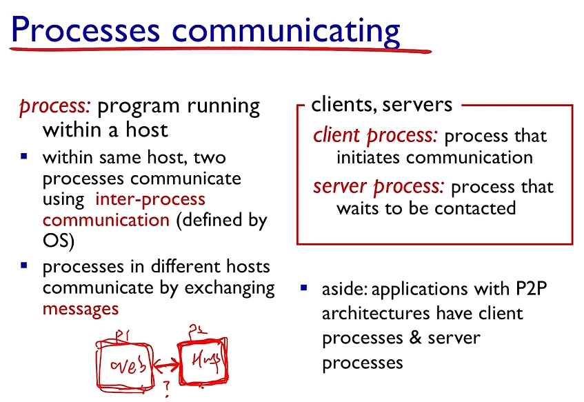

- 현재 Web browser와 .hwp 프로세스를 수행하고 있다고 할 때, 두 개의 프로세스가 데이터를 주고 받을 수 있는가?

    - 이것은 기본적으로는 허락되지 않는다. 별도의 프로세스이기 때문이다.
    - 또한 새로운 Web browser를 띄운다고 해도, 두 개의 브라우저가 데이터를 주고 받기는 어렵다. (원래 금지되어 있음.)

> 그래서 기본적으로 OS는 이러한 작업을 지원하기 위해 **IPC**(Interprocess Communication)을 지원한다. 이것은 한 컴퓨터에서 돌아가는 서로 다른 프로세스 간에 데이터를 주고받을 수 있는 통신 방식이다.  
>   
> 여기에는 **메모리를 공유하는 방식**, **FIFO**를 이용하는 방식 등이 있다.

### Socket

socket은 프로세스 간에 데이터를 주고 받기 위해 사용되는 것이며, (Interprocess communication) 최근에는 네트워크 프로세스 간에 데이터를 주고받기 위해 사용된다.

즉, 멀리 떨어져있는 또 다른 Host(End System)에서 실행하고 있는 프로세스와, 내 컴퓨터에서 실행하고 있는 프로세스 간에 통신을 하게 만드는 것. 이것이 바로 Application에서 하는 일 중에 하나다.

(바로 인터넷을 통해서 이루어진다.)

- 프로세스는, 하나는 서버가 되고 다른 하나는 클라이언트가 된다. 

    - 클라이언트 호스트는 Communication을 initiate 하고, 필요한 데이터를 주거나 받을 수 있다.

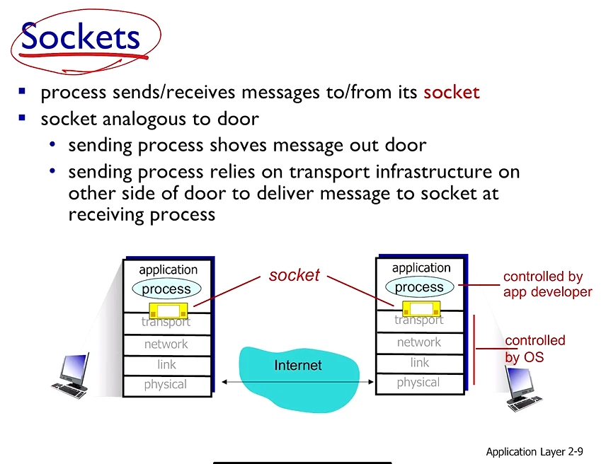

- Socket을 이용하면 TCP/IP Protocl Stack이 어디 구현되어 있는지 봐야한다. ⇒ OS 안에 구현되어 있으며, OS가 관리한다.
- 우리가 짜는 프로그램은 Application Level에서 짜는데, Application에서 짜는 프로그램에서 OS의 서비스를 받으려면, System Call을 사용해야만 한다.
- Socket은 OS에서 관리하고 있는 Network Protocl Stack을 사용할 수 있는 Service를 제공하는 역할을 한다. 이것을 통해서 또 다른 Application Process와 데이터를 주고받을 수 있는 하나의 Interface가 Socket이다.

### Addressing Processes

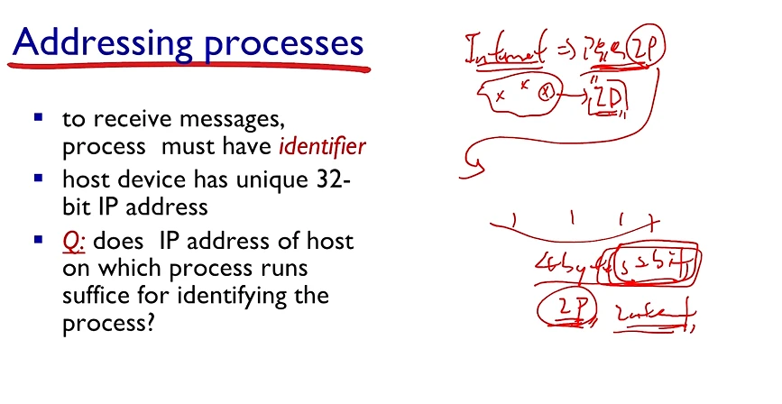

> 인터넷을 하기 위해서는 고유의 IP Address가 필요한데, 인터넷에서 어떤 디바이스인지를 알아내기 위해서는 이 주소를 사용해야 한다. (Identifier)

- IP Address는 x.x.x.x 로 구성되며, x는 각각 1byte로 구성된 총 4byte의 주소이다.

- 그렇다면, IP Address만 있다면 인터넷에서 통신이 항상 가능할까?

    - 이 문제에 대해 답을 얻기 위해, 우편을 배송하는 과정을 생각해 보자.

> 누군가에게 보낼 우편을 작성하고 우체국에 부치면, 가장 먼저 우체국에서는 지역별로 분류를 한다.   
>   
> 1) 서울, 2) 인천, 3) 경기, …  
> 그리고 만약 인천으로 간다면, 구로 분류한다.  
>   
> 1] 계양구, 2] 부평구, 3] 중구 …  
> 그 다음에는, 동이 있고, 동 다음에는 건물 번호, 상세 주소까지 간다.  
>   
> 주소는 항상 Unique하며, 이걸 통해서 우리에게 우편이 전달되는 것이다.  
>   
> 그런데 여기서 중요한 것은, 우리 집까지는 올 수 있다.  
> 그런데 우리 집에 사는 사람이 한 명은 아닐수도 있기 때문에 누구에게 도달하는 것인지 알수 없다는 문제가 있다. **따라서 &lt;누가&gt; 받을 것인지 이름을 작성해야 한다.**

- IP Address는 Host마다 부여되는 것이고, IPC를 하고자 한다면 Internet을 통해서 Host까지 정확히 도달하기는 한다. 그런데 &lt;**어떤 프로세스에게 전달해야 하는가**&gt;를 따져야만 한다.

    - 추가적인 Identifier가 필요하다.

### Port Number

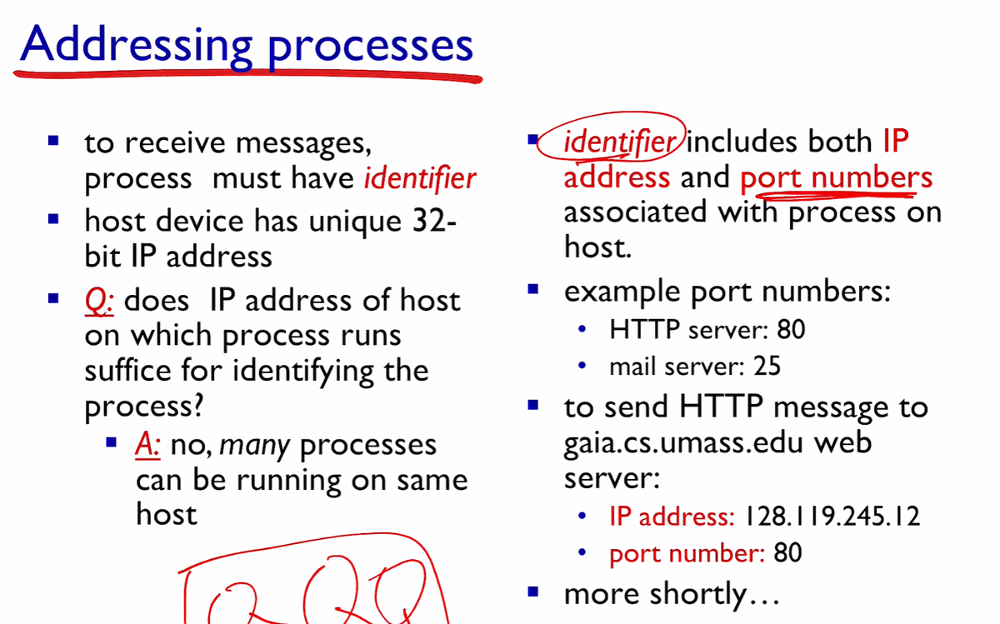

> 이와 같은 상황에서 어떤 프로세스에게 전달해줄 지를 결정하는 추가적인 Identifier를 **Port Number**라고 한다.   
>   
> **Port Number도 IP Address와 마찬가지로 Host 내에서 Unique해야만 한다.**

> 따라서 네트워크 통신을 하기 위해서는 IP Address와 Port Number를 알아야만 한다.

### App-layer protocol defines

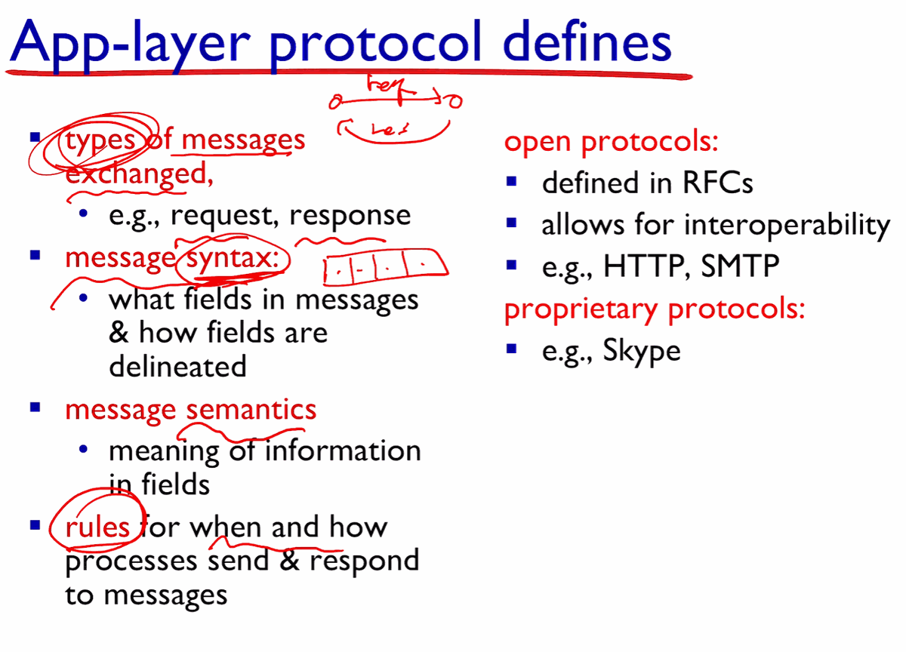

> Application Layer에서 하는 일은 무엇인가?

- 왔다갔다하는 Message 들의 Type을 결정한다.

    - request, response ⇒ 대부분이 이런 구조이다. (On Demand)
    - 일반적으로 Server, Client의 구조

- Message의 syntax (문법)

    - Message마다 Field가 있을 것이다. (어떤 Field가 n이면, 어떤 일을 해라.)

    - 이런 것들이 무엇을 의미하는 지를 정의하고 있다.

        ⇒ Message Semantics

- 언제 어떤 Message를 주고 받아야 하는 지에 대한 Rule을 정의한다.

⇒ 이런 open Protocol들은 RFC에 정의되어 있으며, proprietary protocol들도 사용되고 있다.

- open protocols

    - **interoperability** : 클라이언트는 클라이언트만, 서버는 서버만 구현해도 서로 동작하는데 문제가 없도록 상호호환성이 지원되어야 한다.

---

## &lt;What transport service does an app need?&gt;

> 인터넷을 통해 전달되는 데이터의 종류는 매우 많은데, 어떠한 Message에 담긴 Data의 특징을 살펴보는 것이 중요하다. 이 종류에 따라 요구되는 서비스가 달라질 수 있다.

### data integriy(데이터 무결성)

- 일부 application은 100%의 reliable data transfer가 필요하다. 
    (e.g., file transfer, web transactions, email)

    - 다만 이것은 Application에서 잘한다고 무조건 잘되는 것이 아니다. 
    - 데이터를 전송하는 순간 Network에 가게 되고, 버려지기도 하기 때문에 완벽하게 처리되지 않을 수 있다.
    - 하지만 그럼에도 불구하고 클라이언트는 내가 전송한 데이터가 target에 100% 도착하기를 바란다.

- 그러나 음성 통화 application이나 video 등은 loss에 관용적이다.

### timing

- 일부 application은 low delay를 요구한다. (Multi-user games)

    - 게임과 같은 것들은, 한 두번 정도는 요청이 전달되지 않아도 문제는 없다. 하지만 요청을 보냈을 때 바로 보내지는 것은 보장되어야 한다.

### throughput

- Multimedia 데이터를 다루는 경우(동영상 시청 등), 적어도 15fps ~ 30fps를 플레이해야 자연스러운 동영상으로 인식할 수 있다. 따라서 적어도 15frame으로 실행할 수 있도록 데이터가 계속 전달되어야만 한다. (즉, throughput이 보장이 되어야 한다.)

    - 중간에 loss가 나는 것이 크게 중요하지는 않지만, throughput이 guarantee 되어야 한다.
    - 만약 내가 play 할 수 있는 것보다 더 많은 양이 도착하면, Buffering이 발생하여 delay가 발생하기도 한다.

> Application의 특성에 따라 100% 손실 없는 데이터를 받아야 하는 경우가 있고, delay는 크게 문제가 되는 경우도 있으며, 주어진 시간 안에 반드시 어느 정도의 데이터는 받을 수 있어야 하는 application들이 있다.  
>   
> 그렇다면 이런 application들은 어떻게 서비스를 제공할 수 있는가?  
> ⇒ 바로 transport layer에서 제공할 수 있다.

### Security

- 금융 서비스, 인증 서비스 등은 encryption과 data integrity가 중요하다.

### Transport Service Requirements

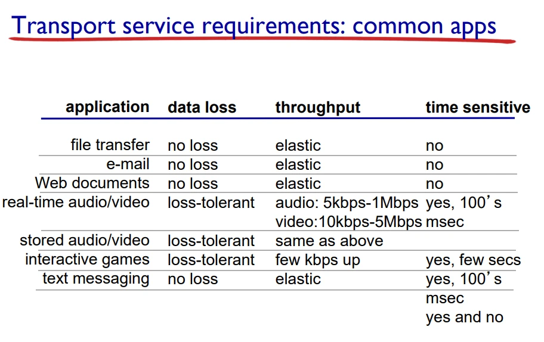

- real-time audio/video : 실시간으로 받으면서 처리
- stored audio/video : 먼저 저장하고 플레이 하는 것

> 각각의 Application에서 요구되는 사항들을 누가 guarantee 할 것인가?  
> ⇒ **Transport Layer**가 담당한다.

---

## &lt;Transport Layer&gt;

> Application의 Data를 requirements에 맞게 End to End로 잘 전달할 수 있도록 하는 서비스이다.

### Internet transport protocols services

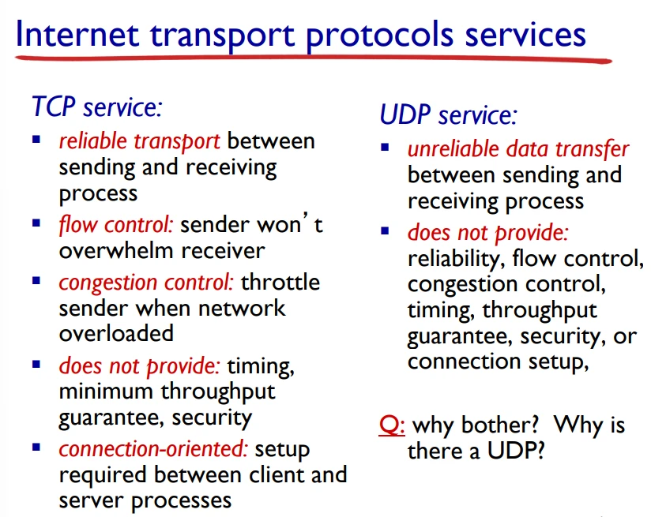

> Application은 여러 개의 Protocol Service를 사용할 수 있지만, 하나의 Socket에서는 여러 개의 Transport Service를 사용할 수 없다. ⇒ 결정 여부는, Data의 Requirements에 따라 달라진다.

- **TCP**

    - Reliable Transport : 확실한 통신이 가능할 때만 통신을 한다. (시간 지연 가능)
    - flow control
    - congestion control
    - timing, throughput, security를 보장하지 않음.

    - connection-oriented : setup required between client and serveer processes

        ⇒ **논리적인 end to end 연결 과정이 존재**한다. (call setup과는 다름)

- **UDP**

    - Unreliable data transfer : 사실, Unreliable 보다는 less reliable이 맞다.
    - UDP는 best effort를 목표한다. ⇒ 할 수 있는 최선을 다하지만, drop은 어쩔 수 없음.
    - reliability, flow control, congestion control, timing, throughput, security, connection setup을 보장하지 않는다.
    - TCP를 제외하면 가장 빠른 통신 방식

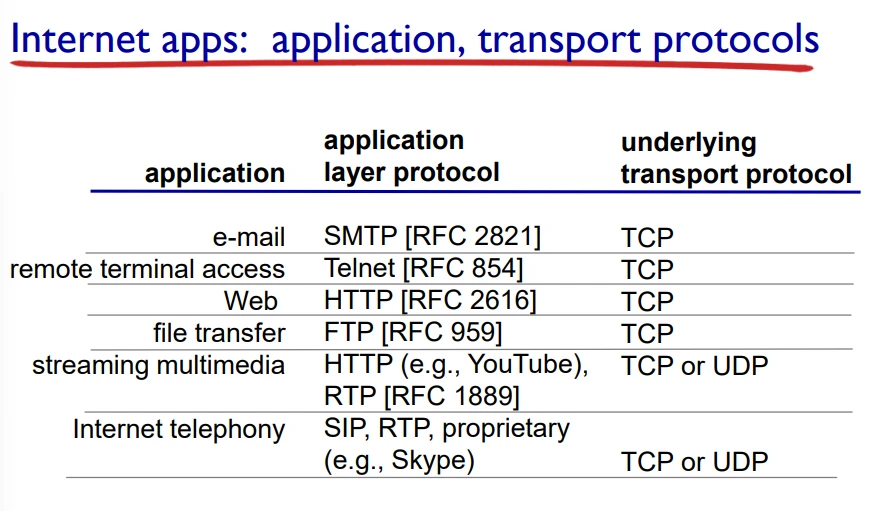

### Securing TCP

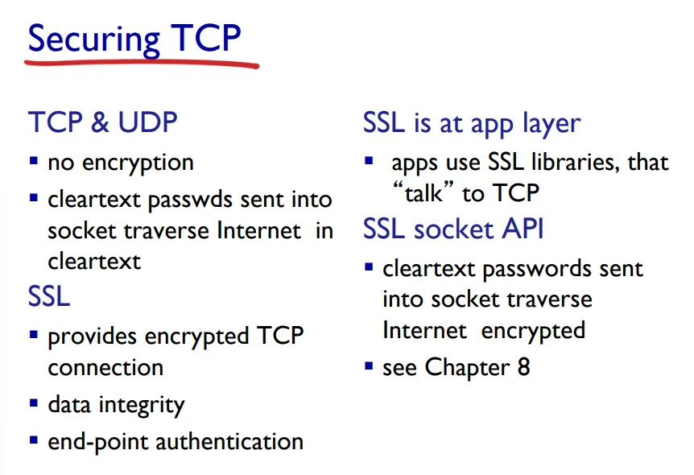

> 기존의 TCP는 security가 없었음. SSL을 추가하여 보안 연결을 보장할 수 있다.  
> ⇒ **Data integrity**가 주어진다. (**End to End에서 authentication이 이루어진다.**)

- HTTPS도 Application이기 때문에, 테스트해보려면 Domain을 가져야만 한다.
- SSL, TLS, HTTPS는 Presentation Layer에 속한다고 볼 수 있음.

[In which layer is HTTP in the OSI model?](https://stackoverflow.com/questions/38596488/in-which-layer-is-http-in-the-osi-model)

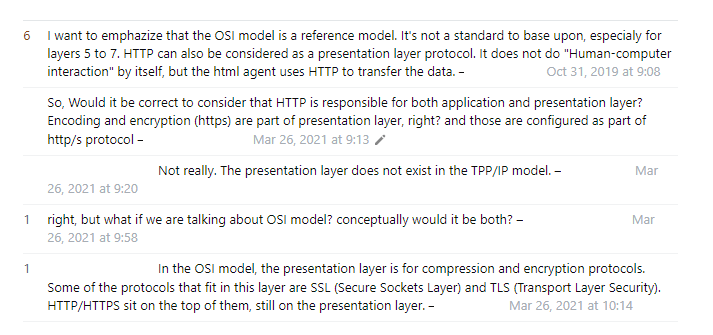
