# Web and HTTP

작성일 2023-10-16 · 최종 수정일 2023-12-07
{ .post-date }

[Socket Programming - TCP 세션 수립 및 종료](https://junb51.tistory.com/4)

## &lt;Web and HTTP&gt;

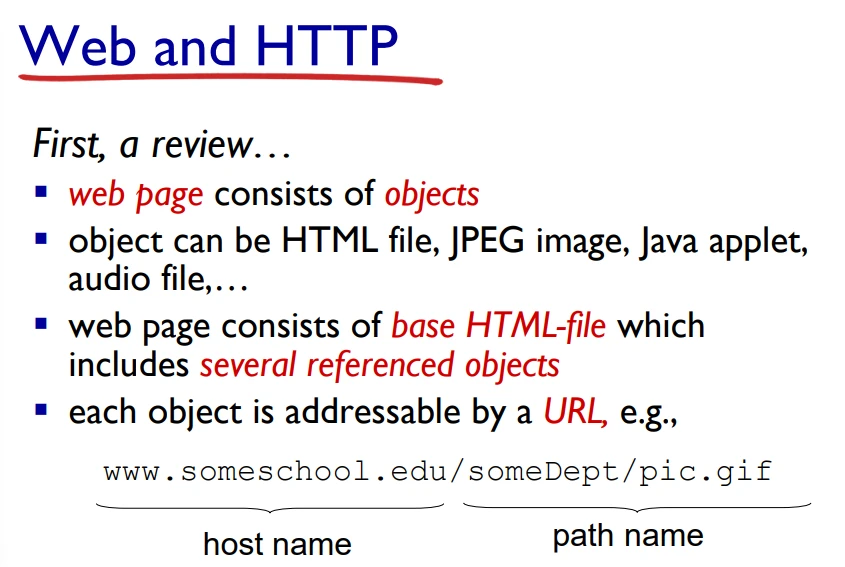

> Web은 기본적으로 HTTP를 사용한다.

- App과 Web의 가장 큰 차이

    - App은 이미지나 동영상 등의 Object가 모두 폰에 내장되어 있다.

    - 반면 Web은 모두 서버에 request를 보내서 필요한 object를 전달받는다.

        - 이때, 어디에 배치하고 보여줄지 기준을 정하게 되는데, 이를 HTML이라고 한다.

- Web Page는 각각의 Object를 폴더 곳곳에 개별적인 파일로 보관하고 있으며, 필요할 경우 각각 reference를 해서 가져오게 된다. (모든 Object는 URL을 가지고 있다.)

    - URL은 host name + path name으로 이루어진다.

### HTTP Overview

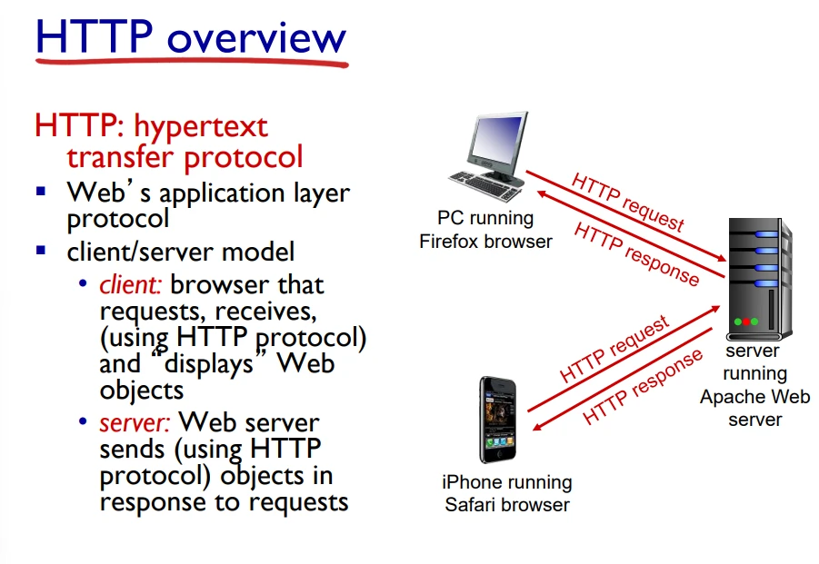

> HTTP는 Hypertext Transfer Protocol이며, 어떤 Text를 누를 경우 다른 Page로 이동할 수 있는 것을 Hypertext라고 한다. HTTP는 Hypertext를 전달하는 Protocol이다.

- Web’s application layer protocol

- HTTP를 사용하는 대표적인 모델이 Client/Server 모델이다.

    - Client가 Browser에서 Request를 Server로 보낸다.
    - 그러면 Server는 그 Request에 대한 Response를 보낸다.

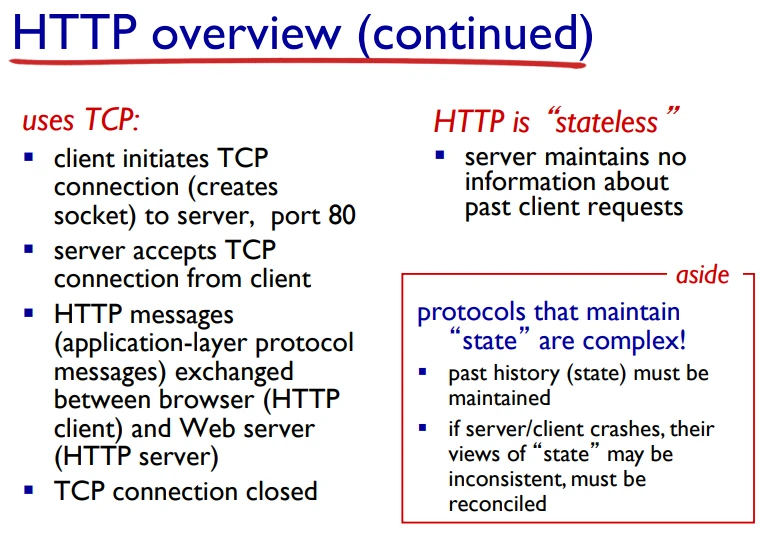

- **TCP**는 **connection-oriented**이므로 서버의 **Port Number**를 통해 **TCP Connection**을 **initiate** 해야 한다.

- 그러면 **Server**는 해당하는 **Client**와의 **TCP Connection**을 **accept**한다.

    - 이때부터는 데이터를 보낼 수 있게 된다.

- **TCP**는 연결된 상태로 계속두면, 그 자체로 **Overhead**가 된다. 그러므로 연결을 끊어야만 한다.

- **Homepage** : Client가 Access했을 때 받는 첫 페이지. 이 Page를 구성하기 위해서는 다양한 **Object**가 필요하다.

    - **HTML**을 전달 받으면, **Browser**가 **HTML**을 **Parsing**하고, 여기에 나온 **Reference**를 하나씩 **Server**에 **요청**한다.
    - **Client**는 전달을 받는 대로 TCP connection을 close한다.

- **HTTP**는 “**stateless**”이다.

    - 상태가 없는 프로토콜이며, 연결 상태가 없다.
    - 연결 상태가 없다는 것은, 이전 요청 상태를 기억하지 않는다는 것이다.

    - HTTP가 stateful한 protocol을 만들기 위해서는, 굉장히 복잡하다!

        ⇒ 로그인을 하게 만들기. 그런데, 로그인을 안했는데도 stateful하게 만들어버릴 수도 있다.

        ⇒ 이것이 진정한 stateful이고, **cookie**를 통해 할 수 있다. 단, 이것은 Pure한 HTTP Protocol은 아니고, 추가적인 기능이다.

    ### HTTP connections

    > Object를 어떻게 가져오냐에 따라서 두 가지 연결 방법이 있다.

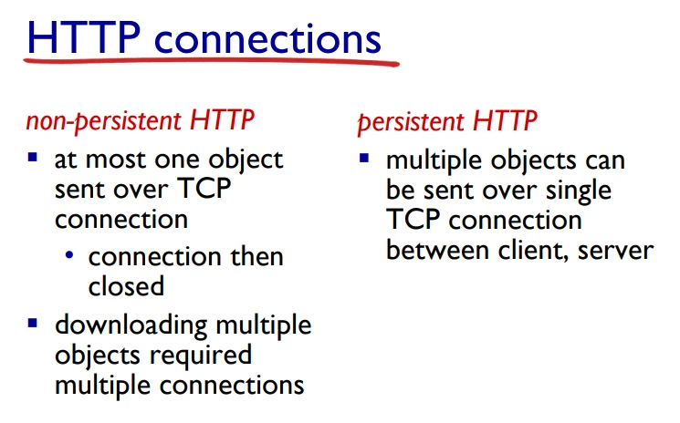

- **non-persistent HTTP**

    - TCP 연결을 한 Object마다 한다. ⇒ 만약 받아야 하는 Object가 여러 개라면, 그 개수만큼 연결하고 끊는 TCP connecting을 반복한다.
    - TCP는 논리적인 연결이기 때문에, 동시에 한 사람에게 독립된 여러 TCP 연결을 만들 수 있다. 그래서 동시에 여러 Object를 만들 수 있다.

- **persistent HTTP**

    - multiple한 object에 대해서, single TCP connection을 만들면, 연결을 만들고, 모두 다 받고, 연결을 끊는 방식이다.

### Non-persistent HTTP

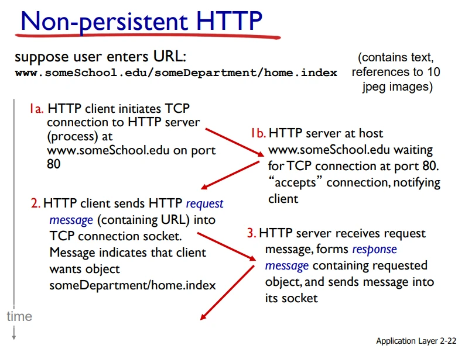

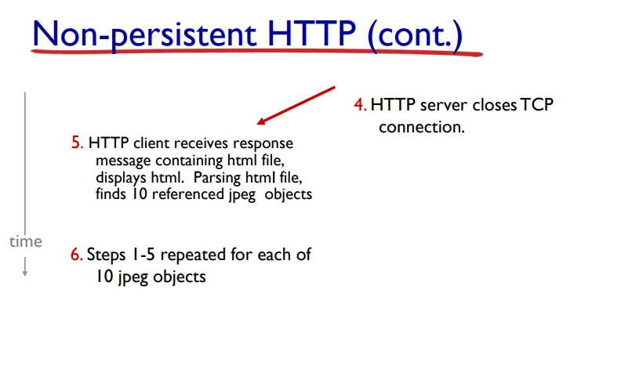

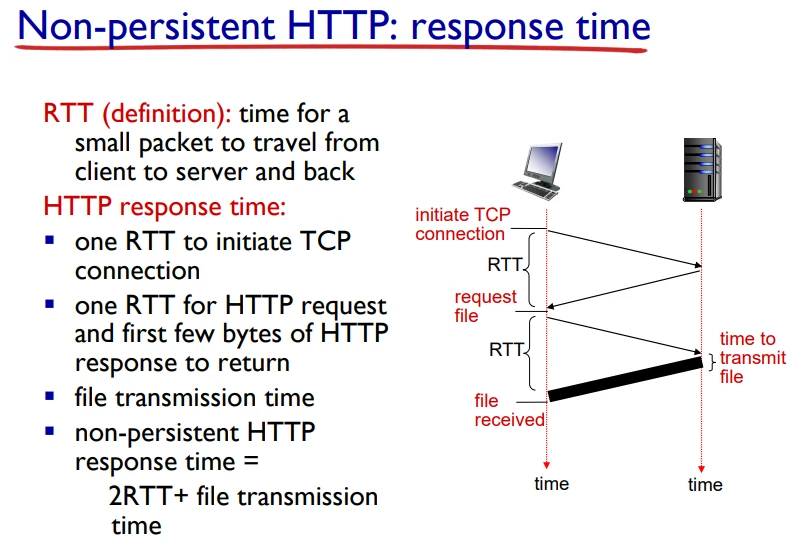

- **RTT**(Round-Trip Time) : Request가 갔다가 Response로 돌아오는 시간. Object 수만큼 RTT가 이루어진다.

    - Response Time = 2RTT + file transmission time (n개의 object를 받는다면 * n)

    $$
    (2RTT + fileTransmissionTime)*n
    $$

### Persistent HTTP

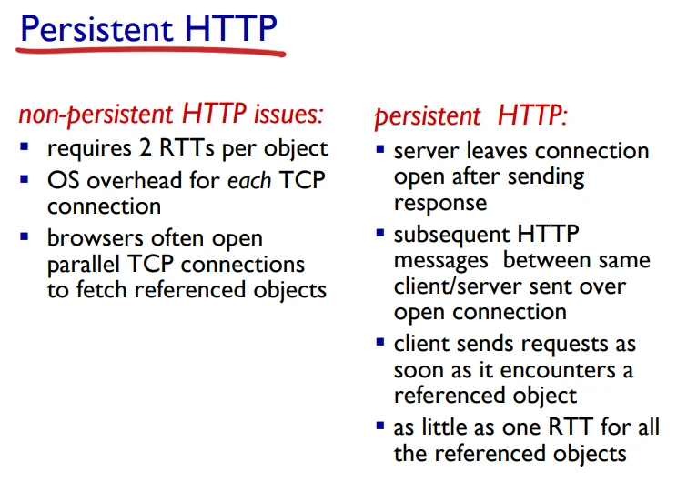

$$
RTT + (RTT + fileTransmissionTime)*n
$$

> 결과적으로 말하면, Persistent HTTP에서는, object의 수만큼의 RTT connection Time이 줄어드는 것이다. 최근에는 대부분 Persistent HTTP가 사용된다.

### HTTP Request Message

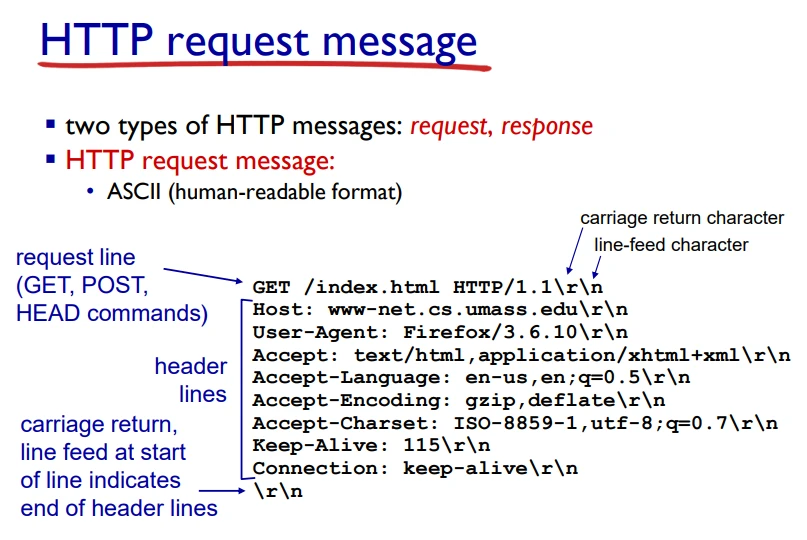

- Request Line : GET, POST
- URL
- header는 실제로는 보내지 않아도 무방함. optional한 부분이며, Browser가 만들어서 보내주는 부분이다.
- Header는 모두 ASCII이기 때문에, 한 라인마다 carriage return, line feed를 붙여줘야 한다.
- End of Header에는 carriage return, line feed를 두 번 붙여줘야 한다.

### HTTP Requeest Message: General Format

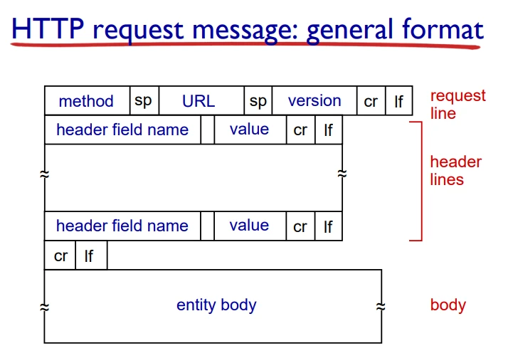

- 구분자는 Space이며, 실제로는 Method(sp)URL만 들어가도 큰 문제는 없음.

    - version은 persistent냐 non-peresistent냐를 따진다.

### Uploading Form Input

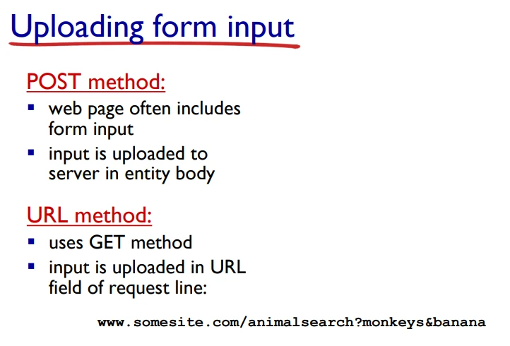

- 만약 어떤 웹사이트에 Form이 있다면, 해당하는 Form에 뭔가를 입력하고, 보낼 수 있다.

    - Send를 한다는 것은 Object를 받아오는 일반적인 Request와는 다른 것이다. 즉, 나의 데이터를 일방적으로 주는 것이다.

    - 이전의 HTTP는 Web page에게 File을 달라고 하고, 거기서 Reference하는 Object를 받아오는 과정이었음. 하지만, Form에 있는 데이터는 내가 Server로 보내주는 것이고, **request가 아님.**

        즉, 일방적으로 서버에게 데이터를 주는 것이다.

<!-- -->

1. **POST method**

    Method가 POST일 때, 전송하고자 하는 데이터를 entity body에 넣으면 된다. 

2. **URL method(GET)**

    Input data를 entity body에 넣는게 아니라, URL에 추가하는 방식이다.

    이렇게 하기 위해서는 URL을 만들 수 있는 특정한 syntax를 알아야만 한다.

    즉, encoding을 해서 URL 형태로 데이터를 넘겨주는 것이다.

> GET은 유저가 볼 수 있기 때문에 별도의 Parsing이 없어서 매우 빠르고 편하다. 하지만 보안 등이 중요한 것은 POST를 사용한다.

### Method Types

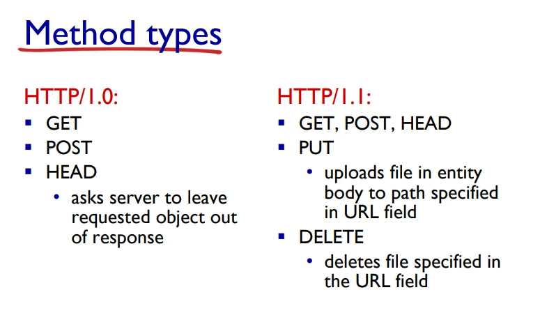

- HTTP/1.1 

    - PUT : Client에서 직접 파일을 entity body에 넣어 Upload 할 수 있는 것
    - DELETE : URL에 명시된 파일을 제거하는 것 
    - HEAD : …

### HTTP Response Message

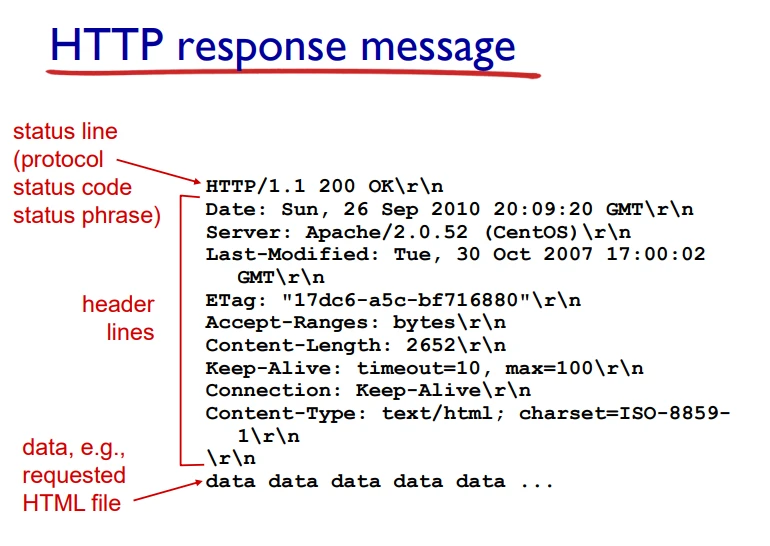

전달받고자 하는 파일은 response body에 들어간다.

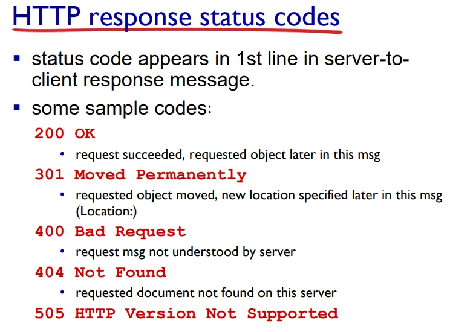

- 200 : OK
- 301 : 프로젝트의 디렉터리 구조가 완전히 바뀌었을 때.
- 400 : 잘못된 요청
- 404 : 파일을 찾을 수 없는 경우
- 505 : HTTP version이 달라서 지원할 수 없는 경우

### Trying out HTTP (client side) for yourself - using Curl

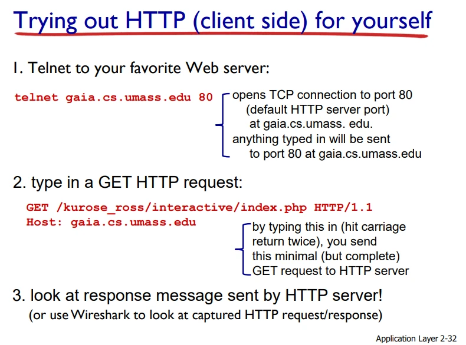

### Cookie

> 기본적으로 Web 통신은 Stateless이다. (상태를 기억하지 않음.) 그래서 Login을 하지 않는 이상은 상태를 기억하지 못한다. 하지만 이런 조건에서는 한계가 많기 때문에 State를 저장하고자 새로운 방법인 Cookie를 도입한다.

- **Cookie의 구성요소**

    - HTTP response의 cookie header line
    - 다음 HTTP request에 cookie header line
    - Host에 cookie file이 유지되며, browser를 통해서 관리된다.
    - cookie를 사용하여 유저를 식별하고 Web site의 DB에서 데이터를 가져온다.

### Cookie를 활용한 State 유지

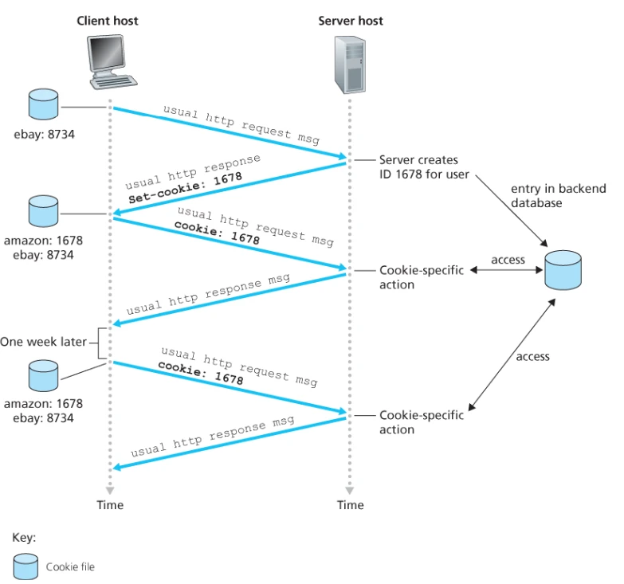

- 처음에 유저가 서버에 HTTP request를 전송한다.

    - 서버는 해당 유저에 대해 식별 가능한 ID(entry)를 만들고, 이 entry를 back-end에 생성한다.
    - 이렇게 만들어진 유저의 ID 1678을 HTTP response의 cookie header로 담아 전송한다.

- 유저가 자신의 ID(1678)를 cookie에 첨부하여 HTTP request를 전송한다.

    - cookie를 통해서 유저를 식별하고, 데이터를 response로 전송한다.

- 이후에 시간이 지나 유저가 웹 사이트에 다시 접속할 때, 유저는 1678이라는 ID를 저장한 cookie를 가지고 있으므로, 이걸 request header에 담아 전송하여 서버가 자신을 식별하도록 한다.

> 이렇게 cookie를 사용하면 HTTP 통신을 stateful하게 사용할 수도 있다.

### Cookie의 용도

- **authorization** (권한)
- **shopping carts** (장바구니)

- **recommendations** (추천)

    - 유저가 웹 사이트에서 몇 개의 아이템을 클릭하면, Backend에서 선택 목록을 분석하여 추천 알고리즘을 돌리고, 추천 목록을 전달하는 것.

- **user session state** (Web e-mail)

---

## &lt;Web Caches(Proxy Server)&gt;

> CPU는 내부에서는 처리 속도가 매우 빠르지만, CPU밖에서 데이터를 가져오게 되면 처리 속도가 매우 느려진다. 그래서 반복적으로 처리되는 데이터는 CPU 내부의 작은 메모리에 갖다 놓게 되는데, 이를 **Cache Memory**라고 한다.

- Cache는 **I-Cache**(Instruction Cache), **D-Cache**(Data Chche)로 나뉜다.

- Cache를 뒤졌을 때 Cache에 그 데이터가 있다면 **Cache Hit**, 없다면 **Cache Miss**이다.

    - 따라서 CPU의 실행 시간은 hit rate + miss rate로 보인다.

> 만약, 특정 시간에 인천대학교 학생들이 Naver를 많이 접속한다고 해보자. 그러면 학생들은 똑같은 페이지를 전달받게 될 것이며, 인천대학교 망과 네트워크 코어를 연결하는 Access Router를 거쳐서 계속 서버에 요청하게 될 것이다.  
>   
> 이렇듯 학교 내에는 지역망과 네트워크 코어를 연결하는 Main Access Router가 있고, 위의 상황의 경우에는 End System이 모두 똑같은 정보를 전달받고자 함에도 Access Router에 Traffic이 과도하게 발생해서 효율이 떨어지는 상태이다.

### Proxy Server(Web Cache)

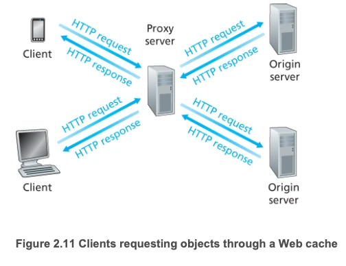

> 이러한 문제를 해결하기 위해 등장한 것이 **Proxy Server**(Web Cache)이다. Proxy는 특정한 망 내에 위치한 중간 서버로서, Original Server와 Client를 연결하는 역할을 한다.  
>   
> Proxy는 평소에 Client의 요청을 모두 받으면서 특정한 망 내의 Client가 접속한 사이트의 목록을 저장하고 있다가, 이 사이트에 대해서 많은 요청이 들어오면 Client가 Original Server를 거치지 않고 빠르게 response를 전달받을 수 있도록 한다.  
>   
> ⇒ 어떻게 보면 request를 보낼 때 한 번 더 거치기 때문에 Overhead처럼 보이기도 하지만, 많은 요청이 있을 때는 효율적이다.

- Proxy가 있는 망 내에서의 **HTTP 통신 과정**

    - 브라우저는 웹 캐시와 TCP 연결을 설정하고, 웹 캐시에 있는 객체에 대한 HTTP 요청 전송
    - 웹 캐시는 객체의 사본이 저장되어 있는지 확인, 저장되어 있다면 클라이언트 브라우저로 HTTP response와 함께 객체를 전송한다.
    - 만약 갖고 있지 않다면, 기점 서버로 TCP 연결을 설정한다.
        이후 웹 캐시는 캐시와 서버 간의 TCP 연결로 객체에 대한 HTTP 요청을 보내고, 기점 서버는 웹 캐시로 HTTP response를 보낸다.

    - 웹 캐시의 객체를 수신할 때, 객체를 지역 저장장치에 복사하고 클라이언트 브라우저에 HTTP 응답 메시지를 보낸다. (이때, 이미 설정되어 있던 TCP를 통해 전송)

- **Web Caching의 장점**

    - Client에 대한 Response Time을 감소시킨다.
    - 특정한 기관내의 망에서 Access Router에 몰리는 Traffic을 경감한다.

### Conditional GET

> Proxy Server는 update가 적은 Server일수록 유리한데, 그 이유는 Proxy가 갖고 있는 데이터는 갱신될 수 없는 데이터이기 때문에, 서버가 유지하려는 데이터를 오래 가지고 있을수록 좋다고 할 수 있다.  
>   
> 클라이언트는 HTTP 통신을 할 때, 브라우저로 전달되는 모든 객체가 최신인 지를 확인하면서 캐싱하는데, 이러한 방식을 **Conditional GET**이라고 한다.  
>   
> HTTP request 메시지가 GET을 사용하고, **If-modified-since** Header를 포함하면 된다.

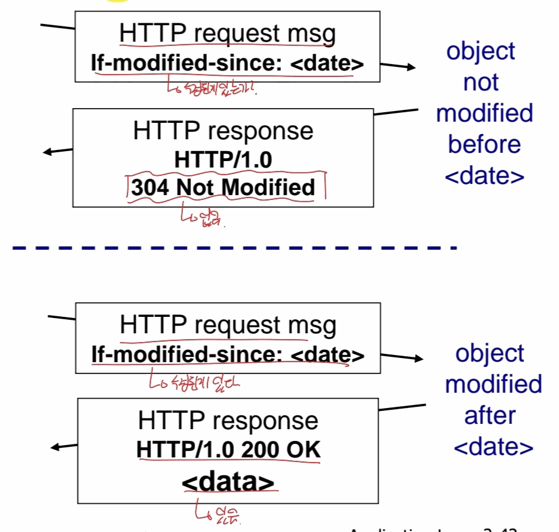

- **HTTP GET** request Header에 If-modified-since Header를 포함한다.

    - 만약 현재 가지고 있는 Object가 수정되지 않았다면, status code 304가 반환된다.
    - 만약 Object가 수정되었다면, status code 200과 함께 새로운 Object가 반환된다.
