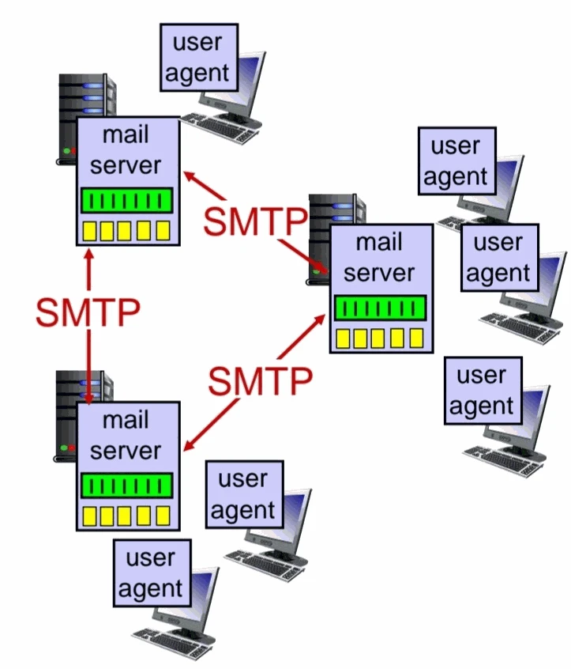
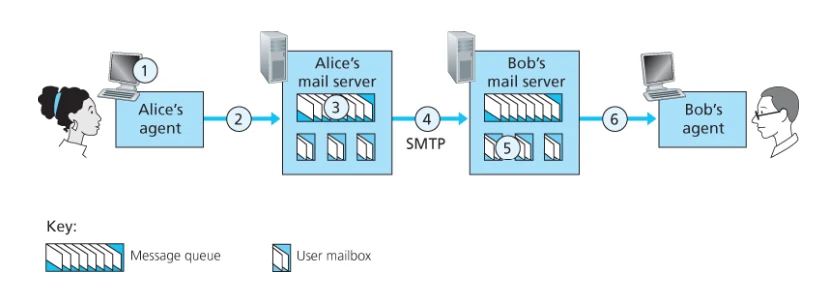

# Electronic Mail

작성일 2023-10-16 · 최종 수정일 2023-12-07
{ .post-date }

## &lt;E Mail의 구성요소&gt;

- **User Agent**

    - Email을 처리해 줄 Application

- **Mail Server**

    - Mail 요청을 처리해 줄 Server. 보내고 받는 쪽에 둘 다 있어야 한다.

- **SMTP**(Simple Mail Transfer Protocol)

    - 메일 전송에 사용되는 Protocol

### Mail Server

> E Mail에서 Mail Server는 전달하고자 하는 Mail을 다른 Mail Server에 보내는 역할을 한다.

- Mail Server는 두 개의 파트로 구성된다.

    - **Message Queue**

        - 한꺼번에 여러 사람이 메일을 보내려고 할 때, Queue에 넣어서 순차적으로 처리한다.

    - **Mail Box**

        - Mail Box는 메일 서버에 계정마다 존재하며, 메일이 여기에 전달된다.

> 메일이 빠르게 전송되지 않을 때가 있을 수 있는데, 그 경우는 1) 네트워크에 congestion이 발생한 경우, 2) 혹은 Message Queue가 꽉 찬 경우 이다.

### SMTP(Simple Mail Transfer Protocol)

> Mail을 전송할 때 사용되는 Protocol로서, 메일에서 가장 대표적으로 사용된다.

- **SMTP의 과정**

    - handshaking (greeting) ⇒ 통신이 가능한지 확인
    - transfer of message ⇒ 메일을 전송
    - closure ⇒ 통신 종료

    > SMTP도 HTTP와 비슷하게 command/response로 이루어진다.  
    >   
    > **command** : ASCII text  
    > **response** : status code and phrase

    > SMTP에서 mail의 Body는 반드시 7-bit ASCII로 이루어져야 한다.

> Mail은 Web HTTP와는 다르게, Server끼리 메일을 주고 받는다.

- **SMTP**는 **Persistent Connection**을 사용한다.
- **SMTP**는 **Header**와 **Body**를 포함하며, 반드시 7-bit ASCII로 구성해야 한다.
- **SMTP**는 **CR<strong>(Carriage Return)</strong>LF<strong>(Line Feed)</strong>CR<strong>(Carriage Return)</strong>LF**(Line Feed) 를 end of message 기호로 사용한다.

### Comparison with HTTP

> Client를 기준으로 하며, HTTP는 Client가 데이터를 받아오지만, SMTP는 Client가 데이터를 보내는 역할이다.

- HTTP : Pull
- SMTP : Push
- 두 개의 Protocol 모두 command/response interaction을 갖고, status code가 있다.
- HTTP는 Web Page에 10 개의 object가 있다면 10번 통신해서 object를 한 개씩 갖고 오지만, SMTP는 여러 개의 Object를 멀티 파트로 나누고 한 번의 통신으로 전송한다.

### SMTP Example

1. Client가 Mail을 전송하길 원하면, Mail을 내가 연결된 Mail Server로 보낸다. 이때 Message Queue가 비어있지 않다면, Mail은 Message Queue에서 대기하게 된다.
2. Mail Server는 해당 Mail을 보낼 차례가 되면 전송하려는 Server에서 받는 사람의 계정이 존재하는지 검사하고, 존재한다면 Mail을 전송한다. 이때, 보내는 Server는 Client의 역할을 하는 것이다.
3. Mail을 최종적으로 전달받은 Server는 전달받은 Mail을 수신자의 Mail Box에 넣어둔다.

> **Detail**  
>   
> 1. 클라이언트 SMTP는 서버의 SMTP의 25번 포트로 TCP 연결을 설정.   
>   
> 2. 연결이 설정되면, Application Layer Handshaking을 수행.  
> 이때 SMTP Client는 송신자의 전자메일 주소와 수신자의 전자메일 주소를 제공  
>   
> 3. 이후 Client는 메시지를 보낸다.(TCP의 신뢰적인 데이터 전송에 의존)  
>   
> 4. 보낼 다른 메시지가 있다면 같은 TCP 연결 상에서 반복, 그렇지 않으면 TCP를 닫는다.  
> (**지속 연결**, Persistent Connection)

### Mail Access Protocols

> Mail Server에서 내 Mail을 읽어오고, 처리하는 방법이다.  
> 대표적으로 POP3, IMAP 등이 있다.

- **POP3**

    - User Agent에 Mail을 가져오면, Mail Server에서는 해당 내용이 사라지게 되는 방식.
    - 과거에는 저장 공간의 한계 때문에 이런 방식을 채택했다.

- **IMAP**

    - User Agent에 Mail을 가져와도, Mail Server에서 해당 내용이 사라지지 않는 방식. 최근에는 이 방식이 POP3보다 많이 사용되기도 하지만, Web Mail의 대중화로 인해 잘 사용되지는 않는다.
