# DNS & CDN

작성일 2023-10-16 · 최종 수정일 2023-12-07
{ .post-date }

## &lt;DNS(Domain Name Service)&gt;

> Host는 접속하고자 하는 Server의 고정 IP를 알아야만 접속이 가능하다. 하지만 그 Server들의 고정 IP를 외우고 있는 것은 어렵다. 그래서 IP를 사람들이 알 수 있는 URL String으로 바꿔주는 것을 DNS라고 한다.

**DNS**

### DNS란?

> DNS는 알고리즘이 아니라, 하나의 데이터베이스와도 같다.  
> DNS는 두 개의 field로 이루어져 있으며, Name ↔ IP를 매칭한다.

- 우리는 인터넷을 이용하기 위해 다음 설정을 마쳐야 한다.

    - IP Address, Subnet mask, Gateway, DNS를 세팅해야 한다.
    - 또한, DNS는 Application Layer에서만 수행되는 Protocol이다.

- DNS는 Query를 하고, 그거에 대한 Resolve를 받는 방식으로 수행된다.

    > ex. www.naver.com에 접속하려는데, 그 IP좀 알려줘라. 이렇게 Query를 한다. 그런데 만약 DNS 서버가 IP Address를 가지고 있다면 반환. 그게 아니라면 다른 서버를 뒤져서 가져온다.
    >
    > ⇒ 복잡도가 높을 것 같지만, 그렇게 높지는 않고, 모두 Edge에서 이루어지므로 빠르다.

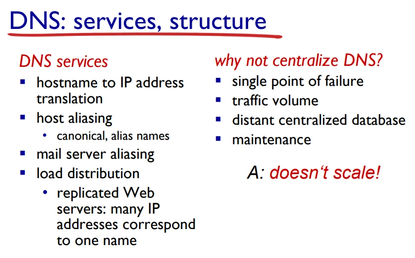

- **Host Aliasing**

    - 하나의 IP Address도 여러 개의 Host가 존재할 수 있다.
    - 그런데, 그런 Host들은 각각 IP Address가 있어야 한다.

- **Load Distribution**(*Multi Server & Multi IP Address*)

    - Server는 유저의 요청을 분산하기 위해 여러 대의 Server를 둔다.
        ⇒ 이를 Load Distribution이라고 한다.

    - Server를 여러 대 존재하면, DNS가 Local Server로 안내해준다.
    - 즉, IP Address는 여러 대가 있지만, DNS가 가장 가까운 Local Server로 연결해 주는 것이다.

    > 우리나라는 하나의 DNS Server를 사용하고 있는데, 사실 DNS는 거의 Centralized하지 않다. 그리고 인터넷에서 중요한 것은 Distribution을 하는 것이다.

> 만약 DNS 서버가 하나만 있다면 어떨까?  
> ⇒ 그러면 DNS 서버를 설정할 필요가 없으니까 전세계 모두가 하나의 주소로 접속하면 될 것이다.  
>   
> 하지만, 문제가 존재하는데, 그 DNS 서버가 다운되면 매우 큰 문제가 발생한다.   
>   
> 또, 특정 서버에 접근하기 위해서 네트워크를 타고 가게 되는데, 만약 DNS 서버가 하나만 있다면 가까운 것들만 빨리 처리되기 때문에 문제가 생길 수 있다.  
>   
> 그리고, 만약 서버가 유지보수를 해야 한다면 아무도 인터넷을 사용할 수 없기 때문에 문제가 생긴다.

### DNS : a distributed, hierarchical DB

> 계층적으로 구조를 만들면 관리가 쉬워지며, 정보가 올라가고 내려가는 속도가 매우 빠르다. (계층의 이점을 활용해 전파의 부담을 줄이고, 데이터를 위로 올려줄 수 있음.)

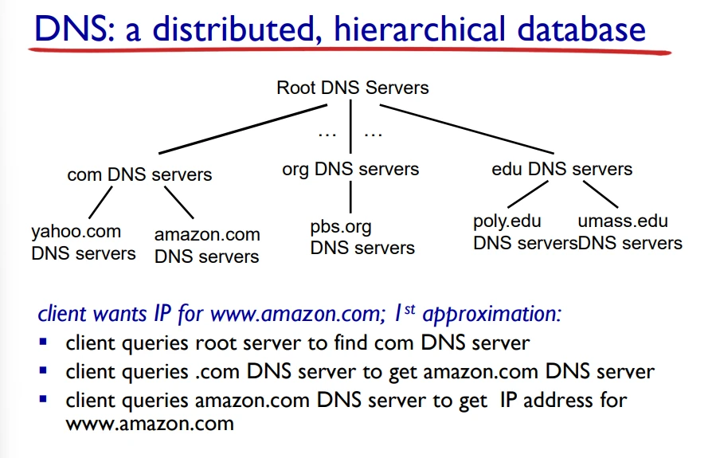

- Root DNS Server

    - .com DNS Server
    - .org DNS Server
    - .edu DNS Server

- 이렇게 hierarchical하게 연결되어 있다고 해도, Root DNS Server가 모든 정보를 갖고 있지는 않다. 주로 바로 밑에 있는 자식 노드들의 정보만 갖고 있게 된다.

### TLD(authoritative servers)

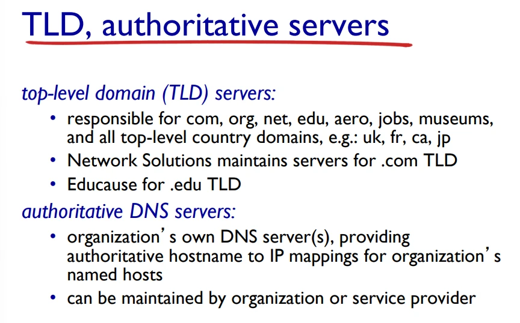

- top-level domain (TLD) servers

    - 상위 domain들을 관리하는 서버

- authoritative DNS servers

    - 각 기관은, 기관 자신의 authoritative DNS server를 가진다.

### DNS name resolution example

> 어떻게 Name으로부터 IP를 얻어낼 수 있는가?

- ex. gaia.cs.umass.edu를 접속하려고 한다. 그런데, 바로 접속할 수가 없다. (왜냐면 현재 알고 있는 것은 Domain Name 뿐이므로, IP Address를 얻어야만 한다.)

- **Iterated Query**

    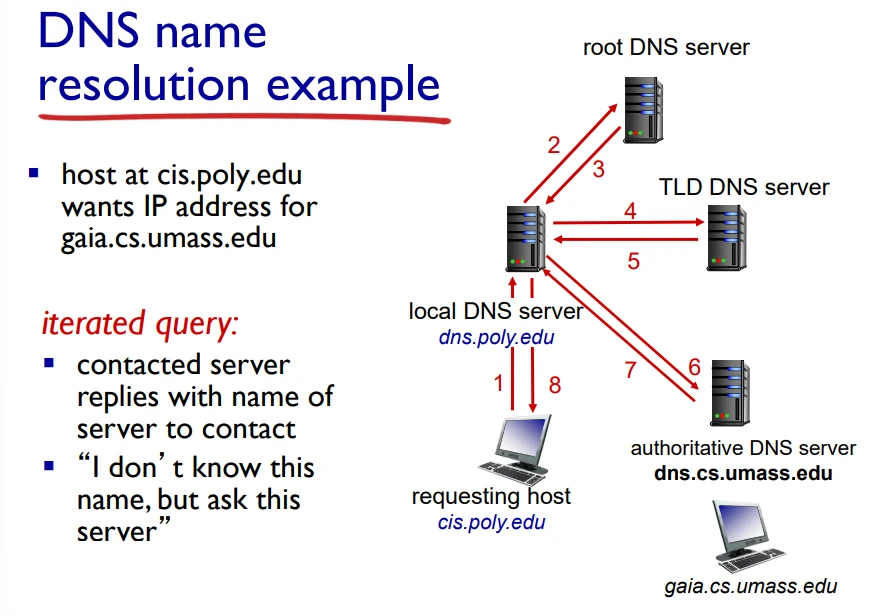

    - local DNS Server에게 [gaia.cs.umass.edu](http://gaia.cs.umass.edu)라는 주소를 보낸다.
    - 만약 local DNS Server가 알면 바로 보내주지만, 모를 수도 있다.

    - 모른다면 root에게 물어본다. (root의 주소는 알고 있음.)  

        - root가 TLD DNS Server의 주소를 준다.

    - 그러면 local DNS Server에게 물어보고, 만약 모른다면 authoritative DNS Server의 주소를 알려준다.
    - 그러면 local DNS Server는 authoritative DNS Server에 접근하여 IP Address를 전달받게 된다.
    - 이렇게 전달받은 주소로 접근하여 데이터를 전달받는다.

- Recursive Query

    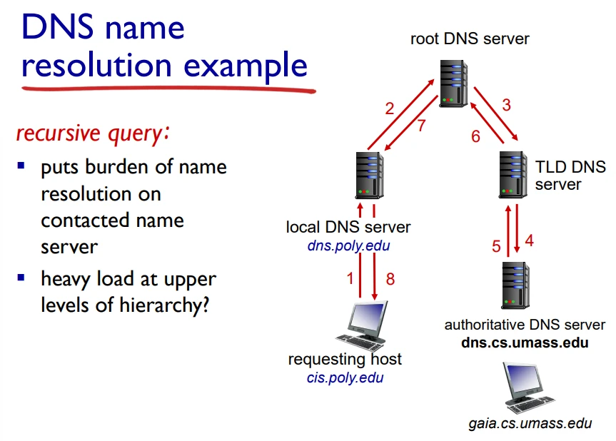

    - Recursive Query는 응답을 local DNS Server에게 보내주는 것이 아니라, 한 번에 찾아놓고 한 번만 응답을 돌려주는 것이다.

> 과거에는 Iterated Query를 주로 사용했지만, 최근에는 Recursive Query를 주로 사용한다.

- local DNS Server나 다른 서버는 자신이 한 번 찾은 주소를 저장하고 있는다.
    ⇒ 이를 **DNS Caching**이라고 한다.

    - 다만 끝도 없이 저장하는 것은 아니고, 어느 정도 시간만 저장한다.
    - 또, 구글이나 네이버와 같은 대형 회사들은 보안 상의 이유로 IP Address를 계속해서 바꾼다. 그러므로 저장하는 시간이 길지는 않을 수 있다.

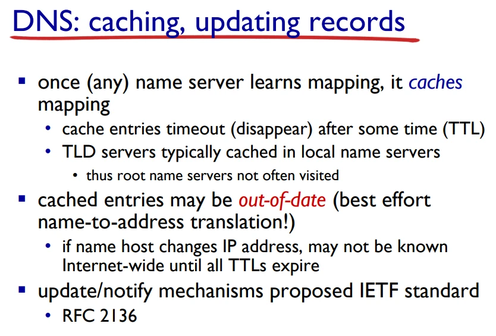

- 최근 트렌드가, Cache형 DB를 많이 사용한다.

    - 그런 데이터들은 모두 TTL을 가져서, Storage에 저장을 했다가 자동으로 삭제하는 방식으로 사용한다.

- DNS records

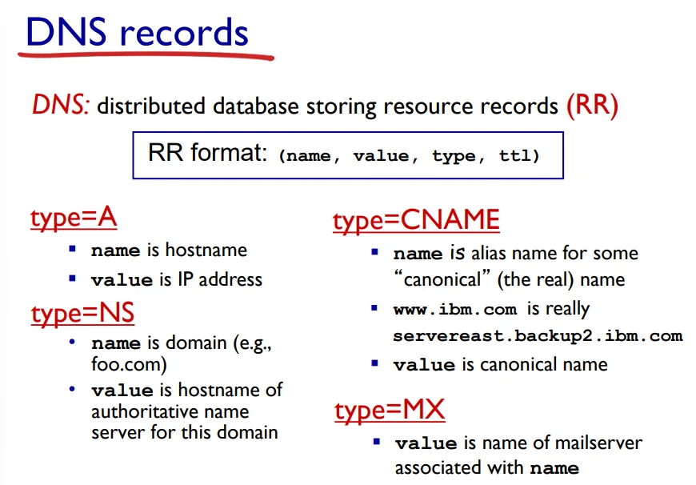

### DNS Protocol, Messages

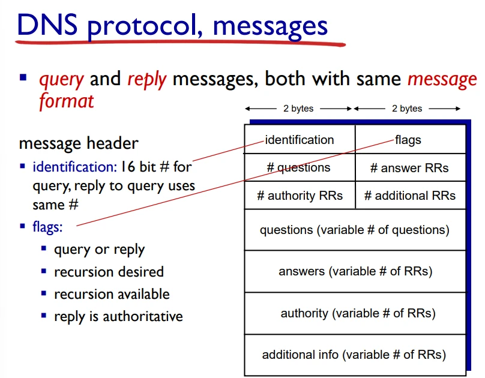

- 특정 주소에 접속 → Identifier가 채워짐. (Random Number)

    - 이것이 매우 중요한데, recursive에서 다시 돌아올 때, 어떤 Query에 대한 응답이냐는 것을 알아야 한다. 그걸 알아야 되는데, 그렇기 때문에 Query와 Reply의 Identification Number가 같아야한다.

        - Question이 몇 개인가? (여러 개 가능)

- flags

    - Query or Reply : Query에는 Questions이 붙는다. (Domain Name 포함)

    - authority RRs : Recursion으로 할거냐, 말거냐

        - 만약 recursion을 사용하고 싶다면, 다음 두 개의 field set이 필요.

            - recursion desired
            - recursion available

    - reply is authoritative
    - answer RRs

    - additional RRs

        - Answer가 몇 개인지 체크하는 것으로 보인다.

- **Attacking DNS**

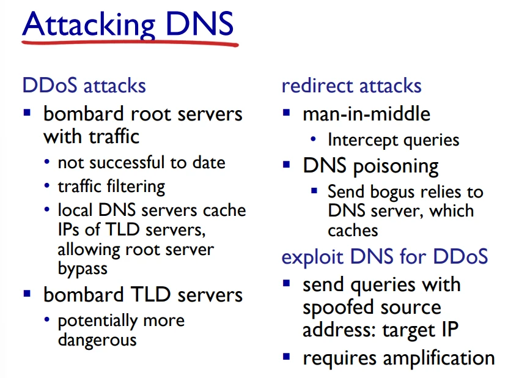

---

## &lt;CDN(Content Distribtuion Network)&gt;

> Internet의 Bandwidth 중 37%는 Youtube, 16%는 Netflix이다.  
> 어떻게 이렇게 많은 Traffic을 감당할 수 있을까?

[[네트워크] DASH, CDN](https://hi-guten-tag.tistory.com/383)

- Youtube나 Netflix가 Single-Mega Server였다면 Single Point Failure 때문에 불가능했을 것이며 서버가 하나라면, Fairness(거리별로 서비스 받는 속도)의 문제도 존재할 것이다.

- Host마다 접속 방법이 다르며, Throughput은 Bandwidth가 가장 작은 것에 수렴한다.

    - 만약 내가 안좋은 환경에서 접속한다고 해서, 서비스가 안좋다면 나는 분명 Complain을 하고 싶을 것이다.
    - 이런 상황에서 어떻게 서비스를 잘 할 수 있을까?

- 인터넷 망은 공유가 원칙이다. 어느 누구라고 해서 망 전체를 차지해서는 안된다. ⇒ 이렇게 공유하고 있는데 어떻게 서비스를 잘 할 수 있을까?

> 가장 중요한 것은 서버를 여러 대 두는 것이다.   
> (Distributed Server)   
>   
> 전세계 곳곳에 서버를 여러 대 두고, 망을 공유한다.   
> (Application-level Infrastructure, 서비스를 상위로 띄워버린다.)

- 데이터의 용량이 늘어난다는 것은 시스템에 있어서는 단순히 메모리를 늘리면 되는 것이지만, 네트워크에는 다른 문제가 된다.

    - 보내야 될 용량이 많아진다는 것이므로, 엄청나게 많은 양을 전송해야만 한다.
    - 그런데 사실 이것을 있는 그대로 보내면, 우린 이것들을 볼 수 없다. 
    - 영상은 한 프레임 한 프레임이 고용량이므로, 우리는 이 데이터들을 **압축**해야만 한다.

### 네트워크 전송 데이터의 압축

- **spatial** : 공간적 특징을 잡아 압축한다.

    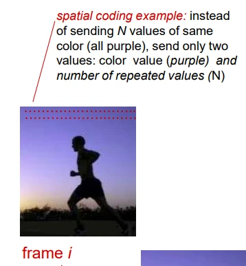

    - **한 프레임 내**에서 픽셀 값이 유사한 픽셀들의 값을 그냥 합쳐버리는 것이다. **Huffman Coding**을 이용해서 압축한다.
    - 압축을 해서 보내면, 복호화를 해야만 한다.
    - spatial 방식은 **색깔**이 **변하지 않을수록** 더 잘 **압축**된다.

- **temporal** : 앞 뒤 프레임의 변화에 따라 압축한다.

    - 앞 영상과 뒷 영상의 차이를 본다.
    - 영상이 1초에 30프레임 이라는 것은 한 프레임에 약 33ms가 할애된다는 것이다. 그런데, 생각보다 그 시간 안에는 변화량이 많지는 않다.
    - 그렇게 앞, 뒤 프레임의 변화를 체크하고, 변화가 있는 프레임에 대해서만 어디가 얼마만큼 변했는지, 그 변화를 기록하는 것이다. 즉, 만약 변화가 없는 영상이라면 영상을 아예 보내지 않을 수도 있다.

> MPEG, H.264 등을 이용해 동영상을 압축하게 된다.

### Streaming Stored Video

> - cdn은 throughput이 어느정도 보장이 되어야 한다.
>
>     - transport service의 reliable이 중요한게 아님. reliable하고도 빨라야 된다. 그런데 가입자 수가 많아질 수록 서버에서 클라이언트로 보내주는 양이 많아진다.
>     - 이걸 어떻게 효율적으로 할 수 있을까?
>
> ⇒ VOD(Video On Demand). Stored Video를 자유롭게 볼 수 있는 방법이 없을까?

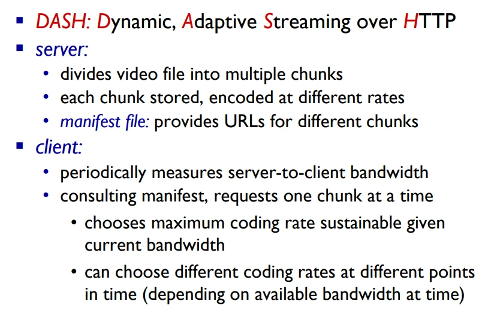

- 서버에 데이터가 저장되어 있고, Client가 요청을 한다.

    - 화면에 썸네일이 나오고 있고, Client가 영상 썸네일을 선택했다고 한다.
    - 그러면, 해당 영상이 실시간으로 전달되면서 Player에서 영상이 재생된다.
    - 최근 대부분의 영상 Platform은 Web을 사용하며, DASH Protocol을 사용한다.

    > **DASH** : Dynamic, Adaptive Streaming over HTTP

- 서버는 영상을 한 번에 보내는게 아니라, chunk로 나눈다. (마치 두부를 썰듯이 큰 데이터를 듬성듬성 잘라주는 것. cut off)

- 그 다음, 각 chunk들을 다른 rate로 encoding한다. 

    - spatial encoding
    - time encoding

- encoding rate가 높다 ⇒ 화질은 떨어지지만 용량은 작아진다.

- **Server**

    - video를 여러 개의 chunk로 쪼갠다.
    - 각각의 chunk는 서로 다른 rate로 encoding 된다.

    - manifest file을 가진다. (main server)

        - chunk에 접근하기 위한 URL을 제공.
        - Object가 다르다는 것은 URL이 다르다는 것이다.

- **Client**

    - Client는 주기적으로 작은 File을 Server에 보내서 **Round Trip Time**을 측정.

        - 이를 통해 현재 가용 Bandwidth를 확인한다.

    - **manifest file**을 **Consulting** 한다.

        - Server는 Client에게 확인한다. “내 bandwidth가 현재 이런데, 어떤 file을 주면 되겠니?”
        - 만약 서버와 높은 bandwidth를 유지한다면, loss가 적은, rate가 낮은 파일을 준다.
        - 그게 아니라면 rate가 높은 것을 준다.

    - 다른 채널에서 하므로 크게 오버헤드가 아닌 것으로 보인다.
    - 다른 point는 다른 chunk이다.
    - 네트워크 상태에 따라서 탄력적으로 보내주는 파일을 조절한다.

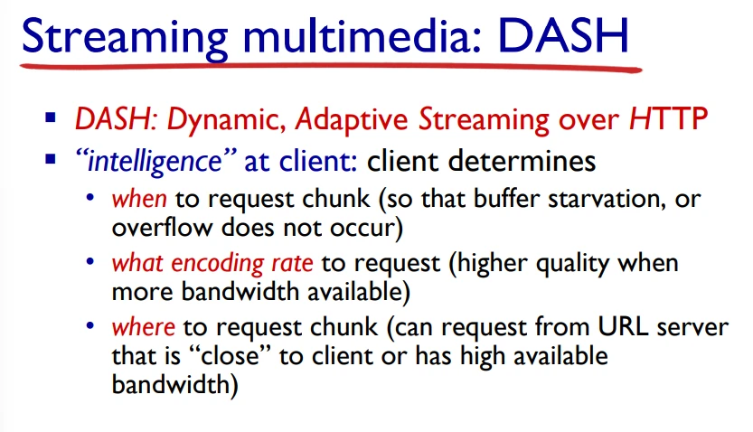

- 서버는 크게 하는 일이 없다. 단지 청크로 썰어서 URL을 공급해주는 역할.
- 반면 클라이언트는 현재 band width를 체크하고 받아올 데이터를 체크한다.

- Buffer(Queue)가 비어있다.

    - Buffer Starvation

### Network Architecture 측면

> 이전까지는 **프로토콜 측면**을 다뤘고, 이제는 **네트워크 아키텍처**의 **구조** 자체를 바꾸고자 함.

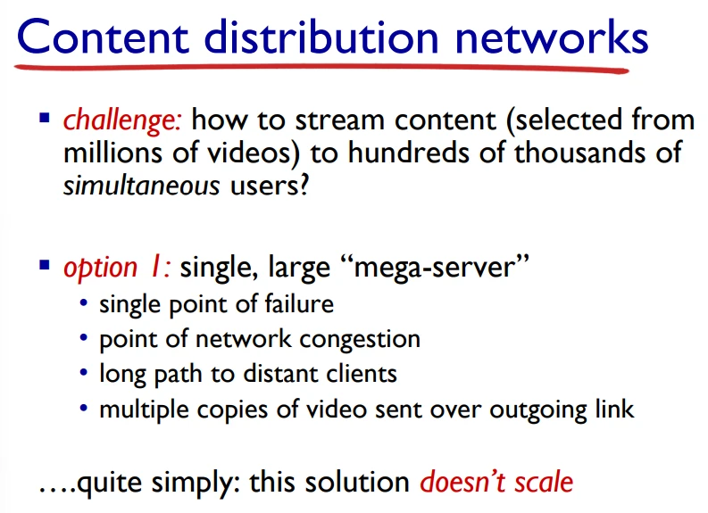

- 엄청나게 많은 요청을 처리하려고 한다. (동영상)

    - 수많은 유저들에게 어떻게 **Streaming Video**를 잘 전송할 수 있는가?

- `option 1` : single, large “mega-server” (대규모 서버)

    - **single point of failure**

    - point of network congestion

        - 큰 서버기 때문에, 근처 라우터들에 패킷이 집중됨.
        - 그러므로 network congestion이 특정 point에 집중돼서 발생한다.

    - client가 **실제 물리적으로 멀리 있다면**, 더 많은 라우터를 거쳐야 하기 때문에 큰 용량의 데이터가 모든 라우터를 거쳐야 하기 때문에 전달이 어렵다.

        - ex) 종이 하나만 나한테 전달해 봐.
        - ex) 이번에는 책상 10개를 전달해 봐. ⇒ 어렵다!
        - 멀리 있는 Client. 즉, **Long Path**에 있는 Client들이 큰 손해를 본다.

    - 내가 영화를 10개 갖고 있어. 근데 client들이 요청을 해. 만약 모두가 하나의 영화만 요청한다면 10개를 개별적으로 접속해서 똑같은 영화의 copy를 보내야 한다.

        - 똑같은 영화를 똑같은 방법으로 동일하게 전송하기 때문에 매우 비효율적이다.

> 이런 문제를 어떻게 효율적으로 해결할 수 있는가?

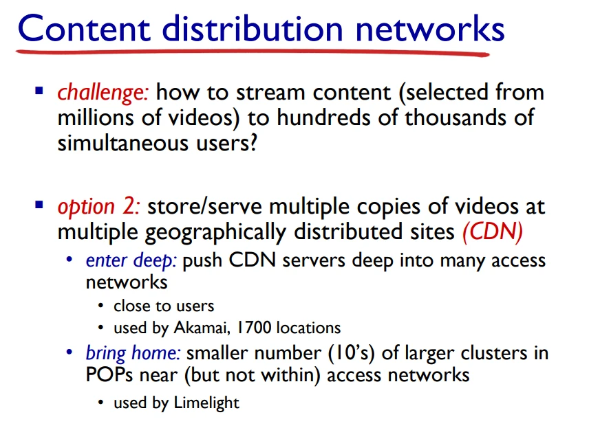

- 지질학적으로 분리된 서버를 곳곳에 배치하여 Client의 요청을 관리한다.

- 이렇게 하면, Client는 자신과 가까운 서버에 요청을 보내고 처리받을 수 있게 된다.

    - 이것이 CDN의 가장 기본적인 개념이다.

> CDN은 특허 때문에 회사마다 방법이 다르다.

- **CDN의 타입**

    - **Enter Deep** : Access Network(ISP 기준)마다 하나씩 CDN Server를 넣는다.

        - Akamai가 운영. 1700개(현재는 2000개 정도)의 지역에 서버 가짐.
        - Access Network 안으로 Server를 넣는 방식이다.
        - **Access Network**는 지역 ISP와 같은 큰 규모의 AS를 의미함.
        - 이를 통해 OTT와 같은 서비스를 제공할 수 있다.

    - **Bring On** : Access Network 안으로 넣는게 아니라, POPS라고 하는 작은 클러스터들을 Access Network 근처인 Core 부근에 배치한다. (Core 안쪽)

        - 최근에는 Enter Deep처럼 Access Network 안 쪽으로 서버를 넣고 있다.

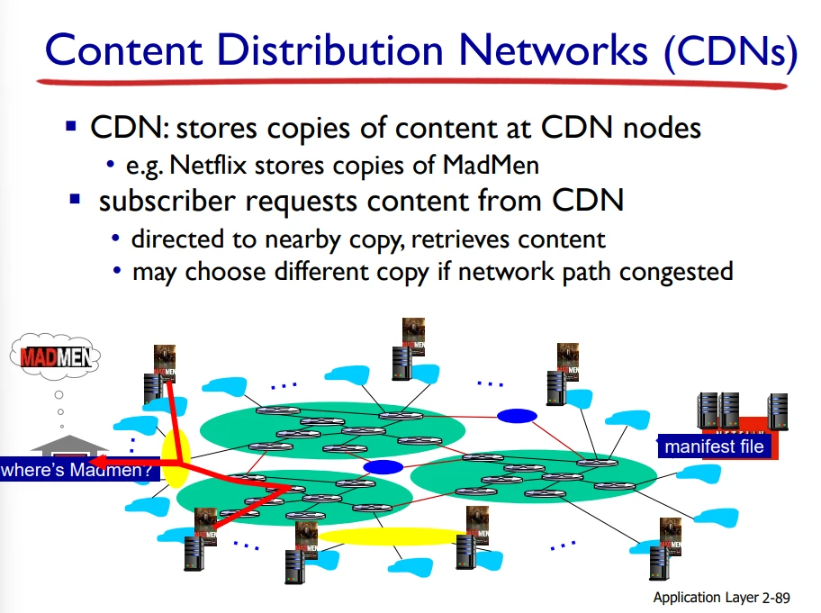

- **Netflix**의 모든 데이터는 **AWS**에 올라가 있다.

    - 이때 지역을 설정하는데, 이것이 CDN이다.

- 여러 개의 Server를 **Geographical**하게 **여러 곳에 위치**시킨다. 그리고 똑같은 **Copy**를 **보유**하고 있는다.

    - 그런데, 각각의 서버가 똑같은 Copy를 갖고 있지만, 실제로는 다 IP Address가 다른 고유한 컴퓨터이다.
    - 그런데 우리는 **Netflix**라는 Domain으로 똑같이 웹사이트에 접속할 수 있다.

    - 이런 기능을 지원하려면 **메인 서버**가 필요하다. (이미지 오른쪽)

        - 초기 메인 페이지는 **Netflix Main Server**에서 처리한다.

        - Client가 Main Server에 요청하면, 서버는 Manifest File을 보내준다.

            - Manifest File은 어느 쪽에 있는 URL의 서버로 접속하라고 알려준다.
            - 이처럼 요청을 분산적으로 처리한다.

        - 실제 서비스에 관련된 것은 전달받은 Manifest File을 통해 접속한 CDN에서 처리한다.

- ex) 인천 사람들이 넷플릭스를 너무 많이봐서 인천 Access Network에 넷플릭스 CDN을 놨다고 해보자.

    - 사람들은 Main Server로부터 초기 페이지를 전달받고, Manifest File을 전달받으면서 인천의 CDN으로 접속하고 있을 것이다.
    - 그런데 만약 사람들이 인천 CDN을 너무 많이 이용하면, Main server가 똑같은 Copy를 갖고 있는 다른 Manifest file을 전달해서 다른 서버를 쓰도록 한다.

> 그런데 이런 서버들은 실제로 Network Core 안으로 들어간 것이 아니라, **Over The Top**이라는 방식을 통해 Network의 상위. 즉, Application Level에서 이루어지는 서비스이다. 따라서 Core와의 문제는 전혀 없다. 주로 Edge(Access Router 안쪽)에서 발생한다.

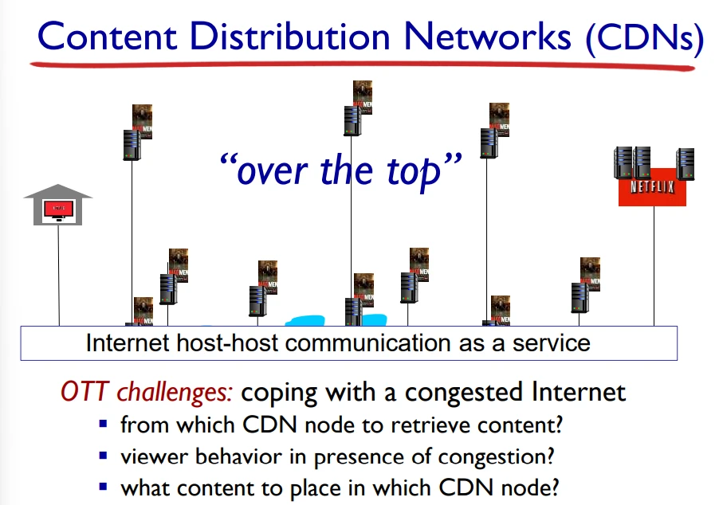

- **Internet Host to Host Communication as a service**

    - 이때 고려하는 것은 &lt;각 서버들을 어떻게 관리할 것인가?&gt;이며, 이것은 서비스로서 Host to Host Communication을 제공한다.
    - **Over The Top** : 이러한 서비스들은 Network의 상위인 Application Layer에서 이루어지며, Multimedia 컨텐츠를 제공하기 위해서 CDN을 사용하는 서비스

    > **고려 사항**  
    >   
    > 어떤 CDN 노드가 어떤 CDN 노드로부터 내용을 검색할 수 있는가?  
    > Congestion이 존재할 때, 보고 있는 사람은 어떤 행동을 해야 하는가?  
    > 어떤 CDN 노드가 어떤 Content를 갖고 있어야 하는가?

- 전 세계에 있는 모든 CDN이 똑같은 copy를 모두 가지고 있는다면 용량이 너무 클 것이다. 그러므로 CDN node에 따라서 서로 다른 내용을 가진다.

    - 어느 정도의 지역적인 특성을 가미해서, 다른 content를 가미해야 한다.

    > 이렇게 하면, 가지고 있지 않은 서비스는 어떻게 가져올 것인지 고려해 보아야 한다.

- **실제 동작 과정**
    (메인 서버에 로그인 ⇒ Available한 CDN Node에서 원하는 데이터를 받는 과정)

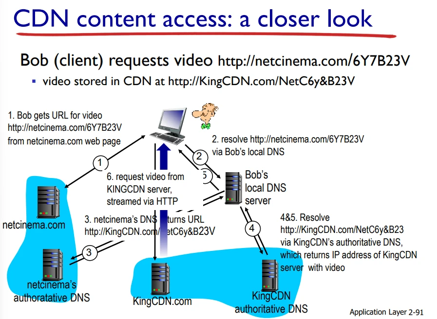

1. Bob이 영화를 보고 싶다. Main Server에 영화를 요청한다. 메인 서버는 영화를 가지고 있지는 않고, video(6Y7B23V, 하나의 청크)를 위한 URL을 준다.
2. 그러면 Bob은 DNS에게 요청, **Bob**의 **Local DNS Server**가 **netcinema’s authoratative DNS**에 요청하고, (Recursive or something) 영화를 가지고 있는 서버의 실제 IP Address를 resolve한다. (DNS만의 방법 사용)
3. 그러면, &lt;King&gt;이라는 영화의 URL을, DNS 서버에서 전달해 준다.
    ⇒ *HTTP를 통해 영화를 전달하므로, Application 단에서 이뤄지는 것으로 보인다.*

4. 그러면 KingCDN DNS Server에 접속을 해서, King CDN.com의 IP Address를 받아온다,
5. 이걸 Bob에게 전달한다.
6. Bob은 Direct로 KingCDN에 접속해 영화를 본다.

<!-- -->

- **DNS 서비스**를 부가적으로 이용해서 **IP Address**를 찾으러 가게 한다.

    - 즉, netcinema.com이 KingCDN.com의 IP를 알려주게 되는 것.

- 이렇게 하는 가장 큰 이유는, Main Server가 직접 모든 요청들에 대해서 다 알려줄 수는 없으니까, 대신 DNS 서비스를 이용해서 알려주는 것이다.
- Local DNS Server가 요청을 할 때, 자기가 이쪽으로 요청을 하게 되면 얘가 Local DNS Server의 IP나 이런 정보를 보고, 거기에 맞는 것을 보내준다. 궁극적으로 중요한 것은, Main Server가 CDN 노드의 IP를 알려주어야 하는데, 모든 요청을 직접 알려줄 수는 없기 때문에 DNS Service를 통해서 대신 알려준다는 것이 중요하다!

### Case Study : Netflix

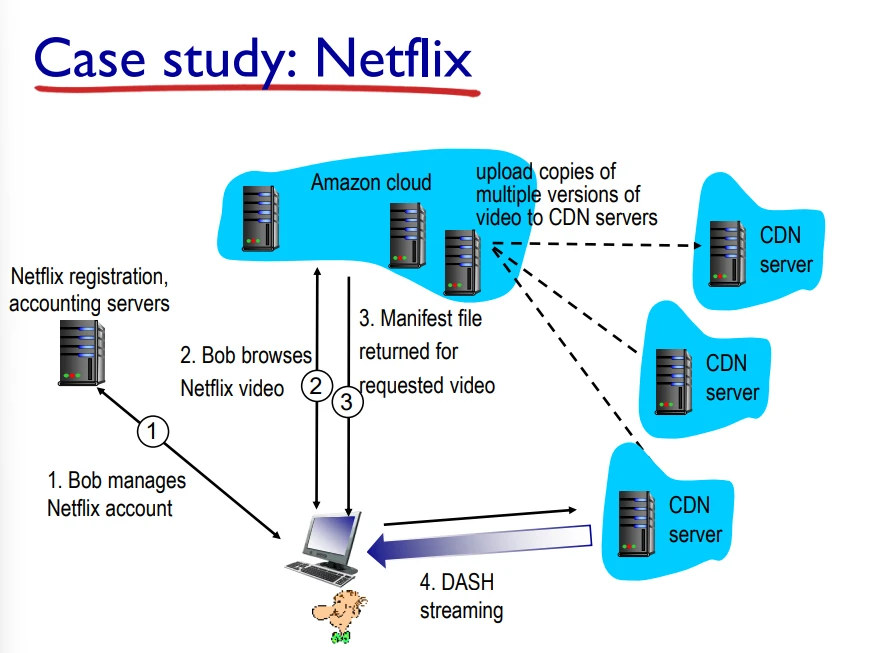

Accounting Server와 Data Server, CDN Server들이 분산되어 있다.

1. Login → 메인 페이지
2. 유저가 비디오를 요청한다.
3. 비디오를 볼 수 있는 CDN의 URL을 **Manifest File**로 전달한다.
    (단, 이전에 여러 CDN에 Copy를 미리 저장해 두었을 것이다.)

4. **DASH Streaming Protocol**을 이용해 비디오를 가져온다.

⇒ 여기서는 DNS를 이용하지 않을까? 이유는, 이미 AWS가 내부적으로 Manifest File을 통해서 CDN 서버의 URL Address를 알아서 전달해 주기 때문이다. (DNS를 거치지 않아도 곧바로 접속할 수 있는 IP Address를 전달해 주는 것이다.)
