# Transport Layer

작성일 2023-10-23 · 최종 수정일 2023-12-07
{ .post-date }

## &lt;Transport Layer&gt;

> Transport Layer는 **Edge**(Host)에만 존재하며, Application Layer를 조력하는 역할을 한다.  
> **Application Layer**와는 다르게, 무언가 드러나는 것을 하지 않고, **Application**을 보조한다.  
> (Core에는 Physical, Link, Network Layer까지만 존재한다.)

- **Multiplexing & Demultiplexing**

    - Application은 여러가지 프로세스로 실행되는데, **Transport**, **Network**, **link**, **physical**은 **OS**에서 하나의 서비스로 돌게 된다. 이걸 **여러 개**의 **Application**에서 하나의 서비스를 써야 하므로, **System Call**을 사용해 서비스를 요청한다.
    - 그런데 시스템은 하난데, 여기에 들어오는 요청이 많아도 어쨌든 작업을 처리해야 한다. 이것이 **Multiplexing**, **Demultiplexing**

> Reliable Transfer를 하기 위해서는 무엇이 필요한가?  
>   
> **Flow Control**  
>   
> **Congestion Control**

- **Transport Layer의 Protocol**

    - TCP : Reliable Protocol (100% Reliable Transfer)
    - UDP : Connectionless Protocol

- **Transport**

    - Transport Layer는 Network Edge에 존재하며, End to End간의 Transport를 하기 위해서 존재하는 것이다. 즉, End to End로 Application의 Message를 어떻게 잘 보낼 수 있는가? 가 주요한 포인트이다.
    - Network Layer로 내려오면, Router를 지나게 된다. 그러므로 Router들 부터는 Header를 열고 닫고 하면 분리가 된 것이다. (Segmentation이 된 것)

    - 그러나 **Transport Layer**에서 만든 Header는 반드시 **Destination**에 도착해야만 열 수 있다.

        - End to End Logical Connection을 유지함.

- **계층별 packet을 부르는 용어**

    - **Application**에서는 **Message**
    - **Transport**에서는 **Segment**
    - **Network**에서는 **Datagram** 
    - **Link**에서는 **Frame**
    - **Physical**에서는 **Bit**

⇒ Application에서 데이터를 전송하면 Transport Layer로 들어간다. 그런데 큰 데이터를 전송하려면, **Transport**에서 **Message**를 자른다. (한 번에 *관리할 수 있을 정도로*) 이걸 **Segment**라고 한다. 

(*이때부터 Segment들은 순서라는게 없다. 왜냐면 각각의 Segment들이 서로 다른 순서로 도착할 수도 있기 때문이다.*)

- 이렇게 자른 Segment들을 **Network Layer**로 보낸다.

-   **Network Layer**는 잘라져서 들어온 **Segment**를 그대로 **Transport**로 올리면 안된다. 만약 그러면 **Application**에서는 순서가 중구난방이 되므로, 이걸 맞춰줘야 한다. 

    - 전달된 Segment를 자른 것은 Sender의 Transport Layer이다.

    > **Layered Architecture**에서 가장 중요한 것은, 저지른 계층이 해결해야 한다. (결자해지)    그래서 잘린 Segment는 **Transport**가 다시 맞춰주고, 이렇게 맞춘걸 **Application**으로 보내준다.

- Application에서는 **TCP**/**UDP** 소켓을 동시에 열고 각각 다른 데이터를 전송할 수 있다.
- 하나의 데이터는 **TCP**/**UDP** 중 한 방법으로만 보낼 수 있다. (동시 전송 불가능)

### Transport vs Network Layer

- **Network Layer**는 **Host**간의 **Logical**한 **Communication**을 만든다.   
    그렇게 하기 위해서 Multi-Hop의 Core를 사용하는 것이다.

- 반면 **Transport Layer**는 **Process**간의 **Logical**한 **Communication**을 만든다.
- **Network Layer**는 IP 단위로 (Host-Host) Destination의 앞까지만 전달하고, 실제 안쪽까지 전달하지는 않는다.

- 그런데 실제로는 하나의 Device에서도 여러 개의 **Network Application**이 존재하므로 어떤 Application Process로 보내야 할 지 세부적으로 구분해 주어야 한다.

    - 이걸 구분하는 역할을 하는 것이 **Transport Layer**의 역할이다.

> 100% reliable(*반드시 packet이 전달되어야 하는 경우*)하거나 time-sensitive(*몇 번 정도는 packet이 drop 되어도 괜찮지만, 빠르게 전달되어야 하는 경우*)한 경우 등, Network Application마다 특성이 다양할 것이다. 이 특성을 Transport Layer에서 결정해 주어야 한다.

- **TCP**

    - reliable, in-order packet delievery service를 지원한다.

        - TCP는 잘라낸 Segment를 기다렸다가 그것이 다 채워지면 전달한다. (Selective Repeat)

    - **congestion control**
    - **flow control**
    - **connection set-up**이 필요하다.

    - **TCP**는 **Source**에서 **Destination**으로 데이터를 보내기 전, 마치 **Circuit Switching**에서 했던 것처럼 End to End로 **Logical**한 **Connection**을 만든다.

        - handshaking이 이루어지면 통신이 시작된다.

    - **Connection Oriented Service** (연결 지향 서비스)
    - 통신이 끝나면 항상 Connection을 Termination 해주어야 한다.

- **UDP** 

    - un-reliable (Less reliable)

    - **No-frills Extension of best effort**

        - 군더더기 없이 자신이 할 수 있는 최선을 다한다.

    - 군더더기란? 뭔가를 추가로 하고 싶다면 Header에 뭔가를 추가해야 한다.
    - 이걸 잘 받으려면, 이것 자체의 OverHead가 커지고, 시간이 늘어난다.
    - 반면 UDP는 받으면 받는대로 그대로 올려준다. 받는 대로 곧바로 올려주지만, 책임은 지지 않는 것. **그러므로 매우 빠르다.**
    - 따라서 **time-sensitive**한 **Application**에서는 사용해야만 한다.
    - 그러나 UDP가 Best Effort라고 하더라도, Delay를 Guarantee 할 수는 없다. Delay를 Guarantee하기 위해서는 Circuit Switching을 해야 하나, 사실상 packet switching 망에서는 불가능하다. ⇒ **따라서 Link의 Speed를 높인다. (프로토콜 개선이 불가능하므로)**

### Multiplexing/demultiplexing

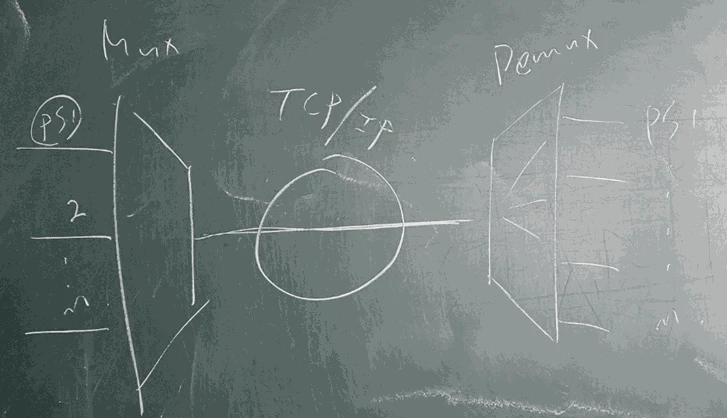

- 클라이언트 단에는 프로세스들이 하나씩 있고, 서버 단에는 프로세스가 여러 개 있다. 이때, **멀티플렉싱**이라는 것은, Transport 서비스는 하나인데 여러 개의 프로세스들이 동시에 사용하고자 할 때 어떻게 분배할 지의 문제이다.

- **Multiplexing** (데이터가 나갈 때, Application에서 하위로 내려갈때)

    - 여러 개의 데이터가 하나의 서비스를 이용하는 것
    - 각각의 프로세스는 **Socket**(*TCP/IP 서비스를 이용하기 위한 하나의 Interface*)을 통해서 **Transport Layer**를 통해서 TCP/IP 서비스를 받는다.

- **Demultiplexing** (여러 개의 데이터가 왔을 때)

    - 하나의 서비스로부터 온 것을 어떤 프로세스로 보내줄 것인지

- 프로세스마다 여러 개의 소켓을 사용할 수 있지만, 여기서 엄밀히 말하면 프로세스의 단위는 소켓 단위라고 볼 수 있다. (몇 개의 소켓이냐.)
- 요청만 하면 서비스를 이용할 수 있는데, 중요한 것은 결국 Segment가 Destination의 Transport Layer까지 왔을 때, 이 패킷이 P1로 가는 것이냐, P2로 가는 것이냐를 결정해야 한다. (**포트 넘버**)
- **Source Port Number**
- **Destination Port Number**

- **Transport Layer**가 **Network Layer**로부터 패킷을 받으면, 이게 어디서 온 것인지 알아야 한다.   
    (P3 인지, P4 인지. 이것은 **IP Address**로 판단.)

    - 만약 P4에서 온 거라면, P4의 **Source Port Number**를 판단한다.
    - 그리고 나의 **어떤**  **Process**로 전송할 지는 **Destination Port Number**로 판단.

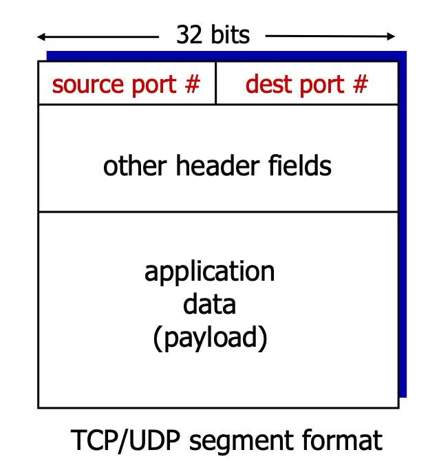

> Host들은 실제로 적절한 Socket(Interface)을 통해 올바른 Application에서 데이터를 받아들이기 위해서 Source IP Address, Destination IP Address, Source Port Number, Destination Port Number를 가지고 Mux/Demux를 사용한다.

- TCP/UDP 모두 Header의 최상위에 **Source Port Number**/**Destination Port Number**가 존재.

### Connectionless demultiplexsing(자바 예제)

> 소켓을 생성. (Datagram socket은 UDP) 반드시 parameter로 Source의 **Port Number**를 넣어주어야 한다. 다만 보낼 때는 반드시 **Destination Port Number**/**Destination IP Address**를 넣어야 한다.   
>   
> 생성할 때는 **Source Port Number**만 있으면 되지만, 보낼 때는 Destination IP Address까지 필요하다. ⇒ **Destination Port Number**가 같으면? **Source IP**/**Source Port Number**를 파악해서 누구에게 온 것인지를 분별할 수 있다.

- **Connection Less**

    - UDP

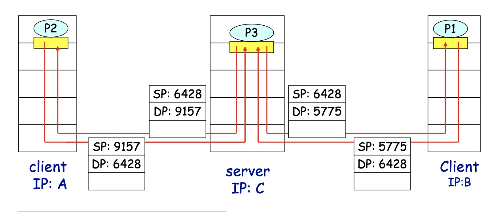

- **포트 생성 예제**

    - 9157(본인의 포트 생성)
    - 6428
    - 5775

- Source Port : 9157, Destination : 6428

- 역으로 보낼 때는, 

    - Source Port : 6428, Destination : 9157

⇒ 포트번호가 소스와 데스티네이션이 같아도 된다. 서로 IP Address로 구분이 가능하다.

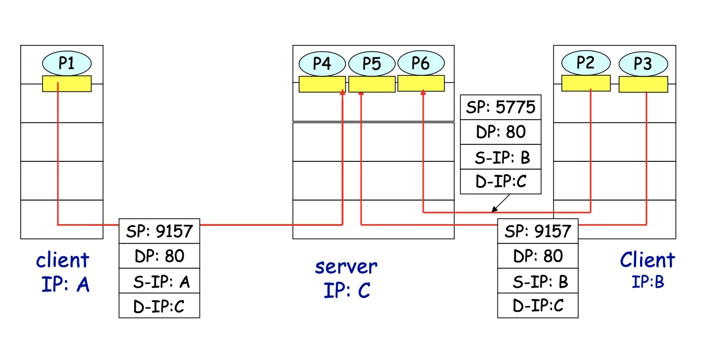

- **Connection Oriented**

    - TCP

- Connection Less는 Port Number만 있어도 구분이 가능하지만, Connection Oriented는 반드시 네 개가 모두 필요하다.   
    (*Source Port Number, Source IP Address, Destination Port Number, Destination IP Address*)

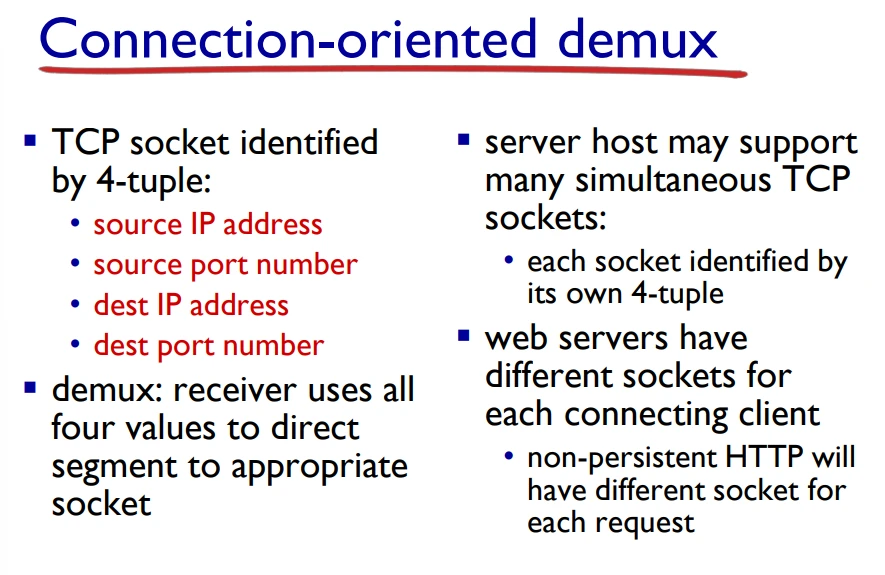

- 한 개의 Host에서도 여러 개의 Socket이 존재할 수 있다.
- Connectionless : 연결을 유지하는 것이 아니라, 매번 필요할 때마다 연결하는 것. 따라서 Source Port, Dest Port만 필요하다.
- TCP/UDP Port는 번호가 같아도 됨. (아예 독립적인 포트임.)
- 서버가 Client에게 보내고 싶다면, IP를 알면 됨.

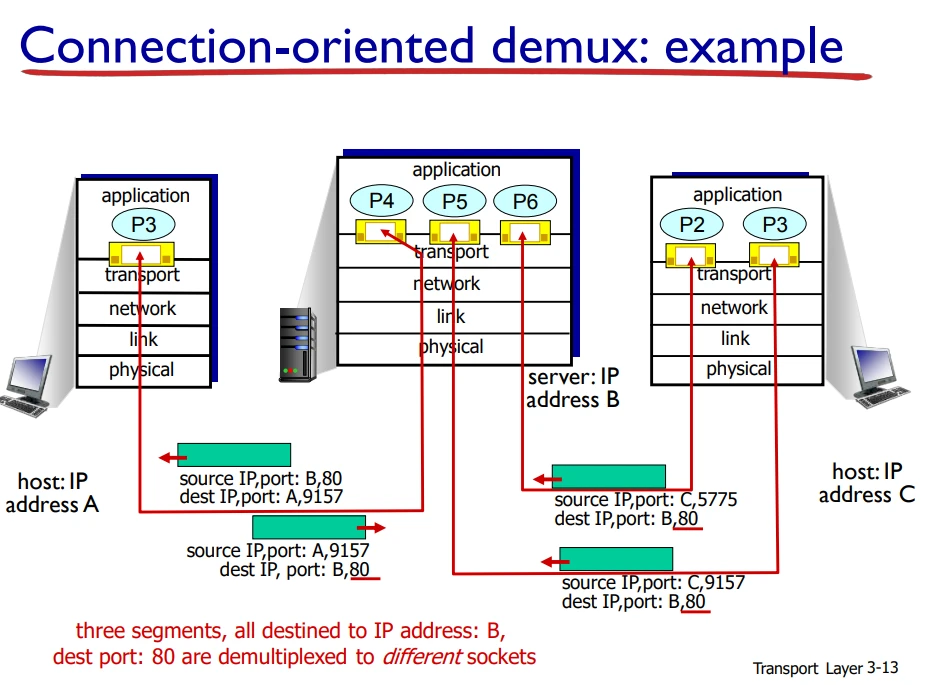

- 반면 Connection Oriented는 Connection이 연결되면, 연결된 Host와만 통신할 수 있는 전용 Process가 생긴다. 

    - 하나의 프로그램 안에서도 TCP 연결의 수만큼 프로세스가 생긴다.

- 내가 똑같은 Port 번호로 TCP 연결 별로 프로세스를 만들었다. 그러면 나의 Port 번호는 동일한데, 똑같은 Port로 대기하고 있는 프로세스가 여러개 있다. 이러면 어디로 보낼 것인가?

    - UDP는 하나의 프로세스로만 처리하기 때문에 그냥 그곳으로 보내면 되지만, 이와  다르게 TCP는 어느 프로세스로 보내야 하는지 알 수 없다.
    - 그렇기 때문에 보낸 쪽의 IP도 알아야 한다.

- UDP에서는 한 포트를 할당하는 프로세스가 하나만 존재한다.

- 반면 TCP는 한 포트당 여러 개의 프로세스가 생길 수 있기 때문에, Source의 IP Addree도 추가로 알아야만 한다.

> 이렇게 Multi-process를 해도 되지만, Multi-thread를 사용해도 된다.  
>   
> fork : 자신과 똑같은 프로세스를 만드는 것  
> Multi-process 서버는 프로세스를 여러 개 생성해서 개별적인 프로세스가 되도록 한다. 이렇게 하면 IPC를 쓰지 않는 이상 데이터 공유가 불가능하다. 그래서 최근에는 Multi-thread 기반의 서버를 사용한다.  
> (단일 프로세스, 멀티 스레드)

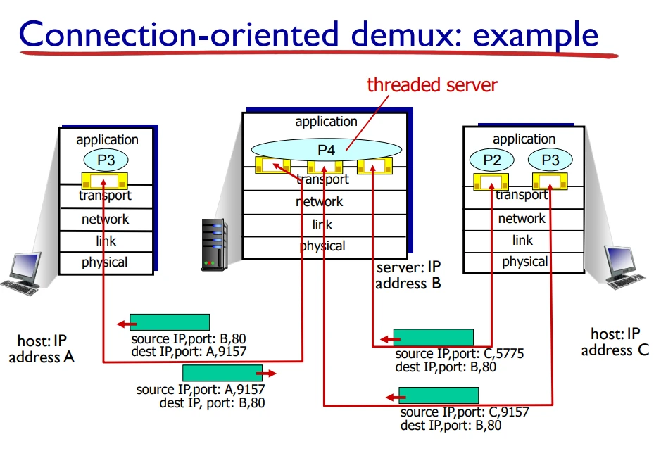

- Application에서 어떤 구조를 가지고 Client의 Process를 관리하느냐, 이것은 Demux와는 관계가 없다? ⇒ Demux는 그냥 똑같이 동작하고, 받는 주체는 Socket이기 때문에 Process가 받던지, Thread가 받던지 상관 없다.

### UDP (User Datagram Protocol)

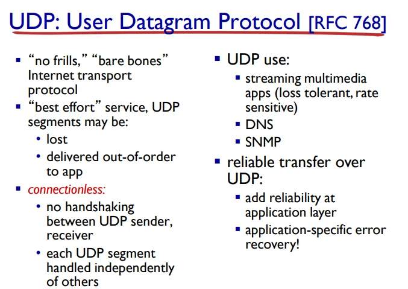

- Transport Layer에서 사용되지만, Datagram이라는 용어를 사용한다.
- 그 이유는, Transport Layer에서 특별히 하는게 없이 Datagram을 만들어서 곧바로 Network Layer로 내려주기 때문이다.

- 모든 Packet은 독립적으로, 개별적으로 보내진다. 이전에 누가 보냈는지는 신경쓰지 않고, connection을 만들지 않는다.

    - DNS는 UDP를 사용한다.

> 그렇다면 어떻게 UDP를 Reliable하게 사용하는가?  
> ⇒ 요즘 Trend는 TCP에서 가장 기본적인 것만 사용하고, 필요한 것들은 Application에서 구현하는 것이다.  
>   
> TCP는 OS에 들어가 있으니까 코드 한 줄도 볼 수 없기 때문에 수정이 불가능하므로, Application에서 Optimize하는 수밖에 없다.  
>   
> 그러므로 Application에서 에러 처리도 가능한 것.

- UDP: segment header

    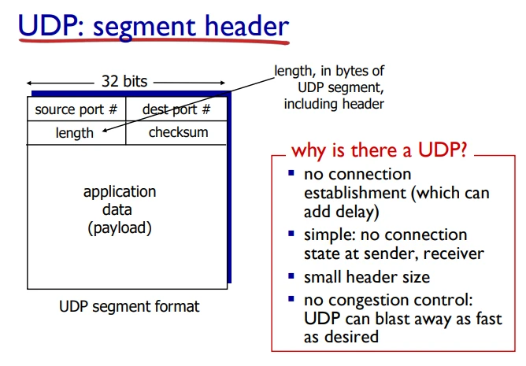

    - source port #, dest port #
    - length : Segment의 길이

    - checksum : Error Detection을 위한 Method

        - 가장 기본적인 에러는 1을 보냈는데 0을 받는 것이다.
        - Error Detection : Error가 있는지 없는지를 감지하는 것

        - Error Correction : Error를 수정하는 것이므로, Overhead가 크다.

            - Correction하는 것은 Overhead가 매우 커서, Application 입장으로 보면 하는 것이 더 손해다.

        - 대부분의 Protocol은 적어도 Error Detection을 가진다.

- Checksum

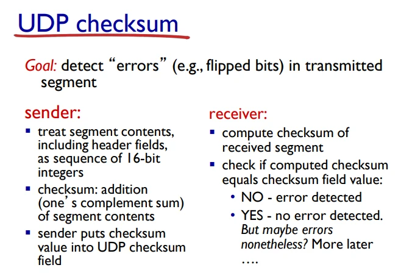

보내는 쪽이 보내고, 받는 쪽이 검사하는 것으로 보인다.

16bit integer를 더하고, 1의 보수를 취한다. (1의 보수는 그대로 더해준다.)  
⇒ 여기까지가 **sum**  
⇒ 그리고 이걸 반전시킨 것이 **checksum field**

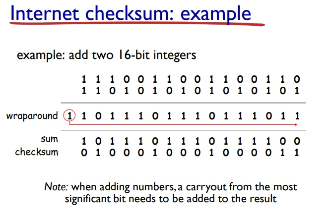

> 이게 checksum field와 다르면 error가 있는거고, 같으면 error가 없는거다.  
> 실제 보낼 때는 원본 데이터와 checksum을 받으므로, 받았을 때 1의 보수를 취하면 sum이 나온다. 이때 sum과 check sum을 더하면 모두 1일 것이고, 이것을 반전했을 때 0이 되면 문제가 없는 것이다. 하지만 하나의 bit라도 잘못되면 error가 발생한 것이라고 판단할 수 있다. (0이 안됨.)
