# rdt in TCP

작성일 2023-11-07 · 최종 수정일 2023-12-10
{ .post-date }

## &lt;What is rdt?&gt;

> RDT(reliable data transfer)는 TCP에서 Reliable Transfer를 구현하기 위해 사용되는 프로토콜이다. TCP는 반드시 RDT를 통해서 packet을 전송하게 되는데, 이것이 TCP와 UDP의 가장 큰 차이점이라고 할 수 있다.

### UDP recap

UDP는 less-reliable transfer protocol의 일종으로서, packet의 reliable transfer를 책임지지 않는다.

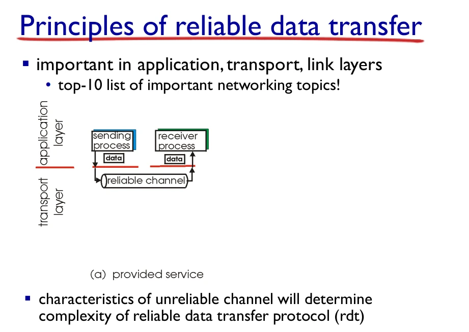

- TCP를 사용할 경우, sender process에서 보낸 데이터를 곧바로 receiver process에서 전달받아 사용할 수 있다. (*Reliable Channel을 지난다고 생각하기 때문에 데이터를 믿고 사용한다.*)
- 반면 UDP를 사용할 경우, source/target에서는 큰 문제는 없지만 channel을 지날 때 data에 문제가 생길 수 있다.  (*즉, TCP는 rdt를 통해 reliable transfer를 하지만, UDP는 그런 것 없이 그냥 보내기 때문에 less-reliable 하다.*)

### How to implement reliable transfer

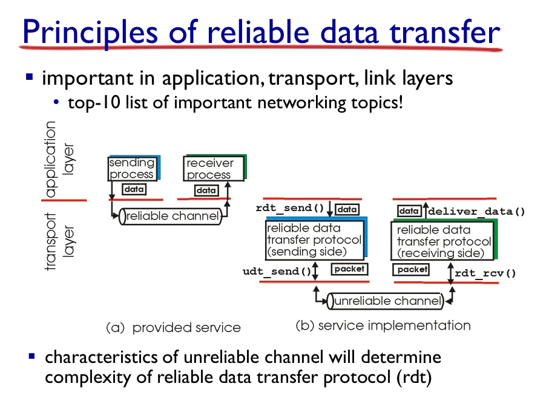

- TCP는 OS에서 추상화되어 제공되며, 따라서 Reliable Transfer를 거치기 위해서는 다음과 같은 과정을 거쳐야 한다.
- Source : function call을 통해 packet을 전달한다.
- Target : interrupt를 통해 전달된 packet을 가져온다.

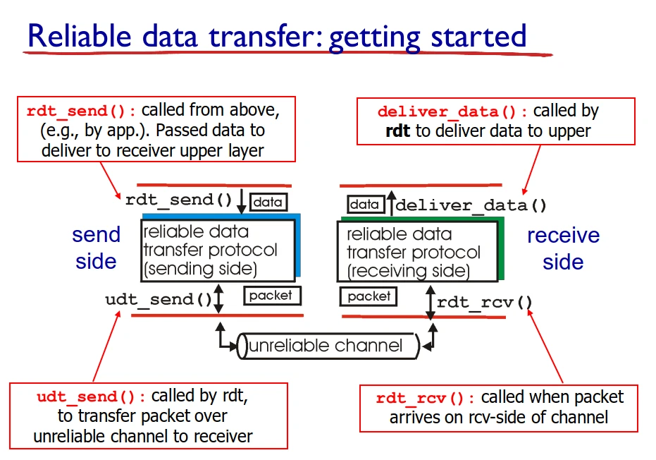

- Application Layer에서 <strong>rdt_send()</strong>를 호출하여 data를 transport layer로 전달한다.
- OS는 **rdt**를 사용하여, <strong>rdt_send()</strong>를 통해 전달받은 packet을 <strong>udt_send()</strong>로 unreliable channel로 전달하고, **receiver**에게 보내준다.
- unreliable channel을 거쳐 destination에 전송된 packet은 receiver side에서 <strong>rdt_rcv()</strong>를 통해 받아들여지고 OS에 전달된다. (*이 과정이 interrupt로 수행된다.*)
- OS는 <strong>deliver_data()</strong>를 사용하여 전달받은 packet의 data를 application layer로 올려준다.

> UDP는 channel을 통해 전달된 packet에 문제가 생기면 버렸지만, TCP는 reliable한 transfer를 하고자 어떠한 동작을 한다. 그러므로 TCP는 문제가 해결될 때까지 target에게 데이터를 전달해 주지 않는다.  
>   
> 또한, UDP/TCP모두 channel 자체는 unreliable하기 때문에, 별도의 protocol이 필요하다. 그래서 TCP가 rdt를 사용하는 것이다.

---

## &lt;FSM(State Transition Diagram)&gt;

> FSM은 다양한 Event가 발생하는 환경에서 Event의 주체가 가질 수 있는 여러 State를 Event의 발생에 따라 생기는 Transition과 함께 정리한 Diagram이다.  
>   
> rdt 또한 FSM으로 Diagram을 정리할 수 있다.

### FSM Example on RDT

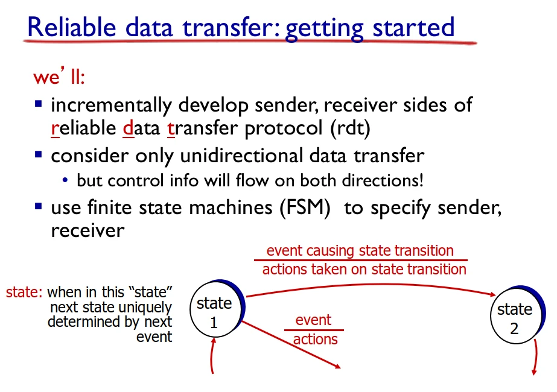

- FSM에서 서로 다른 State는 반드시 서로 다른 상태로 구현되어야 한다.
- FSM에서 모든 Event는 서로 다른 조건에 의해 발생해야 한다.

⇒ 이것을 TCP/rdt에 적용하면, packet의 상태에 따라서 TCP/rdt가 해야하는 일이 달라질 수도 있다는 것을 의미한다.

- 하나의 Event는 두 개의 요소로 구성되며, 위의 요소는 state transition을 유발하는 event의 상태를 말하고, 아래 요소는 state transition에 의해 발생하는 action을 의미한다.

---

## &lt;rdt 1.0&gt;

> rdt 1.0은 channel을 통해 reliable transfer를 완전하게 구현하는 것을 목표한다. 단, 여기서는 channel이 reliable하다고 가정해서 전송/수신만 완벽하게 구현하면 된다고 생각한다.

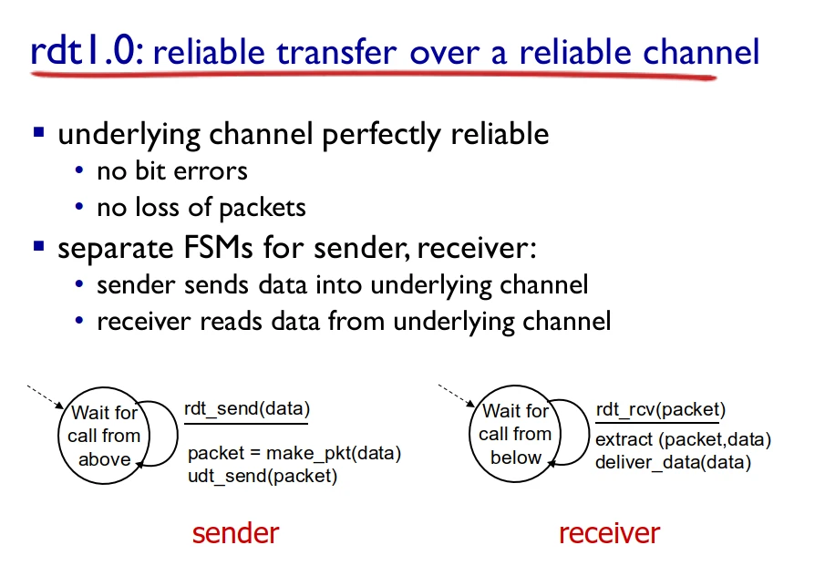

- **Channel**이 **Reliable**하다는 것의 의미  
    1) bit error가 없다.  
    2) packet loss가 없다.

- ***Sender*** : Sender는 packet을 전송하는 Host에서 function call에 의해 event가 시작된다.

    1) **event** : Application에서 <strong>rdt_send(data)</strong>를 호출하면, rdt 1.0을 통한 packet 전송이 시작됨

    2) **actions** : 전달받은 data를 바탕으로 <strong>make_packet(data)</strong>을 호출하여 packet 만들고, rdt를 통해 <strong>udt_send(packet)</strong>을 호출하여 channel을 통해 packet을 전송한다.

- ***Receiver*** : Receiver는 packet을 전달받고 이를 Application Layer로 올려준다.

    1) event : interrupt를 통해 <strong>rdt_rcv(packet)</strong>이 수행되어 packet을 전달받게 된다.   
    2) actions : <strong>extract(packet, data)</strong>를 통해 packet에서 data를 추출해 전달받고, <strong>deliver_data(data)</strong>를 통해 이를 Application Layer로 올려준다.

> 하지만 실제 Data Transfer는 이렇게 간단하지 않은데, channel이 절대로 reliable하지 않기 때문이다. 따라서 rdt 2.0 이상부터는 Feedback이 추가돼서 reliable transfer를 구현한다.

---

## &lt;rdt 2.0&gt;

> TCP는 rdt 2.0 이상부터 Feedback을 추가하여 packet의 전송 상태를 모니터링 할 수 있다.

### Feedback in rdt 2.0

1. **ACK** : 만약 전달받은 packet의 checksum에 문제가 없다면, receiver는 sender에게 ACK를 전달하여 packet에 이상이 없다고 알려준다.
2. **NAK** : 만약 packet의 checksum에 문제가 있다면, receiver는 sender에게 NAK를 전달하여 packet에 이상이 발생했다고 알려준다.

⇒ 만약 **Sender**가 **ACK**를 받았다면, 다음 packet을 전송하기 위한 동작을 준비한다. 하지만 만약 **NAK**를 받았다면, **Re-transmission**을 준비한다.

### rdt 2.0 FSM

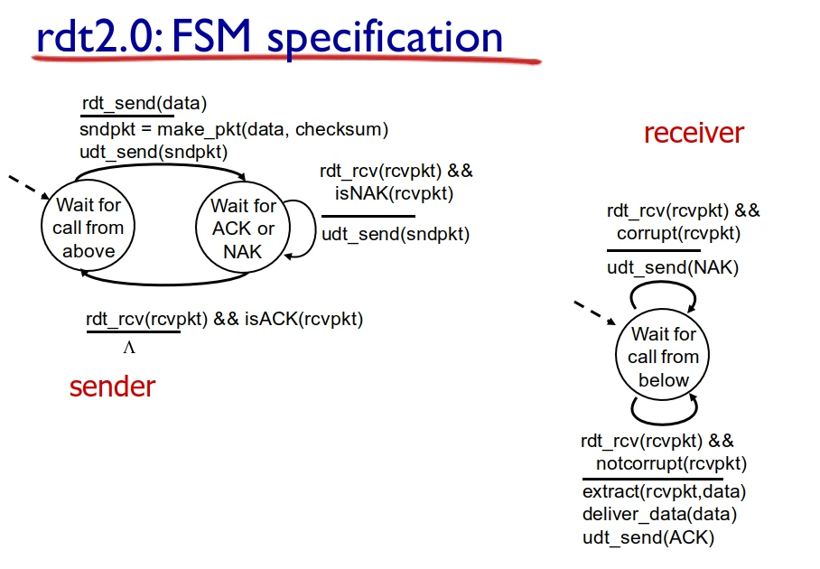

**Sender**

1. **Sender State 1)** (*초기에 Sender는 Init State인 1번 State에서 대기한다.*)

Sender가 1) State에서 대기하다가, <strong>rdt_send(data)</strong>가 발생했다고 해보자. 그러면 <strong>make_pkt(data, checksum)</strong>을 통해서 packet을 만든다. 이후에 <strong>udt_send(sndpkt)</strong>을 통해서 packet을 unreliable channel에 전송한다.

> rdt 2.0부터는 packet이 깨졌는지 안깨졌는지 판단하기 위해서 ACK/NAK를 만들어야 한다. 그러기 위해서는 checksum을 반드시 실어야 하기 때문에 packet을 만드는 모든 과정에서 checksum을 header에 실으며, 이는 이후의 버젼에서도 마찬가지이다.

1. **Sender State 2)**

packet을 보내고 나면, <strong>rdt_rcv(rcvpkt)</strong>을 수행하면서 Receiver로부터 Feedback이 돌아오길 기다린다.   
그리고 <strong>rdt_rcv(packet)</strong>이 True가 되면, 그것이 **ACK**인지 **NAK**인 지에 따라서 동작이 구분된다.

  
2-1) **isNAK(rcvpkt)**

만약 돌아온 packet이 NAK라면, re-transmission을 해야한다. 따라서 action으로는 <strong>udt_send(sndpkt)</strong>을 다시 한 번 수행한다.

> 이때, Sender의 Application Layer는 TCP가 현재 NAK를 받았는지, 뭘 하고 있는 것인지 알 수 없다. TCP의 모든 상태는 Application Layer에게 가려진다.

2-2) **isACK(rcvpkt)**

만약 돌아온 packet이 ACK라면, 다음 packet을 보내기 위한 준비를 해야한다. 따라서 1) State로 Transition하고, 새로운 Packet이 Application Layer에서 내려오길 기다린다. (*Do Nothing*)

**Receiver**

1. **Receiver State 1)** (*rdt 2.0에서 Receiver의 State는 하나이다.*)

Receiver는 계속해서 <strong>rdt_rcv(rcvpkt)</strong>을 수행하며 packet이 전달되기를 기다린다. 그러다가 packet이 도착하면 checksum을 통해 다음 동작을 구분한다.

1-1) **corrupt(rcvpkt)**

전달받은 packet이 깨졌다고 판단되는 경우, <strong>udt_send(NAK)</strong>를 통해 Sender에게 packet이 깨졌음을 알려준다.

1-2) **notcorrupt(rcvpkt)**

전달받은 packet이 깨지지 않았을 경우, 먼저 packet에서 데이터를 추출하기 위해 <strong>extract(rcvpkt, data)</strong>를 수행한다. 이제 추출한 data를 <strong>deliver_data(data)</strong>를 통해 Application Layer로 올려주고, <strong>udt_send(ACK)</strong>를 통해 packet을 잘 전달받았다고 Sender에게 알려준다.

### rdt 2.0 has a fatal flaw

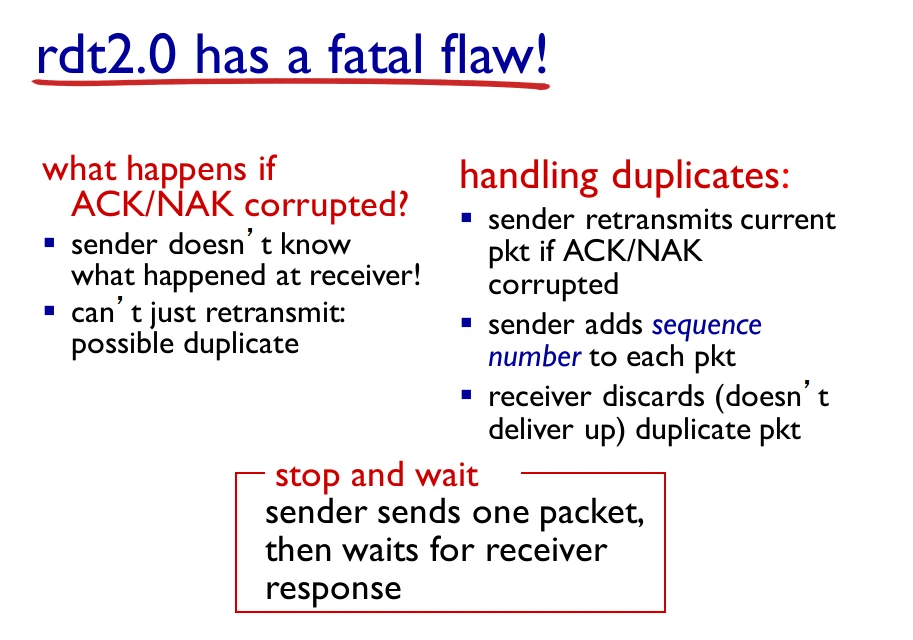

> rdt 2.0을 통해 내가 전달한 packet에 문제가 생겼는지, 잘 전달됐는지를 알아낼 수 있게 되었다. 하지만 여전히 문제는 존재하는데, 그것은 ACK/NAK도 하나의 packet이고 Sender 또한 Receiver와 마찬가지로 rcv_pkt(rcvpkt)을 통해서 대기하기 때문에 ACK/NAK가 깨질 수 있다는 것이다.  
>   
> 그래서 Receiver가 ACK/NAK를 보냈는데, 그 packet이 깨져서 재전송을 하게 된다면, Receiver는 그것이 재전송된 Packet인지 새로운 Packet인지 구분하지 못한다.  
>   
> 또한, 아주 만약에 ACK가 깨져서 NAK가 된다고 한다면, 정상적인 Packet을 또 보내서 Duplication이 발생할 수 있다는 치명적인 문제가 존재한다.  
> ⇒ 무슨 뜻이냐면, Receiver가 잘 받아서 ACK를 보냈는데 그 ACK가 깨진거임. 그러면 Sender는 재전송을 해야 함. 즉, Receiver는 NAK일 때만 재전송을 할 거라고 기대하고 있는데, ACK를 보냈음에도 재전송이 올 수 있다는 뜻. 하지만 Receiver는 이를 &lt;절대&gt; 알지 못한다.

---

## &lt;rdt 2.1&gt;

> 이전에 설명한 대로 packet이 깨졌는지 잘 전달됐는지를 ACK/NAK로 알아낼 수 있게 되었지만, ACK/NAK도 하나의 packet이기 때문에 이것이 깨져서 문제가 발생할 수 있다는 것을 알게 되었다. 이 문제를 해결하기 위해 rdt 2.1은 **Sequence Number**라는 개념을 도입하여 어떤 Packet에 대한 ACK/NAK인지를 구분한다.

### Sequence Number

> **# Seq**는 Packet마다 Number를 추가하는 것이다. 이전에 존재했던 문제 중에, ACK가 깨져서 NAK가 된다면 Sender가 똑같은 Packet을 또 전송하여 Duplication이 발생할 수 있다는 문제가 존재했다. 따라서 **# Seq**를 추가하여, Receiver가 이미 처리된 **# Seq**를 전달받는다면, 그 Packet은 ***Discard***하는 방식을 추가한다.

- 이전에 받았던 Packet의 Sequence Number를 기억하고 있으면, 현재 어디까지 잘 처리했는지를 확인할 수 있으므로 ACK가 깨져서 재전송이 온다고 하더라도 Packet의 Sequence Number를 알고 있기 때문에 문제없이 처리가 가능하다. ⇒ Duplication 문제 해결 가능하며, 이런 방식의 Protocol을 **Stop and Wait**이라고 부른다.
- 먼저 한 Packet을 보내고 Receiver가 Packet에 대한 Respond를 보내길 기다렸다가, 그 Respond가 완벽한 상태라면 그 다음 것을 처리하는 것을 **Stop and Wait**이라고 한다.  
    ⇒ 이것 때문에 **Reliable Transfer**가 가능한 것이다.

### rdt 2.1 Sender FSM

> 달라진 것은 오직 Packet의 # Seq가 추가됐다는 것이다. 0, 1을 반복적으로 설정하여 # Seq을 부여한다.

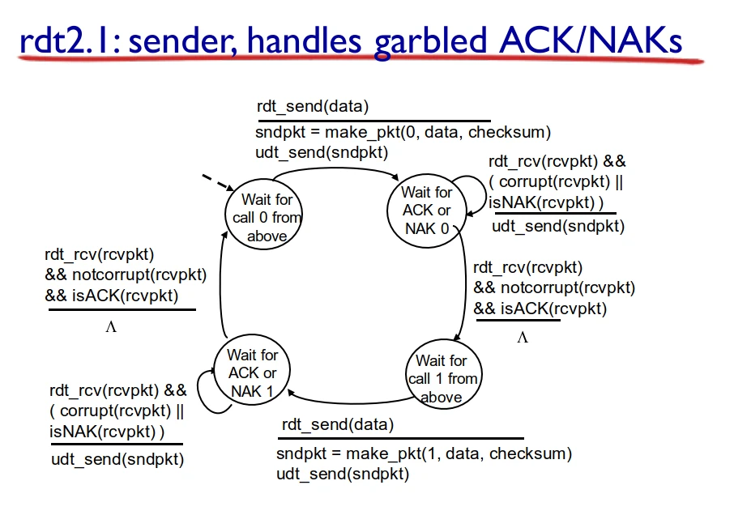

1. **Sender State 1)** 

    Sender는 초기에 대기하다가 Application의 호출에 의해 <strong>rdt_send(data)</strong>가 실행되면 <strong>make_pkt(0, data, checksum)</strong>을 통해 보낼 packet을 sndpkt으로 만든다. 그리고 rdt를 통해 <strong>udt_send(sndpkt)</strong>을 수행한다. 이때 0은 **sequence number**를 의미한다고 볼 수 있다.

    Application에서 데이터를 보내기 위해 Packet을 만들 때마다 Sequence Number가 새롭게 부여된다고 할 수 있다. 초기에는 0이 부여되어 전송된다.

1. **Sender State 2)**

    Sender는 Receiver로부터 ACK 혹은 NAK가 도착하기를 기다린다. 대기하다가 만약 <strong>rdt_rcv(rcvpkt)</strong>이 True가 되면 두 가지를 체크한다.

    - corrupt/notcorrupt
    - isNAK/isACK

    ⇒ 이 두 가지 조건에 따라서 동작을 결정한다.

2-1) **corrupt(rcvpkt)** || **isNAK(rcvpkt)**

우선 corruption이 발생했다면 (*packet이 깨졌다면*) 무조건 재전송한다. 왜 ACK가 깨진건지 NAK가 깨진건지 구분하지 않을까?

>  일단 깨지면 그게 NAK가 깨진건지 ACK가 깨진건지 우리는 알 수가 없으니까 깨졌으면 바로 재전송하는 것이다. (***깨졌으면  # Seq 0을 바로 재전송한다.***)

<strong>corrupt(rcvpkt)</strong>이 아니더라도, 만약 <strong>isNAK(rcvpkt)</strong>이라면, 재전송한다.

2-2) **notcorrupt(rcvpkt)** && **isACK(rcvpkt)**

packet이 깨졌거나(***corrupt(rcvpkt)***), 전달받은 것이 NAK라면(***isNAK(rcvpkt)***) 무조건 재전송한다. 하지만 깨지지 않았고(***notcorrupt(rcvpkt)***), 그리고 전달받은 것이 ACK라면(***isACK(rcvpkt)***) 다음 packet을 전송하기 위해 준비해야 한다.

1. **Sender State 3)**

    이제 다음 Packet을 전송하기 위해서 대기해야 한다. 모든게 1번 State와는 똑같지만, 단지 # Seq을 1로 설정한다는 데만 차이가 있다.

1. **Sender State 4)**

    모든게 2번 State와 똑같으며, 단지 # Seq 1에 대한 Packet을 기다린다는 데서만 차이가 있다.

> Q. State 2) State 4) 에서 정해진 # Seq를 기다리는 것은 어떻게 처리되는 거지?

**Answer**

> 내 궁금증은 만약 0번 Packet을 보내고 이것에 대한 ACK를 기다리는데, 도착한 ACK가 1번 Packet에 대한 ACK가 아닌, 0번 Packet에 대한 ACK냐고 어떻게 확신하냐는 것이었다. 이것은 다음 과정을 생각해보면 이해가 된다.  
>   
> Sender가 0번 Packet을 보냈다. Receiver는 ACK/NAK를 Sender에게 보내게 될 것이다. 그런데 이 상황에서는 무슨 일이 일어나도 ACK가 온전하게 도달하기 전까지는 Sender가 1번 Packet을 전송하지 않는다. 이 과정에서 Sender는 &lt;반드시&gt; 다음에 도달하는 ACK가 0번 Packet에 대한 ACK임을 알고 있다. **그러므로 Sender가 ACK/NAK에 대한 Sequence Number를 확인할 필요는 없다.**

> **다만, Receiver에서는 반드시 Sequence Number를 체크해야만 한다.**    
>   
> rdt 2.0이 도입된 것은 packet이 깨지지 않고 올바르게 전달됐는지를 확인하고자 ACK/NAK를 전송하기 위해서 였고, rdt 2.1이 도입된 것은 ACK/NAK가 깨질 수 있기 때문에 Sequence Number를 추가한 것이다. 그러므로 Receiver는 자신이 받는 Packet의 Sequence Number를 알아야만 현재 Packet이 내가 처리하고자 하는 Packet인지 알 수 있다. 만약 내가 이전에 보냈던 ACK가 깨졌었다면, Sender는 다시 한 번 이전 Packet을 보낼 수도 있기 때문에 이 과정이 반드시 필요하다.

### rdt 2.1 Receiver FSM

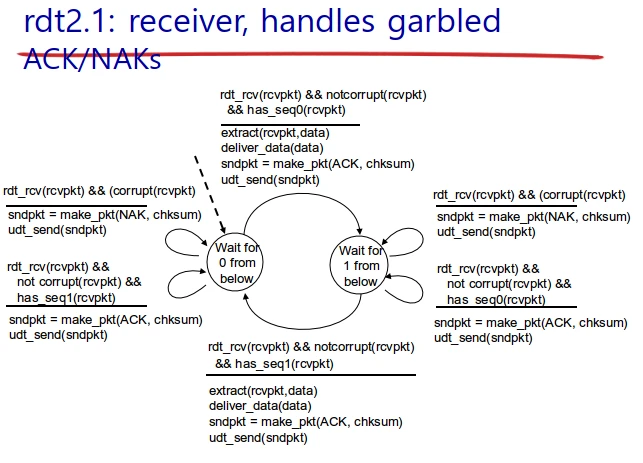

1. **Receiver State 1)**

    Receiver는 계속해서 Packet이 오기를 기다리고 있다가, 가장 처음에 # Seq 0이 도착하기를 기다린다. 그러다가 Packet이 도착하면, 다음 두 가지를 체크한다. **rdt_rcv(rcvpkt)**

    - corrupt/notcorrupt
    - has_seq0/has_seq1

    ⇒ 이 두가지 조건에 따라서 동작을 결정한다.

1-1) **corrupt(rcvpkt)**

우선 packet이 깨졌다면, Sender측과 마찬가지로 바로 NAK를 만들어서 보내준다. packet이 깨졌다면 packet이 어떤 것인지 구분할 필요가 없으므로 바로 NAK를 보내주면 된다.

<strong>make_pkt(NAK, chksum)</strong>을 통해 보낼 NAK packet을 만들고, <strong>udt_send(sndpkt)</strong>을 통해 packet을 전송한다.

> packet의 number는 header에 포함되어 있는 것으로 보인다. Sender측에서 처음에 Packet을 만들 때 Sequence Number를 추가하고, 그 이후에 Receiver 측에서는 **has_seq0** 혹은 **has_seq1**에 **rcvpkt**을 넣어서 확인하기 때문에 header에 들어있지 않다면 확인이 불가능하다.

1-2) **notcorrupt(rcvpkt)** && **has_seq0(rcvpkt)**

packet이 깨지지 않았고, 현재 State에서는 0번 # Seq을 기다리고 있기 때문에 올바른 Packet이 도착했다고 기대할 수 있는 상황이다. 

> packet이 깨지지 않았다면 들어있는 # Seq도 깨지지 않은 것이라고 가정할 수 있기 때문에 <strong>notcorrupt(rcvpkt)</strong>이라면 **has_seq0**/**has_seq1**을 완벽하게 판단할 수 있다.

올바른 packet이 들어왔기 때문에 데이터를 <strong>extract(rcvpkt, data)</strong>하고 이 데이터를 <strong>deliver_data(data)</strong>를 통해 Application Layer로 보내준다.  그 다음에는 Sender에게 ACK를 줘야하기 때문에 **make_pkt(ACK, chksum)**, <strong>udt_send(sndpkt)</strong>을 수행한다.

1-3)  **notcorrupt(rcvpkt)** && **has_seq1(rcvpkt)**

packet이 깨지지 않았지만, **# seq**가 1인 상황이다. 현재 State는 0을 기다리고 있기 때문에 올바르지 않은 Packet이 온 것이라고 생각할 수 있다. 이런 상황이 발생하는 이유는, 현재 State가 되기 이전에 1번 Packet을 보냈었을 것이다. Receiver는 1번 Packet을 받았고 ACK를 Sender에게 전송해 주었는데, 그 ACK가 깨져서 Sender가 1번 Packet을 재전송한 상황이라고 볼 수 있다.

이런 상황에서는 다시 한번 ACK를 전송하여 Sender에게 1번 Packet을 올바르게 처리했다는 것을 인지시켜 주어야 한다.

1. **Receiver State 2)**

    이전에 0번 Packet을 처리했으므로, 이제는 1번 Packet을 처리해 준다. 모든 것이 1번 State와 똑같지만, has_seq1이 되어야 다음 State로 넘어간다는 데서만 차이가 존재한다. 따라서 <strong>rdt_rcv(rcvpkt)</strong>이 True가 될 때까지 대기하고 있다가 다음 두 가지를 체크한다.

    - corrupt/notcorrupt
    - has_seq0/has_seq1

    ⇒ 이 두가지 조건에 따라서 동작을 결정한다.

2-1) **corrupt(rcvpkt)**

만약 packet이 깨졌다면 다른 걸 확인할 필요도 없이 곧바로 NAK를 전송해 주어야 한다. <strong>make_pkt(NAK, chksum)</strong>을 통해 보낼 sndpkt을 만들고, <strong>udt_send(sndpkt)</strong>을 통해 전송한다

2-2) **notcorrupt(rcvpkt) && has_seq1(rcvpkt)**

packet이 깨지지 않았고, 현재 State는 1번 # Seq을 기다리고 있기 때문에 올바른 Packet이 도착한 것이다. 따라서 <strong>extract(rcvpkt, data)</strong>을 수행하고 이 데이터를 <strong>deliver_data(data)</strong>를 통해  Application Layer로 보내준다.  그 다음에는 Sender에게 ACK를 줘야하기 때문에   
**make_pkt(ACK, chksum)**, <strong>udt_send(sndpkt)</strong>을 수행한다.

2-3) **notcorrupt(rcvpkt)** && **has_seq0(rcvpkt)**

현재 State는 1번 # Seq을 기다리고 있기 때문에 잘못된 Packet이 도착한 상황이다. 이 상황은 이전에 보냈던 Packet인 0번 Packet에 대한 ACK가 깨져서 Sender가 ACK를 전달받지 못해 Duplication이 발생한 상황이다. 따라서 다시 ACK를 Sender에게 전송해 Sender에게 이전 Packet이 올바르게 처리된 것을 인지시켜 주어야 한다.

### rdt2.1 discussion

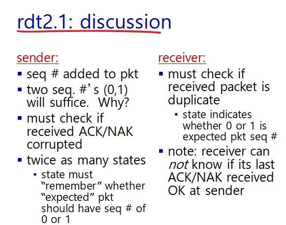

- **Sender**

    Sender에서는 rdt 2.0에서 발생했던 Duplication 문제를 해결하기 위하여 Packet에 Sequence Number를 추가하여 전송했다. 따라서 Sender는 반드시 현재 Sequence Number가 몇인지 기억해야 하며, 이 것에 따라서 다음에 만들 Packet에 올바른 Sequence Number를 실어주어야 한다.

    또한 Sender는 반드시 전달받은 ACK/NAK가 깨졌는지를 체크해야 한다. 만약 깨졌다면, 그것이 원래 ACK였는지 NAK였는지 알 도리가 없으므로 무조건 현재 Sequence Number의 Packet을 재전송해야 한다.

- **Receiver**

    Receiver도 Sender와 마찬가지로 Packet의 Sequence Number를 파악해야 한다. 처음에는 Packet이 깨졌는지 아닌지를 판단하고, 만약 깨졌다면 바로 NAK를 Sender에게 전송해 주어야 한다.

    만약 깨지지 않았다면, Receiver도 현재 처리해야 할 Sequence Number를 기억하고 있다가 올바른 Sequence Number의 Packet인지 아닌지를 has_seq0/has_seq1으로 체크한다.

    만약 현재 처리하는 Sequence Number가 아니라면, 이전에 보낸 Packet에 대해서 전송하였던 ACK가 올바르게 전달되지 않아, Sender 측에서 다시 이전 Packet을 재전송 한 것이다. 따라서 이것은 Drop하고, Sender에게 ACK를 다시금 전송한다.

    만약 현재 처리하는 Sequence Number에 맞게 올바르게 Packet을 전달받았다면, 데이터를 extract하고 Application Layer에 전송한 다음, ACK를 Sender에게 전송하고 Sequence Number를 갱신하여 State를 변경한다.

⇒ 이런 과정이 유기적으로 반복되면서 Packet을 처리하게 된다.

### rdt2.2: NAK-free Protocol

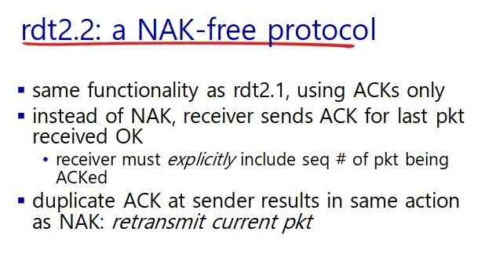

- rdt2.2는 Minor한 업데이트가 추가되었는데, 바로 NAK를 없애고 ACK만 사용하도록 하는 것이다. 그렇다면, Packet이 깨졌을 때 Receiver가 전송하는 NAK가 없이 어떻게 Packet이 깨졌는지를 구분할 수 있는가? ⇒ **ACK에도 Seq_Num을 추가해서 해결한다.**
- 즉, Receiver가 현재 Sequence Number에 맞게 Packet을 올바르게 전달받았을 때, 현재 처리한 Packet의 Sequence Number를 실어서 ACK를 전송한다는 것이다.

### rdt2.2 FSM

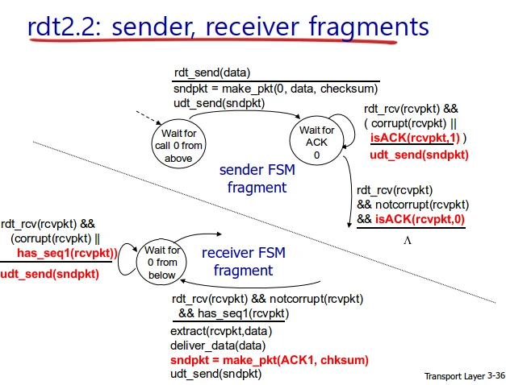

- **Sender**

    Sender에서는 크게 변한 것은 없고, ACK에 Sequence Number가 추가된 부분만 다르다. 

    rdt 2.1에서는 Sender에서 현재 처리하는 Packet의 Sequence Number가 0일 때, 전달받은 ACK/NAK가 깨졌거나, NAK일 경우 현재 Packet을 재전송해 주었다. 하지만 이제는 NAK를 제거하고 Sequence Number를 함께 전송하도록 바뀌어서 약간의 변화가 생겼다.

    따라서, Sender에서 ACK를 확인할 때, 만약 현재 처리하고 있는 Packet의 Sequence Number가 아니라면 현재 Packet을 재전송을 하도록 만든다. 그런데, 어떻게 현재 처리하고 있지 않은데 ACK가 올 수 있을까? 이것은 Receiver에도 변화가 생겼기 때문에 가능하다. (*이후 설명*)

    또한, ACK가 깨지지 않고 올바르게 전달될 때도, 현재 처리하고 있는 Packet의 Sequence Number가 맞는지 <strong>isACK(rcvpkt, # Seq)</strong>로 확인한다.

- **Receiver**

    Receiver에서도 마찬가지로 몇 가지 사소한 변화가 존재한다. 먼저, 전달받은 Packet이 깨지지 않았고 notcorrupt(rcvpkt), 현재 처리하고 있는 Packet의 Sequence Number와 일치할 때 has_seq1(rcvpkt), 그 Packet의 데이터를 꺼내서 Application Layer로 전송하고, 그 다음에 ACK를 전송해 주어야 한다. 이때, 현재 처리하고 있는 Packet의 Sequence Number에 맞게 ACK를 실어서 보내야 한다. *(예를 들어 현재 처리하고 있는 것이 1번이라면, ACK1을 보낸다.*)

    또한, 전달받은 Packet이 깨졌다면 **corrupt(rcvpkt)** 다른 것을 다 체크하지 않고 곧바로 NAK를 만들어서 Sender에게 보내주었는데, 이제는 NAK가 존재하지 않고 Sequence Number를 추가하므로, 이전까지 올바르게 처리된 Sequence Number를 실어서 ACK를 보내준다.

    > 가령, 현재 State가 0번이고 이전에 1번을 올바르게 처리했다고 했다고 하자. 그런데 전달된 0번 Packet에 Corruption이 발생했다. 그러면 묻지도 따지지도 않고 곧바로 NAK를 전달해 주어야 하는 것인데, 이제 NAK를 쓰지 않으므로, 이전까지 올바르게 처리했던 ACK1을 전달해 준다는 것이다.  
    >   
    > 그러면 Sender 측에서는 그것이 깨지지 않고 도달했을 때, 현재 처리하고 있는 Sequence Number가 아니므로, 현재 Packet에 문제가 생김을 파악하여 Packet을 재전송하게 된다.  
    >   
    > 따라서 코드 구현 상에서 초기 Initialization 상태에서는, current_seq_num = 0으로 하고, prev_seq_num = 1로 설정해야 올바르게 동작할 것이다.

## &lt;rdt3.0&gt;

> 여기까지 하면 모든 것이 OK인 것 같지만, 사실 그렇지 않다. 왜냐면 rdt 2.2까지는 반드시 Packet이 전송이 되기는 해야 이루어질 수 있는 동작들인데, 실제 네트워크 환경에서는 Congestion으로 인해 Loss가 발생하여 아예 Packet이 전달되지 않을 수도 있기 때문이다.  
>   
> 그러면 Sender/Receiver는 서로 완전히 독립되어 동작하기 때문에 상호 간에 Packet을 보냈다는 것을 아예 파악할 수가 없다. 따라서 Feedback이 불가능하므로, 이에 대한 대처가 필요하다.

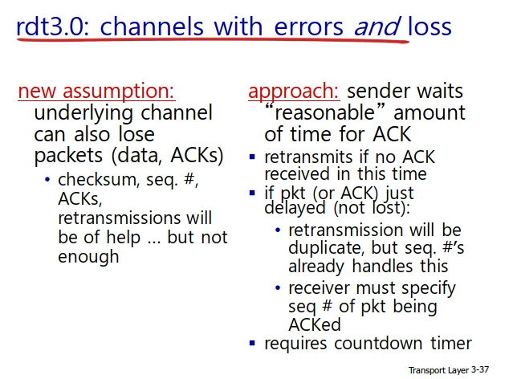

- **Approach**

    이전에 제시된 문제를 해결하기 위하여 Timer를 추가할 수 있다. Timeout이 되기 전에 Feedback이 오면 rdt 2.2까지의 동작으로 처리하고, 만약 Timeout이 발생한다면 interrupt가 발생하여 Sender는 현재까지 처리된 Packet을 재전송하고, Receiver는 아무것도 하지 않으면 된다.

> **Receiver는 아무 것도 하지 않아도 되는 이유**  
>   
> Sender는 자신이 Packet을 보낸 Source이기 때문에 그것을 올바르게 Checking할 의무가 있다. 따라서 자신이 보낸 것에 대한 Response가 일정 시간 안에 도달하지 않으면 Packet이 Target에게 도달하지 않았다고 판단하여 이를 재전송한다.  
>   
> 반면 Receiver는 수동적인 존재이며, Packet이 도달하면 그것을 받고, 잘 받았다고 알림만 보내주는 존재이다. 만약 Sender가 보낸 Packet이 Congestion에 의해 Receiver에게 도착조차 하지 않았다면, Receiver가 할 것은 없다.  
>   
> 또는 Receiver가 Packet을 잘 받았지만, 이번에는 Congestion에 의해 Receiver의 ACKn이 Sender에게 도달하지 않는다고 해도, Sender가 Timer를 이미 체크하고 있기 때문에 굳이 재전송을 해 줄 필요가 없는 것이다.  
>   
> ⇒ 이 상황에서는 Receiver가 이미 원하는 데이터를 전달받았으므로, Sender가 재전송하더라도 그것은 현재 처리하고 있는 Packet이 아니기 때문에 Drop한 후, 이전까지 처리한 Sequence Number를 담은 ACKn을 Sender에게 전송한다.  
> 그러면 Sender는 ACKn이 현재 처리하고 있다고 기억하고 있던 Packet의 ACK이므로, 다음 Packet을 전송할 준비를 하게 된다.

### rdt3.0 Sender FSM

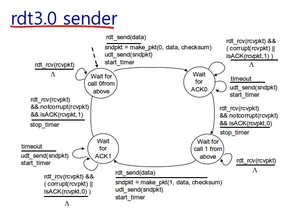

큰 차이점은 없으며, 한 Packet에 대한 timer를 시작하는 것과 끝내는 것이 추가된다. 따라서 Sender는 자신이 보낸 Packet을 받는 것을 기다린다.

1. **Sender State 1)**

    Sender는 Application Layer에서 내려온 Packet에 Header, Sequence Number, Checksum을 실어서 Receiver에게 전송하고, Timer를 동작시킨다.

1-2) **rdt_rcv(rcvpkt)**

여기서 주목할 점은, State 1)에서 Packet을 receive하는 경우가 존재한다는 것인데, 이것은 timer 때문이다. timer로 인해서 Network 혼잡도에 따라 Packet이 올바르게 처리되었음에도 timer interrupt에 의해서 이미 재전송이 된 것에 의해 발생할 수도 있다.

만약 원래 보낸 packet에 Loss가 발생하지 않았고, 새롭게 보낸 packet이 도착하여 Sender는 다음에 전송할 Packet이 오길 기다리고 있는 상태라고 하자. 이 상태에서 (***현재 0번 packet이므로, 이전 packet은 1번 packet일 것이다.***) 1번 Packet에 대한 ACK1이 도착한다면 이것은 무시해야 하므로, Do Nothing으로 Action이 있는 것이다.

또 다른 예시로는 timer interrupt가 발생하여 Packet을 재전송했는데, 이전에 보냈던 Packet의 ACK가 먼저 도착한 경우 이와 같은 현상이 발생할 수 있다. 예를 들어보자. Pkt0를 보냈는데 timeout이 발생했고, 그래서 Pkt0를 다시 보냈다. 이 상황에서 ACK0가 도착해서 Sender는 대기 상태로 들어갔다고 하자. 그런데 새롭게 보낸 Pkt0는 Receiver에서 Duplicate로 처리하여 이전까지 처리했던 Pkt0에 대한 ACK0를 다시 보낼 것이고, 그러면 결국 Sender에서도 Drop된다.

**이와 같은 경우를 다음 Packet Sequence Number에서도 마찬가지로 만들어 주어야 한다.**

1. **Sender State 2)**

    이전과 큰 차이는 존재하지 않으며, 우선 rdt_rcv(rcvpkt)이 True가 될 때까지 기다리고, 확인이 되면 다음 두 가지를 체크한다.

    - corrupt/notcorrupt
    - isACK(rcvpkt, # Seq)

2-1) **corrupt(rcvpkt)** || **isACK(rcvpkt, prev_seq_num)**

이 경우는 packet이 깨졌거나 이전에 처리했던 Packet의 Sequence Number가 도착한 것이므로, 문제가 발생한 경우이다. 위의 교재에서는 어차피 timer가 걸려있기 때문에 아무것도 하지 않고 기다리는 것으로 생각되는데, **왜 재전송을 하지 않고 기다리는지**를 생각해 보았다.

> rdt2.2에 timer를 추가하였는데, 이것은 timer 값에 따라서 network 상에는 duplication이 많이 존재할 수 있다는 것이 시사한다. 따라서 현재 내가 전송한 Packet이 제대로 전달되지 않았다고 하더라도, 이미 Network 상에서 돌고 있는 다른 Packet이 존재할 수도 있는 것이다.  
>   
> 그렇기 때문에 내가 보냈던 Packet에 문제가 생길 때마다 계속해서 새로운 Packet을 만들어 보내는 것은 Network를 너무 혼잡하게 만들 수도 있다. 그러므로 우리가 하는 행동으로 바람직한 것은, 다음 두 개 중 하나이다.  
>   
> 1) 이미 Network 상에 존재하지만 Busy한 Path를 피해서 돌아오느라 오래 걸리는 것일 지도 모르는 Packet을 기다리는 것  
>   
> 2) 일단 재전송하는 것  
>   
> 그런데 현재 State에서는 1) Do Nothing이 가장 바람직한 행동이다.

2-2) **notcorrupt(rcvpkt)** && **isACK(rcvpkt, cur_seq_num)**

이 State는 올바르게 도착한 경우 다음 State로 넘기는 것이므로, <strong>stop_timer()</strong>를 수행한다는 것 외에는 차이가 없다.

2-3) **timeout()**

timeout이 발생한다는 것은 내가 지정한 시간 안에 ACK가 도착하지 않아서, Loss가 발생한 것으로 간주할 수 있는 시간이 지났다는 것이다. 따라서 이전에 만들어두었던 Packet을 전송하고 timer를 다시 로드한다.

> 다음 Packet에 대해서는 똑같은 동작을 하므로 생략한다.

> 이후에 나올 TCP Congestion Control에 따라, TCP는 스스로 Congestion이 발생할 것으로 판단되면 Packet 전송량을 최소화한다. 이것이 특정한 Host에서만 수행되는 것이 아니라 TCP를 사용하는 모든 Host가 동시다발적으로 수행하므로, rdt3.0까지의 방식은 Overhead가 그렇게 크지는 않으며, 재전송을 하다보면 결국에는 모든 Packet이 도달할 수 있게 된다.

> Receiver 단은 별도로 할 것이 없으므로 달라지는 것이 없다. Receiver의 Packet에도 Loss가 발생할 수는 있지만, Timer를 남용하는 것은 Resource 자원의 낭비가 될 수 있으므로 좀 더 책임이 큰 Sender 측에서만 사용하도록 한다.  
>   
> 또한 Timer를 한 번 걸어주었다면, 반드시 stop_timer()를 수행해 주어야 한다.  
>   
> 이로써 Reliable한 Data Transfer를 완벽하게 수행할 수 있게 되었다.

### rdt3.0 in action

> rdt 3.0까지 알아보며 TCP가 Reliable Data Transfer를 할 수 있는 이유를 확인했다. 이제, 실제 상황에서 rdt 3.0이 어떻게 동작하는지 알아보자.

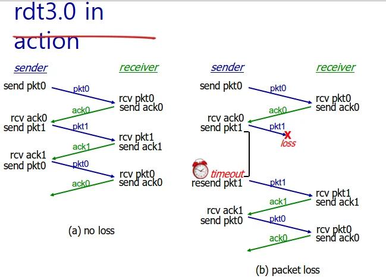

(a) **no loss** : Packet을 올바르게 주고 받는 경우이다.

(b) **packet loss** : 보내는 Packet에 loss가 발생한 경우이다. 0번 Packet은 잘 받았지만, 1번 Packet에 loss가 발생했으며, 이에 따라 timeout이 발생하여 1번 Packet을 재전송한다.  
이후에는 1번 Packet이 올바르게 전송되어 통신이 잘 이루어진다.

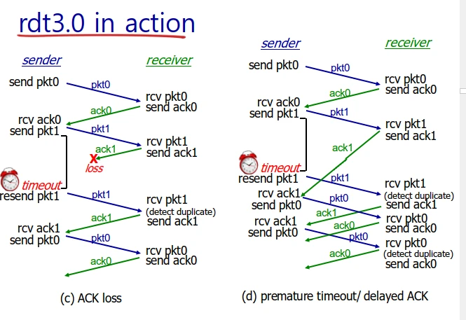

- (c&#41; **ACK loss** : 0번 Packet 이후, 1번 Packet이 올바르게 전달되었지만, **ACK1**에 **Loss**가 발생하여 timeout 이벤트가 발생한 경우이다. 이러면 Sender는 Receiver의 상황을 모르기 때문에 1번 Packet을 재전송한다. 하지만 Receiver는 1번 Packet을 이미 처리했으므로, 1번 Packet은 Drop하고, 이전까지 처리한 Packet에 대한 ACK인 ACK1을 재전송한다. (***1번 Packet은 이미 처리하였으므로, Receiver의 current_seq_num은 0번인 상태일 것이다.***)

- (d) **Receiving ACK after timeout** : Network는 상황에 따라서 RTT(*Round Trip Time*)가 달라진다. 이것은 Timer값을 너무 Tight하게 잡아서, 정상적인 ACK가 Timeout이 되고 나서 Sender에게 오는 경우이다.

    Pkt1에 대한 Timeout이 발생한 뒤 Pkt1을 재전송하지만, Receiver는 이미 Pkt1을 처리하였으므로, 이것은 Duplicated Packet이 되어 Drop되고, Receiver는 ACK1을 다시 전송해준다. 그런데, 현재는 **이전에 보냈던 ACK1이 이미 도착한 상황이다.**

    이전에 Sender는, 늦게오긴 했지만 어쨌든 ACK1이 올바르게 도착했으니 다음 Packet인 Pkt0를 전송한다. 그런데 이 다음에, 재전송했던 Pkt1에 대한 ACK1이 Sender로 도착하게 되고, 현재 Pkt0가 아직 처리되지 않았으므로 Sender는 ‘**아, Pkt0를 보냈는데 ACK1이 도착했으므로 Pkt0가 깨졌구나!**’라고 판단하게 된다. 따라서 Sender는 Pkt0를 다시 보내게 되며, 이후에 원래 보냈던 Pkt0에 대한 ACK0가 도달하게 된다. 그리고 다음 Packet은 도달하지 않는다.

    이후에는 여기서 재전송했던 Pkt0에 대한 ACK인 ACK0가 도착하게 되는데, 현재는 대기 중인 상태이므로 Drop되고 아무 것도 하지 않는다.

    이로써, timeout 이벤트에 의한 문제가 정상화되었다.
