# TCP Pipelining

## &lt;Increasing Performance of rdt&gt;

### Performance of rdt 3.0

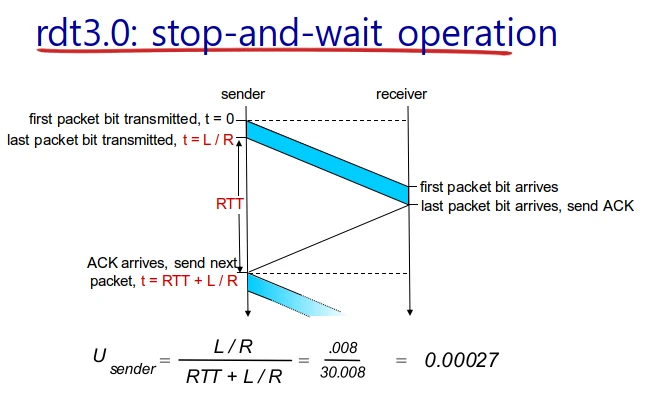

지금까지 Stop and Wait 방식을 사용해 Reliable Transfer를 구현하는 방법을 알아보았다. rdt 3.0의 Utilization을 구해보면, 0.00027밖에 나오지 않는다. 성능이 매우 떨어진다는 것을 알 수 있다.

그래서 Performance를 올리기 위해, 이렇게 비어있는 시간에도 pkt을 보내보자! 라는 기술이 바로 **Pipeline**이라는 기술이다.

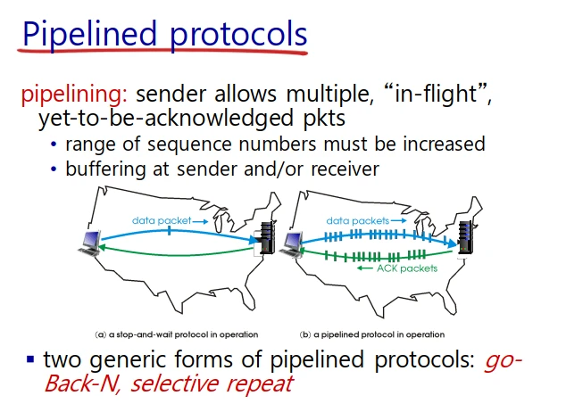

Packet을 하나만 보내는게 아니라, 여러 개를 한 번에 보내자는 것이 **Pipeline**이다. 그러면 같은 시간 안에 많은 Packet을 보낼 수 있으니 Utilization이 좋아진다. 즉, 그만큼 Pkt을 빠르게 전송할 수 있다는 것이다. 이로 인해 발생하는 문제는 새로운 방법론을 도입해 해결해 보도록 하자.

### Types of Pipelining

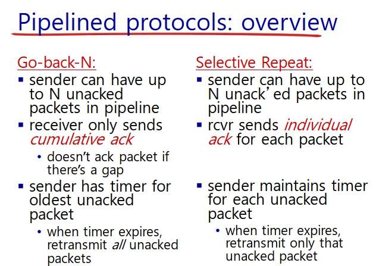

- 파이프라이닝은 Go-back-N 방식과 Selective Repeat 방식으로 주로 사용한다.

### Go-back-N Sender

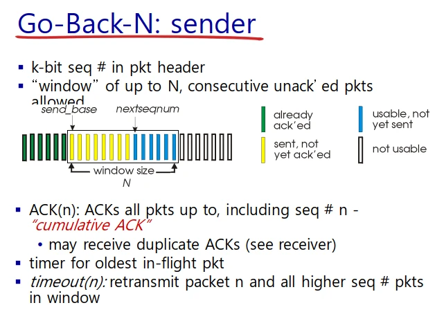

- 기본적으로 Pipelining은 Sliding Window를 이용한다. Window 안에 있는 Packet만 전송하고, 이 Window는 ACK를 받은 것만큼만 이동하는 것을 원칙으로 한다. 이때 Window Size는 **N**이다.
- Go-back-N은 Window 안에 들어있는 Packet을 Bulk로 처리하므로, **Timer를 하나만 사용**한다.
- Go-back-N은 Sliding Window 내의 모든 Packet을 순서대로 쭉쭉쭉 전송해준다. 그리고, Go-back-N은 전송에 문제가 생긴 Packet부터 재전송한다.

- 상단의 이미지를 보면, 노란색은 이미 다 보낸 것, 파란색은 앞으로 보낼 것이지만 아직 보내지 않은 것이며, 녹색은 이미 ACK를 받은 것이고, 흰색은 아직 보낼 것으로 고려하지 않는 것이다.

    - **GBN**은 **ACK**를 받을 때마다 **Sliding Window**를 **한 칸씩 이동**한다.

- 이제는 여러 개의 Pkt을 한꺼번에 여러 개 보내기 때문에, 도착하는 Packet이 어떤 Pkt에 대한 ACK인지를 모두 알아야 한다. 그러므로 Window 내에 있는 모든 Pkt의 **Sequence Number**는 다르게 설정하여 보내야 한다.
- **Cumulative ACK** : Receiver에서 Pkt을 받는데, Pkt 하나 받고 ACK 하나 보내고, 하나 받고, 하나 보내고. 이런 것 자체가 좀 Overhead일 수 있으므로, ACK를 누적해서 보내는 것이 **Cumulative ACK**이다.
- 이때는 ACK를 한 번에 보내기 때문에 Sliding Window는 한 번에 움직이고, Timer도 하나만 사용한다. 만약 Pkt을 보냈는데 모든 Pkt에 대한 ACK가 안온다면, 처음부터 쭉, 모든 Packet을 재전송하게 된다.  
    **⇒ 다만 GBN은 이렇게 동작하지 않는 것으로 보인다.**

### Go-back-N Sender FSM

> GBN은 Sender의 State가 하나라는 특징이 있다.

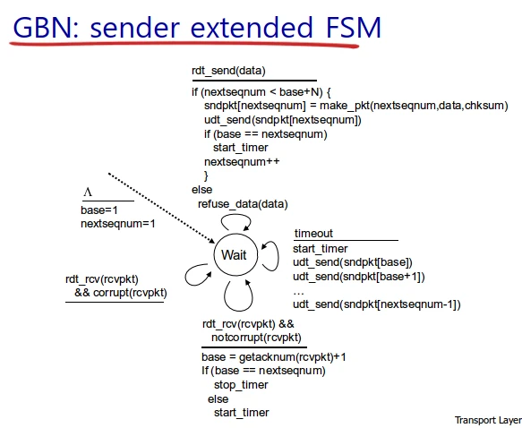

- 위의 FSM에서 base는 Sliding Window의 첫 번째 Packet을 의미하고, N은 Sliding Window의 Size를 의미한다. 초기에는 base = 1, nextseqnum = 1로 초기화한다.

- **rdt_send(data)**

    > Sliding Window 내부의 Packet들을 모두 전송하는 과정이다. base+N을 범위로 지정하여 보낼 Packet들을 모두 한번씩 전송한다.

    - 만약 **Next_Seq_Num**이 **base+N**보다 작다면, 그것은 새로운 Pkt을 만들어 보내겠다는 뜻이다. 이 때는 **make_pkt()** → <strong>udt_send()</strong>로 새로운 Pkt을 보낸다.   
        (*현재 Sliding Window 내부의 Packet인지 체크하고, 내부라면 전송하는 과정이다.*)

    - 그리고 **base**가 **Next_Seq_Num**인지 확인한다. 이걸 확인하는 이유는, 만약 **base**와 **Next_Seq_Num**이 같다면 새로운 Sliding Window가 시작되는 것이기 때문에 Timer를 새롭게 걸어야하기 때문이다.
    - 여기까지 동작하면 Packet을 하나 보낸 것이고, 계속해서 Packet을 보낸다.

> 즉, GBN의 Sender는 Sliding Window 내에 있는 packet의 수만큼 전송하는데, base에서 timer를 시작한다. 그리고 Next_Seq_Num이 base+N. 즉, Sliding Window 내부일 때만 전송한다.

- **rdt_rcv(rcvpkt)** && **notcorrupt(rcvpkt)**

    > 이후에 전송한 Packet에 대한 ACK가 도착했고, 그것이 Corrupt되지 않은 상황을 다뤄보자.

    - timeout이 되지 않고 ACK 하나가 올바르게 도착한 상황이다. <strong>getacknum(rcvpkt)</strong>을 통해서 현재 도착한 Packet이 몇 번 Packet에 대한 ACK인지 확인하고, 그것에 +1을 한 것을 base로 설정한다.
    - <del>이와 같이 설정하는 이유는, <strong>Cumulative ACK</strong>에 의해서 <strong>ACK</strong>가 매 <strong>Packet</strong>마다 전송되는 것이 아니라 <strong>합쳐져서 전송</strong>되기 때문에, 도착한 ACK의 다음 Packet까지 Sliding Window를 이동할 수 있기 때문이다. 그리고 이때는 아직 전송하고 남은 것이 존재하기 때문에 <strong>start_timer()</strong>를 수행하여 다음 ACK를 기다린다.</del> ⇒ Cumulative ACK를 쓰는 것은 아닌 것으로 보인다.
    - 그런데 **base**가 **Next_Seq_Num**과 같으면. 즉, 보낸게 없다면 Timer를 켜면 안된다. 따라서 <strong>stop_timer()</strong>를 수행하여 **Packet**을 새롭게 전송할 때까지 기다려야 한다.

- **timeout**

    > timeout이 발생한 경우 어떤 동작이 수행되는지 확인해보자.

    - 만약 **timeout**이 걸리면, 현재 window 내부에 있는 모든 packet을 **재전송**한다. 어디까지 재전송 하는 것이냐면, **base**부터 **Next_Seq_Num-1**까지 재전송한다.   
        (*이것이 Sliding Window 내부에 있는 모든 Packet이다.*)

- **rdt_rcv(rcvpkt)** && **corrupt(rcvpkt)**

    > 전달받은 packet이 corrupt된 상황이다. 이 상황은 Do Nothing으로 기다린다. 왜냐면, timer가 걸려있기 때문에 굳이 재전송할 필요가 없기 때문이다.

### GBN Receiver FSM

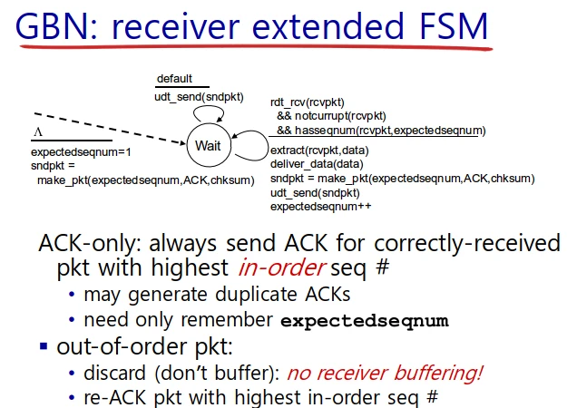

- 수신단은 크게 달라지는 것이 없고, **expected_seq_num**만 추가하면 된다. 예를 들어 만약 내가 5번을 전달받았다면, 다음에는 6번을 전달받아야 한다.

    > 여기서 expectedseqnum = 1인 상태에서 sndpkt을 만들어두는 이유는, 가장 첫 packet에서 Loss가 발생할 경우 default action으로 돌려줄 ACK가 존재하지 않기 때문이다. 이것이 존재하면 첫 번째 Packet에서 Loss가 발생하더라도 ACK를 돌려줄 수 있다.

- **rdt_rcv(rcvpkt)** && **notcorrupt(rcvpkt)** && **has_seq_num(rcvpkt, expected_seq_num)**

    Packet을 전달받았는데, 그것이 깨지지 않았고 예상한 **seq_num**인 것이 확인이 되는 경우이다. 즉, 예상한 대로 동작이 잘 이루어진 것을 말한다. 이때 data를 extract하여 Application Layer로 보내주고, **expected_seq_num**을 실은 **ACK**를 **Sender**에게 보내준다.   
    (<em>따라서 <strong>correctly-received</strong>한 경우에만 Packet을 보내주는 것이다.</em>)

    그리고 나서 **expected_seq_num**을 1 증가시켜서 다음에 도착할 Packet을 준비한다.  
    ⇒ 이 외의 경우인, Packet Number가 잘못되었거나 깨진 경우에는 ACK를 보내주지 않는다.

> 예를 들어서, Sender에서 Packet1 부터 Packet5까지 전달하였다고 해보자. 그런데, Packet이 깨져서 Receiver에 Packet1, Packet2, Packet4, Packet5가 도착하였다고 하자.  
>   
> 그러면 Receiver는 예상하던 seq_num의 Packet이 아니므로, 2번 이후의 Packet에 대해서는 모두 Drop하고, 도착한 4, 5번 Packet에 대해서는 기록하지 않는다.   
> (*즉, Buffering을 하지 않아서 Timeout 이후에 도착한 Packet들은 기록되지 않는 것이다.*)  
>   
> 그리고 나서 가장 최근에 만들었던 sndpkt을 재전송해서, 현재 어디까지 전송이 완료되었는지를 Sender에게 알려준다. 위의 예시에서는 ACK2를 재전송할 것이다.  
>   
> (*다만 Sender는 이것을 받아도 크게 하는 것은 없는 것으로 보인다. timer가 끝날 때까지 기다렸다가 현재 Sliding Window 내의 것들을 모두 재전송할 뿐이다. 이렇게 하는 이유는 ACK를 받을 때마다 계속해서 재전송해주면 Duplication이 너무 많이 발생하기 때문으로 보인다.*)

### GBN in Action

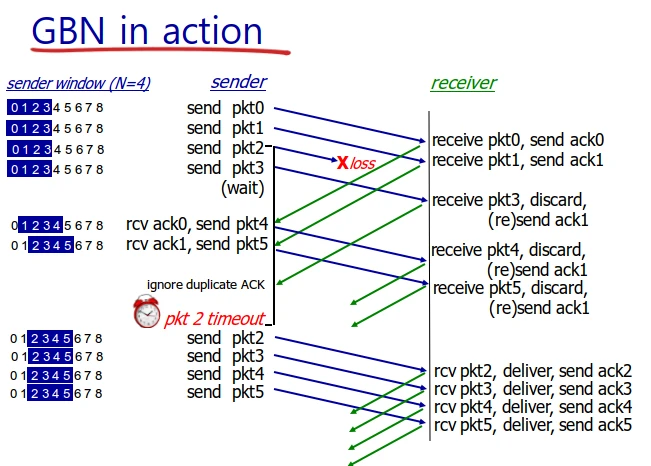

- Sliding Window의 Size가 4라고 할 때, Packet0 ~ Packet4까지 전송한다.
- 이때 당연하게도 **next_seq_num**은 4일 것이며, Window 안에 있는 모든 Packet은 일단 한 번씩은 모두 전송된 상태이다.
- 이때 Timer는 0번 Packet에 대해서만 걸려있다.
- 그런데 **Packet2**에서 **Loss**가 발생했다고 해보자. 이럴 경우 **Packet0 → ACK0**, **Packet1 → ACK1**은 잘 전달받았지만, **Packet2**가 **Receiver**에게 전달되지 않았고, 따라서 **ACK2**는 **Sender**에게 돌아오지 않는다. **Receiver**는 **Packet2**를 전달받지 못한 상태로 **Packet3**를 전달받았으므로, 가장 최근에 만들어뒀던 **ACK1**을 **Sender**에게 보내준다. (*즉, Packet3와 Packet4를 Discard하는 것이다.*)

- **Sender**가 **Packet0**, **Packet1**의 **ACK**인 **ACK0**, **ACK1**을 전달받았기 때문에, Sender FSM에 따라 base를 1씩 증가시킨다. (<em>여기까지는 base == next_seq_num이 아니기 때문에 timer가 재시작되며, 현재 <strong>Packet2</strong>에 대해서 Timer가 걸려있는 상황이다.</em>)

    또한 ACK0, ACK1을 잘 전달받았기 때문에, 이 과정에서 Packet4와 Packet5를 전송하게 될 것이다. 역시 **next_seq_num**은 연속적으로 증가한다. 다만 이 때는 if (base == next_seq_num) 상태가 아니기 때문에 timer를 새로 시작하지는 않는다.  
    따라서 이러한 과정을 거친다.

    > 1)  
    > base = 0, next_seq_num = 4인 상황에서 ACK가 도착했고, 이에 따라 base가 getacknum(rcvpkt) + 1이 된다. ACK0가 도착했으므로, base는 1이 된다.  
    >   
    > base = 1이고, N = 4이다. 현재 next_seq_num = 4인데, 이것이 base + N보다 작기 때문에 packet을 보낸다. 새롭게 보내는 것은 Packet4이다.  
    >   
    > 그런데, if (base == next_seq_num)이 충족되지 않았으므로 timer를 새롭게 시작하지는 않는다. 이것은 새로운 Sliding Window에 대해서 최초에 timer를 보내는 경우에만 허용된다.  
    >   
    >   
    > 2)  
    > base = 1, next_seq_num = 5인 상황에서 ACK가 도착했고, 이에 따라 base가 getacknum(rcvpkt) + 1이 된다. 이번에는 ACK1이 도착한 것이므로, base는 2가 된다.  
    >   
    > base = 2이고,  N = 4이다. 현재 next_seq_num은 5이고, 이것이 base + N보다 작기 때문에 packet을 보낸다. 새롭게 보내는 것은 Packet5이다.  
    >   
    > 그런데, if (base == next_seq_num)이 충족되지 않으므로 timer는 그대로이다. (*Packet2에 대해서 걸려있는 상황이 그대로 유지될 것이다.*)  
    >   
    > 여기서 이후에 새로운 ACK가 도달하더라도, Packet2에서 Loss가 발생한 상황이므로 ACK는 결국 ACK1만 도착하게 되어서 base가 이동하지 않게 되고, 새로운 Packet은 전송되지 않는다고 볼 수 있다.

- Sender는 Packet4, Packet5를 전송하였지만 Receiver는 expectedseqnum = 2이기 때문에 예상했던 Sequence Number가 아니므로 Packet을 Discard하고 ACK1을 다시 전송한다. 위의 Action Diagram은 이 상황에서 Packet2에 대한 Timeout이 발생한 것이다.

    > FSM에 따르면 중복되는 ACK가 도착하면 timer를 갱신하는 것으로 보이지만, **ignore duplicated ACK**에 따라 Packet2에 대한 Timer가 동작하기 시작하는 ACK1 이후에 timer expiration이 발생한 것으로 볼 수 있다.  
    >   
    > 그림에서는 Timer가 Packet2가 전송되기 시작한 순간부터 걸린 것으로 묘사되어 있다. 그러나 Packet3가 **expectedseqnum**이 아니라서 ACK1이 다시 도착했을 때 Sender가 duplicated ACK를 ignore하더라도, Packet2에 대한 timer는 Packet2가 전송되는 시점이 아니라 ACK1이 도착한 시점부터 동작하기 시작한다.

    **FSM 동작을 정리한 부분**

    1. base = 1, N = 4, next_seq_num = 1이다.
    2. 초기에 Packet1, 2, 3, 4를 전송한다. 이때 next_seq_num은 5가 된다.  
        timer는 Packet 1번에 대해서 동작한다.

    3. ACK1이 도착한다. 그러면 base = 2가 되고, timer가 Packet2에 대해서 새로 동작한다.  
        base=2이고, N=4이며, next_seq_num = 5이다.  
        next_seq_num &lt; base + N이 성립한다. 따라서 Packet 5를 전송한다. (새로운 Packet)  
        그리고 next_seq_num++되어, next_seq_num = 6이다.

    4. 그런데 Packet 2에 Loss가 발생한다.  
        이 때문에 Packet3에 대해서 Receiver가 ACK1을 다시 보내게 되고,  
        Sender는 ACK1을 받게 된다. 그러면 또 다시, base = getacknum(rcvpkt) + 1 = 2이다.  
        따라서 Packet2에 대해서 timer를 재시작한다.

    그런데, next_seq_num &lt; base + N이 성립하지 않는다. 왜냐면 6 &lt; 2 + 4이기 때문이다.  
    따라서 refuse_data() 발생, 데이터를 추가로 보내지는 않는다.

    다만 여전히 start_timer가 실행된다. 이걸 해석해 보자면, Sender 입장에서는 실제로 "Packet2에 Loss가 발생한 것인지, 단지 늦게 도착하는 것인지 알지 못한다."  
    따라서 무작정 Packet을 새롭게 보내서 Network 혼잡도를 높이는 것보다는, timer를 한 번 더 갱신해서 혹시 늦게 도착할지도 모르는 Packet을 한번 더 기다려주는 것이 더 합리적인 행동이라고 판단할 수 있기 때문에 이렇게 동작하는 것으로 보인다.

    > **정리본**  
    >   
    > Receiver는 expectedseqnum이 아니라면 가장 최근까지 처리했던 Packet에 대한 ACK를 Sender에게 전송해준다.  
    >   
    > Sender는 duplicated ACK가 도달한다면 그것을 ignore한다. timer를 갱신하지는 않는다. 따라서 timeout이 발생하면 현재 base를 기준으로 sliding window 내에 있는 모든 packet을 재전송하는 방식이다.  
    >   
    > **Buffering은 사용하지 않는다.**

---

### Selective Repeat Sender/Receiver Windows

> Selective Repeat과 GBN의 가장 큰 차이점은, Selective Repeat에는 Receiver 단에 **Buffer**가 도입된다는 것이다. 

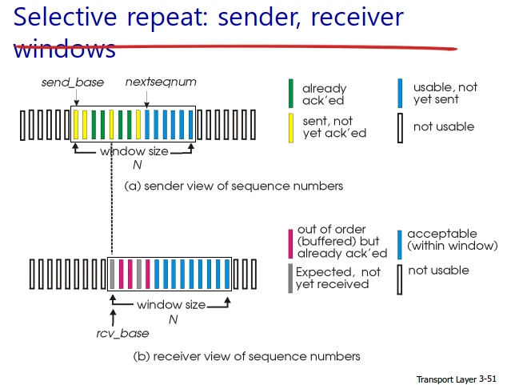

- **Receiver Buffer**는 와야 되는데 아직 받지 못한 Packet을 체크한다. 

    만약 **rcv_base**를 못받았지만 뒤의 두 개의 Packet을 받았다고 해보자. 이전에는 Receiver 단에서 뒤에 오는 Packet들은 모두 다 무시하고 가장 최근까지 만들어뒀던 ACK를 Sender에게 전송해 주는 방식으로 문제를 해결했다.

    하지만 **Selective Repeat**에서는 받은 것을 모두 기록한다. 즉, Buffering하는 것이다.

    이전의 GBN에서는 **Timeout**이 발생하면 **Sliding Window 내의 모든 Packet**을 전부 다 보냈다. 하지만, **Selective Repeat**은 **각각**에 대해서 **Timer**를 사용하여, 특정 **Packet**에 대해 **Timeout**이 발생하면 그 **Packet**을 **재전송**하고, Receiver에서는 전달받은 Packet을 기록하고 있었으므로 한 번에 처리해 줄 수 있다.

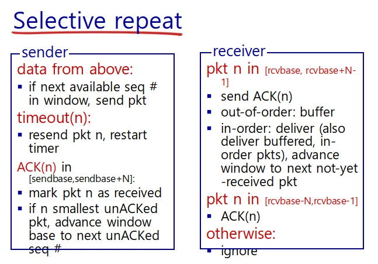

> ⇒ GBN과 거의 비슷하나, GBN에서는 base의 Packet에만 Timer를 걸어줬던 것과는 달리 Selective Repeat은 Sliding Window 내의 모든 Packet에 Timer를 건다는 차이점이 존재한다. 또, Receiver에 Buffer가 존재해서, Sequence하게 전달되지 않은 Packet도 저장해 두었다가 이후에 처리한다.

### Selective Repeat in Action

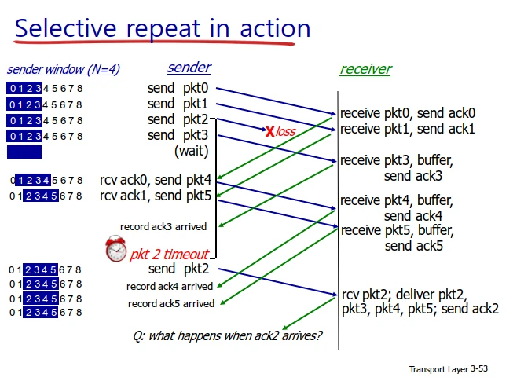

- **GBN**과 마찬가지로 **Sliding Window**는 4이다. **Pipelining**을 사용하여 Packet0~Packet3을 모두 보낸다. 그런데 역시, 2번 pkt에서 Loss가 났다. 

    이때 **Receiver**에는 **Buffer**가 있어서, **Packet0**을 받으면 0번 체크, **Packet1**을 받으면 1번 체크, 이런 방식으로 기록을 한다. 그래서 **Receiver**단의 **Sliding Window**는 **Packet2**까지 넘어가 있을 것이다.

- **현재 Receiver 단에서의 Sliding Window 상황**

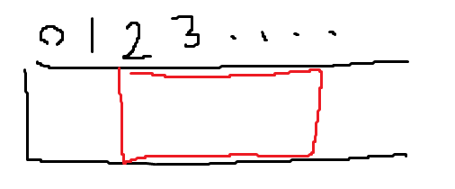

그런데, **Packet2**에서 **Loss**가 발생했으므로, **Packet3**은 올바르게 전달받았다. **Receiver Buffer**는 **Packet3**를 전달받았음을 기록한다.

이제 **Sender**는 **ACK0**, **ACK1**을 전달받고, 여기에 할당된 Timer를 종료하고서 Sliding Window를 늘린다. (<em>이전에 했던 것처럼, <strong>getacknumber(rcvpkt) + 1</strong>을 통해 <strong>base</strong>를 증가시키고 <strong>Packet4</strong>, <strong>Packet5</strong>를 새롭게 전송한다. <strong>Selective Repeat</strong>은 <strong>Packet</strong>마다 <strong>Timer</strong>를 걸어준다.</em>)

이후에 **ACK3**가 도착하면, **Sender**는 **ACK3**를 받았다고 **체크**를 한다.   
(*체크를 한다는 것은 3번 Packet에 걸린 timer를 푸는 것을 의미한다.*)

> 여기가 차이점이다. **GBN**의 **Receiver**는 **Packet3**가 도착하더라도 그것을 **ignore**하고 이전까지 처리한 **ACK**를 **Sender**에게 보내주었지만, 여기서는 **Buffer**를 도입하여 **Packet**의 **전달**을 **기록**했다. 그리고 **ACK3**를 **Sender**에게 보내주는데, **Sender**도 이와 비슷하게 **Packet3**가 잘 도착했음을 확인하고, **Packet3**에 대한 **Timer**를 **풀어준다.** 다만, **Packet2**가 **제대로 도착한 것은 아니기 때문에**  **Sliding Window**를 **옮기지는 않는다**.

이후에 걸어두었던 **Packet2**의 **Timer**가 **Expired**된다. 그러면 **Packet2만 재전송한다.** 이후에 **Packet4**, **Packet5**에 대한 **ACK4**, **ACK5**를 전달받으면 **체크**를 한다. (*timer 해제*) 

왜 Timer 해제만 하냐면, 아직 ACK2를 받지 못했기 때문에, sliding window를 움직일 수는 없기 때문이다. 이후에 **Packet2**에 대한 **재전송**으로부터 **ACK2**를 전달받으면, **Sliding Window**를 한 번에 **Buffering**된 지점의 다음 부분까지 옮겨준다.

### Selective Repeat Dilemma

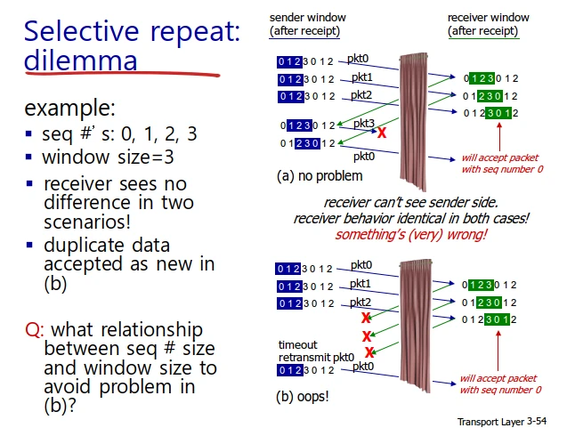

- 만약에 Packet 세 개를 전송했는데, **모든 ACK**에서 **Loss**가 발생했다고 해보자. 이렇게 하면 **Receiver** 단에서 **Sliding Window**를 옮겼을 때, 동일한 **Sequence Number**를 사용하게 되므로 문제가 생긴다. ⇒ **해결법은 단순하다. 그냥 sequence number를 충분히 길게하면 된다.**
