# TCP Flow Control & Congestion Control

작성일 2023-11-20 · 최종 수정일 2023-12-11
{ .post-date }

## &lt;Connection Oriented Transport (TCP)&gt;

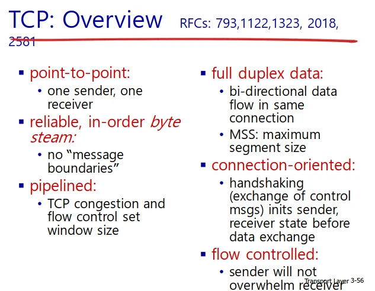

- 기본적으로 TCP는 One-to-Many 통신이 아니며, Point-to-Point 통신으로 관리된다.
- 또한 Reliable Data Transfer를 지원하기 때문에, In-order byte로만 전달받아야 Application으로 데이터를 올려준다는 특징이 있다.
- 그리고 **Pipelining**을 통해서 **Utilization**을 최대한 상승시키는 방법을 선택했다.
- 그런데 여기서 발생할 수 있는 문제는, 나만 TCP를 사용하는게 아니라 다양한 Process들이 TCP를 사용한다는 것이다. 그래서 다양한 Host들이 보내는 Packet이 많기 때문에 Core에 트래픽이 몰리면서 **Congestion**이 발생할 수 있다.
- 만약 수많은 Packet이 TCP에 도착했을 때 Application이 Read System Call을 사용하여 이걸 빠르게 읽어가지 않는다면 TCP에서 Overflow가 발생할 수 있고, Overflow가 발생하면 이 데이터는 결국 TCP가 가지고 있어야 하기 때문에 문제가 될 수 있다.

> 이를 방지하기 위하여 Flow control을 도입해, Sender가 Packet을 보내는 양을 조절한다. 즉, 보내는 Sliding Window의 사이즈를 Adaptive하게 조절하는 것이다.

- **Types of Communication**

    - **simplex** : 나는 보내고 상대방은 받기만 하는 것
    - **half-duplex** : 보낼 수도 있고, 받을 수도 있지만 서로 한 번에 하나의 역할만 하는 것
    - **full-duplex** : 송/수신이 동시에 가능한 것 (*bi-directional*)

- **MSS**(Maximum Segment Size)

    Maximum Segment Size는 TCP에서 한 번에 송신하거나 수신할 수 있는 최대 Segment Size이다.

- **Connection Oriented**

    - 연결을 TCP로 할 지, UDP로 할 지, Socket을 만들 때 결정해야 하는데, 이것은 Connection을 어떤 방식으로 할 것인지 정해야 한다는 것이다.
    - 만약 TCP로 한다면, 데이터를 보내기 전에 연결이 수립되어야 한다. (Server/Client)  
        이것은 TCP 연결을 하는 것을 말한다. ⇒ **Handshaking**

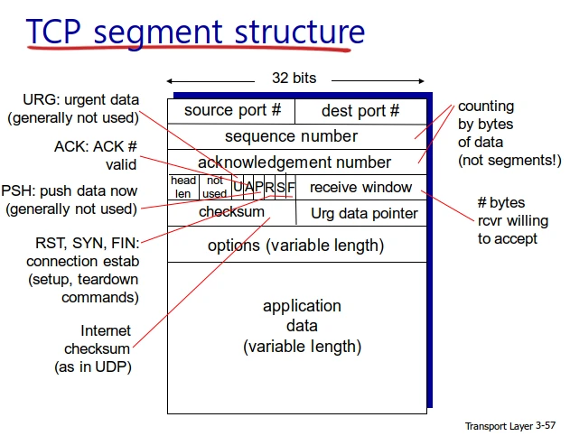

> TCP Segment의 구조이다. UDP 보다 약간 복잡해졌다. TCP는 기본적으로 데이터를 바이트 단위로 다룬다. 즉, 전송해야 할 데이터를 순서대로 정렬된 바이트 스트림으로 취급한다는 것이다. 따라서 모든 Sequence Number와 Ack Number는 바이트 단위로 표시된다.

- **Source Port #**, **Dest Port # (2 Bytes/2 Bytes)**

    이것은 당연히 존재해야 한다. 그래야 Process를 구별하여 Segment 전달이 가능하다.

- **Sequence Number (4 Bytes) & Acknowledgement Number (4 Bytes)**

    > TCP는 Bi-directional이기 때문에 Data를 보냄과 동시에 ACK를 보낼 수 있다. 효율성을 고려하여 동시에 보내주는 것이라고 볼 수 있다. 즉, 상대방 측의 Sequence Number가 나에게는 Acknowledgement Number가 된다. 그래서 보낼 때는 현재 나의 **Sequence Number**와 내가 다음에 받아야 할 **Expected Sequence Number** 두 개를 항상 같이 보낸다.

    **Sequence Number**는 TCP Segment의 연속된 데이터 번호이다. Sequence Number 필드에는 전송되는 세그먼트의 가장 앞에 있는 숫자를 표시한다. 즉, 현재 내가 전달하고자 하는 Sequence Number를 의미한다. 예를 들어 TCP가 5000 Byte 짜리 파일을 전송하고자 하며, 이때 MSS가 100 Byte라고 한다면, TCP는 5000 Byte짜리 파일을 전송하기 위해 50개의 세그먼트를 생성하게 되며, 이런 경우 TCP는 각 세그먼트의 Sequence Number Field에 Byte 기준 번호를 붙인다. 즉, 첫 번째 Segment의 # Seq는 0이고, 두 번째 Segment의 # Seq은 100, 그 다음은 200, 그 다음은 300, … 이런 식으로 설정된다.

- **Header Length** : UDP는 Header Length가 아닌 Length였다. 그때는 Header + Data 전체의 길이를 포함했는데, TCP는 Header Length만 알면 된다. 그 이유는 TCP가 처음에 Hand-shaking을 해서 Connection을 맺을 때, **MSS**를 서로 정하는 약속을 한다. 따라서 데이터를 MSS로 자르기 때문에, (*Header + Data를 해서 MSS를 넘지 못한다.*) Header Length만 알면 문제가 없다.

- **Flags**(U, A, P, R, S, F)

    - **R**(RESET)
    - **S**(SYN)

    - **F**(FIN)

        ⇒ **Connection Establishing**, **Connection Termination** 할 때 사용하는 것들.

        - Pkt의 종류는 크게 두 가지가 있다. 
        - **Data Pkt**(*실제 데이터가 포함됨*)

        - **Control Pkt**(*둘 간의 제어를 위해서 사용되는 Pkt*). 

            ⇒ 이때, Control Pkt의 사이즈는 최대한 작은 것이 좋다. 작아야 빨리 가고, 에러나 발생할 확률이 적어지기 때문이다. 그래서 Flag 처리를 하는 것이다. 그래서 Control Packet이라고 하면, Data는 존재하지 않고, Flag만 포함되어 전송된다.

    - **A**(Acknowledgement) : 만약 A가 check 되어 있으면, **Acknowledgement Packet**이라는 것.
    - **U**(Urgent) : 긴급한 Packet을 구분하기 위함인데, **잘 사용하지 않는다.**
    - **P**(Push) : TCP가 데이터를 전송받으면 Buffer에서 계속 관리를 하며 모두 다 받을 때까지 기다렸다가 Application으로 올려준다. 하지만 만약 Urgent 혹은 Push를 쓰면, Application에서 **fflush**를 사용해서 저장하는 것과도 같다. 잘 사용하지는 않는다. 왜냐면 그럴거면 그냥 UDP를 쓰는 것이 낫기 때문이다.   
        (*즉, 이것이 표시된 데이터를 받으면 바로 App으로 올려주는 역할이다.*)

- **Receiver Window** : **Flow Control**을 위해서 사용된다. (*rwnd는 가용 buffer size를 Sender에 전달*)
- **Urg Data Pointer** : U bit에 체크되어 있을 때, 어디까지가 Urgent인지 표시. U가 잘 사용되지 않으므로 잘 사용하지 않음.

⇒ 그 이외의 option은 너무 detail해서 사용하지 않음.

- **Application Data**(payload)
- **Checksum** : 16 bit로 쪼개서 보내는 데이터 전체에 대한 Checksum을 계산해서 실어준다.

### TCP Seq. number

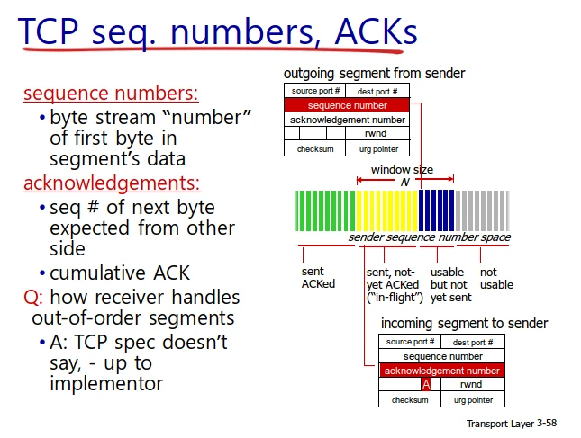

- seq. number는 Selective Repeat Dilemma에 구애받지 않기 위하여 충분히 커야하며, 일반적으로 **Random number**를 사용한다. 

    그런데, **TCP**는 **Seq. number**로 사용하는 약속이 있다. 바로, 내가 보내야 할 데이터의 첫 부분의 Sequence Number(**ASCII Code**)를 Sequence Number로 사용하는 것이다. 

- **녹색**(sent ACKed)은 더 이상 관리가 필요하지 않은 것들이다.

- **노란색**(sent, not yet ACKed)은 보냈지만 아직 ACK가 오지 않은 것이다.

    - 들어오는 Packet은 Flag ACK가 Set되어 있으며, Acknowledgement Number에 다음에 받게 될 Sequence Number가 들어있을 것이다.

- **파란색**(usable but not yet sent)은 Sequence Number를 추가하게 될 것이다. 그리고 이 Sequence Number는 이전에 받은 Acknowledgement Number를 사용하게 될 것이다.

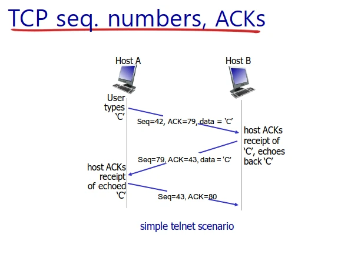

- Loopback 프로그램에서의 Sequence Number와 Acknowledgment Number는 다음과 같다.

    먼저, ‘**C**’에 대한 ASCII code가 **42**이다. 그래서 이걸 **Seq**로 지정한다. (*여기서는 Seq를 42로 가정한 것으로 보인다.*) 다음에 Host B가 **ACK**=**43**으로 지정하여 Packet을 전송해 주는데, 이것은 내가 Packet을 42까지 받았고, 이제 43을 받아야 한다고 알려주는 것이다.

    처음에 **ACK**=**79**인데, 이것은 이전에 Host B에게 전달받았던 **Packet**의 **Seq**가 **78**이라는 것이다. 그래서 내가 다음에 받아야 할 **Packet**의 **Sequence Number**가 **79**라고 알려주는 것이다. 

    즉, 이전에 Host B가 Host A에게 보냈던 데이터에 대한 **ACK** 처리까지, **데이터를 동시에 전송하면서 처리**해 주는 것이다. 

    이후에는 Host B가 다시 Host A에게 데이터 ‘C’를 Loopback 하는데, 현재 **Seq**=**79**를 보내고 있으므로, 이전까지 **Seq**=**78**을 전송했을 것으로 추측할 수 있다. 그리고 Host B가 이번에 **Seq**=**42**를 전달받았으므로, **ACK**=**43**으로 설정했다. 이것은 ‘**내가 지금 42까지 받았으니, 다음에는 43부터 보내주거라.**’라고 말해주는 것이라고 볼 수 있다.

    이후, Host A는 **Seq**=**79**를 전달받았다. 따라서 Host A는 ‘**내가 데이터를 79까지 잘 받았고, 다음에는 80부터 받아야 된다.**’라고 알려주기 위하여 **ACK**=**80**으로 설정한다. 그리고 이번에는 Data를 보내주지 않으며, **Seq**=**43**으로 설정해서 보낸다.

    > 만약 Byte 하나를 보내는게 아니라면, ACK가 1 증가되어서 돌아오는게 아닐 수도 있음. 현재는 1Byte를 보내기 때문에 ACK가 1씩 증가되는 것임.  
    >   
    > 예를 들어서, Seq=42, ACK=79, data =’C’라고 해보자. Host B가 이걸 전송받았다면, 다음에 받아야 하는 것은 Seq=43부터이다. 따라서 ACK=43으로 설정한다. 여기서 만약 데이터가 ‘C’만 간 것이 아니라면, ACK가 더 늘어날 수도 있다는 것이다.

### TCP Timer

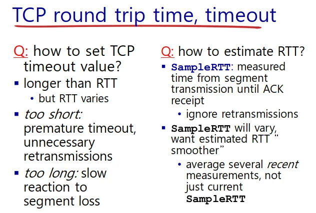

- TCP는 기본적으로 GBN에 가까운 방식을 사용하고, 사용되는 Timer는 하나이다.
- 특히 TCP에서는 Timeout이 가장 중요한 요소이고, 이게 걸린다는 것은 Expiration 시간을 정해놨다는 것이다. 그럼 이 시간을 얼마나 걸 것인가?   
    ⇒ 이것은 네트워크에 따라 Pkt이 오고 가는 시간인, **RTT**(Round Trip Time)에 따라서 다르게 설정하는 것이 합리적이라고 생각할 수 있다.

- Timer의 시간이 너무 길다면? ⇒ Loss에 대한 반응이 너무 느리다.
- Timer가 너무 짧다면? ⇒ 미처 Pkt이 처리되기 전부터 재전송이 되어서 불필요한 재전송을 하게 될 수 있다.

⇒ 따라서 Timer를 부적절하게 설정하면 Network 혼잡을 야기할 수 있다.

> 적절한 RTT를 설정하는 방법은 무엇인가?  
>   
> 지속적으로 pkt을 보내고 받아보고, 이를 통해 **RTT**를 체크하면서 **sampleRTT**를 알아낸다. 우리는 이를 통해서 **estimated RTT**를 구해야 한다. 이것보다 아주 조금 더 마진을 둔 값을 **Time out** 값으로 설정하는 것이 가장 적절하다.

### TCP RTT and Timeout

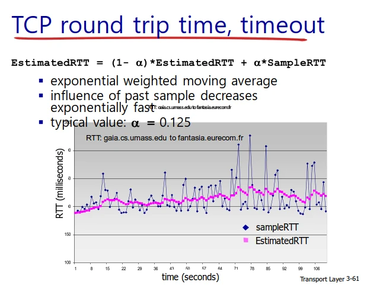

- 네트워크의 상황을 계속해서 예측하는 것은 굉장히 어렵다. 위 공식을 사용하면 **EstimatedRTT**를 쉽게 구할 수 있다. (*여기서 alpha는 0과 1 사이의 값이다.*)  
    ⇒ 일종의 **Weight Moving Average**이다.

    - **EstimatedRTT** : 과거의 값
    - **SampleRTT** : 현재의 값

> 만약 alpha가 0.7이라면, 현재에 기준을 더 많이 두겠다는 뜻이다. 즉, 어디에 더 weight를 두겠냐? 라는 것을 alpha로 정한다.  
>   
> 만약 과거 값에 weight를 더 주게 되면, 이전 값들에 대한 추이를 더 많이 따라간다는 것이다.  
>   
> Typical Value는 alpha = 0.125라고 인데, 이것은 과거에 훨씬 더 많이 가중을 두는 것. 가중을 많이 둘수록, 과거의 값의 추이를 잘 따라갈 수 있게 된다.

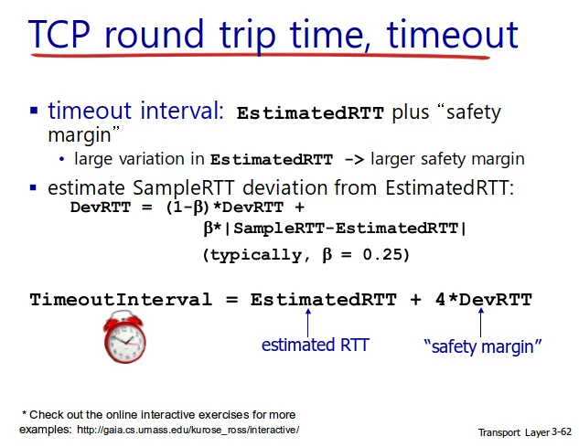

- 결국에는 우리가 timeout interval을 구해야 한다. 이걸 어떻게 구할 수 있을까? 

    - **DevRTT** : 두 값의 표준 편차
    - 이 값을 이용하여 DevRTT를 만든다.
    - 여기서 Beta는 0.25, 역시 과거에 비중을 더 둔다.

- 실제로 **TimeoutInterval**을 구할 때는, Safety Margin을 추가하는 경우가 많다.   
    ⇒ 실제로 이전 값으로의 평균을 구했기 때문에 EstimatedRTT는 값들이 일반적으로 실제 값보다 작다. 따라서 safety margin을 더해서 어느정도 값을 보정하여 **TimeoutInterval**을 정한다. 다만, 이것이 만능은 아니다.

### TCP Reliable Data Transfer

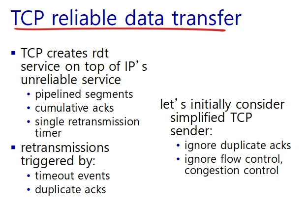

- Network Layer를 Unreliable Service이기 때문에 반드시 Reliable Data Transfer를 위한 TCP가 존재해야 한다.
- 또, Segment Pipelining을 통해 Utilization을 높이고, Cumulative Ack를 사용하며, GBN에서 사용하는 Single Re-transmission Timer를 사용한다.

그런데 이전까지는 **timeout**이 발생했을 때만 **재전송**을 했었다. 그런데 실제로는 **Duplicated ACK**에도 **Retransmission**을 한다. 이걸 하는 이유는 **Fast Retransmission**에서 다룬다.

> 우선, duplicate acks를 무시하고, flow control, congestion control을 무시하는 TCP를 예시로 들어서 Simplified TCP Sender만 확인해보자.

### TCP Sender Events

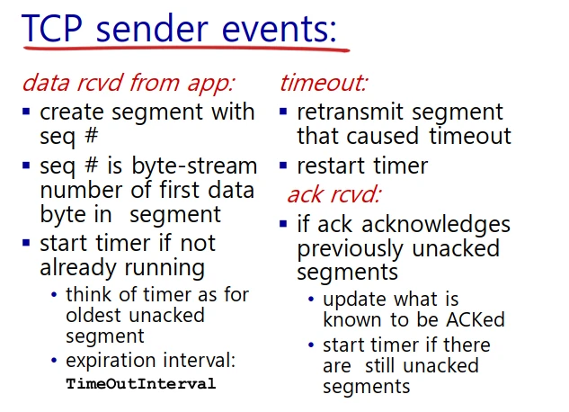

- Sequence Number를 Segment마다 만드는데, Byte-Stream의 첫 번째 # Seq로 시작한다는 것을 확인했었다. 
- 그리고 만약 Timer가 시작하고 있지 않았다면, Timer를 시작한다.   
    (*Application에서 데이터를 보내줬을 때 이 동작을 하는 것이다.*)

- 따라서, 가장 오랫동안 Un-ACKed Segment에 대해 Timer가 동작하는 것으로 생각한다.
- **Expiration Interval**은 우리가 이전에 구한 **TimeOutInterval**을 사용한다.
- **Timeout**이 되면 재전송을 하는데, 가장 앞에 있는 Segment가 Timeout이 됐을 것이다. 이걸 재전송하고 나면 Timer를 다시 Restart한다.
- 그리고 나서 ACK를 받으면, 이전에 Un-ACKed된 Segment가 처리되고, 그 다음에 Sliding Window를 하나 이동하고, 새로운 Packet을 위해 Timer를 시작한다.

- TCP의 입장에서 봤을 때, Sender에는 크게 세 개의 이벤트가 존재할 수 있다.

    - 1) Application에서 데이터가 도착할 때 Sequence Number를 할당하고, Timer를 걸고 데이터를 전송하게 된다.
    - 2) Timeout 이벤트가 발생하면, Sliding Window의 가장 앞에 있는 것부터 데이터를 전송하고 Start Timer를 다시 수행한다.
    - 3) ACK를 받으면, ACK를 받은 것까지 Sliding Window를 이동하고, Timer를 재시작한다.

### TCP: retransmission scenarios

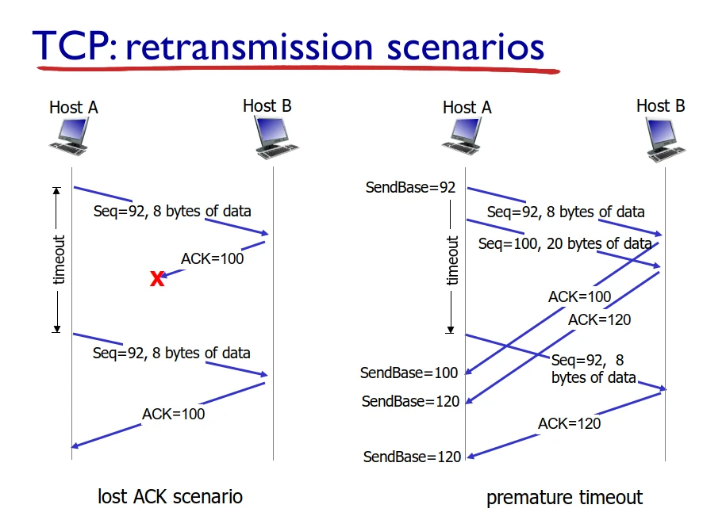

- **Lost ACK scenario** : Sequence Number 92에 8 bytes 데이터. 8 bytes를 받았기 때문에 다음에 expected sequence number가 100이다. 그런데, 이것이 깨졌다면 Sender는 Sliding Window 제일 앞에서부터 전체를 전송한다. 이것은 Duplicated Data인데, 이전 데이터가 오면 그냥 Drop하고, 마지막으로 받았던 ACK만 처리하고 Sender에게 보내준다.  
    받고나면 Sliding Window가 이동하고, 새로운 데이터를 보내 줄 것이다.

- **Premature Timeout** : ACK가 정상적으로 오기는 했는데, **Timeout이 먼저 발생**한 것이다. Seq=92에서 8 bytes를 보내면, ACK는 100을 보낼 것이다. 그 다음에는 Sliding Window로 Seq=100, ACK는 120을 보낼 것이다. 그런데 보내는 과정에서, Timing이 조금 늦어져서 Timeout이 먼저 되었다.

    이렇게 되면 Seq=92부터 다시 보내게 된다. 그런데 보내고 나니 ACK100, ACK 120이 도착했다. 이러면 문제가 되지 않는다. Sender는 도착한 ACK100, ACK120이 Original인지 재전송인지 알지 못하고, 알 필요도 없다. 그래서 SendBase를 100 → 120으로 옮겨서 Sliding을 해준다.

    그런데, 재전송했던 Seq=92에 의해서 ACK120이 돌아오게 된다. 

    (*왜냐면, Receiver인 Host B는 이미 ACK120까지 전송했고, 이것이 또 들어왔으므로 이전까지 처리한 것을 그대로 보내주면 된다. 그리고 Sender는 현재 전송을 하고 있지 않은데, 이 상태에서는 어떠한 Packet이 들어오면 그냥 무시해버리는 것이 rdt 3.0의 방식이다. 왜냐면, 전송상태가 끝났다는 것은 내가 보냈던 모든 Packet을 완벽하게 처리했다는 것이기 때문에, 이후에 도착하는 것은 반드시 Duplicated Data라고 확신할 수 있기 때문이다.)*

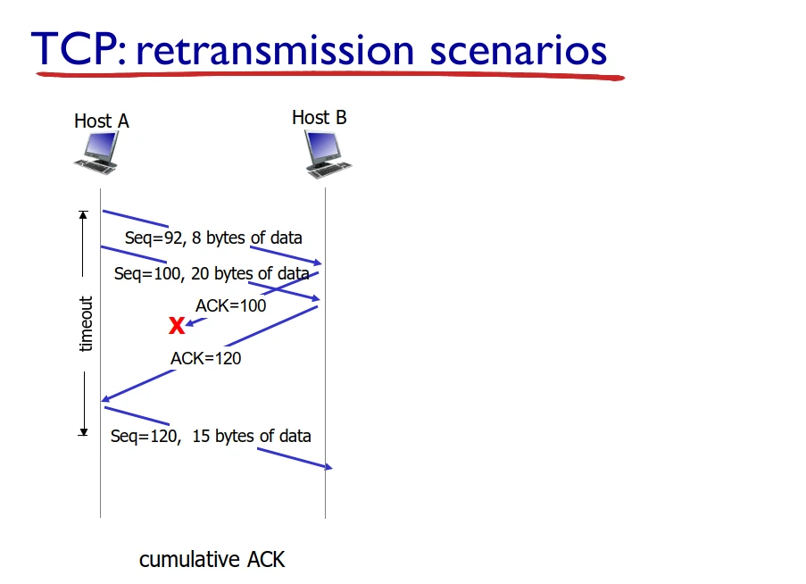

- **Cumulative ACK** : Seq=92, 8 bytes를 보내고 Seq=100, 20 bytes를 보냈는데 ACK100이 깨졌고, 그 이후에 ACK120이 도착했다. 그런데, 이것이 문제가 되지는 않는다. 왜냐면 ACK120이 왔다는 것은 Receiver가 ACK100을 보냈지만, 그것이 Loss된 것이라고 판단할 수 있기 때문이다.

    따라서 100에 대한 ACK를 받지 않아도 120에 대한 ACK만 받으면 Sliding Window를 옮겨서 SendBase가 120까지 쭉 이동하게 되고, 거기서부터 다시 시작하게 된다.

⇒ Receiver는 크게 고려할 사항이 많지는 않다.

### Fast Retransmit

> 이전까지는 Timeout Event에 대해서만 다뤘고, Duplicated ACK에 대해서는 다루지 않았다. 사실 Timeout Event만 다루면, Recovery를 하기까지 시간이 매우 오래걸린다. 따라서 이제부터는 Duplicated ACK에서도 Recovery를 할 수 있도록 한다.  
>   
> Timeout이 되기 전에 어떠한 징조가 보이면, 먼저 Recovery를 해버리는 것이다.

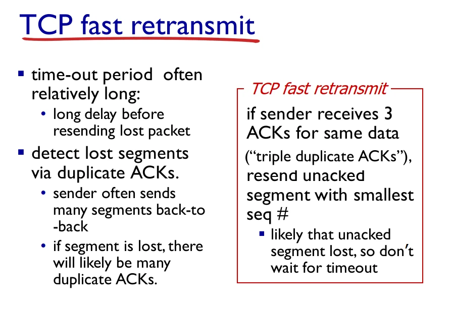

- **Lost Segment**는 **Duplicated ACK**를 통해서 알 수 있다. 만약 Segment가 Lost되면, ACK는 계속해서 날라올 것이다.

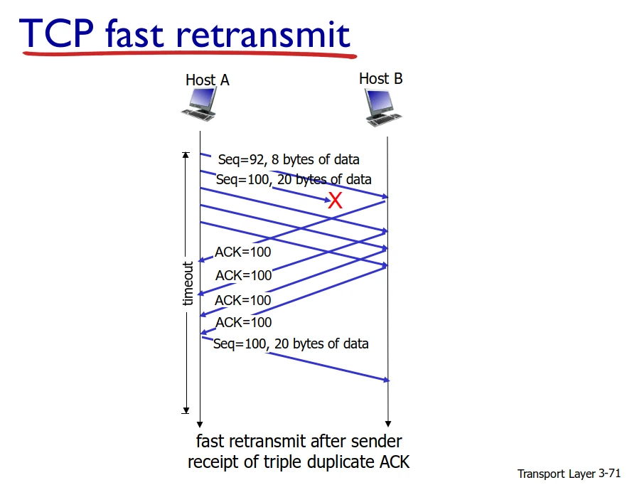

- 왜냐면, 중간에 깨지고 뒤에있는 것들을 받으면 뒤에 있는 것을 받더라도 무시를 하게 된다. 자기가 순서대로 잘 받은 것까지만 처리하기 때문이다. 그래서 가장 최근의 ACK만 계속해서 재전송하게 된다. ACK100을 받으면, 이후에 120을 보내주어야 하는데 Duplicated ACK는 Drop하므로 Timeout이 발생할 때까지 계속해서 대기하게 된다.

    이렇듯, Sender에서 Timeout Event만 사용하면 Duplicated ACK가 아무리 도착해도 Timeout이 발생할 때까지는 Recovery가 불가능하다.  
    ⇒ Fast Retransmit은 여기서 아이디어를 도입한다.

    > 바로, Duplicated ACK가 세 개 도착하면 Packet이 Loss된 것으로 판단하고 Timeout까지 기다리지 않고 빠르게 전송하는 것이다.

---

## &lt;Flow Control&gt;

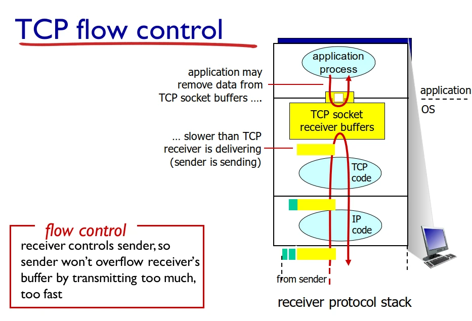

- Receiver 단에서, Data가 Network Layer를 거쳐 TCP로 올라오고 있다. Data가 Pipeline에 의해서 계속해서 연속적으로 도달할 수 있는데, Network Layer는 데이터가 도착하면 무조건 올려버리고, 이 데이터는 TCP에 존재하는 Segment Buffer Queue에 저장된다.

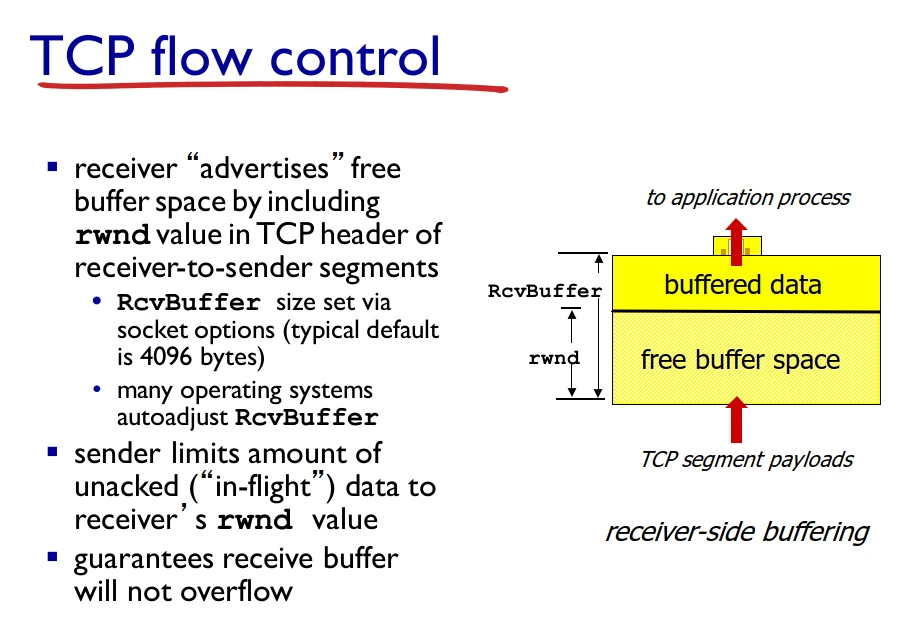

- 그런데 이 공간이 무한한 것은 아니다. 데이터가 너무 많이 도착하면 Overflow가 발생할 수도 있다. 하지만 정상적으로 도착한다면 Buffer에는 데이터가 계속 쌓이게 되고, 이렇게 들어온 데이터는 위로 나가게 된다.

    > 하지만 데이터가 들어왔다가 Transport Layer에 의해 스스로 나가지는 않는다. 모든 프로그램은 Application Driven이라서, Application에서 Socket을 이용해서 TCP에게 데이터를 보낸다고 하더라도 TCP가 스스로 데이터를 가져가는게 아니라, Application Layer에서 Socket을 사용하는 System Call을 통해 전달하게 된다. (*Write Function*)  
    >   
    > 받을 때도 마찬가지로 데이터가 온다면 밑에서 무조건 올려주는 것이 아니라, Application에서 해당하는 Socket으로 Read System Call을 사용해야 데이터를 받아올 수 있다. (*Read에는 얼만큼 읽을 것인지 Parameter를 넣는다.*)  
    > 그런데 Application에서 생각보다 데이터를 빨리 읽어가지 않을 수도 있다. TCP는 Pipeline을 이용해서 데이터를 많이 보내는데, 읽어가는 속도가 충분하지 않을 수도 있다. 이런 경우에는 TCP Buffer에 Overflow가 발생할 수 있다.   
    >   
    > Stop-and-Wait에서는 이런 일이 절대 발생하지 않지만, Pipeline에서만 발생할 수 있는 문제인 것이다. 이런 문제를 해결하기 위한 방법이 Flow Control이다.

- 그렇다면 누가 해결해야 하는가? Receiver는 Application에서 주도적으로 프로그램을 짜지 않는 이상은, TCP에서 주도적으로 Buffer가 다 찼다고 알려줄 수가 없다. (*이것은 모든 OS 서비스가 마찬가지이다. OS의 서비스는 주도적으로 Monitoring을 실시하지 않고, 단지 갖고 있을 뿐이다.*)
- Receiver 단에서는 해결할 수 있는 것이 아무것도 없다. 단지 계속해서 데이터를 받아오고, Application에서 읽으면 보내줄 뿐이기 때문이다. 따라서 Sender가 문제를 해결해야 한다.
- TCP Receiver 단에는 Receive Window라는 Field가 존재한다. 이것은 현재 Buffer가 얼마나 남았는지 알려주는 역할을 하는데, TCP Sender가 이걸 보고 Packet 전달량을 조절하는 것이다.

- 그렇다면 이 RcvBuffer는 어떻게 계산할까?

    - 전체 Buffer 사이즈에서 **buffered data**를 빼면 **rwnd**가 되는데, 이걸 **Sender**에게 보내주는 것이다. 이를 통해 Overflow를 현저히 감소시킬 수 있다.

    > 다만 이것보다 더 좋은 것은, Application에서 데이터를 빠릿빠릿하게 읽어가도록 짜는 것이다.

---

## &lt;Connection Management&gt;

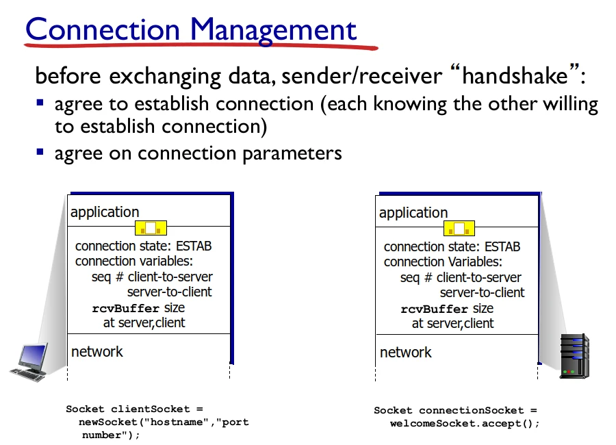

- TCP는 기본적으로 Connection Oriented이기 때문에 데이터가 생기면 바로 보내는게 아니라, 먼저 연결을 수립해야 한다. TCP 연결은 TCP/TCP 간에 대등하게 생긴다.

    - Socket Programming에서 **Socket**을 만들고, **Connect**를 할 때, Client에서 **Accept**을 하면 이루어지게 된다.

### Two-way Handshake

> TCP에서 가장 일반적인 Connection 방식이다.

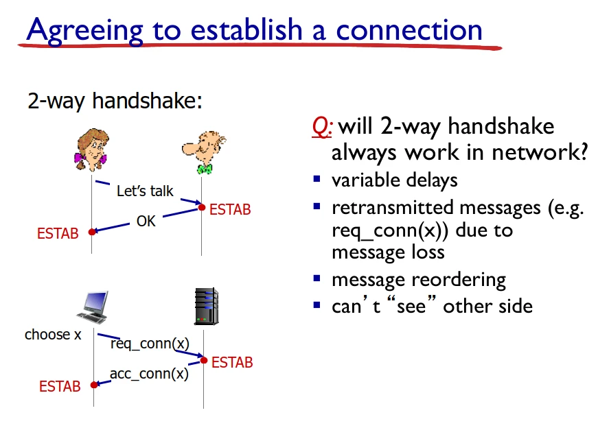

- “나 연결할게?” “OK” 이것이 **Two-way Handshaking**이다.
- 항상 **Client/Server** 구조에서는 Client가 요청을 먼저 한다. Client가 <strong>req_conn(x)</strong>을 통해 연결을 시도한다. 이때 전달되는 x는 연결의 순서 번호이다. **ESTAB**는 연결이 수립된 것을 의미하고, Client에게 <strong>acc_conn(x)</strong>를 보내줘서 연결 수립을 알려준다.

> 하지만 이렇게만 하면 문제가 발생할 수 있다.

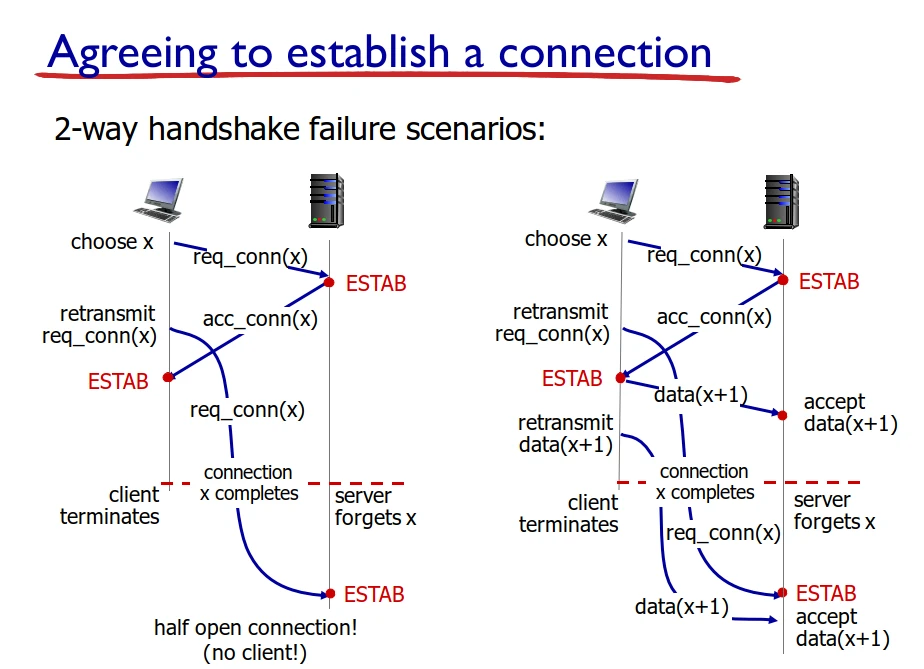

- 만약에, <strong>req_conn(x)</strong>를 보냈는데 <strong>acc_conn(x)</strong>가 도달하기 전에 timeout이 돼서 <strong>req_conn(x)</strong>가 다시 전송되었다고 해보자. 그러면 Client 입장에서는 **ESTAB**가 도착했으니까 연결을 수립해 버린다. 하지만 재전송된 <strong>req_conn(x)</strong>이 서버로 가기 때문에 Server는 이 연결을 계속해서 잡아놓을 수밖에 없다.

    **TCP**에서 **서버**는 **Client**가 요청할 때마다 **한 개**의 **Process**를 만들어준다. 즉, 그 TCP 전용의 연결Process를 만드는 것이다. 이것은 Zombie도 아닌, 아무것도 하지 않으면서 계속 열려있기 때문에 매우 큰 Overhead가 된다.

- 다른 경우에는, <strong>req_conn(x)</strong>를 하고 <strong>acc_conn(x)</strong>를 한 뒤, 데이터를 보낸다. 그런데 이 과정에서 아까처럼 **timeout**이 발생해서 <strong>req_conn(x)</strong>가 재전송 되었다고 해보자. 이때 원래의 연결이 <strong>data(x+1)</strong>을 보냈고, 서버가 이를 받았다고 하자.

    하지만, 재전송했던 <strong>req_conn(x)</strong>이 별도의 **Socket**으로 연결되어 새로운 Process를 만들었고, 이 때문에 <strong>data(x+1)</strong>을 또 다시 보내게 되었다. 이것은 Client 입장에서는 무의미한 동작이다. (*Data Duplication이며, TCP는 Filtering이 불가능하다.*)

> 결론적으로, Two-way로만 Connection을 수립하면, Client가 Establish 되기 전에 Server가 먼저 Establish가 되는 것이 문제라고 생각할 수 있다.

### 3-way Handshake

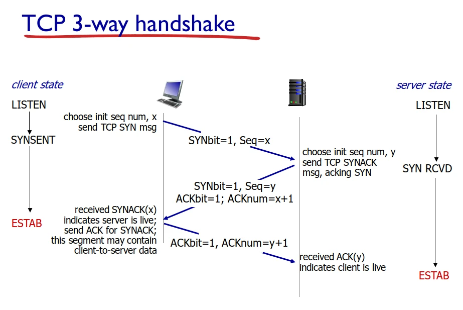

- 이전에 **TCP Header**를 보면 **SYN**이라는 **Flag**가 있었다. 이것을 Set하고 자신의 **Sequence Number**를 실어서 **Server**에 보낸다. 그러면 곧바로 TCP 연결 수립을 하는게 아니라, **SYN RCVD(RECEIVED)** 상태로 간다. 그 다음에는 **ACKbit**를 **1**로 설정하는데, 즉, **SYN**에 대한 **ACK**라고 알려주는 것이다.

    여기까지 왔다는 것은, **Server**가 **SYN**을 받았고, **Client**가 **SYN**에 대한 **ACK**도 받았기 때문에 **Server**에서는 문제가 존재하지 않는다는 것이다. 그래서 **Client**가 **Establish**를 시도하는데, 이것은 **SYN ACK**에 대한 **ACK**이다.

- 즉, 3-way Handshaking은 다음과 같은 과정을 거친다.

<!-- -->

1. **SYN**
2. **SYN ACK**
3. **SYN ACK의 ACK**

⇒ 이 과정까지 진행되어야 **Establish**가 된다. 

> 즉, Client가 완전히 Establish가 된 것을 확인한 후에, Client가 Establish가 되어야 한다. 따라서 3-way Handshake를 사용한다.

### TCP 4-way Handshaking Closing

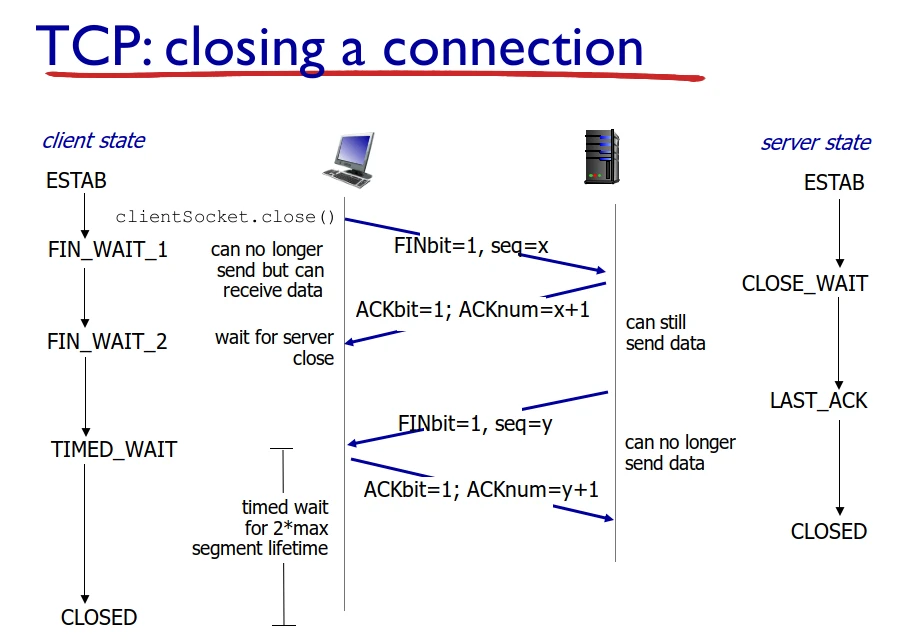

- **SYN**은 항상 **Client**가 먼저 보낸다. 하지만 **FIN**은 **Client**/**Server** 누구나 먼저 보낼 수 있다. 
- 연결을 끊으려는 쪽의 **Socket**에서 <strong>Close()</strong>를 수행하면, **FINbit**가 전송된다. 즉, <strong>Close()</strong>를 하면 **FIN**이라는 것만 날라가는 것이다. (*이때, 실질적으로는 FIN에 ACK가 포함되어 있는 것이고, 그렇기 때문에 Server가 더 전달해 줄 데이터가 남아있다면 더 보내라고 요청하는 것이다.*)
- 이를 받은 **Server** 쪽에서는 **FIN**에 대한 **ACK**를 보낸다. (이 과정에서 *만약 보낼 데이터가 있다면 Sequence Number로 표현해서 전달해 줬을 것이다.*) 하지만 **Server** 입장에서는 아직 Client에게 보내 줄 데이터가 남아있을 수도 있으므로, 여전히 이 상태에서는 데이터를 보낼 수는 있다. 그래서 이 상태를 **CLOSE_WAIT** 상태라고 하며, 데이터가 완전히 다 전송될 때까지 기다린다.

> CLOSE_WAIT이 존재하는 이유를 생각해보자. Client 측에서는 close()를 하고 나면, 어쨌든 Socket을 닫으려고 하는 것이기 때문에 데이터를 다시 전송할 수는 없다. 하지만, 그 이전에 전송했으나 아직 도착하지 않은 것이 존재할 수도 있다.   
>   
> 따라서 Client가 FIN을 보내고 Server가 FIN ACK를 보내는 것은, Client가 연결을 끊겠다고 알리고 Server가 잠시 기다려 달라고 답한 뒤, 늦게 도착할 수 있는 것을 기다리는 것이라고 볼 수 있다. Client는 Close()를 했으므로 데이터를 더 이상 전송할 수는 없지만 여전히 데이터를 받을 수는 있으므로, Server에 늦게 도착한 Packet에 대한 ACK를 받게 된다. 그러면 이제, Server는 닫을 준비가 끝나게 된다.

- **Client** 측에서는 **FINbit**를 전송한 순간 **FIN_WAIT_1** 상태가 되어서 Data를 받을 수는 있지만, 전송할 수는 없는 상태가 된다. 이 상태에서 **FIN ACK**를 받게 되면 **FIN_WAIT_2** 상태가 되어서 종료를 마칠 모든 준비를 마치게 되며, 뒤늦게 도착할 Packet에 대한 ACK를 전송하고자 대기하고 있는 **Server**의 Close를 기다리게 된다. 

    그런데, 이때는 **Client**가 **여전히 데이터를 받을 수는 있다.** 왜냐면, Close를 수행하기 전에 재전송을 했던 데이터들에 대한 ACK가 아직 도착하지 않았을 수도 있기 때문이다.

- 그래서 조금만 더 기다린다. 그러다가 **Server**도 모든 전송을 마쳐서 연결을 닫기 위해 **FINbit**를 추가적으로 보낸다. 이때부터 **Server**는 더 이상 **Data**를 **Send** 할 수 없게 된다. 이후에 **Client**는 다시 **FIN**에 대한 **ACK**를 보낸다. **ACK**를 받은 **Server**는 **ACK**를 받자마자 완전하게 **Close**되고, **Client**는 **ACK**를 받고도 두 배 정도 **Timer**를 기다렸다가 Close된다.

    그 이유는, 만약 **Server**가 **FIN**을 전송하기 이전에 받은 데이터가 있다면, 그것에 대한 **ACK**가 도착할 수 있기 때문에 약간의 시간을 더 기다리고자 **Timer**를 설정하는 것이다. 이것을 **TIMED_WAIT**이라고 한다.

    ⇒ TCP close는 이와 같이 4-way Handshaking이다.

<!-- -->

1. FIN (Client → Server)
2. FINACK (Client ← Server)
3. FIN (Client ← Server)
4. FINACK (Client → Server)

(Wait)

> 이렇게 하는 이유는, 재전송에 의해서 지연이 되는 데이터가 존재할 수 있다. 그것을 다 처리하고 불필요하게 재전송에 의해서 새롭게 생성되는 좀비 프로세스를 없애기 위해서이다.  
> ⇒ 이것은 3-way Handshaking에 대한 내용으로 보인다.  
>
>
> 따라서 연결할 때는 3-way Handshaking, 연결을 끊을 때는 4-way Handshaking을 실시한다.

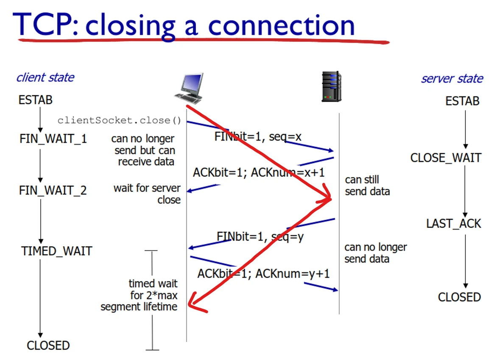

- Closing에서 발생할 수 있는 예외 상황을 생각해 본 것이다. Client가 Close를 하기 전에 보낸 데이터가, 어쩌면 FINbit보다도 늦게 도착할 수 있을 것이다. 따라서 CLOSE_WAIT 상태에서는 추가적인 Packet의 도착을 기다린다. 그러다가 모든 Packet에 대한 ACK까지 전송을 마쳤다고 판단되면, Server도 Close를 수행하고자 FINbit를 전송한다. 하지만 역시 여기서도 FINbit보다 내가 이전에 보냈던 Packet이 더 늦게 도착할 수 있다. 이것이 최대한 도달할 수 있도록 하고자, Client는 Timer를 걸어서 좀 더 Packet을 받도록 한다.

---

## &lt;Congestion Control&gt;

> 이전에 배웠던 Flow Control과 Congestion Control은 완전히 다른 문제이며, Flow Control은 오로지 Receiver의 Buffer가 꽉차는 상황을 방지하기 위해 존재하는 것이다. 반면 Congestion Control은 Network 상황을 통제하기 위해서 존재하는 것이다.

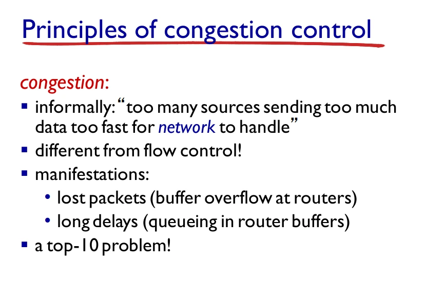

- 결국 이전까지 배웠던 상황들에서 Packet Loss나 Delay가 발생하는 이유는 Network Congestion에 의해서 Core가 Forwarding을 하지 못하기 때문이다.
- 이런 일이 벌어지는 이유는 너무 많은 Sender들이 너무 많은 Data를 보내기 때문이다.
- 이런 경우, 결국 Flow Control과 유사하게 Sender가 조절을 해야 한다.

- 이러한 Congestion의 발생 징후는 다음과 같다고 볼 수 있다.

    - **Loss Packet** (Buffer Overflow at Routers)
    - **Long Delay** (Queueing in Routers) ⇒ **RTT가 길어지기 시작한다.**

### Why the Congestion happens

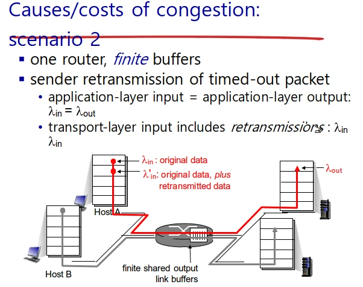

- Router의 Buffer는 Finite Buffer이기 때문에 Loss가 발생할 수 있다. 이런 경우에 TCP에서는 어떤 것을 하나?  ⇒ Timeout이 발생한다.
- Timeout이 발생하면 **재전송**을 한다. 그런데, 이런것 말고도 다른 것이 발생한다. Ack가 깨져서, 동일한 Ack가 3번 받아지면 재전송을 다시 한다. (*Fast Retransmit*)

⇒ **이것이 Congestion을 일으키는 주된 원인이다.**

> 학원 끝난 아이가 부모에게 데리러 오라고 하는 격. 그걸 모든 학원생들이 하게 되면 차가 엄청나게 모여서 혼잡해진다. 이와 같이 한 번 막히기 시작한 Router에 의해 계속해서 재전송이 일어나며 Congestion이 연쇄적으로 발생한다.

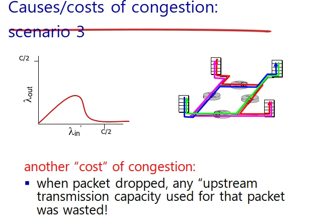

- λout은 Packet이 처리돼서 나가는 것이고, λin은 들어오는 것이다. λin이 너무 많아지면, λout이 급격하게 줄어들게 된다. 그 이유는 Packet이 Loss되거나 이전에 받았던 Packet을 또 보내주기 때문에 결국 λout이 0으로 수렴하게 되는 것이다.

> 그렇다면 TCP에서는 Congestion을 어떻게 해결할 것인가?  
>   
> TCP는 Congestion을 줄이기 위해 대단한 것을 하지는 않는다. 단지, 보내는 packet의 양을 감소시키는 것이다. 또한 Application이 아니라 TCP에서 Congestion을 하는 것은, **Fair**/**Adaptive**하게 진행하기 위해서이다.  
>   
> 대표적인 TCP 알고리즘은 **Reno**와 **Tahoe**이다. 하지만 최근에는 새로운 것이 나타나긴 했다.   
> ⇒ 가장 좋은 Congestion Control 알고리즘은 **Adaptive**하게, 현재 상황에 맞춰 빠르게 대처할 수 있는 알고리즘이다.

### AIMD(Additive Increase Multiplicative Decrease)

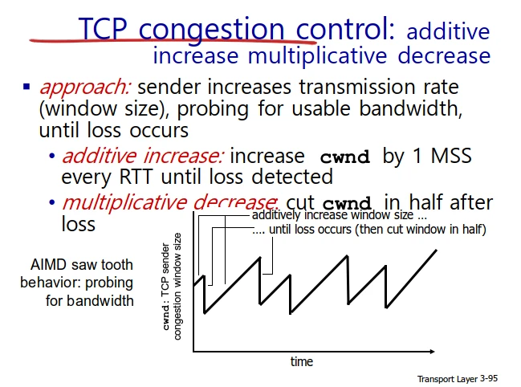

- **Congestion Window** : Sender 측의 **Sliding Window**의 **Size**라고 볼 수 있다. 일반적으로 Sliding Window의 크기만큼 Pipeline으로 데이터를 한 번에 보내준다. 이것은 Dynamic하게 정해지며, Network 상황에 따라서 결정된다.

즉, packet을 보내는 양을 Congestion에 따라서 조절하면서 전송해 준다. 즉, 처음에는 packet을 보내는 양을 천천히 증가시키다가, Congestion이 발생하면 Packet을 보내는 양을 감소시킨다.   
(*Congestion이 발생하면 cWnd를 절반으로 감소시킨다.*)

> Congestion의 발생은 Timeout 혹은 3 duplicated ack로 판단이 가능하다.

### TCP Congestion Control Detail

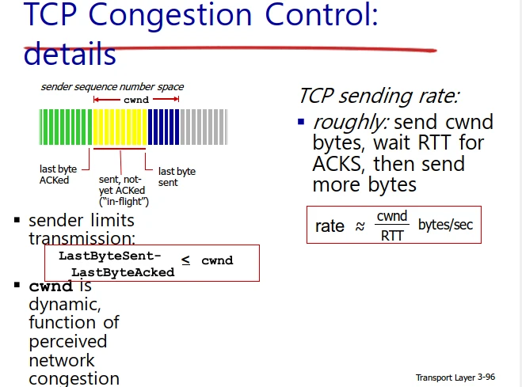

> 아직 전송되지 않은 노란색과 파란색 부분이 **Congestion Window**이다. 여기서 중요한 것은, 한 번에 **cwnd**의 크기를 넘는 양을 전송하지 못하도록 하는 것이다.   
>   
> 단, Congestion Window의 Size는 Dynamic하기 때문에 매번 잘 조절해서 보내준다.

### TCP Slow Start

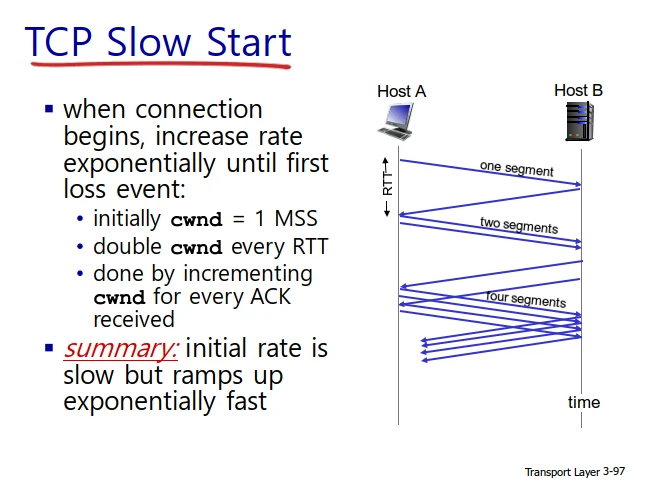

- **Slow Start**는 처음에 1개의 MSS만 보낸다. 그런데 보낸 MSS에 대한 ACK가 정상적으로 도달한다면, 이후에는 보내는 MSS의 양을 exponential하게 두 배씩 increase한다.
- 그러다가 만약 congestion이 발생하면, 다시 MSS를 1로 줄인다. 
- congestion이 발생하고 나서도 MSS를 exponential하게 증가시키면 congestion을 오히려 더욱 악화시킬 수 있으므로, 이전에 congestion이 발생한 부분까지는 exponential하게 증가시키다가. 이전에 congestion이 발생한 지점의 절반 지점을 threshold로 지정하여 해당 부분부터는 additive하게 증가시킨다.

> congestion의 발생은 Timeout, 3 duplicated ACK로 판단한다. 이 때, Timeout은 도달조차 하지 못한 것이므로, 3 Duplicated ACK보다 심각한 경우라고 생각할 수 있다.

### TCP: Detecting, Reacting to Loss

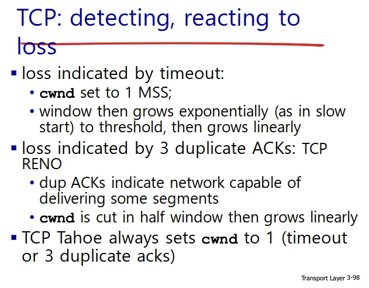

- Timeout이 발생하면 모든 종류의 Congestion Control에서 cwnd를 1 MSS로 고정한다.

- Slow Start에서의 TCP Reno와 TCP Tahoe

    - **TCP Reno**에서는 3 Duplicated ACKs Congestion이 탐지되면, cwnd를 절반으로 줄이고, linear하게 증가시킨다.
    - 반면 **TCP Tahoe**에서는 어떠한 종류의 Congestion이 탐지된 것이든, Congestion이 발생하면 cwnd를 1로 고정한다.
    - 이 과정에서 **ssthresh**는 모두 절반으로 감소한다고 생각하면 되겠다.

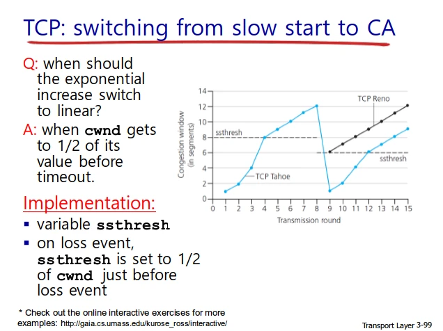

- **TCP Tahoe**는 Timeout이 발생하던지, 3 Duplicated Ack가 생기던지, 무조건 congestion이 생기면 MSS를 1로 감소시킨다. (*이때, ssthresh는 Slow Start의 Threshold이다.*)
- 하지만 **TCP Reno**는 Timeout은 MSS를 1로 보내지만, 만약 3 Duplicated Ack라면 감소된 Threshold에서부터 Linear하게 증가시킨다.

> 큰 차이는 없지만, Timeout이 발생하면 모두 1 MSS로 고정하고, TCP Tahoe는 3 Duplicated ACK는 1 MSS로 고정, TCP Reno는 cwnd를 절반으로 줄이고 linear하게 증가시킨다.  
> (단, 이때 Slow Start라면 모두 ssthresh를 절반으로 줄인다.)

---

## &lt;Congestion Avoidance&gt;

> Exponential하게 증가하다가, Threshold에서 Linear하게 증가되는 부분이 존재하고, 다시 Timeout이 발생하면 다시 1부터 시작하게 된다. 여기서 **Linear**한 부분이 **Congestion Avoidance**라고 볼 수 있다.

### TCP Throughput

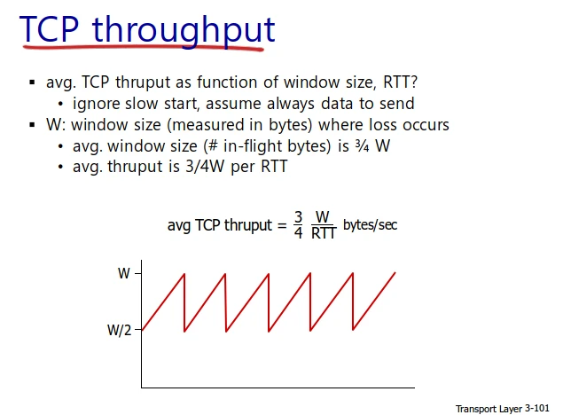

- Congestion Control이 발생했을 때 TCP의 Throughput을 계산하는 것은 굉장히 어렵다. 그래서 3&#47;4은 휴리스틱하게 추가한 값이다.

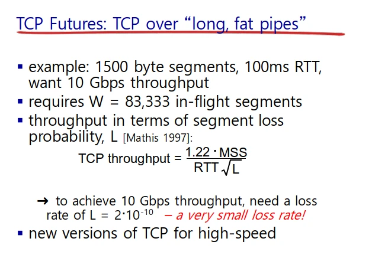

- 공식이 복잡하지만 결국 중요한 것은, 네트워크의 상황이 좋으면 TCP의 Throughput도 좋아지고, 네트워크의 상황이 안좋아지면 TCP의 Throughput도 안좋아진다는 것이다.

### TCP Fairness

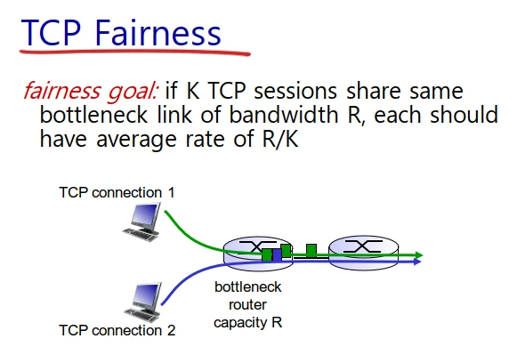

- 그런데, 만약 네트워크에 Bottleneck이 발생했을 때 나만 Congestion을 Control하고 있으면 Unfair한 것이 아닐까? ⇒ TCP는 이 문제가 일어나지는 않는다. 모두가 Congestion을 인지하고 함께 노력하기 때문에 Fair하다.
- 모두가 Congestion Control을 하기 때문에, Router의 Queue에 들어있는 Packet이 점차 처리되면서 네트워크가 해결된다.
- TCP는 우리가 알게 모르게 이걸 수도 없이 처리하고 있다. OS안에서 이걸 처리하기 때문에 Process는 아니고, 하나의 Task로서 계속해서 처리하는 것. (Overhead가 매우 크다.)

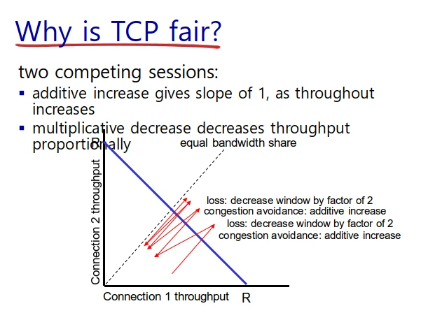

- Capacity가 증가를 하다가, Loss가 발생하면 줄어든다. 그러다가 또 올리다가, 확 줄고, 올리다가 확 줄고… (빨간색 화살표)
- 이게 계속해서 반복되면 Fair하게 만들어진다. 왜냐면, Congestion이라는게, 모두가 노력을 해야 네트워크가 뚫리게 되는 것이다.

> 중요한 것은, 모두가 Fair하게 노력하기 때문에 Throughput이 모두 비슷하게 만들어진다는 것이다.

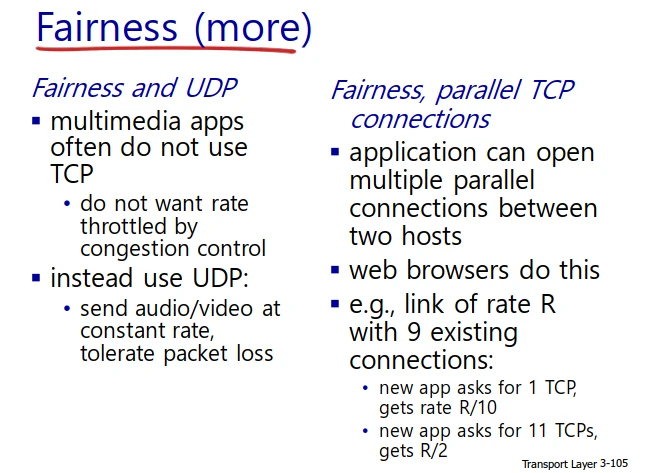

- 한 컴퓨터에서 TCP 연결을 여러 개 만들 수 있으며, 이 때 각각의 TCP마다 별도의 연결(TCP Task)이 생성되는데, 이것은 모두 별도의 연결로서 취급된다.

- 즉, TCP Congestion은 컴퓨터 당 하나씩 일어나는게 아니라, 한 TCP 연결(Task)마다 Congestion Control을 하기 때문에 Fair한 것이다.

    ⇒ 하지만 이 방법을 역이용해서, Application에서 조작이 가능할 수도 있다.

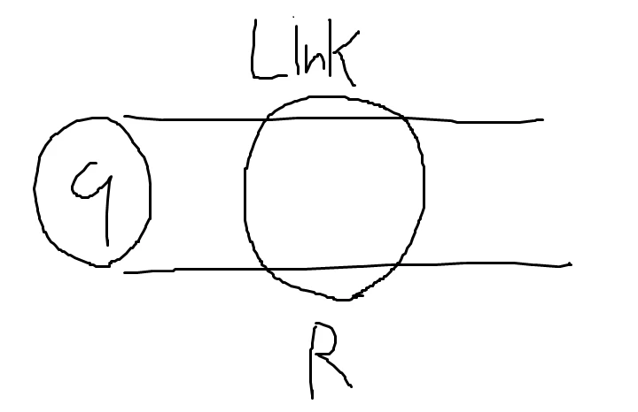

- 기존에 9개의 연결이 있는데, 여기에 내가 하나를 추가하게 되면, 해당 링크에서 각각의 연결에는 R/10의 Rate로 처리를 Fair하게 할 것이다.
- 하지만 만약, 내가 똑같은 연결을 11개를 추가로 Parallel하게 만든다. 그러면 총 연결은 20개인데, 나는 11R/20 만큼 할당을 받을 수 있으므로 Unfair하게 처리된다.
- 주로 Web server들이 이렇게 만들어 버리는데, Permanent 연결이라고 하고, Object를 받아온다고 한다면, 그 Object마다 연결을 만들기 때문에 매우 빠르게 처리한다.

> TCP Congestion Control은 Network Core에서 일어난다. 하지만 그 책임은 Transport Layer에서 졌었다. 그런데, Congestion의 책임을 Network Layer에서 지려는 노력도 존재한다. 

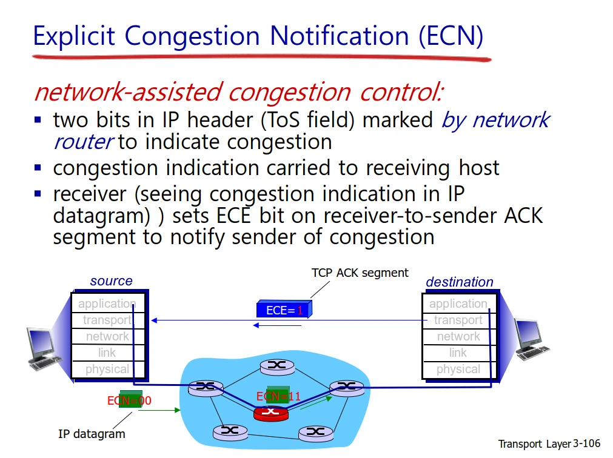

- ToS : IP header에 존재하는 두 개의 비트로, Congestion이 발생했음을 명시해 주는 방식

    - **ECN**(Explicit Congestion Notification) Bit

        - Congestion이 발생하면 11로 만드는 것으로 보인다.
        - 이후에 Source에 ECE를 1로 만들어서 전달.

⇒ 다만 이것은 알고리즘적으로만 존재하고, 실제로는 거의 사용하지는 않는다.
