# Socket Programming


## &lt;Socket Programming&gt;

> Socket의 가장 기본은, Linux 기반에서 C언어로 만들어져 있다. 하지만 이러한 개념만 잘 알고 있으면 언어를 바꿔도 전혀 문제가 없기 때문에, 여기서는 전체적인 Flow와 Architecture를 다룬다.

### Socket

- Socket은 왜 존재하는 것일까? 그 이전에, **Interprocess Communication**에 대해 생각해보자. 모든 **Process**는 **독립적인 존재**이다. 하나의 Process 안에서 데이터를 주고 받는 것은 매우 자유롭지만, 서로 다른 Process가 데이터를 주고 받는 것은 결코 쉬운 것이 아니다.
- 예를 들어, 웹 브라우저와 한글과컴퓨터 프로세스가 데이터를 주고 받는 것이 가능하냐. 이런 말이다. ⇒ 결코 쉽지는 않지만, 불가능하지는 않다.
- 이러한 여러 개의 프로세스는 OS가 관리한다. 실제로 프로세스 간의 Communication을 하기 위해서는 **OS의 서비스**를 받아야 하며, 그렇지 않으면 다른 프로세스가 존재함을 알 수 조차 없다.
- 그래서 이러한 서비스를 표준화해서 사용하는 방법이 바로 **System Call**이다.
- 그런데, Process 간의 데이터를 주고 받는 것은 **FIFO**, **Shared Memory** 등을 사용하고, **Mutex**, **Semaphore** 등을 이용해 **Critial Section**을 보호해야만 한다. 하지만 이 과정이 너무나도 복잡하다. 이러한 상황 속에서 등장한 **Socket**은 이러한 **Interprocess Communication**을 간단하게 만들어주며, 프로세스 간의 **Read**/**Write**를 간단하게 할 수 있도록 도와주는 API로서 제공되었다.
- 이후에 **Network**가 만들어지게 되고, 네트워크 통신은 결국 (*다른 컴퓨터에 존재할 뿐인*) **Process** 간의 통신이라고 생각할 수 있다는 것을 알게 되었다.
- 그러므로 **Socket**을 표준 Interface로 적용하여 Network에 사용하게 되었다.
- 웹 서버를 구현하고 거기서 사용되는 **Daemon**은 뜯어보면 결국 다 Socket에 대한 Programming으로 사용된다. 따라서, Socket에 대한 개념을 알고 있으면 언어에 종속되지 않고 일반적으로 적용할 수 있다.

### Socket의 Type

- **SOCK_STREAM** : TCP
- **SOCK_DGRAM** : UDP

> Socket을 열 때, Socket의 Type을 먼저 정해주어야 한다. 만약 내가 **Client**/**Server**를 모두 개발한다면, 내가 원하는 대로 설정하면 된다. 하지만 만약 Server가 먼저 만들어져 있다면 Server의 Socket의 Type에 맞춰야 한다.

### API of Socket

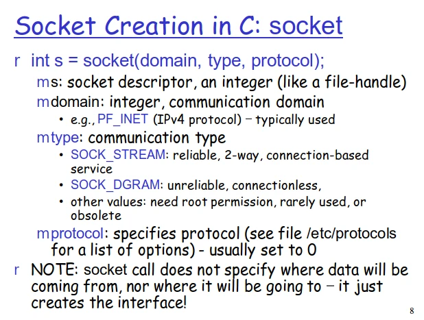

- 가장 먼저 Socket을 Open해야 한다.

```c
int s = socket(domain, type, protocol);
```

> type은 **SOCK_STREAM**/**SOCK_DGRAM**이고, protocol은 현재 사용하지 않으므로 0으로 채워주면 된다. 만약 API를 통해 File을 Open한다면, 우리는 그 File에 대한 File Descriptor를 전달받고, 이것을 통해서 계속 File에 접속한다.  
>   
> Socket도 비슷하게 Socket을 한 번 열면, 고유한 **Identifier**(Integer Value)를 받고 이 것으로 Socket을 구분하여 사용하게 된다. 이를 **Socket Descriptor**라고 한다.

### Port Number

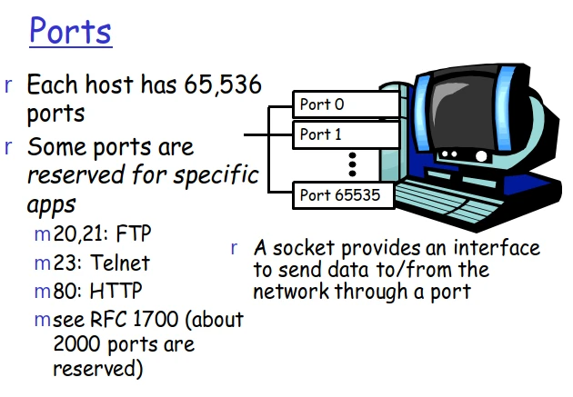

> Socket을 열기 위해서는 Port Number를 설정해야 한다. 그런데, 일반적으로 정해진 Port Number가 있다. 이걸 겹치지 않게 사용하려면 60,000번 이후의 **Port Number**를 사용하는 것이 좋다.

### Bind Function

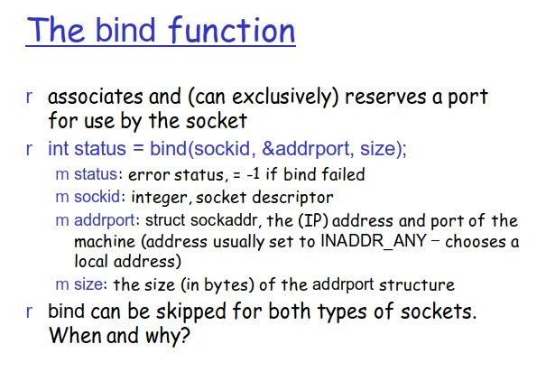

> 내 컴퓨터 안에 **Ethernet**이 여러 개 있을 수 있다. 이 중 어느 것에 대해 **Socket**을 사용할 지 고르는 것이다. 즉, 내 컴퓨터가 아니라 내가 통신할 LAN Card(Interface)와 **Socket**을 **Bind**하는 것이다.

**What is the Ethernet?**

Ethernet이란, 컴퓨터 네트워크 기술의 하나로, 일반적으로 LAN, MAN 및 WAN에서 가장 많이 활용되는 기술 규격이다. 이더넷이라는 명칭은 빛의 매질로 여겨졌던 에테르에서 유래되었다. 이더넷은 OSI 모델의 Physical Layer에서 신호와 배선, Datalink Layer에서 MAC Packet과 Protocol 형식을 정의한다.

정리하자면 내 컴퓨터가 연결된 Local Network를 Ethernet이라고 하는 것 같다.

```c
int status = bind(sockid, &addrport, size);
```

- **sockid** : Socket의 **Descriptor**
- **addrport** : 이것은 struct이기 때문에 여러 정보가 들어간다. 먼저, Ethernet 카드가 여러 개 존재할 수 있는데, 어떤 것을 쓸 것인지를 결정한다. 즉, 나의 **IP Address**를 매핑하는 것이다. 그리고 내 **Port Number**를 넣는다.   
    (그런데, 구조체 내에서 address를 따로 *지정하지 않고 INADDR_ANY로 설정하면 자동으로 연결된 Local Address로 연결한다.*)

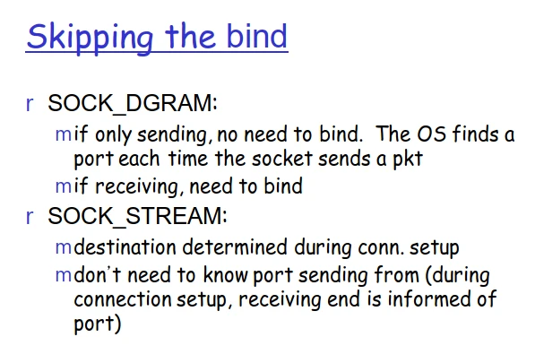

- **SOCK_DGRAM**: 만약 SOCK_DGRAM을 사용하면, 연결을 유지할 필요가 없으므로 별도의 Binding을 할 필요가 없다.

- **SOCK_STREAM** : Connection Setup 과정에서는, 상대방의 **Port Number**를 알 필요가 없다.   
    (*그리고 사실 내 것도 알 필요는 없음.*) 하지만 어쨌든, **Bind**를 해두는 것이 좋다. (*Overhead가 있는 것이 아니므로 일단 하는 것이 좋다.*)

    > ⇒ 이 설명은 정확하지 않은 것으로 보인다. Connection Setup은 connect()를 통해서 수행되는데, 이때는 반드시 연결하려고 하는 Server의 IP Address와 Listen Socket의 Port Number를 알아야만 한다.  
    >   
    > 단지 Client에 대해서는 명시적으로 bind()를 해 줄 필요가 없다는 것이고, connect()를 수행할 때 Client의 IP Address와 Port Number가 알아서 Mapping되는 bind() 과정이 수행되기 때문에 Server가 accpet()을 통해서 Client의 IP Address와 Port Number를 잘 전달받을 수 있는 것이다.  
    >   
    > 또, 현재 어떤 Port가 Free한 지는 Kernel이 알고 있으므로 Application Program이 Port Number를 직접 지정하는 것은 매우 어려운 일이다.

- [**In socket programming, why a client is not bind to an address?**](https://stackoverflow.com/questions/21645970/in-socket-programming-why-a-client-is-not-bind-to-an-address)

> 정리하자면, connect() API 자체에 내부적으로 bind()가 들어있기 때문에 Client는 Socket을 생성할 때 굳이 bind()를 수행하지 않아도 된다. Client가 connect()을 수행하면, 알아서 bind()를 해서 정보를 Server에게 전달해준다.  
>   
> 하지만 Server는 IP Address와 Port Number가 명시적으로 bind 되어 있어야만 다른 Client들의 Socket이 connect()에 IP Address와 Port Number를 명시해서 connection을 시도할 수 있기 때문에 bind()를 반드시 해주어야 한다.

### Connection Setup (SOCK_STREAM)

> SOCK_DGRAM은 connection이 필요하지 않으므로, SOCK_STREAM에서만 다룬다.

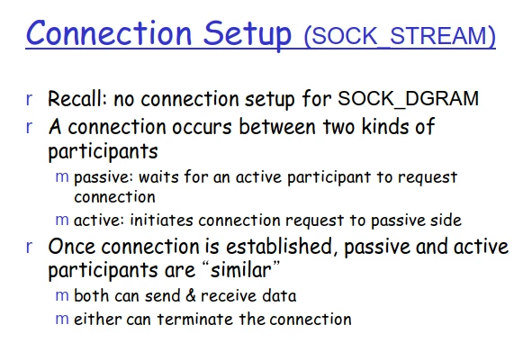

- 만약 Client와 Server가 있다면, Client가 Server에 요청을 처리하고, Server는 이 요청을 기다리고 있는다.

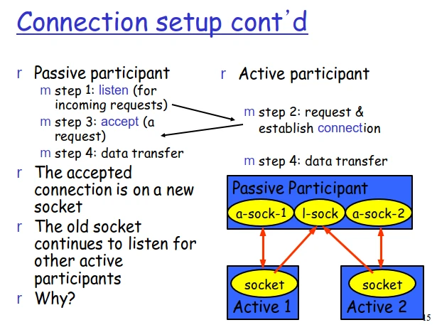

- **Passive Participant** : 지금까지의 순서, **Socket**을 열고, **Bind**를 하고, **Listen**을 통해서 기다리는 역할을 한다. ⇒ Server의 역할로서, 기다리는 역할이다.
- **Active Participant** : **Socket**을 열고, **Bind**를 하고, **Connect**라는 함수를 통해서 연결을 시도한다. 이 때, **Connect**에는 당연히 **Server**의 **URL**이 필요하다. ⇒ Client 측에서 연결을 시도하는 역할이라고 볼 수 있다.
- **Active Participant**가 <strong>Connect()</strong>를 수행하면, **Passive Participant**는 <strong>Accept()</strong>을 실행해 해당 **Active Participant**와의 **독점적인 연결을 수립**한다.

### Connection : listen() & accept()

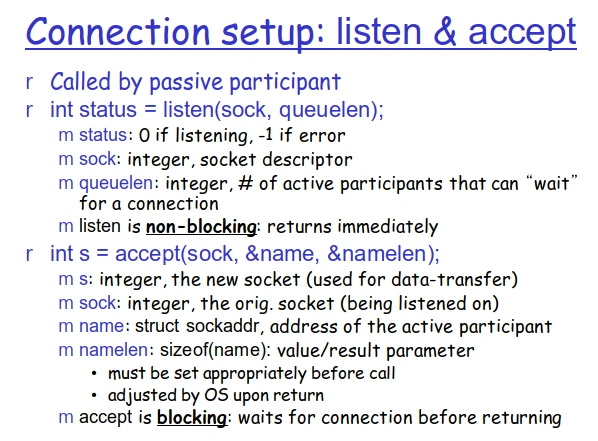

```c
int status = listen(sock, queuelen);
```

- **sock** : socket의 descriptor
- **queuelen** : 얼마나 많은 요청을 한 번에 보관하고 처리할 것인지. accept()을 호출하여 새로운 연결을 수락하기 전, 대기 상태로 둘 수 있는 클라이언트의 수이다.  
    ⇒ Listen()은 Passive Participant가 하는 것이므로 한 번에 연결을 요청하는 Socket을 얼마나 붙잡아 둘 지를 의미하는 것 같다.

```c
int s = accept(sock, &name, &namelen);
```

- <strong>Accept()</strong>을 수행하고 나면, **Server**는 **Client**의 정보를 전달 받는다. name 구조체를 통해서 Client의 **IP Address**와 **Port Number**를 전달받는다. 그리고 namelen으로 그 구조체의 길이 등과 같은 정보를 전달 받는다.

    - 그런데, 이 함수의 결과로 새로운 Socket을 반환한다. 즉, 새로운 Socket을 만들고 반환한다.
    - 이전에 listen에서 사용한 socket은 **Client의 연결을 받아주는 역할**을 한 것이다.
    - 하지만 <strong>Accept()</strong>을 통해 return 받은 socket descriptor 즉, 새로운 **socket**은 현재 연결을 수립한 Client와만 연결을 수립하고 통신한다.

- Server를 처음 열었을 때 만들어지는 Socket을 **Listen Socket**이라고 한다. 이것은 새로운 Client의 요청을 확인하는 역할을 한다. ⇒ 즉, **Passive Participant**이다.
- **Listen Socket**은 **Socket Descriptor**를 통해 **Read**/**Write**가 불가능하다. 왜냐면, 연결된 Socket이 없고 그냥 Listen을 통해 Socket 연결을 해 주는 역할이기 때문이다.
- 반면, <strong>Accept()</strong>을 통해 새롭게 만들어지는 Socket은 **Read**/**Write**를 하면 연결된 Socket 간에 데이터를 쓰고 읽을 수 있다.

> accept()은 listen() 이후에 곧바로 수행되며, 새로운 connect() 요청이 들어올 때까지 Non-blocking I/O로 대기하고 있는다.

### connect()

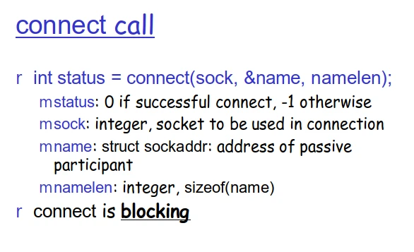

```c
int status = connect(sock, &name, namelen);
```

- **name** : 연결하고자 하는 Server의 **IP Address**와 **Port Number**를 담는 구조체이다.

### send() & recv()

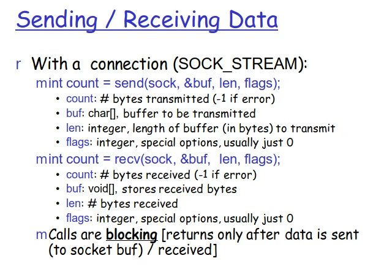

```c
int count = send(sock, &buf, len, flags);
```

- Send 함수에는 **IP Address**와 **Port Number**를 쓰는 부분이 없다. 왜냐면, Socket 연결은 Dedicated하게 정해진 Socket과만 통신하기 때문이다. 그래서 socket의 번호만 넣어주면 통신이 된다. (*Client가 사용할 Socket*)

    > 3-way-hand-shaking은 Server가 Accept하는 과정에서 이루어진다.

- 전달받는 count는 보낸 Byte의 수이다.

```c
int count = recv(sock, &buf, len, flags);
```

- Send와 비슷하게 IP Address나 Port를 지정하지 않아도 (*이미 연결이 되어 있으므로*) 데이터를 receive 한다.

> Blocking I/O : 어떠한 함수를 실행했을 때, 조건이 만족되지 않으면 만족될 때까지 기다리는 함수이다.  
> ⇒ 뒤에 가면 이것이 Socket의 발목을 잡는다.

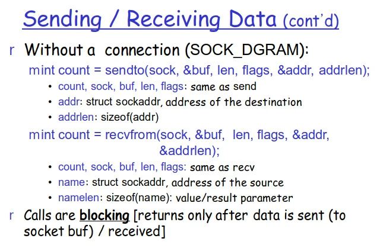

- **SOCK_DGRAM**은 별도의 연결 수립 과정이 없다.
- 이전에 **SOCK_STREAM**은 **Socket Descriptor**만 있으면 (dedicated하게 통신하기 때문에) 통신이 가능했다.

- 하지만, **SOCK_DGRAM**은 **보내는 곳의 주소를 명시**해 주어야만 한다.

    - 별도의 연결 과정이 없기 때문이다!

- **UDP**는 서로 다른 소켓이 주고 받을 수 있지만, **TCP**는 **반드시 정해진 Socket과만 통신이 가능하다.** 따라서 TCP는 연결되지 않은 Socket은 볼 수 조차 없다.

### close()

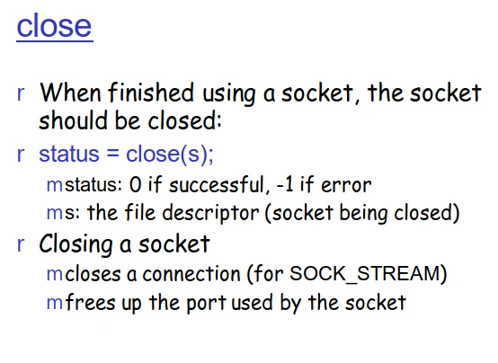

- 4-way-handshaking을 수행하는 과정. 모든 Socket 연결을 종료하는 부분이다.

### Socket Programming Flow

> 모든 Platform에서 동일한 Flow를 거쳐서 이루어진다.

- **SOCK_STREAM**

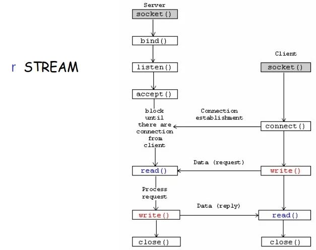

- **socket()** : Server측의 Socket을 연다

- **bind()** : Socket과 Interface를 연결한다. Server는 앞으로 들어오게 될 Client 측의 요청을 기다려야 하므로, bind() 함수를 통해 Local Address와 특정 포트 번호에 자신을 바인딩해야 한다. 그래야만 Client가 connect()를 통해서 지정된 Listen Socket에 연결할 수 있다.

    OS는 각 Process가 중복된 포트 번호를 사용하지 않도록 내부적으로 포트 번호와 소켓 연결 정보를 관리한다. bind()는 해당 소켓이 지정된 포트 번호를 사용할 것이라는 것을 OS에게 요청하는 API이다. (*추가적으로 LAN interface도 결정한다.*)

- **listen()** : Listen Socket이 새로운 Socket과의 connect를 기다리게 한다.
- **accept()** : 최종적으로 Client의 Socket과 연결 요청을 받아들인다. 이 API의 수행 결과로 Server 측에는 새로운 socket이 생성되어 return된다. ~~즉, Client Socket과 연결이 되는 Active Participant가 만들어는 것이다.~~ (*Blocking I/O*) ⇒ Active Participant는 Client 측에서 연결을 시도하는 Socket이라고 할 수 있음.

- Client에서도 <strong>socket()</strong>을 통해 socket을 연다. 이때는 연결 대상에 대한 어떠한 정보도 포함되어 있지 않으므로, 껍데기 뿐인 소켓이라고 볼 수 있다.

    - 그리고 여기서도 마찬가지로 <strong>bind()</strong>를 해주는 것이 좋다. (*해줘서 나쁠 것은 없다는 뜻이다.*)

- <strong>connect()</strong>를 통해 Server가 <strong>accept()</strong>을 수행하도록 신청하고, 3-way Handshaking을 통해서 연결을 수립한다. 이 과정은 Client 측의 Socket에 연결 대상에 대한 IP Address와 Port Number를 지정하는 과정이라고도 볼 수 있다.

    - 이때, connect는 연결할 Server의 IP Address와 Port 번호를 포함한다. (*미리 알아야 함.*)
    - **Blocking I/O**이다. 따라서 결과가 반환되기 전에는 connect()의 실행이 끝나지 않는다.

- 이후에 진행되는 **send()**  <strong>recv()</strong>는 서버 측에서의 새로운 Socket과 Client의 Socket의 **Interprocess Communication**이다.
- 데이터 송/수신이 필요하지 않게 되면 <strong>close()</strong>를 수행한다. 이러면 4-way Handshaking이 수행되며 연결이 종료된다.

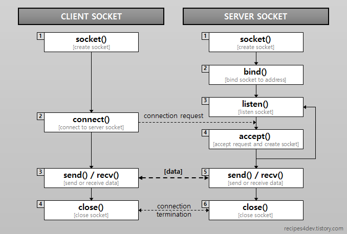

- **SOCK_DGRAM**

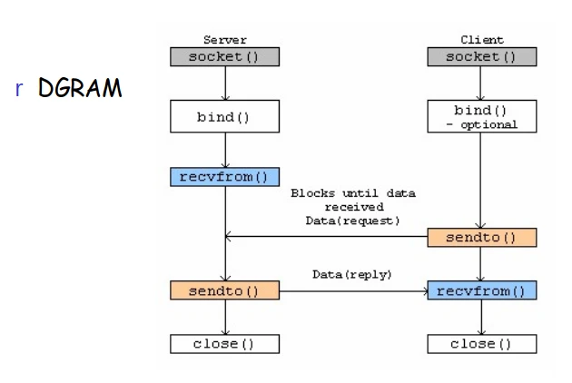

- 별도의 연결을 수행하지 않고, <strong>bind()</strong>만 수행하고 곧바로 데이터를 전송한다. 단, Client에서는 Optional하다!

> 중요한 것은, UDP는 Handshaking이 없는 Non-connection oriented이므로, 반드시 send()와 recv()를 수행할 때, IP와 Port Number를 지정해 주어야 한다.

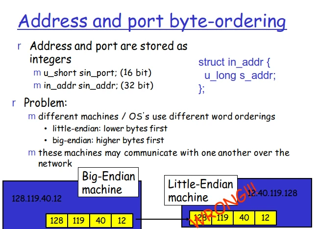

- Byte-Ordering을 하기 위해서 내부적으로 순서를 맞춰주는 루틴이 돌고 있다.

---

## &lt;Dealing with Blocking Calls&gt;

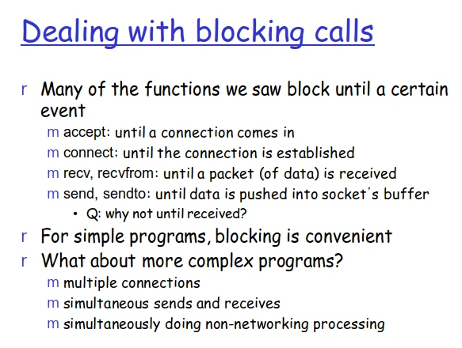

- **accept()**
- **connect()**
- **recv()**, **recvfrom()**
- **send()**, **sendto()**

- 위의 모든 API는 **Blocking I/O**이다.

    - Reliable Data Transfer 할 때, Stop-and-Wait을 하는 것이 가장 편했다. 하지만 Blocking이 풀리고 Pipelining을 할 때부터 문제가 생기기 시작했다.

- Blocking I/O가 편하긴 하지만, 복잡한 시스템의 TCP에서 문제가 생긴다.

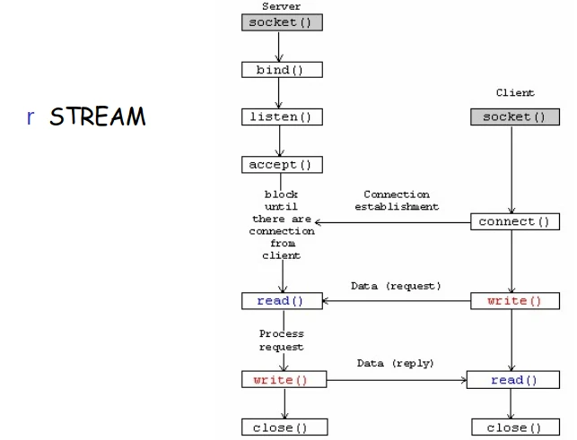

- <strong>listen()</strong>은 Blocking I/O는 아니다.
- <strong>accept()</strong>에서 대기하고 있다가, <strong>connect()</strong>를 하게 되면 대기가 풀린다.
- 그런데 우리가 서로 데이터를 주고 받는 채팅 프로그램을 짠다고 해 보자.
- 이러면 **Server**/**Client**에서 계속해서 While loop을 통해 **read**/**write**가 돌아야 한다.
- 그런데 이 때, 새로운 Client가 Connection을 만들고자 하면, While loop을 돌고 있기 때문에 연결이 불가능하다.

> Simultaneous한 Read/Write가 불가능하다. 그것은 accept()의 Blocking I/O 때문이다.

&lt;Server Side&gt; : scanf() → Write() → Read()

데이터를 보내고 나면, 데이터를 받을 준비를 하고 있다.

&lt;Client Side&gt; : Read() → scanf() → Write()

데이터를 읽고 나면, 바로 데이터를 보낼 준비를 하고 있다.

> 이 때문에, 동시에 Read/Write를 할 수가 없다.

---

## &lt;How to implement Multi-Socket?&gt;

### SOCK_STREAM

- **SOCK_STREAM**은 Server와 Client가 명확하다.

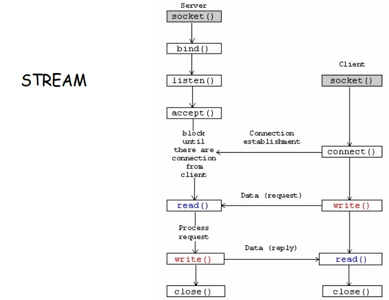

**Server**의 **Socket**은 **Client**가 **접속**하길 **Listen**으로 기다리고 있다가, **Accept**이 된다면, **새로운**  **Socket**을 하나 생성한다. 그 **Socket**은 오직 **지금 요청한 Client와만 Communication하는 Socket**이다.

**Listen Socket**은 **Accept**을 처리하고나서 새롭게 만들어진 Socket이 Client의 요청을 처리하는 동안, 다른 Client의 요청을 받는다.

> 그런데 아직까지는 단일 프로세스에 대해서 처리하는 것이므로, 실제로 이런 구조를 통해서 멀티 소켓을 구현할 수는 없다.   
> ⇒ 같은 프로세스 내에서 Socket을 여러 개 생성했을 뿐이다.

### Simple Server Model

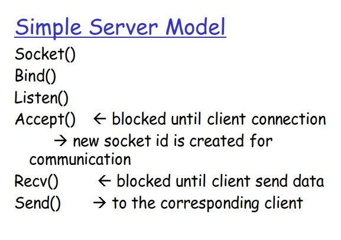

Socket을 하나만 열더라도, 반드시 두 개가 생성된다. 그 이유는 **Listen Socket**은 **절대로 데이터를 받을 수 없기 때문에**, **Listen Socket**과 **Accpet Socket**을 **구분**지어야만 한다.

그런데, 현재 코드는 두 개 이상의 Socket에 대해서 처리할 수가 없다. 왜냐면, 하나의 Socket에 대해서 **Blocking I/O**로 인해 <strong>Recv()</strong>에서 대기하고 있는 상황이므로, 다른 Socket이 생성되더라도 <strong>Recv()</strong>를 수행할 수 없다는 것이다.

> 그렇다면 어떻게 **Multiple Simultaneous Communication**이 가능할까?

### Multi-user Extension

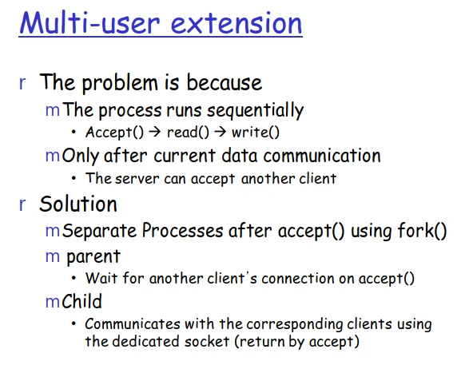

- Client가 <strong>Connect()</strong>를 한다는 것은, Server가 <strong>Accept()</strong>에서 대기를 하고 있어야만 처리된다. 하지만, 사전에 생성된 Socket이 <strong>Recv()</strong>에서 **Block**되어 있기 때문에 **Accept()** 처리를 할 수 없다.

> 여기에 대처하기 위해서 <strong>fork()</strong>를 통해 **프로세스를 추가로 생성**한다.  
> <strong>fork()</strong>를 수행하면, 갖고 있는 변수 등은 모두 똑같지만 **별도의 프로세스로 고려**된다.

### Multi-user Server

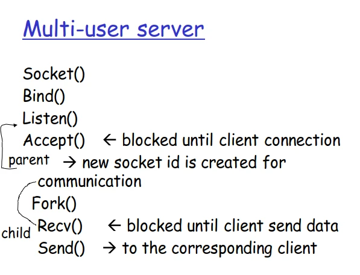

- 부모 프로세스에서는 계속해서 <strong>Listen()</strong>을 하기 위해서 while loop에 쌓여있고, <strong>fork()</strong>를 하고 나서 만약 부모 프로세스라면 계속해서 <strong>Listen()</strong>을 처리할 수 있도록 한다.
- 그게 아니라 만약 Child Process라면, Client와 **dedicated**하게 Communication한다.
- 이후에 또 새로운 Client가 <strong>Connect()</strong>를 한다면, 똑같은 코드가 실행되어서 <strong>fork()</strong>를 통해 Child가 다시 한 번 생성되고, 그 Client와 **dedicated**하게 Communication 하면서 데이터 전송을 처리해 준다.

> 이때, **부모 프로세스**는 계속해서 <strong>Listen()</strong>하면서 <strong>Accept()</strong>을 **대기**하고, 새로운 Client의 connect()가 들어올 경우 <strong>fork()</strong>를 통해서 **Child Process**를 만들고, 이를 통해 **Multi-user**의 **dedicated communication**을 지원할 수 있다.

### One more problem

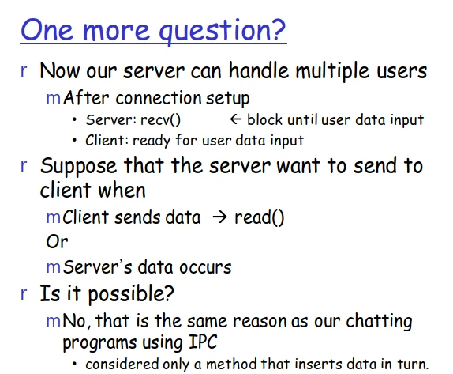

- 만약 채팅 프로그램을 짠다고 하면, 사용자의 입력을 받아들임과 동시에 입력을 전달해 줄 수도 있어야 한다.

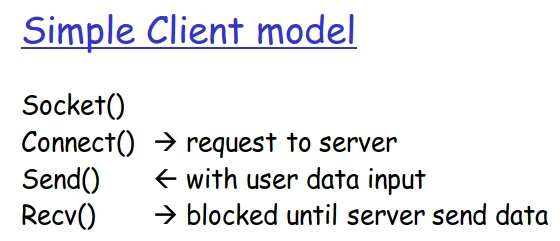

- **Socket**이 <strong>Connect()</strong>를 하고 나면, 그 사이에 <strong>gets()</strong>을 해서 데이터를 전달 받길 기다리다가, 데이터가 들어오면 <strong>Send()</strong>하고, <strong>Recv()</strong>한다.
- 하지만 이런 구조는 Loop-back 구조이기 때문에, 데이터의 전송/수신을 동시에 수신할 수 없다는 문제가 생긴다. (*Sequential한 구조가 된다.*)

> 이런 문제가 발생하는 것은 **Blocking I/O** 때문이다. 이것이 프로그래밍을 할 때는 매우 편리하지만, 오히려 Socket Programming에서는 독이 된다.

> **그렇다면 Socket을 두 개 만들어서 하나는 받기만 하고, 다른 하나는 보내기만 하면 되지 않나?**

⇒ 불가능하진 않지만, 더 좋은 방법이 있다.

- 기본적으로 Socket을 만들면, **Socket Descriptor**를 하나만 전달받는다. 따라서 **Recv()**, <strong>Send()</strong>를 **각각 Process로 분리할 수는 있다.** 하지만 서로 데이터가 전달되는 것을 알 수가 없기 때문에 우리의 의도와는 거리가 있다.

    ⇒ **Thread를 만들면 되는거 아닌가요?**

    > **Thread**를 무분별하게 만들면 **성능이 매우 떨어지고**, 만약 Thread 중 하나가 꼬여버리면 그 **Thread**를 만들기 위해 POSIX에 의해 연결된 **모든 Thread가 다운**되므로 위험하다.

### Select() : The Key of the Multi-Socket

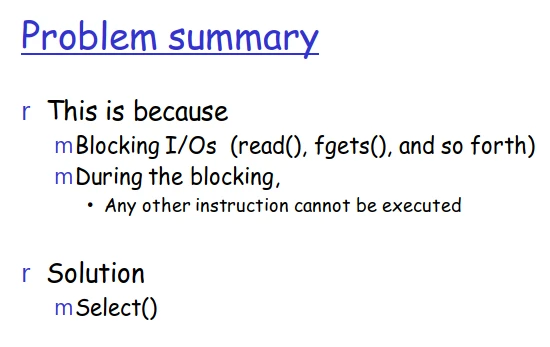

> **Select**()는 사전에 함수를 전달하여 등록하는 것으로서, **Blocking I/O**인 <strong>read()</strong>와 <strong>fgets()</strong>를 전달하면 각 이벤트가 발생할 때 그것을 구분하여 실행시켜준다. 해당 file descriptor가 준비가 되면 그것을 실행하는 방식으로 동작된다.  
> ⇒ 꼭 두 개는 아니어도 된다. 더 많이 등록할 수도 있다.

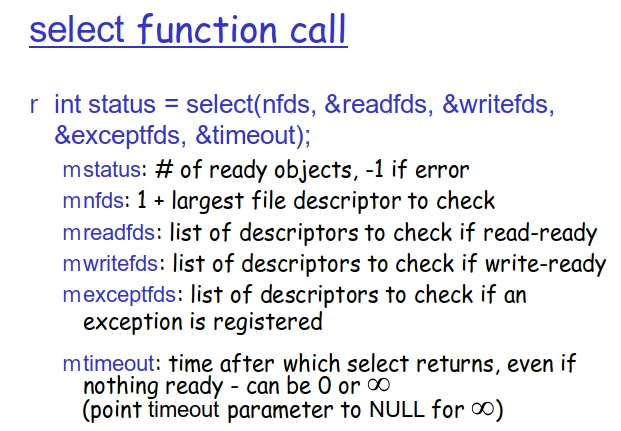

- **nfds** : Number of the file descriptor(Socket도 포함한다.)

    - 그런데, nfds는 1 + largest file descriptor라고 되어있다. file descriptor는 Process가 구분하는 것이며, 똑같은 파일이라도 다른 프로세스에서는 descriptor가 다를 수 있다.
    - 한 프로세스를 만들면 file descriptor stdin(0), stdout(1), stderr(2)가 기본으로 생성되고, 이후에 file을 연다면 다음 번호부터 descriptor가 할당된다.
    - 그러므로 가장 큰 file descriptor에 + 1을 넣어서, 현재 file descriptor의 끝이 어디인지 알려주고, 이로써 문제없이 descriptor를 검사할 수 있도록 한다.

- readfds : read로 체크할 descriptor들의 list.
- writefds : write로 체크할 descriptor들의 list
- excptfds : exception이 발생했을 때 체크할 descriptor의 list
- timeout

### Bit Vector

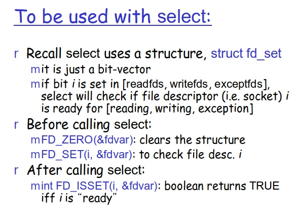

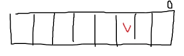

File Descriptor가 체크되었는지 확인하는 방법이다. 위와 같이 하면, 현재 2번 file descriptor를 사용한다는 뜻으로 볼 수 있다.

- Select는 인자로  fdset이라는 구조체를 전달받는다. fdset은 **FD_ZERO**를 통해서 clear하고, <strong>FD_SET()</strong>을 통해서 원하는 descriptor의 bit를 set할 수 있다.
- <strong>FD_ISSET()</strong>을 통해서 특정한 file descriptor를 가리키는 Bit vector가 set 되었는지 확인할 수 있다.

> select는 등록된 모든 socket들 중에서 하나라도 동작이 발생하면 Blocking_I/O를 풀고 동작을 수행한다. 이때, for loop을 돌면서 FD_ISSET(sockid, &readfds) 등을 통해서 내가 지정한 socket에 read가 발생한 것인지 등을 체크할 수 있다. 따라서 만약 Client가 Server와 연결된 Socket으로 send()를 했다면, Server에서도 연결된 socket에 데이터가 들어왔을 것이고, 그렇다면 FD_ISSET(sockid, &readfds)를 통해서 그것이 맞는지 체크한 다음, read()를 통해서 데이터를 읽어들일 수 있다.  
>   
> Client에서는 file descriptor 0번 (stdin)에 대해서 select를 등록하고, FD_ISSET(0, &readfds)로 체크하여 입력한 데이터를 읽어들일 수 있고, 동시에 받아들일 수도 있다.

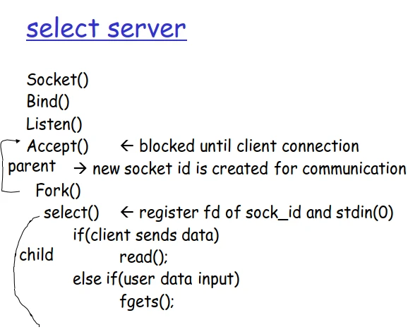

> Child 프로세스를 만들고 나서 select()를 등록하면, 어떠한 이벤트가 발생할 때 이것을 구분하여 처리해 준다.

**example code**

- Server

```c
#include <stdio.h>
#include <stdlib.h>
#include <string.h>
#include <unistd.h>
#include <sys/types.h>
#include <sys/socket.h>
#include <netinet/in.h>
#include <arpa/inet.h>

#define PORT 12345
#define BUF_SIZE 1024

int main() {
    int sockfd, newsockfd;
    struct sockaddr_in serv_addr, cli_addr;
    socklen_t clilen;
    char buffer[BUF_SIZE];
    fd_set readfds;
    int max_sd, activity, valread;

    sockfd = socket(AF_INET, SOCK_STREAM, 0);
    if (sockfd < 0) {
        perror("ERROR opening socket");
        exit(1);
    }

    memset(&serv_addr, 0, sizeof(serv_addr));
    serv_addr.sin_family = AF_INET;
    serv_addr.sin_addr.s_addr = INADDR_ANY;
    serv_addr.sin_port = htons(PORT);

    if (bind(sockfd, (struct sockaddr *) &serv_addr, sizeof(serv_addr)) < 0) {
        perror("ERROR on binding");
        exit(1);
    }

    listen(sockfd, 5);
    clilen = sizeof(cli_addr);

    newsockfd = accept(sockfd, (struct sockaddr *) &cli_addr, &clilen);
    if (newsockfd < 0) {
        perror("ERROR on accept");
        exit(1);
    }

    while (1) {
        FD_ZERO(&readfds);
        FD_SET(newsockfd, &readfds);
        max_sd = newsockfd;

        activity = select(max_sd + 1, &readfds, NULL, NULL, NULL);

        if ((activity < 0) && (errno != EINTR)) {
            printf("select error");
        }

        if (FD_ISSET(newsockfd, &readfds)) {
            valread = read(newsockfd, buffer, BUF_SIZE);
            if (valread == 0) {
                printf("Client disconnected\n");
                close(newsockfd);
                break;
            } else {
                buffer[valread] = '\0';
                printf("Client: %s\n", buffer);
                write(newsockfd, buffer, strlen(buffer));
            }
        }
    }

    close(newsockfd);
    close(sockfd);
    return 0;
}
```

- Client

```c
#include <stdio.h>
#include <stdlib.h>
#include <unistd.h>
#include <string.h>
#include <sys/types.h>
#include <sys/socket.h>
#include <netinet/in.h>
#include <arpa/inet.h>

#define PORT 12345
#define BUF_SIZE 1024

int main(int argc, char *argv[]) {
    int sockfd;
    struct sockaddr_in serv_addr;
    char buffer[BUF_SIZE];
    fd_set readfds;
    int max_sd, activity, valread;

    if (argc < 2) {
        fprintf(stderr, "usage %s hostname\n", argv[0]);
        exit(0);
    }

    sockfd = socket(AF_INET, SOCK_STREAM, 0);
    if (sockfd < 0) {
        perror("ERROR opening socket");
        exit(1);
    }

    serv_addr.sin_family = AF_INET;
    serv_addr.sin_port = htons(PORT);
    inet_pton(AF_INET, argv[1], &serv_addr.sin_addr);

    if (connect(sockfd, (struct sockaddr *) &serv_addr, sizeof(serv_addr)) < 0) {
        perror("ERROR connecting");
        exit(1);
    }

    while (1) {
        FD_ZERO(&readfds);
        FD_SET(0, &readfds); // 표준 입력
        FD_SET(sockfd, &readfds);
        max_sd = sockfd;

        activity = select(max_sd + 1, &readfds, NULL, NULL, NULL);

        if ((activity < 0) && (errno != EINTR)) {
            printf("select error");
        }

        if (FD_ISSET(0, &readfds)) {
            bzero(buffer, BUF_SIZE);
            fgets(buffer, BUF_SIZE, stdin);

            if (strncmp("exit", buffer, 4) == 0) {
                break;
            }

            send(sockfd, buffer, strlen(buffer), 0);
        }

        if (FD_ISSET(sockfd, &readfds)) {
            valread = read(sockfd, buffer, BUF_SIZE);
            if (valread > 0) {
                buffer[valread] = '\0';
                printf("Server: %s\n", buffer);
            }
        }
    }

    close(sockfd);
    return 0;
}
```

⇒ 이 코드는 Client Code 예시이며, sock_id와 stdin(0)를 register 한다.   
이는 Client가 stdin을 통해 입력을 받을 수 있고, sockid를 통해서도 데이터를 읽어들일 수 있다는 것을 의미한다. 즉, Client에서 sockid에 대한 readfds가 ISSET 된다는 것은 Server가 데이터를 보내서 Blocking I/O에 대한 처리가 되었다는 것이고, stdin에 대한 readfds가 ISSET 된다는 것은 Client에서 User가 데이터를 썼다는 것을 의미한다.

이와 비슷하게 Server 측에서는 Echo를 치는 프로그램이기 때문에, sock_id에 대해서만 readfds를 register하고 있는 것을 확인할 수 있다. 이를 통해 TCP 연결을 거쳐 data가 전송되면, Server는 그것을 읽어들이고 그대로 Echo치게 될 것이라는 걸 알 수 있다.

> 정리하자면, Socket을 하나 열고, 새로운 fd_set 구조체 readfds, writefds를 만든다. 이 상태에서 select(newsockid, &readfds, &writefds, NULL, NULL); 를 실행하면, select 함수로 입력이 올 때까지 Blocking 되어서 대기한다. 그러다가 해당 socket에 대해서 read(server send)/write(client stdin) 입력이 오면, select가 수행된다.  
>   
> 이 때는 file descriptor를 순차탐색하면서 어떤 것이 SET 된 것인지 체크해야 한다.

---

## &lt;Socket with Thread&gt;

> 예전에는 fork()를 통해 Process를 만들어서 Socket 통신하는 방식이 좀 더 안정적이었다. 하지만 최근에는 fork()를 쓰지 않고 Thread를 만들어, Process 내에서 Thread를 관리하는 방법을 사용하기도 한다.

- **Thread를 통한 Socket**

만약 Process를 통해서 Socket 통신을 하면, Process는 서로 절대로 데이터를 공유할 수 없다. 만약 데이터를 공유하고 싶다면 별도의 Socket 연결을 또 만들어야 하므로, 매우 복잡하다.

반면 Thread를 만들면 Global 변수를 통해 데이터를 공유할 수 있다는 장점이 있다. 그래서 recv()만 수행하는 Thread를 만들고, send()만 수행하는 Main Thread를 만들어서 gets을 통해 입력을 받는다.그리고 서로 Global 변수를 통해 메시지를 전달받는 방식으로 Socket 통신을 수행할 수 있다.

하지만 그럼에도 불구하고, 사실 while loop을 통해서 read()를 계속하고 있다면, Blocking을 하고 있는 것이기 때문에 event를 처리할 수 없다.

⇒ 그러므로 select()를 선택하는 것이 Best이다.

---

## &lt;Web Socket&gt;

> Socket의 Variation이다. JavaScript를 통해서 구현되는데, 서버가 자바스크립트를 이용해 프로그램을 만들어서 클라이언트에게 보내준다. 그러면 클라이언트에서 Web Socket을 열어서, 역으로 데이터를 보내면서 주고 받을 수 있다.
