# Network Layer

## &lt;Network Layer&gt;

> Network Layer는 오직 Router만 존재하며, 하는 역할을 오로지 Routing 뿐이다.

### Network Layer Key Functions

- 모든 **Router**는 적어도 24-port 정도의 **Lan  port**를 연결하고 있다. **Router**는 여러 개의 network를 연결하는 것이 목표이기 때문에 가능한 많이 연결이 되어 있어야 한다.

- 인터넷에서는 Destination이 눈에 보이지 않는다. 즉, 대부분 여러 Hop을 거쳐야만 데이터를 Source에서 원하는 Destination으로 전달할 수 있다.

    즉, 내 주위에 연결되어 있는 **router**들 중 어느 **router**에게 **Forward**를 해야 최대한 빨리 전달할 수 있을지를 판단해야 한다.

    ⇒ 이걸 판단하는 과정이 **Routing**이다.

- 그리고 **Routing**의 결과를 바탕으로 메시지를 전달하는게 **Forwarding**이다.

### Network Layer

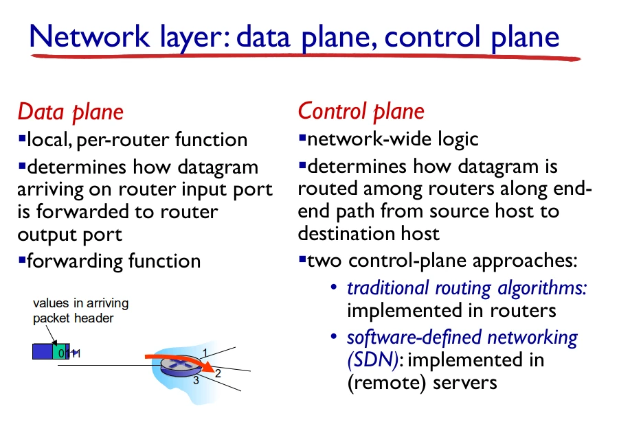

- **Data Plane**

    - 전통적인 방식은 각각의 **Router**에 모두 **routing 알고리즘**을 포함하고 있었다.  

- **Control Plane**

    - **SDN**(Software-defined networking)
    - 그러나 **SDN**은 **Data Plane**과는 다르게 Router들 간의 서버가 존재해서, 도착지를 바로 알아낸 채로 데이터를 전달할 수 있다.

### Locally centralized control plane

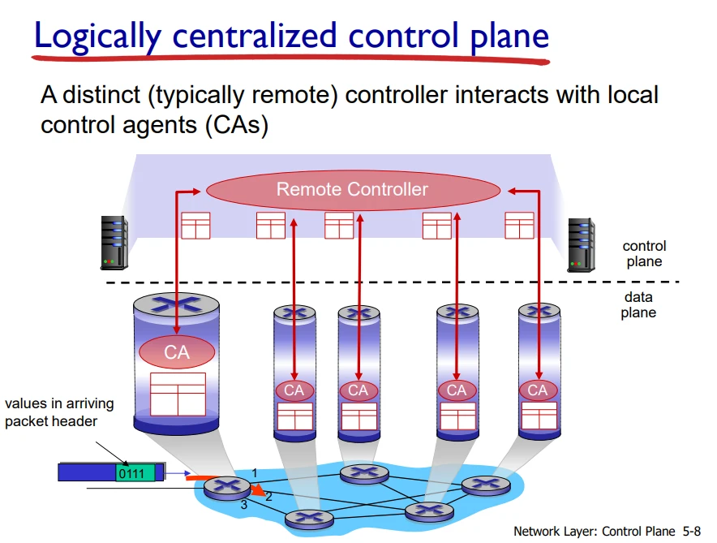

이와 같이 Router들 간의 서버가 존재하고, 여기서 Remote Controlling을 통해 Packet의 도착지를 곧바로 알아내어 Router들마다 Routing 알고리즘을 동작하지 않고 데이터를 전달할 수 있다.

### Network Service Model

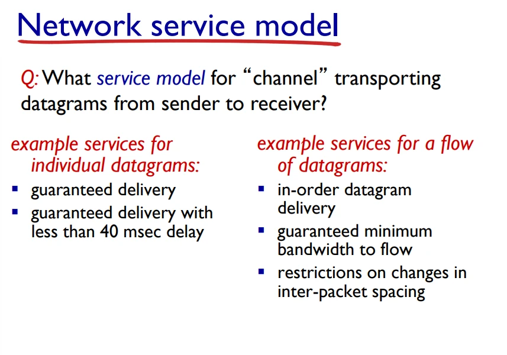

> 네트워크 통신 과정에서 데이터를 in-order로 전달하고자 노력하지만, 실제 데이터의 순서는 **Transport Layer**에 의해서 일부 바뀐 상태로 전달되었을 가능성은 존재한다.  
> ⇒ Packet Loss가 발생해서 재전송에 의해 순서가 일부 바뀔 수 있다는 뜻이다.

### Router의 내부 구조

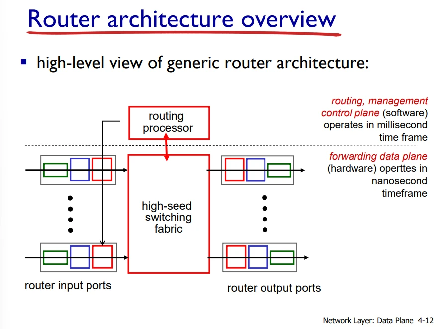

> 그림을 이해하기 편하도록 일방향적으로 표현되었지만, 실제로는 모든 Lan Port가 In/Out이 가능하다. (*그림에서는 input/output이 구분되어 표현되었음.*)

> 아무리 S/W 알고리즘이 좋다고 해도, H/W보다 빠를 수는 없다. 그러므로 일단 알고리즘이 Deterministic하게 결정이 되면, 그 Logic을 그대로 수행하는 H/W를 만들면 된다.
>
> ⇒ 이를 **Fabric**이라고 한다. (*Routing을 H/W로 처리하는 것*)

### Router Input Port Functions

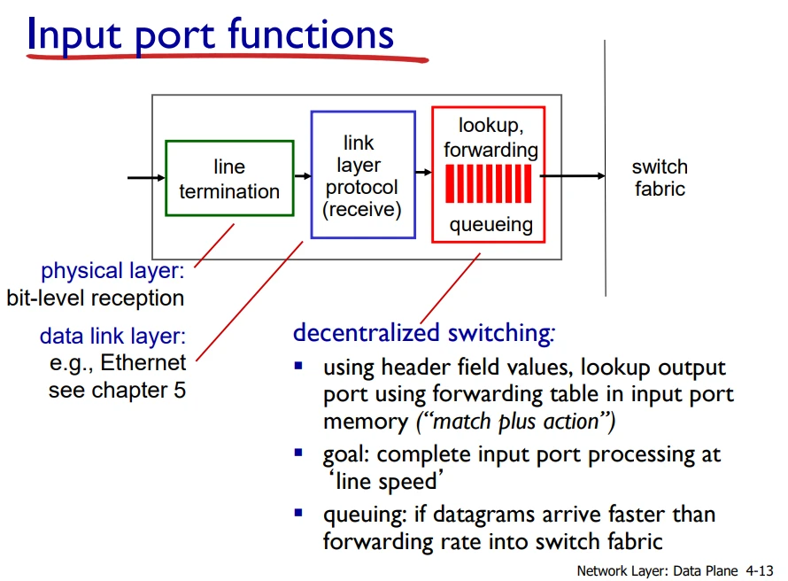

- **Line Termination** : 보낼 데이터 하나를 잘라내는 역할이다. 비트 신호들을 잘라준다.  
    ⇒ 이것이 Physical Layer를 의미한다.

- **Link Layer Protocol** : 데이터를 받아들여 프로토콜 적용한다.  
    ⇒ 이것이 Datalink Layer를 의미한다.

- **Queueing** : 각각의 패킷마다 어떤 Out port로 내보낼지 결정하고 fabric이 이를 스위칭 해주는데 시간이 소요된다. 이 과정에서 fabric의 처리 속도가 데이터가 들어오는 속도를 따라가지 못할 경우에 대비하여 데이터를 보관하는 용도로 사용한다.

    - **fabric**의 **switching speed**(algorithm의 처리 속도) : 전달받은 데이터를 switching하는 시간

> 여기서 말하는 Queue는 우리가 일반적으로 말하는 Queueing에서 발생하는 Delay가 아니다. Router에서 Queueing Delay가 발생하는 Queue는 출력 포트에 존재하는 Queue를 의미한다. ⇒ **즉, Output Datalink의 Service Rate 속도에 따라 발생하는 Delay**  
>   
> 이와 다르게 입력 포트에 존재하는 큐는 단순히 **Fabric**이 **스위칭**을 해주는 속도가 느리기에 들어오는 패킷들을 담아두기 위한 버퍼의 역할이다.  
> ⇒ **즉, Fabric을 통한 Switching 속도에 따라 걸리는 Delay**

### Destination-based forwarding

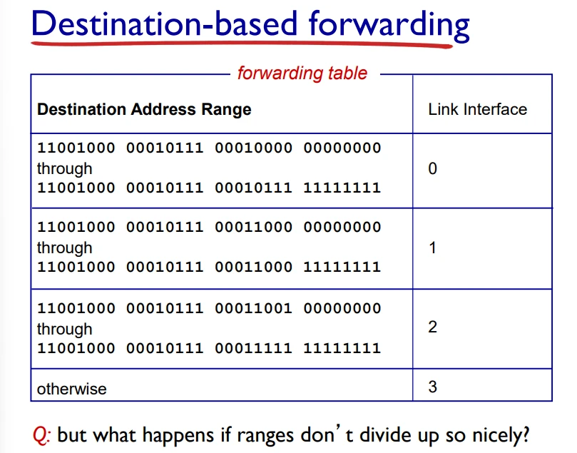

> 그렇다면, 실제적으로 Routing은 어떻게 이루어질까?

- 특정 구간 안에 포함되는 것에 대해서, **Link Interface**를 지정한다.

> 과거에는 IP Address를 Class로 나누어 사용했는데, 현재는 CIDR이라는 Address로 구성이 되어 있다. Destination Address Range에 대해서 **Longest Prefix Matching**을 사용하여 매칭되는 interface를 선택할 수 있다.

### Longest Prefix Matching

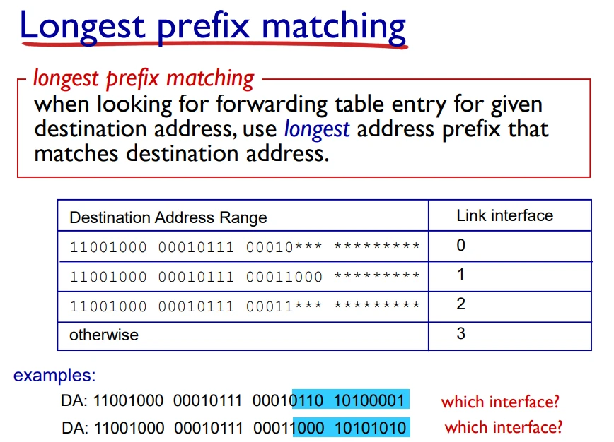

> 이런 방식을 사용하기 위해서는 지리적 요소와 IP가 결부되어 IP가 결정되어야 할 것.  
> ⇒ 같은 Ethernet에 속한 Host는 비슷한 Prefix를 가진다.

- AND 연산을 통해서 longest prefix matching을 실시한다.

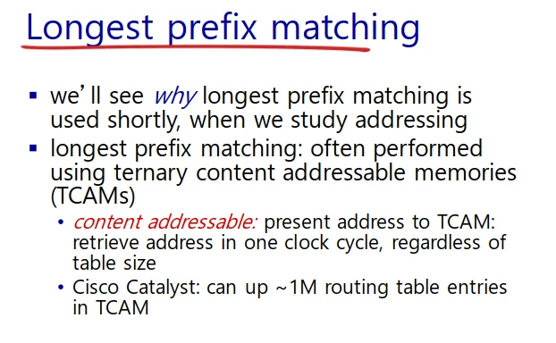

- 시스코가 H/W적으로 구현한 **Longest Prefix Matching**이 **TCAM**

    - 최대 1MB 크기의 라우팅 테이블을 처리할 수 있다. (Fabrics)
    - Fabric이며, Data Plane에 내장되어 Routing시에 Longest Prefix Matching을 실행하는 것이다.

### Switching Fabrics

> Switching Fabric의 Type을 시대 순으로 정리해본다.

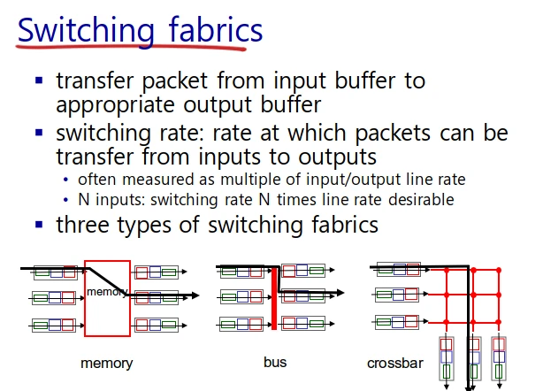

- **Memory** 방식 : Memory에 직접 접근하여 데이터를 저장하고 데이터를 복사(Memory copy)하는 방식이다. 즉, Input으로 들어오는 데이터를 복사하였다가 Switching을 하여 Output Port를 결정하고 복사한 데이터를 출력하는 방식이다.

- **Bus** 방식 : 하나의 공통 **Bus**를 공유하지만, 내부에 스위치가 존재하여 전달하고 전달받는 buffer를 설정하는 방식

    - 다만, 누군가가 Bus를 사용하고 있다면 다른 Buffer는 Bus에 접근이 불가능하다.
    - 이 방식이 Memory 방식보다는 빠르기 때문에, 시스코에서 초기 저가형 라우터에 적용한 방식이다.

- **Crossbar** 방식 : Bus를 병렬적으로 연결하여, Interface * Interface 수 만큼의 Crossbar가 존재. 일반적으로 Bus 방식보다는 빠르지만, Buffer가 **같은 Destination으로 도달해야 하는 경우**에는 **Bottleneck**이 발생한다. 

### Input port queueing

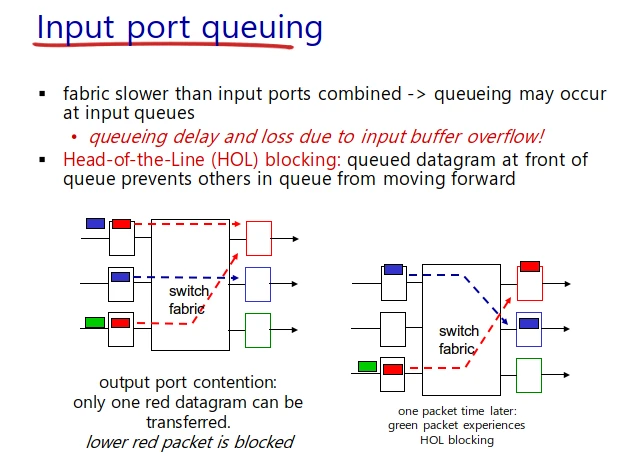

- 실질적으로 Router에는 **Input Queue**와 **Output Queue**, 두 개의 Queue가 존재한다.

    지금 상황에서 좌측 이미지를 보면, 두 개의 Input Queue에 존재하는 Datagram이 같은 Output Queue로 Switching 되고 있다. 이런 경우 둘 다 동시에 전달될 수 없기 때문에 둘 중 하나는 반드시 대기를 해야 한다.

- **HOL Blocking**

HOL Blocking은 이와 같이 Input Queue에서 발생하는 현상으로, 네트워크에서 Input Queue에 있는 패킷이 같은 Output Queue로 향하는 다른 Packet에 의해 지연될 때 발생하는 성능 저하 현상이다. 이로 인해 패킷 처리 속도가 지연되고, 최악의 경우에는 드랍까지 발생할 수는 있지만, 그렇게 크리티컬 하진 않다.

> 이와 같이 발생하는 Congestion은 Router가 해결할 수 없는 상황이다. 하지만 Router Queue의 문제는 Router가 직접 해결해야 한다.  
>   
> 추가적으로, 실질적으로 Router에서 중요한 Queue는 **Output Queue**이다.

### Output Port Queueing

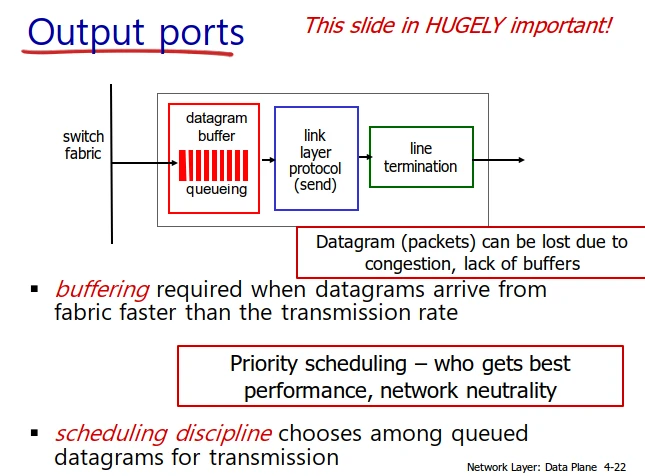

- Output Port에서는 Switching을 거쳐서 나온 Packet을 다시 Queueing하여 Link Layer의 Service를 대기하도록 한다.

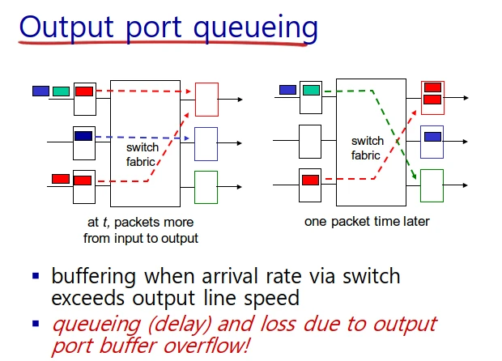

- Network Layer에서는 두 종류의 Queueing Delay가 발생할 수 있으며, Input Queue에서는 Fabric의 Switching Rate보다 데이터가 들어오는 속도가 더 빠르면 Queueing에 따라 Delay가 발생할 수 있다.

    Output Queue에서는 Datalink Layer의 Service Rate보다 Switching을 마쳐 Output Port로 전달된 Packet의 전달 속도가 더 빠를 경우 Queueing Delay가 발생할 수 있다.

### Scheduling Mechanisms

> Network Layer의 Router에서 Queue를 관리하는 방법에 대해서 알아보자.

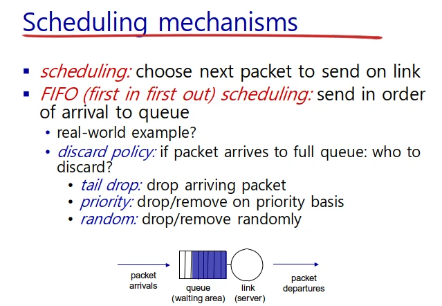

- 일반적인 방법은 **Scheduling**을 사용하며, 대표적으로 **FIFO**를 사용한다. 이번에는 Queue가 꽉찼을 때 어떤 방식으로 Queue에 들어있는 Packet을 제거할 것인지에 대한 문제이다.

<!-- -->

1. **Drop tail** : 가장 늦게 들어온 것을 Drop하는 것이다.
2. **Priority** : Packet의 중요성에 따라 Drop한다.  
    ⇒ 단, 이 방식은 Priority Queue가 필요하다.

3. **Random** : 아무거나 Drop한다.  
    ⇒ 만약 Queue의 크기를 1/10으로 줄이고자 한다면, 10번 째 데이터마다 Drop하면 된다.

### More on Priority Scheduling in Router Queue

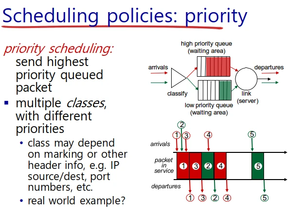

- High Priority Queue와 Low Priority Queue가 구분되어 있으며, Input에서는 Classify를 통해 Packet의 우선 순위를 구분해 Queueing한다. 높은 우선순위의 Datagram부터 전송한다.

> 그런데 이 방식이 이상적인 방식으로 보이지만, 실제로는 우선순위를 매길 수 있는 현실적인 방안이 없다. 인터넷은 Fair하게 동작하는 것을 원칙으로 하기 때문에 이걸 매기기가 매우 힘들다는 것이다. 그래서 실제로는 **FIFO**(Drop Tail)방식을 사용한다.

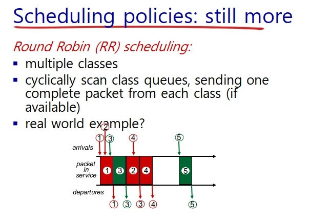

- 다른 방법으로는 **Round Robin**을 적용할 수 있다. 여러 개의 Class가 존재할 경우, 각 Queue를 돌면서 Packet을 하나씩 보내주는 방식으로 Round Robin이 가능하다. 그런데, 실제 상황에서는 어느정도 Priority를 고려하는 것이 필요하다. 그래서 Priority Round Robin을 적용하나, 어느 정도 Fair함을 보장해야 하기 때문에 일종의 Aging과 같은 방식을 적용해 낮은 우선순위의 Packet이 전송될 수 있도록 보장한다.

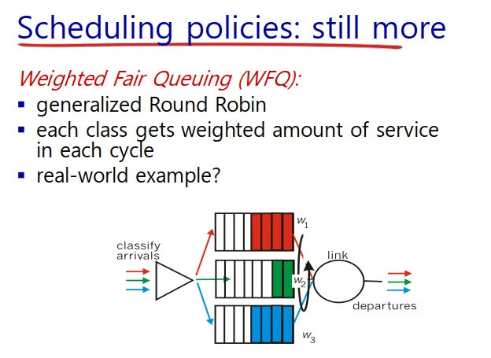

- 가중치가 다른 여러 개의 Queue가 주어져서, 높은 가중치에 해당하는 Packet을 먼저 보내주는 방식이다. 각 Class(Queue)에 Weight가 주어지고, Round Robin을 통해 각 Queue를 순환하며 Packet을 전송한다.

> Priority 방식은 매우 Ideal 하지만, 실제로는 Priority를 정하기 어렵기 때문에 적용할 수 없으며, FIFO 방식 + Drop Tail을 사용한다

---

## &lt;IP protocol&gt;

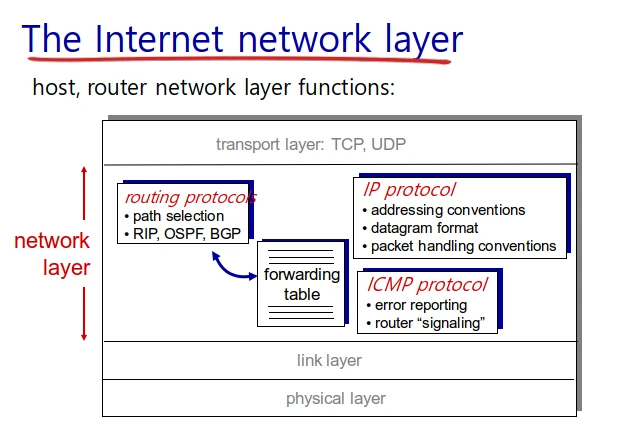

- Router를 처음 켜면 Default 상태이기 때문에 Routing Table 세팅이 안되어 있다. 그래서 주기적으로 주위에 있는 Router와 통신하면서 **Routing Table**을 **갱신**한다.
- 하지만 최근에는 이런 특별한 Routing Protocol이 수행되지 않으며, **SDN**을 사용해 중앙 라우터에 의해 통제되어 Routing이 수행된다.

### IP Datagram format

> Header의 길이는 20bytes이다.

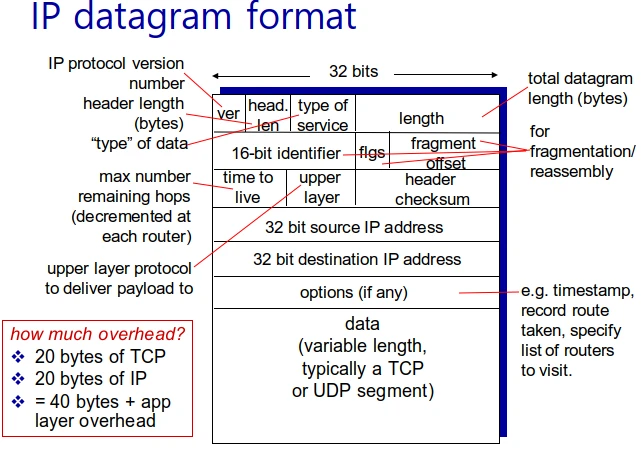

> 네트워크 레이어의 핵심 프로토콜은 IP protocol이다. 현재 일반적으로 사용하는 것은 IPv4이다.

- 프로토콜을 설계하는 사람은 항상 어떻게 Parsing하고 어떤 의미를 받아들일지 생각해야 한다. 기본적으로 Protocol에서 가장 중요한 것은, **Length**가 필요하다는 것이다.  
    ⇒ 따라서 IP Header에는 **total datagram length**가 포함된다.

    - 이전에 TCP에서는 Header Length만 전달해줬는데, 그것은 TCP가 Connection Oriented이기 때문에 사전에 MSS를 약속하기 때문이다. 그러므로 Header Length만 알아도 Data의 Length를 알아낼 수 있다.
    - 반면 UDP는 Connection을 수립하지 않기 때문에 반드시 매 Packet마다 IP Address와 Port Number를 알아야 하고, Packet의 전체 길이를 실어주어야 한다.

> **그러나 만약 Protocol에서 Length가 Fix되어 있다면, 별도의 Length 변수는 필요하지 않다.**

- **TOS**(Type of Service)

    우선 순위를 반영하기 위해 생겼던 Header 파트이지만, 현실적으로 반영할 수가 없었다.

- **32 bit source IP address** & **32 bit destination IP address**

- **16-bit identifier** + **flags** + **fragment offset**

    **IP fragmentation**을 하기 위해서 필요한 내용이다. 실제로 **IP Datagram**을 보내는데, 이것이 **MTU**(Maximum Transfer Unit)를 초과하는 경우가 생긴다. 그럴 경우에는, Datagram을 잘라서 보내주어야 하는데, 이때 사용되는 Header라고 생각할 수 있다.

### IP Fragmentation Simple Example

> 1000 bytes의 데이터가 있다고 해보자.

<table>
<tr><td>IP Header</td><td>Payload</td></tr>
</table>

⇒ 만약 **MTU**가 **300 bytes**라면, **300 bytes**씩 **잘라서 전달**해 줄 것이다. 그런데 이러면 Fragmentation으로 나눠서 전달되기 때문에 각각의 파트가 어떤 내용인지 알 수 없다. 그러므로, 항상 Fragmentation을 할 때는 Data만 자르는 것이 원칙이다.

데이터를 자르고 각각의 **Data**에 **Header**를 붙여주면, **Source IP Address**, **Destination IP Address**는 모두 똑같고, 이것을 나중에 붙이고자 (*한 Datagram임을 알기 위해서*) 같은 **Identifier**를 부여한다. 

**flag**는 잘려진 Datagram인지 아닌지를 판단하는 역할이다.

**fragment offset**은, 만약 flag가 set이 되어 있다면 뒤에 있는 offset을 보고, Memory를 Allocation해서 그 메모리에 offset을 넣어놓는 것이다. 왜냐면, Datagram은 순차적으로 오지 않는다. 이 Datagram이 어떤 순서로 도착할 것인지 모르기 때문에 오는 대로 해당 위치에 Data를 순차적으로 넣어두고, 나중에 그대로 복원해서 올려주어야 한다.  

> 그렇다면 Fragmentation은 누가 할까? 당연하게도 **Router**가 한다. Datagram이 잘 가다가보면, 갑자기 **MTU**가 작아지는 공간이 생기게 되고, 거기서 Fragmentation을 강제로 수행하는 것이다. 그렇다면 어디서 합쳐야 할까?

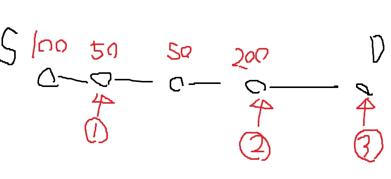

1. Fragmentation은 1번에서 수행해야 한다. (MTU가 작아지는 부분)  
    ⇒ 그러면, 어디서 합쳐야 할까?

2. 2번에서 Fragmentation을 한다면 문제가 생긴다. 현재는 Linear하게 표현이 되어 있어서 문제가 없어 보이지만, 실제 네트워크 환경에서 Router는 Mesh하게 연결이 되어 있기 때문에, 2번과 같은 Router가 존재하지 않을 수도 있다. **따라서 합치는 과정은 반드시 Destination에서 이루어져야만 한다.**
3. 여기서 **reassemble**한다.

<!-- -->

- **TTL**(Time to Live)

    Packet의 최대 수명. 최대 Hop의 수라고 볼 수 있고, Router를 거칠 때마다 1씩 감소시킨다. 이게 만료되어도 Destination까지 도달하지 못하면 Packet을 파기시킨다.

- **header checksum**

    데이터에 대한 Checksum은 TCP/UDP에서 수행하므로, Datagram은 header에 대해서만 checksum을 실시한다.

- **upper layer**

    Transport Layer에서 사용하는 Protocol의 Type(*TCP/UDP*)

### IP Fragmentation and Reassembly Example

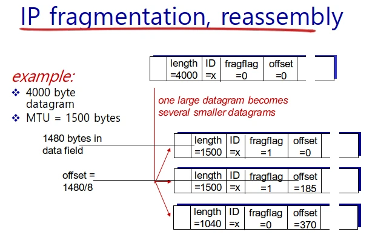

- 초기의 Datagram은 fragflag가 0이므로, offset도 0이다. 그런데 header의 길이가 20bytes이므로, **실제 데이터의 길이는 3980**이다.
- **MTU**가 **1500 bytes**이므로, **4000 bytes**를 세 개의 Datagram으로 자른다.

- 세 개의 **Datagram**의 **ID**는 **모두 같다.**

    - ID가 같아야만 Reassembly가 가능하다.
    - 즉, 잘린 Datagram이 모두 동일한 Header를 갖는 것이다.

**Datagram 1)** fragflag가 1이지만, offset이 0이다. 이것은 Fragmentation에 의해 잘린 첫 번째 데이터라는 것이며, 데이터의 첫 부분부터 MTU 사이즈만큼 저장하면 되기 때문에 1500bytes를 할당하여 모두 저장한다. 그런데 header의 길이가 20이므로, 이걸 뺀 만큼의 데이터가 들어간다. 

**Datagram 2)** fragflag가 1이고, offset이 185이다. 185*8을 하면, 1480이 된다. 또한 Header 20bytes를 빼 1480bytes를 할당하는 것이므로, 데이터의 마지막 주소는 2960(1480+1480)이다.  
⇒ Header는 앞에 있는 20bytes이므로, 이걸 자르고 나서 뒤에 것을 고려하는 것으로 생각된다.

**Datagram 3)** 3번 Datagram은 그 이후의 나머지 데이터를 저장한다. (Header 20bytes 제외)

### IP Addressing: Introduction

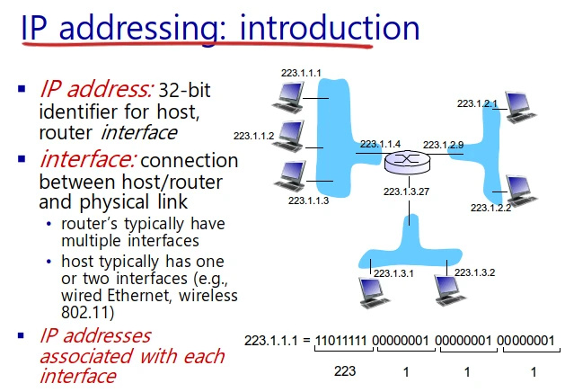

- 이전까지는 **Host**가 직접 **router**에 연결되는 것으로 표현했지만, 실질적으로 그렇게까지 강력한 Network는 존재하지 않는다. 따라서 각각의 **Host**는 **어떠한 Network를 거쳐 Router와 연결**된다.

    ㅏ , ㅓ, ㅗ Network 모두 각각 **독립적인 IP Address**를 가진다. 이전에 **Network LAN Card**를 언급했었는데, 실제로 모든 **LAN Card**는 **고유한 IP Address를 할당해 주어야 한다.** 그러므로 **Router**는 연결된 **Network 수 만큼**  **IP Address**를 가진다. 따라서 **Router**를 거치기 전에는 모두 **Switching Hub**로 연결되어 있어, **Link Layer**라고 볼 수 있다. 

    한 **Router**가 **Link Layer**로 연결하고 있는 하나의 Network는 한 Hub로 묶여있으며, 같은 IP Address 체계를 가져야만 한다.

> 즉, Network는 IP Address로 구분되며, 크게 Subnet과 Host로 나뉘어진다.

### Subnets

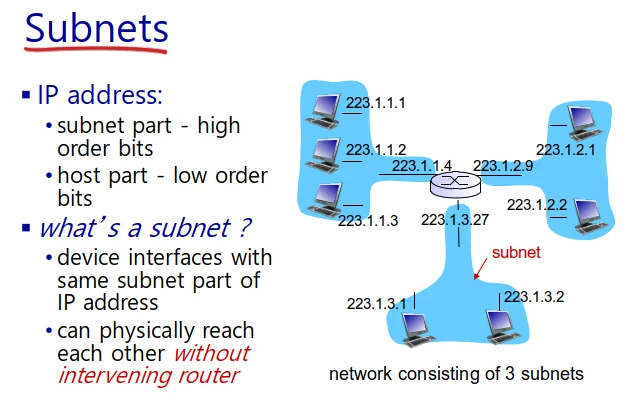

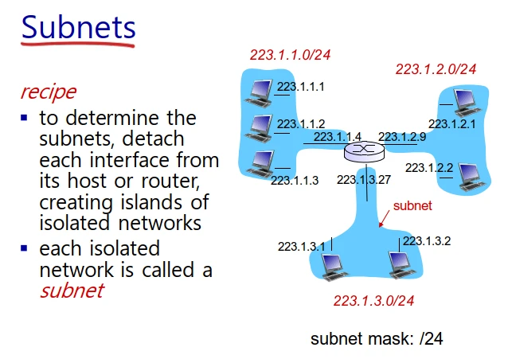

- ㅏ Network에서는 **223.1.1**이 **Subnet**이 된다. 이것은 **Network를 구분해 주는 IP**이다. 그리고 **Subnet Mask**라는 것이 존재하는데, 이것은 **Subnet Part를 구분하는 역할**이다. (*AND 연산*)
- **Example**

223.1.1.0/24

223.1.3.0/24

223.1.2.0/24

⇒ 뒤에 붙은 숫자는 해당 Network에서 Subnet을 구분하는데 사용되는 Bit의 수를 말한다. 반드시 본인이 속한 Network와 같은 Subnet을 사용해야만 Packet을 전달할 수 있다. 

그리고 IP는 Subnet과 Host Part로 구분되어서 자신이 속한 LAN를 식별할 수 있고, 그 이후에 LAN 내에서 Host Part IP를 통해서 Host를 구별할 수 있다.

### CIDR

> 위에서 소개한 방법처럼, IP에 Class를 도입하지 않고 Fair하게 적용하며, Subnet Part와 Host Part로 구분하여 LAN/Host를 구분하는 Addressing 방식을 CIDR이라고 한다.

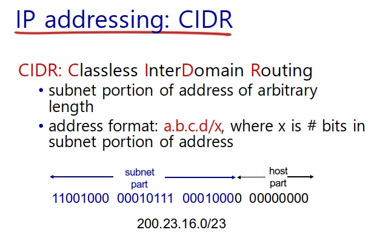

- 이전까지 Address를 Class로 구분하던 것을 없앴다. 대신, Address의 format으로 구분하자는 것이 **CIDR**이며, **Subnet Part**와 **Host Part**를 사용한다. 지정된 **Subnet Mask**를 적용해서 남는 숫자가, **지원 가능한 Host 숫자를 의미**한다. 하지만 **All 0**와 **All 1**은 배제해야 하므로, 위의 경우에는 510개의 Host를 지원할 수 있다.
- **All 0**와 **All 1**은 Broadcasting 등에 사용된다.

> 사실 라우팅에 있어서 가장 중요한 것은 Host파트보다 Subnet 파트이다.

---

## &lt;Subnet & IP Address&gt;

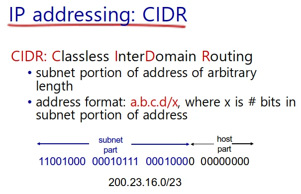

- ISP 업체들은 Host Part를 줄이는 한이 있더라도 본인들이 소유할 수 있는 Subnet을 계속해도 늘리려고 한다. (현재는 /23이지만, 사용하는 비트 수를 늘려갈 수 있음.)

### DHCP(Dynamic Host Configuration Protocol)

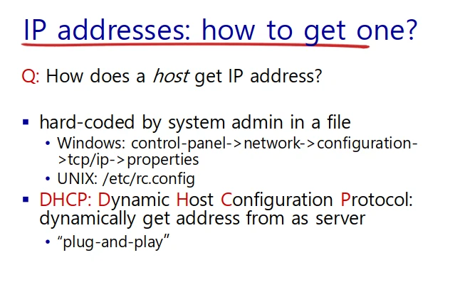

- **DHCP**는 호스트의 IP를 동적으로 할당해주고 사용이 끝나면 Host에게 할당된 IP를 회수해주는 방식이다.

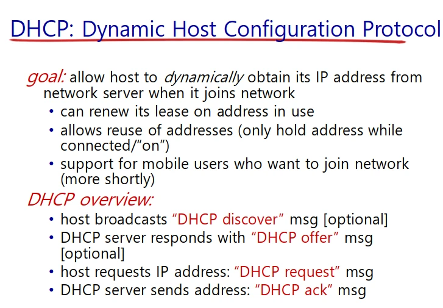

- **DHCP의 과정**

    - **DHCP discover**
    - **DHCP offer**
    - **DHCP request**
    - **DHCP ack**

    > 그런데, DHCP를 통해서 IP를 할당받기 위해서는 기본적으로 IP가 없는 상태에서 IP를 할당받아야 한다.

### DHCP Client-Server Scenario

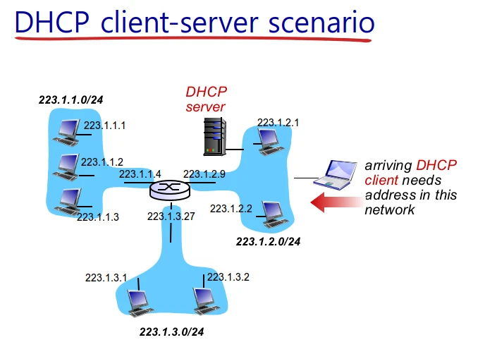

- Client가 Network에 도달하면, DHCP를 통해서 IP Address를 부여받는다.

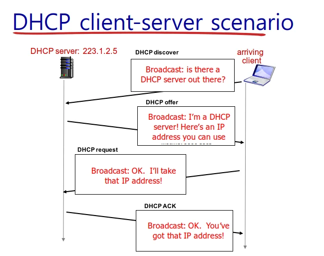

- Client는 DHCP가 있냐고 물어본다. 서버가 없다면 정해진 시간 안에 응답이 오지 않게 될 것이다.

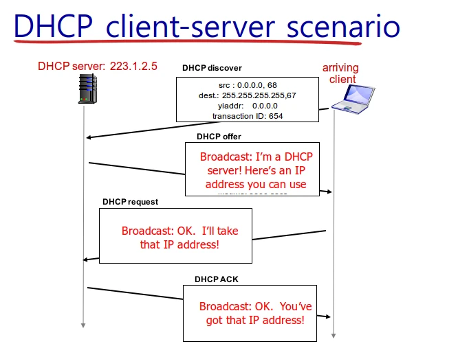

- 기본적으로 **0.0.0.0** 또는 **255.255.255.255**는 네트워크에서 사용되지 않으며, **0.0.0.0**은 아직 **IP가 할당되지 않은 상태**를 의미한다. 모두 1을 갖는 **255.255.255.255**는 **Broadcasting**을 의미한다. 따라서 네트워크에 연결된 모든 **Host**가 **Client**의 **Broadcasting**을 받는다.

    이때 추후에 Client는 자신의 요청임을 구분하기 위해 transaction ID를 **DHCP Discover**에 포함하여 **Broadcasting**을 보낸다.

    > Client : “아 엄마! 나한테 IP Address 달라고!”  
    > ⇒ 소리지르면 온 건물 사람들이 다 듣게 되지만, 실질적으로 응답은 엄마만 한다.

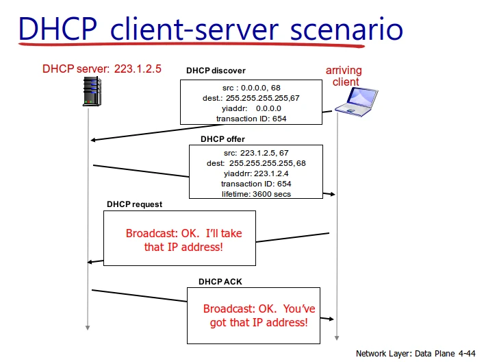

- 요청을 받을 때와 마찬가지로, **DHCP** 또한 **Client**가 누군지 알지 못한다. 따라서 마찬가지로 **Broadcasting**을 진행한다. **Client**는 **DHCP Offer**에 포함된 **transaction ID**를 통해서 자신의 요청임을 확인한다.

    즉, DHCP Server가 DHCP discover를 전달받으면 마찬가지로 Broadcasting을 통해서 **DHCP Offer**를 보내는 것이다.

    > DHCP Server : “뭐? 너 첫 째야 둘 째야? 일단 기다려봐, 엄마가 갖다 줄테니까!”  
    >   
    > (*엄마도 목소리만 들어서는 누군지 모름*)

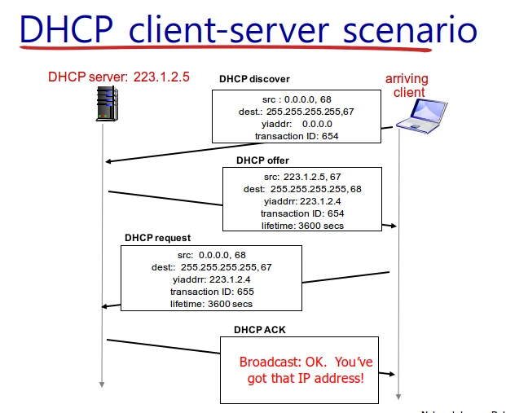

- **DHCP Server**가 제공한 IP를 전달받은 **Client**는, 해당 IP를 사용하겠다고 확인받기 위하여 **DHCP Request**를 **Server**에게 **전송**한다.
- 여기서 **Transaction ID**가 **바뀌게 되는데**, 그 이유는 별개의 요청이 되기 때문이다.

> Client : “엄마! 나 이거 써도 돼요?” (*IP Address를 보여주며*)

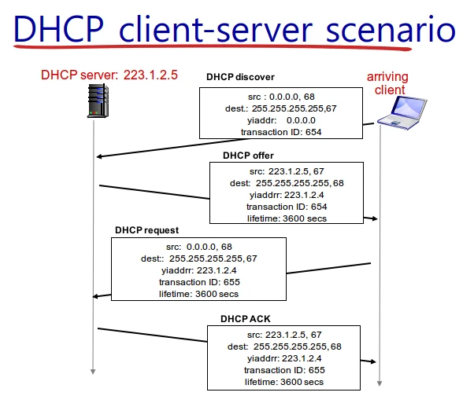

- **Client**는 **Server**로부터 **ACK**를 전달받고, 자신의 **IP Address**를 **yiaddr**로 사용할 수 있게 된다. 이를 **DHCP ACK**라고 한다.

> Server : “그래 너 써. 대신 다 쓰면 꼭 돌려줘야 돼~”

### Subnet의 확장

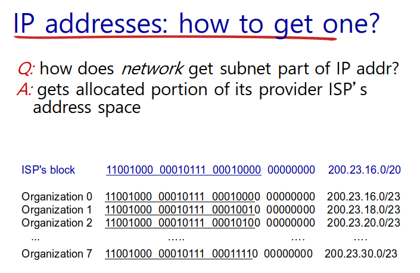

- 위와 같이 /20을 사용할 때보다 Subnet bit를 확장하면 Subnet을 더 많이 만들 수 있게 된다. 이렇게 하면 더 많은 Subnet을 사용할 수 있지만, Host의 수가 감소하게 된다.

> 이미 1995~6년쯤에 Internet이라는 것이 세상에 보급되었고, 사용한지 얼마 되지 않아 IP Address가 부족할 것이라는 예측이 나오게 되었다.  
>   
> 사물인터넷까지 다루다보면 사람이 직접 사용하는 것 뿐만 아니라 사물까지 인터넷에 참여하기 때문에 고민해야 할 부분이 되었다.

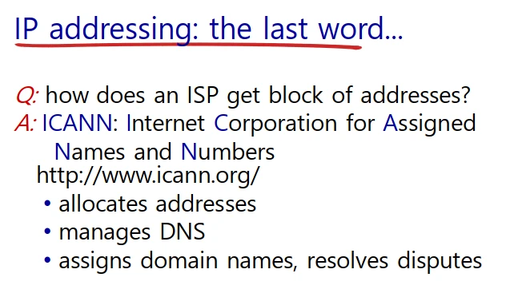

- IP는 ICANN이라는 기관에서 부여를 하는데, 2010년 이후로는 더 이상 IPv4를 할당하지 않는다. 그럼에도 우리는 계속해서 IP를 할당받고 사용하고 있다. 어떻게 이런 것이 가능할까?

---

## &lt;NAT(Network Address Translation)&gt;

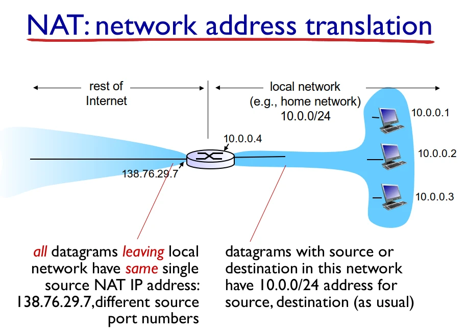

- IP Address가 부족한 문제가 발생 → 이에 따라 Private Address를 할당받는 기술이 NAT가 개발되었다. NAT는 Local Network 내에서 각각의 Host가 외부에 드러나지 않는 가상의 IP를 사용할 수 있도록 하는 Address Allocation 기술이다. 이 IP는 내부에서만 사용돼서, 외부에는 가려진다.
- 예를 들어, 위의 그림에서 router의 실제 IP는 138.76.29.7이다. 하지만 Local Network에서는 NAT에 의해 10.0.0.4라는 Private Address를 할당받아 사용하고, 다른 Host들도 마찬가지이다.

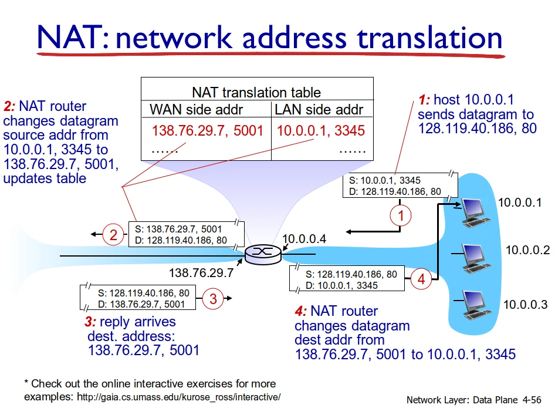

- Network Core와 Local Network를 연결해주는 Access Router가 NAT Router라면, 해당 Router에는 **NAT Translation Table**이 존재해서, 만약 외부에서 Packet을 받으면 해당 Table을 확인해 어떤 Host로 전달되는 것인지를 Mapping 할 수 있다.
- 다만 한 가지 추가되는 것이 있는데, 바로 **Router**가 **Port Number**를 사용한다는 것이다. Router는 LAN을 위한 Port를 열어서, 우선 외부에 드러나는 Port에 Packet 요청이 들어오게 만들고, 이후에 Table을 참조해 Mapping하여 지정된 Host에게 Packet을 전달해준다.

---

## &lt;IPv6&gt;

> IPv6는 header로 fixed-length 40 byte를 사용하고, fragmentation을 허용하지 않는 새로운 IP Address 할당 Protocol이다.

### IPv6 Datagram format

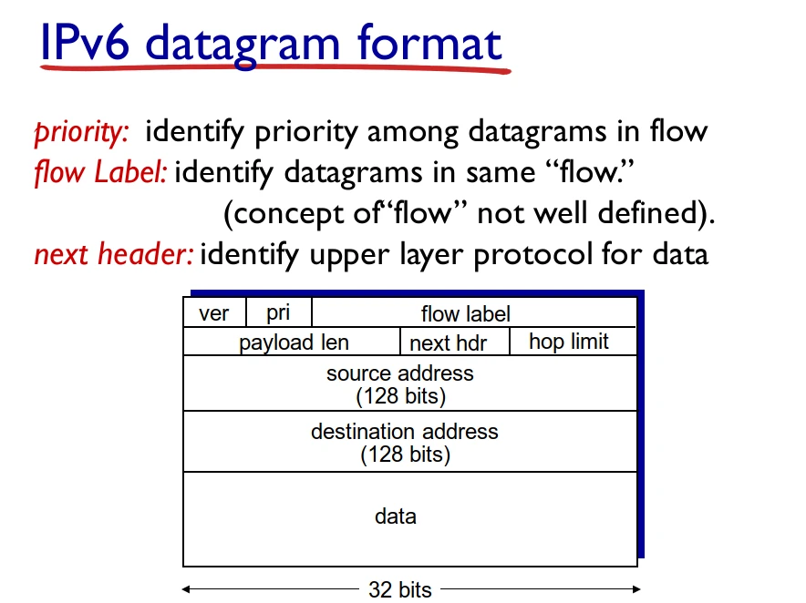

- IPv6는 Source/Destination의 Address를 128-bit로 사용한다. 이 중 48 bit를 MAC Address로 사용한다. 즉, 기존의 32 bit IPv4보다 bit 수를 확장해서 IP를 더 많이 할당하겠다는 것이다.

> 하지만 이 방법은 여전히 문제가 있는데, 기존에 깔려있던 IPv4 NAT Router들을 전면 교체해야 한다는 것이다.

### Transition from IPv4 to IPv6

> 그런데 만약 Client가 IPv6를 사용하는데 거치는 Router들은 IPv4를 사용한다면, Header가 달라서 Parsing이 올바르게 되지 않을 수도 있다. 이런 경우에는 어떻게 해야 할까?

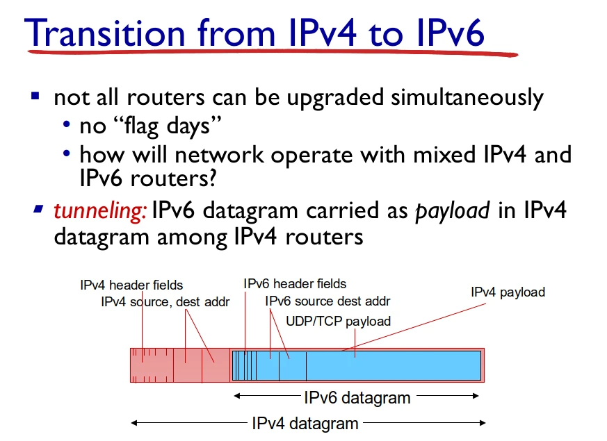

- **Tunneling** : IPv6의 Datagram을 IPv4의 Payload로 담아버리는 방식인 Tunneling을 이용한다.

---

## &lt;Generalized Forwarding and SDN&gt;

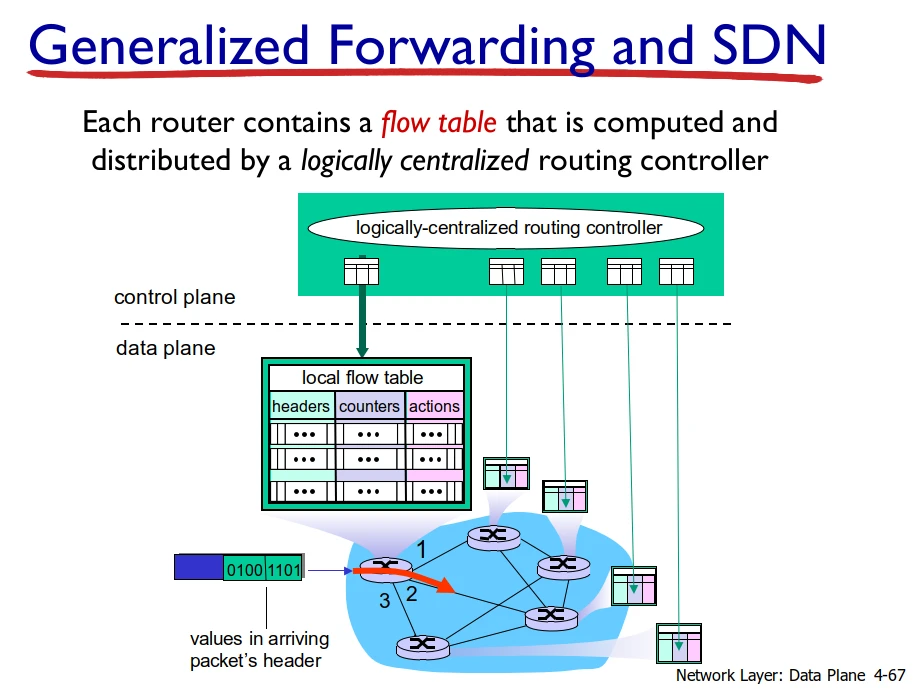

- **SDN**(Software-defined Networking)은 기존의 Data Plane 방식의 Fabric 기반 Route & Forward를 대체하는 방식이며, Router들을 연결하는 Routing Controller Server가 존재하여 Routing Table을 관리하고, 필요할 때마다 정보를 전달해주는 방식이다.

    각각의 Router는 Routing이 필요할 때마다 Forwarding Table을 보고 Forwarding을 하는데, 만약 Table을 전달받는다면 Router의 부담이 매우 적어지게 되기 때문에 아주 편리하다.

### OpenFlow Data Plane Abstraction

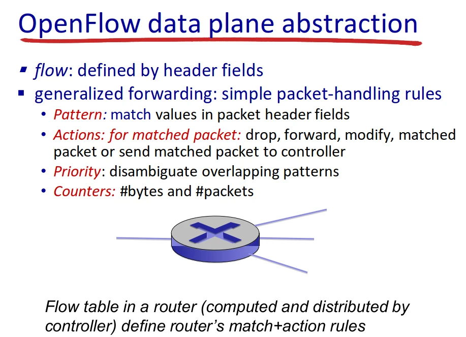

- OpenFlow는 SDN에서 Controller와 Router 간에서 이용하는 Interface 기술 중 하나이다. Packet을 제어하는 기능과 전달하는 기능을 분리하고 프로그래밍을 통해 네트워크를 제어한다.
