# Link Layer

작성일 2023-12-07 · 최종 수정일 2023-12-11
{ .post-date }

## &lt;Link Layer&gt;

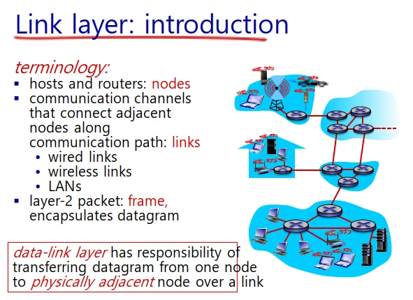

- Link Layer를 쉽게 설명하자면 One Hop으로 이어진 링크이다. Link Layer의 가장 중요한 역할 중 하나는 Host와 Router를 One Hop으로 연결하는 역할이다. 즉, 여러 Host를 묶어서 이 Host들을 Router로 연결해 주는 것이 Switch의 역할이다.
- Link Layer에서는 Packet을 **Frame**이라고 한다.   
    (Message → Segment → Datagram → Frame → Bit)

### Link Layer의 역할

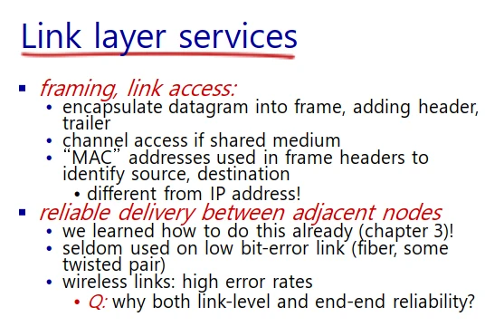

1. Datagram을 새로운 단위인 **Frame**으로 쪼개고 **Header**를 부착한다.

2. **Link Accessing**을 한다.

    Collision을 방지하기 위해 **Link Accessing**이 중요하다.

3. **Reliable Data Delivery**를 한다.

    위에서 전달된 IP Header가 그대로 Payload로 들어가기 때문에 새로운 Address를 Header에 부착해야만 한다. 이것을 **MAC Address** 혹은 **H/W Address**라고 한다.

### Link Layer의 구현

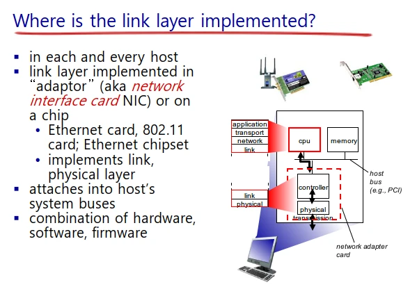

- 실제로 OS 상에서 서비스로 제공되는 계층은 Transport, Network Layer까지이다. Datalink Layer는 별도로 구현되는데, 즉, **Network Layer Interface**가 존재해야만 한다는 것이다.

- Datalink Layer에서는 Error Check를 **CRC**(Cyclic Redundancy Check)를 통해 하게 되는데, 이는 이미 Fabric으로 구현되어 있다.

### Multiple Access Link

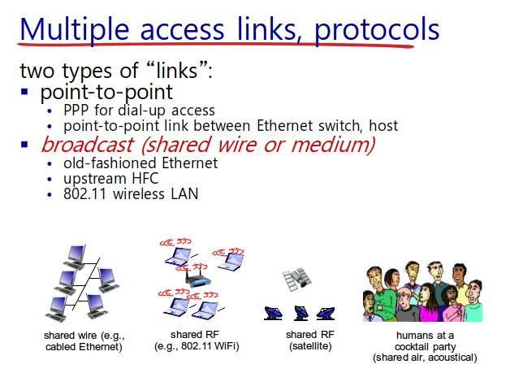

- 다수가 같은 Link를 사용하려고 하면 **Collision**이 발생한다. 이는 유/무선 모두에서 마찬가지인데,  
    이 문제를 해결하기 위해 나온 것이 **Multiple Access Protocol**이다.

### Multiple Access Protocol

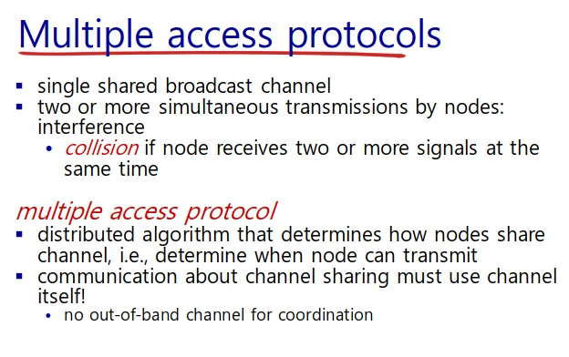

- **Datalink Layer**를 다른 말로 **MAC layer**라고도 하는데, **Multiple Access**를 지원하기 위해 지원되는 **Protocol**이 **MAC protocol**이다.

### MAC Protocols

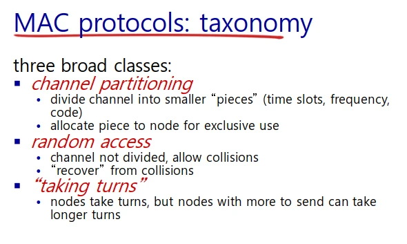

- 사실 Multiple Access를 지원하기 위해서는 Collision이 발생할 확률을 수식적으로 정의해야만 한다.
- **MAC protocol**에는 크게 세 종류가 존재한다.

<!-- -->

1. **Channel Partitioning**

    동시에 사용하지 않도록 하기 위해서 Channel을 구분하는 방식이다.

2. **Random Access**

    특히 Random Access 방식이 중요한데, 인터넷 환경에서 사용하기 적합하기 때문이다.

3. **Taking Turns**

    서로 연결하여 진행하는 방식이며, TDMA와 연결하여 Bluetooth 등으로 Powerful하게 사용되고 있다.

<!-- -->

- **TDMA** 

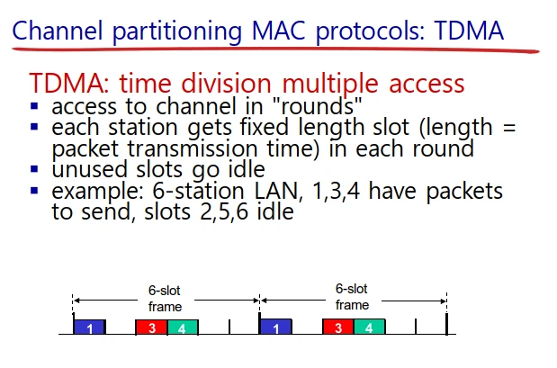

TDMA는 Slot으로 나눠서 데이터를 전달하는 것. 그러므로 Collision이 발생하지 않는다.

- **FDMA**

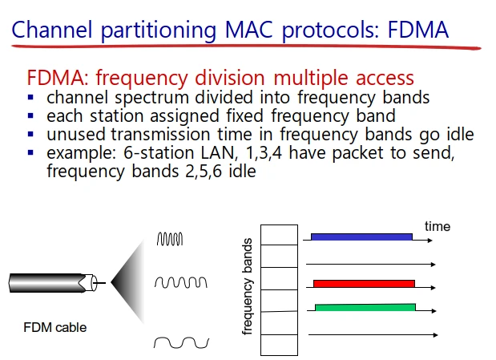

FDMA는 주파수를 나눠서 통신하므로, 역시 Collision이 발생하지 않는다.

---

## &lt;Random Access Protocol&gt;

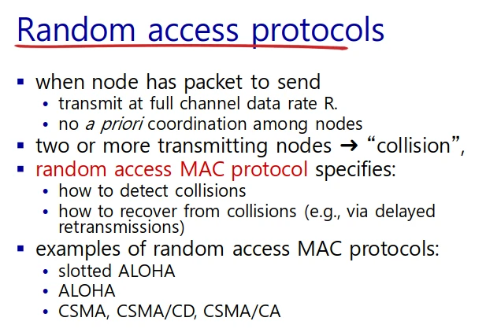

- **Random Access Protocol**은 보낼 차례가 되면 그냥 랜덤하게 보내는 방식이기 때문에, 반드시 **Collision**이 발생하게 된다.
- **Collision**이 발생하면, 사실 데이터를 보낸 측은 상대방이 올바르게 전달 받았는지 못 받았는지를 알아내지 못한다.
- 따라서 **Protocol**을 통해서 이를 파악하고 **Recovery**를 하게 된다.

> 만약 Collision이 발생했다고 확인되면, 결국 데이터를 다시 보내야한다. 하지만 무작정 다시 보내면 또 다시 **Collision**이 발생하기 때문에 **어느 정도 Delay를 부여**한다.  
>   
> Bluetooth의 경우 Master가 존재해서 Collision을 Control하기 쉽지만, 인터넷 환경은 그렇지 않다. 따라서 **Random Access**는 정말 “**random 함수**”를 돌려서 **delay**를 **결정해 재전송**한다.

- **MAC protocol의 종류**

    - ALOHA
    - slotted ALOHA
    - **CSMA**(*Carrier Sense Multiple Access*),   
        **CSMA**/**CD**(*Collision Detection*),   
        **CSMA**/**CA**(*Collision Avoidance*)

### Pure (unslotted) ALOHA

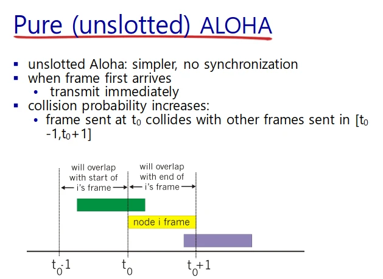

- **Pure ALOHA**는 일단 데이터가 생기면 무조건 보낸 다음, ACK를 받는다. 만약 ACK를 받지 못하면 재전송하는 것이다.

### Slotted ALOHA

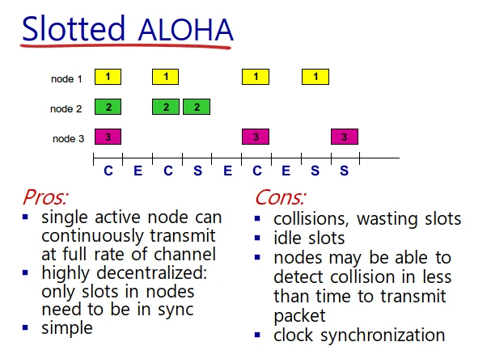

- Pure ALOHA의 단점을 극복하기 위해 Slotted ALOHA는 Slot을 도입한다. 다른 애들이 데이터를 언제 보내는 지는 알 수 없지만, 이미 Synchronization을 맞췄기 때문에 상대적으로 Collision이 적게 발생한다.
- 그런데 단점으로는, 정교한 Synchronization이 어렵다는 점이다. 아무리 정교한 Clock이라고 하더라도, Clock Drift가 발생하기 때문에 그것이 누적되면 Synchronization이 망가질 수 있다.

> Pure ALOHA, Slotted ALOHA의 문제는 내가 데이터를 보내기 전에 누가 보내는지 알 길이 없다는 것이다. 이걸 극복하기 위해 CSMA가 도입되었다.

### CSMA

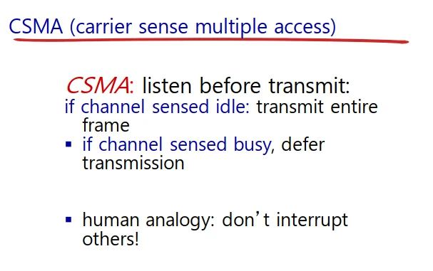

- CSMA는 데이터를 전송하기 전에 보내려는 **Channel**을 **Listen**(Carrier Sense)하고, 만약 누군가 보내고 있다면 Channel이 IDLE할 때까지 대기하다가 보낸다.

    - 이를 통해 **Collision**을 **방지**할 수 있다.

- 하지만 아무리 **Detection**(Listen Before Talk)을 한다고 해도 Collision이 발생할 수는 있다!

### Collision on CSMA

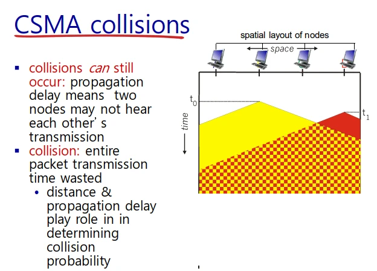

- 아무리 Carrier Sensing을 한다고 해도, 실제로 **Transmission Delay**가 존재하기 때문에 아무리 Carrier Sensing을 한다고 해도 완벽하게 파악하지 못한 채로 Data를 전송하여 Collision이 발생할 수 있다는 것이다.

- 이걸 방지하기 위해서 **Collision Detection**을 도입한다.

    - 실제로 유선 LAN에서 사용한다.

### CSMA/CD

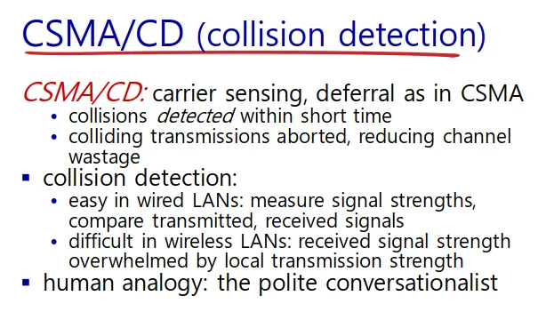

- CSMA/CD는 **Carrier Sensing**을 하고 보내면서 **Collision Detecting**을 같이 하는 것이다.
- 그래서 만약 **Detection**이 되면 잠시 멈추고, **Carrier Sensing**을 또 진행하며 **Channel**이 완전히 **IDLE** 해질 때까지 기다리면서 이상이 없을 때 다시 전송한다.
- 이 때 중요한 것은, **Collision**에 관여된 모든 **Sender**가 **Collision Detection**을 하고 대기하게 되기 때문에 **모두 한 번에 멈춘다**는 것이다. 이렇게 되면 각자 **Delay**를 **Random하게 부여**받고 재전송을 하게 된다.

### Exponential Backoff

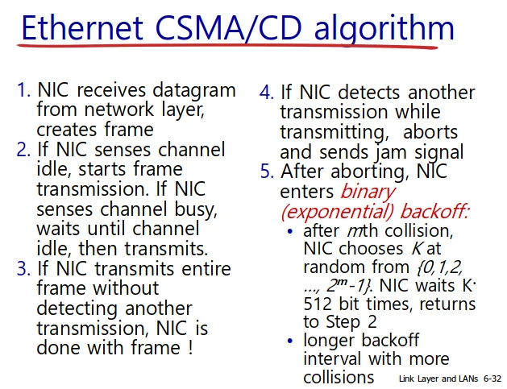

- 0, 1, 2, 4, … 이런 식으로 Exponential하게 Random한 Delay를 받고 대기하게 된다.

> CSMA는 Carrier Sensing을 하고 Busy하면 대기, IDLE하면 전송한다.  
>   
> CSMA/CD는 Carrier Sensing을 하고 Busy하면 대기, IDLE하면 전송한다. 그런데 보내는 도중에도 Collision Detection을 하고, Collision이 감지되면 Exponential Backoff(Random Delay)를 적용했다가 다시 전송하게 된다.

> CSMA/CA는 무선에서 사용하는 방법이다.

### Taking Turns

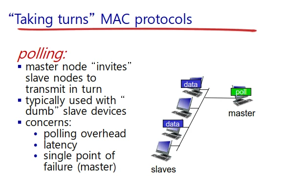

- Taking Turns는 Master가 Polling을 하면서 데이터가 존재하는 것을 처리하는 것이다.
- 다만 이것은 Latency가 점차 증가하고, 만약 Master에 문제가 생기면 시스템 동작이 안되기 때문에 인터넷 환경에서는 적합하지 않다.

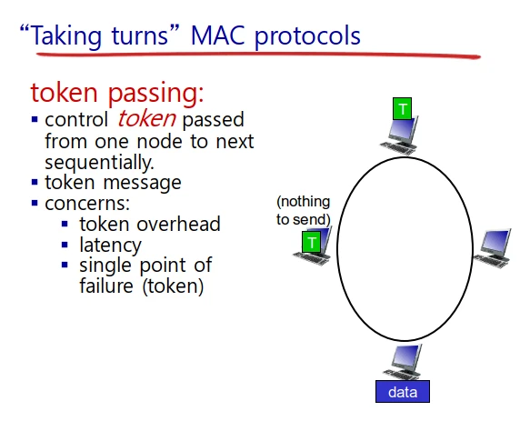

- 과거에 LAN이 없을 때는 Ring 방식으로 Network를 구성했는데, 이것은 자신에게 Token이 도달하면 옆으로 전달해주는 방식이다. 다만 이 방식은 하나만 문제가 생겨도 전체 Ring이 동작하지 않으므로 역시 인터넷에는 적합하지 않다.

---

## &lt;MAC Address&gt;

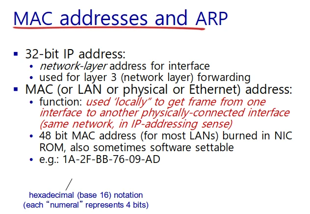

- MAC Address는 변경되지 않는 주소이다. LAN Card 자체가 생산될 때 Hard Coding된 값이다.

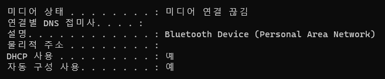

⇒ 나의 MAC Address (cmd에서 ipconfig /all 로 확인이 가능하다.)

> IP Address가 Network Layer에서 Link Layer로 도달하지만, 이것은 고정된 값이 아닐 뿐만 아니라 Encapsulation 되기 때문에 별도의 Address인 MAC이 필요하다.

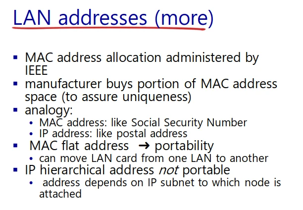

- 만약 서버와 클라이언트를 만들었다고 한다면, 내부망에서만 하면 동작이 잘 된다. (*NAT를 사용하지 않아도 되는 것.*)
- 이 안에서는 Link Layer Address (*MAC*)으로 통신하기 때문에 이것이 가능한 것인데, 연결된 Host를 관리하기 위하여 IP 주소와 MAC 주소를 매핑한 Table을 계속해서 갱신해야 한다. (*ARP*)

### ARP(Address Resolution Protocol)

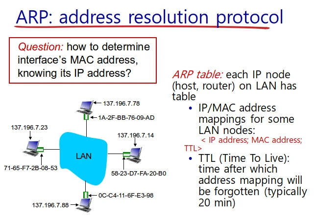

- ARP는 현재 자신과 연결된 LAN에서 연결된 Host 간의 IP를 주기적으로 갱신하는 프로토콜을 말한다.
- 우리가 실제 Application에서 데이터를 보낼 때는 **IP Address**를 통해서 **Destination**을 선정하는데, 이럴 때 각각의 **Link Layer**에서는 그 **IP Address**에 해당하는 **MAC Address**가 있는지 찾아서 해당 Device로 전송해야 한다.

- 예를 들어 137.196.7.88이 137.196.7.78로 데이터를 보내고자 한다면, **같은 Subnet**에 있다는 것을 바로 알아차린다. 하지만 아무리 같은 Subnet에 있더라도 **MAC Address**를 알아야만 데이터를 전송할 수 있다.

    이때, 각각의 **Host**는 **MAC Table**을 가지고 있어서 LAN에 연결된 Host들의 IP와 매핑된 Unique한 MAC Address를 얻고, 이를 통해 Packet을 LAN 내에서 전달할 수 있게 된다.

- 그런데, IP Address는 **DHCP**에 의해서 Dynamic하게 설정이 가능하다. 따라서 TTL을 지정하여 **IP**/**Address Mapping**을 주기적으로 초기화하며 갱신한다.

### Addressing: Routing to another LAN

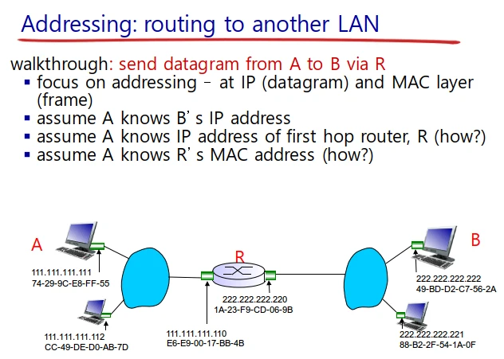

- 만약 어떠한 IP로 데이터를 전송하고자 하는데, 그것이 같은 Subnet에 있지 않다면 이걸 **Access Router**로 전송해 주어야 한다. 
- 그런데 **Router**의 **Mac Address**를 알지 못하기 때문에 **ARP**를 사용해야 한다.

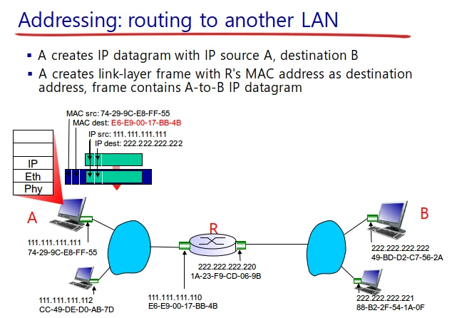

- **Source Host**는 **ARP Table**을 참조하여 **Access Router**의 **MAC Address**를 알아내고 **Link Layer**를 통해서 **Access Router**로 데이터를 **전송**한다.

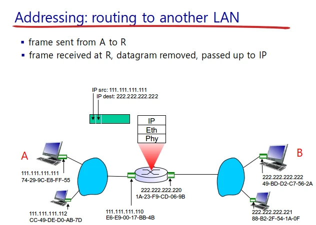

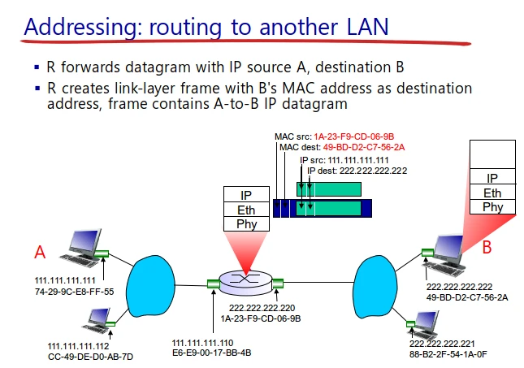

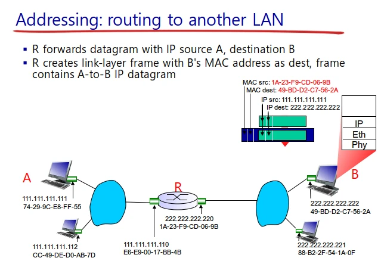

- 그리고 Destination이 속한 Ethernet에서도 마찬가지로, 먼저 전달받은 Packet에서 NAT를 통해 Host의 **Private IP Address**와 **Port Number**를 얻어낸다. 이후에는 얻어낸 IP를 바탕으로 **ARP**  **Table**을 참조하면서 **Host**의 **MAC Address**를 알아내고, 이를 바탕으로 Packet을 **Forward**한다.
