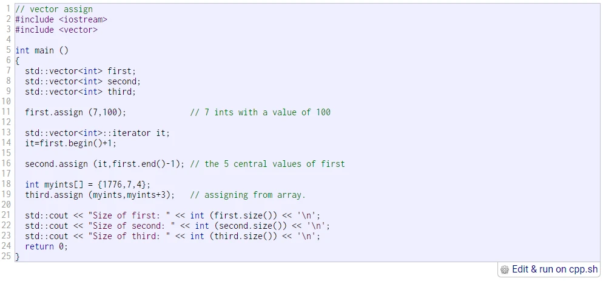

# 4주차-2: 객체 배열, Vector, Array, SFML

## # `객체 배열`

- 지금까지 만든 객체를 갖는 배열을 구성할 수 있다.

```cpp
#include <iostream>

using namespace std;

class Circle {
public:
	int x, y; // 중점의 좌표
	int r; // 반지름

	Circle() : x(0), y(0), r(0) {
		cout << "Circle default constructor was invoked" << endl;
	}
	Circle(int _x, int _y, int _r) : x(_x), y(_y), r(_r) {
		cout << "Circle constructor was invoked" << endl;
	}

	void showCircleInfo() {
		cout << x << " " << y << " " << r<< endl;
	}
};

int main() {

	Circle cs[10];

	for (auto& c : cs) { 
		c.showCircleInfo();
	}

	cs[4].showCircleInfo();
	cs[2].x = 100;
	cs[2].showCircleInfo();

	return 0;
}
```

- class의 구현체 → `instance`
- 만약 range based for loop에서 auto&로 지정하지 않고 auto로 지정한다면, cs 배열에서 클래스가 복사되어 c로 전달되기 때문에 메모리를 더 차지하고 시간이 더 많이 걸릴 것이다.

---

## # `Vector`

- `Array의 단점` : 처음 선언된 Size를 절대로 변경할 수 없다. 그래서 필요한 자료의 Size를 정확히 안다면, Array를 사용하는 것이 좋다.
- `Array의 장점` : Indexing에 의해서 다음 자료가 바로 내 다음 주소에 있어서 O(1)로 자료에 접근할 수 있다.
- `Vector (Linked List)`

```cpp
#include <iostream>
#include <vector>

using namespace std;

int main() {
	
	vector<int> first(10); 
// Linked List의 이름 : first, 
// Size : 10, 
// type : int

	return 0;
}
```

```cpp
#include <iostream>
#include <vector> // vector library including, Doubly Linked List

using namespace std;

class Circle {
public:
	int x, y; // 중점의 좌표
	int r; // 반지름

	Circle() : x(0), y(0), r(0) {
		cout << "Circle default constructor was invoked" << endl;
	}
	Circle(int _x, int _y, int _r) : x(_x), y(_y), r(_r) {
		cout << "Circle constructor was invoked" << endl;
	}

	void showCircleInfo() {
		cout << x << " " << y << " " << r<< endl;
	}
};

int main() {

	// template

	vector<Circle> second; // Data type에 대한 걱정이 사라짐! 

	return 0;
}
```

- `Template`  

    Vector를 사용할 때, Vector의 형식은 정해져 있고 자료형만 지정해서 사용하는 방식.  
    ex) vector&lt;T&gt; vector_name;  

- `Standard Template Library (STL)` → `Vector`

    Java의 경우에는 `Generic` 으로 이 기능을 지원하는데, 최근에 지원되는 modern language 는   
    `Generic` 기능을 지원한다.

```cpp
#include <iostream>
#include <vector>

using namespace std;

int main(void) {

	vector<int> first(5);

	//for (auto& v : first) {
	//	cout << v << endl;
	//}

	// cout << first[5] << endl;
	// cout << first.at(5) << endl; // at은 Vector의 method. 그 index로 가서 값을 가져온다.

	first.push_back(100);
	first.push_back(200);

	cout << "first: " << first.front() << " " << "back: " << first.back() << endl;
	// 요소를 반환해주는 코드, 지우지 않는다.

	first.pop_back(); // pop_back은 반환값을 제공하지 않는다.

	// begin, end

	for (auto p = first.begin(); p != first.end(); p++) {
		cout << *p << endl;
	}

	auto p = first.begin();
	cout << *(p + 5) << endl;

	//for (auto v : first) {
	//	cout << v << endl;
	//}

	return 0;
}
```

- 참고 사이트 : cplusplus.com  
    → C++은 지금도 진화하고 있다. C++98은 1998년도에 만들어진 버전이고, C++11은 2011년도에 만들어진 버전이다. 필요한 메서드들은 해당 사이트에서 찾아볼 수 있다.
- Vector 같은 경우, 메모리를 추가로 잡을 때 한 개만 필요하다고 한 개만 늘리면 굉장히 비효율적이기 때문에 한 번에 여러 개의 메모리 공간을 잡아 놓는다.
- `begin end`

    `begin`은 vector의 첫 주소 (Head)를 반환한다.  
    `end`는 마지막 요소의 다음 번 주소를 반환해서, 실제 마지막 요소까지 출력할 수 있도록 한다.

```cpp
#include <iostream>
#include <vector>

using namespace std;

int main() {

	// ... 위의 코드 가져옴

	vector<int> b;
	b = first;

	if (first == b) { // Linked
		cout << "they are same" << endl;
	}	

	// insert
	first.insert(first.begin(), 999); // (address, value)
	first.insert(first.begin()+1, 50); // (address, value)
	cout << first.at(0) << endl; // 999
	cout << first.at(1) << endl; // 999

	// clear
	first.clear();
	cout << "size: " << first.size() << endl;

	// assign
	// 하단에 embed된 사용법 스크린샷 참조

	return 0;
}
```

- `assign`



```cpp
#include <iostream>
#include <vector>

using namespace std;

int main(void) {

	// ... 위의 코드 가져옴

	vector<int> first { 5, 4, 3, 2, 1 }; // 초기화 방법
	vector<Circle> cs;

	return 0;
}
```

- `STL을 사용하는 이유`

    STL을 이용하면 sorting 등을 자동으로 사용할 수 있다.

```cpp
#include <iostream>
#include <vector>
#include <algorithm>

using namespace std;

bool compare(int a, int b) {

	return a < b;

}

int main(void) {

	vector<int> first {5, 4, 3, 2, 1};

	sort(first.begin(), first.end(), compare); // asc 
	// 맨 끝이 포함되지 않는다.
	// 함수의 이름을 그대로 넣는다.	

	for (auto v : first) {
		cout << v << endl;
	}

	return 0;
}
```

```cpp
#include <iostream>
#include <vector> // vector library including, Doubly Linked List
#include <algorithm>

using namespace std;

class Circle {
public:
	int x, y; // 중점의 좌표
	int r; // 반지름

	Circle() : x(0), y(0), r(0) {
		cout << "Circle default constructor was invoked" << endl;
	}
	Circle(int _x, int _y, int _r) : x(_x), y(_y), r(_r) {
		cout << "Circle constructor was invoked" << endl;
	}

	void showCircleInfo() {
		cout << x << " " << y << " " << r<< endl;
	}
};

// Class 간의 우열 관계를 판단해주는 함수
bool compare(Circle a, Circle b) {
	if ((a.x + a.y) < (b.x + b.y)) {
		return true;
	}

	else false;
}

int main() {

	vector<Circle> cs;

	sort(cs.begin(), cs.end(), compare); // C++는 기본적으로 Quick Sort를 사용한다.

	return 0;
}
```

- `이차원 vector`

```cpp
#include <iostream>
#include <vector> // vector library including, Doubly Linked List

using namespace std;

int main() {

	vector<vector<int>> a;

	for (int i = 0; i < 3; i++) {
		vector<int> row;

		for(int j = 0; j < 5; j++) {
			row.push_back(i*j);
		}
		a.push_back(row);
	}

	return 0;
}
```

- a라는 vector 안에 vector&lt;int&gt; type을 갖는 row를 원소로 넣어준다.  
    이렇게 작성하면 각각의 벡터의 크기가 달라도 되므로, 필요한 만큼만 받아서 사용할 수 있다.

---

## # `Array`

- `array`

```cpp
#include <iostream>
#include <array> // STL이긴 하지만, 기존의 Array와 기능이 똑같다.

using namespace std;

int main(void) {

	array<int, 3> my_array; // Size를 지정해준다.
	my_array[0] = 10;

	for (auto v : my_array) {
		cout << v << endl;
	}

	return 0;
}
```

- array를 이런 방식으로 선언하면 Class의 Method 들을 사용할 수 있다.

    1. size() : Array의 크기를 알 수 있다. 이전까지는 MACRO로 지정해서 사용했음.
    2. fill() : 같은 숫자로 채운다.
    3. empty() : Array가 비어있는지 아닌지
    4. at() : 해당 idx의 value
    5. front() : 첫 번째 값
    6. back() : 마지막 값

---

## # `SFML(Simple and Fast Multimedia Library)`

- Library 설치 필요.
- Visual Studio 2017 다운로드 필요.
- 32bit download를 추천.

---

## # Vector

```cpp
vector.begin() // 시작 주소 반환
vector.end() // 끝 주소 + 1 반환
vector.size() // 사이즈 반환
vector[] // vector를 배열 처럼 접근 가능, vector는 효율 중심이므로 at보다 [] 권장
vector.at() // 지정한 번째의 원소의 값을 출력함
vector.front() // 맨 앞의 값을 출력함
vector.back() // 맨 뒤의 값을 출력함
vector.assign(n, m) // 값 n을 m개 만큼 채워서 vector를 초기화함
vector.push_back(value) // value를 뒤에 넣는다.
vector.pop_back() // 뒤에서 값을 뺀다
vector.insert() // 값을 삽입한다.
vector.erase() // 값을 지운다.
vector.clear() // vector를 비운다. 
```
