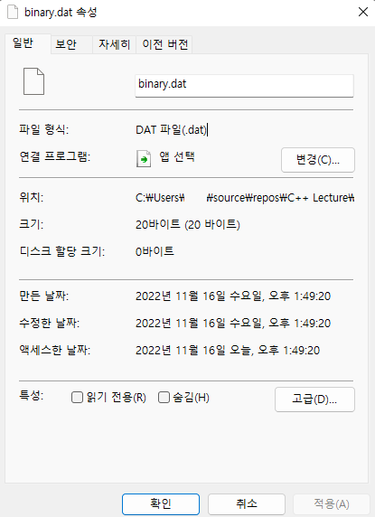

# 11주차 (2): 이진 파일, 임의 접근 파일

작성일 2022-11-16
{ .post-date }

- 이진파일

binary file | text file, ascii file, .txt 를 의미한다. text file은 저장 내용이 ascii code로 기록된다.

stream - input stream, output stream.

C++ class : ofstream, ifstream.

```cpp
#include <iostream>
#include <fstream>

using namespace std;

int main(void) {

	int buffer[] = {10, 20, 30, 40, 50};

	// 기록할 파일을 연다. 파일 객체를 생성한다.
	// C언어에서는 파일을 열고 닫을 때 fopen, fclose를 했는데,
	// 객체 생성 === open
	// 소멸자 내에서 close를 자동으로 넣어주기 때문에
	// close를 명시하지 않아도 된다.

	ofstream os("binary.dat", ofstream::binary);

	// int type array buffer의 주소를
	// char*로 캐스팅해준다.
	os.write((char *)buffer, sizeof(buffer));
	// write의 parameter를 보면 const char* _str 을 넘겨준다.
	// 이는 char의 주소를 의미하며, 주소에서 값을 바꾸지 못하게 하도록
	// const로 선언해준다.

	return 0;
}
```

만든 파일을 경로 상에서 확인해보면, 정확히 20바이트의 파일이 생성된 것을 확인할 수 있다.



값을 HEX로 바꿔서 확인해보면,

0A 00 00 00 | 14 00 00 00 | 1E 00 00 00 | 28 00 00 00  | 32 00 00 00 이와 같이 값이 저장된다. 저장되는 순서는 리틀 엔디안에 의해 저장된다.

```cpp
#include <iostream>
#include <fstream>

using namespace std;

int main(void) {

	int buffer[] = {10, 20, 30, 40, 50};
	char buffer2[] = { '1', '2', '3', '4', '5' };

	ofstream os("binary.dat", ofstream::binary);

	os.write(buffer2, 5);

	return 0;
}
```

사실 binary file과 text file은 차이가 없다. 단지 text file로 읽는다면 저장된 값을 ASCII code로 환산해서 사용자에게 문자로 보여주는 것이다.

---

- 파일을 읽어오기 (이전의 예제에서, int 5개를 넣어서 20바이트를 저장한 상태)

```cpp
#include <iostream>
#include <fstream>

using namespace std;

int main(void) {

	int buffer[5];

	ifstream is("binary.dat", ifstream::binary);
	is.read((char*)buffer, 20);

	for (auto& _v : buffer) {
		cout << _v << endl;
	}

	return 0;
}
```

---

- random access file

순차 접근 파일 : 앞에서부터 파일을 모두 읽어야, 원하는 위치 도달  
임의 접근 파일 (random access file)

```cpp
#include <iostream>
#include <fstream>

using namespace std;

int main(void) {

	ifstream is("binary.dat", ifstream::binary);

	int v;
	is.seekg(4, ios::beg);
	is.read((char*)&v, 4);

	cout << "value is: " << v << endl;

	return 0;
}
```

- seek : file pointer를 원하는 위치에 옮겨주는 역할. g는 get의 약자이다. seek해서 g(get)한다는 뜻이다. 읽는 포인터를 움직일 때는 seekg를 사용하고, 쓰는 포인터를 움직일 때는 seekp를 사용한다. 

```cpp
#include <iostream>
#include <fstream>

using namespace std;

int main(void) {

	ifstream is("binary.dat", ifstream::binary);

	int v;
	is.seekg(4, ios::beg); // beginning
	is.seekg(4, ios::cur); // current location
	is.read((char*)&v, 4);

	cout << "value is: " << v << endl;

	return 0;
}
```

이렇게 수행하면, 결과는 당연히 30이 나올 것이다.

```cpp
#include <iostream>
#include <fstream>

using namespace std;

int main(void) {

	ifstream is("binary.dat", ifstream::binary);

	int v;
	is.seekg(4, ios::beg); // beginning
	is.read((char*)&v, 4);
	is.seekg(4, ios::cur); // current location
	is.read((char*)&v, 4);

	cout << "value is " + v << endl;

	return 0;
}
```

그런데, 파일을 한 번 읽거나 쓰면 그 위치가 읽거나 쓴 바이트 수만큼 이동하게 된다. 따라서, 다음 코드의 결과는 40이 나오게 된다.

- 추가로, seekg(-4, ios::end)를 쓰면 파일 포인터의 끝에서 부터 이동할 수 있게 된다.

---

- 예외 처리 (Exception Handling)

```cpp
#include <iostream>

using namespace std;

int main(void) {

	/*
		int person = 0;
		if (person == 0) {
			cout << "error" << endl;
		}
	*/

	try {

		int person = 3;
		if (person == 0) {
			throw person;
		}
		else {
			throw 'c';
		}
	}
	catch (int e) {
		cout << "Exception catched!!" << endl;
	}
	catch (char c) {
		cout << "Character exception catched!!" << endl;
	}

	return 0;
}
```

- C++에는 try, catch라는 개념이 있다. 이전까지 C언어에서는 주석부분과 같이 코드를 작성해야만 했다. 이건 옛날 방식이고, 현재 방식은 try, catch를 이용한다. 문제가 생길 수 있는 부분을 try로 감싼다. 그 안에서 오류가 발생할 수 있는 부분을 catch에 정의한다. try 구문 안에서 오류가 발생하는 부분이 생기면 throw를 던져준다. 그렇게 되면 throw가 catch로 이동하게 돼서 에러를 처리하도록 만드는 방식으로 바꿔놓았다.
- catch는 동시에 여러 개를 잡을 수도 있다. multiple-catch (다중 캐치) catch를 여러 개 구성해놓으면 여러 개의 error를 처리하도록 만들 수 있다. 

---

- template

```cpp
#include <iostream>

using namespace std;

int get_max(int x, int y) {

	if (x > y) {
		return x;
	}
	else {
		return y;
	}
}

float get_max(float x, float y) {

	if (x > y) {
		return x;
	}
	else {
		return y;
	}
}

int main(void) {

	return 0;
}
```

→ function overloading. 그런데 이렇게 두 개를 만들어내는 것은 비효율적이다. 타입만 다르지 하는 일은 똑같기 때문에 이런 방식으로 구현하는 것은 좋지 않다. 그래서 나온 것이 템플릿이다. 템플릿은 function overloading에서 불필요한 부분을 지워주는 것이다. 그러면 이 두 개를 type만 바꿔주면 하나로 합쳐버릴 수 있다.

```cpp
#include <iostream>

using namespace std;

template<typename T>
T get_max(T x, T y) {
	if (x > y) {
		return x;
	}
	return y;
}

int main(void) {

	cout << get_max(3, 4) << endl;
	cout << get_max(3.5, 4.5) << endl;

	return 0;
}
```
