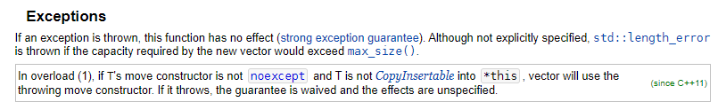

# 12주차 (1): 예외 처리, template

작성일 2022-11-21 · 최종 수정일 2022-11-23
{ .post-date }

- multiple catch

```cpp
#include <iostream>
#include <vector>

using namespace std;

// multiple catch

int main(void) {

	vector<int> v = { 1, 2, 3, 4, 5 };
	cout << v.at(0) << endl;
	cout << v.at(10) << endl;
	cout << "Program ended" << endl;

	return 0;
}
```

현재 at(10)은 출력이 불가능하므로, exception에 빠지게 된다. exception 처리를 제대로 하지 않았으므로 프로그램이 죽게 된다. 에러가 발생할 확률이 있는 곳에 try, catch를 쳐주면 exception handling이 가능하다.

```cpp
#include <iostream>
#include <vector>

using namespace std;

// multiple catch

int main(void) {

	vector<int> v = { 1, 2, 3, 4, 5 };
	try {
		cout << v.at(0) << endl;
		cout << v.at(10) << endl;
		cout << "Program ended" << endl;
	}
	catch (exception& e) { 
		// 이 방식을 사용하면, 모든 exception을 catch할 수 있음.
		// reference를 이용했으므로, 원본이 그대로 넘어오게 된다.
		cout << e.what() << endl;
	}

	cout << "Program Ended\n";

	return 0;
}
```

이와 같이 exception 처리를 하면 에러 처리를 함으로써 프로그램이 죽지 않게 된다. catch를 이용하면, 에러에 대해서 모두 처리를 했다고 가정하고 프로그램을 진행하게 된다.

exception도 class의 일종이므로, 모든 error를 class내에서 처리할 수 있다. 만약, 특정 error만 handling하고 싶다면 class에서 특정 error만 처리하도록 catch를 추가해줄 수 있다.

```cpp
#include <iostream>
#include <vector>

using namespace std;

// multiple catch

int main(void) {

	vector<int> v = { 1, 2, 3, 4, 5 };
	try {
		cout << v.at(0) << endl;
		cout << v.at(10) << endl;
		cout << "Program ended" << endl;
	}
	catch (out_of_range& e) {
		cout << "me : " << e.what() << endl;
	}
	catch (exception& e) { 
		// 이 방식을 사용하면, 모든 exception을 catch할 수 있음.
		// reference를 이용했으므로, 원본이 그대로 넘어오게 된다.
		cout << e.what() << endl;
	}

	cout << "Program Ended\n";

	return 0;
}
```

이와 같이 catch의 맨 위부터 아래로 내려가며 자기와 가장 잘 맞는 error에 대한 handling이 실시된다. 이처럼, exception의 종류가 많고 각각의 exception에 대해 처리해주는 방식이 다르다면 모두 따로 써주면 된다.

```cpp
#include <iostream>
#include <vector>

using namespace std;

// multiple catch

int main(void) {

	vector<int> v = { 1, 2, 3, 4, 5 };
	try {
		cout << v.at(0) << endl;
		// cout << v.at(10) << endl;
		v.resize(v.max_size() + 1);
		cout << "Program ended" << endl;
	}
	catch (length_error& e) {
		cout << "me : " << e.what() << endl;
	}
	catch (out_of_range& e) {
		cout << "me : " << e.what() << endl;
	}
	catch (exception& e) { 
		// 이 방식을 사용하면, 모든 exception을 catch할 수 있음.
		// reference를 이용했으므로, 원본이 그대로 넘어오게 된다.
		cout << e.what() << endl;
	}

	cout << "Program Ended\n";

	return 0;
}
```

---

그렇다면, 어떤 exception이 발생할 지는 어떻게 알 수 있는가? method 위에 커서를 올려놓고 search online을 해서 API document를 읽어본다.

- resize method의 exception



이런 exception이 존재하지 않는다면, try에서 error tracking하는 코드를 모두 구성해야 한다. try & catch로 exception을 잘 잡으면, 프로그램이 잘 돌아가도록 smooth하게 구성할 수 있다.

(try & catch는 고급 언어의 특징이다.)

---

- function template

```cpp
#include <iostream>

using namespace std;

template<typename T>
void showValue(T v) {
	cout << v << endl;
}

int main(void) {

	showValue(10);
	showValue(10.5);
	showValue('c');
	showValue("hello");

	return 0;
}
```

그런데 이것은 1차원적인 template이고, 좀 더 고차원적인 template은 class에서 사용한다.

---

- class template

class에서는 object, instance를 찍어낼 수 있지만, class template에서는 class를 찍어낼 수 있다. 따라서, class template은 일반 class보다 상위의 개념이다.

```cpp
#include <iostream>

using namespace std;

template<typename T>
class Box {
private:
	T data;

public:
	Box() {	
	
	}
	Box(T _data) : data(_data) {
	
	}
	T getData() {
		return data;
	}
};

int main(void) {

	Box<int> b(10);

	cout << b.getData() << endl;

	return 0;
}
```

class template 자체에서는 instance를 찍어낼 수 없으므로, 먼저 class를 찍어내야 한다. strongly typed language는 class에서 하나의 type을 찍어냈을 때, 이미 type이 정해진 class를 다른 type으로 바꿀 수는 없다.

> 파이썬이나 자바스크립트의 경우, untyped language이기 때문에 자료형이 마음대로 바뀔 수 있다. 반대로 C++의 경우는 strongly typed language이기 때문에 반드시 type을 지정해주어야 한다. C++ 같은 경우가 굉장히 안정적인 언어이다. 최근에는 파이썬의 같은 경우도  
> a : Int = 10; 이와 같이 type annotation을 지정해주고, 이렇게 지정해주고 나면 컴파일 과정에서 발생할 수 있는 모든 에러를 잡아준다.

```cpp
#include <iostream>

using namespace std;

template<typename T>
class Box {
private:
	T data;

public:
	Box() {	
	
	}
	Box(T _data) : data(_data) {
	
	}
	T getData() {
		return data;
	}
	void setData(T _data) {
		data = _data;
	}
	void showMyData();
};

template <typename T>
void Box<T>::showMyData() {
	cout << data << endl;
}

class MyItem {
private:
	int k;

public:
	MyItem() {
		k = 99;
	}
	void showK() {
		cout << k << endl;
	}
};

int main(void) {

	Box<MyItem> my_box;
	MyItem i;
	my_box.setData(i);
	
	MyItem v = my_box.getData();
	v.showK();

	return 0;
}
```

method의 선언을 class 밖에서 하고 싶다면, 위와 같이 하면 된다.

---

- STL(Standard Template Library)

ex) vector&lt;int&gt;

Standard Library는 크게 세 파트이다.

1. container : vector(SLL), list, queue, stack, priority queue, set, map…

    set은 중복을 허락하지 않는 데이터의 집합

    map은 hash table(key : value, mapping의 약자)

2. iterator : 반복자, 컨테이너 안에 들어간 데이터를 순차적으로 꺼내보고 싶을 때 기능을 지원함.
3. algorithm : find(데이터가 있는지 없는지, 있다면 어딨는지…), sort, reverse, remove,   
    transform(데이터가 있다면, 변형을 가하는 것. filter의 역할로 보인다) 등…

---

- list & vector

- list : list가 vector와 기능이 다른 것은, list는 DLL이다. vector는 array이다. 따라서, vector는 contiguous memory이다. 
- operation time

list : insertion, deletion이 거의 일정하다.  
vector : add는 일정, insertion, deletion은 상황에 따라 다르다. 실제로 데이터 5개를 넣는다고 하면, 메모리 공간을 5개만 할당해놓는게 아니다. 할당받는 공간보다 좀 더 많이 할당해 놓는데, 그래서 add는 시간이 거의 일정하다. 하지만, insertion이나 deletion을 한다고 하면 데이터 사이즈가 클 때 전부다 한 번씩 옮겨주는 작업을 해야하기 때문에 시간이 오래걸린다.

- memory

list : large memory, pointer  
vector : small memory

- default size

list : no default size  
vector: default size(지정받은 것보다 더 많이 할당을 받아 놓는다. 만약 default size를 넘어간다면, 다른 주소에 가서 기존의 vector memory 공간보다 더 큰 memory를 할당 받고, 그곳에다가 기존에 있던 값을 다 copy해 넣는다.)

- random access

list : random access is not possible, .at(i)  
vector : v.at(i) is possible because vector is array.

```cpp
#include <iostream>
#include <vector>
#include <list>

using namespace std;

int main(void) {

	vector<int> v = { 3, 2, 1, 5, 4 };
	list<int> v2 = { 3, 2, 1, 5, 4 };

	for (auto& _e : v) {
		cout << _e << endl;
	}

	cout << endl;
	
	for (auto& _e : v2) {
		cout << _e << endl;
	}

	return 0;
}
```

---

- Iterator(list & vector)

begin()

end()

++

--

\*

rbegin() : reverse begin

rend() : reverse end

```cpp
#include <iostream>
#include <vector>
#include <list>

using namespace std;

int main() {

	list<int> v = { 3, 1, 2, 4, 5 };

	// iterator를 사용해서 포인터로 값을 뽑아온다.
	for (auto i = v.begin(); i != v.end(); i++) {
		cout << *i << endl;
	}
	
	// range based for loop
	for (auto& e : v) {
		cout << e << endl;
	}

	return 0;
}
```

---

- deque

```cpp
#include <iostream>
#include <deque>
#include <string>

using namespace std;

int main(void) {

	deque<int> dq = { 1, 2, 3, 4, 5 };

	dq.push_back(10);
	dq.push_back(20);
	dq.push_front(999);
	dq.push_front(100);
	
	for (auto i = dq.begin(); i != dq.end(); i++) {
		cout << *i << endl;
	}

	return 0;
}
```
