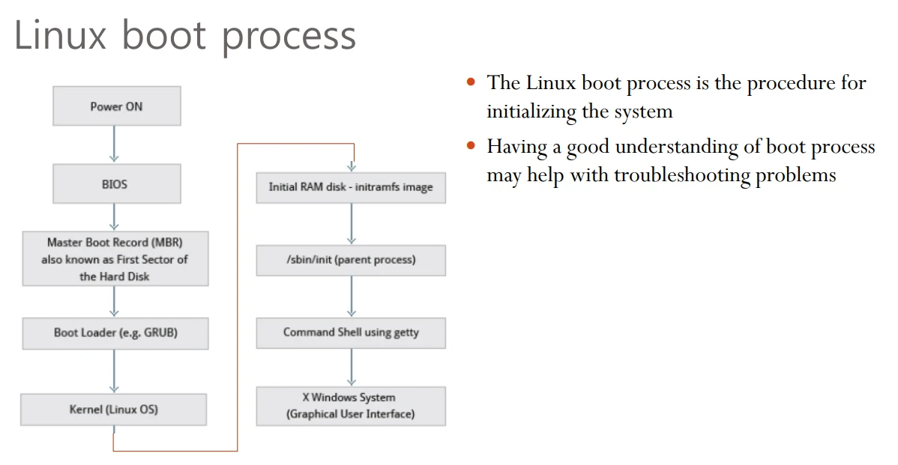
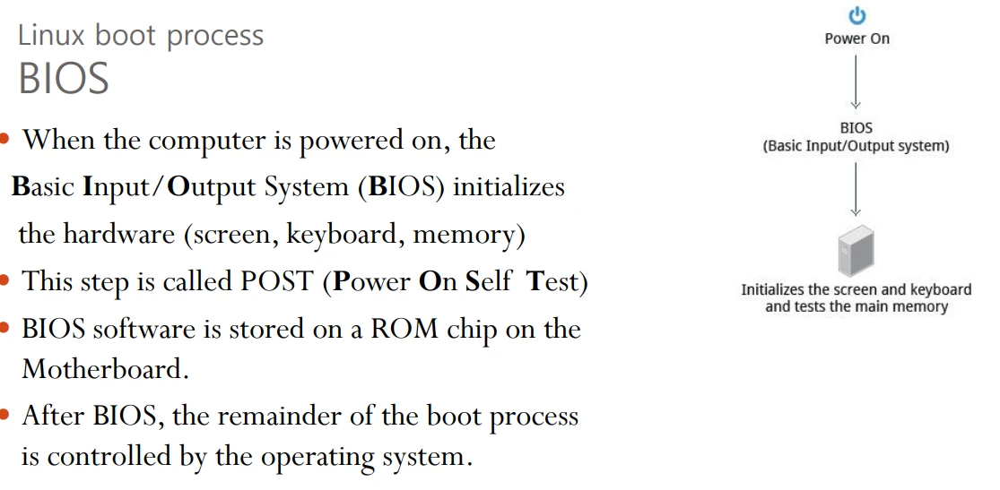
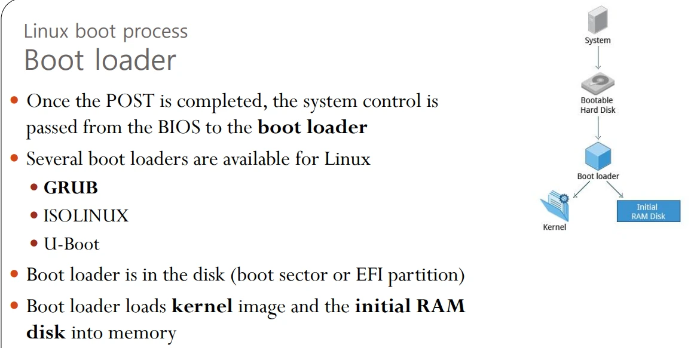
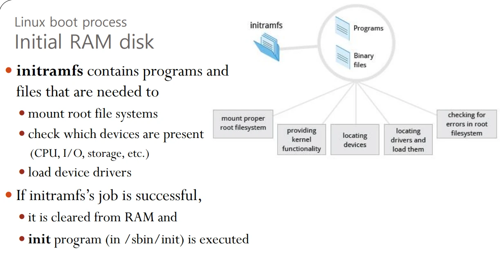
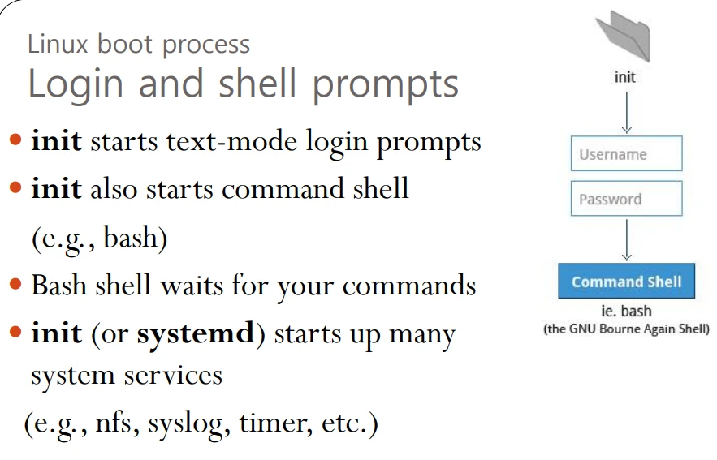
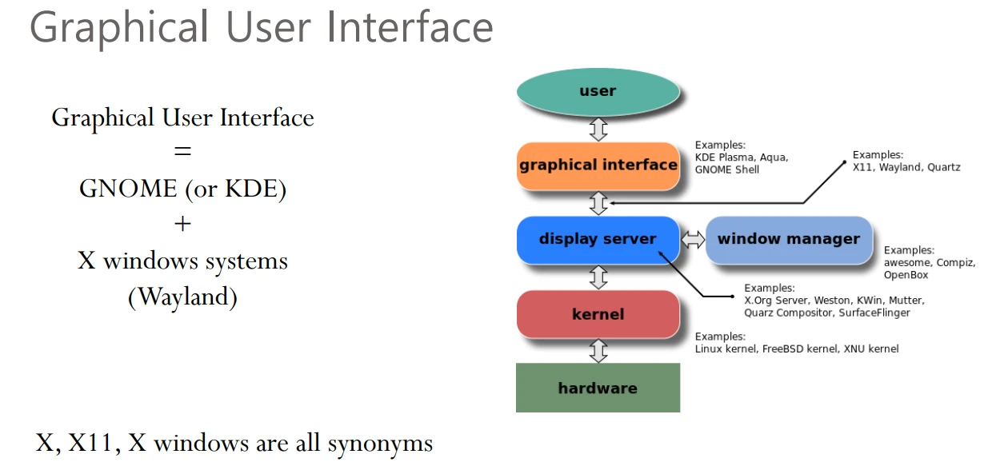

# 1주차 온라인 강의: 오픈소스SW, Linux 기본 명령, I/O redirection

작성일 2022-10-02 · 최종 수정일 2022-10-20
{ .post-date }

## `오픈소스SW`

- 오픈소스SW : SW 및 소스코드의 자유로운 사용과 변경이 가능한 SW

1983 : Richard Stallman의 주도로 GNU프로젝트 시작

1984 : Richard Stallman 주도로 FSF(Free Software Foundation) 설립

1994 : Linus Torvalds 리눅스 커널 1.0 버전 출시 …

- 1989년 오픈소스SW의 라이선스 정책인 `GPL(GNU General Public License)` 발표

- Linux 오픈소스 운영체제

    1991 : 핀란드 대학원생이던 Linus Torvalds 리눅스 최초버전 공개

- 1994 : Linus Torvalds 리눅스 커널 1.0버전 출시

- `라이선스` : 판매자와 이용자 간의 사용방법과 조건의 범위를 명시하는 것을  
    `오픈소스 소프트웨어 라이선스`라고 한다.

    ex) GPL, LGPL, MPL, BSD license, Apache license…

## `Linux Terminology`

- `Kernel`

    운영체제에서 가장 핵심이 되는 부분으로, H/W 자원을 관리하는 일종의 S/W이다.  
    커널은 H/W와 Application S/W를 연결해주는 일종의 Glue, 접합체 역할을 한다.

    User가 H/W에 직접 접근하려면 H/W의 디테일한 부분을 알아야 된다.  
    하지만 kernel이 `abstraction`(추상화)을 통해 유저가 H/W를 쉽게 사용할 수 있도록 만들어 준다.

    kernel은 어떤 Application이 얼마 만큼의 memory를 사용할지 등을 조절하며, CPU를 얼마나, 누가 쓸지 스케쥴링을 담당한다.

    > 커널이란, 운영체제에서 가장 핵심적인 부분으로써, H/W 자원을 관리하는 일종의 S/W이다. 커널은 사용자의 요청에 따라 process에 필요한 H/W 자원을 할당하는 역할을 한다. 프로세스는 priority를 가진다. CPU는 한 번에 한 가지의 process만 처리할 수 있기 때문에 (thread가 있긴 하지만, 기본적으로 CPU는 한 번에 한 가지의 process만 처리할 수 있다.) process는 필연적으로 status를 갖게 되고, 시스템에서 정해진 스케쥴링 방법에 따라 우선순위에 따라서, running, sleep, stopped를 번갈아가면서 cpu에 의해 작업된다. 이 과정에서 kernel은 각 process들의 우선순위에 따라서 어느 cpu에서 작업되고, 언제 실행될지를 결정하여 process를 처리해주는 역할을 한다. 실제로 유저가 H/W에 직접 접근하려면 굉장히 어렵지만, kernel의 추상화를 거치면서 H/W를 간단하게 사용할 수 있게 된다.

- `Distribution(배포판)`

    리눅스 커널, GNU S/W 및 여러 가지 자유 소프트웨어로 구성된 운영체제이다.  
    유닉스 계열의 OS들과는 달리 유닉스에 기반을 두지 않고 기술적으로 독립적인 환경에서 유닉스를 모방하여 개발되었다.

    kernel은 같은 kernel을 사용하지만, 사용 목적 등에 따라 file 관리 시스템이나 그래픽 인터페이스 등이 조금씩 다르며, 용도에 따라 다양한 종류의 S/W을 지원한다.

    > 배포판이란, 리눅스 커널을 기반으로 GNU S/W(ls, pwd 등등 linux를 구성하는 기본적인 command 등을 포함하고 있는 S/W set) 및 여러 가지 자유 소프트웨어로 구성된 운영체제이다. 각 배포판들은 리눅스 커널을 동일하게 사용하지만, 사용 목적에 따라서 시스템을 구성하는 요소나 소프트웨어들이 다르다.
    >
    > 안드로이드도 Linux Kernel을 사용한다. 그렇다면, Thread와 같은 것을 다룰 때, Linux Kernel에 대한 이해가 있으면 안드로이드를 이해하기 쉬울 것이다.

- `Boot Loader`

    리눅스의 부팅 절차는 다음과 같다.

    

    `Power ON`

    `BIOS` : System에 대한 Check 후에 `MBR`로 점프한다.

    `Master Boot Record (MBR)` : Boot Loader가 어디 위치하고 있는지 포인팅 하고 있다.  
    a.k.a first sector of the hard disk.

    `Boot Loader` : S/W. Linux Kernel을 Memory 상에 Load 해준다.

    `Kernel (Linux OS)` : kernel 동작 시작

    `Initial RAM disk(initramfs image)` : Memory 상의 가상의 Disk, 가상 Disk를 이용해서 여러가지 시스템이 동작을 하면서, 기본적인 드라이버들을 업로드한다.

    `/sbin/init` : Kernel이 init process (최초의 프로세스)를 생성한다.

    `Command Shell using getty`

    `X Windows System`

    [#1 리눅스 시스템 부팅의 이해 : /sbin/init 프로그램](https://chiccoder.tistory.com/42)

- `BIOS (Basic Input Output System)`



- 컴퓨터에 전원이 인가되면, `BIOS`가 `H/W`를 `초기화`한다. (Screen, Keyboard, Memory 등)  
    이 단계를 `POST(Power On Self Test)`라고 한다.  
    → System에 어떤 디바이스들이 있고, Memory는 동작하는지 이런 것들을 체크한다.
- BIOS S/W는 메인보드에 부착된 `ROM`에 저장되어 있다.
- BIOS 실행이 끝난 후에는, `OS`에 의해서 남은 부팅 과정이 실행된다.

- `Boot Loader`

    

    - `BIOS`가 `Master Boot Record(MBR)`을 거쳐서 `Boot Loader`에 `Control`을 넘겨준다.  
        (Boot Loader는 Disk의 특정 영역에 저장된 아주 간단한 S/W. Kernel을 Memory 상에 업로드)
    - BIOS에서 POST가 실행되면, 시스템 컨트롤 권한이 Boot Loader에 전달된다.
    - Ubuntu에서는 주로 `GRUB`을 Boot Loader로써 사용한다.
    - `Boot Loader` 가 `kernel`에 컨트롤을 넘기고, `kernel`은 `memory` 상에 있는 `Initial Ram` `Disk`를 이용해 시스템 초기화를 다시하게 된다. (`BIOS`와는 다른 별개의 초기화)

- `Initial RAM Disk, initramfs(initial RAM file system)`

    

    - initramfs는 Initial RAM disk 안에서 돌아가는 가상의 File System이다.

    - 이는 Disk 상에 있는 여러가지 file, system 동작을 위해 필요한 라이브러리나 file system을 mount해서 user가 사용할 수 있게 만들어준다.

        - mount root file systems
        - check which devices are present
        - load device drivers

    - initramfs 작업이 성공적으로 끝나면, RAM에서 제거된 뒤 `init program`이 실행된다.

- `Login and shell prompts`

    

    → `init`은 `kernel`이 만드는 최초의 프로세스로서, 아래와 같은 동작을 한다.

    - `init` starts text-mode login prompts
    - `init` also starts command shell (e.g., bash)
    - Bash shell waits for your commands
    - `init` (or systemd) starts up many system services

- `File System`

    - File System이란, 유저의 data를 실제 접근 가능한 구조로 조직해놓은 구조체이다.
    - Disk filesystems : Ext2, Ext3, Ext4, XFS, NTFS, etc  
        → Linux의 filesystem은 `Ext4`이며, windows는 `NTFS`이다.
    - Flash storage filesystems : Ubifs, JFFS2, YAFFS, etc
    - Special file systems (Power가 on되어 있는 동안만 가상으로 돌아가는 가상의 fs)  
        → Procfs, sysfs, tmpfs, etc.

- `Partitions and Filesystems`

    - `Partition`이란, 디스크 상에서 물리적으로  접촉 가능한 구역을 의미한다.
    - `Filesystem`은 `Partition` 위에 설치가 되는 file의 구조체를 의미한다.

|  | Windows | Linux |
|---|---|---|
| Partition | Disk1 | /dev/sda1 |
| Filesystem Type | NTFS/VFAT | EXT3/EXT4/XFS/BTRFS… |
| Mounting Parameters | DriveLetter | MountPoint |
| Base Folder(Where OS is stored) | C:\\ | / |

→ / : root directory 밑에 sub directory로서 mount된다.

- `mount` : 특정 Partition에 있는 filesystem을 /(root)에 있는 일부 sub directory에 갖다 붙이는 것.

- `The Filesystem Hierarchy Standard (FHS)`

    - 최상위 디렉토리 / : `root directory`, 모든 filesystem은 root directory의 sub directory이다.
    - /bin/ : essential user command binaries → executable binaries
    - /boot/ : static files of the boot loader (boot loader 파일이 존재함)  
        → essential files to boot the system
    - /dev/ : device files. used by most H/W, S/W devices
    - /etc/ : host-specific system configuration file들이 존재한다.
    - /home/ : user home directories
    - /lib/ : essential shared libraries and kernel modules (32bit)  
        → /lib64/ : essential libraries (64bit)
    - /media/ : mount point for removable media  
        → USB 연결 시에 USB가 /media에 있는 sub directory에 mount 된다.
    - /mnt/ : mount point for a temporarily mounted filesystems  
        → wsl 사용시, windows C, D … 등이 mount된다.
    - /opt/ : Add-on application s/w packages
    - /sbin/ : system binaries, init process가 존재하는 경로
    - /srv/ : data for services provided by this system
    - /tmp/ : temporary files
    - /usr/ : (multi) user utilities and applications
    - /var/ : variable files
    - /root/ : home directory for the root user
    - /proc/ : virtual filesystem documenting kernel and process status as text files

- `Graphical User Interface`

    

    Graphical User Interface = GNOME (or KDE)  
    → Desktop Environment(GUI) XWindows 위에 올라가 있음. 프로그래밍 하기 쉽고 편한 GUI 환경을 제공한다.

    +

    X windows systems (Wayland)

    - kernel을 통해서 H/W와 직접적으로 통신하는 windows system
    - 아주 기본적인 graphical widget, interface 제공

## `Linux Basic Commands`

- `man` [options] [section] command

    The man page has 9 sections

    1. User commands
    2. System calls
    3. Library functions
    4. Devices
    5. Files
    6. …
    7. Overview, conventions, miscellaneous
    8. Superuser, and system administration commands
    9. …

- `shutdown` [options] [time] [wall]

    sudo shutdown -h 10:00 “Shutting down for scheduled maintenance.”

    sudo shutdown -h now

    or

    sudo poweroff

    sudo reboot

- `which` [options] name

    ex) which diff : diff라는 명령어가 설치된 위치가 어디인지 출력해줌.

- `whereis` [options] name

    ex) whereis diff : diff라는 명령어와 매뉴얼 설치 위치를 출력해줌.

- `pwd` : 현재 내가 위치한 디렉토리 위치를 출력해줌.

- `tree` : show all sub-directories and files

    - tree -d : show all sub-directories
    - tree -d -L 2 : show all sub directories with depths of 2

- `Hard Links vs. Soft Links`

    - `ln` : used to create hard links and soft (symbolic) links.  
        ex) ln file1 file : 마치 C++의 참조자와 비슷한 느낌. 다른 이름으로 같은 object에 접근할 수 있도록 해준다. 그렇기 때문에 하나의 파일이 지워져도 다른 파일로 동일하게 접근할 수 있으며, 파일에 대한 모든 정보가 동일하다. (I-node도 동일)

        ex ) ln -s file1 file2 : file1에 대한 soft (symbolic) link를 생성한다. 이는 windows의 바로가기와 비슷한 역할을 하며, 실제 디스크 공간의 용량을 차지하지 않는다. 바로가기 역할을 하기 때문에 원본 파일이 지워지면 soft link는 지워진다.

## `Viewing Files`

- `cat` : file의 내용을 표시한다.
- `less` : 보통 큰 txt 파일을 읽기 위해 사용되며, 스크롤과 서치 기능을 제공한다.  
    `/` 를 사용하여 원하는 pattern을 입력해 `forward search` 할 수 있고, `?` 를 사용하여  
    `backward search` 를 할 수 있다. q를 사용해 나간다.
- `tail` : file의 맨 끝 10 라인을 보여준다. (default)  
    `-n` option을 사용하여 n를 숫자로 지정해 원하는 라인 수 만큼 볼 수 있다.
- `head` : tail의 반대 기능으로, file의 맨 처음 10 라인을 보여준다. (default)
- `mkdir`, `rmdir` : directory를 만들고 제거한다
- `rm -rf` : used to remove non-empty directory.  
    → r : recursive 하게 안에 들어 있는 모든 파일을 제거한다는 뜻  
    → f : force, 묻지 말고 다 지우라는 뜻.
- `mv` : Rename a file/directory or move the file to another directory
- `rm` : Remove a file
- `rm -f` : Forcefully remove a file
- `rm -rf` : Forcefully remove a directory recursively
- `rm -i` : Interactively remove a file (지울지 말지 물어보기)

## `Standard file streams, I/O redirection, Pipes`

- 기본적으로 어떤 명령어든, 어플리케이션이든 (명령어를 통해) 동작(실행)될 때 세 가지의 file stream이 기본적으로 열려있게 된다.
- 명령어 안에서 명시적으로 open하지 않더라도, 자동으로 열린다.

| Name | Symbolic Name | File descriptor | Example |
|---|---|---|---|
| Standard input | stdin | 0 | Keyboard |
| Standard output | stdout | 1 | Terminal |
| Standard error | stderr | 2 | Terminal/log file |

- `I/O Redirection` : 기존의 Input, Output, Error 등을 다른 곳에서 받거나 내보낼 수 있게 된다.

```shell
some_command < input_file
# file의 내용을 some_command에 stdin으로 집어넣을 수 있다.
# <<나 >>를 쓰면, 내용이 덧붙여서 기록된다.
# 이는 2>> 에도 마찬가지이다.

some_command > output_file
# command의 stdout을 output_file에 stdin으로 집어넣을 수 있다.

some_command 2> output_file # error가 발생하지 않으면, 내용을 넣지 못하고 수행됨.
# error message만 output_file에 stdin으로 집어넣는다.

# ex) 현재 디렉터리에 존재하지 않는 파일 err_ls_man.txt를 cat해본다.
# cat my_txt.txt 2> err_ls_man.txt
# err_ls_man.txt에 no such file or directory err가 기록된다.

some_command >& output_file
# Output과 error가 같이 기록된다.

some_command > output_file 2>&1
# 위와 같은 기능의 명령어, output과 error가 같이 기록된다.
```

- `Pipes` : 명령어들을 이어서 복잡한 프로그램을 만들 수 있는 기능

```shell
ls -l | wc -l
```

## `Searching for files`

- `Wildcard` : 기호 (character나 string으로 대체될 수 있는 기호)

| Wildcard | result |
|---|---|
| ? | Matches any single character |
| \* | Matches any string of characters |
| [set] | Matches any character in the set |
| [!set] | Matches any character not in the set |

- `find` utility

```shell
find /usr -name gcc
# -name은 옵션으로, 뒤에 오는 내용이 이름에 포함되는 파일을 찾게된다.

find /usr -type d -name gcc
# type이 directory인 것, name에 gcc가 들어가는 파일을 찾는다.

find /usr -type f -name gcc
# f는 일반적인 file을 의미한다.

find / -size +10M
# size가 10mb가 넘는 것만 찾는다.

find -name "*.swp" -exec rm {} ';'
# Program이 실행되다가 어떤 이유로 인해 죽어버리면 .swp 파일이 많이 생성된다.
# 이 파일들을 지우기 위해 Wildcard를 사용하여 file을 찾아내고, -exec option을 통해
# rm 명령을 실행하면 file들을 제거할 수 있다.

find / -atime 50
# 50일 전에 접근한 파일들을 찾는다

find / -mtime +50 -mtime -100
# 50일 전, 100일 이내에서 수정된 모든 파일을 찾는다.
```
