# 5주차 온라인 강의: gcc, Static Library, Shared Library

작성일 2022-09-29 · 최종 수정일 2022-10-19
{ .post-date }

## `gcc compiler introduction`

- gcc란, 프로그램을 컴파일 하는데 사용하는 도구이다. gcc를 사용할 때 어떤 컴파일 과정을 거쳐서 실행파일로 생성되는지 살펴보고, 주요한 옵션들에 대해서 살펴본다.
- 라이브러리란, 자주 사용하는 function과 같은 module들을 모아놓은 집합들의 object file들을 모아놓은 것. static library, dynamic library(shared library)로 나뉜다.
- gcc란, GNU C/C++ compiler 의 약자
- Embedded System에서는 Cross Compile을 자주 하게 된다. 예를 들어, x86 → ARM object code를 생성한다던지 등의 일을 많이 하게 되는데, 이 때도 역시 gcc가 Cross Compile을 한다.  
    C언어를 compile할 때는 gcc, C++를 compile할 때는 g++를 이용한다.
- gcc는 사실상, c만 compile하는 것이 아니라, ADA, Java와 같은 다양한 Langauage를 compile할수 있도록 Architecture가 설계되어 있다.

- gcc는 compile을 거쳐서 실행파일만 생성해주는 것이 아니라, 다양한 역할을 한다.

    - preprocessing : user가 사용한 macro를 처리함
    - compilation, assembly
    - linking : compile을 거쳐 만들어진 object code를 object file과 연결하는 것

- 실행파일이 생성되는 과정

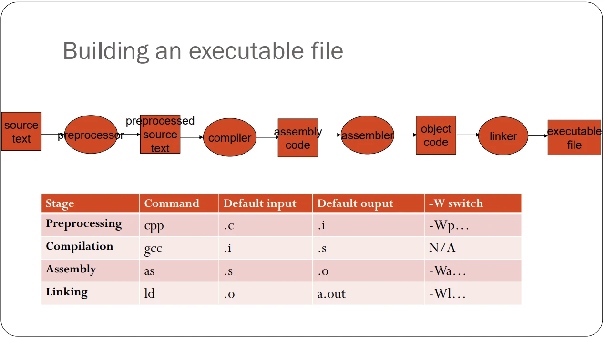

1. `source text` : 작성한 소스 파일
2. `preprocessor` : `cpp(c preprocessor)` 라는 명령어 수행, c 파일에 있는 macro 들. 예를 들면 include나 define과 같은 macro를 대체 처리해서 compile하기 직전의 단계에 또 다른 source file로 만들어 준다.
3. `preprocessed source text` : 주로 확장자가 .i 로 만들어진다.
4. `compiler` : 이 단계에서부터 실제적으로 `gcc`가 관계된다. source file을 갖다가 `assembly code`로 바꿔준다.
5. `assembly code` : `.s` 라는 확장자의 또다른 `assembly code`로 바꾼다. 예를 들어 여러분이 x86을 사용한다면, x86용 assembly code를 생성하고, ARM을 사용한다면 ARM용 assembly code를 generation 해준다.
6. `assembler` : `as` 라는 이름의 `assembler`가 따로 존재한다. `as`가 `assembling`을 통해서 `.o` 라는 `객체 파일`을 생성한다 → 실제 기계어 플랫폼 아키텍처에 해당하는 (x86이나 ARM) 기계어  명령어들이 들어가있는 코드
7. `object code` : `.o file`은 단순히 `object file`만 생성되었지, 실제로 수행되는데 사용되는 정보들은 없다. 예를 들자면, 라이브러리의 경로나 어느 memory location에 load해야 된다던지 등의 정보는 없다. 이를 `ld` 라는 `linker`가 처리해준다.
8. `linker` : `.o file`을 `liking` 해준다.
9. `executable file` : `a.out`

source text → preprocessor(매크로 처리) → compiler (사용자의 architecture 환경에 따라 assembly code 변환) → as라는 이름의 assembler를 통해서 .o라는 객체 파일 생성(사용되는 아키텍처에 따른 기계어 명령어) → linker assembler(as)를 통해서 생성된 .o파일을 ld라는 linker를 통해서 실제 라이브러리의 경로나 어느 memory location에 load해야되는지에 대한 정보를 알려준다. 즉, link한다.

→ 실제로 gcc를 호출하면, preprocessing, compilng, assembling, linking을 거친다.

- `gcc architecture`

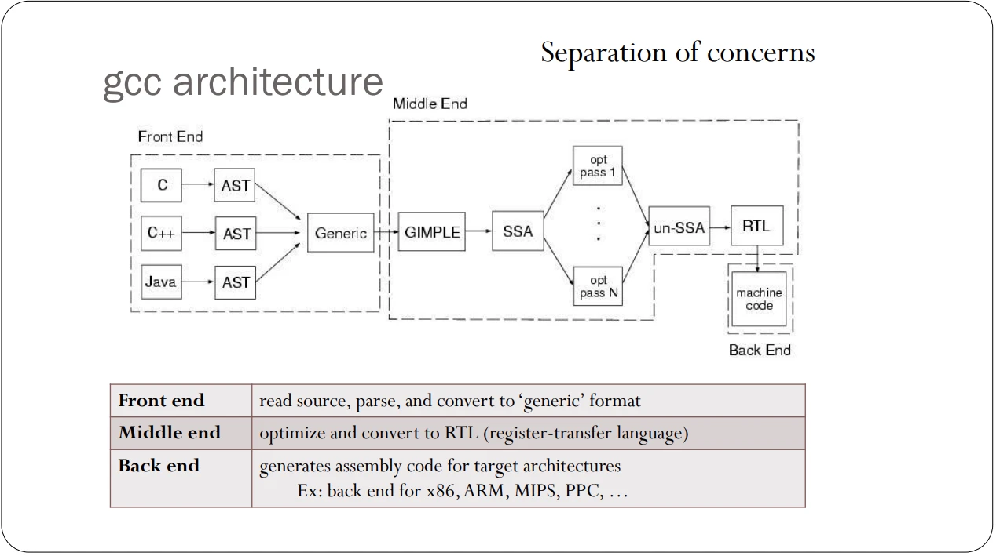

- `Front end` : C, C++, Java와 같은 Source code file을 Generic이라는 중간 코드로 변환한다. Generic은 Java의 Byte code와 비슷하다. 어떤 Language가 오던지, Generic이라는 중간 형태로 변환한다. 예를 들어, 새로운 나의 언어를 만들었다면, gcc를 사용하기 위해 Front end에 Generic으로 변환해주는 module을 적절하게 넣어주면 된다.
- `Middle end` : Front end에서 생성한 중간 코드를 갖다가 최적화 한다. (optimization)  
    GIMPLE → SSA → opt pass 1\~N → un-SSA → RTL (최적화 단계)  
    이후, RTL(Register Transfer Language)이라는 형태로 변환을 해두면, 마지막에 있는 Back End에서 RTL이라는 중간 코드를 실제 Machine Code로 변환한다.
- `Back end` : RTL이라는 중간 코드를 실제 Machine Code로 변환한다. 예를 들어, 만약 x86을 사용한다면, x86용 assembly code를 만드는 것이다. 만약에 ARM을 사용한다면, RTL에서 ARM용으로 assembly generation을 하면 된다. MIPS, PPC과 같은 여러 종류의 Architecture를 이런 식으로 지원할 수 있게 되는 것이다.

→ 왜 세 개의 end로 나뉘었을까?

- Middle end는 Target Language에 관계없이 항상 동일한 과정을 진행하므로, 새로운 언어를 추가한다면 Front End에 Module만 추가하면 Middle End 과정을 거쳐서 Back End로 보낼 수 있게 된다. 만약 새로운 아키텍처를 만들었다면, 이거에 대한 Back end를 만들어서 기존에 있던 Language를 Architecture용 Assembly code로 바꿀 수 있게 된다.
- gcc 사용법

> “hello.c” :  
> \#include &lt;stdio.h&gt;  
> int main(void) {  
> printf(”Hello \\n”);  
> }

- gcc -o hello hello.c -g -Wall

-o : 생성될 실행 파일의 이름을 무엇으로 지정할지

-g : 디버깅 옵션

-Wall : 모든 warning messages를 출력한다.

→ hello 실행 파일 생성.

- Major options of gcc

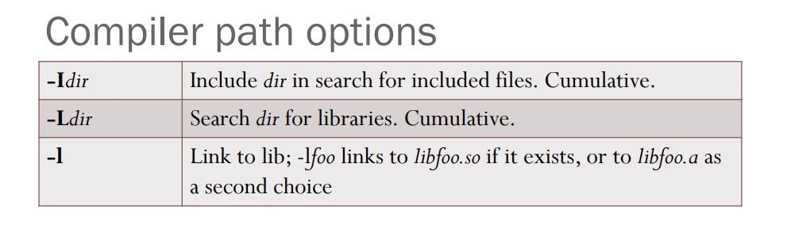

- -Idir : 지정한 directory에 있는 header file을 지정해서 compile 하도록 한다. (Cumulative, 이 옵션은 여러번 사용할 수 있다. 대문자 i)
- -Ldir : 외부 Library를 어디서 찾아서 사용할지, directory를 찾아서 지정한다. (Cumulative)
- -l : Library를 link해주고 싶을 때. ex) -lfoo (foo는 library name)

shared library가 default, 만약 libfoo.x 를 찾는데, libfoo.so가 없으면 libfoo.a를 link한다.  
→ libfoo.so(shared library)  
→ libfoo.a(static library)

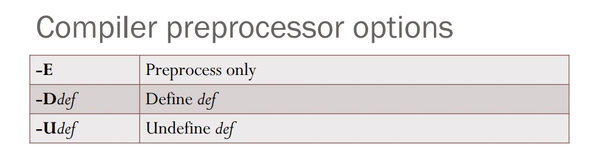

- -E : preprocess only, compiling, assembling, linking을 하지 않는다.
- -Ddef : Define def. program내에서 #define하고 macro를 지정할 수 있지만, compile 과정에서 define한 macro를 정의할 수 있다.
- -Udef : define된 macro를 undefine 한다.

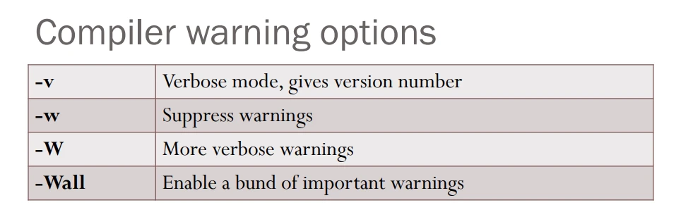

C 프로그래밍에서는 warning option을 무시하면 안된다.

- -v (verbose) : 여러가지 message를 많이 찍어주고, 버전 정보도 찍어준다.
- -w : warning을 최대한 적게 print 한다.
- -W : -v보다 더 많이 말을 한다.
- -Wall : 중요한 warning을 전부 다 찍는다.  
    (pointer 사용 버그나 type 버그들을 확인하고, 무시하면 안된다. 사전에 찾을 수 있음)

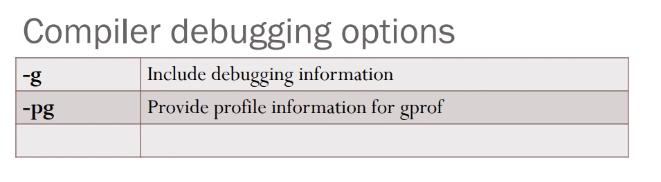

gdb

- -g : gdb에 여러가지 정보를 넘겨주는 옵션
- -pg : 어떤 부분에서 프로그램이 시간을 많이 소요하게 되는지 profiler에 관련된 정보를 gcc compile 단계에서 넘겨주게 된다.

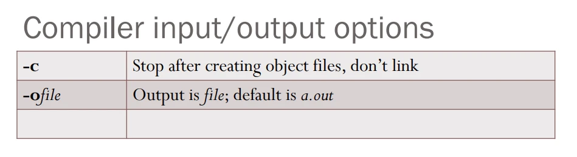

- -c : object file 까지만 생성하고, link는 하지 않는 옵션
- -ofile : file name으로 object file을 생성하라는 뜻이다.

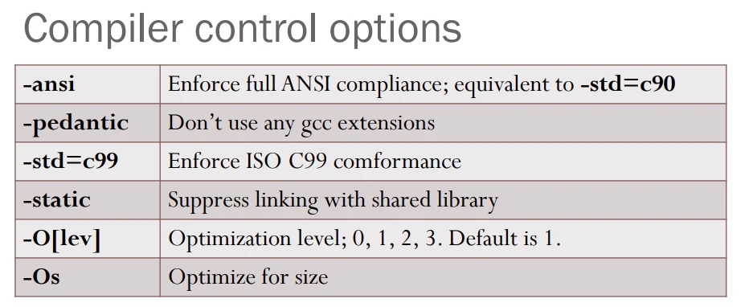

- -ansi : c90이라는 standard가 있는데, 이 standard에 맞게 작성된 프로그램을 compile하는 옵션. ⇒ -std=c90  
    (c90 standard에 맞지 않는 옵션을 사용하면 오류를 띄워줌)
- -pedantic : gdd compiler도 여러가지 extension을 가지고 있는데, 그러한 extension들을 사용하지 않고 순수하게 c standard에 있는 문법만 사용하여 compile하도록 하는 옵션
- -std=c99 : ISO c99 standard에 맞게 작성된 프로그램을 compile하라는 옵션  
    → C언어에서 가장 최근에 나온 standard가 c99이다.
- -static : Shared Library를 쓰지 말고, static Library를 쓰라는 옵션
- -O[lev] : Compiler가 Optimization이라는 과정을 거치는데, 최적화를 얼마나 시킬것인가에 대한 옵션을 지정한다. 지정하지 않을 경우 default는 1이며, 가장 많이 사용되는 것은 2이다.
- -Os : Optimization을 할 때, 속도가 빠르게 할 수도 있고, size를 줄일 수도 있는데, size를 줄이는 옵션이다.

> -O2 -Wall -pedantic  
> Make sure you understand any warnings  
> Don’t use -pedantic when compiling Linux kernel, which uses many gcc extensions

## `Static Library`

- object file(function들을 모아놓은 file).  
    ex) ‘pthread’ library는 thread에 관련된 function들을 종합적으로 모아놓은 파일의 예시

- Library Type

    1. Shared Library(dynamic library)
    2. Static Library

- Static libraries

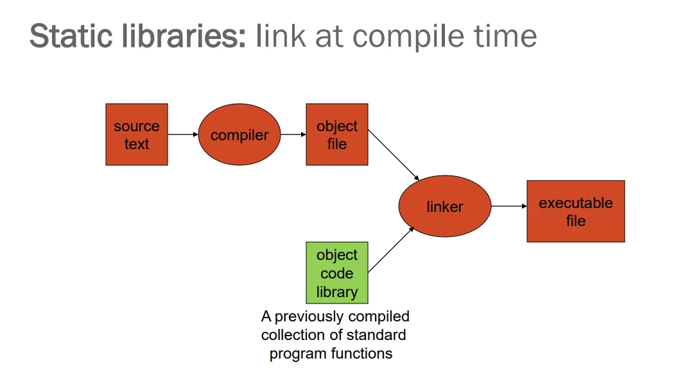

- linking 과정에서 사실상 우리가 작성한 코드만 사용하는 것이 아니라, 우리가 작성하거나 사용하지 않은 library나 object file(.o file)도 많이 사용하게 된다. (linking 과정) → 하나의 실행파일에 다 포함시킨다.

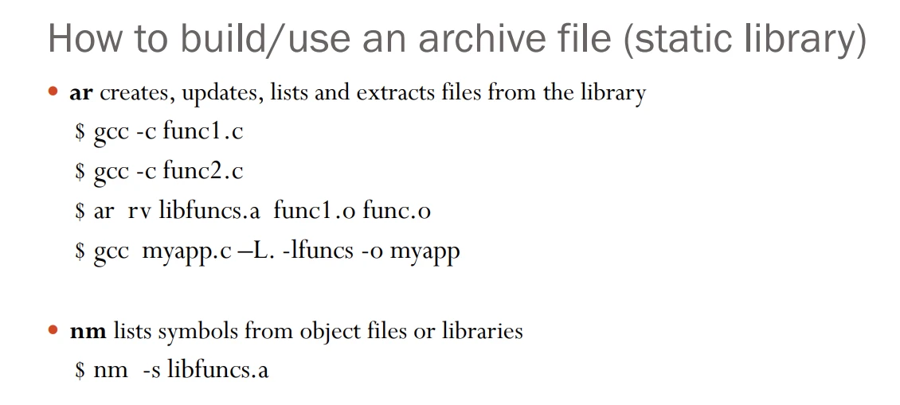

- `ar` (archive)

    \$ gcc -c func1.c

    \$ gcc -c func2.c

    \$ ar -rv libfuncs.a func1.o func2.o  
    → linux에서 -v option은 대부분 verbose option이고, -r option은 뒤에 있는 object file들을 libfuncs.a 라는 static library에 추가하라는 command이다.

    \$ gcc myapp.c -L. -lfuncs -o myapp  
    → -L. : compile할 때, 현재 디렉터리에서 library를 찾으라는 뜻.

    → -lfuncs : libfuncs.a file을 object file과 link하라는 뜻이다. (libxxx.so, xxx를 지정해주면 된다.)

- `nm` : 실제로 생성된 library에 내가 만든 함수나 심볼이 들어가있는지, define되어 있는지 확인할 때 nm utility를 사용할 수 있다.

     \$ nm -s libfunc.a

    ex) &lt;stdio.h&gt;에 printf가 있는지 아닌지를 체크할 수 있는 기능.

## `Shared Library(dynamic library)`

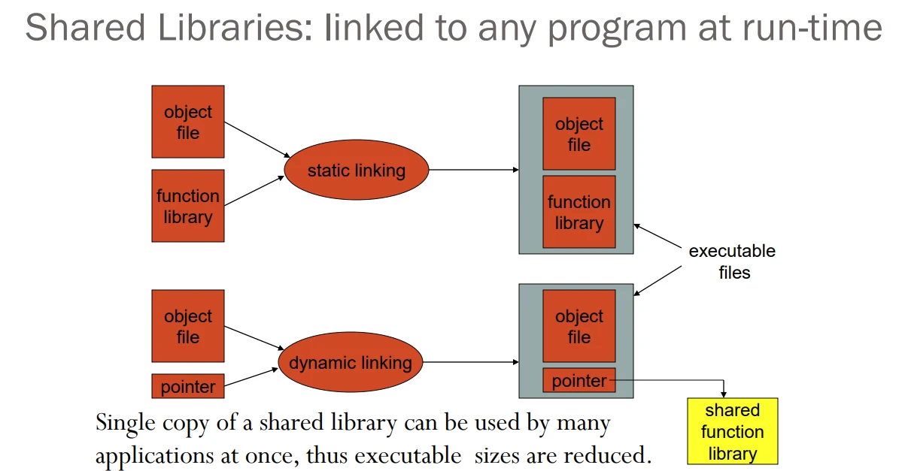

- Static Library의 경우, 만약 function이 pthread library라고 하자. 이를 ld로 link를 한다고 할 때, function library(pthread)가 실행 파일 안에 포함된다. 즉, object file (.o file)의 새로운 copy를 실행 파일에서 갖고 있게 된다. (이 때 생성된 실행파일의 이름을 a.out 이라고 하자)

> 그런데, 만약 내가 yourapp 이라는 실행 파일을 만들었다고 가정하자. 이 때, yourapp에도 pthread의 object file copy를 갖고 있다면, 중복이 많이 된다. (a.out에도 pthread object file copy가 들어있다.)
>
> 그래서 나온 것이 Shared Library이다. (pthread의 경우) 자신과 관련된 부분은 가지고 있고, pthread와 관련된 module이 어디에 있는지 알려주는 pointer를 가지고 dynamic linking 과정을 거쳐서 실행 파일 a.out을 만들게 되면, 실행 파일에는 static library와 달리 pointer를 가지게 된다. pointer는 shared function library가 어디에 위치하고 있는지 그 위치를 알려주는 정보만을 포함하고 있다.
>
> → 메모리를 적게 잡아먹고, 파일 사이즈도 작아진다.

- Shared Library를 만드는 방법

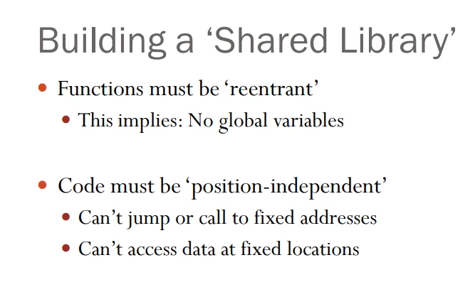

- Global Variable이 없어야 한다. 각각의 실행파일에서 pointer를 가지고 Shared Library를 가리키는데, 만약 Shared Library에 Global Variable이 있는데 각 실행파일에서 이를 가리키게 되고 값을 바꾸게 된다면 서로 다른 실행파일에 영향을 줄 수 있다. 이렇게 되면 서로 간섭효과를 발생시키게 될 수 있으므로, 이를 방지하기 위해 전역 변수를 선언해서는 안된다.  
    → Functions must be ‘reentrant’, this implies: No global variables…
- Position-independent 해야 한다. 프로그램이 실제로 메모리상에 load될 때, 우리는 그 위치를 미리 알 수 없다. 시스템이 동작할 때마다 달라지므로, Shared Library가 메모리의 특정 위치에 load될 것이라고 가정하고 프로그램을 작성하면 안된다는 것이다.

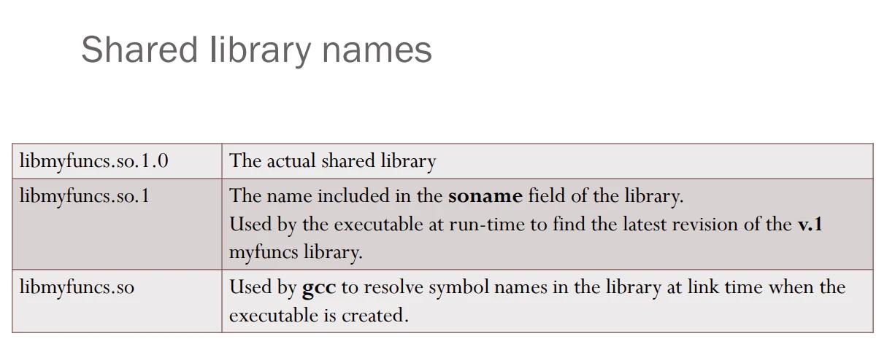

- Shared library는 static library와 다르게 버전 정보를 가지고 있다.

ex) libmyfuncs.so.1.0 : 1 은 major 버전, 0은 minor 버전.

- 실제로 사용할 때는, 버전 정보가 없는 libmyfunc.so 를 사용한다. 그런데, libmyfuncs.so는 실제 Shared library가 아니고, libmyfunc.so.1.0 에 대한 Symbolic Link이다. 이 file은 gcc link 과정에서 사용된다.

그런데, 실제 runtime 때에는 버전 정보가 가장 높은 것이 사용된다. 하지만, 실제 시스템 내에는 버전 정보가 여러가지가 있을 수 있다. 사용자가 어떤 버전을 사용할지 결정하는 방법도 있다.

- libmyfuncs.so.1 : major 번호만을 filename으로 가지도록 지정하고, 해당 file을 원하는 버전에 Symbolic Link를 걸어준다. 예를 들어, 이 파일을 버전 1.0에 Symbolic Link를 걸어준다면 1.0이 실행되는 것이고, 1.2 file에 걸어준다면 1.2가 실행되는 것이다.

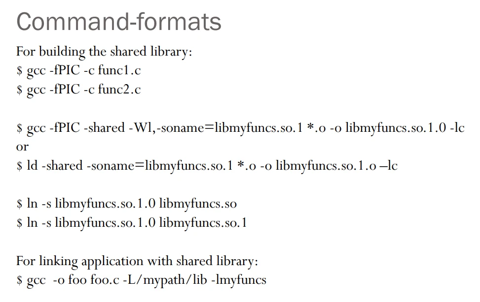

\$ gcc -fPIC -c func1.c

\$ gcc -fPIC -c func2.c

- Shared Library를 만들 때는 반드시 -fPIC 옵션을 명시해준다.

\$ gcc -fPIC -shared -Wl,-soname=libmyfuncs.so.1 \*.o -o libmyfuncs.so.1.0 -lc

- -shared 옵션은, shared library를 만들겠다는 option인데, 생략을 해도 된다. (default) 하지만, 좀 더 명시적으로 -fPIC -shared 라고 적어주는 것이 바람직하다.
- -Wl, : 뒤에 나오는 명령어 옵션들이 ld에 전달된다는 것이다. gcc는 compile assembling 까지만 담당하고, linking 과정은 ld라는 것을 불러서 사용했다.  -Wl, 뒤에 오는 옵션들은 ld에 전달해주는 옵션이다.
- -soname=libmyfuncs.so.1 : shared library에 .so name을 정해준다.
- \*.o : 현재 디렉터리에 있는 모든 object file을 포함시키겠다는 뜻이고,
- -o libmyfuncs.so.1.0 : 생성된 파일 이름을 어떻게 지정할 것인가
- -lc : libC를 linking 하라는 뜻이다. 보통 -l 옵션을 줄 때, 앞에 붙은 lib은 생략한다.

\$ ld -shared -soname=libmyfuncs.so.1 \*.o -o libmyfuncs.so.1.0 -lc

- gcc와 같은 방식으로 shared library를 생성할 수 있다.

\$ ln -s libmyfuncs.so.1.0 libmyfuncs.so : gcc link에서 사용된다.

\$ ln -s libmyfuncs.so.1.0 libmyfuncs.so.1 : Runtime에 사용된다.

- For linking application with shared library:

\$ gcc -o foo foo.c -L/mypath/lib -lmyfuncs

- -L : 디렉터리 경로를 지정해서 찾아보록 하는 지정하는 것
- -lmyfuncs : link하고자 하는 library를 지정해준다.

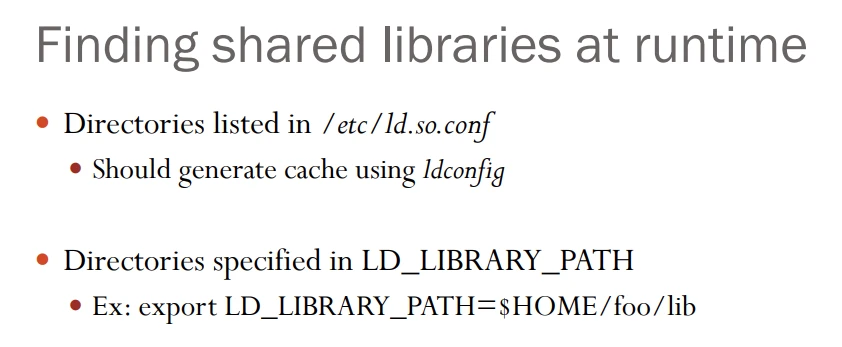

- Shared Library는 Runtime에 Library를 link 해준다. Compile time에는 pointer만 갖고 있다가, 실제로 실행할 때 pointer에 해당하는 Library를 찾아서 갖다 붙이게 되는데, 그 때 모든 디렉터리를 다 찾아볼 수는 없으므로, 어느 디렉터리에 가서 찾아볼 것인가 하는 것을 명시해줄 수 있다.
- Directories listed in /etc/ld.so.conf ← 시스템 라이브러리들의 path가 다 들어있다.  
    ex) /lib, /usr/lib 등의 디렉터리들이 명시되어 있다.
- 시스템 라이브러리가 아닌, 자체 라이브러리의 경우 export LD_LIBRARY_PATH 라는 환경 변수에 경로를 지정해준다. `ex) export LD_LIBRARY_PATH = $HOME/foo/lib`

> 내용 정리
>
> gcc -c c/myfunc1.c -o o/myfunc1.o -I./include  
> 이 옵션을 통해 link 전 단계까지 compile을 진행할 수 있다. 또한, compile할 때 custom header의 include가 필요할 경우, -I (대문자 i)를 통해 header file 경로를 지정해줄 수 있다.
>
> gcc -fPIC -shared -Wl,-soname=libmyfuncs.so.1 o/\*.o -o libmyfuncs.so.1.0 -lc  
> ld -shared -soname=libmyfuncs.so.1 o/\*.o -o libmyfuncs.so.1.0 -lc  
> 위 command를 통해서 shared library를 생성할 수 있다. static은 ar, -Wl은 L의 소문자이고, 콤마 바로 뒤에 붙여써야 한다. 추가적으로, 이 command에서 설정하는 -soname은 실제 실행파일을 수행할 때 동적으로 link될 symbolic link의 이름을 지정하는 것이다. 이 symbolic link가 어떤 버전 파일을 가리키냐에 따라서 실제로 수행되는 버전이 달라진다.
>
> ln -s libmyfuncs.so.1.0 libmyfuncs.so.1  
> ln -s libmyfuncs.so.1.0 libmyfuncs.so  
> 이후에 수행하기 위해 필요한 symbolic link file들을 만든다. major version이 붙은 symbolic link는 실제로 파일을 실행할 때 동적 링크되는 symbolic 링크이다. 나중에 export LD_LIBRARY_PATH=\$HOME/… 을 지정해줘야 한다. version이 안붙은 것은 gcc link할 때 사용되는 것으로, 그냥 link할 때 경로를 지정해주면 된다.
>
> gcc -o bin/myapp-so o/myapp.o -L./lib -lmyfuncs  
> 위와 같이 수행하여 link 과정을 수행한다. 이 command를 수행하면 bin/에 .exe file이 생겨난다. 이 때, -L 옵션으로 library가 존재하는 경로를 지정해주고, 그 안에서 -l (소문자 L) 을 통해 library file의 name을 지정한다. -l 을 통해서 library를 link할 때는 앞에 붙은 lib과 뒤에 붙은 확장자를 떼주고 command에 작성해야 한다. 이 때, 이름이 같은 .so와 .a 가 존재하면 우선순위는 .so이며, .so가 없으면 .a가 선택된다.
>
> export LD_LIBRARY_PATH=\$HOME/library/lib  
> 생성된 .exe file을 실행하기 위해 동적 링크에 필요한 경로를 환경변수로 지정해준다.
