# 6주차 온라인 강의: Makefile, Recursive make

작성일 2022-10-08 · 최종 수정일 2022-10-19
{ .post-date }

## `Make File 소개`

- Make File이란, 복잡한 구조를 갖는 S/W를 체계적으로 컴파일할 수 있도록 도와주는 개발도구이다.
- 소스코드의 일부가 수정되었을 때 해당되는 부분만 재 컴파일 되도록 함으로써 전체적인 컴파일 시간을 줄여주는 역할을 한다.

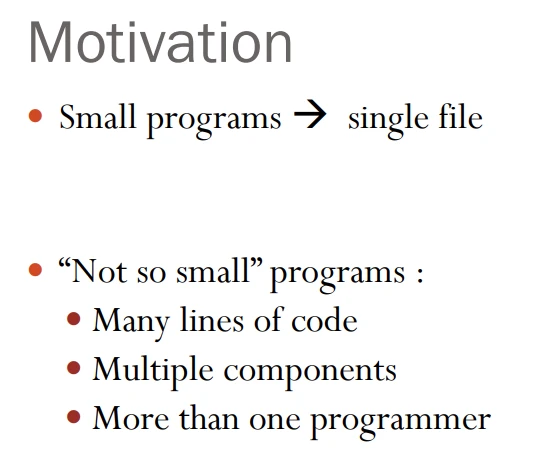

- 프로그램이 작을 때는 하나의 파일로 프로그램을 구성할 수 있다.  
    Small programs → single file
- 그러나, 큰 프로그램을 개발할 때는 여러 사람이 팀으로서 작업을 하게 되며, 코드의 길이도 늘어나고 컴포넌트와 모듈의 수도 점점 늘어나게 된다.

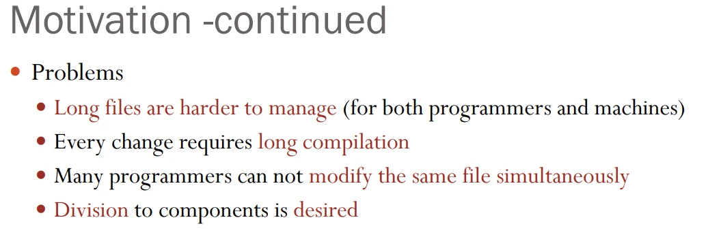

- 만약 큰 프로젝트의 경우, 한 파일에 모든 프로그램의 내용을 다 담았다고 하면, 다음과 같은 문제들이 발생할 수 있다.

<!-- -->

1. 프로그램의 함수와 컴포넌트를 확인하기 어렵다.
2. 호출 관계를 파악하기 어려워진다.
3. 프로그램을 컴파일하는데 굉장히 오랜 시간이 걸린다.
4. 만약 파일의 아주 작은 부분만 고쳐도 파일 전체를 다시 컴파일해야 한다.
5. 여러 명이 한 파일에 동시에 변경을 가하기가 어려워진다.

> 따라서, 컴포넌트를 여러 부분으로 쪼개는 것이 필요하다.

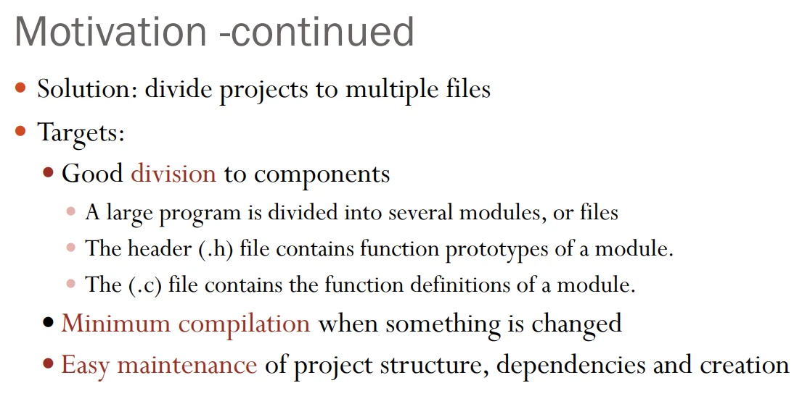

- Solution : 파일을 여러 개의 multiple-files로 만들면 관리하기가 용이해진다.
- 여러 개의 관련있는 파일들을 module로 묶어서 별개의 파일로 나누는 것이 큰 프로젝트, 큰 S/W를 개발할 때 주로 사용되는 방법이다.

- header (.h) file에는 주로 그 module에 해당되는 function의 prototype을 정의하고, (.c) file 에는 함수의 declaration, function definition 을 작성하게 된다.

    - 이렇게 되면 수정을 가할 때, 수정이 필요한 부분만 바꾸면 되므로 minimum compilation이 가능해진다.

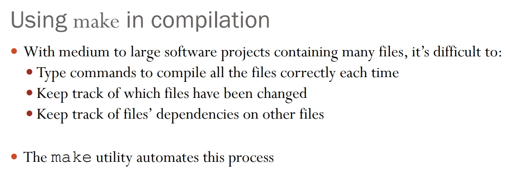

- 대규모 프로젝트에서는 module화 해서 개발하는 것이 바람직하지만, 그렇게 하면 file의 개수가 굉장히 많아지게 된다. 이 상황에서 발생할 수 있는 어려움들은 다음과 같다.

<!-- -->

1. 파일 개수가 많아서 각각의 파일을 compile 하는데 command를 다 입력해야 한다.
2. 어떤 파일이 어떻게 변경이 되었는지 알아야만 그 파일을 특정해서 compile할 수 있다.
3. 파일 간에는 굉장히 다양한 의존성(dependency)이 존재하는데, 이를 체계적으로 관리하는 것도 굉장히 중요한 문제가 된다.

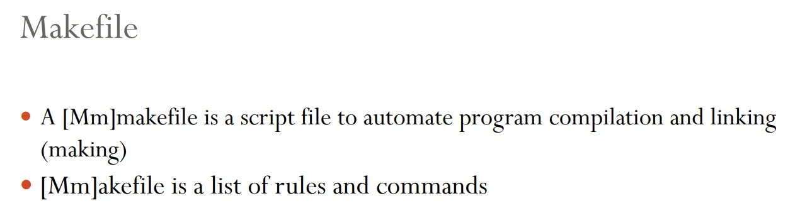

- make 명령어는 기본적으로 Makefile이라고 하는 script를 통해 해석함으로써 명령을 수행해준다.  (Makefile도 가능하고, makefile도 가능하다. 첫글자 case 구분을 하지 않음.)
- makefile은 script file로서, 프로그램을 어떻게 compile 할지, 그 규칙을 적어놓는 script이다.

> makefile에 compile에 필요한 규칙이나 command를 기입해놓으면, makefile을 이용하여 make라는 command를 통해 compile을 자동으로 수행하게 된다.

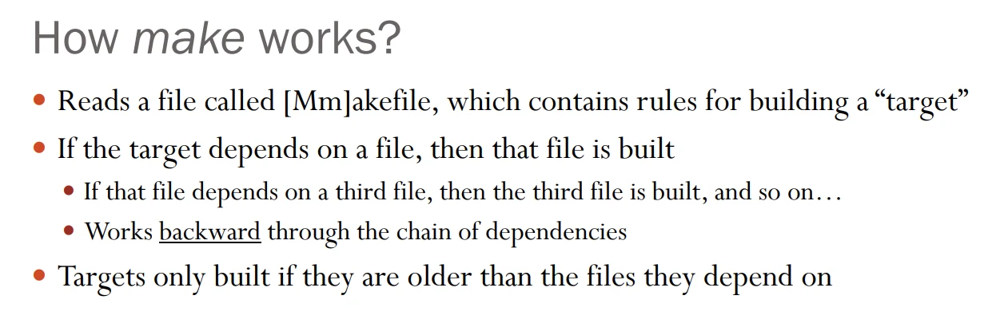

- Make가 동작하는 과정

    - 작성할 Makefile script를 읽어서, 가장 상위의 target을 찾는다.
    - target은 최종적으로 만들고 싶어하는 프로그램을 의미한다.
    - 그 상위 target을 만들기 위해서는 또 다른 서브 오브젝트 파일이나 또 다른 파일들이 필요할 수 있다.
    - 그럼 그 파일들을 사용하면 된다. 그러나 만약에 그 파일이 존재하지 않는다면, 다시 만들어주어야 한다.
    - 그 파일을 만드는 방법은, 그 파일이 의존하는 또 다른 파일들이 있고, 그 파일들을 만들어주어야 한다.
    - 그 파일이 없으면 또 그 파일을 만들어주고… 이처럼 recursive하게 동작된다.

- 한 번 target이 만들어지면, 그 target 자체가, 의존하는 파일들보다 생성된지 오래됐을 경우에만 compile 을 새로 해서 그 file을 갖다가 target을 만들어내게 된다.
- target이 의존 파일들보다 오래되었는지를 체크하려면 파일의 생성 혹은 수정 시각을 체크하면 된다.

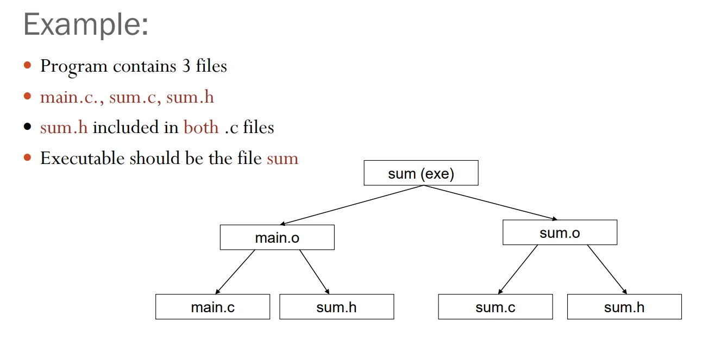

- Example

> 세 개의 파일로 구성되어 있는 프로그램이 있다.
>
> main.c, sum.c, sum.h
>
> sum.c와 main.c가 sum.h라는 header file을 include 하고 있을 것이다.  
> 그리고 main.c sum.c를 compile 해서 linking 함으로써 최종적으로 sum(.exe)라는 target을 만들어낼 수 있게 된다.
>
> 위의 예제에서, sum(.exe)는 sum.o와 main.o에 의존하고 있다.  
> main.o는 main.c와 sum.h에 의존하고 있다.  
> sum.o는 sum.c와 sum.h에 의존하고 있다.

```makefile
sum: main.o sum.o # sum을 만들기 위해서는 main.o와 sum.o가 필요하다. (depend on)
	gcc -o sum main.o sum.o

main.o: main.c sum.h
	gcc -c main.c

sum.o: sum.c sum.h
	gcc -c sum.c
```

## `Makefile의 구조`

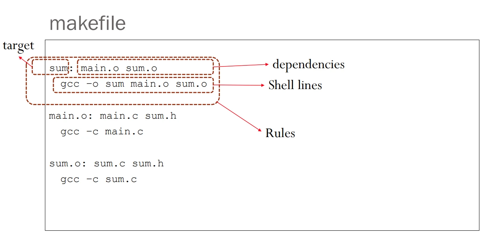

sum: main.o sum.o  
→ target과 dependency를 합쳐서 dependency line이라고 한다.

gcc -o sum main.o sum.o

→ dependency file들을 어떻게 만들어낼지 정의한 부분을 Shell lines, Action lines라고 한다.  
Shell line은 시작할 때 반드시 `TAB`으로 시작한다!

- `Components of a Makefile`
- `Comments`

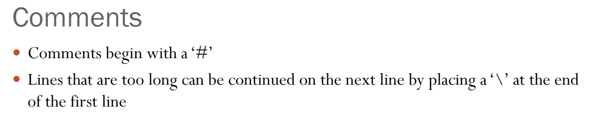

- 주석은 #을 통해 작성할 수 있다.
- makefile에서 한 라인에 command를 모두 적기 힘들어서 다음 라인으로 continue를 해야할 때는 back slash \\ 를 쓰면 연결할 수 있다.
- `Rule`

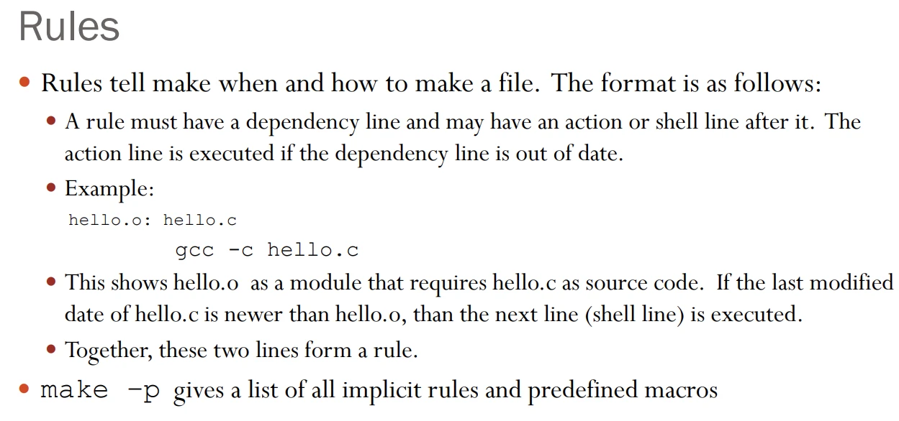

- 해당 파일을 언제 어떻게 만들어줄 지 알려주는 규칙을 Rule 이라고 한다.

```makefile
hello.o: hello.c # target: target_dependency
	gcc -c hello.c # Action
```

- hello.o는 hello.c 소스 코드가 필요한 모듈이다. 만약, hello.c의 마지막 수정 시각이 hello.o보다 빠르다면, (즉, hello.c가 더 최근에 수정됐다면) shell line(action line)을 수행한다.
- makefile에는 이미 정의되어 있는 많은 룰들이 있다. make -p를 통해 확인 가능하다.
- `Dependency Lines`

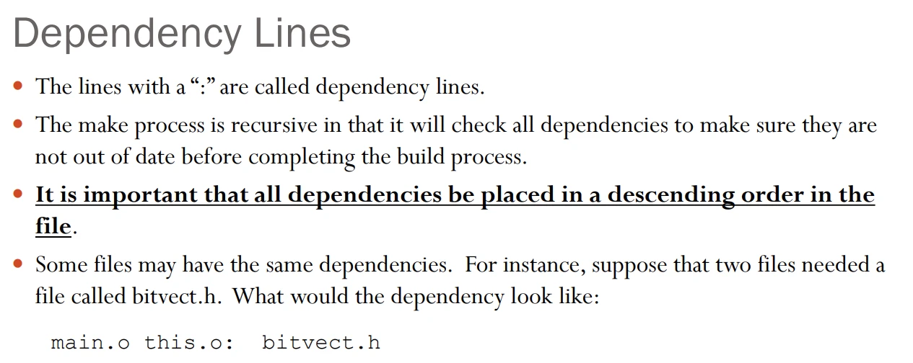

- target: target dependencies 로 구성된다.
- 프로그램을 구성할 때 Rule이 여러 개 존재할 수도 있으므로, 제일 마지막에 만들어져야 하는 target을 makefile의 맨 첫 번째에 적어주게 된다.  
    `It is important that all dependencies be placed in a descending order in the file.`
- 만약, 여러 파일이 동일한 dependency를 가지면 아래와 같이 기술한다.

```makefile
main.o this.o: bitvect.h
```

- `Shell Lines (or action lines)`

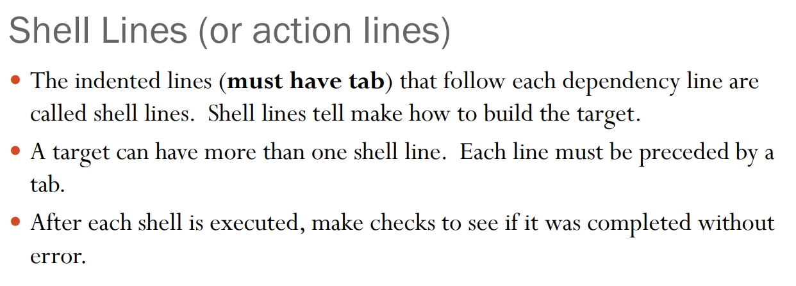

- Shell Lines는 첫 부분에 TAB 으로 시작한다.
- target을 만들기 위한 action이 어떻게 구성되는가, 명령어를 무엇을 수행해야하는가를 작성하는 부분이다.
- action을 한 라인만 작성해야하는 것이 아니라, 만약 여러 줄의 명령을 수행해야 한다면 개행을 한 뒤 TAB을 하고 command를 작성해주면 된다.
- 각 shell linen이 수행되고 나면, make는 error 없이 정상적으로 실행됐는지 검사한다.
- `Macros (variables)`

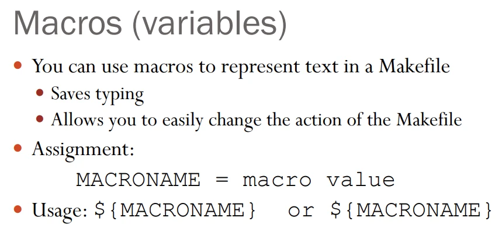

- Macro를 이용해 variable과 const를 정의함으로써 동일한 것을 여러번 타이핑하는 수고를 줄여준다.

```makefile
# Assignment
MACRONAME = macro value

# Usage, Reference
${MACRONAME} or $(MACRONAME)
```

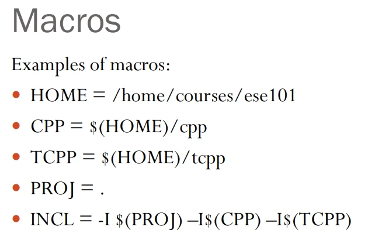

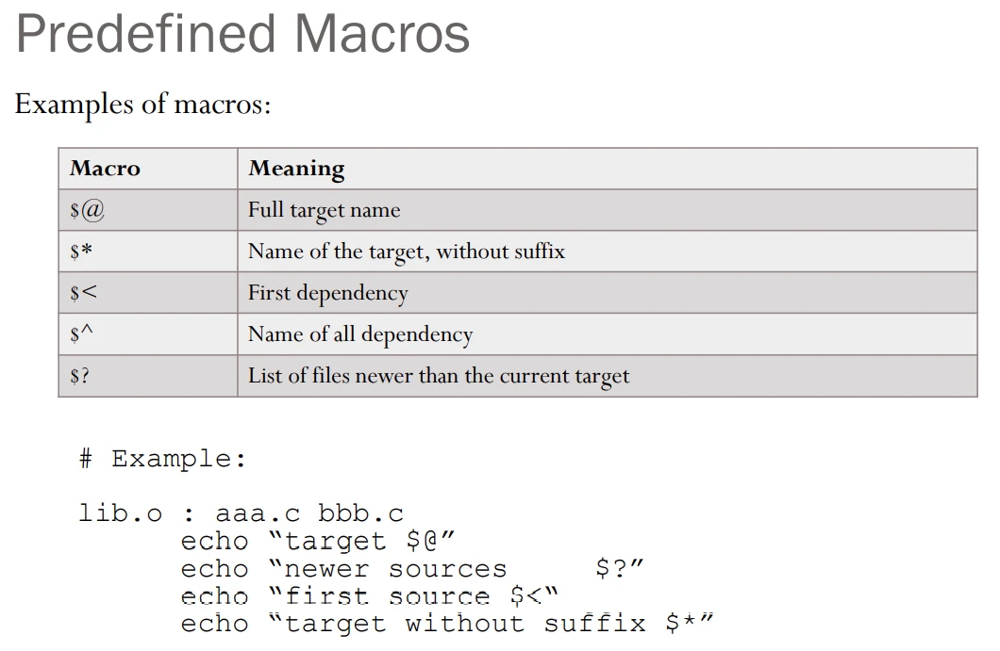

```makefile
lib.o: aaa.c bbb.c
	echo "target $@" # full target name을 print한다. lib.o
	echo "newer sources   $?"
# 만약, lib.o가 10:10이고, aaa.c가 10:12, bbb.c가 9:30 이면 $?는 어떤 것이 출력되는가?
# aaa.c가 출력된다.
	echo "first source #<" # aaa.c
	echo "target without suffix $*" # target name에서 확장자를 떼고 출력한다. lib
	gcc -o lib.o -c aaa.c bbb.c
```

## `Example`

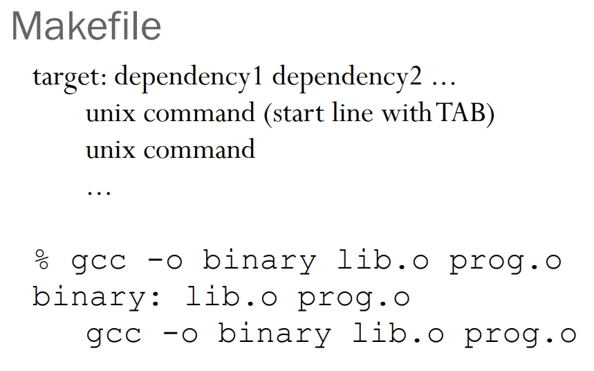

```makefile
# gcc -o binary lib.o prog.o
binary: lib.o prog.o # Dependency Line
	gcc -o binary lib.o prog.o # Shell Line

# 그런데, target binary를 생성하기 위해 lib.o와 prog.o를 만들려면 이를 생성하는 또다른
# 규칙이 필요하다. 그런 상황에서는 아래에 새로운 규칙을 추가하면 된다. (확장)
```

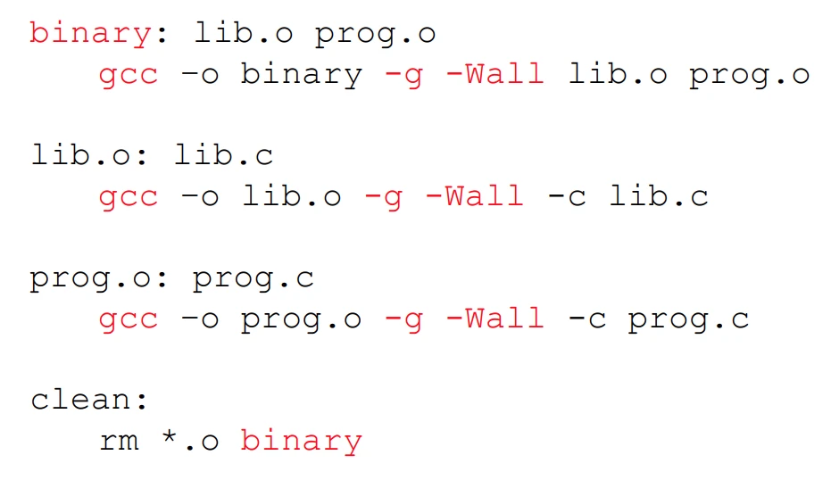

- 그런데 위의 명령을 보면, 빨간색으로 강조된 부분은 중복되어 사용되고 있다는 것을 알 수 있다.
- 이를 매크로를 이용해서 처리할 수 있다.

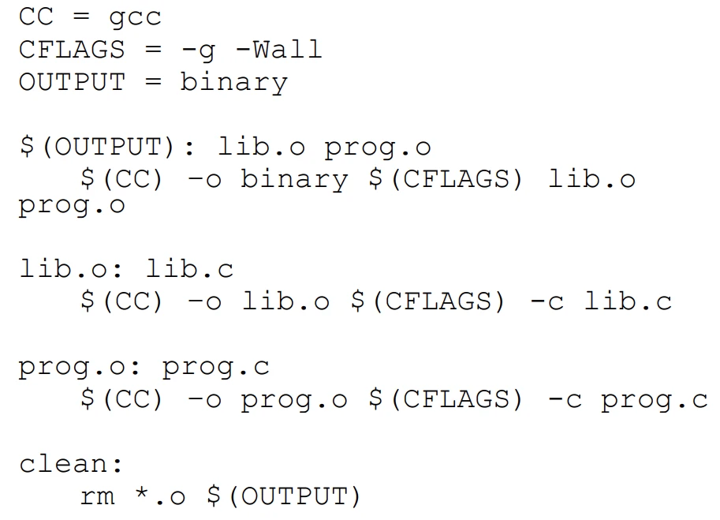

- 만약 나중에 지정한 MACRO의 값을 수정하고 싶으면 그냥 MACRO만 수정하면 나머지는 알아서 바뀌게 된다.

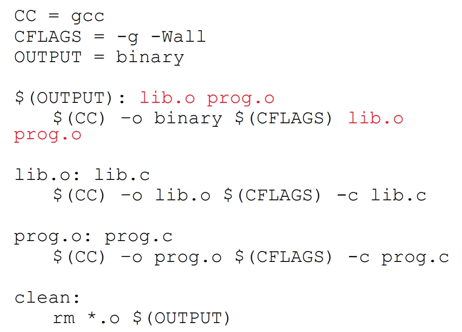

- 다시 코드를 보면, 또 다시 중복되는 부분이 존재하는 것을 알 수 있다.
- 이를 다시 MACRO로 처리해준다.

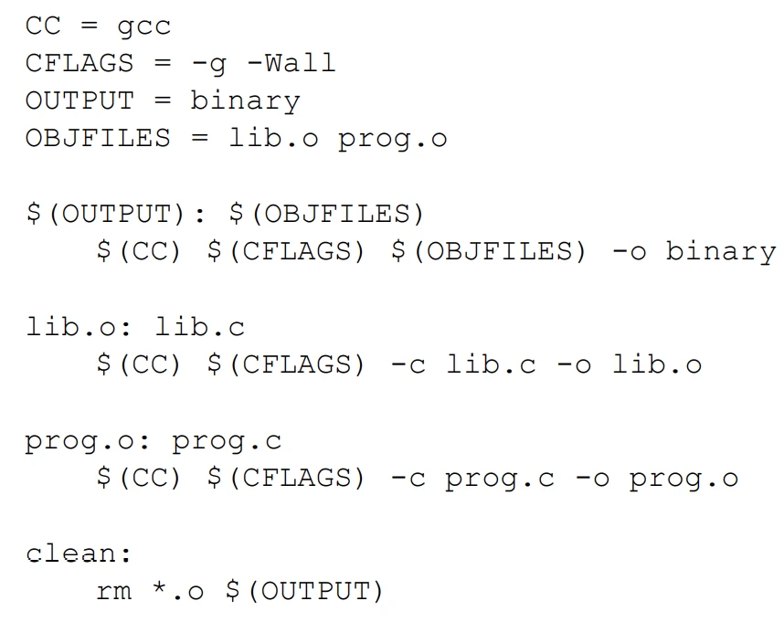

- lib.o, prog.o 를 OBJFILES MACRO로 처리해준다.

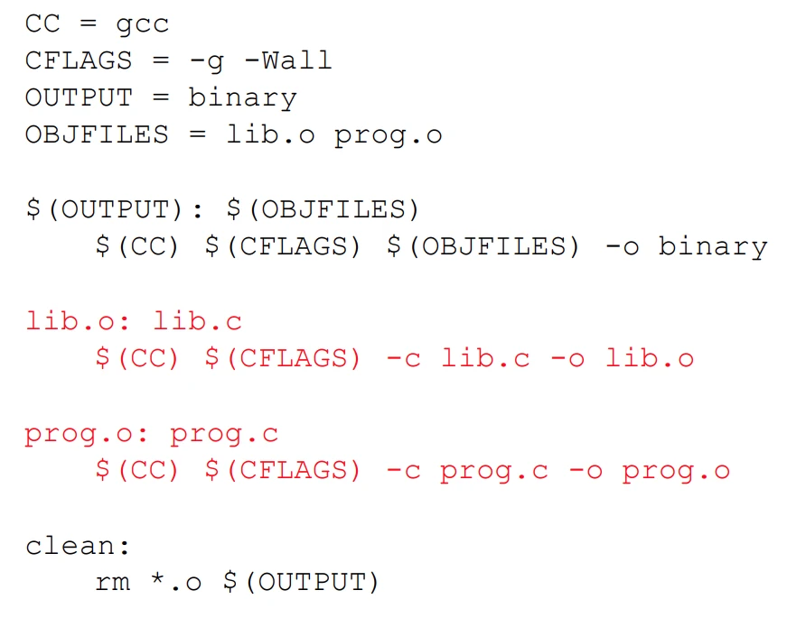

- 빨간색으로 강조된 부분을 보면, 두 Rule 모두 간단한 compile 과정임을 알 수 있다.

    이를 와일드 카드를 이용하면 동일한 명령을 수행하도록 처리할 수 있다.

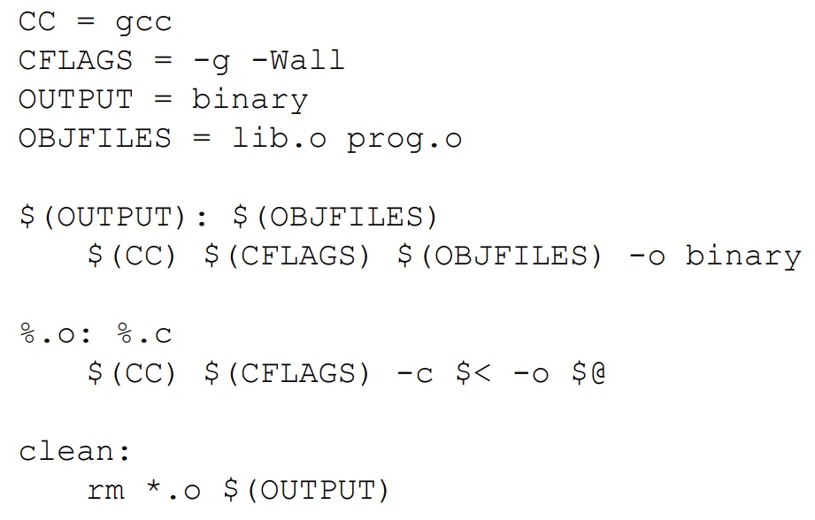

- %는 wildcard로써, 어떠한 파일이 오던 매칭되면 넣어주라는 의미이다.

```makefile
%.o: %.c
	$(CC) $(CFLAGS) -c $< -o $@

# $<는 first dependency : ~.c
# $@는 target name : ~.o
```

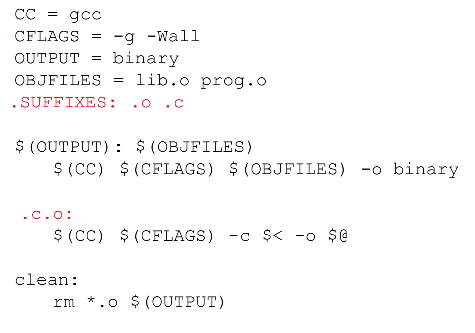

- 위와 동일한 역할을 .SUFFIXES: .o .c와 .c.o: 를 통해서 수행할 수 있다. (같은 방법)

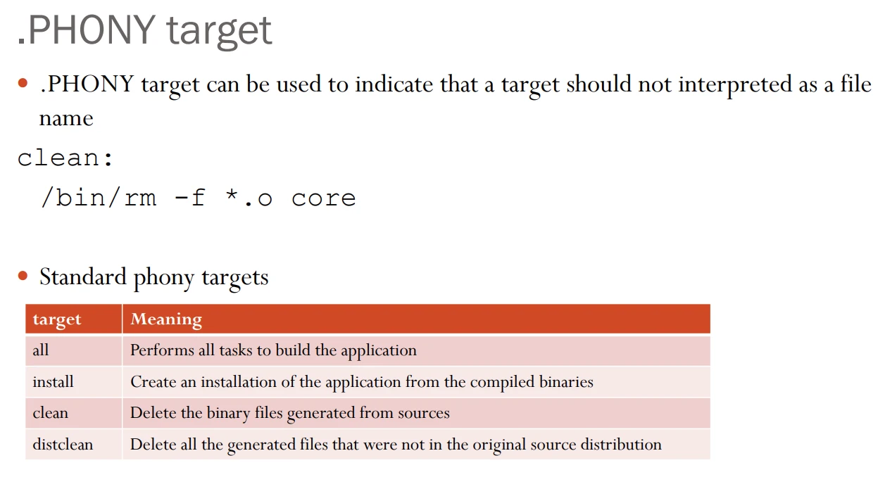

**`phony target`**

- target이 file이 아닌 경우도 있다. 해당되는 Action을 호출하기 위해 사용되는 경우가 있다. 이를 phoney target 이라고 한다.

```makefile
clean:
	/bin/rm -f *.o core
```

- clean이라는 phony target은 clean이라는 file을 만들기 위한 rule이 아니라, 밑에 있는 Action. 즉, shell line을 수행하기 위해 설정해주는 것이다.

```makefile
# bash 상에서 입력
make clean # 이와 같이 입력하면, clean 명령이 수행된다.
```

- target (standard로 쓰이는 phony target 존재)

    - all : 어플리케이션을 끝까지 빌드하라는 뜻의 target name.  
        performs all tasks to build the application
    - install : 컴파일된 결과를 갖다가 해당 디렉터리에 설치하라는 명령어를 호출하는 target  
        Create an instllation of the application from the complied binaries
    - clean : 소스에서 생성된 모든 object file을 제거한다.  
        Delete the binary files generated from sources

    - distclean : 처음에 소스가 있었던 원래 상태로 돌려놓으라는 명령어. temporary file 등과 같이 실행파일 뿐만 아니라 실행과정에서 생성되는 중간 파일들을 모두 지워서 처음 소스코드가 있었던 상태로 돌리라는 의미이다.

```makefile
make all # 시스템 전체를 compile한다.

make install # 위에서 컴파일된 결과를 제 위치에 설치한다.

make clean # 컴파일하고 그 결과가 설치되었으므로, 필요없어진 binary 파일을 제거한다.
```

## `Recursive make`

- S/W의 structure를 보게 되면, 아래와 같이 구성된다.

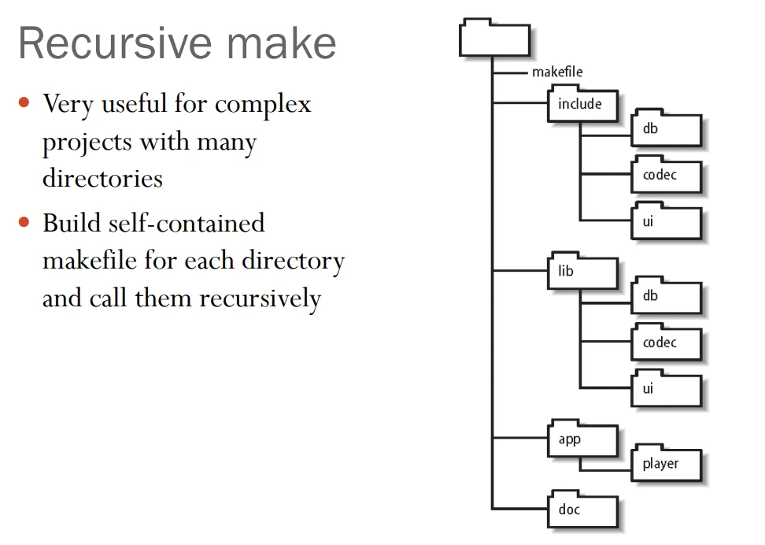

- 여러가지 디렉터리가 있고, header file을 넣는 include directory, library를 넣는 lib directory, 실제 application와 관련된 파일이 존재하는 app directory, document가 관련된 doc directory, 그리고 각각의 상위 directory 아래에는 hierarchical한 하위 directory들이 존재한다.
- makefile을 이용하면, 하나의 makefile로 모든 구조를 거쳐 compile할 수 있게 된다. 그러나, 이렇게 구현하면 makefile이 굉장히 복잡해지게 된다. 그래서 보통 규모가 있거나 여러 directory를 갖는 makefile의 경우에는 각각의 directory에 makefile을 만들어준다.
- include, lib, app, doc directry와 하위 directory 모두 각각에 해당되는 makefile을 갖는다. 상위 directory의 makefile(include, lib, app, doc)은 하위 directory의 makefile을 호출하는 역할을 하거나, linking을 하는 역할을 해준다. 그리고 최상위 makefile은 이렇게 만들어진 파일들을 모아서 호출하거나 linking 해주는 역할을 한다.
- 이렇듯, 복잡한 sub-directory 구조를 갖는 프로젝트는 recursive 하게 make를 이용하는 것이 좋다. 이와 같이 make를 만들면, 각각의 directory에서 make는 self-contained하게 만들고, 상위 directory에서 (맨 위에 있는 makefile에서 부터) 점점 하위 makefile을 호출하면서 실행하게 되도록 구성해준다.

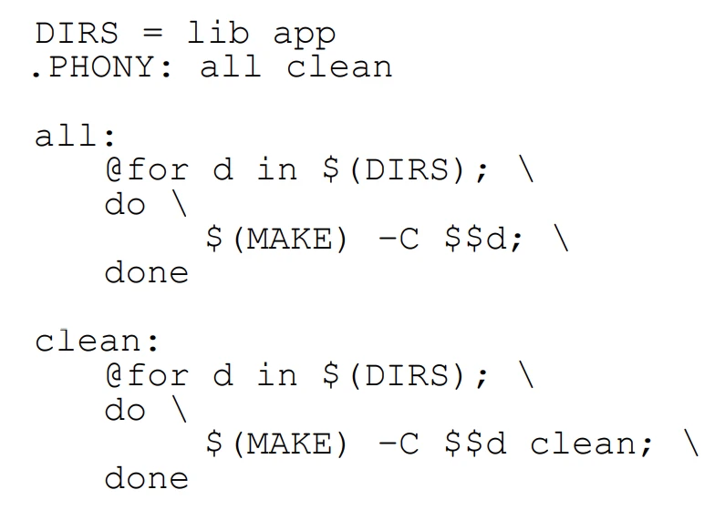

- lib, app directory가 존재한다고 해보자. 그리고 lib과 app은 각각의 makefile을 갖고 있다고 하자.
- lib과 app는 각각의 makefile을 독립적으로 가지고 있고, 최상위 makefile은 밑에 있는 makefile들을 호출해주는 역할을 하면 된다.

```makefile
DIRS = lib app
.PHONY: all clean

# for문 앞에 붙은 @는 명령어를 print하지 말라는 의미이다.

all: # Shell line은 bash shell line이기 때문에 shell command를 사용할 수 있다.
	@for d in $(DIRS); \
	do \
		$(MAKE) -C $$d; \ 
# for문의 변수 d가 directory 이므로, 그 directory로 이동해서 (-C, change directory)
# 거기서 makefile을 수행하라는 뜻이다.
# $$d의 의미는, $d를 해석하지 말고 그대로 넘겨주라는 의미의 escape character로 $를 이용함.
	done

clean:
	@for d in $(DIRS); \
	do \
		$(MAKE) -C $$d clean; \
	done
```
