# 9주차 온라인 강의: 소스 버전 관리, Git 소개

작성일 2022-10-27 · 최종 수정일 2022-12-03
{ .post-date }

## `소스 버전 관리`

- 소프트웨어를 개발하다보면, 소프트웨어에 여러 변경을 가하게 되고 여러 버전들이 생기게 된다.  또한 개발을 혼자 진행하는 것이 아니라 여러 명이서 개발하게 되므로 각각 변경을 가하게 된다. 이러한 소프트웨어 버전들을 체계적으로 관리해주는 도구가 바로 ‘버전 관리 시스템’이다.

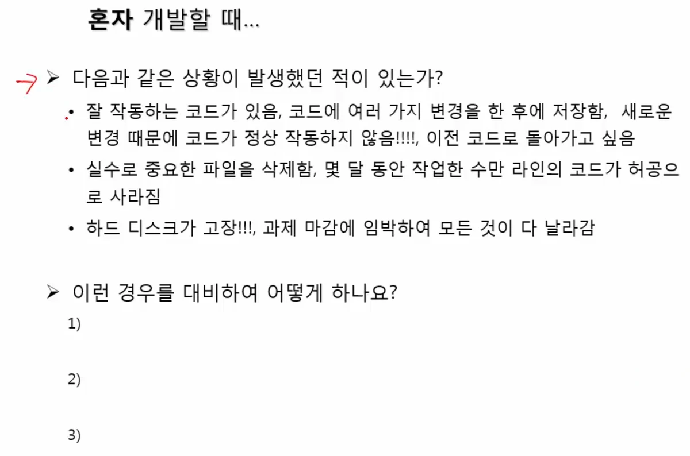

- 이런 경우를 대비하여 어떻게 하는가?

    → USB를 이용해 정기적으로 백업

- 여러 명이서 개발하게 된다면?

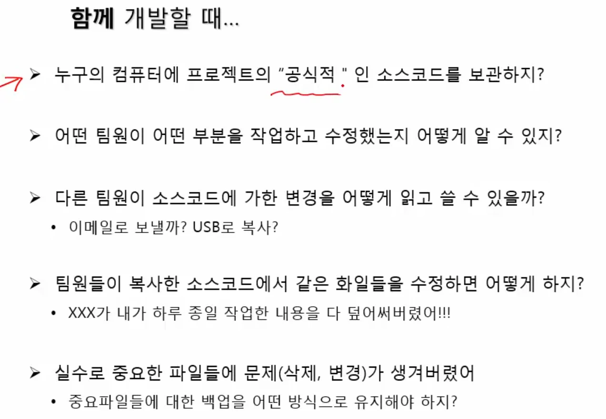

큰 규모의 S/W를 개발할 때는 위에 나오는 문제들을 해결하기가 힘들어진다.

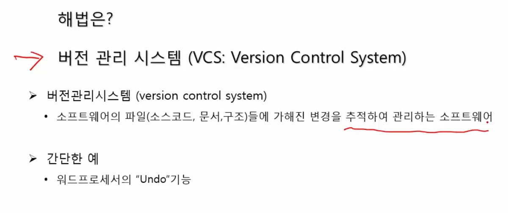

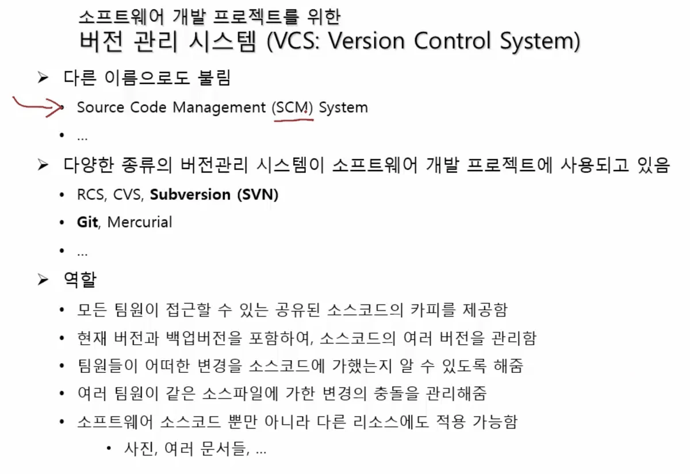

- 기본적으로 Source Code Management (SCM) System 이라고 불리며, 기존에는 Unix, Linux, Windows마다 여러 버전관리 시스템이 존재했고, 이전에 많이 사용됐던 것에는 RCS, CVS 등이 있다. 최근에 자주 사용되었던 것에는 Subversion(SVN)이 있고, (Windows에서는 tortoise SVN이 사용되기도 함) Git이 가장 많이 사용된다.  
    → 이 SW들은 모두 오픈소스이다.
- 모든 팀원이 접근할 수 있는 공유된 소스코드의 카피를 제공함
- 현재 버전과 백업버전을 포함하여, 소스코드의 여러 버전을 관리함
- 팀원들이 어떠한 변경을 가했는지 알 수 있도록 해줌
- 여러 팀원이 같은 소스파일에 가한 변경의 충돌을 관리해줌

- 소프트웨어 소스코드 뿐만 아니라 다른 리소스에도 적용 가능함

    - 사진, 여러 문서들, …

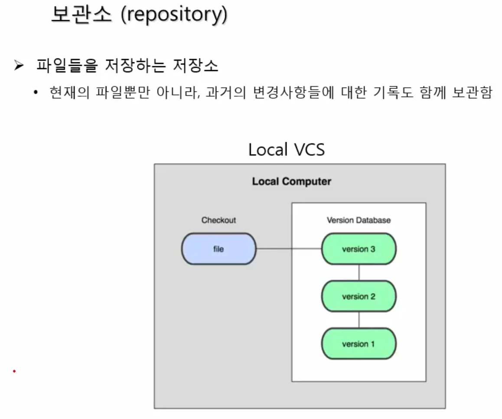

- 보관소 : 소프트웨어의 변경 사항을 저장해주는 DB. 여기서 version은 S/W가 변경되어온 과정을 설명하는 것이다.

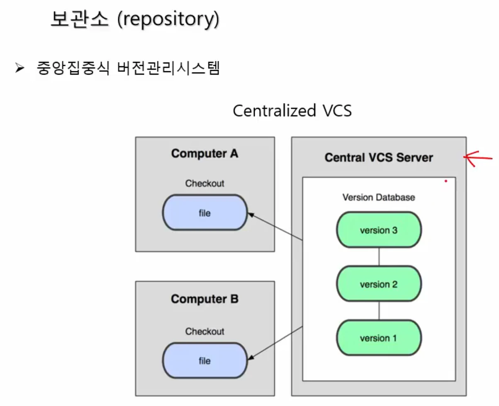

- 팀으로서 일하게 되면, 중앙집중식 버전관리시스템은 서버에서 Central VCS Server가 돌아가게 되고, 각 컴퓨터에서 파일을 가져와서 버전관리시스템의 repository를 대상으로 checkout하거나 본인이 변경한 사항을 공유할 수 있음.

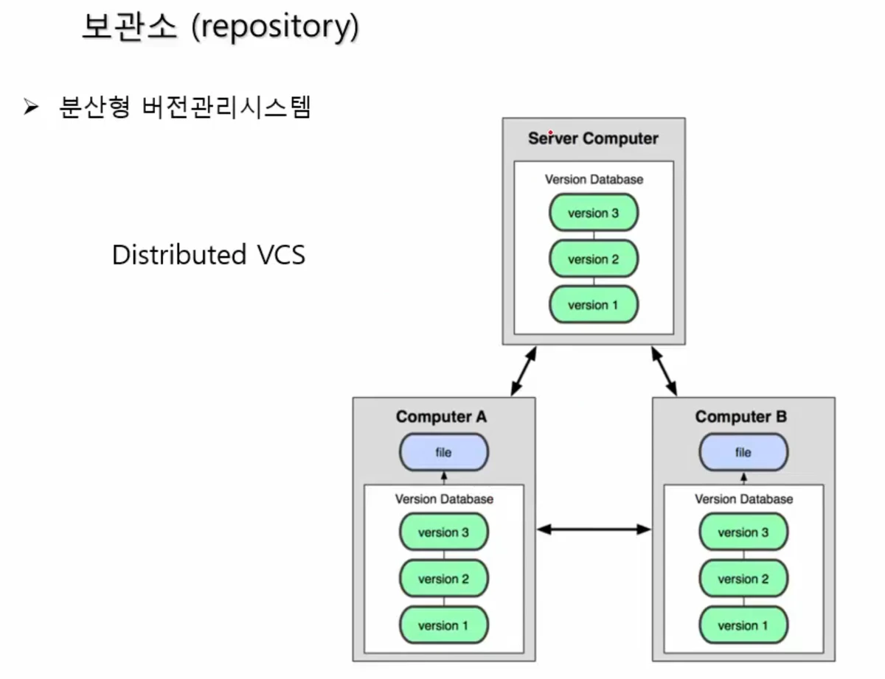

- 분산형 버전관리시스템 : Server가 있고, 컴퓨터 A, 컴퓨터 B에서 가져오는데,  컴퓨터 A와 B 끼리도 서로 동기화를 한다거나, 소스코드를 교환하고 checkout하는 기능을 하게 되는데, 이는 주로 사용되는 방법은 아니다.

## `Git 소개`

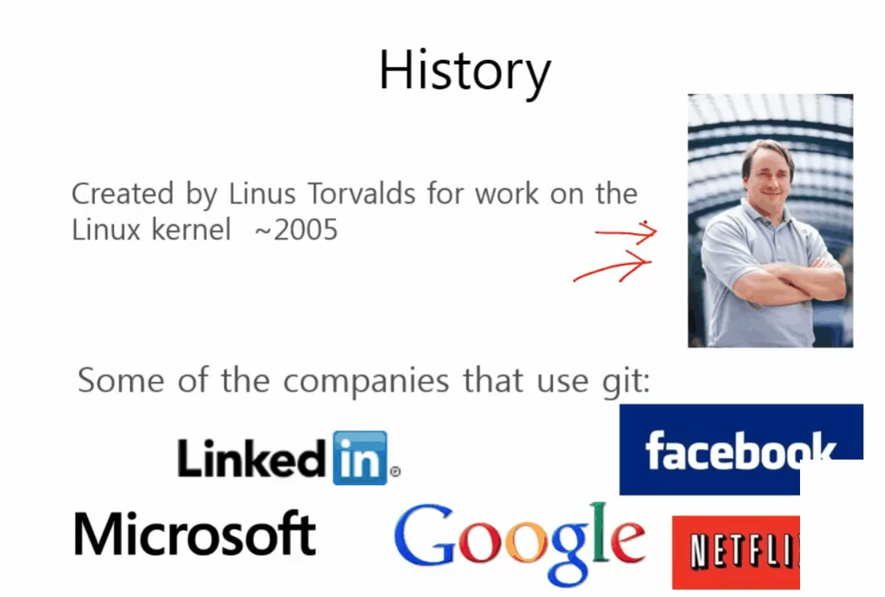

- Linus Torvalds에 의해 개발됨. 여러 명이 동시에 다른 시간에 개발을 할 때, 여러가지 버전이 생길수 밖에 없다. 이를 어떻게 체계적으로 관리할까를 고민하다가 만들어진게 Git의 history이다.
- Git은 현재 Linux를 개발할 때만 사용되는 것이 아니라 거의 대부분의 S/W를 개발하는 회사들이 활발하게 사용해서 버전관리에 이용하고 있다.

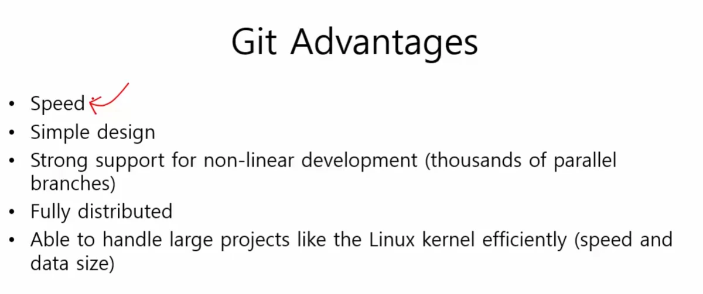

- 기존 버전관리시스템들의 문제점 (Git이 만들어진 이유)

<!-- -->

1. 기존 버전관리시스템들은 속도가 너무 느렸다. Git은 빠른 속도를 지원한다.
2. 디자인이 심플해서 보기 편하다.
3. linear development는 소스 코드 개발이 다른 코드의 개발에 종속성을 가져서, 코드를 순서대로 개발하는 것이다. Git을 이용하면 parallel 하게 개발한 뒤, 추후에 merge하는 방식을 사용할 수 있게 된다.
4. 어느 한 copy가 망가지더라도, 다른 copy가 master repository가 돼서 다시 나눠줄 수 있는 Fully Distributed 성격을 지닌다.
5. Linux Kernel과 같은 큰 규모의 S/W도 빠르게 효율적으로 handle할 수 있다.

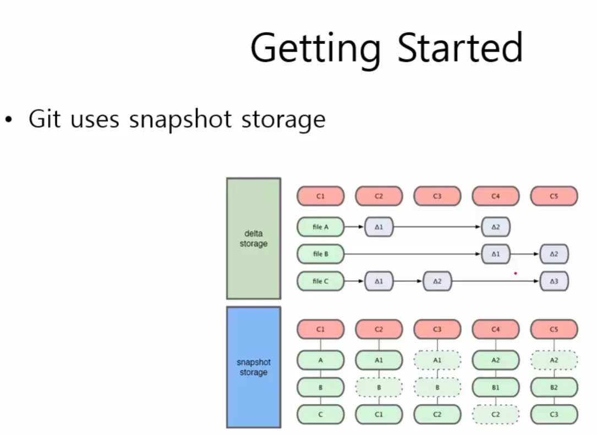

- 기존의 VCS와 Git의 차이점

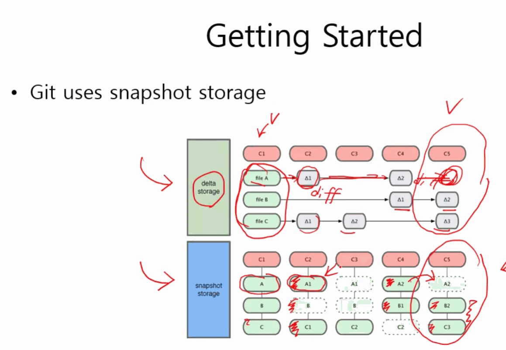

기존의 VCS의 방식은 delta storage 방식인데, 만약 C2에서 file A에 변경이 가해지게 되면, (이를 diff라고 한다.) 이것만 저장하고, 이후에 C4에서 다시 변경이 가해지게 되면 다시 diff만 저장한다. 만약 C5의 파일을 얻어내고 싶다고 하면, C1에서 모든 diff를 적용하면서 찾아와야 한다. 그래서, 큰 프로젝트 같은 경우에는 overhead가 굉장히 많다.

이와는 다르게 Git은 snapshotstorage를 이용하며, 변경이 될 경우에만 변경이 된 것을 저장하게 된다. 따라서 만약 C5의 소스 코드를 사용하고 싶다면, B2, C3는 바로 가져오고 A2는 이전의 C4에서 추적해서 가져오면 되는 것이다.

- Git의 기본적인 사용 방식

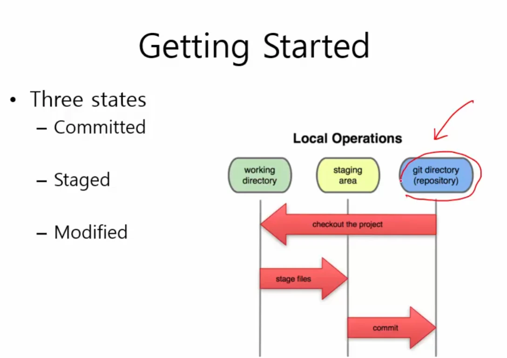

- git directory(repository) : 실제적으로 저장된 소스코드가 존재하는 부분이다. checkout이라는 과정을 통해 여러분의 local copy로 복사해올 수 있다. 이를 working directory라고 한다.
- 이후 수정을 하게 되면, repository로 checking을 해주어야 하는데, 먼저 staging을 해준다. staging area는 일종의 buffer이며, 이렇게 두는 이유는 실제로 commit을 하기 전에 먼저 review를 하고 코드를 commit하라는 의미에서 존재하는 것이다.
- staging이 끝나게 되면, commit을 통해 git repository에 최종적으로 checkin 한다.

working directory(modified)

staging area(staged)

git directory(modified)

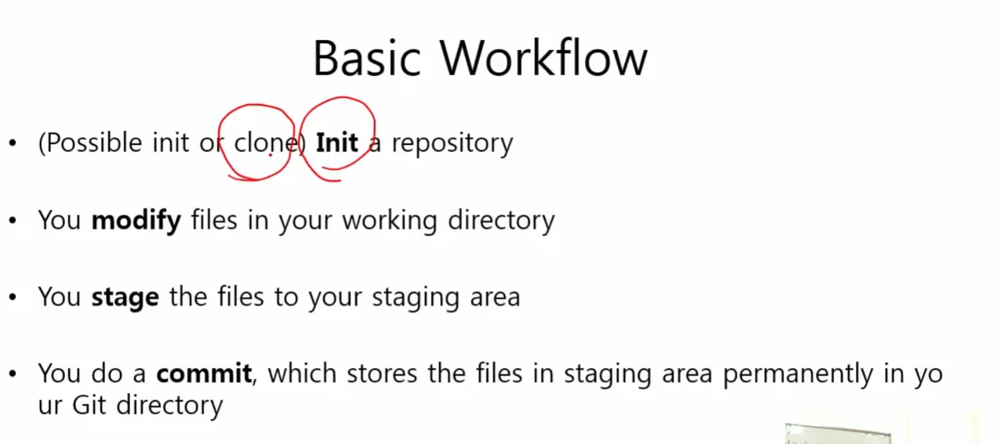

- repository를 Init으로 만들거나 남이 만든 repository를 clone해서 가져온다.
- 파일들을 working directory로 가져와서 수정한다. (modify)
- 변경된 파일들을 stage에 올린다. (staged)
- commit을 통해 repository에 영구적으로 보관한다.
- 리눅스에서는 sudo apt-get install git 으로 다운로드한다.

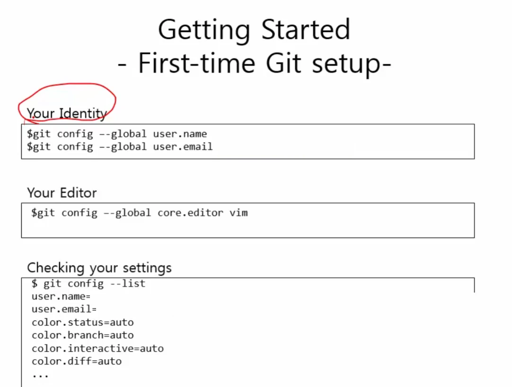

\$ git config —global user.name “Gildong Hong”

\$ git config —global user.email user@example.com

→ 소스코드를 변경할 때, 로그에 사용자 정보를 남길 때 사용된다.

\$ git config —global core.editor vim

→ 사용하는 Editor 정보를 남긴다.

\$ git config —list

→ 현재 설정한 setting을 확인할 수 있다.

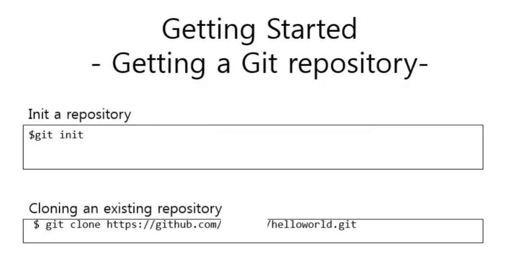

- git repository를 만드는 방법은 두 가지가 있다.

<!-- -->

1. git init (내가 새로 만드는 것)
2. git clone (남이 만든 repository를 복사해와서 사용하는 것)

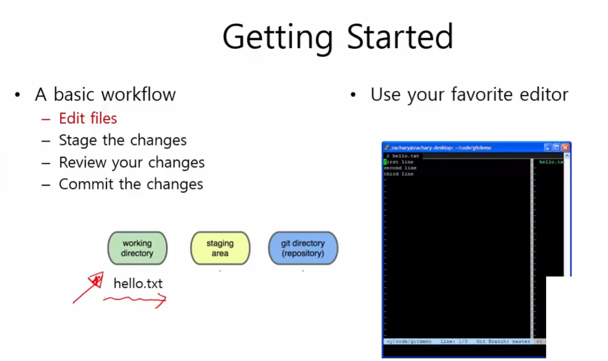

- repository가 만들어지게 되면, 이전에 말한 세 가지 단계를 거치게 된다. 만약 hello.txt를 수정했다고 한다면, 제일 먼저 working directory에 남아있게 된다. (staging이나 commit이 안된 상태)

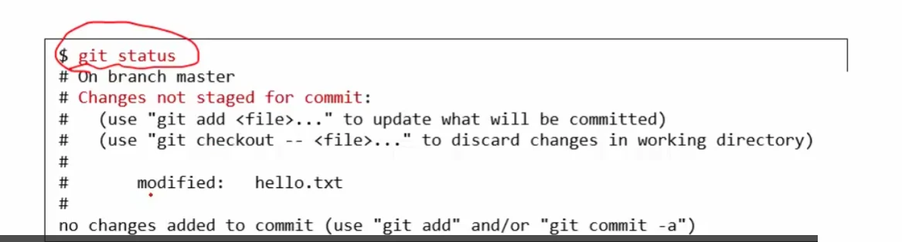

- 이 상태에서 git status를 하면, hello.txt의 status를 볼 수 있다.

→ Changes not staged for commit

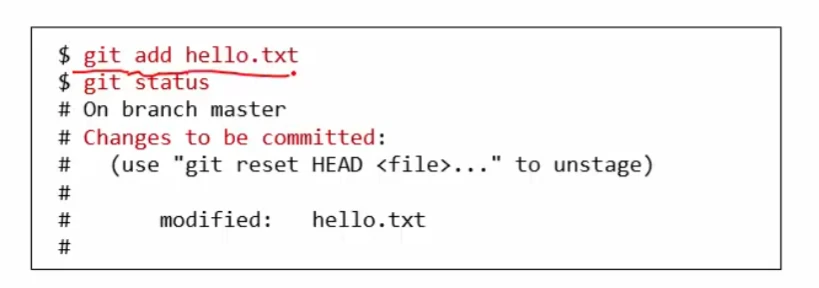

- git add hello.txt (or directory 전체) 를 하면, staging area로 보내준다.

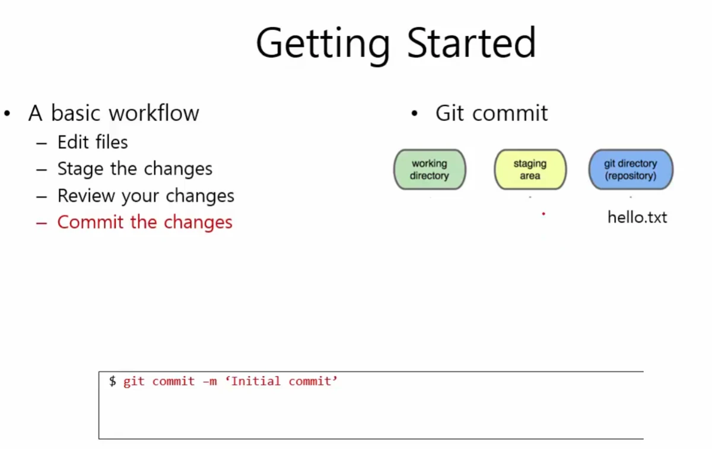

- git commit -m ‘Initial commit’

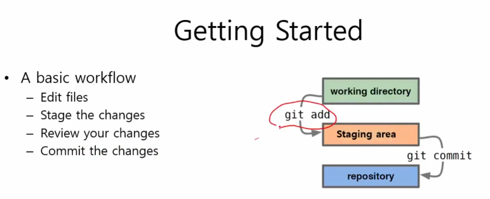

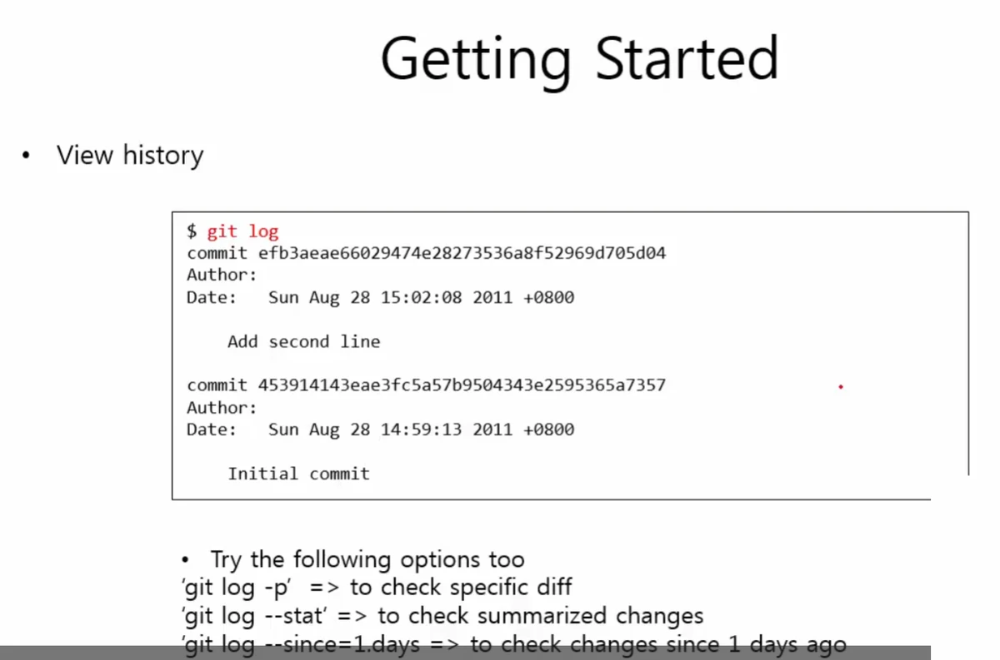

- git log : 어떤 변경들이 가해졌는지 요약으로 볼 수 있다.
- git log는 옵션이 굉장히 많은데, git log -p는 실제로 어떤 부분이 수정되었는지를 보여준다. git log —stat은 조금 더 요약을 해서 바뀐 부분만 보여주게 된다.

소스 버전 관리 시스템에서 제공하는 가장 큰 특징 중 하나인 branching을 살펴본다.

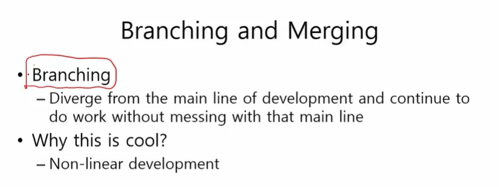

우리가 개발하는 S/W에 main line이 존재하며, 우리는 여기에 계속해서 change를 가한다. 그런데 우리가 main line에서 벗어나서 다른 방식으로 S/W를 개발해보고 싶을 때가 생기면, 우리는 가지를 친다고 해서 branching을 하게 된다. 계속 branching만 하는 것이 아니라, 나중에 결과물을 가져와서 main line에 합치는 과정을 하게 되는데 이를 merging이라고 한다. 우리가 linear한 개발에서 벗어나서 non-linear한 개발을 할 수 있다는 것이 branching과 merging의 가장 큰 장점이라고 할 수 있다.

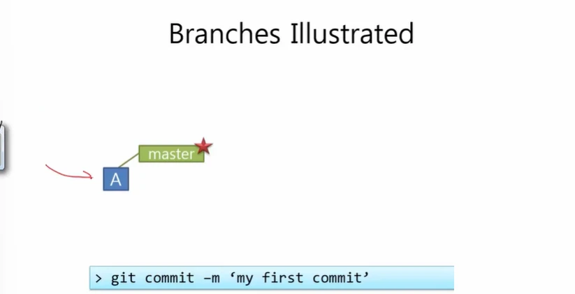

A라는 copy가 있고, default main line을 master라고 한다. master라는 branch는 default branch로서, 가장 최근에 메인 라인에 가해진 부분을 가리키는 포인터를 가지고 있다. 그러면 여기서 commit을 하게 되면, A라는 commit의 결과(copy)가 생성된다.

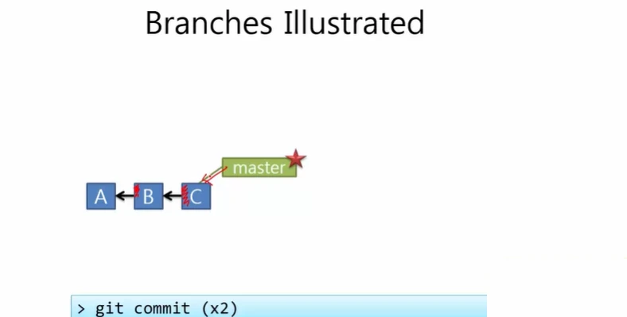

그리고 계속해서 master에 변경을 가하고 commit을 하게 되면, master는 가장 최근에 가해진 변경을 가리키는 포인터를 계속해서 갱신하게 된다.

그런데, master copy는 그대로 놔둔 채로, 어떤 특정한 부분에 대해 debugging을 해서 버그를 잡고 싶은 경우가 있을 것이다. 이런 경우에는

 git checkout -b bug123 이라는 명령어를 통해 branching을 해준다.

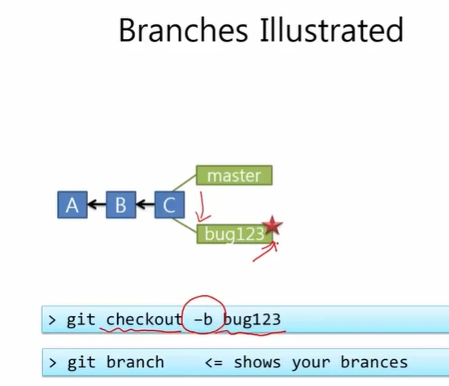

그 뒤, git branch를 입력하면 bug123 branch가 나온 것을 확인할 수 있게 된다. 그리고 현재 활동 중인 branch는 bug123으로 오게 된다.(별이 bug123에 가게 된다.)

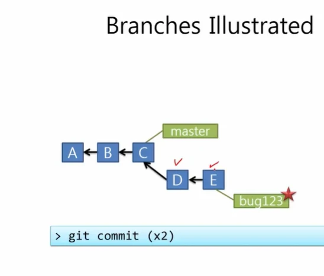

그 뒤, bug123 branch에서 변경을 하고 commit하는 과정을 반복하면 위와 같이 D, E처럼 계속해서 copy가 만들어지게 된다. 이후에, bug123을 master에 합치고 싶다면 먼저 현재 포인터를 master branch로 옮겨주어야 한다.

git checkout master

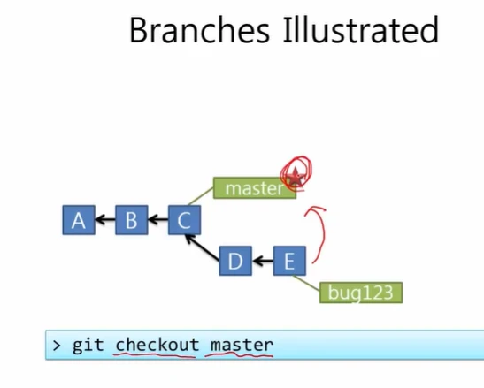

그리고 나서, git merge bug123을 입력하면, master가 bug123이 가리키고 있는 가장 최근의 copy본을 가리키게 된다. (master와 bug123의 포인터가 copy E를 pointing하게 된다.)

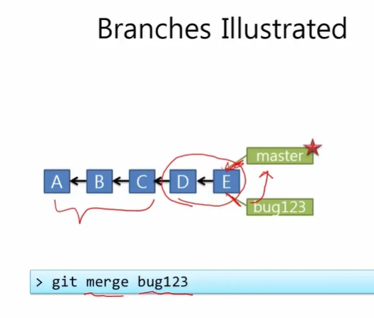

그러고 나서 bug123 branch가 필요없게 된다면, git branch -d bug123을 입력해서 bug123 branch를 제거해준다.

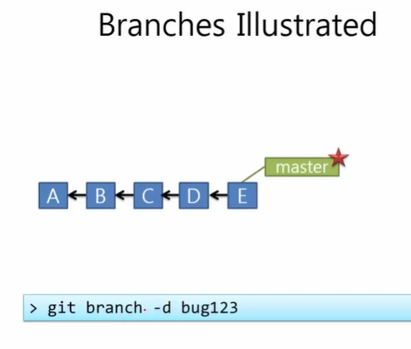

> 아까와 비슷하지만, 다른 시나리오를 생각해보자.

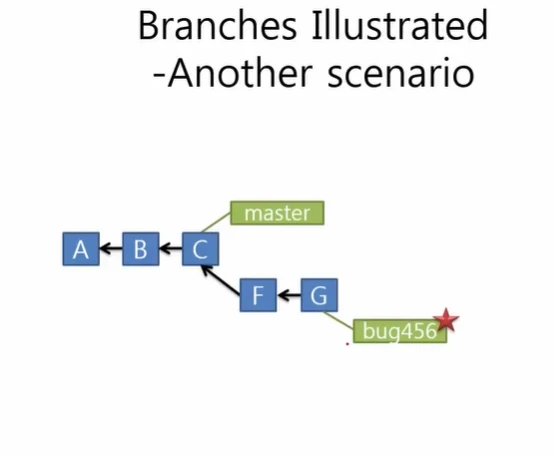

master branch가 있고, 여기서 checkout해서 bug456이라는 branch가 생성되어 F, G copy를 commit해 업데이트가 된 상태이다. 그런데, bug456이 진행되는 동안 master도 update를 할 필요가 있었다고 하자.

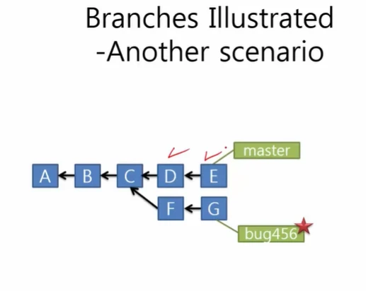

master는 D, E copy를 commit해서 bug456의 초기 copy인 C가 아니라 E를 가리키고 있는 것을 확인할 수 있다. 이 때 master와 bug456이 두 가지의 경로로 갈라지게 되었다. 이런 경우에는 어떻게 해야하는가? 결국에는 bug456을 master에 합쳐주어야 되는데, 일단 git checkout master를 입력해서 현재 활동중인 포인터를 master로 옮겨준다.

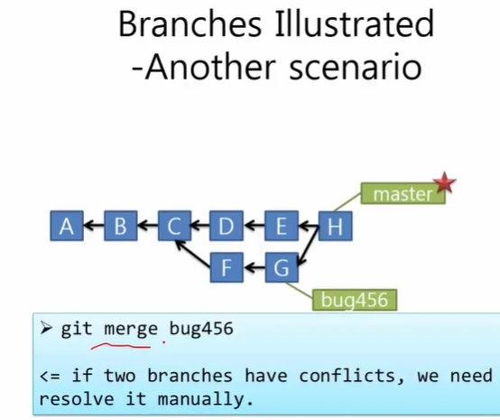

그 뒤, git merge bug456을 통해 merge한다. 이렇게 하면 F, G copy의 내용이 H의 master branch에 합쳐지게 된다. 그런데, 합쳐지게되면 자동적으로 잘 합쳐지는 경우가 있다. 예를 들면, 우리가 master에 가했던 D, E의 변경과 bug456에서 가했던 F, G의 변경이 서로 전혀 다른 부분을 update했다면 쉽게 갖다붙일 수 있다. 하지만, 두 branch가 서로 같은 부분을 수정했다고 하면, merge가 자동적으로 될 수 없다. 그런 경우에는 어쩔 수 없이 사람이 직접 conflict가 난 부분을 찾아가서 수정을 가해줘야 한다.

merge가 이루어지고 나면, bug456이 필요없어지므로, git branch -d bug456을 입력하여 branch를 제거한다.

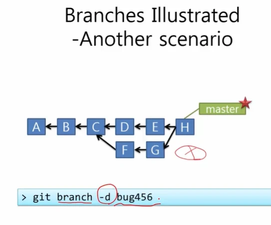

우리가 살펴봤듯이, branching과 merging을 하는 가장 큰 이유는 우리가 main line development line과 별도로 다른 branch에서 동시에 일을 진행할 수 있기 때문이다. 그리고 대부분 branch는 서로 다른 부분을 건드리기 때문에 conflict가 거의 발생하지 않지만, 만약 conflict가 발생하게 된다면 manual하게 git에서 수정을 가해주면 문제없이 merge를 진행할 수 있게 된다.
