# 10주차: Git 실습

`home/class/lab4-git`

- 최근, 버전 관리하는 툴 중에서 99.9%는 Git을 사용한다. 웹에다가 posting을 할 때는 Github를 사용한다.

Github repository를 보면, 무엇이 바뀌었는지 체크할 수 있다. readme.md를 이용하여 설명서도 작성할 수 있다.

처음에 Git이 나오게된 이유는, 전세계에 있는 리눅스 개발자들이 서로 다른 장소와 시간에서 동시에 개발하고자 만들어지게 되었다. 그렇게 개발할 때, 소스코드를 보관하는 서버로서 Git, Github를 사용한다.

git을 wsl에 설치하는 방법 : \$ sudo apt-get install git or sudo apt install git

\$ git log : 사용자가 해당 repository에 가한 변경의 기록을 보여준다.

\$ git log -p : 무엇을 바꿨는지 좀 더 설명해주는 옵션  
→ 어느 부분을 수정했는지 좀 더 자세하게 알려준다.

\$ git log --stat : 소스 코드에 대한 통계를 보여준다.  
→ 어떤 파일에서 몇 개의 라인이 추가되고 삭제되었는지 등을 알려준다.

\$ git log —oneline : 수정 사항을 간략하게 한 줄로 보여준다.  
\$ git log —oneline —graph : branch의 생성을 visualize해서 보여준다.

⇒ branch를 파고 merge하는 과정을 보여준다.

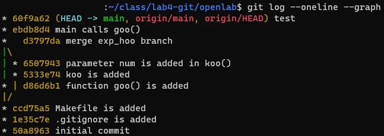

여기서 보면, 좌측에 7글자로 된 hash code가 있는데, 이 hash code를 이용하면 git에서 원하는 시점으로 돌아갈 수 있도록 해준다. (commit을 한 시점마다 번호가 생성된다.)

git을 사용하다보면, 내 소스파일을 만드는 일도 많지만, 남의 소스코드를 들여다보면서 수정해서 쓰는 일도 많다.

---

- 이제 자신의 git repository를 만든다.

여러 명이 repository에 있는 코드를 수정할 수도 있기 때문에, 가장 먼저 기본적인 설정. config를 해주어야 한다. (git config —list 를 통해 현재 설정 확인 가능)

\$ git config —global user.name “user”

\$ git config —global user.email user@example.com

\$ git config —global core.editor nano // 기본 editor 설정

\$ git init : 사실 코드를 만들다가 중간에 해도 된다.

먼저, 기존에 하던 코드를 한 번 만들어 놓고 해보자.

\$ git init : git file이 숨김 파일로 생성된다.

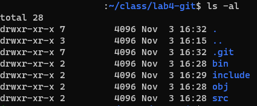

또, 우리가 자주 사용하게 되는 명령어는 \$ git status 가 있다.

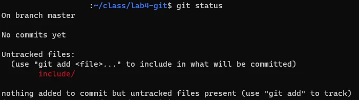

이제, 기록을 남기려면 기본 세 개의 과정을 거쳐야 한다.

1. git directory(repository)
2. staging area
3. working directory(우리가 보는 소스 코드는 모두 이 곳에 존재한다.)

항상 중간에 staging area라는 곳에 source code를 집어 넣었다가 commit이라는 것을 통해서 완전히 기록을 하게 된다. 지금 상태는, staging area에도 아무 것도 없고 commit 된 것도 없으므로 staging을 먼저 해주자.

```shell
git add .
git add include/
git add include/funcs.h

# 다양한 방법으로 staging 가능
```

- funcs.h가 staging area에 존재하는 모습

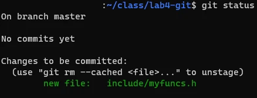

\$ git rm —cached &lt;file&gt; 을 하면, staging area에서 제거 가능.

\$ git commit -m “Initial Commit” // 첫 commit

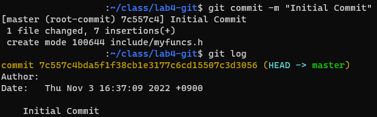

> commit할 때는 항상 comment를 조금이라도 남겨놔야 찾기가 쉽다.
>
> 그리고, 논리적으로 의미가 있는 작업을 한 뒤라면 commit을 가해주는 것이 좋다.

```c
// myfuncs.c

#include "myfuncs.h"
#include <stdio.h>

void foo(void) {

	printf("hello foo\n");
}
```

- c file을 만든 후, staging→commit

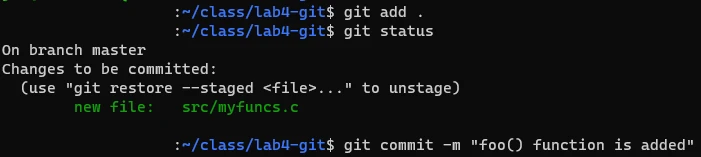

> goo() function을 만들어서 staging→commit 한다.

```c
// myfuncs.c

#include "myfuncs.h"
#include <stdio.h>

void foo(void) {

	printf("hello foo\n");
}

void goo(void) {

	printf("hello goo\n");
}
```

\$ git add src/myfuncs.c

\$ git status

\$ git commit -m “goo() function added”

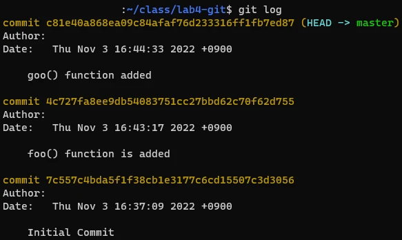

---

이제, 동작을 확인해보아야 하니까 main을 만들자.

```shell
gcc -c src/myfuncs.c -o obj/myfuncs.o -I./include
# object file 생성

gcc -c src/myapp.c -o obj/myapp.o -Iinclude/
# object file 생성

# -----------------------------------------------------------

# Link
gcc -o bin/myapp.o src/myapp.c src/myfuncs.c -Iinclude/
```

- 이제 무언가 기능이 추가되었으니, 기록을 남기고 싶다.

\$ git add .

→ staging은 되는데, 문제가 발생한다. 무엇이 문제일까?

> myapp.o, myfuncs.o, myapp은 우리가 육안으로 무엇이 바뀌었는지 구별이 불가능한 파일들이다. 따라서, 굳이 commit할 필요가 없고 myapp.c만 commit해주는 것이 옳다.

```shell
git add src/
# myfuncs.c는 굳이 바뀐 것이 없으니 add 하지않고, myapp.c만 추가한다.

git commit -m "executing file myapp made"
```

그런데, \$ git status를 입력하면, 계속해서 obj/ bin/ directory가 남아있는 것을 확인할 수 있다. 이 것을 무시하기 위해서 다음처럼 파일을 만들어준다.

```shell
nano .gitignore

# ------------- #

bin/ # directory라고 표시하기 위해 뒤에 /를 붙여준다.
obj/
*.o
```

\$ git commit -m “.gitignore is added”

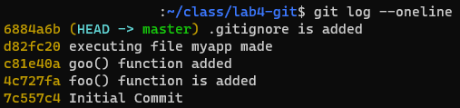

많은 작업을 수행하지는 않았지만, 이렇게 작업 기록이 많이 남게 되었다. 이런 식으로 기록을 계속해서 남겨주어야 개발자간의 소통이 지속적으로 이루어질 수 있다.

> executing file myapp made → main() is implemented

---

- branch

    뭔가 소스를 개발해오다가, 현재 소스를 놔두고 다른 일을 좀 해보고 싶을 때, 실험적으로 조금 바꿔보고 싶은데 기존 소스는 그대로 두고 싶다면 branch를 만들어서 새로운 코드를 실험해서 제대로 되면 원래 코드에 합친다던지, 그런 기능을 해보고 싶다. 그런데, 그 전에 먼저 checkout을 해본다.

개발을 하다보면, 특정 시점으로 돌아가서 확인해보고 싶을 때가 있다.

\$ git log —oneline

\$ git checkout xxxxxxx // 구별이 되면, 굳이 7자리를 적어주지 않아도 된다.

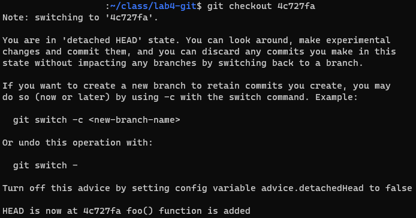

\$ tree

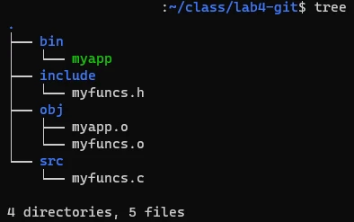

\$ git log

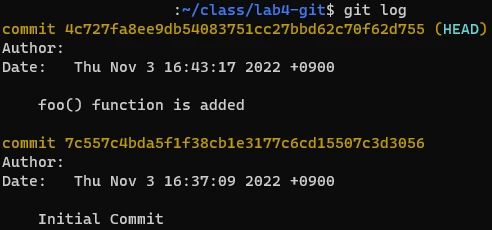

> 이전에 작업했던 것들이 사라졌다! 하지만, 진짜 사라진 것은 아니고 추후에 돌아갈 수 있다. 또한, 우리가 돌아온 이 시점에서 수정을 가해줘도 된다. 이를 확인하기 위해 myfuncs.c에 zoo() function을 만들어보자.

- zoo()를 commit 했다.

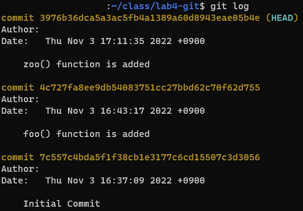

그런데, 다시 이전에 작업했던 시점으로 돌아갈 수도 있다.

\$ git checkout master

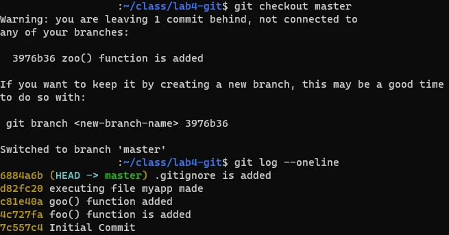

내용을 살펴보면, zoo()는 사라진 것을 확인할 수 있다. 그런데 설명을 보면 zoo()를 살리고 싶으면 branch를 만들라는 내용이 있다. 이걸 하면 복원할 수 있게 되는데, 그 내용은 사실 .git에 저장되어 있다. 하지만 사람이 본다고 알아볼 수는 없다.

---

- 지금은 branch가 master하나만 존재한다. 우리가 branch를 만들어낼 수도 있다.

\$ git branch 를 입력하면, 현재 branch가 뭐가 존재하는지 알 수 있다. (\*은 current position, checkout을 의미한다.)

> 만약, myexp 라는 branch를 만들고 싶다면, 다음과 같은 방법을 이용한다.
>
> \$ git branch myexp  
> \$ git checkout -b myexp
>
> branch를 이용하면, checkout은 하지 않지만 checkout을 이용하면 \*이 이동하기 때문에 필요에 따라 적절히 사용한다.

- header file에서, foo(), goo() 말고도 다른걸 추가해보자.  
    → header file에 zoo() 선언 추가, myapp.c에 zoo() 호출.

이제 이를, git log —oneline —graph 로 확인하려고 했는데, 그래프 상에서 잘 나타나지 않아서 조금 더 수정을 해본다.

```c
// myapp.c 

#include "myfuncs.h"
#include <stdio.h>

int main(void) {

    foo();
    goo();

    for (int i = 0; i < 3; i++) {

        zoo();
    }

    return 0;
}
```

\$ git log —oneline —graph master myexp

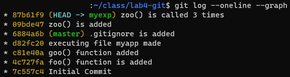

- 일단 master로 다시 checkout 하자.

\$ git checkout master

\$ git branch

여기서, code . 을 통해 확인해보면 이전 branch에서 가한 변경이 다 사라져 있다.

일단, myexp branch는 잊어버리고, 다른 수정을 가해보자.

```c
// myapp.c

#include "myfuncs.h"
#include <stdio.h>

int main(void) {

    for (int i = 0; i < 3; i++) {

        foo();
        goo();
    }

    return 0;
}
```

\$ git add .

\$ git commit -m “foo() & goo() are called 3 times”

\$ git log —oneline —graph master myexp

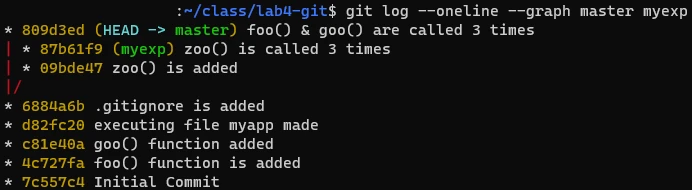

> branch는 어느 정도 master가 정리되면, 정리를 해주어야 한다. branch를 합칠 때는 항상 master에 합치는 것이다. master는 항상 남아있어야 한다.

\$ git merge myexp

> 그런데, merge가 잘 될까? 두 개가 수정한 것이 겹치지 않으면 잘 merge가 되지만, 겹치는 것이 있으면 merge가 안돼서 manual하게 처리를 해주어야 한다. merge가 안되면 merge가 어디서 실패했는지를 표시해준다.

\$ cat src/myapp.c

> 겹치는 것에 대한 판단은 결국 line으로 이루어지기 때문에, line이 겹치면 충돌할 가능성이 있다. 따라서, file별로 쪼개놓는 이유는 서로 충돌을 피할 수 있기 때문이다. 또한, diff는 line 별로 같은지 다른지를 체크하기 때문에 line이 중요하다고 할 수 있다.

---

- branch 지우기

\$ git branch -d myexp

---

\$ git remote -v : 현재 프로젝트가 github, 원격 repository에 연결된 주소

\$ git remote add origin `https://github.com/<계정>/opensw2022_Example_repository.git`

\$ git remote -v

or \$ git remote -vv

\$ git branch -M main

\$ git push -u origin main // credential이 없으므로 실패.

> 그런데, 이렇게 하면 안된다. 왜냐면, 보안상의 이유로 command line 상에서 push하는 것을 막아놨다. 그래서 hash code같은 credential을 외워주는 프로그램이 있는데, 이를 사용한다.
>
> \$ code .
>
> 엄청나게 긴 암호를 외워주는 기능이 있다.

- 터미널 상에서 똑같이 입력하면, commit이 가능하다.  
    → Github login을 하지 않으면 fatal이 발생하여 실패한다.

\$ git push origin main  
→ 현재 내가 수정한 내용을 갖다가 remote repository의 main에 보낸다는 내용.

vsCode에서는 GUI를 통해 commit만 실행하고(local repository), 명령어로  
\$ git push origin main

을 입력하면, commit된 것을 remote repository의 main에 push할 수 있다.

---

만약 다른 사람과 공동으로 개발하고 싶다면, repository setting에서 collaborators로 초대하면 push가 가능해진다. (만약 collaborator에 초대하지 않는다면, clone은 가능하지만, 현재 repository에 push할 수는 없다.)

Github에서 자체적인 edit 기능을 통해 myapp.c에 약간의 수정을 가한 뒤, commit 했다. 그러나 이것은 remote repository에서 수정된 내용이지 나의 local repository에 적용되지 않는다. 이를 가져오기 위해 local repository(vsCode)에서 다음의 명령어를 수행한다.

\$ git pull origin main
